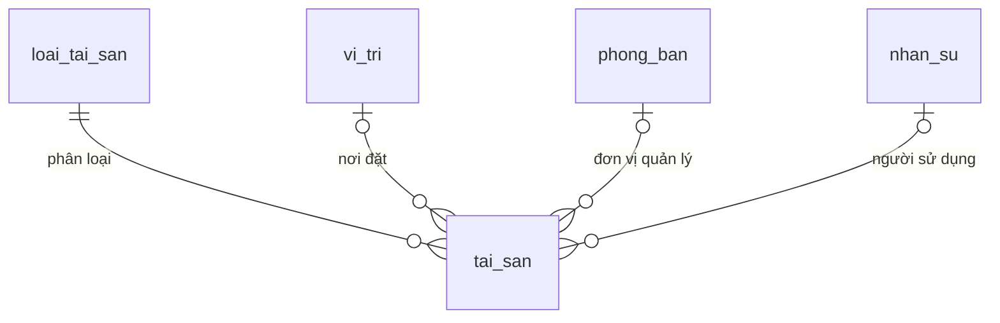
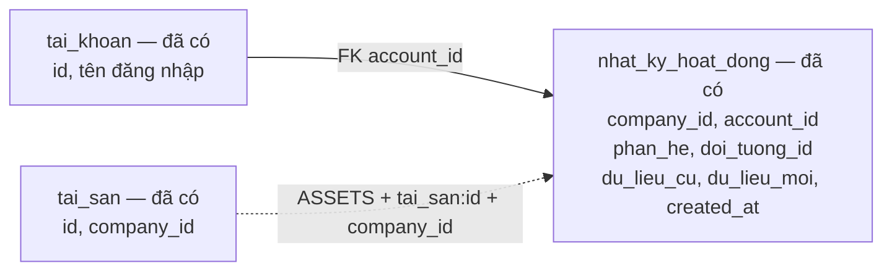

# Thiết kế quản lý tài sản

Cập nhật: **19/11/2026**. Đặc tả hiện hành được tách từ plan để tra cứu khi triển khai; không thay nghiệp vụ hoặc schema. Tiến độ, việc còn lại và bằng chứng kiểm thử nằm tại [Plan tài sản](plans/ASSET-MANAGEMENT-CHECKLIST.md). Rule nghiệp vụ: [ASSET-MANAGEMENT-RULES](../.agents/rules/ASSET-MANAGEMENT-RULES.md).

Đọc theo nhu cầu: [DB](#thiết-kế-db-cần-giữ) · [Tự lưu](#tự-lưu-chỉnh-sửa-tài-sản--16112026) · [Panel/khấu hao](#sửa-trực-tiếp-trong-panel-và-thông-tin-khấu-hao--16112026) · [QR](#liên-kết-hồ-sơ-và-tem-qr--16112026) · [Vị trí/3D](#liên-kết-với-vị-trí-và-3d).

## Thiết kế DB cần giữ

**Phân hệ tài sản sở hữu 2 bảng đã triển khai**: `loai_tai_san`, `tai_san`; tham chiếu `vi_tri` do [phân hệ vị trí dùng chung](plans/LOCATION-MANAGEMENT-CHECKLIST.md) sở hữu. Migration `20261111095809_tai_san_muc_1` chỉ thêm hai bảng này, enum/sequence/ràng buộc và catalog quyền, không tạo lại vị trí hoặc chạy seed. Dùng lại nhân sự, phòng ban, tài khoản, RBAC và nhật ký hiện có. Tên Prisma/PostgreSQL giống nhau theo [rule DB](../.agents/rules/DATABASE-RULES.md).

Hai bảng tài sản có `id`, `company_id`, `created_at`, `updated_at`. Mã unique trong công ty; các FK cùng công ty, Restrict khi đã có tham chiếu. Cột tùy chọn để null khi chưa xác minh, không tạo người/phòng/vị trí giả.

### Sơ đồ bảng và liên kết

**Các liên kết dưới đây đã triển khai.** `||` là đúng một, `o|` là không hoặc một, `o{` là không hoặc nhiều.

Hai bảng tài sản sở hữu là `loai_tai_san`, `tai_san`; ba bảng liên kết còn lại dùng chung. Cây vị trí và vị trí làm việc của nhân sự thuộc phân hệ sở hữu, không nhân bản tại đây.

Để tránh nhiều đường chéo, không vẽ `cong_ty`: mỗi bảng trên thuộc đúng một công ty qua `company_id`. FK nghiệp vụ được ràng buộc cùng công ty bằng cặp `(id, company_id)`; sơ đồ chỉ hiển thị liên kết để dễ đọc. Mã loại/vị trí/tài sản unique theo cặp `(company_id, mã)`, không phải mã duy nhất toàn hệ thống.

**Nhật ký dùng lại, tách khỏi quan hệ người sử dụng:**

Đường nét đứt là liên kết tra cứu lịch sử qua định danh đối tượng, **không phải FK** từ nhật ký đến tài sản. `account_id` hiện nullable để giữ nhật ký khi không còn tài khoản; thao tác tài sản bình thường phải ghi tài khoản từ phiên hợp lệ. Một người có thể dùng nhiều thiết bị mà không có tài khoản đăng nhập; người thao tác cập nhật và người sử dụng thiết bị có thể khác nhau.

### 1. `loai_tai_san` — danh mục loại thiết bị

| Cột nghiệp vụ | Ý nghĩa                                                                    |
| ---------------- | ---------------------------------------------------------------------------- |
| `ma_loai`      | Mã loại, ví dụ LAPTOP, PC, MAY_IN; giữ ổn định                       |
| `ten_loai`     | Tên hiển thị, bắt buộc                                                  |
| `mo_ta`        | Mô tả tùy chọn                                                           |
| `dang_su_dung` | Cho phép chọn khi thêm mới; ngừng dùng không làm mất liên kết cũ |

Chỉ chứa loại thiết bị trong giai đoạn này; không cần cột phân biệt thiết bị/vật tư. Không xây thêm bảng hãng, model hoặc cấu hình trong phạm vi hiện hành.

### Danh mục vị trí dùng lại

`vi_tri` do [plan vị trí](plans/LOCATION-MANAGEMENT-CHECKLIST.md) quản lý thiết kế cột, cây, trạng thái và quyền LOCATIONS. Tài sản chỉ lưu `vi_tri_id` nullable, FK kép cùng công ty, Restrict; chọn vị trí đang dùng và có tổ tiên đang dùng. Trường hợp chưa xác minh để trống.

ASSETS MANAGE được lấy danh mục tối thiểu để chọn, không tự có quyền sửa vị trí. Quản lý loại thiết bị vẫn thuộc tài sản. Preview/action/DB chặn xóa/ngừng dùng vị trí đang được thiết bị tham chiếu, kể cả thiết bị ngừng dùng. Luồng gán vị trí tuân thủ thứ tự khóa chung tại plan vị trí.

### 2. `tai_san` — hồ sơ từng thiết bị

| Cột nghiệp vụ      | Nhãn và yêu cầu                                                                                               |
| --------------------- | ----------------------------------------------------------------------------------------------------------------- |
| `ma_tai_san`        | Mã tài sản tự sinh, ví dụ TS-000001; bất biến, không tái sử dụng                                      |
| `ten_tai_san`       | Tên tài sản — bắt buộc nhập                                                                                |
| `loai_tai_san_id`   | Loại tài sản — bắt buộc chọn từ danh mục                                                                 |
| `tinh_trang`        | Chưa xác nhận / Bình thường / Hỏng / Đang sửa / Ngừng sử dụng; mặc định Chưa xác nhận           |
| `hinh_thuc_su_dung` | Chưa xác định / Cá nhân / Dùng chung / Chưa phân bổ; mặc định Chưa xác định                      |
| `phong_quan_ly_id`  | FK `phong_ban`: đơn vị quản lý thiết bị, tùy chọn                                                      |
| `nguoi_su_dung_id`  | FK `nhan_su`: người được giao thiết bị; bắt buộc khi chọn Cá nhân, các hình thức khác để null |
| `vi_tri_id`         | FK `vi_tri`: vị trí hiện tại, tùy chọn                                                            |
| `so_serial`         | Serial/service tag, tùy chọn; không giả định mọi hãng có serial duy nhất toàn công ty                 |
| `hang_model`        | Hãng/model dạng text, tùy chọn                                                                                |
| `ghi_chu`           | Ghi chú vận hành, tùy chọn; không lưu mật khẩu/secret                                                    |
| Thông tin mua sắm/khấu hao | 4 cột tùy chọn và mặc định ở loại theo [thiết kế bổ sung](#sửa-trực-tiếp-trong-panel-và-thông-tin-khấu-hao--16112026); không tính khấu hao kế toán |

Quy tắc cụ thể:

- Tên và loại cần nhập/chọn; tình trạng/hình thức có giá trị mặc định nhưng vẫn là trường bắt buộc hợp lệ. Form hiển thị dấu sao đúng theo rule frontend. Nhập thêm serial, vị trí và người sau khi xác minh được.
- Mã cấp an toàn bằng sequence/default và ràng buộc bất biến; không dùng số lượng dòng hoặc `MAX + 1`. Đổi loại/phòng/người không đổi mã.
- Phân biệt **đơn vị quản lý**, **người sử dụng**, **vị trí vật lý**. Không tự đồng bộ vị trí hay đơn vị quản lý khi nhân sự chuyển phòng. Chọn mới người sử dụng đang làm việc và cùng công ty; người nghỉ việc đang giữ thiết bị vẫn giữ liên kết để người quản lý xử lý, không tự thu hồi.
- Thiết bị chưa xác định người dùng không mặc định là dùng chung. AP ngoài sảnh có thể chọn Dùng chung, vị trí Sảnh tầng 2, không gắn người.
- Hiện không có cột phòng sử dụng riêng: giao cá nhân thì liên kết người; dùng chung thì ghi vị trí và đơn vị quản lý. Không lấy phòng làm việc hiện tại của người làm bằng chứng bàn giao thiết bị cho cả phòng.
- Không xóa cứng hồ sơ tài sản. Thiết bị ngừng dùng giữ mã/lịch sử, lọc theo Ngừng sử dụng; nhập nhầm ghi rõ lý do. Ngừng sử dụng và chưa phân bổ là hai khái niệm khác nhau.
- Chống ghi đè bằng phiên bản `updated_at` cho cả thiết bị và loại. Mutation khóa hàng công ty → advisory phân quyền `(260126, companyId)` → kiểm tra lại phiên/quyền, phiên bản và tham chiếu → ghi dữ liệu/audit trong cùng transaction. Luồng vị trí, HR, phòng ban và tài sản dùng cùng thứ tự; trigger DB cũng khóa công ty để bảo vệ tham chiếu khi ghi trực tiếp.
- DB dùng enum `TinhTrangTaiSan` (`CHUA_XAC_NHAN`, `BINH_THUONG`, `HONG`, `DANG_SUA`, `NGUNG_SU_DUNG`) và `HinhThucSuDungTaiSan` (`CHUA_XAC_DINH`, `CA_NHAN`, `DUNG_CHUNG`, `CHUA_PHAN_BO`). CHECK bảo đảm Cá nhân khi và chỉ khi có người sử dụng; FK kép cùng công ty cho loại/người/phòng/vị trí. Trigger chặn đổi ID/công ty/mã và xóa cứng thiết bị.
- Chỉ kiểm tra trạng thái người/loại khi tạo hoặc đổi liên kết; giữ người đã nghỉ/loại ngừng dùng khi sửa trường khác. Loại được ngừng dùng dù còn hồ sơ cũ; mã loại nhập chữ hoa, số/gạch dưới, bất biến. Không áp dụng điều kiện loại vị trí làm việc của HR cho thiết bị; thiết bị được chọn mọi loại vị trí đang dùng với tổ tiên đang dùng.

### Lịch sử và bảng dùng lại

- `nhat_ky_hoat_dong`: lưu ai làm, lúc nào, hành động, dữ liệu trước–sau gồm ID và nhãn cần giải thích lịch sử. Phân hệ `ASSETS`, khóa đối tượng có loại kèm ID, ví dụ `tai_san:123`, `loai_tai_san:5`, tránh trùng ID giữa bảng. Thay đổi danh mục vị trí ghi ở `LOCATIONS` theo plan vị trí; đổi nơi đặt thiết bị vẫn ghi ở lịch sử thiết bị. Snapshot nhãn lịch sử không thay FK hiện hành.
- Ghi trực tiếp audit trong transaction; không dùng helper `logActivity` hiện có vốn nuốt lỗi ghi nhật ký. Lỗi audit phải rollback thay đổi thiết bị.
- Lịch sử tại hồ sơ chỉ đọc nhật ký đúng công ty/đúng thiết bị, cho người có ASSETS VIEW; không mở quyền xem toàn bộ nhật ký hệ thống và không trả dữ liệu phân hệ khác.
- `nhan_su`, `phong_ban`: dùng ID có sẵn. `tai_khoan`: người thao tác audit, không phải người sử dụng thiết bị.
- Bảng `quyen`, `vai_tro_quyen`, `tai_khoan_vai_tro`: thêm quyền, giữ nguyên mô hình phân quyền; không tạo role theo loại thiết bị.

## Tự lưu chỉnh sửa tài sản — 16/11/2026

**Đã triển khai và kiểm chứng:** thay Lưu thủ công bằng tự lưu cho bảng, panel (dùng chung 3D), form sửa hồ sơ và sửa loại. Tạo mới hoặc bản nháp AI cần nút xác nhận tạo/lưu; không tự tạo bản ghi từ form nhập dở. Quy tắc này thay hành vi Lưu/Hủy trước đây.

| Tương tác | Hành vi |
| --- | --- |
| Chọn danh mục/enum/checkbox | Tự lưu ngay sau khi chọn; Cá nhân phải chọn đủ người, không lưu trạng thái trung gian sai ràng buộc |
| Chữ/số/ngày | Rời ô, bấm ngoài hoặc Enter để lưu; ghi chú nhiều dòng dùng Ctrl/Cmd+Enter hoặc rời ô |
| Esc / Bỏ thay đổi | Bỏ phần chưa lưu; không hoàn tác lần đã lưu thành công |
| Lưu thành công | Cập nhật phiên bản từ server, danh sách/hồ sơ/lịch sử; báo Đã lưu, không gửi lại dữ liệu không đổi |
| Lỗi hoặc xung đột | Giữ nội dung, hiện lỗi và Thử lưu lại; không tự ghi đè phiên bản mới, không rời hồ sơ khi còn dữ liệu chưa lưu |

Không đổi DB/quyền. Action lưu loại trả thêm bản ghi vừa lưu để dùng đúng phiên bản cho lần tự lưu tiếp theo. Request được chặn trùng, form khóa khi đang gửi; vẫn dùng schema và audit cùng transaction.

## Sửa trực tiếp trong panel và thông tin khấu hao — 16/11/2026

Panel `AssetDetail` được tái sử dụng khi chọn Sửa tài sản từ menu 3D, giữ quyền/action/lịch sử và khấu hao/QR hiện có. Luồng chọn đối tượng và kiểm chứng được quản lý tại [plan 3D](plans/OFFICE-3D-CHECKLIST.md#sửa-hồ-sơ-từ-menu-đối-tượng--16112026).

**Đã triển khai và kiểm chứng:** nhấp vào giá trị trong panel để sửa tại chỗ, không mở dialog sửa toàn bộ hồ sơ. Một mục được sửa mỗi lần, tự lưu theo mục tự lưu; quyền MANAGE mới có thao tác, VIEW chỉ đọc. Mã tự cấp/ID/QR và giá trị tính toán không cho sửa. Lỗi hoặc phiên bản cũ giữ bản nháp; không tự bỏ bản nháp khi đóng panel/chuyển tab/quay lại.

- Sửa tên, loại, tình trạng, hình thức/người sử dụng, phòng quản lý, vị trí, hãng/model, serial và ghi chú. Hình thức/người là một nhóm để giữ ràng buộc Cá nhân; bỏ người phải chọn hình thức khác rõ ràng. Vẫn dùng `saveAsset`, kiểm tra phiên bản/tham chiếu và audit nguyên tử.
- **Mua sắm & khấu hao** là phần tùy chọn, mặc định thu gọn: ngày mua, giá mua (VND), thời gian khấu hao (tháng), ngày hết hạn bảo hành. Hồ sơ cũ để null, không suy từ nguồn hoặc tự điền số liệu.
- Cách tính bản đầu: tính đều từ ngày mua tới ngày kết thúc sau số tháng đã nhập; cuối tháng được chặn về ngày cuối tháng đích, tính theo ngày lịch tại Việt Nam. Phần còn lại = số ngày còn / số ngày toàn kỳ, giới hạn 0–100%; xanh khi >50%, vàng khi >20%, đỏ khi ≤20%. Thanh mỏng dưới tên từng tài sản chỉ hiện khi có ngày mua và số tháng; giá tùy chọn dùng để tính giá trị còn lại tham khảo (VND, làm tròn đồng), không phải tình trạng vật lý hoặc sổ khấu hao kế toán.
- Theo phản hồi bổ sung, loại có thời gian khấu hao mặc định tùy chọn; lựa chọn nhanh 3/5/7 năm hoặc nhập tháng. Không tự phân loại hay áp mức cho PC/laptop cũ. Tài sản có nút áp dụng mức của loại, vẫn sửa riêng; đổi mức loại không hồi tố hồ sơ. Không suy ngày mua, giá hoặc bảo hành.

Thiết kế bổ sung (không thêm bảng/FK): `tai_san.ngay_mua` DATE?, `gia_mua` DECIMAL(18,0)? không âm, `thoi_gian_khau_hao_thang` INT? trong 1–1200, `han_bao_hanh` DATE? không trước ngày mua nếu cả hai có giá trị. `loai_tai_san.khau_hao_mac_dinh_thang` INT? trong 1–1200. Cột mới để null cho toàn bộ dữ liệu cũ; ngày dùng ISO date-only, tiền truyền bằng chuỗi nguyên để không mất độ chính xác. Payload cũ thiếu thông tin mới phải giữ nguyên giá trị hiện tại; null là xóa giá trị. Không lưu phần trăm/giá trị tính toán vào DB.

## Liên kết hồ sơ và tem QR — 16/11/2026

**Đã triển khai và kiểm chứng:** mở `/assets?asset=<id>` hiển thị panel hiện có; tải lại, chia sẻ và Back/Forward đồng bộ hồ sơ. Trong tab Thông tin, card **Tem QR** thu gọn mặc định; mở để xem QR, mã/tên, tải PNG, in tem hoặc sao chép liên kết. Áp dụng cả hồ sơ cũ và mới, không cần bấm tạo mã.

- QR chứa URL theo ID bất biến, không chứa thông tin nhân sự hay quyền. Đọc hồ sơ vẫn qua `getAsset` và quyền/công ty hiện có; không thêm bảng/cột hoặc lưu ảnh QR vào DB.
- Tạo QR cục bộ bằng `qrcode`, không gọi dịch vụ QR ngoài. Link dùng origin đang truy cập; cảnh báo khi là localhost để tránh in tem dùng trên điện thoại. Tem vận hành cần mở ERP bằng địa chỉ ổn định điện thoại truy cập được trước khi tải/in; không tự cấu hình tên miền.
- Chưa đăng nhập hoặc phiên bị thu hồi: đăng nhập rồi trở về link tài sản. Nếu bắt buộc đổi mật khẩu, đi qua profile trước; chỉ cho phép đích tài sản nội bộ hợp lệ, không nhận URL ngoài.
- In một tem có QR/mã/tên; không thêm in hàng loạt, scanner, kiểm kê hoặc quyền mới.

## Liên kết với vị trí và 3D

Đã triển khai và kiểm chứng ngày 12/11: [plan 3D](plans/OFFICE-3D-CHECKLIST.md#gán-tài-sản-tại-vị-trí-3d) sở hữu giao diện tại HCNS; [plan vị trí](plans/LOCATION-MANAGEMENT-CHECKLIST.md) sở hữu cây `vi_tri`. Nhân sự và thiết bị có FK vị trí riêng, không chuyển thiết bị theo người.

| Quyền | Phạm vi |
| --- | --- |
| LOCATIONS VIEW/MANAGE | Vào viewer và chọn vị trí; không tự xem tài sản |
| Thêm ASSETS VIEW | Đọc danh sách thiết bị và hình đại diện tại điểm liên kết hợp lệ |
| Thêm ASSETS MANAGE | Gán/chuyển/bỏ gán; không sửa cây vị trí hoặc hồ sơ HR |

- `assignAssetLocation` chỉ đổi `tai_san.vi_tri_id` và `updated_at`; dùng ASSETS MANAGE, cùng khóa hàng công ty → advisory `(260126, company_id)` → kiểm tra lại phiên/quyền. Không có schema/migration mới.
- Payload strict gồm thiết bị, vị trí đích nullable, phiên bản đã đọc và xác nhận. Vị trí phải cùng công ty, đang dùng và mọi tổ tiên còn dùng; điểm đặt thiết bị dùng được, không giới hạn theo loại chỗ ngồi HR.
- Thiết bị đã có vị trí phải xác nhận khi chuyển/bỏ gán. Cùng vị trí không tạo trùng hoặc audit thừa. Phiên bản cũ bị từ chối, không tự ghi đè; thay đổi và nhật ký ASSETS `tai_san:id` cùng transaction, trước–sau có đường dẫn vị trí. Lỗi audit rollback toàn bộ.
- Giữ nguyên mã, người sử dụng, phòng quản lý, tình trạng và các trường còn lại. Thiết bị ngừng dùng vẫn có thể ghi nhận/chuyển nơi đặt hoặc bỏ gán, không bị mất lịch sử.
- `getAssetLocationCandidates` chỉ trả trường chọn tối thiểu, 20 hồ sơ/trang; lấy dữ liệu theo công ty phiên, không có HR hoặc ghi chú/serial trong kết quả. `saveAsset` cũng làm mới viewer khi đổi vị trí từ `/assets`.
- Hình PC/máy in trong HCNS nay đại diện hồ sơ đã gán, không dựng từ ghi chú khảo sát. Giới hạn mẫu hình và tương tác thuộc plan 3D.

## Quyền và điểm vào mã nguồn

- ASSETS VIEW đọc danh sách/hồ sơ/lịch sử; MANAGE thêm sửa hồ sơ/loại và chọn dữ liệu người/phòng/vị trí tối thiểu, không cấp toàn quyền HR hoặc LOCATIONS. Scope hiện tại toàn công ty; phòng quản lý không tự trở thành scope.
- Catalog/seed cài mới/ma trận `/roles` dùng cùng chính sách; không chạy lại seed hoặc tự cấp quyền vận hành. Payload role cũ thiếu ASSETS giữ nguyên grant này.
- Server Actions tại `src/actions/asset.ts`, schema strict tại `src/lib/validations/asset.ts`. `getAssets` phân trang 20 và đếm cùng bộ lọc; `getAssetOverview` đếm toàn bộ nhóm theo quyền/công ty, không đếm từ một trang kết quả.
- `getAssetFilterOptions`, `getAssetCategories`, `getAsset`, `getAssetHistory` (50 sự kiện mới nhất đúng thiết bị), `getAssetAssignmentOptions`, `saveAssetCategory`, `saveAsset`; `getLocationOptions` dùng lại phân hệ vị trí. Không có action xóa thiết bị hoặc REST song song.
- Bố cục hiện hành do [plan IA](plans/INFORMATION-ARCHITECTURE-CHECKLIST.md) điều phối: ba card hạng mục ở trang chung; bảng và lọc loại nhỏ trong tài sản, nhóm người/vị trí dạng danh sách. Không còn card loại lớn hoặc nút Đổi mở form toàn hồ sơ.

## Nguồn nhập và giới hạn dữ liệu

Mốc 12/11: workbook 92 dòng/11 nhóm, đã nhập 89 hồ sơ và 9 loại, giữ hai hồ sơ thủ công; kết quả lúc đó 91 hồ sơ/11 loại, không phải số đếm hiện tại. Có 98 audit cùng transaction, định danh tác vụ hệ thống và nguồn/hash/mã dòng chống nhập lặp; thử đồng thời, chạy lại và rollback audit đạt. 42 dòng ghép được người ACTIVE theo tên đầy đủ duy nhất; bốn dòng cần xác minh ở checklist plan. Không suy phòng quản lý từ cột phòng hoặc vị trí từ nhân sự; tình trạng nguồn chưa xác nhận.

Nguồn được đọc bằng Python theo chấp thuận, giữ nguyên file gốc; SHA256 `1d394d52d942bafe7ca6327856d4a27e7e033d994d9d4e9e9864af60b2bb0023`. Đã loại thông tin truy cập trong ghi chú SRV01/LB01, không nhập cột mạng. Ảnh BMHC 0501 (90 thiết bị) chỉ tham khảo; [phân tích nguồn](strategy/PHAN-TICH-NHAP-TAI-SAN-VA-VI-TRI-DUNG-CHUNG.md) và [đánh giá 3D cũ](strategy/DANH-GIA-TICH-HOP-TAI-SAN-VA-MO-HINH-3D.md) chỉ giữ bối cảnh, không dùng schema/seed cũ làm chuẩn hiện hành. Danh sách chưa nhập/chưa gán người được quản lý duy nhất tại plan.
