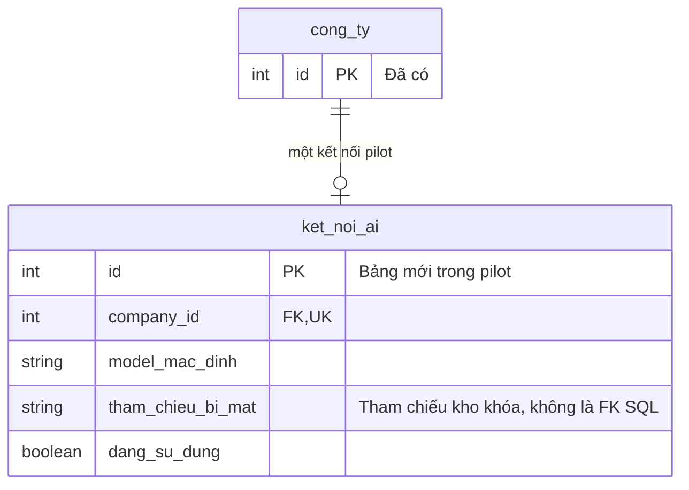

# Thiết kế quản trị AI: kết nối, hạn mức và mức sử dụng

Cập nhật **16/11/2026**. **Đã triển khai quản lý kết nối tại Cài đặt chung → Quản trị AI; quản trị hạn mức/thống kê đầy đủ còn kế hoạch**; tài liệu chi tiết được quản lý bởi [Plan trợ lý AI](plans/AI-ASSISTANT-CHECKLIST.md). Người phụ trách yêu cầu lưu hạn mức bằng một cột trên tài khoản, bỏ bảng hạn mức riêng. Plan sở hữu phạm vi, tiến độ và nghiệm thu; tài liệu này sở hữu cột hạn mức, bảng kết nối và phần quản trị. Không tự thay đổi tài khoản, hạn mức hoặc API key trên OpenAI.

## 1. Mục tiêu và màn hình

### Đề xuất đưa AI vào khu cài đặt hệ thống — 16/11/2026

Người phụ trách đã yêu cầu triển khai phương án này. **Đã có `/settings` và `/settings/ai`, chuyển form key/model khỏi dashboard và thêm quyền `AI MANAGE_CONNECTIONS` tại `/roles`**. Phạm vi/kiểm chứng do [plan cài đặt hệ thống](plans/SYSTEM-SETTINGS-CHECKLIST.md) quản lý; chat pilot giữ ở dashboard.

`/settings` là trang đầu của khu cài đặt dưới **Hệ thống & cấu hình**; hiện có **Quản trị AI**. **Thông tin chung**, **API & tích hợp**, **Thông báo**, **Đăng nhập & bảo mật**, **Dữ liệu & lưu trữ** là các nhóm mở rộng theo nhu cầu. `/settings/ai` thay đường dẫn `/ai-management` từng dự kiến. Từng mục có URL riêng để tải lại/liên kết trực tiếp; mobile dùng bộ chọn mục. Chỉ hiện mục đã triển khai và được cấp quyền, không dựng hàng loạt màn hình trống.

| Nhóm dự kiến | Phạm vi |
| --- | --- |
| Thông tin chung | Thông tin/nhận diện công ty; giá trị mặc định về ngôn ngữ, múi giờ, ngày giờ/tiền tệ khi có nơi sử dụng |
| Quản trị AI | Kết nối, API key và model; hạn mức theo tài khoản; mức sử dụng/chi phí; chính sách AI dùng chung theo plan |
| API & tích hợp | Kết nối các dịch vụ ngoài, trạng thái và kiểm tra kết nối; mỗi tích hợp có phạm vi được triển khai riêng, không tự mở truy cập 1Office |
| Thông báo | Kênh gửi, người gửi, mẫu và sự kiện thông báo dùng chung; tùy chọn nhận cá nhân thuộc profile |
| Đăng nhập & bảo mật | Chính sách phiên/mật khẩu và phương thức đăng nhập khi được triển khai; cấp/gỡ quyền vẫn tại ma trận hiện có |
| Dữ liệu & lưu trữ | Chính sách giữ lịch sử/tệp, tình trạng dung lượng và sao lưu; thao tác khôi phục/xóa cần thiết kế vận hành riêng |

Quản trị AI hiện có **Kết nối & model**; **Hạn mức tài khoản** và **Mức sử dụng** chưa triển khai. Chat ở dashboard; cá nhân hóa và lịch sử riêng giữ theo plan hiện hành. Tái sử dụng `ket_noi_ai` và kho khóa, không tạo một bản cấu hình AI thứ hai trong bảng cài đặt tổng quát.

Phân quyền theo từng nhóm và hành động, không dùng một quyền vào `/settings` để mở tất cả cấu hình. Trang đầu/menu hiện theo hợp các mục được phép; trang con, truy vấn và action kiểm tra quyền tương ứng, cùng công ty. `AI USE`, `AI MANAGE_CONNECTIONS`, `AI MANAGE_LIMITS`, `AI VIEW_USAGE` tiếp tục theo [ma trận quyền AI](#6-quyền-và-audit). Người quản lý kết nối không cần mặc nhiên có quyền quản lý tài sản/vị trí hoặc đọc chat của người khác. Quyền cài đặt chung không tự bao gồm quyền sửa ma trận vai trò.

Cấp quyền vẫn qua `/roles`; có thể đặt liên kết từ khu cài đặt đến đó, không tạo ma trận thứ hai. Đã mở rộng catalog/validation/guard/menu và migration cho quyền kết nối; quyền hạn mức/usage triển khai khi có chức năng tương ứng theo [plan phân quyền](plans/ROLE-MANAGEMENT-CHECKLIST.md#khi-thêm-tính-năng-hoặc-quyền-mới). Không suy đặc quyền từ tên ADMIN. Migration/seed không cấp grant; thao tác chuyển tiếp riêng có audit giữ quyền quản trị kết nối cho đúng tài khoản pilot hiện tại, theo plan cài đặt.

### Các vùng quản trị AI theo thiết kế đầy đủ

Người phụ trách đề xuất quản lý hạn mức từng user, API key, quota/token đã dùng và phần còn lại. Khu `/settings/ai`, nhãn **Quản trị AI**, sẽ mở rộng các vùng sau theo quyền riêng; hiện mới có kết nối/key/model:

| Vùng | Nội dung / thao tác |
| --- | --- |
| Tổng quan | Lượt hỏi và lần gọi API tách biệt; token đầu vào/đầu ra/cache; chi phí ERP ước tính, ngân sách dự phòng, lỗi; lọc kỳ, tài khoản, model, kết nối |
| Hạn mức tài khoản | Chọn người/tài khoản bằng danh mục tối thiểu, sửa một mức ngân sách tháng; 0 chặn gọi trả phí, các giới hạn kỹ thuật dùng cấu hình kết nối chung |
| Kết nối và API key | Tên kết nối/nguồn chịu phí, project, khóa che bớt, trạng thái và lần kiểm tra; thêm/thay khóa, thử kết nối, tạm dừng |
| Đối soát OpenAI | Mức dùng/chi phí nhà cung cấp theo phạm vi được phép, thời điểm cập nhật và trạng thái đồng bộ; liên kết tới trang quản trị chính thức khi chưa đủ khả năng truy vấn |

User thường xem hạn mức và mức sử dụng của chính tài khoản tại vùng chat/profile. Người quản lý xem metadata cần thiết cho vận hành, không tự được đọc nội dung chat hoặc cá nhân hóa của user.

## 2. Phân biệt các loại hạn mức

| Chỉ số | Chủ thể kiểm soát | Cách hiển thị |
| --- | --- | --- |
| Ngân sách được cấp trong ERP | ERP; theo tài khoản và kết nối | Được cấp, đã ghi nhận, đang giữ cho lượt đang gọi/chưa rõ, còn khả dụng, ngày bắt đầu kỳ; token là thống kê sử dụng, chưa có trần token riêng từng user |
| Chi phí/mức sử dụng OpenAI | Nhà cung cấp; theo organization/project/key tùy endpoint/quyền | Dữ liệu đối soát, phạm vi và thời điểm lấy; không coi là số dư trả trước |
| Spend limit của OpenAI | Organization/project OpenAI | Phân biệt cảnh báo và hard limit; bản đầu chỉ đối chiếu nếu được phép, không tự sửa giới hạn ngoài ERP |
| Rate limit | Nhà cung cấp và bộ giới hạn nội bộ | Số request/token theo cửa sổ thời gian, model/phạm vi và mốc reset; không gọi là số tiền còn lại |
| Số dư prepaid/credit | Nguồn thanh toán OpenAI | Chưa xác minh endpoint chính thức đọc số dư trong lần khảo sát; mặc định “Chưa kết nối/Chưa xác định”, dẫn sang Billing |

- API key là credential, không phải ví tiền riêng. Các khóa có thể dùng chung project/organization và chịu giới hạn/nguồn thanh toán chung. Phân bổ theo user ERP dựa vào log nội bộ; `user_id` của nhà cung cấp không tự đồng nhất `account_id` ERP.
- Theo tài liệu chính thức đã kiểm tra, OpenAI có Usage/Costs API với credential quản trị phù hợp và bộ lọc project/key/model tùy endpoint. Không mặc định key gọi model đọc được các API này hoặc có thể xem toàn organization. [Admin APIs](https://developers.openai.com/api/docs/guides/admin-apis), [Usage](https://developers.openai.com/api/reference/resources/admin/subresources/organization/subresources/usage/methods/completions), [Costs](https://developers.openai.com/api/reference/resources/admin/subresources/organization/subresources/usage/methods/costs).
- Tài liệu hiện hành hỗ trợ hard spend limit cho organization/project; spend alert chỉ cảnh báo. Cơ chế chặn phía nhà cung cấp có độ trễ, nên chi phí có thể vượt nhẹ mức cấu hình. ERP vẫn cần hạn mức user riêng. [Spend limits](https://developers.openai.com/api/docs/guides/spend-limits).
- Header `x-ratelimit-remaining-*`/reset nếu có chỉ phản ánh cửa sổ tốc độ tại lần nhận response và có thể chịu tải dùng chung. Không dùng để suy số dư tiền hoặc cam kết còn từng ấy token cho một user. [Rate limits](https://developers.openai.com/api/docs/guides/rate-limits).
- Chưa tìm thấy endpoint số dư không có nghĩa khẳng định nhà cung cấp vĩnh viễn không hỗ trợ. Phải xác minh lại trước khi thêm hiển thị số dư; không gọi endpoint Billing không được tài liệu hóa, dùng cookie trình duyệt hoặc lấy chi phí trừ một số nạp tiền suy đoán.

## 3. Thiết kế DB cần giữ

### Kết nối pilot — 16/11/2026

Đã triển khai theo yêu cầu quản lý API key và model; phần thiết kế đầy đủ phía sau vẫn là lộ trình. Pilot có **một kết nối OpenAI mỗi công ty**, quản lý qua `/settings/ai` bằng `AI MANAGE_CONNECTIONS`, độc lập quyền chat. Chưa có màn hình usage/quota; quyền kết nối đã có tại `/roles`.

| Trường trong `ket_noi_ai` | Quy tắc hiện hành |
| --- | --- |
| `id`, `company_id` | PK tự tăng; FK công ty Restrict; unique `company_id` bảo đảm một kết nối |
| `model_mac_dinh` | Varchar(200), tên model bắt buộc, kiểm tra ký tự; xuất hiện trong Models API không chứng minh hỗ trợ Responses/function calling |
| `tham_chieu_bi_mat`, `hau_to_khoa` | UUID tham chiếu file mã hóa, bốn ký tự cuối để nhận diện; không lưu key hoặc ciphertext vào DB/audit |
| `phien_ban_khoa` | Int >= 1; chỉ tăng khi thay key |
| `dang_su_dung` | Boolean; tạm dừng không xóa khóa hoặc revoke khóa bên OpenAI |
| `created_at`, `updated_at` | Thời gian tạo/sửa; `updated_at` chống ghi đè giữa các tab |

- Khóa nhập là dữ liệu chỉ ghi; tải lại form luôn để trống, để trống khi lưu giữ key cũ. Key mới mã hóa AES-256-GCM với nonce ngẫu nhiên và ràng buộc công ty/tham chiếu; file và khóa mã hóa ngoài `public`/Git, quyền thư mục 0700/file 0600. Kho cục bộ cho môi trường hiện tại; đường dẫn và sao lưu tại Kiến trúc. Khóa mã hóa mất/hỏng thì chặn giải mã, không tự thay khóa làm mất khả năng đọc kho cũ.
- Chuẩn bị file mới trước transaction, khóa công ty/phân quyền, đọc lại quyền và phiên bản, cập nhật metadata cùng audit trong transaction. Không xóa phiên bản khóa cũ đang có thể được request dùng; file chưa gắn do lỗi giữ để dọn khi đã đối chiếu, không xóa khi chưa rõ transaction đã commit.
- Khi chưa có bản ghi, hỗ trợ cấu hình môi trường cũ chỉ trong công ty của tài khoản pilot được bind; sau khi có bản ghi thì dùng bản ghi đó. Tạm dừng hoặc kho bị lỗi phải chặn chat, không quay về key môi trường. Mỗi lượt chat giữ một phiên bản kết nối; cài đặt đổi giữa lượt thì dừng trước lần gọi API kế tiếp.
- Kiểm tra khóa dùng `GET /v1/models`, chỉ trả tên model hợp lệ, không gọi model trả phí hoặc nhận URL nhà cung cấp tùy ý. Có giới hạn lượt kiểm tra; lỗi không ghi đè cấu hình hoạt động. Form mặc định dùng danh sách tìm/chọn, tự tải khi mở bằng khóa đã cấu hình; giữ lựa chọn cũ kể cả không có trong danh sách mới. Khóa nhập mới dùng nút kiểm tra/tải; có thể nhập model thủ công khi key không được phép đọc danh sách. [Models API](https://developers.openai.com/api/reference/typescript/resources/models/methods/list).
- Không tự nhập khóa, chọn model, bật kết nối hay seed dữ liệu thật; bảng mới khởi đầu rỗng. Kiểm thử với khóa/API mô phỏng trên DB và kho file riêng.

### Thiết kế đầy đủ còn kế hoạch

Thiết kế tổng gồm **hai cột mới trên `tai_khoan` và bốn bảng AI mới**: cột cá nhân hóa ở plan, cột hạn mức bên dưới; ba bảng hội thoại/tin nhắn/log ở plan và bảng `ket_noi_ai` tại đây. Không tạo bảng hạn mức riêng. Bảng kết nối có `id Int` tự tăng, `company_id`, `created_at`, `updated_at`, FK/index theo chuẩn dự án; phần mở rộng này chưa có migration, không thay thiết kế kết nối pilot đã chạy ở trên.

### Cột `tai_khoan.han_muc_ai_thang`

| Trường dự kiến | Kiểu / ý nghĩa |
| --- | --- |
| `han_muc_ai_thang` | Decimal(18,6), NOT NULL, mặc định 0, CHECK >= 0; đề xuất ngân sách USD cho một tháng lịch |

- Một tài khoản có một giá trị hạn mức hiện hành. Cách lưu một cột đã được người phụ trách yêu cầu; đơn vị tiền/kỳ tháng tiếp tục là phương án đã đề xuất, cần chốt mức cấp cụ thể trước pilot. Không dùng JSON hoặc một bảng chính sách chỉ để lưu con số này.
- Chỉ quyền `AI MANAGE_LIMITS` được đổi cột này trong phạm vi công ty; user xem nhưng không tự sửa qua profile/cá nhân hóa. Dùng `updated_at` hiện có để kiểm tra xung đột, audit giá trị cũ/mới cùng transaction; không tăng phiên bản đăng nhập chỉ vì đổi hạn mức.
- Mức 0 hoặc thiếu `AI USE` chặn gọi có phí. Migration khi được yêu cầu đặt 0 cho dữ liệu cũ; không tự cấp ngân sách hoặc grant. Model/tốc độ/lượt đồng thời/giới hạn đầu ra dùng cấu hình kết nối chung, không có tùy chỉnh riêng từng user trong bản đầu.
- Mức đã dùng và phần đang giữ lấy từ `nhat_ky_goi_ai` theo công ty/tài khoản/kỳ; mức còn lại tính khi đọc. Không thêm cột “đã dùng”/“còn lại” trên tài khoản hoặc reset/xóa log đầu tháng.
- Đề xuất tháng lịch theo `Asia/Ho_Chi_Minh`; timestamp UTC, ranh giới kỳ tường minh. Đổi khóa/kết nối không cấp lại hạn mức: tổng tài khoản tính trên mọi kết nối trong cùng kỳ. Giảm hạn mức dưới mức đã dùng chặn lần gọi mới; tăng hạn mức không xóa usage cũ.
- Không tự gộp hạn mức theo nhân sự/phòng ban. Nếu một người có nhiều tài khoản thì quản trị phân bổ chủ động; quota tổng theo nhân sự/phòng là mở rộng riêng.

### `ket_noi_ai` — nguồn kết nối và thanh toán

Một bản ghi là một kết nối OpenAI gắn project, có một phiên bản khóa hoạt động. Thay khóa giữ cùng kết nối và lịch sử; đổi project/nguồn thanh toán thì tạo kết nối mới, không viết lại nguồn của các lần gọi cũ.

| Trường dự kiến | Ý nghĩa |
| --- | --- |
| `id`, `company_id` | PK, công ty sở hữu; unique `(id, company_id)` |
| `ten_ket_noi`, `nguon_chiu_phi` | Nhãn nội bộ và mô tả chủ thể chịu phí, không là quyền truy cập |
| `nha_cung_cap`, `ma_to_chuc`, `ma_du_an` | Bản đầu chỉ OpenAI; mã bên ngoài, không phải FK nội bộ |
| `tham_chieu_bi_mat`, `phien_ban_khoa`, `hau_to_khoa` | Tham chiếu phiên bản khóa trong kho bí mật, số phiên bản và hậu tố ngắn để nhận diện; không lưu plaintext |
| `trang_thai` | Chưa thiết lập / hoạt động / tạm dừng; trạng thái kiểm tra độc lập |
| `la_mac_dinh` | Boolean; kết nối dùng chung cho các tài khoản cùng công ty ở bản đầu |
| `model_cho_phep`, `model_mac_dinh` | Danh sách model cho phép và mặc định hợp lệ |
| `han_muc_chi_phi_thang` | Decimal USD, trần nội bộ cho toàn kết nối; 0 chặn gọi trả phí |
| `cau_hinh_gioi_han` | JSONB có phiên bản: giới hạn đầu vào/đầu ra, vòng công cụ, thời gian, tốc độ và đồng thời; phân biệt trần toàn kết nối với mức kỹ thuật chung áp cho mỗi tài khoản, kiểm tra schema/giá trị |
| `kiem_tra_gan_nhat_at`, `trang_thai_kiem_tra`, `ma_loi_gan_nhat` | Metadata kiểm tra; không chứa key/request header hoặc lỗi thô |
| `doi_soat_nha_cung_cap` | JSONB nullable chứa snapshot tổng hợp có giới hạn, phạm vi/kỳ/nguồn/thời điểm/trạng thái; không là sổ chi phí chính |

- Bản đầu chỉ ánh xạ mỗi cặp organization/project OpenAI tới một kết nối và một công ty ERP; unique `(nha_cung_cap, ma_to_chuc, ma_du_an)` để không cộng lặp/né trần bằng cách thêm khóa khác cùng project. Khóa thay mới thuộc cùng kết nối. Muốn chia sẻ project giữa công ty phải có thiết kế đối soát/phạm vi riêng.
- Mã organization/project phải được khai báo rõ và kiểm chứng khi có khả năng; một lần gọi model thành công không tự chứng minh mọi quyền quản trị hoặc nguồn billing đã đúng. Không tự nhận tên model trả về là căn cứ xác minh chủ sở hữu project.
- Partial unique index trên `company_id` khi `la_mac_dinh = true`: tối đa một kết nối mặc định mỗi công ty. Khi chưa có hoặc kết nối mặc định tạm dừng thì chặn gọi, không tự chọn khóa khác. Quản trị đổi mặc định trong transaction; lần gọi đã gửi giữ nguồn cũ trong log.
- Các tài khoản dùng nguồn mặc định của công ty, không có FK kết nối riêng trên tài khoản hoặc bảng phân bổ chỉ để thay bảng hạn mức đã bỏ. Gán kết nối/model/giới hạn kỹ thuật riêng từng user để giai đoạn sau nếu có nhu cầu được yêu cầu rõ.
- Không hard delete kết nối mặc định hoặc đã phát sinh log; dùng tạm dừng. FK từ log dùng cùng công ty và Restrict. Ngân sách kết nối chỉ áp dụng lưu lượng qua ERP, không chặn các ứng dụng khác dùng project đó.

### Mở rộng `nhat_ky_goi_ai` đã đề xuất

Thêm `ket_noi_id` (FK cùng công ty), `phien_ban_khoa`, `ky_han_muc` (Date đầu tháng địa phương) và `cau_hinh_ap_dung` JSONB tối thiểu gồm hạn mức tài khoản/đơn giá/giới hạn kết nối lúc gọi. Tài khoản vẫn được tham chiếu bằng `account_id` đã có; không có FK tới bảng hạn mức. Không lưu secret hoặc toàn prompt trong snapshot. Server ghi đúng nguồn kết nối thực tế; đổi hạn mức hoặc kết nối mặc định sau này không viết lại log cũ.

Log giữ nguồn kết nối thực tế của từng lần thử và cấu hình lúc nhận xử lý trong snapshot. Dùng Restrict cho liên kết tài khoản/kết nối đã có log. Các trường token đầu vào/đầu ra/cache và chi phí dự phòng/ước tính tiếp tục theo plan; cache nằm trong đầu vào, reasoning nếu đã nằm trong tổng đầu ra không cộng thêm lần nữa.

Không thêm bảng tổng hợp chỉ để cộng số dùng trong pilot. Index log theo công ty/tài khoản/kỳ và công ty/kết nối/kỳ. Khi quy mô cần bảng tổng hợp, bổ sung sau khi đo; vẫn phải đối chiếu được với log từng lần gọi.

## 4. Giữ hạn mức và tính phần còn lại

**Còn khả dụng trong ERP = mức cấp − mức đã ghi nhận − phần giữ cho các lần gọi đang xử lý/chưa rõ**, chặn ở 0 khi hiển thị. Dùng Decimal cho tiền; nhãn là ngân sách ERP ước tính, không gọi là số dư OpenAI.

1. Trước mỗi lần gọi, đọc quyền, `tai_khoan.han_muc_ai_thang` và kết nối mặc định hiện hành. Khóa theo cùng thứ tự của hệ thống: công ty → phân quyền → kết nối → tài khoản → hội thoại/log khi cần. Các luồng đổi hạn mức/khóa kết nối dùng cùng thứ tự; đọc và chọn mặc định trong khóa để không đổi nguồn giữa kiểm tra và nhận xử lý.
2. Trong transaction ngắn, cộng mức đã dùng + dự phòng ở cả user và kết nối, kiểm tra model/tốc độ/đồng thời theo cấu hình chung, giữ ngân sách đủ cho giới hạn lần gọi. Tính ngân sách theo cả đầu vào, đầu ra tối đa, reasoning được tính phí và các khoản công cụ đã bật; không đủ thì không gửi request.
3. Gọi API ngoài transaction. Mỗi bước công cụ có thể dẫn đến lần gọi mới và phải kiểm tra/giữ ngân sách mới, kể cả khi vẫn cùng một câu hỏi.
4. Khi có usage, giải phóng phần dự phòng và ghi mức thực tế/ước tính nguyên tử. Timeout chưa rõ giữ dự phòng, đưa vào danh sách cần đối chiếu; không coi là 0, không tự cấp lại số tiền đó vì tab đã đóng.
5. Mỗi lần gọi ghi kỳ tại lúc nhận xử lý; sang tháng không sửa kỳ cũ. Thay khóa hoặc hạn mức giữa lượt chỉ áp cho lần gọi tiếp theo sau khi kiểm tra lại; log lần đang chạy vẫn giữ nguồn/phiên bản ban đầu. Tạm dừng không cam kết thu hồi được chi phí của request đã gửi.

Giới hạn nội bộ chỉ ngăn ERP nhận thêm yêu cầu theo số liệu/giá đã biết. Không hứa hóa đơn tuyệt đối không vượt 1 đồng khi usage/giá chưa xác định, nhiều dịch vụ dùng chung project hoặc chi phí nhà cung cấp cập nhật trễ; mọi chênh lệch phải hiện để xử lý. Cảnh báo ngưỡng và chặn hết hạn mức là hai hành vi khác nhau.

## 5. Quản lý khóa và đối soát

- Ưu tiên project/service account dành cho ứng dụng. Quản trị có thể nhập khóa mới qua form gửi bảo mật tới server; server ghi vào kho bí mật, DB chỉ giữ tham chiếu/hậu tố. Lựa chọn kho bí mật là điểm cần chốt trước triển khai giao diện quản lý khóa. [Hướng dẫn API key](https://developers.openai.com/api/docs/guides/api-keys).
- Không trả khóa đã lưu về trình duyệt, không cho “xem lại”, không ghi vào log/audit/chat/Git. Endpoint nhà cung cấp do ứng dụng cấu hình cố định, không cho nhập URL bất kỳ để nhận credential. Secret tham chiếu phải là định danh được server cấp/kiểm soát.
- Thay khóa theo phiên bản: ghi secret mới, kiểm tra trong phạm vi được phép, đổi tham chiếu nguyên tử kèm audit metadata; lỗi giữ cấu hình đang hoạt động. DB và kho bí mật không có transaction chung, nên có bước xử lý secret chưa được gắn hoặc phiên bản cũ còn được request đang chạy dùng.
- “Tạm dừng kết nối trong ERP” chỉ chặn ERP; không đồng nghĩa revoke khóa trên OpenAI. Cấp/revoke khóa bên nhà cung cấp, nạp tiền và sửa spend limit chưa thuộc chức năng tự động bản đầu; dùng trang quản trị chính thức.
- Nút kiểm tra phải phân biệt kiểm tra xác thực với thử gọi model có thể phát sinh phí. Lần thử có phí cần `AI USE` và hạn mức còn khả dụng của người thao tác, đồng thời kiểm tra trần của kết nối đang thử; dùng cùng cơ chế giữ ngân sách/log. Quyền quản lý kết nối không tạo đường thử vô hạn miễn kiểm soát hoặc tự đổi nguồn chat mặc định.
- Usage/Costs đồng bộ là bước sau khi có credential quản trị phù hợp, tách khỏi khóa gọi model và khỏi ngữ cảnh AI. Chỉ thực hiện đọc; không mặc định lưu Admin key có quyền rộng cho dịch vụ chat. Dịch vụ đối soát giới hạn project của đúng công ty ngay tại server trước khi trả dữ liệu UI/cache.
- Lấy đủ các trang/khoảng thời gian trước khi thay snapshot, ghi thời điểm lấy và phạm vi/kỳ; lỗi giữ bản thành công gần nhất kèm nhãn cũ/lỗi. Không cộng lặp snapshot theo mỗi lần đồng bộ, không gán dữ liệu tổng cả organization cho một user ERP.
- Số liệu nhà cung cấp có thể gồm lưu lượng ngoài ERP và dùng kỳ/múi giờ khác. Hiển thị riêng với log ERP, đối chiếu trên cùng cửa sổ thời gian; không cộng hai nguồn thành tổng chi phí mới. Bản đầu không tự chia đều chênh lệch cho user hoặc sửa hạn mức dựa trên dữ liệu chưa đối chiếu.

## 6. Quyền và audit

| Quyền đề xuất | Phạm vi |
| --- | --- |
| `AI USE` | Chat và xem mức dùng/hạn mức của chính tài khoản |
| `AI VIEW_USAGE` | Xem thống kê metadata các tài khoản/kết nối trong công ty |
| `AI MANAGE_LIMITS` | Sửa `tai_khoan.han_muc_ai_thang`; cần thêm VIEW_USAGE để mở số liệu đối chiếu, không cấp quyền sửa các trường tài khoản khác |
| `AI MANAGE_CONNECTIONS` | Thêm/thay/tạm dừng kết nối, quản lý model/giới hạn kết nối; cần thêm VIEW_USAGE để xem số liệu |

Không suy quyền từ chức danh quản lý; không tự cấp các grant trên. Các grant quản trị không mặc nhiên gồm `AI USE` hoặc quyền đọc nội dung chat. Cấp tại `/roles`; không có nút tự cấp quyền tại màn hình AI. Danh mục tài khoản chọn gán chỉ trả tối thiểu tên/username/trạng thái cùng công ty, không mở hồ sơ HR.

Mọi thay đổi hạn mức/kết nối và audit metadata phải cùng transaction DB; có kiểm tra phiên bản để không ghi đè quản trị khác. Audit ghi trường thay đổi, hạn mức cũ/mới, actor, lý do nếu điều chỉnh ngoại lệ; thay khóa chỉ ghi phiên bản/hậu tố, không secret hoặc giá trị có thể giải mã. Không dùng log chat thay audit quản trị.

## 7. Thứ tự thực hiện và tiêu chí

Tiến độ thực hiện ở [checklist AI](plans/AI-ASSISTANT-CHECKLIST.md#checklist-triển-khai), không duy trì checklist trùng tại đây.

| Đợt | Phạm vi | Điều kiện nghiệm thu |
| --- | --- | --- |
| Quản trị nội bộ cùng pilot chat | Một cột hạn mức trên tài khoản, một bảng kết nối bổ sung, key ở kho bí mật, model/giới hạn kỹ thuật chung, tổng quan từ log ERP | Không lộ secret/nội dung chat; chặn đồng thời đúng; đổi khóa/kỳ/hạn mức không reset usage; giữ log lỗi/timeout |
| Đối soát nhà cung cấp | Usage/Costs với credential được cấp, cache có nguồn/thời điểm và lỗi, link Billing/Limits | Phân trang, project/công ty, múi giờ, không cộng trùng và không giả số dư/token còn lại |
| Mở rộng khi có nhu cầu | Nguồn chi theo phòng, quota theo nhân sự, nhiều nhà cung cấp, tự cấp/revoke key hoặc quản lý giới hạn OpenAI | Có thiết kế/phạm vi riêng; không tự bật theo quyền quản trị nội bộ |

Trước khi triển khai cần chốt nhóm quản trị, nguồn chịu phí/project, kho bí mật, mức cấp và model, cách xử lý khoản chưa rõ, credential đọc đối soát nếu dùng, thời hạn giữ log/audit. Các số ngân sách trên UI mẫu phải được ghi là minh họa; không tự áp dụng cho tài khoản thật.
