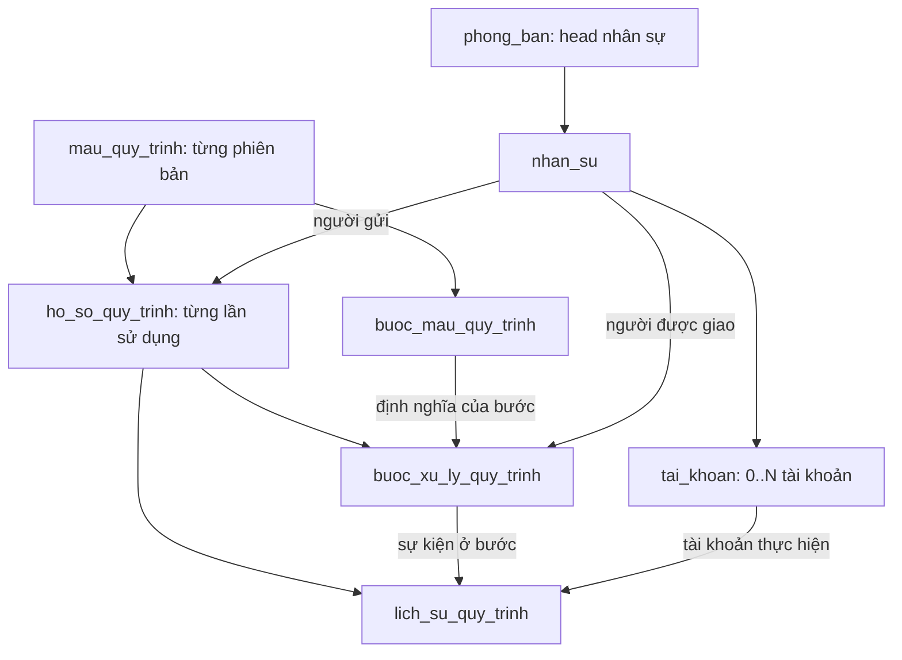

# Thiết kế chi tiết quy trình xử lý công việc

Tiến độ triển khai xem [kế hoạch workflow](plans/WORKFLOW-CHECKLIST.md). Tài liệu này giữ thiết kế bảng/cột và quy tắc xử lý để tra cứu khi lập trình.

Ngày lập: 02/11/2026. **Cập nhật 06/11/2026: đã triển khai bản thử nghiệm 5 bảng, `/workflows` và quyền riêng tại `/roles`; chưa cấu hình pilot thực tế. Đã bổ sung thiết kế cho trình tạo quy trình kéo thả, luồng sử dụng mẫu, thông báo và dashboard; chưa triển khai phần mở rộng này.** Prisma và PostgreSQL dùng chung tên tiếng Việt.

## 1. Mục tiêu và nền tảng tái sử dụng

Có thể xây dựng dần từ dữ liệu hiện có. Dùng lại `cong_ty`, `phong_ban`, `nhan_su`, `tai_khoan` và bốn bảng RBAC. Nhân sự là người chịu trách nhiệm; tài khoản là danh tính đăng nhập thực hiện hành động. Không nhân bản danh sách người hay dùng text chức danh để suy quyền.

Schema đã có 5 bảng quy trình; `phong_ban.nguoi_phu_trach_id` hỗ trợ kiêm nhiệm. Session có danh sách hành động workflow riêng. Chức vụ, người phụ trách phòng và quyền tài khoản vẫn độc lập.

Đã thêm **5 bảng nghiệp vụ**, tổng **14 bảng**, giữ 9 bảng lõi và dữ liệu hiện có. Migration `20261105090000_quy_trinh_thu_nghiem` đã áp dụng sau khi thử trên DB tạm và backup local. Không cần hệ thống workflow bên ngoài, hàng đợi hay thư viện mới. Server Actions dùng Prisma transaction trực tiếp.

## 2. Phạm vi bản đầu

- Mẫu gồm danh sách bước tuần tự, mỗi bước có một người xử lý.
- Hai loại bước: `APPROVAL` (duyệt/từ chối) và `TASK` (thực hiện, xác nhận hoàn tất).
- Hai cách chọn người: `SPECIFIC_EMPLOYEE` (chọn người cụ thể) và `REQUESTER_DEPARTMENT_HEAD` (head phòng người gửi).
- Người dùng chọn mẫu đang phát hành, nhập tiêu đề/nội dung, lưu nháp rồi gửi. Bản đầu không có form động hoặc upload tệp; bổ sung sau khi pilot xác nhận nhu cầu.
- Danh sách “Hồ sơ tôi gửi”, “Việc chờ tôi xử lý”, chi tiết các bước và lịch sử.
- Duyệt → bước tiếp theo; từ chối → kết thúc hồ sơ. Nếu cần sửa để gửi lại, tạo bản nháp mới liên kết hồ sơ cũ; không tái sử dụng các kết quả duyệt trước.
- Chưa có nhánh điều kiện, duyệt song song, biểu quyết, hạn mức tiền, ủy quyền theo thời gian, người theo dõi, gửi email, trình kéo–thả hoặc công việc độc lập ngoài quy trình.
- Không thay thế quy trình đang chạy trên 1Office. Pilot một luồng nội bộ được chọn, không tạo hai nơi phê duyệt chính thức cho cùng hồ sơ.

Ví dụ minh họa (không phải quy trình đã chốt của công ty): nhân viên gửi đề nghị hỗ trợ → head phòng xác nhận → nhân sự IT được chỉ định thực hiện → hoàn tất. Mỗi bước TASK là một việc cần làm trong quy trình; chưa cần bảng Task độc lập ở bản đầu.

### 2.1. Định hướng trình thiết kế quy trình kéo thả

Mẫu quy trình sẽ được thiết kế trên một vùng làm việc trực quan tương tự flowchart trong Visio. Người quản lý kéo hình từ bảng công cụ, nối các hình thành luồng, chọn từng hình để cấu hình người xử lý, trường dữ liệu và kết quả. Thiết kế này là hướng mở rộng sau bản tuần tự hiện tại; chưa đồng nghĩa đã triển khai hoặc được nghiệm thu vận hành.

Phân biệt hai vai trò để tránh lấy sai dữ liệu:

- **Người thiết kế mẫu** tạo và cấu hình sơ đồ quy trình.
- **Người tạo hồ sơ** chọn mẫu đã phát hành và bắt đầu một lần chạy. Các giá trị như họ tên, mã nhân sự, phòng ban hoặc người phụ trách phòng được lấy theo người tạo hồ sơ tại thời điểm gửi.

#### Bộ 8 hình cơ bản

| Hình | Ký hiệu | Mục đích | Nguyên tắc chính |
| --- | --- | --- | --- |
| Bắt đầu | Hình oval | Điểm vào của quy trình | Mỗi mẫu có đúng một điểm bắt đầu; có thể chứa các trường nhập ban đầu và giá trị tự lấy theo người tạo hồ sơ |
| Kết thúc | Hình oval | Kết thúc một nhánh | Có thể có nhiều kết quả như hoàn thành, từ chối hoặc hủy; không có đường đi ra |
| Xử lý | Hình chữ nhật | Một công việc cần thực hiện | Chọn người thực hiện, hướng dẫn, dữ liệu đầu vào và dữ liệu phải tạo ra |
| Phê duyệt | Hình chữ nhật kèm dấu duyệt | Duyệt hoặc từ chối | Về chuẩn flowchart đây vẫn là một bước xử lý; dùng dấu duyệt để người dùng dễ nhận biết, không tạo một quy ước hình học riêng |
| Điều kiện | Hình thoi | Chọn nhánh theo điều kiện | Có ít nhất hai đường ra; mỗi đường có điều kiện rõ ràng và phải có một nhánh mặc định |
| Nhập dữ liệu | Hình bình hành | Hiển thị biểu mẫu để người dùng điền | Chỉ chứa các trường được cấu hình trước; kiểm tra dữ liệu ở máy chủ khi lưu và khi gửi |
| Dữ liệu | Hình trụ | Đọc hoặc ghi dữ liệu hệ thống | Chỉ dùng nguồn dữ liệu được cho phép; không cho nhập câu SQL hoặc mã lệnh tùy ý |
| Điểm nối | Hình tròn nhỏ | Nối các vùng xa trên sơ đồ | Chỉ điều hướng luồng, không giao việc và không lưu dữ liệu nghiệp vụ |

Phê duyệt được tách khỏi xử lý trong bảng công cụ vì hai bước có hành vi và quyền khác nhau, nhưng vẫn giữ hình chữ nhật theo quy ước flowchart. Màu sắc và biểu tượng chỉ hỗ trợ nhận biết, không thay thế ý nghĩa của hình.

#### Cấu hình của một hình

Mỗi hình có tên, mô tả, mã nội bộ không trùng trong mẫu, người chịu trách nhiệm, dữ liệu vào, dữ liệu ra và các đường nối. Tùy loại hình, bảng cấu hình bên phải hiển thị thêm:

- **Xử lý:** người cụ thể, phụ trách phòng của người tạo hồ sơ hoặc quy tắc phân công được cho phép; nội dung cần làm; kết quả bắt buộc.
- **Phê duyệt:** người duyệt, lựa chọn duyệt/từ chối, yêu cầu ghi lý do và nhánh tương ứng với từng kết quả.
- **Điều kiện:** trường dùng để so sánh, toán tử, giá trị so sánh, thứ tự xét và nhánh mặc định. Điều kiện được lưu theo cấu trúc, không lưu JavaScript.
- **Nhập dữ liệu:** danh sách trường, kiểu dữ liệu, bắt buộc hay không, giá trị mặc định và khả năng chỉnh sửa.
- **Dữ liệu:** nguồn đọc, trường nguồn, trường nhận kết quả và chế độ chỉ đọc hoặc cho phép sửa.

Nhóm trường ban đầu gồm văn bản ngắn, văn bản dài, số, ngày/giờ, có/không, lựa chọn một giá trị và tham chiếu nhân sự/phòng ban. Tệp đính kèm chỉ bổ sung sau khi chốt quy tắc lưu trữ và phân quyền.

Giá trị của trường có thể đến từ:

- người dùng nhập trực tiếp;
- hồ sơ nhân sự hoặc phòng ban của người tạo hồ sơ;
- người đang xử lý bước;
- thời gian và công ty từ hệ thống;
- kết quả của hình đã chạy trước đó;
- danh mục dùng chung đã được cấp phép.

Máy chủ phải tự xác định công ty, tài khoản, nhân sự và phòng ban từ phiên đăng nhập cùng dữ liệu đã lưu. Các trường danh tính do hệ thống xác định là chỉ đọc; không nhận mã công ty hoặc mã người dùng do trình duyệt tự gửi lên.

#### Bố cục màn hình thiết kế

- Bên trái: bảng 8 hình để kéo vào vùng làm việc.
- Ở giữa: vùng vẽ có lưới, phóng to/thu nhỏ, kéo khung nhìn và nối các hình.
- Bên phải: cấu hình hình đang chọn, gồm thông tin chung, người xử lý, dữ liệu và điều kiện.
- Phía trên: lưu nháp, kiểm tra sơ đồ, phát hành và thông tin phiên bản.
- Danh sách lỗi hiển thị hình chưa hợp lệ và cho phép đi thẳng đến hình đó.

Việc thiết kế ưu tiên máy tính để bàn. Điện thoại hỗ trợ xem sơ đồ và theo dõi hồ sơ; thao tác kéo thả đầy đủ chỉ xem xét sau khi trải nghiệm trên máy tính ổn định.

#### Kiểm tra trước khi phát hành

1. Có đúng một hình bắt đầu và ít nhất một hình kết thúc.
2. Mọi hình đều đi tới được từ điểm bắt đầu và có đường đến một điểm kết thúc; không có hình hoặc đường nối rời.
3. Hình bắt đầu không có đường vào, hình kết thúc không có đường ra.
4. Hình điều kiện có ít nhất hai nhánh, các điều kiện không trùng và có một nhánh mặc định.
5. Người xử lý, nguồn dữ liệu và trường tham chiếu tồn tại, cùng công ty và đáp ứng quyền cần thiết.
6. Giai đoạn đầu không cho tạo vòng lặp hoặc chạy song song. Mỗi hồ sơ chỉ đi theo một nhánh hoạt động tại một thời điểm.
7. Mẫu đã phát hành là bất biến. Muốn sửa sơ đồ phải sao chép thành phiên bản mới, kiểm tra lại rồi phát hành.

#### Tác động dữ liệu khi triển khai

Danh sách `thu_tu` hiện tại không đủ biểu diễn sơ đồ có nhánh. Khi triển khai cần thiết kế migration riêng, giữ dữ liệu và hành vi của mẫu tuần tự đang có:

- Mở rộng `buoc_mau_quy_trinh` để lưu mã hình, loại hình và tọa độ trên vùng vẽ. Tọa độ chỉ phục vụ hiển thị.
- Thêm bảng liên kết giữa hình nguồn và hình đích, kèm nhãn nhánh, thứ tự xét điều kiện và dấu hiệu nhánh mặc định.
- Thêm bảng trường dữ liệu của mẫu để lưu mã trường, nhãn, kiểu, nguồn giá trị, bắt buộc, chỉ đọc, thứ tự và quy tắc kiểm tra.
- Quy tắc phân quyền, người xử lý và quan hệ giữa các bản ghi vẫn dùng cột và khóa ngoại rõ ràng; không dồn toàn bộ nghiệp vụ vào một cột JSON.
- Lịch sử phải ghi hình đã chạy, dữ liệu vào/ra và tài khoản thực hiện. Một phiên bản mẫu đã phát hành không bị thay đổi bởi lần sửa sau.

Thứ tự triển khai đề xuất: dựng vùng kéo thả và 8 hình → cấu hình trường dữ liệu → kiểm tra và phát hành → chạy một nhánh tuần tự có điều kiện → đánh giá nhu cầu vòng lặp, song song và tệp đính kèm. Việc chọn thư viện giao diện chỉ thực hiện sau khi làm bản mẫu kỹ thuật và kiểm tra khả năng bảo trì.

### 2.2. Hai chức năng dành cho hai nhóm người dùng

#### Quản lý quy trình — dành cho quản trị viên

Người có `WORKFLOW:MANAGE` quản lý danh sách mẫu quy trình và phiên bản. Một mẫu được tạo thủ công trên vùng kéo thả, tương tự chỉnh flowchart trong Visio, gồm:

- tên, mã, mục đích và hướng dẫn sử dụng;
- sơ đồ các bước và đường chuyển;
- biểu mẫu ban đầu và trường cần bổ sung ở từng bước;
- trường bắt buộc, kiểu dữ liệu, giá trị mặc định và nguồn tự điền;
- trách nhiệm của từng bước, quyền cần có và người thực hiện cố định hoặc quy tắc xác định người;
- kết quả duyệt, điều kiện chuyển nhánh và kết quả kết thúc;
- phiên bản nháp, kiểm tra hợp lệ, phát hành và ngừng sử dụng.

Người thực hiện cố định phải là nhân sự cùng công ty, đang làm việc và có tài khoản đủ quyền khi mẫu được phát hành hoặc khi bước được kích hoạt. Chọn một người trong mẫu không tự cấp quyền cho người đó. Mẫu đã phát hành không sửa trực tiếp; thay đổi phải tạo phiên bản mới.

#### Yêu cầu của tôi — dành cho người sử dụng

Người có `WORKFLOW:CREATE` không chỉnh sơ đồ. Họ chọn một mẫu đang phát hành, ví dụ **Xử lý sự cố IT**, mở biểu mẫu đã cấu hình, điền thông tin còn thiếu và gửi. Hệ thống tạo một **hồ sơ quy trình**; trên giao diện có thể dùng tên nghiệp vụ dễ hiểu như **Yêu cầu hỗ trợ** hoặc **Ticket**.

Luồng sử dụng:

1. Người dùng tìm hoặc chọn mẫu được phép sử dụng.
2. Hệ thống tự điền dữ liệu được phép từ tài khoản, hồ sơ nhân sự, phòng ban và công ty.
3. Người dùng bổ sung các trường còn thiếu, lưu nháp hoặc gửi yêu cầu.
4. Khi gửi, hệ thống chốt phiên bản mẫu và dữ liệu nguồn cần lưu lịch sử, sau đó kích hoạt bước đầu tiên.
5. Khi đến một bước, hệ thống xác định và giao việc cho người tương ứng. Chỉ bước đang đến lượt mới cho phép thao tác.
6. Người được giao mở việc từ dashboard hoặc thông báo, bổ sung dữ liệu, duyệt hoặc hoàn tất theo cấu hình.
7. Kết quả của bước quyết định bước tiếp theo. Hồ sơ kết thúc khi đi tới một điểm kết thúc hợp lệ.

#### Thông báo và dashboard cá nhân

Khi một bước chuyển sang trạng thái chờ xử lý, hệ thống phải tạo thông báo trong ứng dụng cho người được giao. Thông báo gồm tên yêu cầu, bước cần làm, người gửi, thời điểm giao và liên kết mở đúng hồ sơ. Đọc thông báo không đồng nghĩa đã xử lý bước.

Thông báo chỉ giúp người dùng biết có việc; bản ghi bước đang mở mới là nguồn xác định “đang đến lượt tôi”. Nút duyệt hoặc hoàn tất chỉ hiện khi tài khoản hiện tại còn đủ quyền, nhân sự còn hoạt động, đúng người được giao và bước vẫn đang chờ. Cơ chế tạo thông báo phải chống tạo trùng khi gửi lại request hoặc kích hoạt bước đồng thời.

Giai đoạn đầu ưu tiên thông báo trong ứng dụng và dashboard. Email, tin nhắn hoặc thông báo đẩy là kênh mở rộng, chỉ thêm sau khi chốt dịch vụ gửi và chính sách dữ liệu.

Dashboard cá nhân ưu tiên theo thứ tự:

1. **Đang đến lượt tôi:** tổng số bước chờ người dùng, tách số cần duyệt và cần thực hiện.
2. **Việc cần làm gần nhất:** danh sách ngắn sắp theo thời điểm giao và hạn xử lý nếu có.
3. **Yêu cầu của tôi:** nháp, đang xử lý, cần bổ sung và kết quả gần đây.
4. **Thông báo chưa đọc:** sự kiện giao bước hoặc thay đổi có liên quan trực tiếp.
5. **Điều phối:** chỉ dành cho `WORKFLOW:MANAGE`, tách khỏi việc cá nhân.

Mỗi chỉ số phải truy vấn từ dữ liệu thật và dùng cùng điều kiện lọc với danh sách mở ra khi người dùng bấm vào. Không hiển thị số mẫu, không dùng thông báo làm quyền truy cập và không tính các bước đã hoàn thành hoặc bị chuyển giao khỏi người dùng.

## 3. Quan hệ tổng thể

Hai bảng bước không trùng dữ liệu: bước mẫu là hướng dẫn chung, bước xử lý là kết quả của một hồ sơ cụ thể. Một mẫu 3 bước dùng cho 10 hồ sơ có 3 bước mẫu và 30 bước xử lý.

## 4. Nền phân công quản lý — đã triển khai 04/11/2026

- [x] Migration cột head, UI chọn/hiển thị người phụ trách, kiểm tra tenant/ACTIVE và kiêm nhiệm đã hoàn thành, kiểm thử đạt. Không tự chọn head cho dữ liệu thực tế. Chưa triển khai giải quyết người duyệt hoặc bảng quy trình.

| Bảng | Trường Prisma = cột PostgreSQL đề xuất | Kiểu | Ý nghĩa |
| --- | --- | --- | --- |
| phong_ban | nguoi_phu_trach_id | Int? FK → nhan_su | Nhân sự phụ trách phòng; có thể để trống khi chưa xác nhận |

- FK kép `(nguoi_phu_trach_id, company_id)` → `nhan_su(id, company_id)`, `onDelete: Restrict`; thêm index cùng cặp. Cho phép một người phụ trách nhiều phòng, không đặt unique trên nguoi_phu_trach_id. Người đó có thể công tác ở phòng khác nhưng phải cùng công ty và được xác nhận phân công.
- Không tự gán từ DEPT_HEAD, chức danh hoặc tên giám sát trong export. Select hiển thị họ tên + mã ERP + phòng công tác để phân biệt người trùng tên.
- Chọn head không tự cấp role/quyền hay tạo tài khoản. Head chưa có tài khoản đủ quyền vẫn lưu được ở cơ cấu; khi dùng làm người xử lý phải báo chưa đủ điều kiện.
- `tai_khoan` giữ nguyên quan hệ với nhan_su; chỉ cần thêm `@@unique([id, company_id])` khi triển khai để làm đích FK cùng công ty cho bảng mới. Đây không phải cột dữ liệu mới.
- Head đã chọn ở `/departments` và hiển thị phòng phụ trách ở `/employees`. Khi người nghỉ việc, giữ liên kết và cảnh báo cần phân công lại. Workflow khi triển khai phải tạm dừng/báo lỗi nếu head không ACTIVE hoặc chưa có tài khoản đủ quyền; không tự bỏ qua bước duyệt.

## 5. Các bảng và cột đề xuất

Quy ước: `?` = nullable; model/field Prisma trùng tên bảng/cột PostgreSQL. Tên bảng và trường nghiệp vụ dùng tiếng Việt không dấu; khóa/trường kỹ thuật phổ biến dùng tên Anh ngắn gọn; FK nghiệp vụ phức tạp dùng tiếng Việt + `_id`. Tất cả 5 bảng có các cột chung sau (không lặp trong từng bảng):

| Trường Prisma = cột PostgreSQL | Kiểu / quy tắc |
| --- | --- |
| id | Int, PK tự tăng |
| company_id | Int, FK cong_ty; lấy từ session |
| created_at | DateTime, mặc định now() |
| updated_at | DateTime, @updatedAt |

### 5.1. mau_quy_trinh

Một dòng là **một phiên bản mẫu**, ví dụ `HTNB` phiên bản 1. Không cần bảng phiên bản thứ sáu ở bản đầu.

| Trường Prisma = cột PostgreSQL | Kiểu | Nội dung |
| --- | --- | --- |
| ma | VarChar(50) | Mã mẫu, ổn định giữa các phiên bản |
| ten | VarChar(255) | Tên hiển thị |
| mo_ta | Text? | Hướng dẫn sử dụng |
| phien_ban | Int | Từ 1, tăng khi sửa mẫu đã phát hành |
| trang_thai | Enum | DRAFT / PUBLISHED / RETIRED |
| tai_khoan_tao_id | Int FK tai_khoan | Người cấu hình mẫu |
| thoi_diem_phat_hanh | DateTime? | Thời điểm phát hành |

Unique `(company_id, ma, phien_ban)`; check phien_ban > 0. Partial unique index `(company_id, ma) WHERE trang_thai = 'PUBLISHED'` bảo đảm mỗi mã chỉ có một phiên bản được dùng để tạo hồ sơ mới. Index `(company_id, trang_thai)`.

Mẫu DRAFT được sửa. Khi phát hành, tên/nội dung/các bước đóng băng; sửa phải sao chép sang phiên bản mới. Phát hành bản mới và chuyển bản cũ RETIRED trong cùng transaction. RETIRED chỉ ngừng nhận hồ sơ mới; hồ sơ đã gửi tiếp tục dùng đúng phiên bản cũ.

### 5.2. buoc_mau_quy_trinh

| Trường Prisma = cột PostgreSQL | Kiểu | Nội dung |
| --- | --- | --- |
| mau_quy_trinh_id | Int FK mau_quy_trinh | Thuộc đúng một phiên bản mẫu |
| thu_tu | Int | Thứ tự 1, 2, 3… |
| ten | VarChar(255) | Ví dụ “Xác nhận đề nghị” |
| huong_dan | Text? | Người xử lý cần làm gì |
| loai_buoc | Enum | APPROVAL / TASK |
| cach_chon_nguoi | Enum | SPECIFIC_EMPLOYEE / REQUESTER_DEPARTMENT_HEAD |
| nguoi_chi_dinh_id | Int? FK nhan_su | Chỉ có giá trị khi chọn người cụ thể |

Unique `(mau_quy_trinh_id, thu_tu)`; check thu_tu > 0. CHECK bắt buộc nguoi_chi_dinh_id có giá trị khi SPECIFIC_EMPLOYEE và null khi chọn head. Phát hành phải có ít nhất một bước, số thứ tự liên tục, không sửa bước của mẫu đã phát hành. Người được chỉ định phải cùng công ty.

Không lưu tên người vào đây để JOIN. Head chưa được ghi thành người cố định trong mẫu; đây là quy tắc xác định người tại thời điểm bước bắt đầu.

### 5.3. ho_so_quy_trinh

Một dòng là một đề nghị/hồ sơ thực tế sử dụng mẫu.

| Trường Prisma = cột PostgreSQL | Kiểu | Nội dung |
| --- | --- | --- |
| ma | VarChar(50) | Mã tự sinh, bất biến, ví dụ QT-000123 |
| mau_quy_trinh_id | Int FK mau_quy_trinh | Khóa vào đúng phiên bản mẫu |
| tieu_de | VarChar(255) | Tiêu đề hồ sơ |
| noi_dung | Text | Nội dung do người gửi nhập |
| nguoi_gui_id | Int FK nhan_su | Người đề nghị, lấy từ tài khoản đang đăng nhập |
| phong_nguoi_gui_id | Int FK phong_ban | Phòng của người gửi, chốt tại lúc gửi |
| tai_khoan_tao_id | Int FK tai_khoan | Tài khoản tạo hồ sơ |
| trang_thai | Enum | DRAFT / IN_PROGRESS / COMPLETED / REJECTED / CANCELLED |
| thoi_diem_gui | DateTime? | Null khi nháp |
| thoi_diem_ket_thuc | DateTime? | Null khi chưa kết thúc |
| ho_so_truoc_id | Int? FK ho_so_quy_trinh | Tùy chọn liên kết hồ sơ bị từ chối, khi lập lại |

Unique `(company_id, ma)`; mã cấp bằng sequence phía DB, không MAX+1. Index `(company_id, nguoi_gui_id, trang_thai)` và `(company_id, trang_thai, created_at)`.

Bản đầu người tạo phải có nhan_su ACTIVE và phòng ban hợp lệ; chưa hỗ trợ tạo thay người khác. Lưu nháp lấy phòng hiện tại; khi gửi kiểm tra và chốt lại phòng. Chuyển phòng nhân sự sau đó không đổi phòng nguồn của hồ sơ. Không sửa tiêu đề/nội dung/mẫu/người gửi sau khi gửi. Nháp đang trỏ mẫu RETIRED phải chuyển sang mẫu còn phát hành trước khi gửi.

Không thêm `currentStepId` để tránh hai nơi xác định bước hiện tại. Đọc từ bước xử lý có trạng thái PENDING hoặc BLOCKED; tối đa một bước như vậy trên mỗi hồ sơ ở bản tuần tự.

### 5.4. buoc_xu_ly_quy_trinh

| Trường Prisma = cột PostgreSQL | Kiểu | Nội dung |
| --- | --- | --- |
| ho_so_quy_trinh_id | Int FK ho_so_quy_trinh | Hồ sơ đang thực hiện |
| mau_quy_trinh_id | Int | Dùng trong FK kép/ba để bảo đảm bước và hồ sơ cùng mẫu |
| buoc_mau_quy_trinh_id | Int FK buoc_mau_quy_trinh | Định nghĩa bước bất biến |
| nguoi_duoc_giao_id | Int? FK nhan_su | Chốt người khi bước bắt đầu; null khi chưa xác định |
| trang_thai | Enum | WAITING / PENDING / BLOCKED / APPROVED / REJECTED / COMPLETED / CANCELLED |
| thoi_diem_bat_dau | DateTime? | Bắt đầu chờ xử lý hoặc bị vướng phân công |
| thoi_diem_ket_thuc | DateTime? | Thời điểm kết thúc bước |
| ly_do_tam_dung | Text? | Ví dụ chưa có head hoặc tài khoản đủ quyền |

Unique `(ho_so_quy_trinh_id, buoc_mau_quy_trinh_id)`; index `(company_id, nguoi_duoc_giao_id, trang_thai)`. Partial unique index trên ho_so_quy_trinh_id khi trang_thai thuộc PENDING/BLOCKED ngăn có hai bước đang xử lý. PENDING phải có nguoi_duoc_giao_id và thoi_diem_bat_dau; WAITING chưa có người/thời điểm bắt đầu.

Không lặp tên, thứ tự, hướng dẫn của bước: đọc qua buoc_mau_quy_trinh_id vì mẫu đã phát hành bất biến. mau_quy_trinh_id ở đây là khóa hỗ trợ ràng buộc, không phải một bản mô tả mẫu thứ hai.

Không đặt `approvedBy` trên bước để đại diện cho mọi hành động. Người thực sự duyệt/từ chối/hoàn tất và lời nhận xét được ghi ở lịch sử. Người được giao có thể khác người tạo hồ sơ; khi có chuyển giao, lịch sử giữ cả người cũ và mới.

### 5.5. lich_su_quy_trinh

| Trường Prisma = cột PostgreSQL | Kiểu | Nội dung |
| --- | --- | --- |
| ho_so_quy_trinh_id | Int FK ho_so_quy_trinh | Hồ sơ của sự kiện |
| buoc_xu_ly_quy_trinh_id | Int? FK buoc_xu_ly_quy_trinh | Null với sự kiện cấp hồ sơ |
| tai_khoan_thao_tac_id | Int? FK tai_khoan | Tài khoản thực hiện; null chỉ cho sự kiện hệ thống |
| nhan_su_thao_tac_id | Int? FK nhan_su | Người gắn tài khoản tại thời điểm hành động |
| ten_nguoi_thao_tac_luc_do | VarChar(255) | Tên lịch sử hoặc nhãn “Hệ thống” |
| hanh_dong | VarChar(50) | DRAFT_CREATED / DRAFT_UPDATED / SUBMITTED / STEP_ASSIGNED / APPROVED / REJECTED / TASK_COMPLETED / REASSIGNED / BLOCKED / CANCELLED / FINISHED |
| y_kien | Text? | Nhận xét; bắt buộc lý do với từ chối/chuyển giao/hủy |
| chi_tiet | Json? | Trạng thái trước/sau, ID người cũ/mới và lý do xác định người |

Index `(ho_so_quy_trinh_id, created_at, id)`. Lịch sử chỉ thêm, không sửa/xóa; updated_at bằng created_at khi tạo và không cập nhật sau đó. Actor lấy từ session server. Bản đầu ghi cả kích hoạt bước/hoàn tất tự động trong transaction của người vừa gửi hoặc xử lý; chưa có tác vụ nền. chi_tiet chỉ chứa dữ liệu lịch sử cần thiết, không dùng JSON làm nguồn FK hoặc cấu hình quyền.

Tên snapshot ở nhật ký là dữ liệu lịch sử có chủ đích, không thay bảng nhân sự. nhan_su_thao_tac_id giữ bằng chứng người thao tác nếu sau này tài khoản được đổi liên kết; tai_khoan_thao_tac_id phân biệt tài khoản thường/admin của cùng người.

nhat_ky_hoat_dong hiện có ghi thao tác quản trị mẫu/head. lich_su_quy_trinh phục vụ timeline nghiệp vụ, không sao chép toàn bộ mỗi sự kiện vào nhat_ky_hoat_dong trừ khi có yêu cầu kiểm toán riêng.

## 6. Ràng buộc liên kết và bảo toàn dữ liệu

- Mỗi bảng mới có unique `(id, company_id)` để làm đích FK cùng công ty. Tham chiếu cong_ty và người/phòng/tài khoản/mẫu phải kiểm tra công ty ở cả server và FK kép.
- `ho_so_quy_trinh` và `buoc_mau_quy_trinh` thêm unique `(id, mau_quy_trinh_id, company_id)`. buoc_xu_ly_quy_trinh dùng FK `(ho_so_quy_trinh_id, mau_quy_trinh_id, company_id)` và `(buoc_mau_quy_trinh_id, mau_quy_trinh_id, company_id)` đến hai bảng này để không ghép một bước mẫu khác vào hồ sơ.
- buoc_xu_ly_quy_trinh thêm unique `(id, ho_so_quy_trinh_id, company_id)`. History dùng FK `(buoc_xu_ly_quy_trinh_id, ho_so_quy_trinh_id, company_id)` để một sự kiện không trỏ sang bước của hồ sơ khác. ho_so_truoc_id cùng công ty, không cho tự trỏ chính mình.
- FK nghiệp vụ dùng `onDelete: Restrict`. Mẫu/người/tài khoản đã được dùng không xóa cứng qua workflow; dùng ngừng phát hành, nghỉ việc hoặc khóa tài khoản. Bản đầu cho phép hủy nháp thay cho xóa, giữ lịch sử đơn giản.
- Quy tắc nhiều hàng (mẫu đã phát hành bất biến, đủ bước, bước phù hợp loại, thứ tự chuyển) kiểm tra trong transaction; ghi rõ phần nào cần trigger khi soạn migration. Partial index/CHECK tạo bằng SQL migration và tài liệu hóa vì không thể hiện hết qua Prisma schema.
- Không thêm khóa/head/role dựa vào suy đoán từ dữ liệu nguồn. Gán người thực tế là bước cấu hình cần xác nhận trước pilot.

## 7. Quyền và người được phân công

Giữ bốn bảng vai_tro/quyen/vai_tro_quyen/tai_khoan_vai_tro. Danh mục WORKFLOW riêng, không tái sử dụng ngầm TASK:APPROVE chưa được thực thi:

| Quyền hiện hành | Phạm vi bản đầu |
| --- | --- |
| WORKFLOW:VIEW | Xem mẫu phát hành và hồ sơ mình gửi/được giao xử lý; không mở toàn công ty |
| WORKFLOW:CREATE | Tạo/sửa nháp và gửi hồ sơ của chính mình |
| WORKFLOW:EXECUTE | Hoàn tất bước TASK đang được giao cho mình |
| WORKFLOW:APPROVE | Duyệt/từ chối bước APPROVAL đang được giao cho mình |
| WORKFLOW:MANAGE | Quản lý mẫu, xem hồ sơ cùng công ty để điều phối, chuyển giao bước chưa kết thúc và hủy hồ sơ có lý do; không thay người khác duyệt |

Phải có VIEW cùng quyền thao tác tương ứng; MANAGE bao gồm VIEW toàn công ty nhưng không bao gồm CREATE/APPROVE/EXECUTE. Server kiểm tra quyền của **tài khoản đang đăng nhập** + nhan_su ACTIVE + đúng người được giao + đúng công ty + đúng trạng thái/bước. Không cộng quyền từ tài khoản khác cùng người; không tự cấp APPROVE khi chọn head hay từ mã ADMIN/IT_ADMIN. Quản trị kỹ thuật không gắn nhan_su có thể cấu hình mẫu nếu được cấp MANAGE, nhưng không gửi/duyệt/thực hiện thay người.

Hộp việc theo nguoi_duoc_giao_id; một người có nhiều tài khoản chỉ thấy/nút xử lý theo quyền từng tài khoản. Bản hiện tại chưa có trung tâm thông báo. Hướng mở rộng ưu tiên thông báo trong ứng dụng khi bước được kích hoạt; email và thông báo đẩy để sau. Người không có tài khoản không thể thực hiện trực tuyến; không tự tạo tài khoản.

Session đã mở rộng `workflowActions`; `/roles` cho chọn từng hành động. `canWorkflow` và server guard kiểm tra quyền chuyên biệt. Không đổi nghĩa quyền HR/account hoặc cấp quyền hàng loạt. Với WORKFLOW, `pham_vi=ALL` không bỏ bộ lọc hồ sơ của VIEW; scope phòng tổng quát chưa triển khai.

Giới hạn bản đầu dựa trên quan hệ người gửi/người được giao, chưa dùng scope DEPARTMENT chung. Chưa cần thay cấu trúc vai_tro_quyen để có bộ máy scope tổng quát. Trang `/roles` đã có ma trận quyền workflow. Pilot thực tế vẫn cần chọn người, cấp quyền và nghiệm thu.

## 8. Luồng chạy và các trường hợp cần xử lý

1. **Cấu hình:** tạo mẫu DRAFT, xếp bước, chọn người hoặc quy tắc head. Phát hành kiểm tra đủ bước, người cụ thể đang làm việc và có ít nhất một tài khoản hoạt động đủ quyền cho bước.
2. **Gửi hồ sơ:** khóa hồ sơ nháp, xác minh chủ sở hữu, mẫu còn phát hành, chốt phòng nguồn. Kiểm tra trước khả năng tìm người cho các bước; nếu thiếu head, quyền/tài khoản hoặc bước APPROVAL tự duyệt thì báo để chỉnh cấu hình, chưa nhận gửi. Tạo các bước WAITING, chuyển hồ sơ IN_PROGRESS, kích hoạt bước đầu và ghi lịch sử trong một transaction.
3. **Kích hoạt bước:** đọc quy tắc của phiên bản mẫu. Người cụ thể lấy nhan_su đã chỉ định; head lấy từ phòng nguồn chốt ở hồ sơ. Chốt nguoi_duoc_giao_id, ghi STEP_ASSIGNED và chuyển PENDING. Việc kiểm tra trước lúc gửi không đóng băng người của bước chưa bắt đầu.
4. **Dữ liệu thay đổi sau khi gửi:** nếu đến bước mà không còn người hợp lệ/tài khoản đủ quyền, bước thành BLOCKED, hồ sơ vẫn IN_PROGRESS. Không bỏ qua bước, tự phê duyệt hoặc tự đẩy lên phòng cha. MANAGE có thể chuyển giao cho người đủ điều kiện cùng công ty, có lý do; dùng cho cả PENDING/BLOCKED. Không tạo màn hình sửa kết quả đã duyệt.
5. **Xử lý:** APPROVAL nhận APPROVED/REJECTED; TASK nhận COMPLETED. Từ chối yêu cầu lý do, hồ sơ REJECTED và các bước còn lại CANCELLED. Duyệt/hoàn tất kích hoạt bước tiếp; hết bước thì hồ sơ COMPLETED. Trạng thái hoàn tất quy trình không tự tạo giao dịch thanh toán/mua hàng.
6. **Tự duyệt:** bản đầu chặn APPROVAL nếu nguoi_duoc_giao_id = nguoi_gui_id, dù đăng nhập tài khoản thứ hai. TASK tự thực hiện được phép. Với head cũng là người gửi, cần cấu hình người cụ thể khác hoặc chuyển giao có ghi nhận; không mặc định bỏ bước.
7. **Đổi head/chuyển phòng:** head mới chỉ ảnh hưởng bước chưa kích hoạt; bước PENDING giữ nguyên người đã giao. Phòng nguồn của hồ sơ không đổi khi nhân sự chuyển phòng. Nếu người đang xử lý nghỉ việc/mất quyền, thao tác bị chặn và cần chuyển giao; UI hiển thị tình trạng vướng từ dữ liệu hiện tại, không cần job nền để phát hiện.
8. **Hủy/lập lại:** chủ hồ sơ được hủy DRAFT; MANAGE có thể hủy hồ sơ IN_PROGRESS có lý do, hủy bước còn mở/chưa chạy. Hồ sơ đã kết thúc không sửa. Hồ sơ REJECTED có thể sao chép thành nháp mới với ho_so_truoc_id, chọn mẫu còn phát hành và duyệt lại từ đầu.

Mọi hành động thay trạng thái khóa hàng công ty → advisory RBAC → hàng hồ sơ, sau đó kiểm tra lại quyền/danh tính từ DB và trạng thái trong transaction. Cập nhật bước + hồ sơ + lịch sử cùng transaction; chỉ một hành động trên bước thắng khi bấm hai lần/hai tài khoản duyệt đồng thời. Không thực hiện gọi dịch vụ bên ngoài trong transaction. Đăng xuất/thu hồi quyền áp dụng ở lần xử lý tiếp theo theo cơ chế phiên hiện có.

## 9. Giao diện đã triển khai

- **Mẫu quy trình:** danh sách mẫu; form tên/mô tả, danh sách bước có nút lên/xuống; select loại bước, cách chọn người, select nhân sự khi cần. Có trạng thái nháp/phát hành/ngừng dùng và phiên bản.
- **Tạo hồ sơ:** chọn mẫu, xem trước các bước/người dự kiến, nhập tiêu đề/nội dung, lưu nháp/gửi. Tên người dự kiến ở bước head có ghi chú có thể đổi trước khi bước bắt đầu.
- **Hồ sơ của tôi / Việc cần xử lý:** tiêu đề, người gửi, bước hiện tại, trạng thái. Chưa thêm bộ lọc phức tạp.
- **Chi tiết:** nội dung đã gửi, các bước và timeline; nút đúng loại bước và quyền. Nếu bị vướng phân công, nêu lý do và đầu mối điều phối.
- Danh sách giới hạn 200 hồ sơ cập nhật gần nhất; người đã xử lý vẫn được xem hồ sơ nếu tài khoản có VIEW; người bị chuyển giao khỏi bước trước khi xử lý không còn quyền đọc từ bước đó. Chưa có phân trang sâu.
- Không mở UI bảng nối RBAC cho người vận hành; phân quyền thao tác nằm trong luồng tài khoản/role.

## 10. Tiêu chí kiểm thử khi triển khai

| Tình huống | Kết quả cần đạt |
| --- | --- |
| Nhân sự có 0 tài khoản | Không tự tạo tài khoản; phát hiện không thể giao bước trực tuyến |
| Một người có 2 tài khoản | Quyền tách theo tài khoản; lịch sử ghi đúng tài khoản và người; không tự duyệt qua tài khoản thứ hai |
| Người có APPROVE nhưng không được giao | Không duyệt được; biết ID không mở quyền đọc hồ sơ |
| Người được giao mất quyền, bị khóa hoặc nghỉ việc | Request tiếp theo bị chặn; điều phối chuyển giao rõ ràng |
| Ghép người/phòng/mẫu/bước/hồ sơ khác công ty hoặc khác mẫu | FK và action từ chối, không ghi một phần |
| Mẫu phát hành bị sửa / hai bản cùng mã phát hành đồng thời | Bản cũ bất biến; chỉ một phiên bản PUBLISHED |
| Sửa head trước/sau khi bước bắt đầu | Bước chưa bắt đầu lấy head mới; bước đã giao không âm thầm đổi người |
| Chuyển phòng người gửi | Hồ sơ đã gửi giữ phòng nguồn đã chốt |
| Head chưa khai báo hoặc mất người xử lý giữa luồng | Báo lỗi trước khi gửi hoặc BLOCKED khi đến bước; không duyệt tự động |
| Duyệt/từ chối/hoàn tất sai loại bước hoặc sai thứ tự | Bị chặn, bước sau chưa được mở |
| Bấm gửi/duyệt hai lần hoặc hai tài khoản cùng người cùng xử lý | Một kết quả được ghi; không nhân đôi bước hoặc lịch sử quyết định |
| Ghi lịch sử lỗi giữa transaction | Hồ sơ và bước rollback, không có kết quả thiếu lịch sử |
| Sửa payload hồ sơ đã gửi | Không được sửa nội dung bên dưới kết quả đã duyệt |
| Từ chối rồi lập lại | Hồ sơ mới liên kết cũ, chạy lại từ đầu; lịch sử cũ giữ nguyên |
| Hủy hồ sơ đang chạy cùng lúc người khác duyệt | Transaction tuần tự hóa, không còn bước mở trên hồ sơ đã hủy |

## 11. Hướng mở rộng sau pilot

- Head của phòng cụ thể/phòng cha: thêm cách chọn và department_id nguồn ở bước mẫu, không suy từ role.
- Nhiều người cùng duyệt: thêm bảng phân công từng người cho một bước và quy tắc một người/tất cả; không nhét danh sách ID vào cột text.
- Tệp đính kèm: bảng tệp liên kết hồ sơ, quyền tải theo hồ sơ; lưu file ngoài DB. Chưa thiết kế nơi lưu trong bản này.
- Form nghiệp vụ có số tiền/chi tiết hàng hóa: thêm cấu trúc theo loại hồ sơ khi có mẫu thực tế; không tạo bảng động tùy ý ngay từ đầu.
- Sửa rồi gửi lại trên cùng hồ sơ, nhánh điều kiện, hạn xử lý/nhắc việc, bàn giao theo lịch: thiết kế thêm phiên xử lý/chính sách sau, không mở rộng enum và đường chuyển trạng thái tùy tiện.
- Công việc độc lập và tích hợp giao dịch tài sản/thanh toán là phạm vi riêng; không tự khôi phục module đang tạm hoãn.
