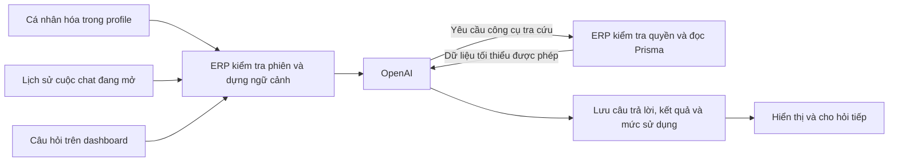
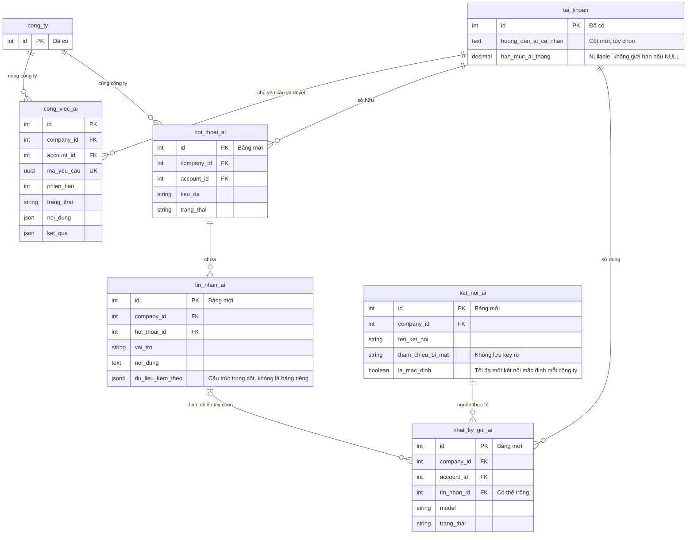
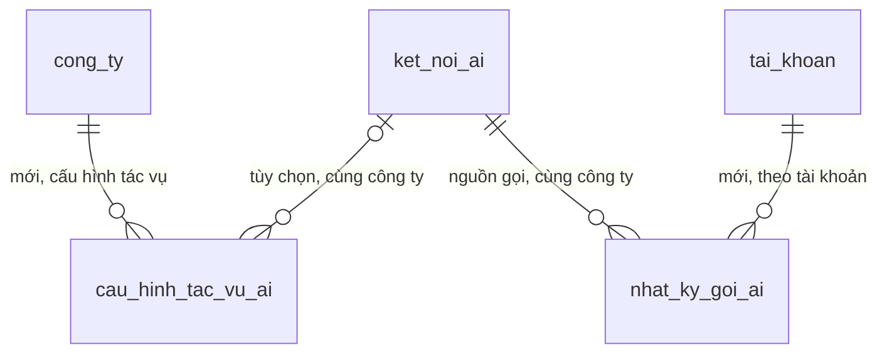

# Trợ lý AI trên dashboard và cá nhân hóa

Cập nhật: **17/11/2026**. Trạng thái: **đã có bản thử, quản lý nhiều key/model, bảng duyệt công việc, lịch sử/bối cảnh chat, cá nhân hóa profile, định tuyến model theo tác vụ và hạn mức/usage nội bộ; chưa nghiệm thu API thật; thiết kế đầy đủ bên dưới chưa triển khai**. Phạm vi bản thử và kết quả tại [Bản thử cho tài khoản quản trị](#bản-thử-cho-tài-khoản-quản-trị--16112026) và [bảng công việc chờ duyệt](#bảng-công-việc-ai-và-duyệt-thực-hiện--16112026).

Rule phân hệ: [AI-ASSISTANT-RULES](../../.agents/rules/AI-ASSISTANT-RULES.md). Plan này sở hữu thiết kế AI; [plan cá nhân](PROFILE-DASHBOARD-CHECKLIST.md), [plan tài sản](ASSET-MANAGEMENT-CHECKLIST.md) và [plan phân quyền](ROLE-MANAGEMENT-CHECKLIST.md) tiếp tục sở hữu nghiệp vụ nền.

Mục lục:

- [A. Tổng quan để duyệt](#a-tổng-quan-để-duyệt)
- [B. Chi tiết triển khai](#b-chi-tiết-triển-khai)
- [Thiết kế DB cần giữ](#thiết-kế-db-cần-giữ)
- [Quản trị AI và hạn mức](#quản-trị-ai-và-hạn-mức)
- [Bối cảnh trong một cuộc chat](#bối-cảnh-trong-một-cuộc-chat)
- [Checklist triển khai](#checklist-triển-khai)
- [Kiểm chứng hiện tại](#kiểm-chứng-hiện-tại)

## A. Tổng quan để duyệt

### Mục tiêu và yêu cầu đã ghi nhận

Ngày 16/11, người phụ trách yêu cầu gắn API vào tài khoản đầy đủ quyền hiện tại để hỗ trợ thêm/sửa hồ sơ và đã chọn phạm vi **tài sản và vị trí**. Đợt này triển khai khung chat cho một tài khoản được cấu hình rõ, AI tra cứu và điền bản nháp; người dùng kiểm tra và lưu bằng form nghiệp vụ ngay trên dashboard. Đã mở rộng bảng duyệt khấu hao mặc định tất cả loại tài sản: xem trước, duyệt một lần, xem kết quả và khôi phục sau reload. Đã triển khai lịch sử/bối cảnh chat và cá nhân hóa profile theo đợt riêng phía dưới; quản trị hạn mức đầy đủ còn kế hoạch.

Người dùng có API OpenAI và muốn khung chat ngay trên dashboard. Kịch bản đầu: người phụ trách IT hỏi **“Tìm thông tin máy in ở phòng HCNS”**, nhận kết quả theo dữ liệu ERP và có thể mở hồ sơ, xem vị trí hoặc hỏi tiếp. Profile có ô bối cảnh/cách trả lời để áp dụng mỗi lượt; lịch sử gắn với người sử dụng.

Đề xuất diễn giải “người sử dụng” thành **tài khoản đăng nhập**: ERP cho phép nhiều tài khoản trên một nhân sự, quyền độc lập. Cài đặt và lịch sử không tự gộp giữa tài khoản cá nhân/quản trị hoặc người cùng phòng.

Nhu cầu bổ sung: người quản lý cần quản lý API key/kết nối, hạn mức từng tài khoản, token/chi phí và phần còn lại. Phạm vi quản trị nội bộ được đưa vào đề xuất pilot; đối soát số liệu OpenAI phụ thuộc credential/quyền phù hợp, không mặc định có số dư trả trước qua API.

Điều chỉnh theo người phụ trách: **hạn mức từng tài khoản chỉ lưu bằng một cột trên `tai_khoan`, không tạo bảng hạn mức riêng**. Mức dùng và phần còn lại lấy/tính từ log API; các giá trị hạn mức cụ thể vẫn chưa cấp cho dữ liệu thật.

Nhu cầu mở rộng mới: [bảng công việc và duyệt thực hiện](#bảng-công-việc-ai-và-duyệt-thực-hiện--16112026). AI liệt kê các đối tượng cùng giá trị trước–sau, người dùng duyệt một lần rồi hệ thống thực hiện và trả bảng kết quả; đã triển khai, kiểm chứng trên DB riêng; dùng thử nghiệp vụ thật sau khi người phụ trách duyệt bảng.

Quản trị API đang mở rộng theo [đợt 17/11](#quản-trị-api-openai-mở-rộng--17112026): hạn mức tùy chọn trên tài khoản, kết nối/model theo tác vụ và sổ sử dụng.

Phân tích mở rộng ngày 17/11: [công cụ kiểm tra và cập nhật nhiều tài sản](#đề-xuất-công-cụ-kiểm-tra-và-cập-nhật-nhiều-tài-sản--17112026), đang là đề xuất, chưa triển khai.

Phân tích UX ngày 17/11: [tự tải model và tự lưu cấu hình tác vụ](#đề-xuất-tự-lưu-cấu-hình-tác-vụ--17112026); đang đề xuất, chờ duyệt chuẩn Frontend.

### Phạm vi bản đầu

| Chức năng | Người dùng thao tác | Kết quả dự kiến |
| --- | --- | --- |
| Cá nhân hóa | Sửa ô “Bối cảnh và cách AI trả lời” tại `/profile` | Áp dụng từ lượt hỏi kế tiếp; để trống dùng mặc định |
| Chat trên dashboard `/` | Tạo cuộc chat, gửi câu hỏi, mở lại lịch sử | Nội dung lưu theo tài khoản; lỗi giữ câu hỏi |
| Tra cứu tài sản | Hỏi bằng tiếng Việt, chọn kết quả, hỏi tiếp | Câu trả lời ngắn, thẻ/danh sách và liên kết hồ sơ thật |
| Liên kết không gian | Chọn “Xem trên 3D” khi được hỗ trợ | Mở vị trí đã ánh xạ và được phép xem |
| Lưu trữ cuộc chat | Đưa cuộc chat khỏi danh sách đang mở, mở lại | Giữ nội dung; không đồng nghĩa xóa dữ liệu |
| Theo dõi API | Hệ thống ghi nhận mỗi lần gọi | Kiểm soát mức sử dụng, lỗi và chi phí ước tính |
| Quản trị kết nối | Người được cấp quyền thêm/thay khóa, chọn model, tạm dừng | Khóa ở kho bí mật, UI chỉ hiện thông tin che bớt; không tự chuyển nguồn chi |
| Hạn mức tài khoản | Người quản lý sửa một mức ngân sách tháng trên tài khoản; user xem phần của mình | Mức đã dùng/dự phòng lấy từ log, còn khả dụng được tính; model/tốc độ dùng cấu hình kết nối chung |
| Đối soát nhà cung cấp | Xem Usage/Costs khi có credential được cấp | Tách số liệu OpenAI khỏi ERP, có thời điểm cập nhật; không giả số dư |

Thiết kế chat đầy đủ bên dưới giữ phạm vi tra cứu; pilot hiện có thêm form tài sản/vị trí và duyệt công việc khấu hao loại như mục B. Hỏi đáp tài liệu, tải tệp, giọng nói, ghi nhớ tự động xuyên cuộc chat, thao tác hàng loạt khác, AI truy cập 1Office và kết nối API riêng từng phòng chưa thuộc phạm vi. Có thể mở màn hình nghiệp vụ sẵn có; thao tác tại màn hình đó theo quyền hiện hành.

### Luồng sử dụng

ERP chủ động đọc cài đặt mỗi lượt. Lịch sử giúp xác định “chiếc thứ hai”; khi hỏi tình trạng/vị trí hiện tại phải tra lại hồ sơ. Mở cuộc chat mới áp dụng cá nhân hóa nhưng không tự lấy nội dung các cuộc chat khác. Lưu chat không phải huấn luyện mô hình. [Bối cảnh trong một cuộc chat](#bối-cảnh-trong-một-cuộc-chat) giữ bộ lọc, danh sách đã hiển thị, đối tượng đang nói tới và cách xử lý đổi chủ đề; dùng JSON của tin nhắn, không thêm bảng.

### Mô hình DB nhìn nhanh

Bản đầy đủ dưới đây còn kế hoạch; DB đang chạy có sáu bảng AI: kết nối, công việc, hội thoại, tin nhắn, cấu hình tác vụ và log API; cá nhân hóa và hạn mức nullable nằm trên tài khoản. Xem [thiết kế kết nối](../THIET-KE-QUAN-TRI-AI.md#kết-nối-pilot--16112026).

**Thiết kế gồm hai cột mới trong `tai_khoan` và năm bảng mới**: cột cá nhân hóa, cột hạn mức; ba bảng hội thoại/tin nhắn/log, `ket_noi_ai` cho quản trị và `cong_viec_ai` cho duyệt thực hiện. Dùng lại tài sản, vị trí, công ty, tài khoản và RBAC; cột hạn mức và bảng kết nối tại [thiết kế quản trị AI](../THIET-KE-QUAN-TRI-AI.md#3-thiết-kế-db-cần-giữ).

`||` = một, `o|` = không hoặc một, `o{` = không hoặc nhiều. Sơ đồ lược bớt trường; tất cả liên kết thuộc công ty phải nhất quán. ID hồ sơ nguồn bên trong JSON là tham chiếu tra cứu, **không phải FK**; không vẽ thành quan hệ SQL. Thiết kế đầy đủ tại [B](#thiết-kế-db-cần-giữ).

### Quyết định và điểm còn mở

| Nội dung | Hướng hiện tại | Trạng thái |
| --- | --- | --- |
| Chat tại dashboard, cá nhân hóa trong profile, lịch sử riêng | Nhu cầu người dùng đã nêu | Đã có chat pilot, cá nhân hóa và lịch sử DB; đã kiểm chứng kỹ thuật |
| Chủ sở hữu là tài khoản | Dùng `account_id`, không gộp theo `employee_id` | Đề xuất theo mô hình ERP |
| Lưu trữ | Hai cột tài khoản + năm bảng; hạn mức nằm trên tài khoản, không có bảng hạn mức | Cách lưu hạn mức đã được người phụ trách yêu cầu; chưa triển khai |
| Cá nhân hóa | Ô text tùy chọn, tối đa 2.000 ký tự | Đề xuất |
| Kết nối và chi phí | Quản trị kết nối/project, hạn mức theo user và kết nối; có thể khởi đầu bằng một nguồn chi | Cần chốt nguồn thanh toán, kho bí mật, model, mức cấp và người quản trị; không tự triển khai kết nối theo phòng |
| Cấu hình dùng chung | Các tài khoản dùng kết nối mặc định của công ty, model/tốc độ theo kết nối; riêng tài khoản có một mức ngân sách | Phương án tinh gọn cho bản đầu; chưa gán kết nối/model/giới hạn kỹ thuật riêng từng user |
| Vị trí quản trị cấu hình | Khu Cài đặt chung `/settings`, mục Quản trị AI `/settings/ai`, quyền quản trị kết nối riêng; cấp tại `/roles` | Đã triển khai theo yêu cầu 16/11; [phương án chi tiết](../THIET-KE-QUAN-TRI-AI.md#đề-xuất-đưa-ai-vào-khu-cài-đặt-hệ-thống--16112026); kiểm chứng tại [plan cài đặt](SYSTEM-SETTINGS-CHECKLIST.md) |
| Đối soát OpenAI | Usage/Costs cần credential quản trị phù hợp; số dư prepaid chưa xác minh endpoint | Chỉ đọc khi được cấp phạm vi; không hứa có số dư/quota thời gian thực |
| Nhóm dùng thử | Một nhóm IT/HCNS được cấp quyền rõ | Chưa có danh sách tài khoản/người nghiệm thu |
| Dữ liệu gửi ra ngoài | Chỉ dữ liệu đã được phép và ẩn danh theo quy định nội bộ | Cần chốt trường dữ liệu, cách ẩn danh và mẫu thử |
| Thời hạn lưu/xóa | Phân biệt lưu trữ, xóa nội dung và giữ metadata chi phí | Cần chốt thời hạn cho chat, log, backup và xử lý yêu cầu xóa |
| Giao diện | Chat trong dashboard, lịch sử thu gọn; giữ vùng việc cá nhân | Chưa có bản giao diện được nghiệm thu |

Các lựa chọn còn mở được giải quyết trong bước thiết kế/pilot tương ứng; không tự dùng dữ liệu thật hoặc gọi API trả phí để mặc định chốt chúng. [Bối cảnh AI theo phòng](../strategy/BOI-CANH-HIEN-TAI-VA-DINH-HUONG-SO-HOA.md#5-bối-cảnh-sử-dụng-ai-theo-phòng-ban) là nguồn về giới hạn dữ liệu và định hướng kết nối trước đây.

### Mốc thực hiện và nghiệm thu

| Mốc | Trạng thái | Điều kiện hoàn thành |
| --- | --- | --- |
| Ghi yêu cầu, thiết kế và định tuyến tài liệu | Đã lập | A/B, DB, rule và liên kết thống nhất |
| Chốt lựa chọn phục vụ pilot | Chưa xong | Nhóm thử, dữ liệu, kết nối/hạn mức và lưu/xóa rõ ràng |
| CSDL, profile và lịch sử | Chưa triển khai | Lưu đúng tài khoản; reload không mất nội dung đã lưu |
| Công cụ tài sản và giao diện kết quả | Có công cụ và form bản nháp trong pilot; phần đầy đủ còn kế hoạch | Tìm đúng hồ sơ/vị trí, không suy dữ liệu thiếu hoặc vượt quyền |
| Quản trị nội bộ | Có nhiều key, model theo tác vụ, hạn mức tùy chọn và usage nội bộ; quyền quản trị độc lập; chưa đối soát OpenAI | Quản lý khóa an toàn, cấp/chặn hạn mức, thống kê và quyền riêng |
| Đối soát nhà cung cấp | Đề xuất bước sau | Có credential/phạm vi đọc, số liệu có nguồn/thời điểm và không lẫn số dư |
| Kiểm thử và dùng thử | Chat 10 tích hợp/3 E2E; quản lý kết nối 8 tích hợp/3 E2E với API mô phỏng đạt; chưa thử API thật | Đạt [ma trận kiểm chứng](#kiểm-chứng-và-pilot) cho phạm vi đầy đủ, người phụ trách xác nhận hữu ích |

## B. Chi tiết triển khai

### Bản thử cho tài khoản quản trị — 16/11/2026

Người phụ trách đã yêu cầu triển khai quản lý API key kèm model ngay trong phần mềm. Đã có **Cài đặt chung → Quản trị AI**: thêm/thay khóa, danh sách model có tìm kiếm và tự tải từ nhà cung cấp, kiểm tra khóa và bật/tạm dừng. Hành vi tải/chọn được kiểm chứng tại [plan cài đặt](SYSTEM-SETTINGS-CHECKLIST.md#danh-sách-model-tự-động--16112026). Thiết kế DB/kho bí mật hiện hành tại [kết nối pilot](../THIET-KE-QUAN-TRI-AI.md#kết-nối-pilot--16112026); đợt kết nối thêm một bảng; hiện đã bổ sung hội thoại/tin nhắn và cá nhân hóa theo mục bên dưới, log usage/hạn mức tùy chọn đã bổ sung theo đợt 17/11.

| Nội dung | Phạm vi đợt này |
| --- | --- |
| Tài khoản | Bind bằng `AI_PILOT_ACCOUNT_ID`; kiểm tra phiên và ACCOUNTS/ROLES MANAGE cùng ASSETS/LOCATIONS MANAGE tại server; không suy quyền từ tên role hoặc mở cho mọi admin |
| Kết nối | Trang `/settings/ai`, quyền `AI MANAGE_CONNECTIONS`: lưu/thay khóa, chọn/nhập model, kiểm tra danh sách model và tạm dừng. Khóa lưu mã hóa phía server; chỉ trả hậu tố. Responses API/function calling đọc cấu hình mỗi lượt; thay đổi có hiệu lực không cần khởi động lại. Env chỉ dự phòng khi chưa có bản ghi và đúng công ty pilot |
| Thêm/sửa | Công cụ AI chỉ tra cứu hoặc chuẩn bị bản nháp; form dùng lại `saveAsset`/`saveLocation`, phiên bản gốc, quyền và audit hiện có. Người dùng xem/sửa rồi bấm Lưu; chưa có công cụ xóa, sửa tài khoản/quyền hoặc SQL tự do |
| Ngữ cảnh | Nội dung cuộc chat đang mở nằm trong bộ nhớ giao diện, không localStorage; giới hạn lịch sử gửi và đọc lại hồ sơ khi chuẩn bị sửa. Reload mất cuộc trao đổi; không coi đây là lịch sử DB của bản đầy đủ |
| Dữ liệu DB | Một bảng `ket_noi_ai` giữ metadata, nhiều kết nối/công ty và một mặc định; tiến độ mở rộng tại [plan cài đặt](SYSTEM-SETTINGS-CHECKLIST.md#nhiều-api-key-openai--16112026). Dùng nhật ký hoạt động cho thay đổi cấu hình, kiểm tra khóa, metadata yêu cầu và usage từng lần API; không lưu prompt/nội dung hồ sơ/key trong log AI. Nhật ký nghiệp vụ do action phân hệ ghi |
| Giới hạn | Một lượt/account, tối đa 10 lượt/5 phút và 100 lượt/24 giờ, tối đa 6 lần API/lượt; giới hạn đầu vào/đầu ra và timeout. Đây là giới hạn thử nghiệm, chưa phải hạn mức tiền theo tháng đã thiết kế |
| Cấp quyền AI dài hạn | Allowlist pilot chỉ dùng trong đợt này; không sửa grant dữ liệu cũ. Khi mở nhiều người dùng, triển khai catalog AI và hạn mức theo thiết kế đầy đủ |

- [x] Đối chiếu mã, quyền, form và hướng dẫn Next.js hiện có; tài khoản `admin` có đủ quyền tài sản/vị trí/tài khoản/role. Đã kiểm tra cấu hình server mà không xuất giá trị khóa; chưa thực hiện cuộc gọi model thật trong kiểm thử.
- [x] Hoàn thiện action/công cụ, chat dashboard và bản nháp dùng form hiện có; `AI_PILOT_ACCOUNT_ID=1` chỉ mở cho tài khoản admin có đủ quyền hiện hành. Không tự thêm hoặc thay giá trị khóa/model môi trường.
- [x] 10 kiểm thử tích hợp trên DB khôi phục riêng đạt: bind/phiên/quyền/cấu hình, bản nháp không ghi tự động, lưu bằng action nghiệp vụ, giữ trường khi sửa, phiên bản cũ, vị trí con/phạm vi công ty, gửi trùng/đồng thời, thu hồi quyền giữa lượt, lỗi API và log không chứa nội dung/key; giới hạn ngữ cảnh/vòng công cụ/lượt 5 phút/24 giờ và timeout ghi chi phí chưa rõ.
- [x] 3 E2E Chrome trên app/DB riêng với API mô phỏng đạt: chỉ account được bind thấy chat, tạo/sửa tài sản/vị trí qua form, sửa tên giữ serial/giá mua, xung đột giữ bản nháp, mobile sáng/tối không tràn, reload xóa chat đúng mô tả. Đã xem ảnh; chat đặt trong cột chính dashboard để đủ chỗ đọc và soạn hồ sơ.
- [x] TypeScript, lint các file thay đổi, khoảng trắng và 171 liên kết/anchor cục bộ trong 6 tài liệu đạt. Trong kiểm chứng chat ban đầu, dấu vân tay 18 bảng vận hành không đổi; không thêm dependency hoặc sửa ba rule kỹ thuật chung. Bằng chứng chat tại `outputs/ai-pilot/`; migration kết nối được kiểm chứng riêng phía dưới.
- [x] Hoàn thiện cài đặt key/model, kho AES-256-GCM, quyền/phiên bản/audit và chat đọc cấu hình mới. Migration `20261116110000_ket_noi_ai` đã áp dụng sau backup và khôi phục thử; trên DB khôi phục, 18 bảng cũ không đổi và schema diff rỗng. DB local có 19 bảng; chưa lưu khóa/kết nối thật. Các cập nhật vị trí/nhân sự/audit diễn ra đồng thời tại local được giữ nguyên.
- [x] 8 kiểm thử tích hợp quản lý key/model đạt trên DB riêng và API mô phỏng: quyền, lưu mã hóa, đổi model giữ khóa, thay khóa, xung đột/đồng thời, tạm dừng không fallback, đổi cấu hình giữa lượt, tải model/lỗi API, kho bí mật lỗi, audit rollback và giới hạn kiểm tra. TypeScript/lint đạt.
- [x] 3 E2E Chrome quản lý kết nối đạt: tài khoản đủ quyền, thiếu key, tải/chọn model, lưu và dùng ngay, đổi model giữ khóa, thay khóa, tạm dừng/bật lại, kiểm tra lỗi giữ cấu hình, mobile sáng/tối. Đã xem ảnh. 10 kiểm thử tích hợp chat hồi quy đạt; TypeScript/lint, schema diff, 182 liên kết/anchor trong 7 tài liệu và `git diff --check` đạt. Rule/kiến trúc/từ điển DB đã đồng bộ; bằng chứng tại `outputs/ai-settings/`.
- [x] Đã khởi động lại dev để nạp Prisma Client; mở Cài đặt AI bằng tài khoản admin tại local đạt, không lỗi JavaScript, ô khóa để trống. Môi trường hiện có key/model và được giữ nguyên; chưa lưu kết nối vào DB hoặc gọi nhà cung cấp thật. Đã dừng app thử và dọn đúng DB tạm; backup/log/ảnh giữ cục bộ.
- [ ] Người phụ trách kiểm tra/chọn model và lưu qua Cài đặt AI; kiểm chứng kết nối thật với cấu hình được chọn. Không đánh dấu tích hợp thật thành công khi chỉ có kiểm thử mô phỏng.
- [x] Đối chiếu `/settings` hiện là trang chờ, menu dùng SYSTEM nhưng catalog ma trận chưa có nhóm này; cấu hình AI còn dùng guard pilot. Ghi [đề xuất khu cài đặt hệ thống](../THIET-KE-QUAN-TRI-AI.md#đề-xuất-đưa-ai-vào-khu-cài-đặt-hệ-thống--16112026): mục AI riêng, các nhóm cấu hình và quyền theo chức năng. 186 liên kết/anchor và `git diff --check` đạt. Lượt phân tích này chỉ cập nhật tài liệu; chưa đổi mã, DB hoặc grant, không chạy lại kiểm thử ứng dụng.
- [x] Theo yêu cầu triển khai tiếp theo, đã chuyển key/model sang `/settings/ai`, tích hợp quyền quản trị kết nối độc lập tại `/roles`, giữ chat và cấu hình/khóa. Thiết kế/nghiệm thu/chuyển quyền pilot tại [plan cài đặt](SYSTEM-SETTINGS-CHECKLIST.md); hạn mức/usage còn kế hoạch.

### Bảng công việc AI và duyệt thực hiện — 16/11/2026

**Đã triển khai và áp dụng migration local theo yêu cầu “thực hiện đi”.** Người phụ trách yêu cầu AI trình bày rõ công việc dự tính và kết quả trong chat, chỉ thực hiện sau khi được duyệt. Yêu cầu này thay phương án trước đó cho phép ghi ngay khi câu lệnh đủ rõ. Bản đầu tập trung đặt khấu hao mặc định của các loại tài sản về 60 tháng (5 năm); bảng dùng dữ liệu thật từ ERP.

| Giai đoạn | Nội dung trên thẻ công việc | Thao tác |
| --- | --- | --- |
| Chờ duyệt | Mục tiêu, phạm vi công ty, tổng số loại, số cần đổi/đã đúng, bảng từng loại và mức hiện tại → dự kiến | Duyệt và thực hiện / Điều chỉnh yêu cầu / Hủy |
| Đang thực hiện | Trạng thái xử lý của toàn kế hoạch; không hiển thị tiến độ giả từng dòng khi transaction chưa commit | Chặn duyệt lặp; không hứa hủy được sau khi đã bắt đầu commit |
| Hoàn tất | Cùng bảng chuyển sang kết quả thực: Đã cập nhật / Giữ nguyên; tổng số, thời gian thực hiện và liên kết phù hợp | Xem kết quả/lịch sử |
| Dữ liệu đã đổi | Chỉ rõ kế hoạch không còn khớp dữ liệu; chưa ghi gì | Làm mới bảng và duyệt lại |
| Thất bại / đã hủy | Lý do và phạm vi đã ghi thực tế; batch nguyên tử lỗi thì toàn bộ chưa cập nhật | Tải trạng thái / lập lại kế hoạch khi cần |

- Thẻ nằm trong khu vực Công việc AI của khung chat, có mã yêu cầu nguồn lưu phía server, có thể mở rộng để đọc danh sách dài; mobile chuyển hàng thành thẻ hoặc cuộn trong bảng, không tràn cả trang. Không cần mở từng hồ sơ để lưu. Điều chỉnh yêu cầu hủy bảng cũ rồi lập công việc mới; làm mới dữ liệu tăng phiên bản, vô hiệu nút duyệt cũ. Cho phép trao đổi để sửa kế hoạch thay vì khóa ô chat vì đang chờ duyệt.
- Công cụ AI lập đề xuất có cấu trúc; server tra dữ liệu hiện hành, dựng danh sách ID/phiên bản và giá trị trước–sau. Giao diện render component bảng từ dữ liệu này, không coi bảng Markdown do model tự viết là lệnh được phép thực thi.
- **Kịch bản 5 năm:** lấy toàn bộ loại trong phạm vi đã xác định, gồm trạng thái đang dùng/ngừng dùng để người duyệt thấy rõ; không lấy riêng 50 dòng lookup đầu. Chỉ cập nhật `loai_tai_san.khau_hao_mac_dinh_thang = 60`; loại đã 60 hiển thị Giữ nguyên. Không hồi tố `tai_san.thoi_gian_khau_hao_thang`, theo [plan tài sản](ASSET-MANAGEMENT-CHECKLIST.md#sửa-trực-tiếp-trong-panel-và-thông-tin-khấu-hao--16112026). Nếu không có dòng cần đổi, trả kết quả không cần cập nhật và không có nút thực thi.
- Duyệt bằng nút gắn đúng mã/phiên bản kế hoạch; máy chủ nhận mã, đọc nội dung đã lưu, kiểm tra người sở hữu/công ty/quyền ASSETS MANAGE và phiên bản từng loại trong khóa trước khi ghi. Không nhận tập thay đổi tùy ý từ nút/client hoặc để model tự duyệt. Chỉ ghi đúng tập đã trình bày; nếu yêu cầu “tất cả” mà danh mục thêm/bớt/đổi sau khi lập thì báo cần làm mới và duyệt lại, không mở rộng âm thầm.
- Thực hiện cả batch và audit trước–sau trong cùng transaction. Nút duyệt gọi action thực thi nội bộ, không cần gọi lại model để quyết định nội dung đã duyệt. Kết quả giao diện lấy từ trạng thái commit, không từ lời AI dự đoán. Lặp request trả kết quả đã có; mất mạng tải lại trạng thái, không tự ghi lại. Chỉ người yêu cầu được duyệt bản đầu; cơ chế giao người khác duyệt là phạm vi riêng.
- **Thiết kế DB đã chốt:** một bảng `cong_viec_ai` độc lập với chat, FK công ty và FK kép `(account_id, company_id)` tới tài khoản; unique `(company_id, account_id, ma_yeu_cau UUID)` chống tạo lặp, index `(company_id, account_id, id)` phân trang. Có `loai_cong_viec=KHAU_HAO_LOAI`, `phien_ban`, `trang_thai`, JSONB `noi_dung` (schemaVersion, months, rows gồm ID/mã/tên/trạng thái/giá trị trước/updated_at), JSONB `ket_qua` (changed/unchanged), `thoi_diem_duyet`, timestamps. CHECK loại/trạng thái/phiên bản dương/JSON object/kết quả và thời điểm duyệt tương ứng trạng thái. Không có cột prompt hay secret; công việc chỉ thuộc tài khoản tạo.
- Trạng thái lưu: `CHO_DUYET`, `CAN_LAM_MOI`, `DA_HUY`, `HOAN_TAT`, `KHONG_CAN_DOI`; trạng thái đang xử lý chỉ ở UI khi transaction chạy, không để bản ghi treo. Danh sách 10 công việc/trang, bảng ban đầu 10 dòng và mở toàn bộ; tối đa 2.000 loại/batch, vượt giới hạn thì chặn thay vì cắt bớt phạm vi. Làm mới tăng phiên bản và cần duyệt lại; Điều chỉnh hủy bảng cũ, đưa yêu cầu vào ô chat để sửa/gửi thành công việc mới. Chat mới không xóa công việc; khôi phục danh sách khi reload, kể cả kết nối AI tạm dừng.

- [x] Đối chiếu tool/UI/`saveAssetCategory`; giữ form một hồ sơ, thêm `plan_category_depreciation` để lập công việc. Model không được cấp công cụ thực thi; action duyệt kiểm tra chủ/quyền và snapshot trong khóa công ty.
- [x] Chốt hợp đồng đề xuất/kết quả, lưu trạng thái và chống trùng; cập nhật thiết kế DB/ERD liên quan trước triển khai.
- [x] Backup và khôi phục thử: 19 bảng cũ trùng fingerprint. Migration `20261116210000_cong_viec_ai` đã áp dụng trên DB riêng; Prisma Client đã sinh.
- [x] Migration local đã áp dụng sau backup mới: toàn bộ 19 bảng cũ trùng fingerprint trước–sau, thêm bảng công việc rỗng; không đổi khấu hao thật, key/model hoặc env. Schema diff trên DB thử rỗng.
- [x] 3/3 E2E Chrome với provider mô phỏng: trước–sau, duyệt, reload/Chat mới, xung đột/làm mới/duyệt lại, điều chỉnh/hủy, mobile sáng/tối không tràn. Đã xem ảnh desktop/mobile.
- [x] TypeScript, lint phạm vi sửa và build production Webpack đạt. Dashboard local tải được khu vực công việc, không lỗi JavaScript; kiểm tra chỉ đọc, không gọi API hoặc đổi dữ liệu thật. Schema diff local rỗng; 269 liên kết/anchor tài liệu đạt. Đã dừng app thử và dọn đúng DB tạm, giữ dashboard local chạy. Bằng chứng/backup/ảnh/log tại `outputs/ai-work-approval/`.
- [ ] Nghiệm thu câu lệnh nghiệp vụ qua API thật với người phụ trách; chưa tự duyệt hoặc đổi khấu hao trên dữ liệu thật.
- [x] Bổ sung công cụ lập kế hoạch khấu hao loại và action duyệt/hủy; tái sử dụng quyền/validation/audit nghiệp vụ, không SQL tùy ý.
- [x] Tạo thẻ công việc và bảng trước–sau/kết quả trong chat, điều chỉnh yêu cầu, mở rộng và phục hồi trạng thái.
- [x] Kiểm thử tích hợp 18/18 (8 công việc + 10 pilot) trên DB khôi phục riêng: chưa duyệt không ghi; duyệt một lần xử lý toàn bộ tập; dữ liệu đổi phải duyệt lại; giữ loại đã đúng và hồ sơ tài sản cũ; mất quyền/khác công ty/lỗi audit không ghi; gửi lặp không ghi trùng; hủy trước duyệt không đổi dữ liệu; kết quả phục hồi đúng từ server. Trình duyệt/mobile kiểm chứng riêng bên trên.

### Lịch sử, bối cảnh chat và cá nhân hóa — triển khai 16/11/2026

**Đã triển khai và kiểm chứng trên DB riêng; migration đã áp dụng local.** Thêm `hoi_thoai_ai`, `tin_nhan_ai` và `tai_khoan.huong_dan_ai_ca_nhan`; không thêm bảng bộ nhớ, quota hoặc log chi phí ở đợt này. Giữ điều kiện pilot hiện hành; mọi tài khoản hợp lệ được sửa cá nhân hóa của chính mình, không tự được mở AI. Cấu trúc DB chi tiết theo mục Thiết kế DB cần giữ; trạng thái dùng chuỗi có CHECK để nhất quán công việc AI. FK công ty/chủ và hội thoại cùng công ty; chủ hội thoại bất biến, unique mã lượt/vai trò trong công ty để không tạo lại khi mất kết nối trước lúc nhận ID chat.

- Danh sách chat có tiêu đề trung tính, mở lại/lưu trữ/khôi phục, phân trang; tạo khi gửi câu đầu, không tạo chat rỗng khi tải dashboard. Tin nhắn lưu câu hỏi, trả lời và trạng thái; không nhận lịch sử từ client. Một lượt đang xử lý/hội thoại, lease 180 giây; hết lease chuyển gián đoạn, tiến trình cũ không được hoàn tất. Gửi lại cùng mã đọc kết quả đã có, không gọi API lần nữa; lỗi xác định cho người dùng gửi lại bằng lượt mới, không sửa tin cũ.
- Mỗi lượt đọc cá nhân hóa mới nhất một lần, gửi như chỉ dẫn user. Giới hạn 2.000 ký tự, xóa về mặc định, lưu có kiểm tra phiên bản; audit chỉ tên trường, không nội dung.
- Bối cảnh lưu JSON có phiên bản: công cụ/điều kiện đã tra, ID và nhãn kết quả theo đúng thứ tự danh sách đánh số giao diện, cùng nguồn. Thông tin tham chiếu không thay kết quả tra lại hiện hành. Chỉ lưu metadata tối thiểu, không raw tool output/reasoning hoặc toàn bộ hồ sơ. Lịch sử và bối cảnh chỉ của chat hiện tại; tối đa 12 lượt hoàn chỉnh/24.000 ký tự và 32.000 byte UTF-8 cho lịch sử kèm metadata, thông báo khi rút gọn. Chat tối đa 200 lượt trước khi chuyển chat mới; danh sách 20 hội thoại/trang, nội dung 40 tin/trang, vẫn đọc lịch sử cũ bằng phân trang.
- Khi nguồn không còn cùng công ty/tồn tại hoặc cấu trúc phụ thuộc không kiểm chứng được, chặn nội dung và tái sử dụng cả chat, giữ tiêu đề trung tính. Quyền pilot đầy đủ kiểm tra lại trên mọi action/công cụ và trước hoàn tất. Tóm tắt tự động, quyền AI USE mở rộng và quota làm sau.
- Bản nháp form vẫn trong lượt đang mở; lịch sử ghi rõ chưa lưu và hướng dẫn lập lại khi mở lại, không phục hồi form có thể tạo trùng hồ sơ. Công việc duyệt có ID tham chiếu trong tin nhắn; trạng thái thật vẫn từ `cong_viec_ai`, không từ câu trả lời cũ.

- [x] Đọc plan/rule/code và backup/khôi phục thử 20 bảng hiện có trên DB riêng, fingerprint trùng.
- [x] Schema/migration đã chạy trên DB riêng; cá nhân hóa profile và đọc cấu hình mỗi lượt đã có mã.
- [x] Lưu hội thoại/tin nhắn, bối cảnh từ server, quyền/nguồn/lease/chống lặp đã có mã; 18 kiểm thử hồi quy pilot/công việc đạt.
- [x] UI mở/lưu trữ/khôi phục chat, lịch sử phân trang và lỗi. Form cá nhân hóa chờ client sẵn sàng mới cho nhập, tránh ghi đè nội dung khi hydrate. Khi kiểm tra lại hội thoại bị từ chối, xóa nội dung/bản nháp trên giao diện và không hiển thị bản nháp vừa trả về.
- [x] Migration `20261116220000_hoi_thoai_va_ca_nhan_hoa_ai` đã áp dụng local sau backup mới, 20 bảng/cột cũ giữ nguyên fingerprint; chỉ thêm hai bảng rỗng và cột nullable. Schema diff DB thử rỗng.
- [x] 8 kiểm thử tích hợp chat/profile và 18 hồi quy pilot/công việc đạt với provider mô phỏng; không gọi API thật hoặc sửa cá nhân hóa thật.
- [x] 4/4 E2E chat/profile đạt: lưu/xóa cá nhân hóa và áp dụng lượt kế, lịch sử sau reload, chat mới tách bối cảnh, lưu trữ/khôi phục, tách tài khoản, thứ tự kết quả và tra lại hồ sơ hiện hành. 3 E2E công việc cũng đạt trong đợt tích hợp. Đã xem ảnh mobile/sáng/tối và profile.
- [x] TypeScript/lint đạt; Build production Webpack bản cuối đạt (exit 0), không đổi dependency. Local profile/dashboard có giao diện mới, không lỗi JavaScript; kiểm tra chỉ đọc, không đổi cá nhân hóa/chat/key thật hoặc gọi OpenAI. Schema diff local rỗng và 284 liên kết/anchor tài liệu đạt. Đã dọn app/DB thử và DB dùng kiểm tra build, giữ dashboard local hoạt động. Bằng chứng tại `outputs/ai-chat-context/`.
- [ ] Nghiệm thu vận hành bằng API thật; không dùng kết quả API mô phỏng làm chứng cứ chất lượng trả lời model.

### Quản trị API OpenAI mở rộng — 17/11/2026

**Đã triển khai, áp dụng migration local và kiểm chứng kỹ thuật theo yêu cầu “Thực hiện đi” sau phần quản lý API key.** Phạm vi: định tuyến kết nối/model theo tác vụ do người dùng chọn; hạn mức USD/tháng trên tài khoản; ngân sách và đơn giá ước tính của kết nối; nhật ký từng lần gọi và tổng quan metadata. Không triển khai các công cụ cập nhật tài sản trong đợt này. Không tự cấp ngân sách/grant, sửa key/model thật hoặc gỡ `.env`. Đối soát OpenAI cần credential quản trị riêng: bản đầu dẫn tới Usage/Billing, thể hiện chưa kết nối, không giả số dư.

Thiết kế DB cần giữ: thêm `tai_khoan.han_muc_ai_thang` Decimal(18,6) nullable mặc định NULL; `ket_noi_ai.han_muc_chi_phi_thang` cùng kiểu và `cau_hinh_gia` JSON nullable có phiên bản/model/đơn giá USD mỗi triệu token. Thêm `cau_hinh_tac_vu_ai` (công ty + mã tác vụ unique, kết nối/model/giá tùy chọn kế thừa) và `nhat_ky_goi_ai` (chủ/công ty/kết nối, mã lượt/bước unique, snapshot model/key/giá, token, chi phí ước tính, dự phòng, trạng thái/thời gian). FK kép bảo đảm cùng công ty; không lưu khóa hoặc nội dung chat vào log.

- Tác vụ cố định GENERAL/LOOKUP/DRAFT; LOOKUP chỉ có công cụ đọc. Không phân loại bằng từ khóa hoặc nhận model tùy ý từ chat. Giữ cấu hình trong cả lượt, thay cấu hình thì dừng trước cuộc gọi sau; lỗi không tự đổi nguồn chi.
- Kỳ lịch Asia/Ho_Chi_Minh. Trước từng cuộc gọi giữ dự phòng nguyên tử theo tài khoản và kết nối dưới khóa công ty; tổng gồm mọi key, lỗi chưa rõ và khoản đang xử lý. Giá do quản trị khai báo, không tự đặt giá model. Đây là ngân sách ERP theo chi phí ước tính, không là số dư hoặc trần project OpenAI. Kết nối cùng project có thể chia sẻ nguồn chi; chưa gộp hạn mức project khi chưa có mapping nguồn.
- Theo trả lời mới của người phụ trách: hiện chưa giới hạn, ô hạn mức nằm trên bảng tài khoản. NULL/để trống = không giới hạn, 0 = chặn gọi có phí, số dương = trần tháng. Không tự đặt hạn mức cho dữ liệu cũ. Khi cả tài khoản và kết nối không giới hạn, thiếu đơn giá vẫn gọi và lưu token; chi phí/dự phòng NULL được hiển thị chưa xác định. Khi đặt trần cần đơn giá đúng model và đối chiếu khoản chưa rõ trong kỳ trước khi nhận thêm cuộc gọi. Timeout/phản hồi thiếu usage giữ dự phòng; đối chiếu thủ công có lý do/audit, chỉ giải quyết khoản không còn đang chạy; không mặc định chi phí 0. Token/cache và chi phí chỉ tính khi có usage hợp lệ; snapshot giá giữ nguyên khi đổi cấu hình.
- Thêm quyền AI MANAGE_LIMITS/VIEW_USAGE vào catalog và ma trận cùng guard thực tế; phạm vi/quyền dùng chat giữ pilot hiện có, chưa thêm AI USE cho mở rộng nhiều tài khoản. Không tự mở pilot cho tài khoản khác. Quản trị chỉ xem metadata, không đọc nội dung chat.

- [x] Đọc rule/thiết kế/code và hướng dẫn Next.js; xác định phạm vi, nơi kế thừa và ranh giới nguồn chi.
- [x] Migration thử trên DB khôi phục và áp dụng local: giữ nguyên dữ liệu cũ của 25 bảng, key/model/grant cũ không đổi; thêm hai bảng và hai quyền catalog, hạn mức cũ NULL. Có backup mới và khôi phục thử, schema diff rỗng.
- [x] Backend định tuyến, giữ/đối soát dự phòng, guard và audit; giao diện quản trị và chọn tác vụ tại chat. Hạn mức không giới hạn/thiếu giá và áp trần sau khi đã có chi phí chưa xác định đều được kiểm chứng.
- [x] 11 kiểm thử tích hợp đạt: đồng thời/quyền/công ty/giá/đổi key/lỗi chưa rõ; 5 E2E Chrome đạt: lưu cấu hình/tác vụ/hạn mức, định tuyến chat, lịch sử, duyệt công việc cũ, quyền độc lập và mobile sáng/tối. Đã xem ảnh và sửa tab chồng chữ trên điện thoại. TypeScript, lint, build production và `git diff --check` đạt; API được mô phỏng, không gọi model thật. Kiểm tra đọc trên app local bằng tài khoản pilot đạt: trang cài đặt có đúng quyền hiện tại, chat hiển thị không giới hạn, không lỗi JavaScript. 219 đường dẫn tài liệu tồn tại. Đã dừng app kiểm thử và dọn hai DB tạm; app local cổng 4000 tiếp tục chạy. Backup, báo cáo và ảnh giữ cục bộ tại `outputs/ai-governance/`.
- [x] Đồng bộ rule phân hệ, thiết kế, từ điển DB và kiến trúc. Không đổi ba rule kỹ thuật chung, dependency, `.env`, key/model hay grant thật.
- [ ] Người phụ trách cấp quyền quản trị bổ sung tại `/roles` khi cần; cấu hình tác vụ/đơn giá thật và nghiệm thu với API thật. Đối soát Usage/Costs OpenAI tự động cần credential/phạm vi riêng; chưa triển khai.

### Đề xuất tự lưu cấu hình tác vụ — 17/11/2026

**Đã phân tích; chưa sửa mã, rule chung hoặc cấu hình thật.** Theo yêu cầu giảm thao tác và tránh gõ sai model. Nội dung bổ sung chuẩn Frontend được quản lý tại [đề xuất tự lưu](README.md#đề-xuất-ưu-tiên-tự-lưu--17112026), chờ lượt duyệt theo AGENTS.md. Không chuyển tất cả cài đặt sang tự lưu trong một đợt.

Hiện trạng: `AiJobForm` chỉ đổi state khi chọn kết nối, phải bấm tải model và lưu riêng; có nhập model tự do. `saveAiJob` kiểm tra cú pháp, quyền, công ty, trạng thái kết nối và phiên bản nhưng chưa xác minh model trong danh sách của đúng key. `testAiKey` gọi GET Models, có kiểm tra phiên bản và giới hạn 10 lượt/5 phút; không được gọi lại theo mỗi render/phím nhập. Kết nối/model/đơn giá là một nhóm có phụ thuộc, không chỉ thêm onChange-submit vào toàn form.

| Thao tác | Hành vi đề xuất |
| --- | --- |
| Mở cấu hình tác vụ | Tự tải model theo kết nối hiệu lực; không ghi DB chỉ vì mở form |
| Chọn kết nối khi đang kế thừa model | Tự tải và xác minh model kế thừa của kết nối mới; hợp lệ thì tự lưu, giữ chế độ kế thừa. Trong lúc chờ, cấu hình cũ còn hiệu lực |
| Đổi kết nối khi đang có model riêng | Kiểm tra model với nguồn mới. Nếu còn hợp lệ và đơn giá phù hợp thì tự lưu nhóm; nếu không, giữ cấu hình đã lưu và yêu cầu chọn model/kiểu kế thừa hợp lệ, không âm thầm reset |
| Chọn model | Chỉ chọn từ danh sách đã tải theo nguồn; tự lưu nhóm hợp lệ, cập nhật phiên bản trả về và giữ dialog mở. Không tự xóa/áp nhầm đơn giá model cũ |
| Không tải được danh sách hoặc thiếu quyền Models | Giữ cấu hình cũ; hiển thị lỗi và nút Thử lại. Bỏ nhập model tự do trong cấu hình tác vụ; không để text tùy ý vượt xác minh server |
| Cần đổi đơn giá hoặc đang áp trần mà thiếu giá | Giữ bản nháp nhóm liên quan và bước Áp dụng khi đã đủ; không lưu cấu hình trung gian khiến lượt chat bị chặn ngoài dự kiến |
| Khóa API, hạn mức, đơn giá và đối chiếu chi phí | Giữ thao tác lưu/xác nhận rõ trong đợt này; không tự lưu khi đang gõ |

Lợi ích: bỏ bước tải model thủ công và bước lưu riêng cho lựa chọn độc lập; giảm quên lưu và lỗi gõ tên model. Đánh đổi: chọn nhầm có hiệu lực sớm, phát sinh thêm request/audit, xung đột khi đổi nhanh/hai tab; cần trạng thái ngay tại trường, phiên bản mới từ server, bỏ kết quả tải cũ, gộp hoặc tuần tự hóa ghi và cho chọn lại giá trị trước. Không gắn tự lưu vào bộ chọn chung làm thay đổi mọi màn hình. Danh sách model chỉ xác minh tên/quyền đọc theo key tại thời điểm tải, không là bằng chứng mọi model chạy được Responses/function calling; cần xử lý lỗi khả năng model riêng và không tự phát sinh cuộc gọi thử có phí.

Phạm vi mã dự kiến: `AiGovernanceForms.tsx` (tự tải/tự lưu/giữ bản nháp), `AiGovernance.tsx` (cập nhật dữ liệu và phiên bản mà không đóng dialog), `ai-governance.ts` và phần tái sử dụng tải model trong `ai-settings.ts` (xác minh nguồn/model phía server trước commit; không gọi HTTP khi giữ transaction). Cache danh sách nếu dùng phải có hạn và gắn công ty/kết nối/phiên bản key; đổi key vô hiệu kết quả cũ. Tái kiểm tra quyền/phiên bản nguồn sau HTTP. Dùng bảng hiện có, không cần migration, thư viện hoặc biến môi trường mới. Sau duyệt cập nhật rule AI/plan cài đặt/thiết kế tương ứng, không sửa rule Backend/Database.

- [x] Đối chiếu mã và chuẩn, ghi nhận lợi/hại và luồng trước–sau; chỉ cập nhật tài liệu đề xuất.
- [ ] Sau duyệt: triển khai luồng tự tải/tự lưu cấu hình tác vụ và xác minh model phía server; đồng bộ thông báo để không còn hướng dẫn nhập tay khi lỗi tải ở luồng này.
- [ ] Kiểm chứng: mở form không ghi; chọn nguồn/model tự tải/lưu đúng; không gửi chuỗi tìm kiếm; tên giả và danh sách nguồn cũ bị chặn; lỗi mạng/quyền/đổi key giữ cấu hình; đổi nhanh/hai tab không ghi đè mới bằng cũ; nhóm giá không lưu dở; trạng thái pending/lỗi khi đóng; bàn phím/mobile/sáng/tối và hồi quy chat/định tuyến/ngân sách.

### Đề xuất công cụ kiểm tra và cập nhật nhiều tài sản — 17/11/2026

**Đã phân tích theo yêu cầu; chưa được yêu cầu triển khai.** Hiện `search_assets` đọc danh sách tối thiểu, `get_asset` đọc từng hồ sơ, `prepare_asset` soạn một form. Công việc AI chỉ hỗ trợ `KHAU_HAO_LOAI`; chưa có kiểm tra nhiều hồ sơ theo giá trị mong muốn hoặc cập nhật nhóm hồ sơ tài sản. Không đổi mã/DB/quyền trong đợt phân tích này.

| Công cụ đề xuất | Trách nhiệm | Ghi dữ liệu |
| --- | --- | --- |
| `inspect_assets` | Nhận bộ lọc rõ hoặc ID từ nguồn đã kiểm chứng, các trường cần xem và giá trị mong muốn tùy chọn; đọc nhóm hồ sơ, trả từng dòng/phiên bản, đúng/thiếu/khác, tổng và phạm vi | Chỉ đọc |
| `prepare_asset_changes` | Lập bảng trước–sau cho một hoặc nhiều tài sản đã xác định; chỉ những trường yêu cầu, tách giữ nguyên/cần sửa/không hợp lệ; lưu kế hoạch có chủ và phiên bản | Chỉ lưu công việc chờ duyệt |
| `get_work_status` | Đọc kế hoạch/kết quả đã lưu của đúng chủ; biết chờ duyệt, hủy, hoàn tất, cần làm mới | Chỉ đọc; nối tới action trạng thái hiện có |
| `get_asset_change_history` | Đọc lịch sử nghiệp vụ theo hồ sơ/phạm vi được phép, đối chiếu trường/thời gian/công việc khi có; tái sử dụng `getAssetHistory` | Chỉ đọc; triển khai sau ba công cụ đầu nếu cần truy vết ai/lúc nào |

Hành động thực thi nằm phía máy chủ, gọi bởi nút Duyệt; không đưa công cụ tự duyệt hoặc chạy SQL cho model. Mở rộng `approveAiWork`/hủy/làm mới hiện có để xử lý loại công việc cập nhật tài sản. Quyền tài khoản là giới hạn trên; còn cần công cụ đúng nghiệp vụ, trường/phạm vi hợp lệ và duyệt đúng kế hoạch. Không dùng một công cụ nhận tên bảng/cột hoặc SQL tùy ý.

- **Kịch bản đầu:** kiểm tra nhóm 10 điện thoại với ngày mua 01/01/2019, hết bảo hành 01/01/2022, thời gian khấu hao 60 tháng. Các giá trị này phải lấy từ yêu cầu đã rõ; không tự suy từ loại tài sản. Đề xuất đợt đầu hỗ trợ đúng ba trường này, tối đa 50 hồ sơ/kế hoạch; giới hạn là đề xuất cần kiểm chứng tải. Tạo nhiều tài sản, giá mua và gán/chuyển người/vị trí triển khai sau theo nghiệp vụ tương ứng.
- “Đã đạt giá trị yêu cầu” khác “đã được lưu bởi công việc này”. Đúng/thiếu/khác lấy từ dữ liệu hiện hành; đã thực hiện lấy từ kết quả commit của công việc; ai/lúc nào/nguồn thao tác lấy từ audit. Không kết luận chưa lưu chỉ vì giá trị hiện tại khác, hoặc khẳng định AI đã cập nhật vì giá trị đã trùng.
- Bộ lọc trả tổng số và phạm vi rõ, không lấy trang đầu làm toàn bộ. Nếu tên loại/vị trí mơ hồ hoặc từ khóa khớp nhiều nhóm, làm rõ trước khi lập bảng. Chốt tập ID/phiên bản đã trình bày; yêu cầu “tất cả” phải kiểm tra tập khớp bộ lọc còn như lúc lập kế hoạch trước khi duyệt. Tập chọn đích danh chỉ tác động các ID đó. Không tự nới phạm vi hoặc chia nhiều đợt ghi sau một duyệt mơ hồ.
- Bản đầu nguyên tử cả nhóm: kiểm tra lại chủ/công ty/quyền/phiên bản và ràng buộc nghiệp vụ; lỗi một dòng hoặc audit thì không cập nhật dòng nào. Loại đã đúng giữ nguyên, không ghi audit cập nhật giả. Dữ liệu đổi thì làm mới bảng và duyệt lại; gửi duyệt lặp trả kết quả cũ. Điều chỉnh danh sách/trường/mức mới vô hiệu bản duyệt cũ.
- Tái sử dụng validation/ràng buộc của tài sản với kiểu thay đổi chỉ chứa trường được yêu cầu. Không gọi `saveAsset` 10 lần như 10 giao dịch độc lập rồi báo thành công cả nhóm; action nhóm dùng Prisma trực tiếp trong một transaction, cùng thứ tự khóa và audit nghiệp vụ. Trường không đề cập giữ nguyên; xóa giá trị cần ý định rõ.
- Cần nối bằng chứng thực thi vào bối cảnh: bổ sung công cụ đọc trạng thái công việc, không chỉ nút đọc trên UI. Với form đơn, thông báo `saved()` hiện là state giao diện và không là bằng chứng được lưu vào hội thoại; khi hợp nhất luồng, liên kết bản nháp/công việc với mutation và audit từ server sau commit, không tin client báo “đã lưu”. Không suy ngược công việc cũ từ câu trả lời AI.
- Giữ giới hạn vòng gọi có kiểm soát; ưu tiên một lần đọc nhóm thay cho tìm danh sách rồi đọc từng hồ sơ. Truy vấn nhóm trả dữ liệu cần thiết và bảng dựng từ server. Sau đo thực tế mới cân nhắc nâng số vòng; nếu chạm trần thì phản hồi rõ phần chưa hoàn tất, không báo đã sửa.

**Thiết kế DB đề xuất:** mở rộng `cong_viec_ai` bằng loại cập nhật hồ sơ tài sản, snapshot JSON có phiên bản chứa tập ID/phiên bản, phạm vi lựa chọn, các trường trước–sau và kết quả từng dòng; tiếp tục dùng `tin_nhan_ai` cho tham chiếu và `nhat_ky_hoat_dong` cho audit. Không cần bảng mới cho nhóm nhỏ. CHECK `cong_viec_ai_kind_check` hiện chỉ nhận `KHAU_HAO_LOAI`, nên khi triển khai phải thêm migration mở rộng CHECK, hợp đồng đọc JSON/UI và giữ tương thích công việc cũ; không sửa migration đã áp dụng. Kế hoạch lớn/chạy nền là phạm vi riêng, chưa thiết kế trạng thái thành công một phần trong đợt đầu.

- [x] Đối chiếu công cụ AI, action tài sản/lịch sử, luồng duyệt và ràng buộc DB; xác định thiếu đọc/so sánh nhóm, lập kế hoạch hồ sơ và đọc bằng chứng thực thi trong chat.
- [ ] Khi có yêu cầu triển khai: thêm đọc/so sánh nhóm, lập bảng cập nhật ba trường, mở rộng duyệt/kết quả và bối cảnh; kiểm thử quyền/chủ/công ty, tập chọn, xung đột, no-op, rollback/audit, lặp duyệt và giữ công việc cũ.
- [ ] Sau nghiệm thu đợt đầu: xem xét lịch sử thay đổi qua AI, tạo nhiều tài sản và các nhóm trường có liên kết người/vị trí/loại. Không coi các hạng mục này đã được duyệt triển khai.

### Căn cứ và ranh giới sở hữu

- Nhu cầu trong hội thoại ngày 13/11/2026: dashboard chat; ví dụ máy in HCNS; lưu lịch sử; cá nhân hóa trong profile; yêu cầu đưa thành plan.
- Đã đọc Prisma schema và luồng profile: `tai_khoan` đã có cột cá nhân hóa AI; sáu bảng AI hiện có là kết nối/công việc/hội thoại/tin nhắn/cấu hình tác vụ/log API; cột hạn mức nullable nằm trên tài khoản.
- Profile hiện sửa liên hệ/ảnh và mật khẩu. Phần AI sẽ là nhóm chức năng bổ sung theo plan này; thay đổi rule profile khi triển khai phải giữ rõ phạm vi, không dùng ghi chú HR làm bối cảnh AI mặc định.
- Danh mục thiết bị, quan hệ phòng quản lý/vị trí, tình trạng và lịch sử cập nhật theo [rule tài sản](../../.agents/rules/ASSET-MANAGEMENT-RULES.md); định danh không gian theo [rule vị trí](../../.agents/rules/LOCATION-MANAGEMENT-RULES.md); liên kết viewer theo [rule 3D](../../.agents/rules/OFFICE-3D-RULES.md).
- Không sửa ba rule kỹ thuật chung để chứa thiết kế tính năng. Mutation nội bộ tiếp tục theo [rule Backend](../../.agents/rules/BACKEND-RULES.md). Bản đầu có thể trả kết quả hoàn chỉnh qua Server Action; streaming chỉ chọn sau kiểm chứng cách tích hợp HTTP phù hợp, không mặc định cần đổi chuẩn backend.

### Luồng giao diện và cá nhân hóa

| Vùng | Hành vi dự kiến |
| --- | --- |
| Profile | Ô text tùy chọn có mô tả/ví dụ, đếm ký tự, Lưu và bỏ thay đổi; xóa nội dung rồi lưu trở về mặc định |
| Dashboard | Khung chat trong vùng làm việc; danh sách cuộc chat riêng có thể thu gọn, nút cuộc chat mới, vùng nhập luôn dễ tiếp cận |
| Kết quả | Câu trả lời ngắn, thẻ khi một thiết bị, bảng/danh sách khi nhiều; nguồn và thời điểm tra cứu khi có giá trị sử dụng |
| Điều hướng | “Mở hồ sơ”, “Xem lịch sử cập nhật”; “Xem trên 3D” chỉ khi ánh xạ hợp lệ và có quyền |
| Trạng thái | Đang xử lý, hoàn tất, lỗi, gián đoạn; phân biệt câu hỏi đã lưu với câu trả lời chưa hoàn thành |
| Mobile/bàn phím | Không tràn ngang trang; lịch sử mở bằng Sheet/menu; xuống dòng và gửi không làm hỏng IME tiếng Việt; focus/lỗi đọc được |

- Nội dung mẫu: “Tôi phụ trách IT văn phòng. Trả lời ngắn bằng tiếng Việt; khi tìm thiết bị, ưu tiên mã, hãng/model, tình trạng và vị trí.” Không tự điền mô tả công việc chưa được người dùng xác nhận.
- Lấy chủ thể từ phiên, kể cả tài khoản hệ thống không gắn nhân sự. Cá nhân hóa không sửa chức vụ, phòng ban hoặc quyền. Người dùng tự khai “quản lý IT” không được nâng quyền.
- Đọc cấu hình mới nhất khi bắt đầu lượt; giữ một bản cấu hình nhất quán trong lượt đang xử lý. Sửa profile không sửa lại các câu trả lời cũ. Không tự ghi thông tin rút ra từ chat vào profile.
- Câu hỏi hiện tại có thể đổi phong cách trả lời; quy tắc ứng dụng và kiểm tra quyền vẫn giữ. Text cá nhân hóa là chỉ dẫn người dùng, không ghép thành chỉ dẫn đặc quyền của ứng dụng.
- Bản đầu không sửa/nhân nhánh các tin nhắn đã hoàn tất hoặc tự tìm trên mọi cuộc chat. Cho phép đổi chủ đề trong cùng cuộc chat bằng yêu cầu rõ; cuộc chat mới là lựa chọn tách chủ đề. Xem [ngữ cảnh và dữ liệu](#ngữ-cảnh-và-dữ-liệu-gửi-ai).

### Kịch bản máy in HCNS

| Điều kiện | Kết quả phải thể hiện |
| --- | --- |
| Một kết quả hợp lệ | Thẻ hồ sơ với trường đã biết; trường thiếu ghi chưa cập nhật |
| Nhiều kết quả | Danh sách phân biệt được; số đếm cùng phạm vi truy vấn, có giới hạn/phân trang rõ |
| “HCNS” chưa xác định được | Làm rõ vị trí vật lý hay đơn vị quản lý; nếu nhiều vị trí trùng tên thì cho chọn |
| Cụm “ở phòng HCNS” xác định được vị trí | Tìm tại vị trí và các điểm con hợp lệ, nói rõ phạm vi; không suy từ phòng quản lý/người sử dụng |
| Không có hồ sơ khớp | “Chưa tìm thấy hồ sơ được gán vị trí…”; có thể đề nghị tìm theo đơn vị quản lý hoặc chưa có vị trí |
| Hỏi tiếp “chiếc thứ hai” | Dựa trên kết quả trước để xác định ID; tra lại quyền/dữ liệu, hỏi rõ nếu không còn đủ ngữ cảnh |
| Hỏi mức mực hoặc tình trạng tức thời | Nêu chưa có dữ liệu đo nếu ERP chưa lưu; không biến tình trạng ghi nhận thành quan sát trực tiếp |
| Hỏi lịch sử sửa chữa | Phân biệt lịch sử cập nhật hồ sơ hiện có với hồ sơ sửa chữa chưa có |
| Thiếu quyền | Không lộ tên, số lượng hoặc sự tồn tại của hồ sơ ngoài quyền; nêu chức năng chưa được cấp |
| Lỗi DB/API | Báo chưa tra cứu được, giữ câu hỏi; không trả danh sách rỗng như kết quả thành công |

### Thiết kế DB cần giữ

Cột cá nhân hóa, bảng hội thoại và tin nhắn dưới đây **đã có schema/migration**; bảng log usage và cột hạn mức vẫn là đề xuất. Chuẩn tên/FK theo [rule DB](../../.agents/rules/DATABASE-RULES.md). Dữ liệu mới không thay thế hoặc sao chép danh mục tài sản làm nguồn vận hành.

Bảng `cong_viec_ai` đã triển khai có thiết kế/ràng buộc tại [bảng công việc và duyệt thực hiện](#bảng-công-việc-ai-và-duyệt-thực-hiện--16112026); ID loại bên trong snapshot JSON là tham chiếu lịch sử, không phải FK. Phần dưới sở hữu cột cá nhân hóa và ba bảng hội thoại/tin nhắn/log. Cột `tai_khoan.han_muc_ai_thang`, bảng `ket_noi_ai` và các trường nguồn/kỳ/cấu hình bổ sung vào log được quản lý duy nhất tại [Thiết kế DB quản trị AI](../THIET-KE-QUAN-TRI-AI.md#3-thiết-kế-db-cần-giữ); hiện có hai cột tài khoản và sáu bảng AI, gồm cấu hình tác vụ bổ sung ngày 17/11.

#### Cột bổ sung trên `tai_khoan`

| Trường | Kiểu | Quy tắc |
| --- | --- | --- |
| `huong_dan_ai_ca_nhan` | Text nullable | Mặc định null; giới hạn 2.000 ký tự cả validation và CHECK DB; chỉ tự sửa |

Dùng `updated_at` hiện có để kiểm tra xung đột lưu profile; không tăng phiên bản đăng nhập chỉ vì đổi cách trả lời. Audit chỉ ghi actor/thời điểm/trường thay đổi, không sao chép nguyên nội dung cá nhân hóa vào nhật ký hệ thống. Không thêm bảng cài đặt chỉ cho một ô text.

#### Bảng `hoi_thoai_ai`

| Trường | Kiểu / quy tắc |
| --- | --- |
| `id` | Int, PK tự tăng |
| `company_id`, `account_id` | Int bắt buộc; FK công ty và tài khoản cùng công ty |
| `tieu_de` | Varchar(200), mặc định tên trung tính; không tự lấy dữ liệu nhạy cảm làm tiêu đề |
| `trang_thai` | String + CHECK `DANG_MO`, `LUU_TRU`; lưu trữ không xóa nội dung |
| `created_at`, `updated_at` | Thời điểm tạo/hoạt động gần nhất |

Unique `(id, company_id)`; index `(company_id, account_id, updated_at, id)`; danh sách hiện phân trang theo ID giảm dần để tránh trùng khi cuộc chat cũ có hoạt động mới. Chủ sở hữu và công ty không chuyển sau tạo. Không tạo hội thoại rỗng chỉ vì tải dashboard; tạo khi người dùng bắt đầu cuộc chat và gửi câu hỏi đầu tiên.

#### Bảng `tin_nhan_ai`

| Trường | Kiểu / quy tắc |
| --- | --- |
| `id` | Int, PK tự tăng; thứ tự hiển thị tăng theo ID trong hội thoại |
| `company_id`, `hoi_thoai_id` | Int; FK kép tới hội thoại cùng công ty |
| `ma_yeu_cau` | UUID; cùng giá trị cho câu hỏi và câu trả lời của một lượt |
| `vai_tro` | String + CHECK `NGUOI_DUNG`, `TRO_LY`; server quyết định vai trò |
| `noi_dung` | Text; câu trả lời có thể rỗng khi chưa hoàn tất |
| `du_lieu_kem_theo` | JSONB nullable; kết quả/nguồn/phụ thuộc quyền theo cấu trúc có phiên bản |
| `trang_thai` | String + CHECK `DANG_XU_LY`, `HOAN_TAT`, `LOI`, `GIAN_DOAN` |
| `ma_xu_ly`, `het_han_xu_ly` | UUID và DateTime nullable; nhận diện tiến trình đang giữ quyền xử lý tạm thời |
| `created_at`, `updated_at` | Tạo và cập nhật trạng thái/kết quả |

- Unique `(id, company_id)`, `(hoi_thoai_id, ma_yeu_cau, vai_tro)` và `(company_id, ma_yeu_cau, vai_tro)`; index `(company_id, hoi_thoai_id, id)`. Tinh gọn so với bảng cột trao đổi ban đầu: dùng ID tự tăng để xếp thứ tự, không cần cấp thêm `thu_tu` bằng `MAX + 1`.
- Partial unique index chỉ cho một tin nhắn `TRO_LY/DANG_XU_LY` trong mỗi hội thoại. Tin người dùng lưu `HOAN_TAT` khi đã nhận thành công; không nhận vai trò/trạng thái từ client.
- JSON gồm phiên bản cấu trúc, loại thẻ, danh sách nguồn được kiểm chứng, ID nguồn và thời điểm tin nhắn làm mốc tra cứu; giá trị/phiên bản hiện hành được đọc lại khi thao tác và phụ thuộc dữ liệu/quyền. Các nút được dựng từ loại hành động cho phép, không lưu HTML/script/URL tùy ý do model tạo.
- Phần `ngu_canh` trong JSON lưu dấu công cụ/bộ lọc và danh sách tham chiếu có cấu trúc theo [đặc tả bối cảnh](#bối-cảnh-trong-một-cuộc-chat). Đây là dữ liệu dẫn xuất có thể dựng lại từ các lượt/nguồn hợp lệ; không thêm cột/bảng hoặc tạo nguồn dữ liệu tài sản thứ hai.
- ID nguồn trong JSON không có FK; phải kiểm tra lại khi dùng, không cấp quyền từ JSON. Metadata phụ thuộc do server ghi nhận từ công cụ đã chạy và ngữ cảnh đã dùng, không tin khai báo của model/client.
- Kết quả lưu tối thiểu để trình bày lại và truy vết câu trả lời; không lưu bản sao toàn bộ hồ sơ HR, kết quả công cụ thô hoặc toàn DB. Giới hạn số kết quả/kích thước JSON được chốt khi thử tải; không âm thầm cắt mà vẫn báo là toàn bộ.
- Nội dung câu hỏi và câu trả lời thành công bất biến trong bản đầu. Bản ghi đang xử lý được hoàn tất một lần; tin lỗi/gián đoạn chỉ cập nhật theo luồng thử lại dưới đây. Đây là bản ghi hội thoại có vòng đời xử lý, không phải audit nghiệp vụ chỉ ghi thêm.

#### Bảng `nhat_ky_goi_ai` — sổ sử dụng

Đợt 17/11 đã có mã/migration/kiểm thử theo [quản trị API mở rộng](#quản-trị-api-openai-mở-rộng--17112026); tên cột vật lý tại [từ điển DB](../DATABASE-DICTIONARY.md#quản-trị-sử-dụng-ai--17112026). Bảng dưới là đặc tả đầy đủ dự kiến; không coi mọi trường là đã triển khai.

| Trường | Kiểu / quy tắc |
| --- | --- |
| `id`, `company_id`, `account_id` | Int; PK, công ty và tài khoản sử dụng |
| `tin_nhan_id` | Int nullable; FK tới tin trả lời cùng công ty |
| `ma_lan_goi` | UUID unique; mỗi lần thử gọi API có mã riêng |
| `ma_yeu_cau_nha_cung_cap` | Varchar nullable; mã đối chiếu bên ngoài, không là FK nội bộ |
| `model`, `phien_ban_huong_dan` | Model thực tế và phiên bản quy tắc ứng dụng |
| `trang_thai`, `ma_loi` | Đang gọi / hoàn tất / lỗi / chưa xác định; mã lỗi làm sạch |
| `token_dau_vao`, `token_dau_ra`, `token_cache` | Số nguyên nullable; cache là phần nằm trong đầu vào, không cộng trùng |
| `chi_phi_uoc_tinh`, `chi_phi_du_phong`, `can_cu_tinh_phi` | Decimal nullable cho kết quả và phần ngân sách giữ trước; JSONB đơn giá/đơn vị/thời điểm áp dụng; không coi là hóa đơn cuối cùng |
| `created_at`, `ket_thuc_at` | Thời điểm bắt đầu và kết thúc nullable |

- Một câu hỏi có thể phát sinh nhiều lần gọi API; mỗi lần thử có dòng riêng. Không ghi API key, header, prompt đầy đủ, nội dung cá nhân hóa hoặc tool payload thô.
- FK account cùng công ty; FK tin nhắn cùng công ty. Nếu có tin nhắn, kiểm tra chủ hội thoại đúng `account_id` bằng ràng buộc/trigger khi triển khai. Index `(company_id, account_id, created_at)` và `(tin_nhan_id)`.
- Bản ghi được cập nhật trong vòng đời một lần gọi, chốt khi biết kết quả; đây là nhật ký vận hành, tách audit nghiệp vụ. Timeout chưa biết mức sử dụng để null/chưa xác định, không ghi 0 hoặc tự gọi lại như chưa phát sinh chi phí.
- Nếu cần phân bổ chi phí theo phòng trong pilot, phải chốt nguồn phòng chịu phí và lưu dấu tại thời điểm sử dụng; không tính ngược theo phòng hiện tại của nhân sự. Chưa thêm thiết kế kết nối riêng từng phòng.

#### Liên kết, lưu trữ và xóa

- FK từ dữ liệu AI tới tài khoản/công ty dùng Restrict. Tin nhắn là dữ liệu con có thể Cascade khi cuộc chat được xóa theo chính sách đã chốt; bản đầu UI chỉ lưu trữ/mở lại.
- FK từ nhật ký gọi tới tin nhắn dùng Restrict trong thiết kế ban đầu. Luồng xóa sau khi được chốt phải gỡ `tin_nhan_id` trong transaction trước khi xóa nội dung, giữ metadata chi phí; không Cascade xóa log rồi làm mất số liệu hạn mức.
- Không xây cron xóa hoặc nút “Xóa vĩnh viễn” trước khi chốt thời hạn, phạm vi backup và quyền xóa. Không quảng bá thao tác lưu trữ là xóa. Lưu/xóa phía ERP không tự xóa mọi dữ liệu phía nhà cung cấp.
- Không lưu API key rõ trong DB/profile/chat/log. Bảng kết nối giữ tham chiếu kho bí mật và metadata theo [thiết kế quản trị](../THIET-KE-QUAN-TRI-AI.md#5-quản-lý-khóa-và-đối-soát); nguồn thanh toán/phạm vi phải được chốt.

### Quản trị AI và hạn mức

Khu `/settings/ai` có kết nối/API key/model, theo tác vụ, mức dùng và hạn mức tài khoản tùy chọn theo đợt 17/11; đối soát OpenAI còn kế hoạch. **Ngân sách ERP còn khả dụng, số liệu chi phí nhà cung cấp, rate limit và số dư prepaid là các chỉ số khác nhau.** Người quản lý quota/khóa không mặc nhiên được xem nội dung chat của user.

Thiết kế chi tiết về bảng/cột, công thức mức còn lại, khóa/chính sách đồng thời, vòng đời secret, quyền và nguồn OpenAI nằm tại [Thiết kế quản trị AI](../THIET-KE-QUAN-TRI-AI.md). Đề xuất triển khai quản trị nội bộ cùng pilot chat; đồng bộ Usage/Costs làm sau khi có credential/phạm vi phù hợp. Không tự nạp tiền, tạo/revoke key hoặc sửa spend limit phía OpenAI trong bản đầu.

### Quyền và bảo vệ lịch sử

Phương án bản đầu: quyền `AI USE` cùng các quyền quản trị độc lập trong catalog/validation/ma trận hiện có; không tạo hệ RBAC riêng. [Ma trận quản trị](../THIET-KE-QUAN-TRI-AI.md#6-quyền-và-audit) quản lý `AI VIEW_USAGE`, `AI MANAGE_LIMITS`, `AI MANAGE_CONNECTIONS`. Đợt chuyển trang cài đặt đã cấp riêng `AI MANAGE_CONNECTIONS` để giữ quyền cho tài khoản pilot, có audit; MANAGE_LIMITS và VIEW_USAGE đã bổ sung theo đợt 17/11 nhưng không tự cấp grant; AI USE mở rộng còn kế hoạch.

| Tác vụ | Kiểm tra dự kiến |
| --- | --- |
| Sửa cá nhân hóa | Phiên hợp lệ, đúng tài khoản; là khả năng tự quản lý profile |
| Gửi câu hỏi, đọc/lưu trữ/mở lại chat | `AI USE` và chủ sở hữu cùng công ty |
| Tra cứu hồ sơ, loại, lịch sử tài sản | Thêm ASSETS VIEW/MANAGE theo chính sách tài sản hiện có |
| Mở viewer hoặc tra cứu cây vị trí riêng | Thêm LOCATIONS VIEW/MANAGE theo chính sách vị trí/3D |
| Dữ liệu nhân sự | Chưa có công cụ HR ở bản đầu; không mở quyền HR từ thông tin người dùng thiết bị |
| Quản lý role/account | Không tự cấp quyền đọc chat của người khác |
| Mức dùng của mình | `AI USE`, chỉ metadata của đúng tài khoản; không lộ secret |
| Thống kê/quản lý hạn mức và kết nối | Quyền quản trị riêng theo thiết kế liên kết; không bao gồm đọc chat của user |

- Danh tính, công ty, sở hữu chat và grant được đọc từ server; không để model nhận SQL tùy ý, tài khoản DB hoặc quyết định quyền. Hạn mức cũng áp dụng phía server, không chỉ ẩn nút.
- Kiểm tra phiên/quyền trước mỗi công cụ và trước khi trả kết quả; thay đổi quyền giữa lúc gọi API phải được phát hiện. Quyền AI không bao gồm quyền nghiệp vụ, scope theo phòng chưa được mặc định là đã có.
- Khi mở lịch sử hoặc dựng ngữ cảnh, kiểm tra lại phụ thuộc quyền và đối tượng nguồn, kể cả tiêu đề, text trả lời, thẻ, số đếm và tóm tắt nếu sau này có. Không chỉ chặn nút mở hồ sơ.
- Với quyền/phạm vi đã mất hoặc phụ thuộc không kiểm chứng được, bản đầu ẩn toàn bộ lượt liên quan và không gửi lại cho model. Phụ thuộc của ngữ cảnh phải truyền sang câu trả lời mới; nếu chưa theo dõi đầy đủ, chặn tái sử dụng cả cuộc chat chứa dữ liệu đó. Không tái dùng chuỗi response từ nhà cung cấp mang ngữ cảnh cũ đã mất quyền.
- Cùng API key/công ty/phòng ban hoặc cùng nhân sự không cho phép đọc chéo chat. Khóa tài khoản, nghỉ việc, bắt buộc đổi mật khẩu và thu hồi phiên theo cơ chế hiện hành.

### Ngữ cảnh và dữ liệu gửi AI

| Thành phần | Nguồn và cách xử lý |
| --- | --- |
| Quy tắc ứng dụng | Mã nguồn có phiên bản; gửi lại mỗi lần gọi cần thiết, không coi quy tắc cũ tự được giữ |
| Cá nhân hóa | Text mới nhất của tài khoản, chỉ dẫn cấp người dùng, có giới hạn; không cấp quyền |
| Câu hỏi hiện tại | Nội dung đã kiểm tra kích thước và chính sách dữ liệu |
| Lịch sử | Chỉ cuộc chat đang mở, các lượt hợp lệ trong ngân sách ngữ cảnh |
| Bối cảnh tác vụ | Bộ lọc, kết quả theo thứ tự đã hiển thị, đối tượng đã xác định và câu hỏi cần làm rõ; mỗi giá trị có nguồn trong cuộc chat |
| Kết quả nghiệp vụ | Công cụ server kiểm tra quyền, chọn tối thiểu trường và áp dụng ẩn danh |

- Đề xuất Responses API và ERP tự giữ lịch sử, `store: false`, không dùng Conversations hoặc chuỗi response lưu bên ngoài làm nguồn lịch sử duy nhất. `store: false` không đồng nghĩa Zero Data Retention; đối chiếu chính sách nhà cung cấp trước pilot.
- Trong một lượt dùng công cụ, bảo toàn các output item/call ID cần thiết theo API. Bản đầu có thể giữ trạng thái kỹ thuật này trong tiến trình; khi mất tiến trình đánh dấu gián đoạn, không hứa khôi phục chính xác giữa một vòng gọi từ text chat đơn thuần.
- Giữa các lượt, dựng lại ngữ cảnh đã kiểm tra quyền với quy tắc/cá nhân hóa hiện tại. Không nối lại output kỹ thuật cũ sau khi sửa/ngắt lịch sử hoặc đổi quyền. Không gửi mọi cuộc chat hay toàn bộ hồ sơ nhân sự để “AI hiểu người dùng”.
- Bộ nhớ dài hạn, tự tóm tắt xuyên cuộc chat và tự sửa profile chưa thuộc bản đầu. Khi vượt ngân sách ngữ cảnh, giới hạn theo lượt hoàn chỉnh và yêu cầu làm rõ tham chiếu đã mất; không đoán “máy đó” nếu không còn đủ dữ liệu.
- Cấu hình chung phải giới hạn input/output, số lượt gọi công cụ, thời gian, kết quả/trang và mức sử dụng theo tài khoản. Giá trị cụ thể phụ thuộc model/ngân sách ở A; chưa chốt giá hoặc model chỉ từ ví dụ trong tài liệu.
- Quy định dữ liệu tại [bối cảnh AI](../strategy/BOI-CANH-HIEN-TAI-VA-DINH-HUONG-SO-HOA.md#5-bối-cảnh-sử-dụng-ai-theo-phòng-ban) áp dụng cả câu hỏi/cá nhân hóa và kết quả tra cứu. Pilot kỹ thuật dùng dữ liệu tổng hợp/đã ẩn danh; dữ liệu hiển thị có tên thật có thể được dựng lại tại ERP từ tham chiếu đã kiểm tra. Không coi quyền xem trong ERP là quyền tự động gửi ra OpenAI.

### Bối cảnh trong một cuộc chat

**Lịch sử được lưu và bối cảnh đưa vào model là hai tập khác nhau.** DB giữ các tin nhắn theo chính sách lưu; mỗi lượt chỉ gửi phần cần thiết và còn quyền xem. Một cuộc chat có bối cảnh riêng, gồm mục tiêu đang hỏi, phạm vi tra cứu, các lựa chọn đã xác định và câu hỏi chưa làm rõ. Cá nhân hóa trong profile tiếp tục áp dụng nhưng không mang dữ liệu của cuộc chat khác sang.

#### Ví dụ tiếp nối và đổi phạm vi

Ví dụ minh họa, không xác nhận số lượng hoặc hồ sơ máy in thực tế:

| Lượt người dùng | Cách dùng bối cảnh |
| --- | --- |
| “Tìm máy in ở phòng HCNS” | Xác định loại máy in và vị trí HCNS; lưu phạm vi đã xác minh cùng danh sách kết quả theo đúng thứ tự hiển thị |
| “Cho tôi xem chiếc thứ hai” | Lấy ID thứ hai trong danh sách đã trả ở lượt liên quan, không chạy lại truy vấn rồi lấy dòng thứ hai theo thứ tự mới |
| “Máy đó đang ở đâu?” | Giữ đúng ID đã chọn, đọc lại quyền và vị trí hiện tại; không suy từ vị trí ghi trong câu trả lời cũ |
| “Chỉ lấy máy đang dùng chung” | Thêm điều kiện dùng chung vào bộ lọc đang áp dụng nếu ý nghĩa rõ; kết quả mới thay danh sách tham chiếu và bỏ lựa chọn không còn phù hợp |
| “Còn phòng Kế toán?” | Giữ loại máy in, đổi vị trí nếu xác định được; nêu các điều kiện còn giữ để người dùng kiểm tra, hỏi rõ nếu có nhiều cách hiểu |
| “Không phải ở HCNS, tôi muốn máy do HCNS quản lý” | Thay điều kiện vị trí bằng phòng quản lý; không giữ ngầm cả hai bộ lọc |
| “Bỏ các điều kiện trước, tìm tất cả máy in tôi được xem” | Xóa bộ lọc và lựa chọn cũ trong cuộc chat; phạm vi quyền server vẫn giữ |
| Mở cuộc chat mới rồi nói “máy đó” | Chưa có đối tượng tham chiếu; yêu cầu chọn hoặc cung cấp mã/tên, không lấy từ cuộc chat trước |

Khi câu mới chuyển hẳn loại đối tượng/chủ đề, không mang theo lựa chọn hoặc bộ lọc không liên quan. Nếu chưa rõ là hỏi tiếp hay đổi chủ đề, hỏi ngắn hoặc cho chọn; không gán mặc định đối tượng chỉ vì gần nhất. Người dùng có thể quay về một kết quả cũ bằng cách chỉ rõ nguồn/mã hoặc chọn thẻ đó; server kiểm tra lại nguồn trong đúng hội thoại.

#### Dữ liệu bối cảnh được lưu ở đâu?

Dùng `tin_nhan_ai.du_lieu_kem_theo.ngu_canh`, với cấu trúc có phiên bản. Dữ liệu này nằm trong cột JSONB đã đề xuất, **không có bảng bộ nhớ hoặc cột ngữ cảnh riêng trên hội thoại**.

| Nội dung trong JSON | Mục đích và nguồn kiểm chứng |
| --- | --- |
| `phien_ban` | Phiên bản cấu trúc để kiểm tra/đọc lại an toàn |
| `tac_vu`, `bo_loc` | Loại tra cứu và các điều kiện đã xác định: loại tài sản, vị trí hoặc phòng quản lý, tình trạng/hình thức dùng; có tham chiếu tới lượt yêu cầu làm căn cứ |
| `ket_qua_tham_chieu` | Tin nhắn nguồn, danh sách ID theo đúng thứ tự đã hiển thị, trang/phạm vi kết quả và thời điểm tra cứu |
| `doi_tuong_dang_chon` | Loại/ID đối tượng đã xác định, tin nhắn hoặc lựa chọn của người dùng làm căn cứ; nullable khi chưa rõ |
| `can_lam_ro` | Phần còn thiếu, các lựa chọn hợp lệ và trạng thái chưa xác định; không biến giả định của AI thành dữ kiện |

- Các ID trong JSON, kể cả tin nhắn nguồn, là tham chiếu logic không có FK. Chúng phải thuộc đúng hội thoại/công ty/phạm vi đang được phép; không tin ID hoặc thứ tự do client/model gửi nếu chưa đối chiếu.
- Model có thể đề xuất cách hiểu câu nói; server kiểm tra cấu trúc, giải quyết tên thành ID qua công cụ và ghi nhận nguồn. Chỉ lựa chọn/điều kiện có căn cứ mới trở thành bối cảnh áp dụng; câu trả lời suy đoán không là nguồn xác nhận nghiệp vụ.
- Cấu trúc hiện hành: `du_lieu_kem_theo = {version: 1, ngu_canh: [{tool, filters, references: [{kind, ids}], results?: [{id, label}]}], workId?, draft?, contextTruncated?}`. Thời điểm nguồn là thời điểm tin nhắn; thứ tự ID/nhãn lấy từ công cụ server, hiển thị thành danh sách đánh số. Đối tượng được tra cụ thể thể hiện qua `get_asset`/ID đã xác minh; không tự coi suy đoán của model là lựa chọn. Bảng khái niệm phía trên là định hướng mở rộng trạng thái tác vụ, không thêm bảng SQL.
- Snapshot đi cùng lượt vừa xử lý và được lưu nhất quán với câu trả lời. Khi reload hoặc mở lại cuộc chat, dựng bối cảnh từ các lượt hợp lệ sau khi kiểm tra quyền. Bản ghi lỗi/gián đoạn không được giả làm kết quả mới thành công.
- Nếu người dùng đã đổi phạm vi nhưng truy vấn lỗi, giữ yêu cầu đổi phạm vi ở trạng thái chưa xác định và vô hiệu lựa chọn cũ không phù hợp; không âm thầm quay về máy của phòng trước. Nhiều tab dùng cùng cơ chế một lượt/hội thoại và kiểm tra tiến trình đã có trong plan.
- Quyền bị thu hồi, nguồn bị xóa hoặc không kiểm chứng được phải loại bỏ cả bối cảnh dẫn xuất, danh sách có thứ tự và đối tượng đang chọn. Khi không còn đủ nguồn, hỏi lại thay vì dùng snapshot cũ để trả thông tin.

#### Hội thoại dài và giới hạn nhớ

- Bản hiện hành dùng giới hạn bảo thủ 12 lượt/24.000 ký tự/32.000 byte UTF-8 cho lịch sử và tổng 64.000 byte cho context trong vòng công cụ; chưa tính ngân sách theo tokenizer từng model. Dựng đầu vào gồm: quy tắc ứng dụng, cá nhân hóa hiện tại, câu hỏi, trạng thái tác vụ đã xác minh và các lượt gần đây liên quan. Dành chỗ cho kết quả công cụ và câu trả lời; không chỉ giới hạn theo một số tin nhắn cố định.
- Chọn các lượt hoàn chỉnh; giữ nguyên chuỗi tool call/output cần thiết của lượt đang chạy. Không cắt giữa một cặp yêu cầu công cụ–kết quả hoặc tái dùng reasoning/output kỹ thuật sau khi thay đổi phần lịch sử mà nó phụ thuộc.
- Đưa một đoạn cũ ra khỏi đầu vào không xóa đoạn đó khỏi DB. Bản hiện hành giữ metadata tham chiếu trong các lượt còn nằm trong ngân sách; lượt bị loại vẫn lưu trong DB, không tự kéo nguồn cũ vào ngữ cảnh; nếu câu hỏi cần nội dung cũ không còn trong bối cảnh và chưa truy lại được, nêu giới hạn và yêu cầu chỉ rõ thay vì hứa nhớ toàn bộ.
- Tóm tắt tự động cho cuộc chat dài là hướng mở rộng riêng, chưa đưa thành bước bắt buộc của bản đầu. Nếu bổ sung, phải có phạm vi tin nhắn nguồn, thời điểm/phiên bản và phụ thuộc quyền; chỉ dùng như dữ liệu dẫn xuất, không là quy tắc ứng dụng hoặc hồ sơ nghiệp vụ. Không thêm tóm tắt tự động xuyên cuộc chat vào phạm vi hiện tại.

### Đồng thời, lỗi và chi phí

1. Trong transaction ngắn, kiểm tra actor/quyền/sở hữu, khóa theo thứ tự tương thích hệ thống, nhận `ma_yeu_cau` và tạo cặp câu hỏi–trả lời đang xử lý. Trùng mã với nội dung khác bị từ chối; trùng mã/nội dung trả trạng thái đã có, không phát sinh cuộc gọi mới.
2. Chỉ một lượt đang xử lý mỗi hội thoại; nhiều tab cùng gửi được kiểm soát ở DB. Tiến trình nhận `ma_xu_ly` và hạn xử lý; không giữ transaction hoặc khóa DB trong khi gọi OpenAI.
3. Trước mỗi lần gọi, kiểm tra hạn mức và ghi log/phần ngân sách dự phòng nguyên tử theo tài khoản trong transaction ngắn; tính từ giới hạn đầu vào/đầu ra và đơn giá đã chọn. Hoàn tất thì thay phần dự phòng bằng chi phí đã xác định; timeout chưa rõ giữ phần dự phòng để nhiều tab không cùng vượt hạn mức. Thực thi công cụ theo danh sách cho phép và giới hạn vòng gọi; đọc quyền lại mỗi lần truy vấn dữ liệu.
4. Hoàn tất bằng transaction có kiểm tra phiên/quyền và token tiến trình còn hiệu lực. Lưu câu trả lời/kết quả/log và cập nhật hội thoại; tiến trình cũ không ghi đè sau khi đã hết hạn/thử lại.
5. Mất mạng phía trình duyệt không tự gọi lại API: khi mở lại đọc trạng thái DB. Tiến trình mất hoặc quá hạn chuyển gián đoạn qua luồng phục hồi có khóa. Bản hiện hành giữ bất biến cả lượt lỗi: nút Dùng lại yêu cầu đưa câu hỏi vào ô nhập, khi gửi tạo mã lượt mới; gửi lại cùng mã chỉ đọc trạng thái, không gọi API. Không sửa câu trả lời đã hoàn tất.
6. Timeout không rõ kết quả cần đối chiếu nếu nhà cung cấp hỗ trợ; nếu vẫn không rõ, người dùng được biết thử lại có thể phát sinh thêm chi phí. Không cam kết gọi API “đúng một lần” xuyên sự cố mạng. Ngân sách giữ phần dự phòng cho lượt đang gọi/chưa rõ, không chỉ cộng log thành công.

Không ghi audit nghiệp vụ thành công cho việc AI chỉ trả lời. Khi sau này có mutation tài sản, transaction/audit vẫn thuộc action tài sản; lịch sử chat không thay nhật ký nghiệp vụ.

### Checklist triển khai

- [x] Tổng hợp yêu cầu và đọc quy chuẩn plan, profile/RBAC, tài sản/vị trí, ba rule kỹ thuật chung; đối chiếu schema/profile ở mức mã nguồn.
- [x] Lập A/B, luồng, ERD, bối cảnh từng cuộc chat và thiết kế quản trị; tinh gọn theo yêu cầu: hạn mức là một cột trên tài khoản, tổng hai cột + năm bảng, không có bảng hạn mức riêng. Đây là thiết kế đầy đủ chưa triển khai; pilot có bốn bảng AI (kết nối/công việc/hội thoại/tin nhắn) và cột cá nhân hóa, dùng lại nghiệp vụ theo mục riêng phía trên.
- [x] Tạo rule AI, đăng ký router và tổng quan plan, liên kết từ plan cá nhân về nguồn thiết kế này.
- [ ] Chốt lựa chọn ở A và nhận yêu cầu triển khai cụ thể; chuẩn bị bộ dữ liệu mẫu, danh sách tài khoản thử.
- [ ] Kiểm chứng SDK/model và cách gọi API hiện hành; đọc hướng dẫn Next.js cục bộ trước khi viết mã; chọn giới hạn và cơ chế phản hồi theo rule Backend.
- [x] Migration quản trị nội bộ: cột hạn mức nullable trên tài khoản, bảng log usage, cấu hình tác vụ/giá/ngân sách, FK chủ/nguồn cùng công ty và quyền thống kê/hạn mức. NULL không giới hạn theo yêu cầu 17/11; không tự cấp ngân sách/grant.
- [ ] Phần mở rộng còn lại: quyền AI USE nhiều tài khoản, nguồn chi/project và đối soát OpenAI theo phạm vi được cấp.
- [x] Thêm form cá nhân hóa và action lưu riêng, kiểm tra phiên/version/audit, cập nhật rule profile; kết quả ở mục triển khai lịch sử/cá nhân hóa.
- [ ] Làm lưu trữ chat, quyền sở hữu, idempotency, xử lý một lượt/hội thoại, phục hồi gián đoạn và log chi phí.
- [ ] Làm quản trị nội bộ: kho bí mật/kết nối mặc định, sửa cột hạn mức tài khoản, model/giới hạn kỹ thuật chung, dự phòng/đối soát hạn mức, tổng quan metadata và audit; không mở quyền đọc chat user.
- [ ] Khi có credential/phạm vi được cấp, tích hợp đọc Usage/Costs, phân trang/cache theo project/kỳ và nhãn cập nhật/lỗi; không suy số dư prepaid.
- [ ] Tích hợp công cụ đọc tài sản/vị trí; kiểm tra nguồn, JSON kết quả/bối cảnh, tiếp nối và đổi bộ lọc, quyền lịch sử và dựng liên kết hồ sơ/3D hợp lệ.
- [x] Chat dashboard và lịch sử riêng đã có; nghiệm thu giao diện/mobile theo mục triển khai lịch sử/cá nhân hóa, không thay số liệu công việc cá nhân bằng dữ liệu giả.
- [ ] Kiểm thử theo ma trận dưới, chạy kiểm tra mã phù hợp và render/kiểm tra giao diện; ghi bằng chứng tại `outputs/ai-assistant/` ngoài Git.
- [ ] Sau xác nhận phạm vi, thử API thật có giới hạn với dữ liệu được phép; ghi chất lượng, độ trễ và chi phí thực tế.
- [ ] Đồng bộ từ điển DB, kiến trúc/dependency/env và plan liên quan theo thay đổi thực tế; chỉ đánh dấu triển khai/kiểm chứng khi có bằng chứng.

### Kiểm chứng và pilot

| Nhóm | Ca kiểm tra cần đạt |
| --- | --- |
| Cá nhân hóa | Trống/mặc định, giới hạn ký tự, lưu xung đột, đổi ở tab khác áp dụng lượt kế; không sửa lời đáp cũ, không tự nâng quyền |
| Chủ sở hữu | Hai tài khoản cùng người, hai người cùng phòng, khác công ty; sửa ID request không đọc/sửa chat hoặc profile chéo |
| Quyền hiện hành | Có AI nhưng thiếu ASSETS; có ASSETS thiếu AI; thu hồi quyền khi API đang gọi và khi mở lịch sử; không lộ tiêu đề/text/thẻ/số đếm hoặc gửi lại nguồn cũ |
| Kịch bản nghiệp vụ | Một/nhiều/không có máy in; HCNS là phòng quản lý/vị trí; điểm con, tên trùng; thiếu model/tình trạng/vị trí; hỏi mực/lịch sử sửa chữa chưa có |
| Hỏi tiếp và nguồn | “Chiếc thứ hai” giữ đúng ID kể cả thứ tự truy vấn đã đổi; reload/mở lại giữ lựa chọn hợp lệ; dữ liệu thay đổi phải đọc lại; nguồn mất/không còn quyền thì loại cả bối cảnh dẫn xuất |
| Ngữ cảnh | Quy tắc/cá nhân hóa không cấp quyền; nội dung hồ sơ chứa chỉ dẫn lạ không trở thành lệnh; cuộc chat mới không lấy lịch sử khác |
| Đổi chủ đề/phạm vi | Đổi HCNS sang Kế toán, vị trí sang phòng quản lý, bỏ bộ lọc, chọn lại kết quả cũ; đổi phạm vi rồi lỗi không tái dùng đối tượng cũ; mơ hồ thì hỏi rõ |
| Hội thoại dài | Ngân sách tính cả công cụ/đầu ra, giữ lượt hoàn chỉnh, không xóa lịch sử DB khi thu gọn đầu vào; thiếu tham chiếu cũ không tự đoán; không hứa tóm tắt/nhớ vô hạn |
| Đồng thời và lỗi | Hai tab, gửi trùng, trùng mã khác câu, DB lỗi, API lỗi/timeout, mất tiến trình, tiến trình cũ hoàn tất muộn; không trùng tin hoặc bỏ mất câu đã lưu |
| Chi phí | Nhiều lần gọi trong một câu, retry có log riêng, cache không cộng hai lần, timeout không ghi 0, giới hạn kể cả nhiều tab/lượt chưa hoàn tất |
| Quản trị hạn mức | 0/hết mức hoặc thiếu kết nối mặc định thì chặn; chỉ MANAGE_LIMITS sửa được đúng cột; nhiều tab/user dùng chung kết nối không vượt phần nhận xử lý; đổi khóa/kết nối/đầu tháng/hạ trần không reset log/cấp lại quota; đổi mặc định đồng thời giữ đúng nguồn log |
| API key và quyền quản trị | Không trả secret về client/log/audit, thử khóa có giới hạn, thay khóa lỗi giữ bản hoạt động; tạm dừng ERP không giả revoke OpenAI; quản trị metadata không đọc chéo chat |
| Đối soát OpenAI | Thiếu credential/quyền, sai project/công ty, nhiều trang, dữ liệu cũ/lỗi và múi giờ; không cộng trùng ERP+OpenAI, không gọi rate-limit token là số dư tiền |
| Toàn vẹn và migration | FK khác công ty/chủ log bị chặn; index unique hoạt động; migration giữ toàn bộ dữ liệu cũ; khôi phục được backup |
| UX | Dashboard/profile desktop và mobile sáng/tối; IME/bàn phím/focus, lưu trữ/mở lại, lỗi giữ câu hỏi, cuộn ổn định, nguồn và thời điểm đọc dễ hiểu |

Pilot ghi thời gian tìm máy in bằng cách hiện tại và bằng chat, độ đúng của hồ sơ/nguồn, số lần cần sửa câu hỏi, lỗi quyền và chi phí thực tế. Bộ ca chuẩn có đáp án từ dữ liệu mẫu; chất lượng mô hình phải đánh giá riêng với kiểm thử phần mềm dùng mô phỏng API.

### Kiểm chứng hiện tại

- Lượt lập plan ngày 13/11 chỉ chỉnh tài liệu; chưa tạo migration/cột/bảng/quyền hoặc gọi API thật. Mã/UI của bản thử ngày 16/11 và kết quả kiểm chứng được quản lý tại mục pilot phía trên, không đánh dấu thiết kế đầy đủ đã hoàn tất.
- Đã đối chiếu cấu trúc và hướng dẫn nguồn trong lượt lập thiết kế. Kiểm thử ứng dụng/đối chiếu DB ngày 16/11 chỉ nghiệm thu phạm vi pilot, không thay ma trận kiểm chứng đầy đủ bên trên.
- [x] Đã kiểm tra 128 liên kết/anchor cục bộ trong 6 tài liệu, A–B–ERD–rule–router, tổng hai cột/bốn bảng, không còn bảng/FK hạn mức riêng và khoảng trắng sau tinh gọn hạn mức. Bằng chứng cục bộ: `outputs/ai-assistant/plan-validation.txt`; không phải nghiệm thu ứng dụng hoặc render sơ đồ.

### Nguồn kỹ thuật

Đã tra tài liệu chính thức trong quá trình phân tích ngày 13/11/2026; kiểm tra lại API/SDK khi triển khai, không coi tài liệu này là danh sách model/giá cố định.

- [OpenAI: vai trò tin nhắn và chỉ dẫn](https://developers.openai.com/api/docs/guides/text#message-roles-and-instruction-following).
- [OpenAI: function calling](https://developers.openai.com/api/docs/guides/function-calling).
- [OpenAI: quản lý ngữ cảnh hội thoại](https://developers.openai.com/api/docs/guides/conversation-state).
- [OpenAI: dữ liệu và thời hạn lưu](https://developers.openai.com/api/docs/guides/your-data).
