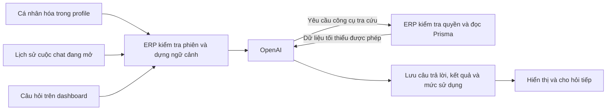
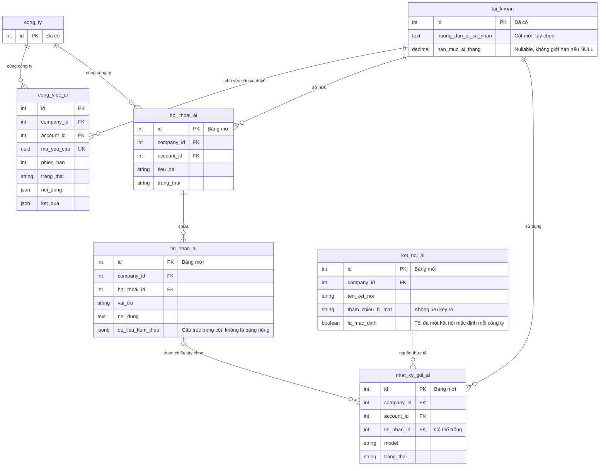
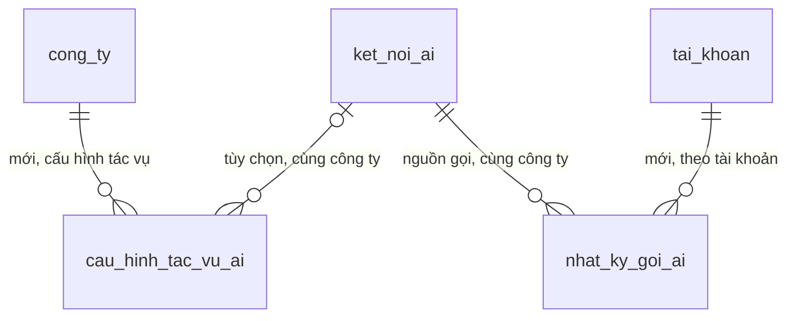
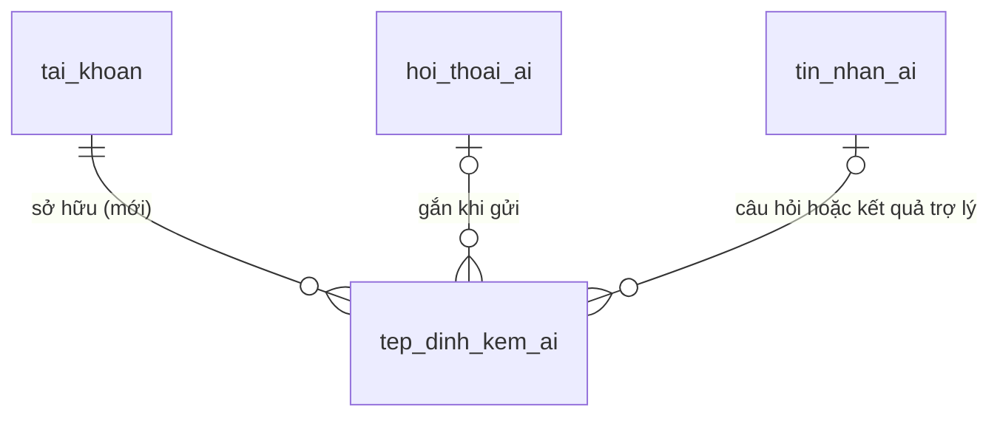

# Trợ lý AI trên dashboard và cá nhân hóa

Cập nhật: **25/11/2026**. Trạng thái: **đã có bản thử, quản lý nhiều key/model, bảng duyệt công việc, lịch sử/bối cảnh chat, cá nhân hóa profile, định tuyến model theo tác vụ, hạn mức/usage nội bộ và tệp ảnh/Word/Excel trong chat; chưa nghiệm thu API thật; thiết kế đầy đủ bên dưới chưa triển khai**. Phạm vi bản thử và kết quả tại [Bản thử cho tài khoản quản trị](#bản-thử-cho-tài-khoản-quản-trị--16112026) và [bảng công việc chờ duyệt](#bảng-công-việc-ai-và-duyệt-thực-hiện--16112026).

Rule phân hệ: [AI-ASSISTANT-RULES](../../.agents/rules/AI-ASSISTANT-RULES.md). Plan này sở hữu thiết kế AI; [plan cá nhân](PROFILE-DASHBOARD-CHECKLIST.md), [plan tài sản](ASSET-MANAGEMENT-CHECKLIST.md) và [plan phân quyền](ROLE-MANAGEMENT-CHECKLIST.md) tiếp tục sở hữu nghiệp vụ nền.

## Mở chatbot cho mọi tài khoản — 20/11/2026

### A. Đặc tả yêu cầu

Đã được yêu cầu triển khai: chatbot là khả năng nền của tài khoản đăng nhập hợp lệ, gồm DEFAULT và tài khoản không có quyền nghiệp vụ. Không bind một account, không cần quyền AI USE hoặc quản lý tài khoản/vai trò. Người dùng trò chuyện thông thường, tải lên/đọc/tạo Word, Excel và các tệp được công cụ hiện có hỗ trợ. Kết nối AI công ty cần hoạt động; hạn mức cá nhân/kết nối và giới hạn kỹ thuật vẫn áp dụng.

| Mã | Tiêu chí nghiệm thu |
| --- | --- |
| CHAT-01 | DEFAULT không có grant mở chat, gửi tiếp, đổi tên, lưu trữ/khôi phục, xem mức dùng riêng; không phụ thuộc biến bind pilot. |
| CHAT-02 | DEFAULT tải lên/đọc/tạo/tải xuống tệp riêng; không đọc chat/tệp người khác hoặc công ty khác. |
| CHAT-03 | Công cụ ERP theo quyền VIEW/MANAGE thực tế; không có quyền vẫn chat được nhưng không tra/sửa ERP, duyệt công việc hoặc quản trị AI. Thu hồi quyền chặn nguồn lịch sử ERP. |
| CHAT-04 | Phiên hết hiệu lực, khóa tài khoản, buộc đổi mật khẩu vẫn bị chặn. Hạn mức 0 chặn gọi API; NULL không giới hạn. |

### B. Thiết kế kỹ thuật

- [x] Thay `canUseAiPilot` bằng `canUseAiChat`; mở dashboard, chat/history, tệp và mức dùng riêng theo phiên hợp lệ. Prompt hỗ trợ trò chuyện thông thường và tài liệu riêng.
- [x] Tách `currentAccountActor` kiểm tra tài khoản/phiên hiện hành khỏi `currentActor` kiểm tra grant nghiệp vụ. Transaction chat/tệp/usage dùng kiểm tra tài khoản; transaction nghiệp vụ giữ quyền phân hệ.
- [x] Lọc công cụ trước khi gửi model và kiểm tra trước thực thi. Nguồn lịch sử tài sản/vị trí/vật tư, bảng công việc và tệp sinh từ nguồn ERP kiểm tra lại quyền; danh sách công việc lọc theo quyền loại công việc.
- **Thiết kế DB cần giữ:** không thêm bảng/cột/migration, không cấp grant vào DEFAULT, không đổi ngân sách. Tái sử dụng hội thoại/tin nhắn/tệp theo `company_id` + `account_id`, lease/chống lặp và usage hiện có. Không mở chia sẻ tệp.
- Biến `AI_PILOT_ACCOUNT_ID` không còn kiểm soát chat. Chỉ giữ cho việc xác định công ty khi nhập cấu hình môi trường cũ ở `ai-connection.ts`; không mở key môi trường ra các công ty khác. Các mô tả bind pilot 16–17/11 phía dưới là phạm vi lịch sử, được thay thế bởi chính sách truy cập này.
- [x] Kiểm chứng CHAT-01–04 trên PostgreSQL riêng, OpenAI giả lập: 36/36 integration (7 ca DEFAULT mới + hồi quy quản trị AI/vật tư); 1/1 E2E tài khoản DEFAULT tạo/tải Word/Excel, tiếp tục chat sau reload, không vào quản trị AI và admin không tải tệp cá nhân của người khác. Đã xem desktop/mobile, không tràn ngang.
- [x] Typecheck và ESLint các file liên quan đạt. Kết quả kiểm tra lưu cục bộ tại `outputs/ai-default/`; không thay ngân sách/grant/key hay dữ liệu nghiệp vụ thật, không gọi API trả phí.
- [x] Production build (`next build --webpack`) đạt. Chưa nghiệm thu với OpenAI thật.

Mục lục:

- [A. Tổng quan để duyệt](#a-tổng-quan-để-duyệt)
- [B. Chi tiết triển khai](#b-chi-tiết-triển-khai)
- [Thiết kế DB cần giữ](#thiết-kế-db-cần-giữ)
- [Quản trị AI và hạn mức](#quản-trị-ai-và-hạn-mức)
- [Hướng đối soát Admin API — tạm lưu kế hoạch](#chuyển-sang-đối-soát-admin-api-và-rà-soát-dữ-liệu-cũ--17112026)
- [Tệp đính kèm và phân tích](#đính-kèm-và-phân-tích-tệp--18112026)
- [Ghi nhận hàng vừa mua](#ghi-nhận-hàng-vừa-mua--19112026)
- [Tạo, sửa và xuất tài liệu](#tạo-sửa-và-xuất-tài-liệu--18112026)
- [Bối cảnh trong một cuộc chat](#bối-cảnh-trong-một-cuộc-chat)
- [Checklist triển khai](#checklist-triển-khai)
- [Kiểm chứng hiện tại](#kiểm-chứng-hiện-tại)

## A. Tổng quan để duyệt

**23/11 — Office web:** đã chọn trình soạn thảo đầy đủ trong panel cạnh chat; mã tích hợp đang kiểm chứng, runtime Lima/Docker đã chạy Document Server thật; Word/Excel sửa/lưu và xuất PDF đã kiểm chứng local. Phạm vi/tiêu chí và bước còn lại tại [Mở tài liệu cạnh chat](#mở-tài-liệu-cạnh-chat--23112026).

### Mục tiêu và yêu cầu đã ghi nhận

**25/11 — làm việc dài với AI:** đã duyệt bỏ trần theo ngày/số lượt chat, nới dung lượng câu hỏi và số tệp gửi, tăng thời gian và tự tóm tắt bối cảnh khi dài. Tiêu chí: chat cũ tiếp tục được; giữ nguyên lịch sử gốc và quyết định đã chốt; tra lại chi tiết khi cần; vẫn kiểm tra quyền nguồn và ghi chi phí. Trạng thái kiểm chứng tại [hội thoại dài](#hội-thoại-dài-và-giới-hạn-nhớ).

Đợt 18/11 đã thêm nút đính kèm, kéo thả tệp và dán ảnh vào chat. Người dùng gửi yêu cầu để đọc ảnh, tóm tắt Word hoặc lọc/tổng hợp Excel/CSV; bảng kết quả có nguồn, hỏi tiếp được sau reload. Dùng kết nối/model hiện hành (đọc ảnh cần model hỗ trợ vision), không cần Admin key. Giới hạn và kiểm chứng tại [tệp AI](#đính-kèm-và-phân-tích-tệp--18112026).

Ngày 16/11, người phụ trách yêu cầu gắn API vào tài khoản đầy đủ quyền hiện tại để hỗ trợ thêm/sửa hồ sơ và đã chọn phạm vi **tài sản và vị trí**. Đợt này triển khai khung chat cho một tài khoản được cấu hình rõ, AI tra cứu và điền bản nháp; người dùng kiểm tra và lưu bằng form nghiệp vụ ngay trên dashboard. Đã mở rộng bảng duyệt khấu hao mặc định tất cả loại tài sản: xem trước, duyệt một lần, xem kết quả và khôi phục sau reload. Đã triển khai lịch sử/bối cảnh chat và cá nhân hóa profile theo đợt riêng phía dưới; quản trị hạn mức đầy đủ còn kế hoạch.

Người dùng có API OpenAI và muốn khung chat ngay trên dashboard. Kịch bản đầu: người phụ trách IT hỏi **“Tìm thông tin máy in ở phòng HCNS”**, nhận kết quả theo dữ liệu ERP và có thể mở hồ sơ, xem vị trí hoặc hỏi tiếp. Profile có ô bối cảnh/cách trả lời để áp dụng mỗi lượt; lịch sử gắn với người sử dụng.

Đề xuất diễn giải “người sử dụng” thành **tài khoản đăng nhập**: ERP cho phép nhiều tài khoản trên một nhân sự, quyền độc lập. Cài đặt và lịch sử không tự gộp giữa tài khoản cá nhân/quản trị hoặc người cùng phòng.

Nhu cầu bổ sung: người quản lý cần quản lý API key/kết nối, hạn mức từng tài khoản, token/chi phí và phần còn lại. Phạm vi quản trị nội bộ được đưa vào đề xuất pilot; đối soát số liệu OpenAI phụ thuộc credential/quyền phù hợp, không mặc định có số dư trả trước qua API.

Điều chỉnh theo người phụ trách: **hạn mức từng tài khoản chỉ lưu bằng một cột trên `tai_khoan`, không tạo bảng hạn mức riêng**. Mức dùng và phần còn lại lấy/tính từ log API; các giá trị hạn mức cụ thể vẫn chưa cấp cho dữ liệu thật.

Nhu cầu mở rộng mới: [bảng công việc và duyệt thực hiện](#bảng-công-việc-ai-và-duyệt-thực-hiện--16112026). AI liệt kê các đối tượng cùng giá trị trước–sau, người dùng duyệt một lần rồi hệ thống thực hiện và trả bảng kết quả; đã triển khai, kiểm chứng trên DB riêng; dùng thử nghiệp vụ thật sau khi người phụ trách duyệt bảng.

Quản trị API đang mở rộng theo [đợt 17/11](#quản-trị-api-openai-mở-rộng--17112026): hạn mức tùy chọn trên tài khoản, kết nối/model theo tác vụ và sổ sử dụng.

Phân tích mở rộng ngày 17/11: [công cụ kiểm tra và cập nhật nhiều tài sản](#đề-xuất-công-cụ-kiểm-tra-và-cập-nhật-nhiều-tài-sản--17112026), đang là đề xuất, chưa triển khai.

Hướng tiếp theo đã tạm lưu theo yêu cầu: [đối soát OpenAI qua Admin API](#chuyển-sang-đối-soát-admin-api-và-rà-soát-dữ-liệu-cũ--17112026), lấy token/chi phí theo Organization/project/key và rà soát phần cấu hình giá cũ. Chưa triển khai; giữ nguyên hạn mức không giới hạn, key và dữ liệu hiện có.

Phân tích UX ngày 17/11: [tự tải model và tự lưu cấu hình tác vụ](#đề-xuất-tự-lưu-cấu-hình-tác-vụ--17112026); đang đề xuất, chờ duyệt chuẩn Frontend.

Bố cục đã triển khai và kiểm chứng ngày 17/11: [dashboard làm nơi làm việc với agent](#đề-xuất-dashboard-là-không-gian-làm-việc-với-agent--17112026). Ưu tiên hội thoại và bảng công việc theo ngữ cảnh; workflow giữ trong Việc của tôi. Đã áp dụng trên ứng dụng, 9 E2E liên quan đạt; chờ người phụ trách dùng thử.

### Phạm vi bản đầu

| Chức năng | Người dùng thao tác | Kết quả dự kiến |
| --- | --- | --- |
| Cá nhân hóa | Sửa ô “Bối cảnh và cách AI trả lời” tại `/profile` | Áp dụng từ lượt hỏi kế tiếp; để trống dùng mặc định |
| Chat trên dashboard `/` | Tạo cuộc chat, gửi câu hỏi, mở lại lịch sử | Nội dung lưu theo tài khoản; lỗi giữ câu hỏi |
| Tra cứu tài sản | Hỏi bằng tiếng Việt, chọn kết quả, hỏi tiếp | Câu trả lời ngắn, thẻ/danh sách và liên kết hồ sơ thật |
| Ghi nhận hàng vừa mua | Nói tên/số lượng, bổ sung nơi giữ nếu thiếu, xem bảng rồi xác nhận | Tạo loại/mặt hàng thiếu và nhập hàng trong một lần; áp dụng nhiều mặt hàng, xem lại kết quả sau reload |
| Liên kết không gian | Chọn “Xem trên 3D” khi được hỗ trợ | Mở vị trí đã ánh xạ và được phép xem |
| Lưu trữ cuộc chat | Đưa cuộc chat khỏi danh sách đang mở, mở lại | Giữ nội dung; không đồng nghĩa xóa dữ liệu |
| Theo dõi API | Hệ thống ghi nhận mỗi lần gọi | Kiểm soát mức sử dụng, lỗi và chi phí ước tính |
| Quản trị kết nối | Người được cấp quyền thêm/thay khóa, chọn model, tạm dừng | Khóa ở kho bí mật, UI chỉ hiện thông tin che bớt; không tự chuyển nguồn chi |
| Hạn mức tài khoản | Người quản lý sửa một mức ngân sách tháng trên tài khoản; user xem phần của mình | Mức đã đối chiếu lấy từ log, còn khả dụng được tính; model/tốc độ dùng cấu hình kết nối chung |
| Đối soát nhà cung cấp | Xem Usage/Costs khi có credential được cấp | Tách số liệu OpenAI khỏi ERP, có thời điểm cập nhật; không giả số dư |

Thiết kế chat đầy đủ bên dưới giữ phạm vi tra cứu; pilot hiện có thêm form tài sản/vị trí, công cụ vật tư và bảng duyệt khấu hao/ghi nhận hàng mua như mục B. Đính kèm/hỏi đáp tài liệu đã có; công cụ tạo/sửa/xuất tệp theo mục riêng ngày 18/11. Giọng nói, ghi nhớ tự động xuyên cuộc chat, thao tác hàng loạt khác, AI truy cập 1Office và kết nối API riêng từng phòng chưa thuộc phạm vi. Có thể mở màn hình nghiệp vụ sẵn có; thao tác tại màn hình đó theo quyền hiện hành.

### Luồng sử dụng

ERP chủ động đọc cài đặt mỗi lượt. Lịch sử giúp xác định “chiếc thứ hai”; khi hỏi tình trạng/vị trí hiện tại phải tra lại hồ sơ. Mở cuộc chat mới áp dụng cá nhân hóa nhưng không tự lấy nội dung các cuộc chat khác. Lưu chat không phải huấn luyện mô hình. [Bối cảnh trong một cuộc chat](#bối-cảnh-trong-một-cuộc-chat) giữ bộ lọc, danh sách đã hiển thị, đối tượng đang nói tới và cách xử lý đổi chủ đề; dùng JSON của tin nhắn, không thêm bảng.

### Mô hình DB nhìn nhanh

Bản đầy đủ dưới đây còn kế hoạch; DB đang chạy có sáu bảng AI: kết nối, công việc, hội thoại, tin nhắn, cấu hình tác vụ và log API; cá nhân hóa và hạn mức nullable nằm trên tài khoản. Xem [thiết kế kết nối](../THIET-KE-QUAN-TRI-AI.md#kết-nối-pilot--16112026).

**Thiết kế gồm hai cột mới trong `tai_khoan` và năm bảng mới**: cột cá nhân hóa, cột hạn mức; ba bảng hội thoại/tin nhắn/log, `ket_noi_ai` cho quản trị và `cong_viec_ai` cho duyệt thực hiện. Dùng lại tài sản, vị trí, công ty, tài khoản và RBAC; cột hạn mức và bảng kết nối tại [thiết kế quản trị AI](../THIET-KE-QUAN-TRI-AI.md#3-thiết-kế-db-cần-giữ).

`||` = một, `o|` = không hoặc một, `o{` = không hoặc nhiều. Sơ đồ lược bớt trường; tất cả liên kết thuộc công ty phải nhất quán. ID hồ sơ nguồn bên trong JSON là tham chiếu tra cứu, **không phải FK**; không vẽ thành quan hệ SQL. Thiết kế đầy đủ tại [B](#thiết-kế-db-cần-giữ).

### Quyết định và điểm còn mở

| Nội dung | Hướng hiện tại | Trạng thái |
| --- | --- | --- |
| Chat tại dashboard, cá nhân hóa trong profile, lịch sử riêng | Nhu cầu người dùng đã nêu | Đã có chat pilot, cá nhân hóa và lịch sử DB; đã kiểm chứng kỹ thuật |
| Chủ sở hữu là tài khoản | Dùng `account_id`, không gộp theo `employee_id` | Đề xuất theo mô hình ERP |
| Lưu trữ | Hai cột tài khoản + năm bảng; hạn mức nằm trên tài khoản, không có bảng hạn mức | Cách lưu hạn mức đã được người phụ trách yêu cầu; chưa triển khai |
| Cá nhân hóa | Ô text tùy chọn, tối đa 2.000 ký tự | Đề xuất |
| Kết nối và chi phí | Quản trị kết nối/project, hạn mức theo user và kết nối; có thể khởi đầu bằng một nguồn chi | Cần chốt nguồn thanh toán, kho bí mật, model, mức cấp và người quản trị; không tự triển khai kết nối theo phòng |
| Cấu hình dùng chung | Các tài khoản dùng kết nối mặc định của công ty, model/tốc độ theo kết nối; riêng tài khoản có một mức ngân sách | Phương án tinh gọn cho bản đầu; chưa gán kết nối/model/giới hạn kỹ thuật riêng từng user |
| Vị trí quản trị cấu hình | Khu Cài đặt chung `/settings`, mục Quản trị AI `/settings/ai`, quyền quản trị kết nối riêng; cấp tại `/roles` | Đã triển khai theo yêu cầu 16/11; [phương án chi tiết](../THIET-KE-QUAN-TRI-AI.md#đề-xuất-đưa-ai-vào-khu-cài-đặt-hệ-thống--16112026); kiểm chứng tại [plan cài đặt](SYSTEM-SETTINGS-CHECKLIST.md) |
| Đối soát OpenAI | Usage/Costs cần credential quản trị phù hợp; số dư prepaid chưa xác minh endpoint | Chỉ đọc khi được cấp phạm vi; không hứa có số dư/quota thời gian thực |
| Nhóm dùng thử | Một nhóm IT/HCNS được cấp quyền rõ | Chưa có danh sách tài khoản/người nghiệm thu |
| Dữ liệu gửi ra ngoài | Chỉ dữ liệu đã được phép và ẩn danh theo quy định nội bộ | Cần chốt trường dữ liệu, cách ẩn danh và mẫu thử |
| Thời hạn lưu/xóa | Phân biệt lưu trữ, xóa nội dung và giữ metadata chi phí | Cần chốt thời hạn cho chat, log, backup và xử lý yêu cầu xóa |
| Giao diện | Chat trong dashboard, lịch sử thu gọn; giữ vùng việc cá nhân | Chưa có bản giao diện được nghiệm thu |

Các lựa chọn còn mở được giải quyết trong bước thiết kế/pilot tương ứng; không tự dùng dữ liệu thật hoặc gọi API trả phí để mặc định chốt chúng. [Bối cảnh AI theo phòng](../strategy/BOI-CANH-HIEN-TAI-VA-DINH-HUONG-SO-HOA.md#5-bối-cảnh-sử-dụng-ai-theo-phòng-ban) là nguồn về giới hạn dữ liệu và định hướng kết nối trước đây.

### Mốc thực hiện và nghiệm thu

| Mốc | Trạng thái | Điều kiện hoàn thành |
| --- | --- | --- |
| Ghi yêu cầu, thiết kế và định tuyến tài liệu | Đã lập | A/B, DB, rule và liên kết thống nhất |
| Chốt lựa chọn phục vụ pilot | Chưa xong | Nhóm thử, dữ liệu, kết nối/hạn mức và lưu/xóa rõ ràng |
| CSDL, profile và lịch sử | Chưa triển khai | Lưu đúng tài khoản; reload không mất nội dung đã lưu |
| Công cụ tài sản và giao diện kết quả | Có công cụ và form bản nháp trong pilot; phần đầy đủ còn kế hoạch | Tìm đúng hồ sơ/vị trí, không suy dữ liệu thiếu hoặc vượt quyền |
| Quản trị nội bộ | Có nhiều key, model theo tác vụ, hạn mức tùy chọn và usage nội bộ; quyền quản trị độc lập; chưa đối soát OpenAI | Quản lý khóa an toàn, cấp/chặn hạn mức, thống kê và quyền riêng |
| Đối soát nhà cung cấp | Đề xuất bước sau | Có credential/phạm vi đọc, số liệu có nguồn/thời điểm và không lẫn số dư |
| Kiểm thử và dùng thử | Chat 10 tích hợp/3 E2E; quản lý kết nối 8 tích hợp/3 E2E với API mô phỏng đạt; chưa thử API thật | Đạt [ma trận kiểm chứng](#kiểm-chứng-và-pilot) cho phạm vi đầy đủ, người phụ trách xác nhận hữu ích |

### Công cụ vật tư theo quyền tài khoản — 18/11/2026

**Đã triển khai, kiểm chứng bằng API mô phỏng; chưa nghiệm thu OpenAI thật.** Công cụ AI chỉ có quyền bằng tài khoản đăng nhập trong phạm vi nghiệp vụ đã tích hợp. Giữ điều kiện mở pilot hiện hành; không tự cấp quyền hoặc mở chat cho mọi tài khoản. LOOKUP chỉ đọc (nhãn “Tra cứu dữ liệu”); GENERAL/DRAFT lập bản nháp, người dùng kiểm tra/xác nhận bằng form vật tư có sẵn trước khi ghi.

- [x] Lọc công cụ theo quyền; thêm tra cứu mặt hàng/tồn/lịch sử và danh mục vật tư; kiểm tra lại quyền trước thực thi và khi đọc lịch sử chat có nguồn vật tư.
- [x] Thêm bản nháp mặt hàng và giao dịch vật tư, điền sẵn form hiện có; giữ kiểm tra số dư/version, chống lặp, tenant và audit của action nghiệp vụ. Không tự trừ tồn theo lời chat hoặc viết SQL do model sinh.
- [x] 6 integration đạt: read-only/không quyền/khác công ty/thu hồi quyền, chuẩn bị không ghi, xác nhận nhập/xuất, số dư thay đổi/âm và gửi lặp; đọc lại nguồn chat theo quyền hiện hành. 4 E2E đạt: nhập/xuất desktop/mobile tối, thêm mặt hàng với tồn đầu, cập nhật số dư xung đột giữ form, hồi quy bản nháp vị trí. Đã xem ảnh desktop/mobile; TypeScript, lint phạm vi sửa và diff-check đạt. Chạy trên DB/app riêng với provider mô phỏng; kết quả tại `outputs/ai-inventory/`, không ghi dữ liệu vận hành.
- [x] Production build trên bản sao đạt; còn cảnh báo có sẵn về middleware/Edge Runtime và phiên bản Next.js. Đã dừng app thử, dọn DB thử; dev server port 4000 giữ nguyên. Không đổi dependency hoặc nâng Next.js trong phạm vi này.
- Thiết kế DB: tái sử dụng bảng vật tư và JSON metadata chat, thêm loại tham chiếu vật tư trong schema ứng dụng; không tạo bảng/migration. Bản nháp theo luồng tài sản/vị trí hiện có: giữ trong phiên UI; reload yêu cầu lập lại từ dữ liệu hiện hành. Không coi bản nháp trong lịch sử là giao dịch đã ghi.
- Phạm vi này không tự cung cấp công cụ cho mọi chức năng HR/workflow/quản trị; các phân hệ đó cần tích hợp công cụ riêng. Nghiệp vụ tồn theo [plan vật tư](INVENTORY-MANAGEMENT-CHECKLIST.md).
- [x] Hoàn thiện 19/11: bảng trước–sau cho thu hồi/ghi giảm/đảo phụ kiện thể hiện tồn, số đang giữ và người/phòng nhận gốc. Chặn đảo bản đảo, đảo lần cấp còn thu hồi/ghi giảm hiệu lực và đảo gây âm ngay khi chuẩn bị; chặn chuyển mặt hàng sang hạng mục khác. Giữ bộ lọc tồn thấp/ngừng dùng/loại/phòng/nơi giữ trong ngữ cảnh và chỉ cho phép tên công cụ đã đăng ký.
- [x] Kiểm chứng đợt hoàn thiện: 9 integration, TypeScript, lint phạm vi sửa và diff-check đạt; bao gồm giao dịch gốc ở trang lịch sử cũ, thu hồi vượt số đang giữ, gửi lặp, VIEW/LOOKUP, thu hồi quyền và dữ liệu khác công ty. PostgreSQL thử độc lập khôi phục từ backup có sẵn do Postgres.app chặn tiến trình kết nối DB local; không thay cấu hình quyền kết nối đó. Không gọi OpenAI thật, không ghi DB vận hành. Không sửa bố cục hoặc chạy lại E2E/build trong đợt này; kết quả tại `outputs/ai-inventory-followup/`.

## B. Chi tiết triển khai

### Ghi nhận hàng vừa mua — 19/11/2026

**Đã triển khai và kiểm chứng kỹ thuật; chưa nghiệm thu API thật.** Một bảng nhiều dòng dùng chung cho hàng có sẵn hoặc mới, đề xuất tạo loại/mặt hàng khi thiếu và ghi NHAP. Người dùng bổ sung nơi giữ/quy cách còn thiếu, kiểm tra bảng rồi xác nhận một lần. Phụ kiện cần nơi giữ hợp lệ; tiêu hao dùng tồn chung, không ép nơi giữ hoặc giá mua. Không tự suy giá, chiều dài/quy cách hoặc người nhận.

- Thiết kế DB cần giữ: tái sử dụng `cong_viec_ai`, bổ sung giá trị `NHAP_VAT_TU` vào CHECK loại công việc; JSON version 1 lưu yêu cầu, các dòng đã đối chiếu, phiên bản nguồn và tồn trước–sau; kết quả lưu ID mặt hàng/giao dịch thực. Không tạo bảng hoặc cột mới, giữ tương thích công việc khấu hao cũ.
- Quyền/chủ sở hữu: pilot hiện có + INVENTORY MANAGE cho lập/xem/sửa/duyệt/hủy bảng; LOOKUP không được lập bảng. Kiểm tra lại tại transaction và khi đọc lịch sử chứa work. Lưu bản đề xuất không ghi danh mục/tồn.
- Duyệt bằng ID/phiên bản; khóa công ty/advisory theo nghiệp vụ vật tư, dựng lại snapshot để phát hiện nguồn thay đổi. Tạo loại/mặt hàng, NHAP từng dòng, audit và hoàn tất work cùng một transaction. Gửi lại đọc kết quả đã hoàn thành; rollback toàn bộ nếu bất kỳ dòng/audit thất bại. Không gọi nhiều Server Action độc lập rồi coi là nguyên tử.
- Tối đa 20 dòng/bảng. Tên trùng rõ ràng dùng lại sau đối chiếu đơn vị/hạng mục; trường hợp nhiều ứng viên hoặc khác đơn vị phải chọn lại, không tự quy đổi. Loại mới trùng tên trong bảng được tạo một lần. Nhiều đề xuất đồng thời phải kiểm tra lại trước ghi.
- [x] Công cụ lập bảng, đọc/sửa/làm mới/duyệt/hủy và kết quả bền vững theo chủ tài khoản.
- [x] Giao diện bảng trước–sau, bổ sung thông tin và liên kết hồ sơ sau nhập; tương thích danh sách công việc và lịch sử chat.
- [x] Migration `20261119110000_cong_viec_nhap_vat_tu` đã thử trên DB riêng và áp dụng local sau backup trong `outputs/ai-receipt/`; không reset/xóa dữ liệu.
- [x] 17 kiểm thử tích hợp vật tư AI qua PostgreSQL riêng: atomic rollback, duyệt đồng thời/chống lặp, quyền/khác công ty, xung đột, tái sử dụng danh mục, thiếu nơi giữ, chat→work và hồi quy khấu hao.
- [x] E2E desktop 1512px/mobile 390px: thiếu nơi giữ hiển thị lỗi, chọn và lưu bảng không đổi tồn, xác nhận một lần, mở lại hội thoại giữ kết quả và liên kết hồ sơ; mobile dùng thẻ, không tràn ngang; đã xem ảnh sáng/tối. Lint/typecheck/build đạt; build có cảnh báo nền về middleware/Edge runtime và phiên bản Next hiện có. Bằng chứng cục bộ `outputs/ai-receipt/`.
- [ ] Người phụ trách dùng thử câu “Vừa mua 2 dây HDMI” với API thật; không tự ghi nhận 2 dây vào dữ liệu thực trong kiểm thử.

### Bản thử cho tài khoản quản trị — 16/11/2026

Người phụ trách đã yêu cầu triển khai quản lý API key kèm model ngay trong phần mềm. Đã có **Cài đặt chung → Quản trị AI**: thêm/thay khóa, danh sách model có tìm kiếm và tự tải từ nhà cung cấp, kiểm tra khóa và bật/tạm dừng. Hành vi tải/chọn được kiểm chứng tại [plan cài đặt](SYSTEM-SETTINGS-CHECKLIST.md#danh-sách-model-tự-động--16112026). Thiết kế DB/kho bí mật hiện hành tại [kết nối pilot](../THIET-KE-QUAN-TRI-AI.md#kết-nối-pilot--16112026); đợt kết nối thêm một bảng; hiện đã bổ sung hội thoại/tin nhắn và cá nhân hóa theo mục bên dưới, log usage/hạn mức tùy chọn đã bổ sung theo đợt 17/11.

| Nội dung | Phạm vi đợt này |
| --- | --- |
| Tài khoản | Bind bằng `AI_PILOT_ACCOUNT_ID`; kiểm tra phiên và ACCOUNTS/ROLES MANAGE cùng ASSETS/LOCATIONS MANAGE tại server; không suy quyền từ tên role hoặc mở cho mọi admin |
| Kết nối | Trang `/settings/ai`, quyền `AI MANAGE_CONNECTIONS`: lưu/thay khóa, chọn/nhập model, kiểm tra danh sách model và tạm dừng. Khóa lưu mã hóa phía server; chỉ trả hậu tố. Responses API/function calling đọc cấu hình mỗi lượt; thay đổi có hiệu lực không cần khởi động lại. Env chỉ dự phòng khi chưa có bản ghi và đúng công ty pilot |
| Thêm/sửa | Công cụ AI chỉ tra cứu hoặc chuẩn bị bản nháp; form dùng lại `saveAsset`/`saveLocation`, phiên bản gốc, quyền và audit hiện có. Người dùng xem/sửa rồi bấm Lưu; chưa có công cụ xóa, sửa tài khoản/quyền hoặc SQL tự do |
| Ngữ cảnh | Nội dung cuộc chat đang mở nằm trong bộ nhớ giao diện, không localStorage; giới hạn lịch sử gửi và đọc lại hồ sơ khi chuẩn bị sửa. Reload mất cuộc trao đổi; không coi đây là lịch sử DB của bản đầy đủ |
| Dữ liệu DB | Một bảng `ket_noi_ai` giữ metadata, nhiều kết nối/công ty và một mặc định; tiến độ mở rộng tại [plan cài đặt](SYSTEM-SETTINGS-CHECKLIST.md#nhiều-api-key-openai--16112026). Dùng nhật ký hoạt động cho thay đổi cấu hình, kiểm tra khóa, metadata yêu cầu và usage từng lần API; không lưu prompt/nội dung hồ sơ/key trong log AI. Nhật ký nghiệp vụ do action phân hệ ghi |
| Giới hạn | Một lượt/account, chống gửi dồn 10 lượt/5 phút; bỏ trần theo ngày và số lượt/chat. Tối đa 25 lần gọi model/lượt, gồm tóm tắt và trả lời cuối; lease 660 giây. Chi tiết tại [hội thoại dài](#hội-thoại-dài-và-giới-hạn-nhớ); ngân sách quản trị vẫn áp dụng |
| Cấp quyền AI dài hạn | Allowlist pilot chỉ dùng trong đợt này; không sửa grant dữ liệu cũ. Khi mở nhiều người dùng, triển khai catalog AI và hạn mức theo thiết kế đầy đủ |

- [x] Đối chiếu mã, quyền, form và hướng dẫn Next.js hiện có; tài khoản `admin` có đủ quyền tài sản/vị trí/tài khoản/role. Đã kiểm tra cấu hình server mà không xuất giá trị khóa; chưa thực hiện cuộc gọi model thật trong kiểm thử.
- [x] Hoàn thiện action/công cụ, chat dashboard và bản nháp dùng form hiện có; `AI_PILOT_ACCOUNT_ID=1` chỉ mở cho tài khoản admin có đủ quyền hiện hành. Không tự thêm hoặc thay giá trị khóa/model môi trường.
- [x] 10 kiểm thử tích hợp trên DB khôi phục riêng đạt: bind/phiên/quyền/cấu hình, bản nháp không ghi tự động, lưu bằng action nghiệp vụ, giữ trường khi sửa, phiên bản cũ, vị trí con/phạm vi công ty, gửi trùng/đồng thời, thu hồi quyền giữa lượt, lỗi API và log không chứa nội dung/key; giới hạn ngữ cảnh/vòng công cụ/lượt 5 phút/24 giờ và timeout ghi chi phí chưa rõ.
- [x] 3 E2E Chrome trên app/DB riêng với API mô phỏng đạt: chỉ account được bind thấy chat, tạo/sửa tài sản/vị trí qua form, sửa tên giữ serial/giá mua, xung đột giữ bản nháp, mobile sáng/tối không tràn, reload xóa chat đúng mô tả. Đã xem ảnh; chat đặt trong cột chính dashboard để đủ chỗ đọc và soạn hồ sơ.
- [x] TypeScript, lint các file thay đổi, khoảng trắng và 171 liên kết/anchor cục bộ trong 6 tài liệu đạt. Trong kiểm chứng chat ban đầu, dấu vân tay 18 bảng vận hành không đổi; không thêm dependency hoặc sửa ba rule kỹ thuật chung. Bằng chứng chat tại `outputs/ai-pilot/`; migration kết nối được kiểm chứng riêng phía dưới.
- [x] Hoàn thiện cài đặt key/model, kho AES-256-GCM, quyền/phiên bản/audit và chat đọc cấu hình mới. Migration `20261116110000_ket_noi_ai` đã áp dụng sau backup và khôi phục thử; trên DB khôi phục, 18 bảng cũ không đổi và schema diff rỗng. DB local có 19 bảng; chưa lưu khóa/kết nối thật. Các cập nhật vị trí/nhân sự/audit diễn ra đồng thời tại local được giữ nguyên.
- [x] 8 kiểm thử tích hợp quản lý key/model đạt trên DB riêng và API mô phỏng: quyền, lưu mã hóa, đổi model giữ khóa, thay khóa, xung đột/đồng thời, tạm dừng không fallback, đổi cấu hình giữa lượt, tải model/lỗi API, kho bí mật lỗi, audit rollback và giới hạn kiểm tra. TypeScript/lint đạt.
- [x] 3 E2E Chrome quản lý kết nối đạt: tài khoản đủ quyền, thiếu key, tải/chọn model, lưu và dùng ngay, đổi model giữ khóa, thay khóa, tạm dừng/bật lại, kiểm tra lỗi giữ cấu hình, mobile sáng/tối. Đã xem ảnh. 10 kiểm thử tích hợp chat hồi quy đạt; TypeScript/lint, schema diff, 182 liên kết/anchor trong 7 tài liệu và `git diff --check` đạt. Rule/kiến trúc/từ điển DB đã đồng bộ; bằng chứng tại `outputs/ai-settings/`.
- [x] Đã khởi động lại dev để nạp Prisma Client; mở Cài đặt AI bằng tài khoản admin tại local đạt, không lỗi JavaScript, ô khóa để trống. Môi trường hiện có key/model và được giữ nguyên; chưa lưu kết nối vào DB hoặc gọi nhà cung cấp thật. Đã dừng app thử và dọn đúng DB tạm; backup/log/ảnh giữ cục bộ.
- [ ] Người phụ trách kiểm tra/chọn model và lưu qua Cài đặt AI; kiểm chứng kết nối thật với cấu hình được chọn. Không đánh dấu tích hợp thật thành công khi chỉ có kiểm thử mô phỏng.
- [x] Đối chiếu `/settings` hiện là trang chờ, menu dùng SYSTEM nhưng catalog ma trận chưa có nhóm này; cấu hình AI còn dùng guard pilot. Ghi [đề xuất khu cài đặt hệ thống](../THIET-KE-QUAN-TRI-AI.md#đề-xuất-đưa-ai-vào-khu-cài-đặt-hệ-thống--16112026): mục AI riêng, các nhóm cấu hình và quyền theo chức năng. 186 liên kết/anchor và `git diff --check` đạt. Lượt phân tích này chỉ cập nhật tài liệu; chưa đổi mã, DB hoặc grant, không chạy lại kiểm thử ứng dụng.
- [x] Theo yêu cầu triển khai tiếp theo, đã chuyển key/model sang `/settings/ai`, tích hợp quyền quản trị kết nối độc lập tại `/roles`, giữ chat và cấu hình/khóa. Thiết kế/nghiệm thu/chuyển quyền pilot tại [plan cài đặt](SYSTEM-SETTINGS-CHECKLIST.md); hạn mức/usage còn kế hoạch.

### Bảng công việc AI và duyệt thực hiện — 16/11/2026

**Đã triển khai và áp dụng migration local theo yêu cầu “thực hiện đi”.** Người phụ trách yêu cầu AI trình bày rõ công việc dự tính và kết quả trong chat, chỉ thực hiện sau khi được duyệt. Yêu cầu này thay phương án trước đó cho phép ghi ngay khi câu lệnh đủ rõ. Bản đầu tập trung đặt khấu hao mặc định của các loại tài sản về 60 tháng (5 năm); bảng dùng dữ liệu thật từ ERP.

| Giai đoạn | Nội dung trên thẻ công việc | Thao tác |
| --- | --- | --- |
| Chờ duyệt | Mục tiêu, phạm vi công ty, tổng số loại, số cần đổi/đã đúng, bảng từng loại và mức hiện tại → dự kiến | Duyệt và thực hiện / Điều chỉnh yêu cầu / Hủy |
| Đang thực hiện | Trạng thái xử lý của toàn kế hoạch; không hiển thị tiến độ giả từng dòng khi transaction chưa commit | Chặn duyệt lặp; không hứa hủy được sau khi đã bắt đầu commit |
| Hoàn tất | Cùng bảng chuyển sang kết quả thực: Đã cập nhật / Giữ nguyên; tổng số, thời gian thực hiện và liên kết phù hợp | Xem kết quả/lịch sử |
| Dữ liệu đã đổi | Chỉ rõ kế hoạch không còn khớp dữ liệu; chưa ghi gì | Làm mới bảng và duyệt lại |
| Thất bại / đã hủy | Lý do và phạm vi đã ghi thực tế; batch nguyên tử lỗi thì toàn bộ chưa cập nhật | Tải trạng thái / lập lại kế hoạch khi cần |

- Thẻ nằm trong khu vực Công việc AI của khung chat, có mã yêu cầu nguồn lưu phía server, có thể mở rộng để đọc danh sách dài; mobile chuyển hàng thành thẻ hoặc cuộn trong bảng, không tràn cả trang. Không cần mở từng hồ sơ để lưu. Điều chỉnh yêu cầu hủy bảng cũ rồi lập công việc mới; làm mới dữ liệu tăng phiên bản, vô hiệu nút duyệt cũ. Cho phép trao đổi để sửa kế hoạch thay vì khóa ô chat vì đang chờ duyệt.
- Công cụ AI lập đề xuất có cấu trúc; server tra dữ liệu hiện hành, dựng danh sách ID/phiên bản và giá trị trước–sau. Giao diện render component bảng từ dữ liệu này, không coi bảng Markdown do model tự viết là lệnh được phép thực thi.
- **Kịch bản 5 năm:** lấy toàn bộ loại trong phạm vi đã xác định, gồm trạng thái đang dùng/ngừng dùng để người duyệt thấy rõ; không lấy riêng 50 dòng lookup đầu. Chỉ cập nhật `loai_tai_san.khau_hao_mac_dinh_thang = 60`; loại đã 60 hiển thị Giữ nguyên. Không hồi tố `tai_san.thoi_gian_khau_hao_thang`, theo [plan tài sản](ASSET-MANAGEMENT-CHECKLIST.md#sửa-trực-tiếp-trong-panel-và-thông-tin-khấu-hao--16112026). Nếu không có dòng cần đổi, trả kết quả không cần cập nhật và không có nút thực thi.
- Duyệt bằng nút gắn đúng mã/phiên bản kế hoạch; máy chủ nhận mã, đọc nội dung đã lưu, kiểm tra người sở hữu/công ty/quyền ASSETS MANAGE và phiên bản từng loại trong khóa trước khi ghi. Không nhận tập thay đổi tùy ý từ nút/client hoặc để model tự duyệt. Chỉ ghi đúng tập đã trình bày; nếu yêu cầu “tất cả” mà danh mục thêm/bớt/đổi sau khi lập thì báo cần làm mới và duyệt lại, không mở rộng âm thầm.
- Thực hiện cả batch và audit trước–sau trong cùng transaction. Nút duyệt gọi action thực thi nội bộ, không cần gọi lại model để quyết định nội dung đã duyệt. Kết quả giao diện lấy từ trạng thái commit, không từ lời AI dự đoán. Lặp request trả kết quả đã có; mất mạng tải lại trạng thái, không tự ghi lại. Chỉ người yêu cầu được duyệt bản đầu; cơ chế giao người khác duyệt là phạm vi riêng.
- **Thiết kế DB đã chốt:** một bảng `cong_viec_ai` độc lập với chat, FK công ty và FK kép `(account_id, company_id)` tới tài khoản; unique `(company_id, account_id, ma_yeu_cau UUID)` chống tạo lặp, index `(company_id, account_id, id)` phân trang. Có `loai_cong_viec=KHAU_HAO_LOAI`, `phien_ban`, `trang_thai`, JSONB `noi_dung` (schemaVersion, months, rows gồm ID/mã/tên/trạng thái/giá trị trước/updated_at), JSONB `ket_qua` (changed/unchanged), `thoi_diem_duyet`, timestamps. CHECK loại/trạng thái/phiên bản dương/JSON object/kết quả và thời điểm duyệt tương ứng trạng thái. Không có cột prompt hay secret; công việc chỉ thuộc tài khoản tạo.
- Trạng thái lưu: `CHO_DUYET`, `CAN_LAM_MOI`, `DA_HUY`, `HOAN_TAT`, `KHONG_CAN_DOI`; trạng thái đang xử lý chỉ ở UI khi transaction chạy, không để bản ghi treo. Danh sách 10 công việc/trang, bảng ban đầu 10 dòng và mở toàn bộ; tối đa 2.000 loại/batch, vượt giới hạn thì chặn thay vì cắt bớt phạm vi. Làm mới tăng phiên bản và cần duyệt lại; Điều chỉnh hủy bảng cũ, đưa yêu cầu vào ô chat để sửa/gửi thành công việc mới. Chat mới không xóa công việc; khôi phục danh sách khi reload, kể cả kết nối AI tạm dừng.

- [x] Đối chiếu tool/UI/`saveAssetCategory`; giữ form một hồ sơ, thêm `plan_category_depreciation` để lập công việc. Model không được cấp công cụ thực thi; action duyệt kiểm tra chủ/quyền và snapshot trong khóa công ty.
- [x] Chốt hợp đồng đề xuất/kết quả, lưu trạng thái và chống trùng; cập nhật thiết kế DB/ERD liên quan trước triển khai.
- [x] Backup và khôi phục thử: 19 bảng cũ trùng fingerprint. Migration `20261116210000_cong_viec_ai` đã áp dụng trên DB riêng; Prisma Client đã sinh.
- [x] Migration local đã áp dụng sau backup mới: toàn bộ 19 bảng cũ trùng fingerprint trước–sau, thêm bảng công việc rỗng; không đổi khấu hao thật, key/model hoặc env. Schema diff trên DB thử rỗng.
- [x] 3/3 E2E Chrome với provider mô phỏng: trước–sau, duyệt, reload/Chat mới, xung đột/làm mới/duyệt lại, điều chỉnh/hủy, mobile sáng/tối không tràn. Đã xem ảnh desktop/mobile.
- [x] TypeScript, lint phạm vi sửa và build production Webpack đạt. Dashboard local tải được khu vực công việc, không lỗi JavaScript; kiểm tra chỉ đọc, không gọi API hoặc đổi dữ liệu thật. Schema diff local rỗng; 269 liên kết/anchor tài liệu đạt. Đã dừng app thử và dọn đúng DB tạm, giữ dashboard local chạy. Bằng chứng/backup/ảnh/log tại `outputs/ai-work-approval/`.
- [ ] Nghiệm thu câu lệnh nghiệp vụ qua API thật với người phụ trách; chưa tự duyệt hoặc đổi khấu hao trên dữ liệu thật.
- [x] Bổ sung công cụ lập kế hoạch khấu hao loại và action duyệt/hủy; tái sử dụng quyền/validation/audit nghiệp vụ, không SQL tùy ý.
- [x] Tạo thẻ công việc và bảng trước–sau/kết quả trong chat, điều chỉnh yêu cầu, mở rộng và phục hồi trạng thái.
- [x] Kiểm thử tích hợp 18/18 (8 công việc + 10 pilot) trên DB khôi phục riêng: chưa duyệt không ghi; duyệt một lần xử lý toàn bộ tập; dữ liệu đổi phải duyệt lại; giữ loại đã đúng và hồ sơ tài sản cũ; mất quyền/khác công ty/lỗi audit không ghi; gửi lặp không ghi trùng; hủy trước duyệt không đổi dữ liệu; kết quả phục hồi đúng từ server. Trình duyệt/mobile kiểm chứng riêng bên trên.

### Lịch sử, bối cảnh chat và cá nhân hóa — triển khai 16/11/2026

**Đã triển khai và kiểm chứng trên DB riêng; migration đã áp dụng local.** Thêm `hoi_thoai_ai`, `tin_nhan_ai` và `tai_khoan.huong_dan_ai_ca_nhan`; không thêm bảng bộ nhớ, quota hoặc log chi phí ở đợt này. Giữ điều kiện pilot hiện hành; mọi tài khoản hợp lệ được sửa cá nhân hóa của chính mình, không tự được mở AI. Cấu trúc DB chi tiết theo mục Thiết kế DB cần giữ; trạng thái dùng chuỗi có CHECK để nhất quán công việc AI. FK công ty/chủ và hội thoại cùng công ty; chủ hội thoại bất biến, unique mã lượt/vai trò trong công ty để không tạo lại khi mất kết nối trước lúc nhận ID chat.

- Danh sách chat có tiêu đề từ câu hỏi đầu sau kiểm tra quyền/nguồn, mở lại/lưu trữ/khôi phục, phân trang; tạo khi gửi câu đầu, không tạo chat rỗng khi tải dashboard. Tin nhắn lưu câu hỏi, trả lời và trạng thái; không nhận lịch sử từ client. Một lượt đang xử lý/hội thoại, lease theo cấu hình tập trung; hết lease chuyển gián đoạn, tiến trình cũ không được hoàn tất. Gửi lại cùng mã đọc kết quả đã có, không gọi API lần nữa; lỗi xác định cho người dùng gửi lại bằng lượt mới, không sửa tin cũ.
- Mỗi lượt đọc cá nhân hóa mới nhất một lần, gửi như chỉ dẫn user. Giới hạn 2.000 ký tự, xóa về mặc định, lưu có kiểm tra phiên bản; audit chỉ tên trường, không nội dung.
- Bối cảnh lưu JSON có phiên bản: công cụ/điều kiện đã tra, ID và nhãn kết quả theo đúng thứ tự danh sách đánh số giao diện, cùng nguồn. Thông tin tham chiếu không thay kết quả tra lại hiện hành. Chỉ lưu metadata tối thiểu, không raw tool output/reasoning hoặc toàn bộ hồ sơ. Lịch sử và bối cảnh chỉ của chat hiện tại; tự tóm tắt phần cũ và tra lại theo [hội thoại dài](#hội-thoại-dài-và-giới-hạn-nhớ), không giới hạn tổng số lượt/chat; danh sách 20 hội thoại/trang, nội dung 40 tin/trang, vẫn đọc lịch sử cũ bằng phân trang.
- Khi nguồn không còn cùng công ty/tồn tại hoặc cấu trúc phụ thuộc không kiểm chứng được, chặn nội dung và tái sử dụng cả chat, giữ tiêu đề trung tính. Quyền pilot đầy đủ kiểm tra lại trên mọi action/công cụ và trước hoàn tất. Tóm tắt tự động theo mục hội thoại dài; chatbot nền không cần AI USE, hạn mức theo cấu hình quản trị hiện hành.
- Bản nháp form vẫn trong lượt đang mở; lịch sử ghi rõ chưa lưu và hướng dẫn lập lại khi mở lại, không phục hồi form có thể tạo trùng hồ sơ. Công việc duyệt có ID tham chiếu trong tin nhắn; trạng thái thật vẫn từ `cong_viec_ai`, không từ câu trả lời cũ.

- [x] Đọc plan/rule/code và backup/khôi phục thử 20 bảng hiện có trên DB riêng, fingerprint trùng.
- [x] Schema/migration đã chạy trên DB riêng; cá nhân hóa profile và đọc cấu hình mỗi lượt đã có mã.
- [x] Lưu hội thoại/tin nhắn, bối cảnh từ server, quyền/nguồn/lease/chống lặp đã có mã; 18 kiểm thử hồi quy pilot/công việc đạt.
- [x] UI mở/lưu trữ/khôi phục chat, lịch sử phân trang và lỗi. Form cá nhân hóa chờ client sẵn sàng mới cho nhập, tránh ghi đè nội dung khi hydrate. Khi kiểm tra lại hội thoại bị từ chối, xóa nội dung/bản nháp trên giao diện và không hiển thị bản nháp vừa trả về.
- [x] Migration `20261116220000_hoi_thoai_va_ca_nhan_hoa_ai` đã áp dụng local sau backup mới, 20 bảng/cột cũ giữ nguyên fingerprint; chỉ thêm hai bảng rỗng và cột nullable. Schema diff DB thử rỗng.
- [x] 8 kiểm thử tích hợp chat/profile và 18 hồi quy pilot/công việc đạt với provider mô phỏng; không gọi API thật hoặc sửa cá nhân hóa thật.
- [x] 4/4 E2E chat/profile đạt: lưu/xóa cá nhân hóa và áp dụng lượt kế, lịch sử sau reload, chat mới tách bối cảnh, lưu trữ/khôi phục, tách tài khoản, thứ tự kết quả và tra lại hồ sơ hiện hành. 3 E2E công việc cũng đạt trong đợt tích hợp. Đã xem ảnh mobile/sáng/tối và profile.
- [x] TypeScript/lint đạt; Build production Webpack bản cuối đạt (exit 0), không đổi dependency. Local profile/dashboard có giao diện mới, không lỗi JavaScript; kiểm tra chỉ đọc, không đổi cá nhân hóa/chat/key thật hoặc gọi OpenAI. Schema diff local rỗng và 284 liên kết/anchor tài liệu đạt. Đã dọn app/DB thử và DB dùng kiểm tra build, giữ dashboard local hoạt động. Bằng chứng tại `outputs/ai-chat-context/`.
- [ ] Nghiệm thu vận hành bằng API thật; không dùng kết quả API mô phỏng làm chứng cứ chất lượng trả lời model.

### Quản trị API OpenAI mở rộng — 17/11/2026

**Đã triển khai, áp dụng migration local và kiểm chứng kỹ thuật theo yêu cầu “Thực hiện đi” sau phần quản lý API key.** Phạm vi: định tuyến kết nối/model theo tác vụ do người dùng chọn; hạn mức USD/tháng trên tài khoản; ngân sách và đơn giá ước tính của kết nối; nhật ký từng lần gọi và tổng quan metadata. Không triển khai các công cụ cập nhật tài sản trong đợt này. Không tự cấp ngân sách/grant, sửa key/model thật hoặc gỡ `.env`. Đối soát OpenAI cần credential quản trị riêng: bản đầu dẫn tới Usage/Billing, thể hiện chưa kết nối, không giả số dư.

Thiết kế DB cần giữ: thêm `tai_khoan.han_muc_ai_thang` Decimal(18,6) nullable mặc định NULL; `ket_noi_ai.han_muc_chi_phi_thang` cùng kiểu và `cau_hinh_gia` JSON nullable có phiên bản/model/đơn giá USD mỗi triệu token. Thêm `cau_hinh_tac_vu_ai` (công ty + mã tác vụ unique, kết nối/model/giá tùy chọn kế thừa) và `nhat_ky_goi_ai` (chủ/công ty/kết nối, mã lượt/bước unique, snapshot model/key/giá, token, chi phí ước tính, dự phòng, trạng thái/thời gian). FK kép bảo đảm cùng công ty; không lưu khóa hoặc nội dung chat vào log.

- Tác vụ cố định GENERAL/LOOKUP/DRAFT; LOOKUP chỉ có công cụ đọc. Không phân loại bằng từ khóa hoặc nhận model tùy ý từ chat. Giữ kết nối, phiên bản khóa và model trong cả lượt, đổi một trong ba thì dừng trước cuộc gọi sau; lỗi không tự đổi nguồn chi.
- Kỳ lịch Asia/Ho_Chi_Minh. Trước mỗi lần gọi, ERP kiểm tra tổng tiền đã đối chiếu trong kỳ theo tài khoản và kết nối. Giá model chỉ phục vụ báo cáo.
- Hạn mức tùy chọn, NULL cho phép dùng không giới hạn, 0 chặn gọi. Mức dương chỉ chặn khi tổng tiền đã đối chiếu đạt mức cấp. Mọi lượt đều ghi token khi nhà cung cấp trả usage. Khoản chưa xác định để NULL.
- Thêm quyền AI MANAGE_LIMITS/VIEW_USAGE vào catalog và ma trận cùng guard thực tế; phạm vi/quyền dùng chat giữ pilot hiện có, chưa thêm AI USE cho mở rộng nhiều tài khoản. Không tự mở pilot cho tài khoản khác. Quản trị chỉ xem metadata, không đọc nội dung chat.

- [x] Tách đơn giá khỏi hạn mức, lựa chọn model và kiểm tra cấu hình giữa lượt. Sổ gọi lưu đơn giá của từng lần gọi. Dự phòng cũ và chi phí ước tính chỉ là dữ liệu lịch sử/thống kê.
- [x] Bổ sung ca hồi quy cho giá thiếu, sai model, sai định dạng, bằng 0, quá cao, ước tính vượt độ chính xác DB, sửa giá giữa hai lần gọi của cùng tác vụ, dự phòng cũ và chi phí đối chiếu. 31/31 ca tích hợp quản trị AI trên PostgreSQL riêng với OpenAI mô phỏng và 4/4 ca thông báo chat đạt. TypeScript và ESLint phạm vi sửa đạt.

- [x] Đọc rule/thiết kế/code và hướng dẫn Next.js; xác định phạm vi, nơi kế thừa và ranh giới nguồn chi.
- [x] Migration thử trên DB khôi phục và áp dụng local: giữ nguyên dữ liệu cũ của 25 bảng, key/model/grant cũ không đổi; thêm hai bảng và hai quyền catalog, hạn mức cũ NULL. Có backup mới và khôi phục thử, schema diff rỗng.
- [x] Backend định tuyến, kiểm tra hạn mức, đối chiếu và ghi audit. Giao diện quản trị phân biệt tổng tham khảo và tổng đã đối chiếu.
- [x] 11 kiểm thử tích hợp đạt: đồng thời/quyền/công ty/giá/đổi key/lỗi chưa rõ; 5 E2E Chrome đạt: lưu cấu hình/tác vụ/hạn mức, định tuyến chat, lịch sử, duyệt công việc cũ, quyền độc lập và mobile sáng/tối. Đã xem ảnh và sửa tab chồng chữ trên điện thoại. TypeScript, lint, build production và `git diff --check` đạt; API được mô phỏng, không gọi model thật. Kiểm tra đọc trên app local bằng tài khoản pilot đạt: trang cài đặt có đúng quyền hiện tại, chat hiển thị không giới hạn, không lỗi JavaScript. 219 đường dẫn tài liệu tồn tại. Đã dừng app kiểm thử và dọn hai DB tạm; app local cổng 4000 tiếp tục chạy. Backup, báo cáo và ảnh giữ cục bộ tại `outputs/ai-governance/`.
- [x] Đồng bộ rule phân hệ, thiết kế, từ điển DB và kiến trúc. Không đổi ba rule kỹ thuật chung, dependency, `.env`, key/model hay grant thật.
- [ ] Người phụ trách cấp quyền quản trị bổ sung tại `/roles` khi cần; cấu hình tác vụ/đơn giá thật và nghiệm thu với API thật. Đối soát Usage/Costs OpenAI tự động cần credential/phạm vi riêng; chưa triển khai.

### Đính kèm và phân tích tệp — 18/11/2026

**Đã triển khai và kiểm chứng kỹ thuật theo yêu cầu “Thực hiện”; chờ dùng thử với model thật.** Ảnh PNG/JPEG/WebP, Word DOCX, Excel XLSX và CSV; đính kèm/kéo thả/dán ảnh, hỏi tiếp cùng hội thoại sau reload. Dùng model/kết nối hiện hành. Ảnh qua vision; Word trích văn bản; bảng tính có công cụ đọc vùng, lọc/tổng hợp trên toàn bộ sheet đã nhập trong giới hạn. Không bật Code Interpreter hoặc chạy mã do model sinh trong đợt này, không nhập tự động vào hồ sơ ERP.

#### Thiết kế DB cần giữ

Bảng mới `tep_dinh_kem_ai`: `id`, `company_id`, `account_id`, `hoi_thoai_id?`, `tin_nhan_id?`, `ma_tai_len` UUID chống tải lặp, `ten_tep`, `loai_tep`, `dung_luong`, `khoa_luu_tru` UUID, `tom_tat` JSON cấu trúc/số sheet/giới hạn, timestamps. FK kép chủ/công ty, hội thoại/công ty và tin nhắn/hội thoại/công ty; cặp hội thoại/tin nhắn cùng null trước gửi, cùng có sau gửi. Tệp chưa gửi chỉ chủ xem/bỏ; khi gửi thì liên kết bất biến. Gắn tệp và tạo cặp tin nhắn trong cùng transaction/khóa AI hiện hành; cùng mã request nhưng khác tập tệp bị chặn.

Kho riêng `var/ai-attachments` hoặc `AI_ATTACHMENT_STORAGE_DIR`, không public/Git: file gốc, dữ liệu đã trích JSON, ảnh chuẩn hóa JPEG cho model. DB giữ metadata, không giữ base64. GET tải/xem kiểm tra phiên, pilot, chủ/công ty và nguồn hội thoại. Không dùng Files API nên không có file ID/chi phí lưu trên OpenAI; nội dung chỉ gửi khi người dùng gửi yêu cầu. Backup phải gồm DB và kho tệp. Không tự xóa tệp đã gửi khi lưu trữ chat; bỏ tệp chưa gửi xóa bản tải tương ứng. Chưa có cron hoặc chính sách tự hết hạn tệp đã gửi.

Giới hạn bản đầu: 10 MiB/tệp, 10 tệp/lượt, 20 tệp/hội thoại, tổng 200 MiB tệp gốc/tài khoản. ZIP Office kiểm tra kích thước giải nén thực tế (30 MiB), số mục (2.000), từ chối macro; ảnh tối đa 25 triệu pixel, chuẩn hóa tối đa 2.048px. Bảng tính tối đa 20 sheet/100.000 dòng/200.000 ô, Word tối đa 300.000 ký tự và 15.000 ký tự/đoạn; vượt giới hạn báo lỗi, không cắt âm thầm. Word không trích hình/biểu đồ nhúng, Excel không chạy macro hoặc tính lại công thức (đọc kết quả cache, báo ô công thức thiếu kết quả). Công cụ đọc trả phạm vi và phân trang; tổng hợp trả số dòng xét/khớp, dữ liệu không phải số và nguồn sheet/cột. Nội dung tệp là dữ liệu, không phải chỉ dẫn cấp quyền.

- [x] Đối chiếu luồng Responses, lịch sử, kho riêng và quy tắc; chốt phạm vi triển khai như trên.
- [x] Migration `20261118090000_tep_dinh_kem_ai` đã áp dụng local; backup mới được phục hồi và thử riêng migration trước áp dụng. Đối chiếu số dòng/hash của 27 bảng cũ không thay đổi; DB thử migration đã dọn. Chỉ triển khai migration AI, không áp dụng hai migration vật tư đang được phát triển song song.
- [x] Upload/bỏ/tải có quyền, kiểm tra tệp và công cụ đọc/phân tích; lưu tham chiếu để hỏi tiếp.
- [x] UI đính kèm, tiến trình/lỗi, nguồn tệp, bảng kết quả và responsive.
- [x] 5 unit và 18 kịch bản E2E (5 tệp + 13 dashboard) đạt trên DB riêng/provider giả lập: tổng hợp đủ 1.500 dòng, Word/ảnh, hỏi tiếp sau reload, tải riêng theo chủ, chặn ID tệp khác tài khoản, gửi lại không gọi lại API, phục hồi tệp chưa gửi, kéo thả/dán ảnh và giới hạn 3 tệp/10 MiB tại thời điểm kiểm chứng 18/11; nay nâng 10 tệp theo cấu hình tập trung. Lần chạy chung có một lỗi fixture chọn nhầm tệp từ lần test cũ; đã dùng tên duy nhất và chạy lại ca đó đạt, không sửa logic ứng dụng để né lỗi.
- [x] TypeScript và ESLint phần thay đổi đạt; smoke local desktop/mobile không lỗi JavaScript hoặc tràn ngang, không gọi model thật.
- [x] Production build webpack đạt; manifest deploy của dashboard chứa worker và XLSX. Máy chủ/DB E2E đã dọn; giữ server local và bản sao lưu trong `outputs/ai-attachments/`.
- [ ] Nghiệm thu với model/kết nối thật và tệp nghiệp vụ; chưa gửi dữ liệu thật trong kiểm thử. Ảnh/scan cần model hỗ trợ vision. PDF đọc lớp chữ/ảnh trang theo mục mở rộng 23/11 bên dưới. Chưa hỗ trợ DOC/XLS cũ, OCR ảnh nhúng Word hoặc phân tích bằng mã tùy ý. Phân tích Excel dùng cache; LibreOffice tính công thức khi xuất PDF.

### Tạo, sửa và xuất tài liệu — 18/11/2026

**Đã triển khai và kiểm chứng bản đầu.** Backend chạy ngầm: tạo DOCX/điền mẫu có placeholder; tạo XLSX/chỉnh ô với kiểm tra giá trị trước sửa; PDF điền form/ghép/chọn trang; chuyển DOCX/XLSX sang PDF bằng LibreOffice. Kết quả mới hiện trong chat, giữ bản gốc và đọc/sửa tiếp theo ID; không cần Microsoft Office trên máy người dùng. Không hứa sửa văn bản PDF tự do, giữ mọi tính năng Office nâng cao hoặc tính lại mọi công thức.

#### Thiết kế DB cần giữ

Tái sử dụng `tep_dinh_kem_ai`: kết quả gắn tin nhắn trợ lý cùng owner/chat; `tom_tat` thêm metadata nguồn (ID tệp, không phải FK), thao tác và ghi chú thay đổi. Migration chỉ mở CHECK loại để nhận `pdf`, không xóa bảng/cột hoặc đổi dữ liệu cũ. Khóa tải UUID của kết quả được suy từ request/tool-step để chống lặp; ghi tệp và audit sau kiểm tra lease/quyền/nguồn hiện hành. Kho/giới hạn và endpoint tải dùng lại; kết quả không được coi là tệp đang soạn.

Công cụ chỉ xuất tệp trong phạm vi hội thoại, không chạy mã hoặc shell do model đưa vào. LOOKUP giữ chỉ đọc. Worker tài liệu tách bộ nhớ/thời gian, LibreOffice có profile/thư mục riêng từng job, tắt macro/cập nhật liên kết và giới hạn thời gian. Tệp mới giữ nguồn và hiển thị dù bước trả lời sau đó lỗi; lỗi/gián đoạn không được làm lộ tệp khi nguồn mất quyền. File gốc không bị ghi đè. Giới hạn ban đầu giữ 10 MiB/tệp, 20 tệp/chat, 200 MiB/tài khoản; nội dung sinh ra có giới hạn cấu trúc.

- [x] Cài `docx`, `exceljs`, `pdf-lib`, `@pdf-lib/fontkit` và LibreOffice 26.8.3.1 ký bởi The Document Foundation tại `~/Applications`; hướng dẫn môi trường trong kiến trúc.
- [x] Bảy công cụ có schema, kiểm tra nguồn/quyền/lease, lưu kết quả bất biến và chống lặp.
- [x] Đọc PDF dạng form/số trang, hỗ trợ font Unicode, UI phân biệt tệp kết quả; kết quả gắn tin nhắn trợ lý, phục hồi cùng lịch sử.
- [x] Migration `20261118130000_tep_ai_pdf` đã áp dụng local sau backup mới, restore và thử migration riêng; số dòng/hash **29 bảng cũ không đổi**. Đã dọn DB thử migration; backup và bằng chứng tại `outputs/ai-document-tools/`.
- [x] 5 unit công cụ đạt, gồm LibreOffice chuyển DOCX/XLSX thành PDF thực tế, Word placeholder tiếng Việt, Excel expected/formula, PDF Unicode/trang; kiểm tra bổ sung liên kết mã hóa và công thức ngoài đạt. Đã xem ảnh PDF và kết quả chat.
- [x] 5 E2E công cụ đạt trên DB riêng/provider giả lập: tạo Word→PDF, sửa Excel giữ nguồn/gửi lại không trùng, PDF Unicode, khôi phục tệp khi câu trả lời lỗi, LOOKUP không ghi tệp. Ca phục hồi ban đầu dùng nhầm tên enum trong assertion; sửa đúng `LOI` rồi đạt, không đổi hành vi ứng dụng.
- [x] 5 E2E hồi quy đính kèm đạt; TypeScript/lint đạt. Smoke local chỉ đọc desktop/mobile không lỗi JavaScript hoặc tràn ngang, không gọi model thật.
- [x] Production build Webpack đạt (exit 0), manifest dashboard chứa worker, docx/ExcelJS/pdf-lib/fontkit và phụ thuộc ZIP. Đã dừng server thử, dọn đúng DB kiểm thử và tháo bộ cài LibreOffice; server local 4000 giữ hoạt động. 217 liên kết cục bộ và `git diff --check` đạt. Bằng chứng/backup/ảnh tại `outputs/ai-document-tools/`.
- [ ] Nghiệm thu với model thật và tệp nghiệp vụ; kiểm thử hiện không gọi API tính phí hoặc gửi dữ liệu thật. Mở rộng PDF và sửa Word theo mục 23/11 bên dưới; Excel sửa ô đơn giản, không bảo toàn mọi cấu trúc nâng cao.

### Đọc PDF và dựng Word chỉnh sửa — 23/11/2026

Người phụ trách đã yêu cầu triển khai PDF → Word → sửa → PDF. Tái sử dụng tệp/chat/quyền/lease hiện có, không thêm bảng/cột. Bản nguồn bất biến; kết quả giữ sourceIds. PDF văn bản đọc trực tiếp; bản scan render từng trang để model vision đọc, không cài dịch vụ OCR ngoài hoặc gửi file tự động.

- [x] `read_pdf_page`: văn bản và ảnh trang có số trang, giới hạn tài nguyên; tệp cũ dùng được không cần tải lại.
- [x] `convert_pdf_to_word`: trích chữ tự động hoặc dựng lại đoạn/bảng theo từng trang đã đọc; công bố giới hạn bố cục, không bỏ trang scan âm thầm.
- [x] `update_word_text`: sửa đoạn/ô bảng theo nội dung cũ và số lần khớp, tạo bản mới; giữ cấu trúc và ngăn thay nhầm. Chữ mới lấy định dạng run đầu, chỉ thân tài liệu; chặn tab/ngắt dòng/field/textbox/tracked changes để tránh khớp sai.
- [x] Nối công cụ, cập nhật chỉ dẫn hành vi và nguồn; Word → PDF dùng LibreOffice hiện có. Lượt tài liệu dùng chung giới hạn 25 lần gọi model với các tác vụ khác, vẫn kiểm tra lease/hạn mức mỗi lần.
- [x] 6/6 unit mới đạt: PDF chữ/scan/render, trang sai/tệp lỗi, không bỏ trang thiếu chữ, Word nhiều run/bảng/tiếng Việt, số lần khớp/XML escape và PDF → Word → sửa → PDF bằng LibreOffice thật. 5/5 ca tài liệu cũ đạt trong đợt này.
- [x] 2/2 E2E với provider giả lập trên DB riêng đạt: PDF văn bản và scan → đọc ảnh → dựng Word → đọc Word → sửa → xuất → đọc lại PDF; tệp nguồn không đổi, kết quả phục hồi, sourceIds đúng, đọc/chuyển tệp khác chat và tải bằng tài khoản khác bị chặn. Đã chỉnh bộ kiểm thử chờ ô upload sẵn sàng trước khi chọn file.
- [x] TypeScript/lint/build Webpack đạt; manifest có helper, PDF.js/worker/font, canvas native và DOM/ZIP/phụ thuộc. Đã xem ảnh PDF kết quả, tiếng Việt và số liệu đúng. Bằng chứng tại `outputs/ai-pdf-20261123/`; không gọi API trả phí hoặc sửa dữ liệu vận hành.
- [ ] Nghiệm thu model vision thật với PDF nghiệp vụ: kiểm thử scan hiện xác minh pipeline ảnh và nội dung giả lập, chưa đo độ chính xác nhận dạng thực tế.

Phạm vi đầu: PDF tối đa 200 trang để đọc, 1 trang/lần render cạnh dài 2048 px; chuyển tối đa 20 trang/lần thành tài liệu mới, không cam kết bố cục/số trang giống nguồn. Dựng từ scan cần model vision; khi chữ mờ/số tiền không chắc phải yêu cầu xác minh. Không tự chạy mã/macro, không sửa trực tiếp nét chữ PDF hoặc ghi hồ sơ ERP.

Trang có lớp chữ tối đa 30.000 ký tự; chuyển tự động tối đa 100.000 ký tự và từ chối trang có dưới 20 ký tự để tránh bỏ sót scan. `pages=null` giữ văn bản dạng đoạn, không tự dựng bảng/ảnh; `pages` có cấu trúc yêu cầu đủ trang 1..N, đoạn trước bảng trong mỗi trang, không mang logo/ảnh nguồn sang Word. Word sửa chỉ thân tài liệu, không sửa header/footer. Worker 256 MiB/30 giây, ảnh trang tối đa 8 MiB, tệp kết quả 10 MiB như cũ. Dữ liệu PDF cũ được đọc lại từ bytes, không cần migrate hoặc tải lên lại. Nội dung nhận diện do model dựng vẫn cần người dùng đối chiếu.

### Đề xuất dashboard là không gian làm việc với agent — 17/11/2026

#### Mở tài liệu cạnh chat — 23/11/2026

**Đã chọn phương án 2; đã chạy Document Server thật và kiểm chứng local Word/Excel/lưu/xuất PDF. Chưa triển khai hoặc nghiệm thu VPS.** Đặc tả UX: nhấp tên tệp mở cùng vùng bên phải của bản nháp/đề xuất, tải xuống là thao tác riêng; desktop có phóng rộng, mobile chuyển Trao đổi/Tài liệu. DOCX/XLSX chỉnh bằng ONLYOFFICE, PDF/CSV xem, ảnh xem riêng. Giữ bản nháp ERP phía sau và nội dung tài liệu khi đổi kích thước/tab. Bản Community thử nghiệm: điện thoại chỉ xem, edition hỗ trợ mobile mới bật chỉnh trên điện thoại.

| Tiêu chí nghiệm thu | Hành vi cần đạt |
| --- | --- |
| OF1 | Mở tệp đúng chat trong panel, đóng trở lại bản nháp/công việc, không tràn trang mobile |
| OF2 | Sửa Word/Excel và Lưu bản mới; chỉ báo thành công khi callback đã ghi DB, AI đọc được bản mới sau reload |
| OF3 | Chặn đổi file/chat/rời trang khi chưa xác nhận lưu; lỗi giữ editor và đường tải tệp |
| OF4 | Chủ/công ty/phiên/nguồn kiểm tra ở mở/đọc/lưu; callback sai chữ ký, sai key hoặc URL ngoài dịch vụ bị chặn |
| OF5 | Bản gốc bất biến; callback lặp cùng request không tăng số tệp/audit |

**Thiết kế DB cần giữ:** không thêm bảng/cột. Dùng lại `tep_dinh_kem_ai` → FK hội thoại/tin nhắn/chủ/công ty; mỗi snapshot là bản ghi mới. JSON `tom_tat` giữ `sourceIds` (tham chiếu JSON, không FK), `officeSession`, `officeRequest`, `sha256`, operation `office_edit`. Cặp user/assistant `tin_nhan_ai` hoàn tất và audit tạo trong cùng transaction; cập nhật thời điểm hội thoại. `ma_tai_len` UUID xác định theo session/request (hoặc hash nội dung cho callback đóng) chống lặp. Hai phiên cùng nguồn tạo hai kết quả độc lập, không ghi đè. Bộ editor giữ phần chưa lưu trên dịch vụ, ERP chỉ đọc được snapshot đã nhận.

**Quyền và tích hợp:** `office-editor.ts` Server Actions cấp cấu hình/lệnh/trạng thái; `/api/office/source` và `/api/office/callback` là HTTP tích hợp ngoài, không dùng cookie thay xác thực. Capability ký riêng mục đích client/source/callback, ràng buộc chủ/công ty/chat/file/sessionVersion, hết hạn 8 giờ; callback thêm JWT ONLYOFFICE, chỉ dùng payload đã ký. Đối chiếu phiên DB và toàn bộ nguồn chat mỗi lần; archived chỉ xem. Download kết quả chỉ origin dịch vụ cấu hình + `/cache/files/`, không theo redirect, giới hạn stream 10 MiB. Ghi dữ liệu dưới khóa công ty/advisory, tái kiểm tra quyền/nguồn, parse file, giới hạn 20 tệp/chat và 200 MiB/chủ. Nội dung đã tải vào editor không thu hồi từ xa khi quyền đổi; chặn lần đọc/lưu tiếp theo. Không gọi OpenAI hoặc tính token khi chỉnh tay.

**Triển khai:** [Bộ khởi chạy và cấu hình](../../deploy/office/README.md), môi trường tại [Kiến trúc](../ARCHITECTURE.md#office-web-trong-chat--đang-triển-khai-23112026). Compose thử nghiệm có JWT, volume riêng, localhost:8088; secret tự tạo ngoài Git, không sửa env hiện tại khi chưa có Docker. Không dùng dịch vụ demo/cloud cho tài liệu riêng. Edition/giấy phép dùng thực tế cần chọn trước triển khai công ty. Nút Lưu native của editor chỉ đồng bộ Office; nút Lưu bản mới của ERP đợi callback. Menu Tệp của editor tải/xuất trực tiếp; muốn AI đọc bản export đó cần đính kèm lại hoặc dùng công cụ xuất trong chat.

- [x] Bổ sung panel/editor, mở tệp riêng và tải xuống riêng, preview ảnh, giữ bản nháp ERP, chuyển vùng/mobile, trạng thái lỗi và mở rộng.
- [x] Lưu bản mới, kiểm tra JWT/quyền/nguồn và callback, cặp tin nhắn/audit cùng transaction, chống ghi lặp; bảo vệ chỉnh sửa chưa lưu.
- [x] Chuẩn bị Compose + script khởi chạy + env mẫu; chạy thử script đã xác nhận máy thiếu Docker và không thay env ERP.
- [x] Unit 4 ca và integration DB thật 4 ca đạt: capability/purpose/chữ ký, giới hạn tải/URL, chủ/chat/phiên, Word+Excel, callback lặp, nguồn bất biến và audit; Office HTTP được mô phỏng.
- [x] 3 E2E Chrome đạt với DocsAPI/HTTP mô phỏng: desktop mở/sửa/lưu/phóng rộng/giữ sau reload và chặn rời trang khi chưa lưu; mobile chuyển vùng/không tràn; mất kết nối giữ tải xuống và đóng. Đã xem ảnh desktop/mobile. TypeScript, ESLint, build Webpack và 399 liên kết tài liệu đạt. Bằng chứng tại `outputs/office-20261123/`; build tại `outputs/ai-pdf-20261123/build.log`. Chưa kiểm thử UI của ONLYOFFICE thật.
- [x] Mac Intel/macOS 13.7.8: Lima 2.3.0, Docker CLI 29.10.0, Compose 5.8.0 cài trong thư mục người dùng; VM Linux `sdg-office` 4 CPU/6 GiB/50 GiB sparse, không mount home. Context Docker riêng, không đổi context mặc định; đã thử reboot VM, Docker tự chạy lại và script chạy lặp giữ cấu hình. ONLYOFFICE 10.0.0.1 đã tải/chạy, healthcheck true; `.env.office`/`.env.local` mode 600, khóa riêng ngoài Git. Script local nhận Lima hoặc Docker Desktop, chờ job font/cache kết thúc và healthcheck true tối đa 10 phút trước báo sẵn sàng; VPS có env mẫu/hướng dẫn HTTPS, mạng và chuyển dữ liệu.
- [x] Kiểm chứng với **ONLYOFFICE thật** và DB/tài khoản thử tách biệt: mở DOCX trong panel, đổi “20 lọ” thành “10 lọ — kiểm thử Office thật”, callback lưu/parse bản mới và giữ nguồn; Excel đổi B2 thành 10, công thức C1 `=B2*5` lưu cache 50, mở lại bản đã lưu sau reload. Xuất PDF từ editor, tải byte thực và đọc/render kiểm tra 1 trang chứa 10/50. Ảnh và tệp chứng cứ `outputs/office-20261123/real-*` (không Git). Không gọi OpenAI, không sửa tài liệu người dùng.
- [x] Ghi nhận lần boot đầu: healthcheck true trước khi tạo xong font/theme/JS cache; dịch vụ tự restart sau chuẩn bị, làm mất kết nối phiên thử. Sau hoàn tất đã mở lại bản lưu và xuất PDF. README yêu cầu chờ bước chuẩn bị mỗi lần container khởi động; không lấy healthcheck đơn lẻ làm bằng chứng editor đã sẵn sàng. Sau reboot/resize đã kiểm tra script chờ đúng hết job, báo sẵn sàng và healthcheck true; cấu hình ERP đủ biến, hai file env mode 600. Syntax script, Compose config, diff-check và 399 liên kết tài liệu đạt.
- [ ] Kiểm thử thêm file phức tạp/font công ty, giới hạn tải/đồng thời, mất mạng khi đang sửa và phục hồi phiên trên Document Server thật; chọn edition trước vận hành công ty. VPS chưa triển khai vì chưa có môi trường/địa chỉ máy chủ.

- [x] 23/11: bỏ hai thẻ “Thông tin cuộc chat” và “Mức sử dụng AI của tôi” khỏi lịch sử dùng chung desktop/mobile; gỡ component thống kê và state làm mới khỏi chat. Giữ danh sách/thao tác hội thoại, dữ liệu usage và kiểm tra hạn mức phía server; không đổi DB. TypeScript, ESLint component và diff-check đạt; không chạy lại E2E cho thay đổi gỡ khối hiển thị này.

#### Tinh gọn theo phản hồi giao diện — 18/11/2026

**Đã triển khai và kiểm chứng UX desktop/mobile mô phỏng.** Người dùng cần đọc/trao đổi với AI liên tục; phần đầu trang, điều khiển lịch sử và composer trước đây chiếm nhiều chiều cao. Áp dụng rule Frontend 8.2/8.4/8.5/8.9/8.10 bằng tiêu chí dưới đây; không sửa ba rule kỹ thuật chung. Đọc rule phải đi kèm đối chiếu tiêu chí theo vùng và kiểm tra tác vụ/ảnh thực tế; không lấy build thành công làm chứng cứ đạt UX.

| Vùng | Thay đổi và tiêu chí nghiệm thu |
| --- | --- |
| Đầu trang | Tiêu đề và tab cùng hàng desktop; giảm chiều cao trước chat, không thay menu toàn hệ thống |
| Composer | Ô nhập tự tăng chiều cao có giới hạn; đính kèm/chọn tác vụ/gửi cùng thanh công cụ desktop; format/giới hạn mở khi cần; mobile không tràn, vùng chạm ≥40px |
| Lịch sử | Nhóm Hôm nay/Hôm qua/Trước đó; thời gian đầy đủ chỉ trong chi tiết; menu riêng từng chat chứa đổi tên/lưu trữ; giữ thứ tự hoạt động và tự làm mới sau thao tác |
| Hội thoại | Tệp mở từ thanh tiêu đề, văn bản có chiều rộng dễ đọc, bảng giữ vùng rộng; mở/đóng tệp không mất nội dung nhập/vị trí đọc |
| Đổi tên | Dùng cột `hoi_thoai_ai.tieu_de` hiện có; schema chung, kiểm tra chủ/công ty/nguồn, chống ghi đè tên đã đổi, audit cùng transaction; không gọi model hoặc migration |

- [x] Quản lý không gian 25/11. Chat và tài liệu dùng chiều cao còn lại dưới header, cuộn riêng. Khi xem lịch sử cũ, giữ vị trí qua phân trang và có nút về tin mới nhất. Thanh hỗ trợ nằm ở Việc của tôi. Tên tệp và các nút thao tác cùng hàng. Phóng to/thu nhỏ giữ phiên soạn thảo. ONLYOFFICE mở thanh công cụ gọn và DOCX mặc định vừa chiều ngang.
- [x] Kiểm chứng trên Chrome với DB thử và Office mô phỏng. 4 ca tài liệu/hội thoại đạt, gồm kéo vạch chia, phóng to khi có sửa đổi, lưu, xem trên mobile và giữ vị trí đọc qua 85 tin nhắn. 3 ca công việc hỗ trợ đạt. TypeScript, ESLint và diff-check đạt. Đo tại cửa sổ 1600 × 800, khung tài liệu cao 621 px.
- [x] Gom tiêu đề/tab, composer, nhóm ngày lịch sử, menu riêng từng chat, nút mở tệp và văn bản tối đa 72ch; thêm đổi tên với kiểm tra nguồn/tên cũ, giữ thứ tự hoạt động.
- [x] Theo xác nhận 19/11: Enter gửi qua submit hiện có, Shift+Enter xuống dòng; bỏ qua IME đang ghép chữ/keyCode 229 và không gửi lặp khi giữ Enter. Chỉ đổi ô nhập chat, không đổi textarea nghiệp vụ hoặc dữ liệu. TypeScript, lint component và diff-check đạt; chưa kiểm chứng bàn phím/IME trên thiết bị thật, không gọi API trong lượt này.
- [x] Đo local cùng viewport 1512×982: composer 233→118px, vùng đọc 462→601px (+30%), đầu chat y=196→148px. Smoke chỉ đọc desktop/mobile không tràn ngang hoặc lỗi JS; E2E xác nhận cùng số đo với chat dài/tệp. Đã xem ảnh desktop sáng và mobile 390×844 tối, ảnh/JSON tại `outputs/ai-workspace-compact/`.
- [x] Kiểm tra nhập dài tự tăng chiều cao, focus/popover/Escape, đổi tab, lỗi mạng và gửi lại, tải tệp, đổi tên/lưu trữ/khôi phục và bảo toàn bản nhập. Mở/đóng tệp giữ vị trí cuộn; đổi tên không đẩy chat lên đầu, từ chối ID của tài khoản khác và tên đã bị phiên khác sửa.
- [x] 21 ca E2E liên quan đều đạt qua lượt chính và chạy lại có mục tiêu: 13 dashboard, 5 đính kèm, 3 bố cục/đổi tên. Sửa locator theo menu mới, dọn tệp chưa gửi của fixture để tránh dữ liệu giữa ca và tăng thời gian chờ khởi tạo; các ca timeout khi compile/build đồng thời đã đạt khi chạy lại. Chỉ dùng DB cô lập và OpenAI mô phỏng; không gửi tệp thật hoặc gọi API tính phí. Lint phạm vi sửa và `git diff --check` đạt.
- [x] Production build `next build --webpack` và TypeScript đạt trên bản mã cuối trong bản sao cô lập. Đã dừng server thử 4158 và dọn DB thử; server 4000 giữ nguyên. Nghiệm thu bàn phím ảo trên điện thoại thật vẫn thuộc bước dùng thử bên dưới.

- [x] 18/11: lịch sử xếp theo `updated_at DESC, id DESC`; chat cũ có trao đổi mới lên đầu sau lượt gửi, chỉ mở xem không thay thứ tự. Cursor gồm thời điểm/ID để phân trang ổn định khi trùng thời gian; ghép trang loại trùng ID. Tái sử dụng thời điểm hiện có, không đổi DB.
- [x] 4 E2E đạt trên DB riêng/API giả lập: hỏi tiếp chat cũ lên đầu và giữ sau reload, mở xem không đổi thứ tự, phân trang với timestamp trùng, che nguồn/giới hạn chủ, lưu trữ/khôi phục desktop/mobile. TypeScript, ESLint và diff-check đạt; kết quả `outputs/ai-history-order/`. Đã dừng app thử và xóa DB thử, không gọi API thật.

**Đã triển khai và kiểm chứng đợt 1 ngày 17/11/2026 sau yêu cầu “Áp dụng”; chờ người phụ trách dùng thử.** Áp dụng rule Frontend hiện có về công việc người dùng, giảm lặp, mật độ thông tin, phản hồi trung thực và bảo toàn ngữ cảnh; không cần sửa ba rule kỹ thuật chung. [Plan kiến trúc thông tin](INFORMATION-ARCHITECTURE-CHECKLIST.md) điều phối điều hướng; plan này sở hữu không gian AI; [plan cá nhân](PROFILE-DASHBOARD-CHECKLIST.md) tiếp tục sở hữu việc workflow/profile.

#### Hiện trạng và quyết định bố cục đề xuất

Đã đọc `src/app/(dashboard)/page.tsx`, `AiAssistant.tsx`, `AiWorkCard.tsx`, `AppLayout.tsx` và rule liên quan. Banner chào/avatar/ngày lớn, tối đa 6 card workflow ở trước chat; chat chỉ chiếm 2/3 vùng chính trên desktop. Biểu đồ Yêu cầu của tôi lặp lại nhóm/số đếm phía trên; khối truy cập nhanh trùng menu. Khung workflow rỗng có chiều cao lớn và minh họa cá nhân không hỗ trợ tác vụ AI. Trong chat, lịch sử mở thành khối phía trên, toàn bộ công việc tài khoản nằm giữa trao đổi và ô nhập; nhiều công việc kéo ô nhập xuống xa. Thẻ công việc lộ ID/phiên bản kỹ thuật; nội dung chat hiển thị text nên các dấu Markdown có thể lộ nguyên văn.

| Thành phần | Hướng xử lý |
| --- | --- |
| Banner chào, avatar lớn, ngày và trang trí | Bỏ khỏi vùng chính; tiêu đề Bàn làm việc gọn, hồ sơ tại menu tài khoản hiện có |
| Sáu card workflow và biểu đồ Yêu cầu của tôi | Chuyển thành danh sách/bộ lọc trong Việc của tôi; giữ truy vấn/quyền, không cộng nhóm chồng lấn hoặc đếm nhóm điều phối là việc cá nhân |
| Truy cập nhanh | Bỏ bản sao menu; chỉ giữ liên kết tới hồ sơ liên quan ngay trong kết quả AI |
| Workflow rỗng/minh họa cá nhân lớn | Một thông báo trống gọn tại đúng vùng; không dành nhiều card cho nhóm không có việc |
| Hội thoại AI | Vùng chính, dùng chiều rộng khả dụng; bỏ câu gợi ý mẫu khi chat mới theo phản hồi dùng thử |
| Bảng công việc/kết quả | Mở panel theo công việc đang chọn, không xếp mọi công việc dưới tin nhắn; đóng panel thì trả chiều rộng cho chat |
| Token, tiền, key/model, quota | Quản trị tại `/settings/ai`; chat chỉ hiện cảnh báo liên quan trực tiếp và lối xem mức dùng cá nhân. Không thêm hàng KPI chi phí trên dashboard |

#### Bố cục và hành vi

Tên điểm vào đề xuất là **Bàn làm việc**, giữ URL `/`. Trong trang có Trợ lý AI và Việc của tôi khi tài khoản có chức năng tương ứng; không tạo thêm submenu chỉ lặp tên trang. Không tự đổi nhóm menu khác. Mặc định AI cho tài khoản được dùng; tài khoản chưa được mở AI vẫn có dashboard cá nhân theo quyền, không tự mở rộng pilot.

- **Chat chưa có công việc:** tiêu đề gọn, Hội thoại/Chat mới, vùng trao đổi và ô nhập thấy ngay trong màn hình desktop thông thường. Không hiện câu gợi ý mẫu/hướng dẫn dài; gửi bằng hành động rõ, không tự gọi dịch vụ trả phí. Giữ bộ chọn tác vụ hiện tại ở dạng gọn gần ô nhập; không tự đổi model/job bằng suy đoán.
- **Chat có kế hoạch:** desktop mặc định dành 35% cho chat, phần còn lại cho tài liệu hoặc bản nháp. Kéo vạch chia hoặc dùng phím mũi tên để điều chỉnh. Có thể mở rộng vùng chi tiết ra toàn màn hình. Nếu không đủ chiều rộng đọc, chuyển sang chế độ một vùng. Không giữ menu hệ thống, danh sách chat, chat và panel thành bốn cột thường trực. Lịch sử hiện thành cột thu gọn trên desktop, tự ẩn khi mở bảng; mobile dùng Sheet. Tiêu đề từ câu hỏi đầu tiên chỉ trả sau kiểm tra quyền/nguồn.
- **Panel công việc:** tiêu đề nghiệp vụ, phạm vi, trạng thái và bảng trước–sau/nguồn. Nút Duyệt và thực hiện, Điều chỉnh, Hủy đặt sát bảng; lỗi xung đột có Làm mới. Sau commit hiển thị kết quả, không suy đã lưu từ lời AI. Cập nhật mặc định loại phải nói rõ không hồi tố tài sản hiện có. Không hiện ID/phiên bản nội bộ như thông tin chính. Bản nháp tài sản/vị trí vẫn dùng form lưu hiện có; không biến thành hành động tự ghi.
- **Việc của tôi:** danh sách gọn các việc cần xử lý, có nhãn phân biệt Công việc AI và Quy trình; mở công việc AI quay lại đúng bảng, workflow tới hồ sơ `/workflows/[id]`. Các nhóm điều phối công ty chỉ hiện cho MANAGE, giữ nhãn điều phối riêng. Bộ lọc dựa dữ liệu thật; không tạo số đếm giả. Việc AI vẫn tồn tại khi chat mới; gắn từ `tin_nhan_ai`/work ID hiện có khi xác định được, không tự gán công việc tài khoản vào chat khác.
- **Mobile:** menu thu gọn; hội thoại bằng Sheet; khi có bảng dùng chuyển Trao đổi/Bảng công việc thay cho hai cột nhỏ hoặc xếp bảng dài trên ô nhập. Thao tác duyệt phải tiếp cận được; vùng cuộn riêng cho bảng rộng. Không để bàn phím che ô nhập/nút gửi.
- **Trạng thái và ngữ cảnh:** loading/lỗi ngay tại vùng, không dựng phần trăm hoàn thành. Giữ bản nhập, hội thoại, trang/cuộn khi chuyển tab hoặc mở bảng; bảo toàn `aiChat`, query workflow `view/page`, reload và Back/Forward. Chuyển tab không được âm thầm unmount làm mất yêu cầu đang chạy/bản nháp. Xung đột quyền/nguồn tiếp tục chặn dữ liệu như hiện hành. Nội dung định dạng phải hiển thị rõ, không thực thi HTML/script do model trả về.

#### Tính năng có thể phát triển và thứ tự

| Đợt | Giá trị cho người dùng | Trạng thái/phụ thuộc |
| --- | --- | --- |
| 1. Dọn bố cục | Chat chiếm vùng chính, lịch sử thu gọn, panel bản nháp/công việc và Việc của tôi; giữ chức năng sẵn có | Đã triển khai và kiểm chứng; sắp xếp UI, không mở rộng quyền hoặc tool |
| 2. Làm việc với nhóm hồ sơ | Tìm/đối chiếu 10 điện thoại, chỉ ra thiếu/sai, lập bảng sửa các trường đã chọn, duyệt và xem kết quả | Chưa có tool cập nhật nhóm hồ sơ; theo [đề xuất công cụ nhóm](#đề-xuất-công-cụ-kiểm-tra-và-cập-nhật-nhiều-tài-sản--17112026), cần backend/validation/migration CHECK của công việc |
| 2. Theo dõi tiến trình thực | Biết đang tra cứu nguồn nào, chờ làm rõ/chờ duyệt, đã ghi gì; hỏi tiếp hoặc mở lại công việc | Cần sự kiện/trạng thái backend và công cụ đọc kết quả; không hiển thị suy luận nội bộ hoặc tự suy tiến độ từ thời gian chờ |
| 3. Tài liệu và báo cáo | Đính kèm Excel/PDF để trích dữ liệu, kiểm tra trùng, xem trước nhập; bảng tổng hợp/biểu đồ/xuất theo yêu cầu | Ý tưởng chưa triển khai; cần phạm vi file/quyền/lưu trữ, công cụ và nguồn dữ liệu được duyệt; không đặt nút đính kèm/xuất giả ở đợt 1 |
| 4. Công việc định kỳ | Rà tài sản sắp hết bảo hành, báo cáo định kỳ, đề xuất việc cần xử lý | Ý tưởng; cần lịch chạy, phạm vi, chi phí, bật/tắt và duyệt theo nghiệp vụ. Không tự chạy nền hoặc gửi thông báo bên ngoài từ việc duyệt bố cục |

Tra cứu/soạn form tài sản-vị trí, lịch sử/cá nhân hóa và công việc khấu hao mặc định loại đã có; các chức năng nhóm hồ sơ, file, báo cáo, chạy định kỳ không được trình bày như khả năng hiện hành. Admin Usage/Costs vẫn tạm lưu kế hoạch riêng, không nằm trong đợt dọn dashboard.

#### Thiết kế DB và phạm vi mã cần giữ

Đợt 1 tái sử dụng hội thoại/tin nhắn/công việc, tài khoản và workflow; chưa cần bảng/cột mới. Chiều cao/bề rộng workspace điều chỉnh có phạm vi tại dashboard, không thay layout tất cả trang. Đã tách tab/điều hướng sang `DashboardWorkspace`, thay trình bày `AiWorkCard` và chuyển workflow trên `page.tsx` vào vùng riêng; các action xác thực/nguồn/duyệt giữ nguyên hợp đồng. Đã cập nhật rule/thiết kế cá nhân đang mô tả card-biểu đồ và rule AI tương ứng; không biến rule Frontend dùng chung thành quy định bố cục dashboard. Chỉ đổi trạng thái URL hoặc state UI khi đủ giữ link/nguồn hiện có; tính năng lưu bản nháp bền vững mới phải được thiết kế riêng.

#### Điều chỉnh sau dùng thử: lưu trữ và chat gọn

- [x] Bổ sung cột lịch sử mặc định trên desktop, thu gọn được; mobile dùng Sheet, bảng công việc tự ẩn cột lịch sử. Chat có tiêu đề từ câu hỏi đầu, không gọi thêm AI; lịch sử cũ dùng câu hỏi đầu khi đọc. Tái sử dụng `hoi_thoai_ai.tieu_de`, không migration/backfill. Danh sách kiểm tra chủ/công ty/quyền hiện hành và nguồn trước khi trả tiêu đề.
- [x] 13/13 E2E đạt trên app/DB riêng và OpenAI giả lập: chuyển chat và giữ tiêu đề qua lượt tiếp theo/reload, đọc tiêu đề chat cũ không backfill, phân trang, che tiêu đề khi nguồn không hợp lệ, cách ly tài khoản, thu gọn lịch sử khi mở bảng; hồi quy chat/bản nháp/lưu trữ/khôi phục/mobile. TypeScript, ESLint phạm vi sửa và diff-check đạt. Kiểm tra chỉ đọc trên local không lỗi JavaScript/tràn ngang; đã xem ảnh desktop/mobile. Kết quả tại `outputs/ai-history-sidebar/`; không gọi OpenAI thật, không sửa hội thoại thật. Đã dừng app kiểm thử và xóa DB tạm; app local cổng 4000 tiếp tục chạy.
- [x] Đưa “Khôi phục để chat tiếp” tới ngay ô nhập của hội thoại lưu trữ; dùng action hiện hành và chỉ mở gửi khi server xác nhận. Tách trạng thái tải lịch sử khỏi tải hội thoại/đổi trạng thái; lỗi có phản hồi tại nơi thao tác, chặn gửi lặp và giữ nội dung nhập.
- [x] Bỏ ba gợi ý mẫu, câu dẫn và đoạn hướng dẫn dài dưới ô nhập; placeholder “Nhập tin nhắn…”. Thông tin lưu trữ/quyền riêng tư mở trong lịch sử khi cần. Không thay DB hoặc nội dung tin nhắn đã lưu.
- [x] 11/11 E2E đạt trên Next dev/DB riêng và OpenAI giả lập: gồm 8 luồng workspace hồi quy, khôi phục trực tiếp và gửi tiếp đúng hội thoại trên desktop/mobile, mất mạng khi khôi phục giữ bản nhập/trạng thái để thử lại, đóng lịch sử đang tải vẫn nhập được. TypeScript, ESLint và diff-check đạt; kiểm tra chỉ đọc trên local không lỗi JavaScript/tràn ngang. Đã xem ảnh mobile sau khôi phục; kết quả tại `outputs/ai-chat-restore/`. Không gọi OpenAI thật hoặc thay dữ liệu hội thoại thật.

#### Kiểm chứng và bước tiếp theo

- [x] Rà mã dashboard/chat/work, rule Frontend/cá nhân/AI và plan kiến trúc thông tin; ghi rõ phần bỏ/chuyển/giữ cùng giới hạn quyền.
- [x] Dựng minh họa tương tác cục bộ tại `outputs/ai-dashboard-proposal/agent-workspace.html`, gồm chat mới, mở kế hoạch, duyệt thử/kết quả, lịch sử và Việc của tôi. Nội dung là dữ liệu minh họa, không gọi AI hoặc ghi DB.
- [x] Kiểm tra tương tác mock bằng Chrome, desktop/mobile, không tràn ngang ở 390px và không lỗi JavaScript; xem ảnh kế hoạch desktop và kết quả mobile tối. Đây không phải E2E ứng dụng hoặc nghiệm thu công cụ nghiệp vụ.
- [x] Người phụ trách duyệt “Áp dụng” cho bố cục đợt 1; giữ backend và các dữ liệu/quyền hiện hành.
- [x] Triển khai chat chính, panel theo ngữ cảnh (mở rộng/thu nhỏ/đóng), lịch sử Sheet và Việc của tôi; đồng bộ rule/thiết kế cá nhân. Giữ query `aiChat`, `aiWork`, `desk`, `view/page`, hai tab mounted; định dạng đậm/code bằng React escape. Không sửa backend/DB hoặc thêm thư viện.
- [x] 8/8 E2E workspace đạt trên DB khôi phục riêng và OpenAI giả lập: gợi ý không tự gửi; giữ câu nhập/tác vụ khi chuyển tab/lọc/phân trang/Back–Forward; chuyển tab ngay khi yêu cầu đang chạy; lịch sử/lưu trữ/khôi phục; định dạng text an toàn; bảng mở/đóng/mở rộng/reload/Việc của tôi; duyệt ghi đúng một lần; dữ liệu thay đổi phải làm mới; điều chỉnh hủy kế hoạch cũ; mobile sáng/tối và focus khi đóng Sheet; bản nháp giữ qua điều hướng rồi lưu bằng form; tài khoản ngoài pilot không thấy AI; lỗi mạng giữ yêu cầu và gửi lại được.
- [x] Hồi quy dashboard 205 hồ sơ đạt: số đếm toàn bộ, phân trang 10 hồ sơ và cách ly tài khoản không có quyền workflow. Truy vấn việc được giao/điều phối giữ nguyên điều kiện hiện hành; không tự cấp quyền.
- [x] TypeScript, ESLint phần thay đổi, production build webpack và `git diff --check` đạt. Đã xem ảnh desktop bảng trước–sau và mobile tối; 390px không tràn ngang. Kiểm tra chỉ đọc trên `localhost:4000` xác nhận giao diện mới, ô nhập trong viewport, không lỗi JavaScript; không gửi yêu cầu AI thật.
- [x] Kết quả/script/ảnh cục bộ tại `outputs/ai-dashboard/` (`ai-e2e.txt`, `workflow-e2e.txt`, `build.txt`, `local-smoke.json`). Không thay schema/migration, biến môi trường hoặc dữ liệu nghiệp vụ thật. Build còn cảnh báo middleware/phiên bản framework có sẵn; không nâng dependency trong đợt bố cục.
- [ ] Người phụ trách dùng thử với hội thoại và công việc thật; đối chiếu trải nghiệm trên điện thoại có bàn phím ảo. Kiểm thử mô phỏng 390px chưa thay nghiệm thu thiết bị thật/API thật. Công cụ nhóm hồ sơ, báo cáo và lịch chạy vẫn chưa triển khai; đính kèm được theo dõi tại mục ngày 18/11.

### Chuyển sang đối soát Admin API và rà soát dữ liệu cũ — 17/11/2026

**Đã thống nhất hướng và tạm lưu trong plan theo yêu cầu mới nhất ngày 17/11; chưa triển khai Admin API, chưa thu thập credential và chưa cho phép xóa cột.** Đối soát nhà cung cấp không thay nhật ký theo tài khoản ERP. Không suy yêu cầu này thành duyệt đề xuất sửa rule Frontend ở mục tự lưu.

Phạm vi Organization/Project/API key đã làm rõ:

- Tài khoản đăng nhập OpenAI có thể tham gia nhiều Organization; mỗi Organization có các Project, mỗi Project có nhiều API key. Admin key của API Platform phục vụ phạm vi Organization tương ứng và quyền thực tế được cấp; không mặc nhiên quản lý các tổ chức khác của cùng tài khoản đăng nhập.
- Một Admin key đủ quyền trong một Organization có thể phục vụ đồng bộ thống kê nhiều project/key thuộc tổ chức đó; không cần một Admin key cho mỗi key chạy agent. Nếu có nhiều Organization, cấu hình nguồn đối soát riêng theo từng tổ chức, không gộp chỉ vì cùng email đăng nhập.
- Khi thiết kế DB, cần ánh xạ công ty ERP → nguồn Organization OpenAI được phép → Project/key tại nhà cung cấp; không đồng nhất các ID này với `company_id` hoặc `account_id`. Lưu định danh nguồn và phạm vi truy vấn để đối chiếu không lẫn tổ chức/công ty.
- Admin key và key chạy model là hai mục đích riêng. Admin key lưu mã hóa trong kho bí mật, DB chỉ giữ tham chiếu/metadata; UI không trả lại khóa đã lưu, không ghi vào chat/Git/log và không cung cấp cho model. Việc ứng dụng chỉ gọi API đọc không biến Admin key thành dữ liệu công khai hoặc mặc nhiên hạn chế quyền của khóa bên OpenAI.
- Phạm vi hiện tại là API Platform, gồm token/chi phí API; không nhập dữ liệu thuê bao hoặc thống kê ChatGPT/Codex workspace vào cùng nguồn đối soát. Nguồn tham khảo: [API keys](https://developers.openai.com/api/docs/guides/api-keys), [phân quyền Organization/Project](https://developers.openai.com/api/docs/guides/rbac), [thanh toán ChatGPT và API](https://help.openai.com/en/articles/9039756-managing-billing-for-chatgpt-and-the-api-platform).

Phạm vi được người phụ trách làm rõ bằng ảnh Analytics: cần tổng token, input/output/cache, số lần gọi và tổng tiền OpenAI ghi nhận theo khoảng ngày/project/key; không cần chức năng thay đổi người dùng, khóa, project hoặc spend limit phía OpenAI. Tích hợp backend chỉ gọi API đọc Usage/Costs đã định sẵn, không đưa công cụ quản trị cho model. Admin credential vẫn là secret dù ứng dụng chỉ đọc. Nguồn đồng bộ tách khỏi nhật ký ERP; không yêu cầu nhập đơn giá để xem chi phí nhà cung cấp.

Ảnh minh họa ngày 17/11 hiển thị kỳ 11–17/11: tổng 67.219 token, input 66.052, output 1.167, 26 request và Total spend 0,26 USD. Ảnh Usage có bộ lọc Default project/key HC_PC_2nd; ảnh Overview không hiển thị đầy đủ bộ lọc nên không khẳng định hai ảnh có cùng toàn bộ phạm vi. Ô Spend limit hiển thị 0,32 USD spent không phải số dư và không mặc nhiên cùng phạm vi với Total spend. Các số này chỉ đọc từ ảnh, không nhập thành dữ liệu đồng bộ thật. UI đối soát cần ghi rõ phạm vi, khoảng thời gian/múi giờ, thời điểm cập nhật; khi so với ảnh dùng UTC, không trộn kỳ tháng giờ Việt Nam của hạn mức nội bộ. Không cộng cache thêm lần nữa vào input/total. Costs theo bucket ngày; không hứa số tiền chính xác theo phút hoặc phân bổ chính xác từng user ERP dùng chung key.

Đọc DB local ngày 17/11: 5 tài khoản, tất cả hạn mức NULL; 2 kết nối, không có ngân sách hoặc giá khai báo; `cau_hinh_tac_vu_ai` và `nhat_ky_goi_ai` đều 0 dòng. Đây chỉ là ảnh chụp ở thời điểm rà soát, không chứng minh tài khoản OpenAI chưa phát sinh phí hoặc cho phép bỏ kiểm tra lại trước migration. Không đọc/xuất secret.

| Dữ liệu hiện có | Hướng xử lý đề xuất |
| --- | --- |
| `ket_noi_ai` và `cau_hinh_tac_vu_ai` | Giữ kết nối/key/model và định tuyến tác vụ; không xóa bảng để thay mô hình quản trị |
| `tai_khoan.han_muc_ai_thang` | Giữ trên user theo yêu cầu; hiện NULL không giới hạn. Không chuyển hạn mức thành tiền OpenAI đã tiêu |
| `nhat_ky_goi_ai`: chủ, nguồn, model, token, trạng thái, thời gian | Giữ để quy được lượt sử dụng về tài khoản ERP, điều tra lỗi và kiểm soát đồng thời |
| `ket_noi_ai.cau_hinh_gia`, `cau_hinh_tac_vu_ai.cau_hinh_gia` | Ứng viên loại bỏ sau chuyển nguồn giá; bỏ nhập đơn giá lặp theo key/tác vụ. Nếu cần ước tính tiếp, dùng danh mục giá chung có model/chế độ/ngày hiệu lực, không tự suy giá từ Costs |
| `ket_noi_ai.han_muc_chi_phi_thang` | Đề xuất loại bỏ ngân sách riêng từng key để tinh gọn; giữ hạn mức user. Không coi đây là spend limit project/organization; các key có thể chung nguồn chi |
| Sổ gọi: `cau_hinh_gia`, `chi_phi_uoc_tinh`, `du_phong` | Giữ tạm trong giai đoạn chuyển đổi; đây là snapshot và dự phòng phục vụ ước tính/kiểm soát chi trước khi gọi, không ghi đè bằng Costs tổng hợp. Khi bỏ hoàn toàn dự toán thì phải bỏ cả cơ chế phụ thuộc, xác định lại khả năng thực thi hạn mức user trước khi đề xuất xóa tiếp |
| Hội thoại, tin nhắn, cá nhân hóa, công việc, audit | Giữ nguyên; không thuộc dữ liệu dư của phương án đơn giá |

[Costs API](https://developers.openai.com/api/reference/resources/admin/subresources/organization/subresources/usage/methods/costs) trả theo bucket ngày và nhóm project/key/line item; không mặc nhiên cung cấp chi phí từng lượt hoặc phân biệt tài khoản ERP dùng chung key. Nguồn chi phí nhà cung cấp cần lưu riêng theo tổ chức/project/key/kỳ/tiền tệ/phạm vi/thời điểm đồng bộ. Dùng khóa nhận diện ổn định và upsert để chạy lại không nhân đôi; không cộng vào tổng ước tính như một khoản mới. Admin credential dùng kho bí mật hiện có và được phân biệt mục đích quản trị, không đưa vào danh sách chọn key chạy model. Định danh key ở nhà cung cấp cần có lịch sử theo phiên bản để thay key không gán lại chi phí cũ. Chưa chốt schema mới trong lượt phân tích này.

Trình tự chuyển đổi: (1) triển khai đọc/đối soát Admin API và tách nguồn số liệu; (2) thay UI/validation/action/chat budget để bỏ phụ thuộc cấu hình giá/key-limit cũ, vẫn giữ lịch sử; (3) kiểm kê lại tất cả môi trường và backup/khôi phục thử, chuyển dữ liệu nếu phát sinh; (4) trình migration với danh sách cột xóa và tác động để được cho phép, rồi áp dụng migration mới; (5) kiểm chứng không mất key/model/chat/audit, cập nhật từ điển/thiết kế và dọn code/test không dùng. Không sửa migration đã áp dụng, không xóa cột khi vẫn có code tham chiếu hoặc đơn thuần đổi nhãn chi phí ước tính thành chi phí thực tế.

- [x] Rà soát schema, đường đọc/ghi và số lượng dữ liệu thực tế; ghi phân loại giữ/thay/ứng viên xóa.
- [x] Lưu hướng đối soát chỉ đọc, phạm vi Organization/Project/key, bảo mật credential và phân loại dữ liệu cũ theo yêu cầu; chưa thay mã/schema/DB hoặc key thật.
- [ ] Khi người phụ trách yêu cầu triển khai: chốt thiết kế DB và tích hợp đối soát Admin API với credential/phạm vi phù hợp; tiếp tục giữ chưa giới hạn như yêu cầu.
- [ ] Chuẩn bị chuyển đổi và migration dọn ba cột ứng viên cùng code phụ thuộc; việc xóa phải được cho phép theo AGENTS.md, không thực hiện trong lượt phân tích này.

### Nguồn đơn giá và chi phí — làm rõ 17/11/2026

Đã đối chiếu mã và tài liệu OpenAI: token input/cache/output lấy tự động từ usage phản hồi; đơn giá hiện do quản trị nhập, `aiCost` tự tính `(input - cached) × giá input + cached × giá cache + output × giá output`, chia một triệu và làm tròn lên 6 chữ số USD. Đây là ước tính cho các nhóm token hiện được hỗ trợ, không phải toàn bộ hóa đơn. Thiếu giá vẫn ghi token theo usage trả về, chi phí chưa xác định.

[Models API](https://developers.openai.com/api/reference/resources/models/methods/list) hiện trả danh mục/metadata, không có trường đơn giá. [Bảng giá](https://developers.openai.com/api/docs/pricing) là nguồn cho danh mục giá nếu triển khai tự điền theo model/chế độ/ngày hiệu lực; chưa triển khai đồng bộ. [Costs API](https://developers.openai.com/api/reference/resources/admin/subresources/organization/subresources/usage/methods/costs) lấy chi phí nhà cung cấp đã ghi nhận theo khoảng thời gian, dùng Admin API key; có lọc/nhóm project hoặc API key. Không đồng nhất credential gọi model với credential đối soát, không suy mỗi người dùng ERP tương ứng một user OpenAI khi dùng chung key. Đồng bộ chi phí nhà cung cấp cần giữ riêng với ước tính từng lượt để tránh cộng hai lần. Lượt này chỉ làm rõ và cập nhật tài liệu, chưa đổi code/DB/quyền hoặc kết nối thật.

### Đề xuất tự lưu cấu hình tác vụ — 17/11/2026

**Đã phân tích; chưa sửa mã, rule chung hoặc cấu hình thật.** Theo yêu cầu giảm thao tác và tránh gõ sai model. Nội dung bổ sung chuẩn Frontend được quản lý tại [đề xuất tự lưu](README.md#đề-xuất-ưu-tiên-tự-lưu--17112026), chờ lượt duyệt theo AGENTS.md. Không chuyển tất cả cài đặt sang tự lưu trong một đợt.

Hiện trạng: `AiJobForm` chỉ đổi state khi chọn kết nối, phải bấm tải model và lưu riêng; có nhập model tự do. `saveAiJob` kiểm tra cú pháp, quyền, công ty, trạng thái kết nối và phiên bản nhưng chưa xác minh model trong danh sách của đúng key. `testAiKey` gọi GET Models, có kiểm tra phiên bản và giới hạn 10 lượt/5 phút; không được gọi lại theo mỗi render/phím nhập. Kết nối/model/đơn giá là một nhóm có phụ thuộc, không chỉ thêm onChange-submit vào toàn form.

| Thao tác | Hành vi đề xuất |
| --- | --- |
| Mở cấu hình tác vụ | Tự tải model theo kết nối hiệu lực; không ghi DB chỉ vì mở form |
| Chọn kết nối khi đang kế thừa model | Tự tải và xác minh model kế thừa của kết nối mới; hợp lệ thì tự lưu, giữ chế độ kế thừa. Trong lúc chờ, cấu hình cũ còn hiệu lực |
| Đổi kết nối khi đang có model riêng | Kiểm tra model với nguồn mới. Nếu còn hợp lệ và đơn giá phù hợp thì tự lưu nhóm; nếu không, giữ cấu hình đã lưu và yêu cầu chọn model/kiểu kế thừa hợp lệ, không âm thầm reset |
| Chọn model | Chỉ chọn từ danh sách đã tải theo nguồn; tự lưu nhóm hợp lệ, cập nhật phiên bản trả về và giữ dialog mở. Không tự xóa/áp nhầm đơn giá model cũ |
| Không tải được danh sách hoặc thiếu quyền Models | Giữ cấu hình cũ; hiển thị lỗi và nút Thử lại. Bỏ nhập model tự do trong cấu hình tác vụ; không để text tùy ý vượt xác minh server |
| Đổi đơn giá | Khi bật cấu hình giá, chỉ lưu khi nhóm giá hợp lệ. Có thể để trống toàn bộ nhóm giá để dùng model ngay. |
| Khóa API, hạn mức, đơn giá và đối chiếu chi phí | Giữ thao tác lưu/xác nhận rõ trong đợt này; không tự lưu khi đang gõ |

Lợi ích: bỏ bước tải model thủ công và bước lưu riêng cho lựa chọn độc lập; giảm quên lưu và lỗi gõ tên model. Đánh đổi: chọn nhầm có hiệu lực sớm, phát sinh thêm request/audit, xung đột khi đổi nhanh/hai tab; cần trạng thái ngay tại trường, phiên bản mới từ server, bỏ kết quả tải cũ, gộp hoặc tuần tự hóa ghi và cho chọn lại giá trị trước. Không gắn tự lưu vào bộ chọn chung làm thay đổi mọi màn hình. Danh sách model chỉ xác minh tên/quyền đọc theo key tại thời điểm tải, không là bằng chứng mọi model chạy được Responses/function calling; cần xử lý lỗi khả năng model riêng và không tự phát sinh cuộc gọi thử có phí.

Phạm vi mã dự kiến: `AiGovernanceForms.tsx` (tự tải/tự lưu/giữ bản nháp), `AiGovernance.tsx` (cập nhật dữ liệu và phiên bản mà không đóng dialog), `ai-governance.ts` và phần tái sử dụng tải model trong `ai-settings.ts` (xác minh nguồn/model phía server trước commit; không gọi HTTP khi giữ transaction). Cache danh sách nếu dùng phải có hạn và gắn công ty/kết nối/phiên bản key; đổi key vô hiệu kết quả cũ. Tái kiểm tra quyền/phiên bản nguồn sau HTTP. Dùng bảng hiện có, không cần migration, thư viện hoặc biến môi trường mới. Sau duyệt cập nhật rule AI/plan cài đặt/thiết kế tương ứng, không sửa rule Backend/Database.

- [x] Đối chiếu mã và chuẩn, ghi nhận lợi/hại và luồng trước–sau; chỉ cập nhật tài liệu đề xuất.
- [ ] Sau duyệt: triển khai luồng tự tải/tự lưu cấu hình tác vụ và xác minh model phía server; đồng bộ thông báo để không còn hướng dẫn nhập tay khi lỗi tải ở luồng này.
- [ ] Kiểm chứng: mở form không ghi; chọn nguồn/model tự tải/lưu đúng; không gửi chuỗi tìm kiếm; tên giả và danh sách nguồn cũ bị chặn; lỗi mạng/quyền/đổi key giữ cấu hình; đổi nhanh/hai tab không ghi đè mới bằng cũ; nhóm giá không lưu dở; trạng thái pending/lỗi khi đóng; bàn phím/mobile/sáng/tối và hồi quy chat/định tuyến/ngân sách.

### Đề xuất công cụ kiểm tra và cập nhật nhiều tài sản — 17/11/2026

**Đã phân tích theo yêu cầu; chưa được yêu cầu triển khai.** Hiện `search_assets` đọc danh sách tối thiểu, `get_asset` đọc từng hồ sơ, `prepare_asset` soạn một form. Công việc tài sản hỗ trợ `KHAU_HAO_LOAI` (công việc nhập vật tư riêng đã bổ sung theo đợt 19/11); chưa có kiểm tra nhiều hồ sơ theo giá trị mong muốn hoặc cập nhật nhóm hồ sơ tài sản. Không đổi mã/DB/quyền trong đợt phân tích này.

| Công cụ đề xuất | Trách nhiệm | Ghi dữ liệu |
| --- | --- | --- |
| `inspect_assets` | Nhận bộ lọc rõ hoặc ID từ nguồn đã kiểm chứng, các trường cần xem và giá trị mong muốn tùy chọn; đọc nhóm hồ sơ, trả từng dòng/phiên bản, đúng/thiếu/khác, tổng và phạm vi | Chỉ đọc |
| `prepare_asset_changes` | Lập bảng trước–sau cho một hoặc nhiều tài sản đã xác định; chỉ những trường yêu cầu, tách giữ nguyên/cần sửa/không hợp lệ; lưu kế hoạch có chủ và phiên bản | Chỉ lưu công việc chờ duyệt |
| `get_work_status` | Đọc kế hoạch/kết quả đã lưu của đúng chủ; biết chờ duyệt, hủy, hoàn tất, cần làm mới | Chỉ đọc; nối tới action trạng thái hiện có |
| `get_asset_change_history` | Đọc lịch sử nghiệp vụ theo hồ sơ/phạm vi được phép, đối chiếu trường/thời gian/công việc khi có; tái sử dụng `getAssetHistory` | Chỉ đọc; triển khai sau ba công cụ đầu nếu cần truy vết ai/lúc nào |

Hành động thực thi nằm phía máy chủ, gọi bởi nút Duyệt; không đưa công cụ tự duyệt hoặc chạy SQL cho model. Mở rộng `approveAiWork`/hủy/làm mới hiện có để xử lý loại công việc cập nhật tài sản. Quyền tài khoản là giới hạn trên; còn cần công cụ đúng nghiệp vụ, trường/phạm vi hợp lệ và duyệt đúng kế hoạch. Không dùng một công cụ nhận tên bảng/cột hoặc SQL tùy ý.

- **Kịch bản đầu:** kiểm tra nhóm 10 điện thoại với ngày mua 01/01/2019, hết bảo hành 01/01/2022, thời gian khấu hao 60 tháng. Các giá trị này phải lấy từ yêu cầu đã rõ; không tự suy từ loại tài sản. Đề xuất đợt đầu hỗ trợ đúng ba trường này, tối đa 50 hồ sơ/kế hoạch; giới hạn là đề xuất cần kiểm chứng tải. Tạo nhiều tài sản, giá mua và gán/chuyển người/vị trí triển khai sau theo nghiệp vụ tương ứng.
- “Đã đạt giá trị yêu cầu” khác “đã được lưu bởi công việc này”. Đúng/thiếu/khác lấy từ dữ liệu hiện hành; đã thực hiện lấy từ kết quả commit của công việc; ai/lúc nào/nguồn thao tác lấy từ audit. Không kết luận chưa lưu chỉ vì giá trị hiện tại khác, hoặc khẳng định AI đã cập nhật vì giá trị đã trùng.
- Bộ lọc trả tổng số và phạm vi rõ, không lấy trang đầu làm toàn bộ. Nếu tên loại/vị trí mơ hồ hoặc từ khóa khớp nhiều nhóm, làm rõ trước khi lập bảng. Chốt tập ID/phiên bản đã trình bày; yêu cầu “tất cả” phải kiểm tra tập khớp bộ lọc còn như lúc lập kế hoạch trước khi duyệt. Tập chọn đích danh chỉ tác động các ID đó. Không tự nới phạm vi hoặc chia nhiều đợt ghi sau một duyệt mơ hồ.
- Bản đầu nguyên tử cả nhóm: kiểm tra lại chủ/công ty/quyền/phiên bản và ràng buộc nghiệp vụ; lỗi một dòng hoặc audit thì không cập nhật dòng nào. Loại đã đúng giữ nguyên, không ghi audit cập nhật giả. Dữ liệu đổi thì làm mới bảng và duyệt lại; gửi duyệt lặp trả kết quả cũ. Điều chỉnh danh sách/trường/mức mới vô hiệu bản duyệt cũ.
- Tái sử dụng validation/ràng buộc của tài sản với kiểu thay đổi chỉ chứa trường được yêu cầu. Không gọi `saveAsset` 10 lần như 10 giao dịch độc lập rồi báo thành công cả nhóm; action nhóm dùng Prisma trực tiếp trong một transaction, cùng thứ tự khóa và audit nghiệp vụ. Trường không đề cập giữ nguyên; xóa giá trị cần ý định rõ.
- Cần nối bằng chứng thực thi vào bối cảnh: bổ sung công cụ đọc trạng thái công việc, không chỉ nút đọc trên UI. Với form đơn, thông báo `saved()` hiện là state giao diện và không là bằng chứng được lưu vào hội thoại; khi hợp nhất luồng, liên kết bản nháp/công việc với mutation và audit từ server sau commit, không tin client báo “đã lưu”. Không suy ngược công việc cũ từ câu trả lời AI.
- Giữ giới hạn vòng gọi có kiểm soát; ưu tiên một lần đọc nhóm thay cho tìm danh sách rồi đọc từng hồ sơ. Truy vấn nhóm trả dữ liệu cần thiết và bảng dựng từ server. Sau đo thực tế mới cân nhắc nâng số vòng; nếu chạm trần thì phản hồi rõ phần chưa hoàn tất, không báo đã sửa.

**Thiết kế DB đề xuất:** mở rộng `cong_viec_ai` bằng loại cập nhật hồ sơ tài sản, snapshot JSON có phiên bản chứa tập ID/phiên bản, phạm vi lựa chọn, các trường trước–sau và kết quả từng dòng; tiếp tục dùng `tin_nhan_ai` cho tham chiếu và `nhat_ky_hoat_dong` cho audit. Không cần bảng mới cho nhóm nhỏ. CHECK `cong_viec_ai_kind_check` hiện nhận `KHAU_HAO_LOAI` và `NHAP_VAT_TU`, nên khi triển khai cập nhật hàng loạt tài sản phải thêm migration mở rộng CHECK, hợp đồng đọc JSON/UI và giữ tương thích công việc cũ; không sửa migration đã áp dụng. Kế hoạch lớn/chạy nền là phạm vi riêng, chưa thiết kế trạng thái thành công một phần trong đợt đầu.

- [x] Đối chiếu công cụ AI, action tài sản/lịch sử, luồng duyệt và ràng buộc DB; xác định thiếu đọc/so sánh nhóm, lập kế hoạch hồ sơ và đọc bằng chứng thực thi trong chat.
- [ ] Khi có yêu cầu triển khai: thêm đọc/so sánh nhóm, lập bảng cập nhật ba trường, mở rộng duyệt/kết quả và bối cảnh; kiểm thử quyền/chủ/công ty, tập chọn, xung đột, no-op, rollback/audit, lặp duyệt và giữ công việc cũ.
- [ ] Sau nghiệm thu đợt đầu: xem xét lịch sử thay đổi qua AI, tạo nhiều tài sản và các nhóm trường có liên kết người/vị trí/loại. Không coi các hạng mục này đã được duyệt triển khai.

### Căn cứ và ranh giới sở hữu

- Nhu cầu trong hội thoại ngày 13/11/2026: dashboard chat; ví dụ máy in HCNS; lưu lịch sử; cá nhân hóa trong profile; yêu cầu đưa thành plan.
- Đã đọc Prisma schema và luồng profile: `tai_khoan` đã có cột cá nhân hóa AI; sáu bảng AI hiện có là kết nối/công việc/hội thoại/tin nhắn/cấu hình tác vụ/log API; cột hạn mức nullable nằm trên tài khoản.
- Profile hiện sửa liên hệ/ảnh và mật khẩu. Phần AI sẽ là nhóm chức năng bổ sung theo plan này; thay đổi rule profile khi triển khai phải giữ rõ phạm vi, không dùng ghi chú HR làm bối cảnh AI mặc định.
- Danh mục thiết bị, quan hệ phòng quản lý/vị trí, tình trạng và lịch sử cập nhật theo [rule tài sản](../../.agents/rules/ASSET-MANAGEMENT-RULES.md); định danh không gian theo [rule vị trí](../../.agents/rules/LOCATION-MANAGEMENT-RULES.md); liên kết viewer theo [rule 3D](../../.agents/rules/OFFICE-3D-RULES.md).
- Không sửa ba rule kỹ thuật chung để chứa thiết kế tính năng. Mutation nội bộ tiếp tục theo [rule Backend](../../.agents/rules/BACKEND-RULES.md). Bản đầu có thể trả kết quả hoàn chỉnh qua Server Action; streaming chỉ chọn sau kiểm chứng cách tích hợp HTTP phù hợp, không mặc định cần đổi chuẩn backend.

### Luồng giao diện và cá nhân hóa

| Vùng | Hành vi dự kiến |
| --- | --- |
| Profile | Ô text tùy chọn có mô tả/ví dụ, đếm ký tự, Lưu và bỏ thay đổi; xóa nội dung rồi lưu trở về mặc định |
| Dashboard | Khung chat trong vùng làm việc; danh sách cuộc chat riêng có thể thu gọn, nút cuộc chat mới, vùng nhập luôn dễ tiếp cận |
| Kết quả | Câu trả lời ngắn, thẻ khi một thiết bị, bảng/danh sách khi nhiều; nguồn và thời điểm tra cứu khi có giá trị sử dụng |
| Điều hướng | “Mở hồ sơ”, “Xem lịch sử cập nhật”; “Xem trên 3D” chỉ khi ánh xạ hợp lệ và có quyền |
| Trạng thái | Đang xử lý, hoàn tất, lỗi, gián đoạn; phân biệt câu hỏi đã lưu với câu trả lời chưa hoàn thành |
| Mobile/bàn phím | Không tràn ngang trang; lịch sử mở bằng Sheet/menu; xuống dòng và gửi không làm hỏng IME tiếng Việt; focus/lỗi đọc được |

- Nội dung mẫu: “Tôi phụ trách IT văn phòng. Trả lời ngắn bằng tiếng Việt; khi tìm thiết bị, ưu tiên mã, hãng/model, tình trạng và vị trí.” Không tự điền mô tả công việc chưa được người dùng xác nhận.
- Lấy chủ thể từ phiên, kể cả tài khoản hệ thống không gắn nhân sự. Cá nhân hóa không sửa chức vụ, phòng ban hoặc quyền. Người dùng tự khai “quản lý IT” không được nâng quyền.
- Đọc cấu hình mới nhất khi bắt đầu lượt; giữ một bản cấu hình nhất quán trong lượt đang xử lý. Sửa profile không sửa lại các câu trả lời cũ. Không tự ghi thông tin rút ra từ chat vào profile.
- Câu hỏi hiện tại có thể đổi phong cách trả lời; quy tắc ứng dụng và kiểm tra quyền vẫn giữ. Text cá nhân hóa là chỉ dẫn người dùng, không ghép thành chỉ dẫn đặc quyền của ứng dụng.
- Bản đầu không sửa/nhân nhánh các tin nhắn đã hoàn tất hoặc tự tìm trên mọi cuộc chat. Cho phép đổi chủ đề trong cùng cuộc chat bằng yêu cầu rõ; cuộc chat mới là lựa chọn tách chủ đề. Xem [ngữ cảnh và dữ liệu](#ngữ-cảnh-và-dữ-liệu-gửi-ai).

### Kịch bản máy in HCNS

| Điều kiện | Kết quả phải thể hiện |
| --- | --- |
| Một kết quả hợp lệ | Thẻ hồ sơ với trường đã biết; trường thiếu ghi chưa cập nhật |
| Nhiều kết quả | Danh sách phân biệt được; số đếm cùng phạm vi truy vấn, có giới hạn/phân trang rõ |
| “HCNS” chưa xác định được | Làm rõ vị trí vật lý hay đơn vị quản lý; nếu nhiều vị trí trùng tên thì cho chọn |
| Cụm “ở phòng HCNS” xác định được vị trí | Tìm tại vị trí và các điểm con hợp lệ, nói rõ phạm vi; không suy từ phòng quản lý/người sử dụng |
| Không có hồ sơ khớp | “Chưa tìm thấy hồ sơ được gán vị trí…”; có thể đề nghị tìm theo đơn vị quản lý hoặc chưa có vị trí |
| Hỏi tiếp “chiếc thứ hai” | Dựa trên kết quả trước để xác định ID; tra lại quyền/dữ liệu, hỏi rõ nếu không còn đủ ngữ cảnh |
| Hỏi mức mực hoặc tình trạng tức thời | Nêu chưa có dữ liệu đo nếu ERP chưa lưu; không biến tình trạng ghi nhận thành quan sát trực tiếp |
| Hỏi lịch sử sửa chữa | Phân biệt lịch sử cập nhật hồ sơ hiện có với hồ sơ sửa chữa chưa có |
| Thiếu quyền | Không lộ tên, số lượng hoặc sự tồn tại của hồ sơ ngoài quyền; nêu chức năng chưa được cấp |
| Lỗi DB/API | Báo chưa tra cứu được, giữ câu hỏi; không trả danh sách rỗng như kết quả thành công |

### Thiết kế DB cần giữ

Cột cá nhân hóa, bảng hội thoại và tin nhắn dưới đây **đã có schema/migration**; bảng log usage và cột hạn mức vẫn là đề xuất. Chuẩn tên/FK theo [rule DB](../../.agents/rules/DATABASE-RULES.md). Dữ liệu mới không thay thế hoặc sao chép danh mục tài sản làm nguồn vận hành.

Bảng `cong_viec_ai` đã triển khai có thiết kế/ràng buộc tại [bảng công việc và duyệt thực hiện](#bảng-công-việc-ai-và-duyệt-thực-hiện--16112026); ID loại bên trong snapshot JSON là tham chiếu lịch sử, không phải FK. Phần dưới sở hữu cột cá nhân hóa và ba bảng hội thoại/tin nhắn/log. Cột `tai_khoan.han_muc_ai_thang`, bảng `ket_noi_ai` và các trường nguồn/kỳ/cấu hình bổ sung vào log được quản lý duy nhất tại [Thiết kế DB quản trị AI](../THIET-KE-QUAN-TRI-AI.md#3-thiết-kế-db-cần-giữ); hiện có hai cột tài khoản và sáu bảng AI, gồm cấu hình tác vụ bổ sung ngày 17/11.

#### Cột bổ sung trên `tai_khoan`

| Trường | Kiểu | Quy tắc |
| --- | --- | --- |
| `huong_dan_ai_ca_nhan` | Text nullable | Mặc định null; giới hạn 2.000 ký tự cả validation và CHECK DB; chỉ tự sửa |

Dùng `updated_at` hiện có để kiểm tra xung đột lưu profile; không tăng phiên bản đăng nhập chỉ vì đổi cách trả lời. Audit chỉ ghi actor/thời điểm/trường thay đổi, không sao chép nguyên nội dung cá nhân hóa vào nhật ký hệ thống. Không thêm bảng cài đặt chỉ cho một ô text.

#### Bảng `hoi_thoai_ai`

| Trường | Kiểu / quy tắc |
| --- | --- |
| `id` | Int, PK tự tăng |
| `company_id`, `account_id` | Int bắt buộc; FK công ty và tài khoản cùng công ty |
| `tieu_de` | Varchar(200); lưu tiêu đề tối đa 80 ký tự từ câu hỏi đầu tiên; DB giữ mặc định trung tính. Hội thoại cũ suy ra tiêu đề khi đọc, sau kiểm tra quyền/nguồn |
| `trang_thai` | String + CHECK `DANG_MO`, `LUU_TRU`; lưu trữ không xóa nội dung |
| `created_at`, `updated_at` | Thời điểm tạo/hoạt động gần nhất |

Unique `(id, company_id)`; index `(company_id, account_id, updated_at, id)`; danh sách xếp theo `updated_at DESC, id DESC`, phân trang bằng cặp thời điểm/ID; frontend loại trùng ID khi ghép trang. Chủ sở hữu và công ty không chuyển sau tạo. Không tạo hội thoại rỗng chỉ vì tải dashboard; tạo khi người dùng bắt đầu cuộc chat và gửi câu hỏi đầu tiên.

#### Bảng `tin_nhan_ai`

| Trường | Kiểu / quy tắc |
| --- | --- |
| `id` | Int, PK tự tăng; thứ tự hiển thị tăng theo ID trong hội thoại |
| `company_id`, `hoi_thoai_id` | Int; FK kép tới hội thoại cùng công ty |
| `ma_yeu_cau` | UUID; cùng giá trị cho câu hỏi và câu trả lời của một lượt |
| `vai_tro` | String + CHECK `NGUOI_DUNG`, `TRO_LY`; server quyết định vai trò |
| `noi_dung` | Text; câu trả lời có thể rỗng khi chưa hoàn tất; CHECK tối đa 32.000 ký tự cho TRO_LY, 8.000 cho NGUOI_DUNG (validation gửi mới và CHECK riêng người dùng đều 8.000) |
| `du_lieu_kem_theo` | JSONB nullable; kết quả/nguồn/phụ thuộc quyền theo cấu trúc có phiên bản |
| `trang_thai` | String + CHECK `DANG_XU_LY`, `HOAN_TAT`, `LOI`, `GIAN_DOAN` |
| `ma_xu_ly`, `het_han_xu_ly` | UUID và DateTime nullable; nhận diện tiến trình đang giữ quyền xử lý tạm thời |
| `created_at`, `updated_at` | Tạo và cập nhật trạng thái/kết quả |

- Unique `(id, company_id)`, `(hoi_thoai_id, ma_yeu_cau, vai_tro)` và `(company_id, ma_yeu_cau, vai_tro)`; index `(company_id, hoi_thoai_id, id)`. Tinh gọn so với bảng cột trao đổi ban đầu: dùng ID tự tăng để xếp thứ tự, không cần cấp thêm `thu_tu` bằng `MAX + 1`.
- Partial unique index chỉ cho một tin nhắn `TRO_LY/DANG_XU_LY` trong mỗi hội thoại. Tin người dùng lưu `HOAN_TAT` khi đã nhận thành công; không nhận vai trò/trạng thái từ client.
- JSON gồm phiên bản cấu trúc, loại thẻ, danh sách nguồn được kiểm chứng, ID nguồn và thời điểm tin nhắn làm mốc tra cứu; giá trị/phiên bản hiện hành được đọc lại khi thao tác và phụ thuộc dữ liệu/quyền. Các nút được dựng từ loại hành động cho phép, không lưu HTML/script/URL tùy ý do model tạo.
- Phần `ngu_canh` trong JSON lưu dấu công cụ/bộ lọc và danh sách tham chiếu có cấu trúc theo [đặc tả bối cảnh](#bối-cảnh-trong-một-cuộc-chat). Đây là dữ liệu dẫn xuất có thể dựng lại từ các lượt/nguồn hợp lệ; không thêm cột/bảng hoặc tạo nguồn dữ liệu tài sản thứ hai.
- ID nguồn trong JSON không có FK; phải kiểm tra lại khi dùng, không cấp quyền từ JSON. Metadata phụ thuộc do server ghi nhận từ công cụ đã chạy và ngữ cảnh đã dùng, không tin khai báo của model/client.
- Kết quả lưu tối thiểu để trình bày lại và truy vết câu trả lời; không lưu bản sao toàn bộ hồ sơ HR, kết quả công cụ thô hoặc toàn DB. Giới hạn số kết quả/kích thước JSON được chốt khi thử tải; không âm thầm cắt mà vẫn báo là toàn bộ.
- Nội dung câu hỏi và câu trả lời thành công bất biến trong bản đầu. Bản ghi đang xử lý được hoàn tất một lần; tin lỗi/gián đoạn chỉ cập nhật theo luồng thử lại dưới đây. Đây là bản ghi hội thoại có vòng đời xử lý, không phải audit nghiệp vụ chỉ ghi thêm.

#### Bảng `nhat_ky_goi_ai` — sổ sử dụng

Đợt 17/11 đã có mã/migration/kiểm thử theo [quản trị API mở rộng](#quản-trị-api-openai-mở-rộng--17112026); tên cột vật lý tại [từ điển DB](../DATABASE-DICTIONARY.md#quản-trị-sử-dụng-ai--17112026). Bảng dưới là đặc tả đầy đủ dự kiến; không coi mọi trường là đã triển khai.

| Trường | Kiểu / quy tắc |
| --- | --- |
| `id`, `company_id`, `account_id` | Int; PK, công ty và tài khoản sử dụng |
| `tin_nhan_id` | Int nullable; FK tới tin trả lời cùng công ty |
| `ma_lan_goi` | UUID unique; mỗi lần thử gọi API có mã riêng |
| `ma_yeu_cau_nha_cung_cap` | Varchar nullable; mã đối chiếu bên ngoài, không là FK nội bộ |
| `model`, `phien_ban_huong_dan` | Model thực tế và phiên bản quy tắc ứng dụng |
| `trang_thai`, `ma_loi` | Đang gọi / hoàn tất / lỗi / chưa xác định; mã lỗi làm sạch |
| `token_dau_vao`, `token_dau_ra`, `token_cache` | Số nguyên nullable; cache là phần nằm trong đầu vào, không cộng trùng |
| `chi_phi_uoc_tinh`, `chi_phi_du_phong`, `can_cu_tinh_phi` | Decimal nullable cho kết quả và phần ngân sách giữ trước; JSONB đơn giá/đơn vị/thời điểm áp dụng; không coi là hóa đơn cuối cùng |
| `created_at`, `ket_thuc_at` | Thời điểm bắt đầu và kết thúc nullable |

- Một câu hỏi có thể phát sinh nhiều lần gọi API; mỗi lần thử có dòng riêng. Không ghi API key, header, prompt đầy đủ, nội dung cá nhân hóa hoặc tool payload thô.
- FK account cùng công ty; FK tin nhắn cùng công ty. Nếu có tin nhắn, kiểm tra chủ hội thoại đúng `account_id` bằng ràng buộc/trigger khi triển khai. Index `(company_id, account_id, created_at)` và `(tin_nhan_id)`.
- Bản ghi được cập nhật trong vòng đời một lần gọi, chốt khi biết kết quả; đây là nhật ký vận hành, tách audit nghiệp vụ. Timeout chưa biết mức sử dụng để null/chưa xác định, không ghi 0 hoặc tự gọi lại như chưa phát sinh chi phí.
- Nếu cần phân bổ chi phí theo phòng trong pilot, phải chốt nguồn phòng chịu phí và lưu dấu tại thời điểm sử dụng; không tính ngược theo phòng hiện tại của nhân sự. Chưa thêm thiết kế kết nối riêng từng phòng.

#### Liên kết, lưu trữ và xóa

- FK từ dữ liệu AI tới tài khoản/công ty dùng Restrict. Tin nhắn là dữ liệu con có thể Cascade khi cuộc chat được xóa theo chính sách đã chốt; bản đầu UI chỉ lưu trữ/mở lại.
- FK từ nhật ký gọi tới tin nhắn dùng Restrict trong thiết kế ban đầu. Luồng xóa sau khi được chốt phải gỡ `tin_nhan_id` trong transaction trước khi xóa nội dung, giữ metadata chi phí; không Cascade xóa log rồi làm mất số liệu hạn mức.
- Không xây cron xóa hoặc nút “Xóa vĩnh viễn” trước khi chốt thời hạn, phạm vi backup và quyền xóa. Không quảng bá thao tác lưu trữ là xóa. Lưu/xóa phía ERP không tự xóa mọi dữ liệu phía nhà cung cấp.
- Không lưu API key rõ trong DB/profile/chat/log. Bảng kết nối giữ tham chiếu kho bí mật và metadata theo [thiết kế quản trị](../THIET-KE-QUAN-TRI-AI.md#5-quản-lý-khóa-và-đối-soát); nguồn thanh toán/phạm vi phải được chốt.

### Quản trị AI và hạn mức

Khu `/settings/ai` có kết nối/API key/model, theo tác vụ, mức dùng và hạn mức tài khoản tùy chọn theo đợt 17/11; đối soát OpenAI còn kế hoạch. **Ngân sách ERP còn khả dụng, số liệu chi phí nhà cung cấp, rate limit và số dư prepaid là các chỉ số khác nhau.** Người quản lý quota/khóa không mặc nhiên được xem nội dung chat của user.

Thiết kế chi tiết về bảng/cột, công thức mức còn lại, khóa/chính sách đồng thời, vòng đời secret, quyền và nguồn OpenAI nằm tại [Thiết kế quản trị AI](../THIET-KE-QUAN-TRI-AI.md). Đề xuất triển khai quản trị nội bộ cùng pilot chat; đồng bộ Usage/Costs làm sau khi có credential/phạm vi phù hợp. Không tự nạp tiền, tạo/revoke key hoặc sửa spend limit phía OpenAI trong bản đầu.

### Quyền và bảo vệ lịch sử

Phương án bản đầu: quyền `AI USE` cùng các quyền quản trị độc lập trong catalog/validation/ma trận hiện có; không tạo hệ RBAC riêng. [Ma trận quản trị](../THIET-KE-QUAN-TRI-AI.md#6-quyền-và-audit) quản lý `AI VIEW_USAGE`, `AI MANAGE_LIMITS`, `AI MANAGE_CONNECTIONS`. Đợt chuyển trang cài đặt đã cấp riêng `AI MANAGE_CONNECTIONS` để giữ quyền cho tài khoản pilot, có audit; MANAGE_LIMITS và VIEW_USAGE đã bổ sung theo đợt 17/11 nhưng không tự cấp grant; AI USE mở rộng còn kế hoạch.

| Tác vụ | Kiểm tra dự kiến |
| --- | --- |
| Sửa cá nhân hóa | Phiên hợp lệ, đúng tài khoản; là khả năng tự quản lý profile |
| Gửi câu hỏi, đọc/lưu trữ/mở lại chat | `AI USE` và chủ sở hữu cùng công ty |
| Tra cứu hồ sơ, loại, lịch sử tài sản | Thêm ASSETS VIEW/MANAGE theo chính sách tài sản hiện có |
| Mở viewer hoặc tra cứu cây vị trí riêng | Thêm LOCATIONS VIEW/MANAGE theo chính sách vị trí/3D |
| Dữ liệu nhân sự | Chưa có công cụ HR ở bản đầu; không mở quyền HR từ thông tin người dùng thiết bị |
| Quản lý role/account | Không tự cấp quyền đọc chat của người khác |
| Mức dùng của mình | `AI USE`, chỉ metadata của đúng tài khoản; không lộ secret |
| Thống kê/quản lý hạn mức và kết nối | Quyền quản trị riêng theo thiết kế liên kết; không bao gồm đọc chat của user |

- Danh tính, công ty, sở hữu chat và grant được đọc từ server; không để model nhận SQL tùy ý, tài khoản DB hoặc quyết định quyền. Hạn mức cũng áp dụng phía server, không chỉ ẩn nút.
- Kiểm tra phiên/quyền trước mỗi công cụ và trước khi trả kết quả; thay đổi quyền giữa lúc gọi API phải được phát hiện. Quyền AI không bao gồm quyền nghiệp vụ, scope theo phòng chưa được mặc định là đã có.
- Khi mở lịch sử hoặc dựng ngữ cảnh, kiểm tra lại phụ thuộc quyền và đối tượng nguồn, kể cả tiêu đề, text trả lời, thẻ, số đếm và tóm tắt nếu sau này có. Không chỉ chặn nút mở hồ sơ.
- Với quyền/phạm vi đã mất hoặc phụ thuộc không kiểm chứng được, bản đầu ẩn toàn bộ lượt liên quan và không gửi lại cho model. Phụ thuộc của ngữ cảnh phải truyền sang câu trả lời mới; nếu chưa theo dõi đầy đủ, chặn tái sử dụng cả cuộc chat chứa dữ liệu đó. Không tái dùng chuỗi response từ nhà cung cấp mang ngữ cảnh cũ đã mất quyền.
- Cùng API key/công ty/phòng ban hoặc cùng nhân sự không cho phép đọc chéo chat. Khóa tài khoản, nghỉ việc, bắt buộc đổi mật khẩu và thu hồi phiên theo cơ chế hiện hành.

### Ngữ cảnh và dữ liệu gửi AI

| Thành phần | Nguồn và cách xử lý |
| --- | --- |
| Quy tắc ứng dụng | Mã nguồn có phiên bản; gửi lại mỗi lần gọi cần thiết, không coi quy tắc cũ tự được giữ |
| Cá nhân hóa | Text mới nhất của tài khoản, chỉ dẫn cấp người dùng, có giới hạn; không cấp quyền |
| Câu hỏi hiện tại | Nội dung đã kiểm tra kích thước và chính sách dữ liệu |
| Lịch sử | Chỉ cuộc chat đang mở, các lượt hợp lệ trong ngân sách ngữ cảnh |
| Bối cảnh tác vụ | Bộ lọc, kết quả theo thứ tự đã hiển thị, đối tượng đã xác định và câu hỏi cần làm rõ; mỗi giá trị có nguồn trong cuộc chat |
| Kết quả nghiệp vụ | Công cụ server kiểm tra quyền, chọn tối thiểu trường và áp dụng ẩn danh |

- Đề xuất Responses API và ERP tự giữ lịch sử, `store: false`, không dùng Conversations hoặc chuỗi response lưu bên ngoài làm nguồn lịch sử duy nhất. `store: false` không đồng nghĩa Zero Data Retention; đối chiếu chính sách nhà cung cấp trước pilot.
- Trong một lượt dùng công cụ, bảo toàn các output item/call ID cần thiết theo API. Bản đầu có thể giữ trạng thái kỹ thuật này trong tiến trình; khi mất tiến trình đánh dấu gián đoạn, không hứa khôi phục chính xác giữa một vòng gọi từ text chat đơn thuần.
- Giữa các lượt, dựng lại ngữ cảnh đã kiểm tra quyền với quy tắc/cá nhân hóa hiện tại. Không nối lại output kỹ thuật cũ sau khi sửa/ngắt lịch sử hoặc đổi quyền. Không gửi mọi cuộc chat hay toàn bộ hồ sơ nhân sự để “AI hiểu người dùng”.
- Bộ nhớ dài hạn, tự tóm tắt xuyên cuộc chat và tự sửa profile chưa thuộc bản đầu. Khi vượt ngân sách ngữ cảnh, giới hạn theo lượt hoàn chỉnh và yêu cầu làm rõ tham chiếu đã mất; không đoán “máy đó” nếu không còn đủ dữ liệu.
- Cấu hình chung phải giới hạn input/output, số lượt gọi công cụ, thời gian, kết quả/trang và mức sử dụng theo tài khoản. Giá trị cụ thể phụ thuộc model/ngân sách ở A; chưa chốt giá hoặc model chỉ từ ví dụ trong tài liệu.
- Quy định dữ liệu tại [bối cảnh AI](../strategy/BOI-CANH-HIEN-TAI-VA-DINH-HUONG-SO-HOA.md#5-bối-cảnh-sử-dụng-ai-theo-phòng-ban) áp dụng cả câu hỏi/cá nhân hóa và kết quả tra cứu. Pilot kỹ thuật dùng dữ liệu tổng hợp/đã ẩn danh; dữ liệu hiển thị có tên thật có thể được dựng lại tại ERP từ tham chiếu đã kiểm tra. Không coi quyền xem trong ERP là quyền tự động gửi ra OpenAI.

### Bối cảnh trong một cuộc chat

**Lịch sử được lưu và bối cảnh đưa vào model là hai tập khác nhau.** DB giữ các tin nhắn theo chính sách lưu; mỗi lượt chỉ gửi phần cần thiết và còn quyền xem. Một cuộc chat có bối cảnh riêng, gồm mục tiêu đang hỏi, phạm vi tra cứu, các lựa chọn đã xác định và câu hỏi chưa làm rõ. Cá nhân hóa trong profile tiếp tục áp dụng nhưng không mang dữ liệu của cuộc chat khác sang.

#### Ví dụ tiếp nối và đổi phạm vi

Ví dụ minh họa, không xác nhận số lượng hoặc hồ sơ máy in thực tế:

| Lượt người dùng | Cách dùng bối cảnh |
| --- | --- |
| “Tìm máy in ở phòng HCNS” | Xác định loại máy in và vị trí HCNS; lưu phạm vi đã xác minh cùng danh sách kết quả theo đúng thứ tự hiển thị |
| “Cho tôi xem chiếc thứ hai” | Lấy ID thứ hai trong danh sách đã trả ở lượt liên quan, không chạy lại truy vấn rồi lấy dòng thứ hai theo thứ tự mới |
| “Máy đó đang ở đâu?” | Giữ đúng ID đã chọn, đọc lại quyền và vị trí hiện tại; không suy từ vị trí ghi trong câu trả lời cũ |
| “Chỉ lấy máy đang dùng chung” | Thêm điều kiện dùng chung vào bộ lọc đang áp dụng nếu ý nghĩa rõ; kết quả mới thay danh sách tham chiếu và bỏ lựa chọn không còn phù hợp |
| “Còn phòng Kế toán?” | Giữ loại máy in, đổi vị trí nếu xác định được; nêu các điều kiện còn giữ để người dùng kiểm tra, hỏi rõ nếu có nhiều cách hiểu |
| “Không phải ở HCNS, tôi muốn máy do HCNS quản lý” | Thay điều kiện vị trí bằng phòng quản lý; không giữ ngầm cả hai bộ lọc |
| “Bỏ các điều kiện trước, tìm tất cả máy in tôi được xem” | Xóa bộ lọc và lựa chọn cũ trong cuộc chat; phạm vi quyền server vẫn giữ |
| Mở cuộc chat mới rồi nói “máy đó” | Chưa có đối tượng tham chiếu; yêu cầu chọn hoặc cung cấp mã/tên, không lấy từ cuộc chat trước |

Khi câu mới chuyển hẳn loại đối tượng/chủ đề, không mang theo lựa chọn hoặc bộ lọc không liên quan. Nếu chưa rõ là hỏi tiếp hay đổi chủ đề, hỏi ngắn hoặc cho chọn; không gán mặc định đối tượng chỉ vì gần nhất. Người dùng có thể quay về một kết quả cũ bằng cách chỉ rõ nguồn/mã hoặc chọn thẻ đó; server kiểm tra lại nguồn trong đúng hội thoại.

#### Dữ liệu bối cảnh được lưu ở đâu?

Dùng `tin_nhan_ai.du_lieu_kem_theo.ngu_canh`, với cấu trúc có phiên bản. Dữ liệu này nằm trong cột JSONB đã đề xuất, **không có bảng bộ nhớ hoặc cột ngữ cảnh riêng trên hội thoại**.

| Nội dung trong JSON | Mục đích và nguồn kiểm chứng |
| --- | --- |
| `phien_ban` | Phiên bản cấu trúc để kiểm tra/đọc lại an toàn |
| `tac_vu`, `bo_loc` | Loại tra cứu và các điều kiện đã xác định: loại tài sản, vị trí hoặc phòng quản lý, tình trạng/hình thức dùng; có tham chiếu tới lượt yêu cầu làm căn cứ |
| `ket_qua_tham_chieu` | Tin nhắn nguồn, danh sách ID theo đúng thứ tự đã hiển thị, trang/phạm vi kết quả và thời điểm tra cứu |
| `doi_tuong_dang_chon` | Loại/ID đối tượng đã xác định, tin nhắn hoặc lựa chọn của người dùng làm căn cứ; nullable khi chưa rõ |
| `can_lam_ro` | Phần còn thiếu, các lựa chọn hợp lệ và trạng thái chưa xác định; không biến giả định của AI thành dữ kiện |

- Các ID trong JSON, kể cả tin nhắn nguồn, là tham chiếu logic không có FK. Chúng phải thuộc đúng hội thoại/công ty/phạm vi đang được phép; không tin ID hoặc thứ tự do client/model gửi nếu chưa đối chiếu.
- Model có thể đề xuất cách hiểu câu nói; server kiểm tra cấu trúc, giải quyết tên thành ID qua công cụ và ghi nhận nguồn. Chỉ lựa chọn/điều kiện có căn cứ mới trở thành bối cảnh áp dụng; câu trả lời suy đoán không là nguồn xác nhận nghiệp vụ.
- Cấu trúc hiện hành: `du_lieu_kem_theo = {version: 1, ngu_canh: [{tool, filters, references: [{kind, ids}], results?: [{id, label}]}], workId?, draft?, contextTruncated?}`. Thời điểm nguồn là thời điểm tin nhắn; thứ tự ID/nhãn lấy từ công cụ server, hiển thị thành danh sách đánh số. Đối tượng được tra cụ thể thể hiện qua `get_asset`/ID đã xác minh; không tự coi suy đoán của model là lựa chọn. Bảng khái niệm phía trên là định hướng mở rộng trạng thái tác vụ, không thêm bảng SQL.
- Snapshot đi cùng lượt vừa xử lý và được lưu nhất quán với câu trả lời. Khi reload hoặc mở lại cuộc chat, dựng bối cảnh từ các lượt hợp lệ sau khi kiểm tra quyền. Bản ghi lỗi/gián đoạn không được giả làm kết quả mới thành công.
- Nếu người dùng đã đổi phạm vi nhưng truy vấn lỗi, giữ yêu cầu đổi phạm vi ở trạng thái chưa xác định và vô hiệu lựa chọn cũ không phù hợp; không âm thầm quay về máy của phòng trước. Nhiều tab dùng cùng cơ chế một lượt/hội thoại và kiểm tra tiến trình đã có trong plan.
- Quyền bị thu hồi, nguồn bị xóa hoặc không kiểm chứng được phải loại bỏ cả bối cảnh dẫn xuất, danh sách có thứ tự và đối tượng đang chọn. Khi không còn đủ nguồn, hỏi lại thay vì dùng snapshot cũ để trả thông tin.

#### Hội thoại dài và giới hạn nhớ

**25/11: đã triển khai và kiểm chứng kỹ thuật; chưa nghiệm thu chất lượng tóm tắt qua API thật.**

- Bỏ trần 100 yêu cầu/ngày và 200 lượt/cuộc chat. Giữ chống gửi dồn 10 lượt/5 phút, khóa một lượt đang chạy theo tài khoản, chống gửi trùng và ngân sách do quản trị chủ động đặt.
- Câu hỏi 8.000 ký tự; tối đa 25 lần gọi model/lượt (gồm tóm tắt); đầu ra 12.000 token/lần; 180 giây/lần, 600 giây/lượt, lease 660 giây. Tệp tối đa 10/tin nhắn; giữ 10 MiB/tệp, 20 tệp/chat và kho 200 MiB/tài khoản. Các giới hạn an toàn đọc/giải nén tài liệu giữ nguyên.
- Lịch sử vượt 96.000 byte UTF-8 được tóm tắt theo lô 64.000 byte, giữ tối đa 6 lượt gần nhất trong 32.000 byte. Tóm tắt tối đa 12.000 ký tự/24.000 byte; gọi cùng kết nối/model đã chọn và ghi usage/ngân sách như mọi cuộc gọi khác. Đây là ngân sách văn bản của ERP, chưa phải tokenizer/context window được xác nhận cho từng model.
- **Thiết kế DB cần giữ:** dùng thêm thuộc tính tùy chọn `memory={version:1,throughId,text,createdAt,model}` trong JSONB `tin_nhan_ai.du_lieu_kem_theo` của câu trả lời đang xử lý. Không tạo bảng/cột mới; lịch sử gốc không sửa/xóa. Migration `20261125030000_ai_user_message_limit` nới CHECK riêng `tin_nhan_ai_user_check` từ 2.000 lên 8.000 ký tự, giữ trạng thái HOAN_TAT và yêu cầu không rỗng; không sửa migration đã áp dụng. Checkpoint chỉ ghi sau tóm tắt thành công, kiểm tra lease/actor/nguồn; giữ được khi phần trả lời sau đó lỗi. Chỉ đọc văn bản sau mốc đã thu gọn; kiểm tra metadata nguồn của toàn chat trước tái sử dụng, không biến summary thành quyền hay dữ liệu nghiệp vụ.
- Công cụ `search_chat_history` chỉ đọc đúng chat/chủ/công ty, phân trang và giới hạn đầu ra; giúp tìm lại nội dung gốc. Tóm tắt giữ mục tiêu, quyết định, tham chiếu và việc chưa xong, không hứa nhớ đầy đủ mọi chi tiết hoặc xuyên hội thoại.
- Transcript công cụ vượt 192.000 byte được thu gọn sau khi có kết quả công cụ, thay cả chuỗi call/output hoàn chỉnh; không tái sử dụng reasoning cũ hoặc để cặp call/output mồ côi. Tổng context văn bản tối đa 256.000 byte. Ảnh không đếm chuỗi base64 như văn bản; tóm tắt yêu cầu đọc lại tệp nếu cần chi tiết ảnh.
- Chưa có background queue/checkpoint thực thi công cụ để tiếp tục xuyên lần khởi động máy chủ. VPS/proxy phải cho phép request ít nhất 660 giây; tăng cấu hình ứng dụng không thay được timeout của hosting hoặc giới hạn thật của model/OpenAI. Chính sách dọn tệp sau 30 ngày vẫn để cân nhắc riêng, chưa xóa tệp tự động.
- [x] Kiểm chứng 28/28 integration trên PostgreSQL riêng với provider mô phỏng (19 ca context/chat và 9 ca quản trị/ngân sách), 7/7 unit: Unicode không mất chữ, giữ hơn 12 lượt, checkpoint khôi phục sau lỗi, tra tin dài theo offset, chặn chat khác/thu hồi quyền, bỏ trần 200 lượt/chat và 100 lượt/ngày, 8.000 ký tự/10 tệp, 25 calls gồm tóm tắt, 8 trace công cụ lưu được, chống gửi dồn và khóa đồng thời. Không gọi OpenAI trả phí.
- [x] Migration mới đã thử trên bản sao phục hồi backup rồi áp dụng local; số dòng/hash cả 34 bảng không đổi ở cả hai DB. `prisma migrate diff` không lệch schema. Không tạo/xóa bảng/cột, không sửa nội dung chat hoặc tự dọn tệp; backup/log tại `outputs/ai-context-compaction/`.
- [x] TypeScript, ESLint các file đổi và `git diff --check` đạt; giao diện giữ bố cục cũ, schema/cấu hình dùng chung nhận mức mới. Chưa kiểm chứng thời gian 10 phút qua VPS/proxy hoặc chất lượng tóm tắt của model thật.
- [ ] Nghiệm thu chất lượng tóm tắt với API/model thật và hạ tầng triển khai.

### Đồng thời, lỗi và chi phí

1. Trong transaction ngắn, kiểm tra actor/quyền/sở hữu, khóa theo thứ tự tương thích hệ thống, nhận `ma_yeu_cau` và tạo cặp câu hỏi–trả lời đang xử lý. Trùng mã với nội dung khác bị từ chối; trùng mã/nội dung trả trạng thái đã có, không phát sinh cuộc gọi mới.
2. Chỉ một lượt đang xử lý mỗi hội thoại; nhiều tab cùng gửi được kiểm soát ở DB. Tiến trình nhận `ma_xu_ly` và hạn xử lý; không giữ transaction hoặc khóa DB trong khi gọi OpenAI.
3. Trước mỗi lần gọi, kiểm tra hạn mức theo chi phí đã đối chiếu và ghi log trong transaction ngắn. Thực thi công cụ theo quyền hiện tại và giới hạn vòng gọi.
4. Hoàn tất bằng transaction có kiểm tra phiên/quyền và token tiến trình còn hiệu lực. Lưu câu trả lời/kết quả/log và cập nhật hội thoại; tiến trình cũ không ghi đè sau khi đã hết hạn/thử lại.
5. Mất mạng phía trình duyệt không tự gọi lại API: khi mở lại đọc trạng thái DB. Tiến trình mất hoặc quá hạn chuyển gián đoạn qua luồng phục hồi có khóa. Bản hiện hành giữ bất biến cả lượt lỗi: nút Dùng lại yêu cầu đưa câu hỏi vào ô nhập, khi gửi tạo mã lượt mới; gửi lại cùng mã chỉ đọc trạng thái, không gọi API. Không sửa câu trả lời đã hoàn tất.
6. Khi timeout, chi phí có thể chưa xác định. Giữ bằng chứng để đối chiếu và thông báo cho người dùng trước khi gửi lại.

Không ghi audit nghiệp vụ thành công cho việc AI chỉ trả lời. Khi sau này có mutation tài sản, transaction/audit vẫn thuộc action tài sản; lịch sử chat không thay nhật ký nghiệp vụ.

### Checklist triển khai

- [x] Tổng hợp yêu cầu và đọc quy chuẩn plan, profile/RBAC, tài sản/vị trí, ba rule kỹ thuật chung; đối chiếu schema/profile ở mức mã nguồn.
- [x] Lập A/B, luồng, ERD, bối cảnh từng cuộc chat và thiết kế quản trị; tinh gọn theo yêu cầu: hạn mức là một cột trên tài khoản, tổng hai cột + năm bảng, không có bảng hạn mức riêng. Đây là thiết kế đầy đủ chưa triển khai; pilot có bốn bảng AI (kết nối/công việc/hội thoại/tin nhắn) và cột cá nhân hóa, dùng lại nghiệp vụ theo mục riêng phía trên.
- [x] Tạo rule AI, đăng ký router và tổng quan plan, liên kết từ plan cá nhân về nguồn thiết kế này.
- [ ] Chốt lựa chọn ở A và nhận yêu cầu triển khai cụ thể; chuẩn bị bộ dữ liệu mẫu, danh sách tài khoản thử.
- [ ] Kiểm chứng SDK/model và cách gọi API hiện hành; đọc hướng dẫn Next.js cục bộ trước khi viết mã; chọn giới hạn và cơ chế phản hồi theo rule Backend.
- [x] Migration quản trị nội bộ: cột hạn mức nullable trên tài khoản, bảng log usage, cấu hình tác vụ/giá/ngân sách, FK chủ/nguồn cùng công ty và quyền thống kê/hạn mức. NULL không giới hạn theo yêu cầu 17/11; không tự cấp ngân sách/grant.
- [ ] Phần mở rộng còn lại: quyền AI USE nhiều tài khoản, nguồn chi/project và đối soát OpenAI theo phạm vi được cấp.
- [x] Thêm form cá nhân hóa và action lưu riêng, kiểm tra phiên/version/audit, cập nhật rule profile; kết quả ở mục triển khai lịch sử/cá nhân hóa.
- [ ] Làm lưu trữ chat, quyền sở hữu, idempotency, xử lý một lượt/hội thoại, phục hồi gián đoạn và log chi phí.
- [ ] Làm quản trị nội bộ: kho bí mật/kết nối mặc định, sửa cột hạn mức tài khoản, model/giới hạn kỹ thuật chung, dự phòng/đối soát hạn mức, tổng quan metadata và audit; không mở quyền đọc chat user.
- [ ] Khi có credential/phạm vi được cấp, tích hợp đọc Usage/Costs, phân trang/cache theo project/kỳ và nhãn cập nhật/lỗi; không suy số dư prepaid.
- [ ] Tích hợp công cụ đọc tài sản/vị trí; kiểm tra nguồn, JSON kết quả/bối cảnh, tiếp nối và đổi bộ lọc, quyền lịch sử và dựng liên kết hồ sơ/3D hợp lệ.
- [x] Chat dashboard và lịch sử riêng đã có; nghiệm thu giao diện/mobile theo mục triển khai lịch sử/cá nhân hóa, không thay số liệu công việc cá nhân bằng dữ liệu giả.
- [ ] Kiểm thử theo ma trận dưới, chạy kiểm tra mã phù hợp và render/kiểm tra giao diện; ghi bằng chứng tại `outputs/ai-assistant/` ngoài Git.
- [ ] Sau xác nhận phạm vi, thử API thật có giới hạn với dữ liệu được phép; ghi chất lượng, độ trễ và chi phí thực tế.
- [ ] Đồng bộ từ điển DB, kiến trúc/dependency/env và plan liên quan theo thay đổi thực tế; chỉ đánh dấu triển khai/kiểm chứng khi có bằng chứng.

### Kiểm chứng và pilot

| Nhóm | Ca kiểm tra cần đạt |
| --- | --- |
| Cá nhân hóa | Trống/mặc định, giới hạn ký tự, lưu xung đột, đổi ở tab khác áp dụng lượt kế; không sửa lời đáp cũ, không tự nâng quyền |
| Chủ sở hữu | Hai tài khoản cùng người, hai người cùng phòng, khác công ty; sửa ID request không đọc/sửa chat hoặc profile chéo |
| Quyền hiện hành | Có AI nhưng thiếu ASSETS; có ASSETS thiếu AI; thu hồi quyền khi API đang gọi và khi mở lịch sử; không lộ tiêu đề/text/thẻ/số đếm hoặc gửi lại nguồn cũ |
| Kịch bản nghiệp vụ | Một/nhiều/không có máy in; HCNS là phòng quản lý/vị trí; điểm con, tên trùng; thiếu model/tình trạng/vị trí; hỏi mực/lịch sử sửa chữa chưa có |
| Hỏi tiếp và nguồn | “Chiếc thứ hai” giữ đúng ID kể cả thứ tự truy vấn đã đổi; reload/mở lại giữ lựa chọn hợp lệ; dữ liệu thay đổi phải đọc lại; nguồn mất/không còn quyền thì loại cả bối cảnh dẫn xuất |
| Ngữ cảnh | Quy tắc/cá nhân hóa không cấp quyền; nội dung hồ sơ chứa chỉ dẫn lạ không trở thành lệnh; cuộc chat mới không lấy lịch sử khác |
| Đổi chủ đề/phạm vi | Đổi HCNS sang Kế toán, vị trí sang phòng quản lý, bỏ bộ lọc, chọn lại kết quả cũ; đổi phạm vi rồi lỗi không tái dùng đối tượng cũ; mơ hồ thì hỏi rõ |
| Hội thoại dài | Ngân sách tính cả công cụ/đầu ra, giữ lượt hoàn chỉnh, không xóa lịch sử DB khi thu gọn đầu vào; thiếu tham chiếu cũ không tự đoán; không hứa tóm tắt/nhớ vô hạn |
| Đồng thời và lỗi | Hai tab, gửi trùng, trùng mã khác câu, DB lỗi, API lỗi/timeout, mất tiến trình, tiến trình cũ hoàn tất muộn; không trùng tin hoặc bỏ mất câu đã lưu |
| Chi phí | Nhiều lần gọi trong một câu, retry có log riêng, cache không cộng hai lần, timeout không ghi 0, giới hạn kể cả nhiều tab/lượt chưa hoàn tất |
| Quản trị hạn mức | 0/hết mức hoặc thiếu kết nối mặc định thì chặn; chỉ MANAGE_LIMITS sửa được đúng cột; nhiều tab/user dùng chung kết nối không vượt phần nhận xử lý; đổi khóa/kết nối/đầu tháng/hạ trần không reset log/cấp lại quota; đổi mặc định đồng thời giữ đúng nguồn log |
| API key và quyền quản trị | Không trả secret về client/log/audit, thử khóa có giới hạn, thay khóa lỗi giữ bản hoạt động; tạm dừng ERP không giả revoke OpenAI; quản trị metadata không đọc chéo chat |
| Đối soát OpenAI | Thiếu credential/quyền, sai project/công ty, nhiều trang, dữ liệu cũ/lỗi và múi giờ; không cộng trùng ERP+OpenAI, không gọi rate-limit token là số dư tiền |
| Toàn vẹn và migration | FK khác công ty/chủ log bị chặn; index unique hoạt động; migration giữ toàn bộ dữ liệu cũ; khôi phục được backup |
| UX | Dashboard/profile desktop và mobile sáng/tối; IME/bàn phím/focus, lưu trữ/mở lại, lỗi giữ câu hỏi, cuộn ổn định, nguồn và thời điểm đọc dễ hiểu |

Pilot ghi thời gian tìm máy in bằng cách hiện tại và bằng chat, độ đúng của hồ sơ/nguồn, số lần cần sửa câu hỏi, lỗi quyền và chi phí thực tế. Bộ ca chuẩn có đáp án từ dữ liệu mẫu; chất lượng mô hình phải đánh giá riêng với kiểm thử phần mềm dùng mô phỏng API.

### Kiểm chứng hiện tại

- Lượt lập plan ngày 13/11 chỉ chỉnh tài liệu; chưa tạo migration/cột/bảng/quyền hoặc gọi API thật. Mã/UI của bản thử ngày 16/11 và kết quả kiểm chứng được quản lý tại mục pilot phía trên, không đánh dấu thiết kế đầy đủ đã hoàn tất.
- Đã đối chiếu cấu trúc và hướng dẫn nguồn trong lượt lập thiết kế. Kiểm thử ứng dụng/đối chiếu DB ngày 16/11 chỉ nghiệm thu phạm vi pilot, không thay ma trận kiểm chứng đầy đủ bên trên.
- [x] Đã kiểm tra 128 liên kết/anchor cục bộ trong 6 tài liệu, A–B–ERD–rule–router, tổng hai cột/bốn bảng, không còn bảng/FK hạn mức riêng và khoảng trắng sau tinh gọn hạn mức. Bằng chứng cục bộ: `outputs/ai-assistant/plan-validation.txt`; không phải nghiệm thu ứng dụng hoặc render sơ đồ.

### Nguồn kỹ thuật

Đã tra tài liệu chính thức trong quá trình phân tích ngày 13/11/2026; kiểm tra lại API/SDK khi triển khai, không coi tài liệu này là danh sách model/giá cố định.

- [OpenAI: vai trò tin nhắn và chỉ dẫn](https://developers.openai.com/api/docs/guides/text#message-roles-and-instruction-following).
- [OpenAI: function calling](https://developers.openai.com/api/docs/guides/function-calling).
- [OpenAI: quản lý ngữ cảnh hội thoại](https://developers.openai.com/api/docs/guides/conversation-state).
- [OpenAI: dữ liệu và thời hạn lưu](https://developers.openai.com/api/docs/guides/your-data).

### Ticket hỗ trợ qua AI — 23/11/2026

Đã bổ sung tra người/phòng, soạn nháp và form gửi ticket ngay cạnh chat. Nghiệp vụ, DB metadata/chống gửi lặp, quyền và kết quả kiểm chứng do [plan Công việc B.9](TASK-MANAGEMENT-CHECKLIST.md#b9-ticket-hỗ-trợ-qua-ai-và-tinh-gọn-thao-tác--23112026) sở hữu. Công cụ chỉ hiện với VIEW + CREATE; LOOKUP chỉ tra cứu. Không tự cấp quyền hoặc tự gửi khi model gọi tool.

- [x] `lookup_support_targets`, `prepare_support_ticket`; lưu nháp theo chat, mở lại bằng form chung, kiểm tra quyền/nguồn và trạng thái đã gửi.
- [x] Kiểm thử tích hợp DB/auth thật, giả lập phản hồi provider đạt; gồm tìm đích, phân trang, gửi đồng thời, phục hồi, đích sai/thiếu quản lý, mất quyền và LOOKUP. Kết quả hiện hành tại B.9 plan Công việc.
- [x] Trình duyệt, TypeScript/lint/build đạt; đồng bộ rule/kiến trúc/plan và HTML Công việc. Kết quả/giới hạn chi tiết tại B.9 được liên kết ở trên.
- [x] Ngày 25/11 kiểm chứng một yêu cầu tiếng Việt qua model thật: tra nhân sự giả lập → lập nháp, không tự tạo ticket/thông báo. Nháp đang sửa giữ qua đóng panel/chuyển trang trong bộ nhớ phiên; reload chỉ khôi phục nháp gốc. Phạm vi, token, cleanup và giới hạn tại [B.10 plan Công việc](TASK-MANAGEMENT-CHECKLIST.md#b10-hoàn-thiện-luồng-sử-dụng-và-vận-hành--25112026).
- [ ] Nghiệm thu vận hành, nhiều cách diễn đạt và đích trùng tên bằng người dùng thật; một smoke API không thay cho bước này.

- [x] Tra người/phòng hỗ trợ theo chức danh, mã và tên viết tắt; lựa chọn hiện và phục hồi trong chat. Phạm vi/kiểm chứng thuộc [B.9 plan Công việc](TASK-MANAGEMENT-CHECKLIST.md#b9-ticket-hỗ-trợ-qua-ai-và-tinh-gọn-thao-tác--23112026).

#### Sửa giới hạn chờ phản hồi dài — 23/11/2026

**Chẩn đoán đọc dữ liệu, giữ nguyên hội thoại:** cuộc “gpt” có 8 lượt lỗi dừng ở 25.025–25.064 giây, không có HTTP status/usage; trùng `AbortSignal.timeout(25000)`. Cùng hội thoại có phản hồi ngắn thành công khoảng 8 giây. Lỗi bắt đầu khi yêu cầu bài phát biểu 10 phút; không có bằng chứng hỏng DB/tệp hoặc lỗi quyền. Log cũ chỉ ghi `unknown`, nên không truy ngược được nguyên nhân mạng chi tiết. Chưa gửi lại yêu cầu tới OpenAI.

- [x] Thời gian chờ mỗi HTTP response đã nâng tiếp ngày 25/11 lên 180 giây, giảm theo thời gian còn lại trong ngân sách lượt 600 giây; lease 660 giây. Bắt cả lỗi đọc JSON sau header, phân biệt timeout/network/invalid JSON; audit chỉ reason, elapsedMs, timeoutMs, HTTP status, không lưu nội dung hoặc secret.
- [x] Trần output đã nâng tiếp ngày 25/11 lên 12.000 token cho request; không cắt âm thầm câu trả lời ở 8.000 ký tự. Incomplete do max_output_tokens có thông báo riêng; token trả về vẫn ghi usage. Không tự retry, không đổi model/key hoặc bỏ kiểm tra quyền.
- [x] Bối cảnh lượt lỗi giữ yêu cầu/thông tin người dùng; không gán lỗi kỹ thuật thành yêu cầu cần làm rõ. Giữ nguyên lịch sử lỗi cũ, tệp và usage chưa xác định; không tự sửa phí hoặc đánh dấu thành công.
- [x] Migration `20261123220000_ai_long_answers` đã áp dụng local sau backup/restore và thử trên DB riêng: nới CHECK câu trả lời lên 32.000 ký tự, giữ giới hạn người dùng; không thêm/xóa cột hoặc sửa dữ liệu. Số dòng/hash 34 bảng không đổi trên DB thử và local. Backup/bằng chứng ở `outputs/ai-chat-diagnosis/`. Nếu cần quay về code cũ, giữ CHECK đã nới; không thu nhỏ CHECK khi đã có câu trả lời dài hoặc cắt dữ liệu để rollback.
- [x] 7 regression liên quan đạt trên DB riêng với provider mô phỏng: phản hồi 26 giây và dài >8.000 ký tự lưu đầy đủ, timeout cả header/body, lỗi mạng/JSON, chống gửi lặp, incomplete giữ usage, bối cảnh lỗi, dự phòng/đối soát và CHECK 32.000/8.000 theo vai trò.
- [x] TypeScript, ESLint các file sửa, Prisma validate/generate, schema diff và kiểm tra khoảng trắng đạt. Prisma schema không đổi; migration chỉ thay CHECK SQL nên không cần đổi API client.
- [ ] Nghiệm thu bài phát biểu qua API thật do người dùng chủ động gửi; chưa gọi API có phí trong đợt sửa. Streaming/job nền là hướng cải tiến sau, phản hồi vượt thời gian/độ dài vẫn được chặn có thông báo.

#### Giải thích lỗi ngay trong chat — 25/11/2026

Người dùng yêu cầu nêu lý do và hướng xử lý tại lượt chat bị lỗi, không gọi chung là lỗi cả hội thoại. Phân biệt nguyên nhân đã xác minh với chưa rõ; không suy timeout/hết tiền từ thông báo cũ. Lịch sử cũ được diễn giải khi hiển thị, không ghi lại DB.

- [x] `ai-chat-feedback.ts` tập trung lý do/cách xử lý cho timeout, mạng, độ dài/ngữ cảnh, số lượt/tệp/bước, hạn mức tài khoản/kết nối, cấu hình, phiên/quyền/nguồn, yêu cầu trùng/đang chạy và lỗi chưa rõ. `AiChatFailure` hiển thị nhãn hệ thống + lý do + cách xử lý trong log chat.
- [x] Lỗi đã lưu chỉ hiện tại tin nhắn, bỏ lặp dưới composer; lỗi gửi trước khi có lượt DB và mất kết nối trình duyệt hiện tạm trong chat, giữ nội dung nhập và mã yêu cầu khi kết quả chưa rõ. Lỗi mở/lưu trữ hội thoại giữ tại thao tác tương ứng. Chỉnh lại yêu cầu chỉ điền ô nhập, không tự gọi API; lỗi cần quản trị không gợi ý gửi lặp.
- [x] Giữ giới hạn ERP 10 lượt/5 phút; trần 100 lượt/24 giờ đã bỏ ngày 25/11, lỗi cũ có hướng dẫn tiếp tục; tách HTTP 401/403/404/5xx, 429 chỉ phân biệt tốc độ/ngân sách khi mã lỗi xác nhận. Không trả nội dung lỗi thô của nhà cung cấp. Lỗi nội bộ không tự quy thành thiếu quyền; phản hồi không hợp lệ không khẳng định chưa có tệp nào được tạo.
Các nhóm nguyên nhân trong luồng hiện hành (không có nghĩa tất cả đã xảy ra ở chat “gpt”):

| Nhóm | Lý do / cách xử lý cho người dùng |
| --- | --- |
| Thời gian | Chờ phản hồi quá 180 giây hoặc lượt vượt 600 giây → chia nhỏ yêu cầu; phiên xử lý hết 660 giây → kiểm tra kết quả đã có trước gửi lại |
| Kết nối | Trình duyệt–ERP chưa nhận kết quả → giữ mã yêu cầu, kiểm tra lượt cũ; ERP–OpenAI gián đoạn → chờ/thử lại, quản trị kiểm tra khi lặp |
| Độ dài | Đầu ra vượt giới hạn token/ký tự, đầu vào vượt ngữ cảnh → viết từng phần hoặc thu hẹp dữ liệu |
| Số lượt/bước/tệp | 10 lượt/5 phút, 20 tệp/chat, quá bước công cụ → chờ, mở chat mới hoặc tiếp tục từng phần đúng trường hợp |
| Ngân sách ERP | Tài khoản/kết nối không đủ mức còn lại → quản trị kiểm tra mức dùng và ngân sách; không suy thành hết tiền OpenAI |
| OpenAI 429 | Có mã xác nhận mới nói tốc độ hoặc hết quota; thiếu mã → nêu chưa rõ loại giới hạn, kiểm tra cả hai |
| Key/model/cấu hình | Khóa bị từ chối, không có quyền model, kết nối dừng/chưa đặt mặc định, kho khóa/bảng giá chưa sẵn sàng, đổi cấu hình giữa lượt → quản trị kiểm tra; không gửi secret vào chat |
| Dịch vụ/phản hồi | OpenAI 5xx, JSON/output không hợp lệ, phản hồi rỗng, công cụ không đúng hợp đồng, incomplete → thử lại có kiểm soát; nguyên nhân thiếu dữ liệu giữ “chưa xác định” |
| Bộ lọc nội dung | Chỉ khi provider xác nhận → nêu mục đích và thông tin cần thiết; trường hợp bị chặn nhầm liên hệ quản trị |
| Phiên/quyền/nguồn | Phiên hết hiệu lực, thiếu quyền, dữ liệu nguồn không xác minh được → đăng nhập lại hoặc nhờ kiểm tra quyền/nguồn; không mở quyền bằng việc đổi chat |
| Hội thoại/yêu cầu | Đã lưu trữ/không còn khả dụng, đang xử lý, gửi lại khác nội dung/tệp → khôi phục hoặc kiểm tra kết quả trước tạo lượt mới |
| Tệp và nghiệp vụ | Sai định dạng/kích thước/phạm vi dữ liệu, thiếu tệp/quyền, thiếu dữ liệu hoặc xung đột khi lập nháp → dùng lý do kiểm tra nghiệp vụ hiện có, bổ sung/tra lại; công cụ trả lỗi cho AI chưa đồng nghĩa cả chat thất bại |
| Nội bộ chưa rõ | Không đoán do quyền/mạng → kiểm tra kết quả hiện tại, cung cấp thời điểm lỗi cho quản trị |

- [x] 4 unit test phân loại (gồm lỗi cũ/chưa rõ, quota/rate limit, nội dung lọc, không lộ thông điệp thô), 1 integration với 7 nhóm HTTP lưu/đọc lại và chống gọi lặp, 1 E2E gửi lỗi/khôi phục sau mất kết nối/giới hạn trước khi tạo lượt đạt trên DB riêng, provider giả lập. Đã xem desktop sáng/mobile tối 390 px, không tràn ngang; sửa ô chọn tệp ẩn còn chiếm chiều rộng. TypeScript, ESLint file sửa và diff check đạt. Bằng chứng tại `outputs/ai-chat-feedback/`. Không gọi API trả phí, không thay lịch sử/quyền/ngân sách thực tế.

### Cấu hình giới hạn AI tập trung — 25/11/2026

- [x] Theo yêu cầu người dùng, dùng một `request.maxSteps = 25` cho mọi tác vụ; bỏ mức riêng cho tài liệu và nhánh đổi giới hạn trong vòng chạy. Các giới hạn thời gian/token/ngữ cảnh khác giữ nguyên. Kiểm tra TypeScript, ESLint hai file sửa và diff đạt; không gọi API tính phí.

- [x] Gom giới hạn lượt gọi, thời gian, token, lịch sử, tệp và worker tài liệu tại `src/lib/ai-config.ts`, comment tiếng Việt nêu đơn vị và mục đích. Backend/UI/worker đọc cùng nguồn.
- [x] Giữ API key/model/ngân sách cá nhân trong cấu hình DB hiện có; không chuyển bí mật sang file dùng chung client. Giới hạn câu trả lời 32.000 có CHECK DB, thay đổi cần migration mới, không sửa migration đã áp dụng.
- [x] Kiểm chứng: TypeScript, ESLint các file thay đổi và `git diff --check` đạt; 20/20 ca unit (gồm 2 ca LibreOffice chạy riêng), 8/8 ca tích hợp chat/usage trên DB thử riêng với provider giả lập. Kiểm tra đọc/chuyển PDF → Word → sửa → PDF, giữ số và tiếng Việt; không gọi OpenAI trả phí hoặc sửa DB người dùng. Bằng chứng cục bộ tại `outputs/ai-config-refactor/`.
