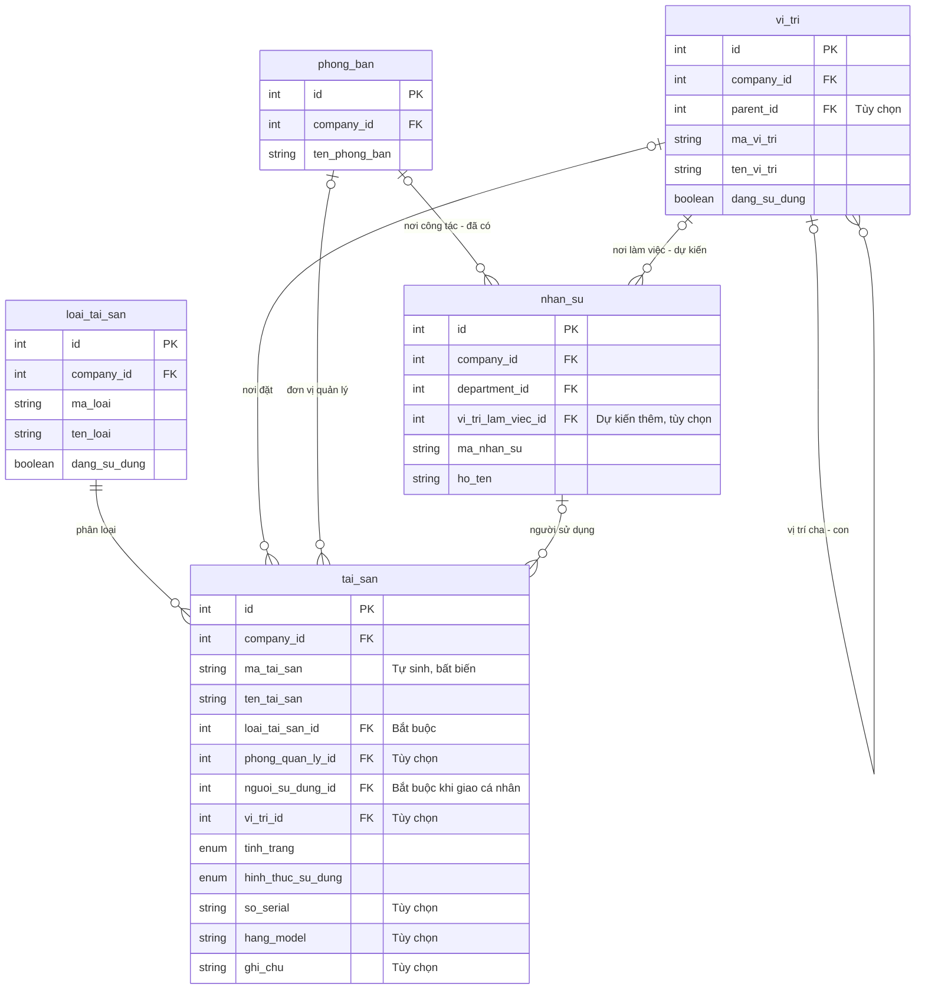
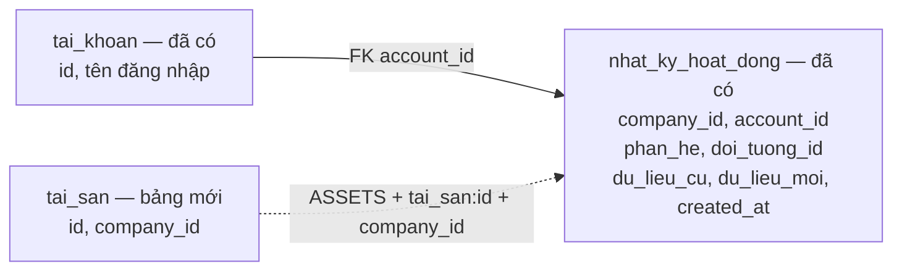

# Kế hoạch quản lý tài sản — mức 1

Cập nhật: **10/11/2026**. Người phụ trách yêu cầu tập trung thiết kế lại **thiết bị quản lý từng chiếc**. Thiết kế dưới đây là phạm vi bản đầu; chưa triển khai schema/UI mới. Các bảng tài sản cũ đã gỡ ngày 31/10; 3D nhân sự vẫn hoạt động độc lập.

Rule nghiệp vụ: [ASSET-MANAGEMENT-RULES](../../.agents/rules/ASSET-MANAGEMENT-RULES.md).

## Phạm vi hiện tại

- Mỗi thiết bị có một hồ sơ, mã cố định, loại, tình trạng, người sử dụng và vị trí khi đã xác định. Số lượng tính từ hồ sơ, không có ô số lượng cho một thiết bị.
- Danh sách/thẻ loại → hồ sơ bên phải → cập nhật thông tin và xem lịch sử. Có tìm kiếm, lọc loại/tình trạng/phòng quản lý/người sử dụng/vị trí.
- Mức 1 chỉ cập nhật hiện trạng: giao cho người khác, đổi vị trí, ghi nhận hỏng/đang sửa/ngừng sử dụng và ghi chú. Chưa có phiếu bàn giao, hồ sơ sửa chữa hay workflow duyệt riêng.
- **Ngoài phạm vi:** vật tư tiêu hao và nhập–xuất–tồn; license phần mềm; bảo trì định kỳ; giá vốn/khấu hao; QR/mã vạch; hiển thị tài sản trên 3D; import/export hàng loạt. Đây là các bước sau, không tự khôi phục thiết kế cũ.
- Bản đầu phục vụ danh mục thiết bị IT được nhập vào ERP. Quyền có phạm vi công ty; chưa có giới hạn dữ liệu theo phòng. Phòng quản lý trên hồ sơ không phải scope phân quyền; IT không mặc định sở hữu hoặc quản lý mọi tài sản của công ty.

## Thiết kế DB cần giữ

**Phân hệ tài sản sở hữu 2 bảng mới**: `loai_tai_san`, `tai_san`; tham chiếu `vi_tri` do [phân hệ vị trí dùng chung](LOCATION-MANAGEMENT-CHECKLIST.md) sở hữu và triển khai trước. Tổng cộng hai phân hệ dự kiến thêm 3 bảng; không tạo lại bảng vị trí trong migration tài sản. Dùng lại nhân sự, phòng ban, tài khoản, RBAC và nhật ký hiện có. Tên Prisma/PostgreSQL giống nhau theo [rule DB](../../.agents/rules/DATABASE-RULES.md).

Các bảng mới có `id`, `company_id`, `created_at`, `updated_at`. Mã unique trong công ty; các FK cùng công ty, Restrict khi đã có tham chiếu. Cột tùy chọn để null khi chưa xác minh, không tạo người/phòng/vị trí giả.

### Sơ đồ bảng và liên kết

**Thiết kế dự kiến, chưa migration.** Tài sản thêm `loai_tai_san`, `tai_san`; `vi_tri` là bảng dùng chung đã triển khai theo plan vị trí. Các bảng HR đã có; FK vị trí nhân sự là bước sau. Sơ đồ rút gọn các cột để tập trung vào liên kết; `PK` là khóa chính, `FK` là khóa ngoại; `||` là đúng một, `o|` là không hoặc một, `o{` là không hoặc nhiều.

Để tránh nhiều đường chéo, không vẽ `cong_ty`: mỗi bảng trên thuộc đúng một công ty qua `company_id`. FK nghiệp vụ được ràng buộc cùng công ty bằng cặp `(id, company_id)`; sơ đồ hiển thị tên cột đơn để dễ đọc. Mã loại/vị trí/tài sản unique theo cặp `(company_id, mã)`, không phải mã duy nhất toàn hệ thống.

**Nhật ký dùng lại, tách khỏi quan hệ người sử dụng:**

Đường nét đứt là liên kết tra cứu lịch sử qua định danh đối tượng, **không phải FK** từ nhật ký đến tài sản. `account_id` hiện nullable để giữ nhật ký khi không còn tài khoản; thao tác tài sản bình thường phải ghi tài khoản từ phiên hợp lệ. Một người có thể dùng nhiều thiết bị mà không có tài khoản đăng nhập; người thao tác cập nhật và người sử dụng thiết bị có thể khác nhau.

### 1. `loai_tai_san` — danh mục loại thiết bị

| Cột nghiệp vụ | Ý nghĩa                                                                    |
| ---------------- | ---------------------------------------------------------------------------- |
| `ma_loai`      | Mã loại, ví dụ LAPTOP, PC, MAY_IN; giữ ổn định                       |
| `ten_loai`     | Tên hiển thị, bắt buộc                                                  |
| `mo_ta`        | Mô tả tùy chọn                                                           |
| `dang_su_dung` | Cho phép chọn khi thêm mới; ngừng dùng không làm mất liên kết cũ |

Chỉ chứa loại thiết bị trong giai đoạn này; không cần cột phân biệt thiết bị/vật tư. Không xây thêm bảng hãng, model hoặc cấu hình ở mức 1.

### Danh mục vị trí dùng lại

`vi_tri` do [plan vị trí](LOCATION-MANAGEMENT-CHECKLIST.md) quản lý thiết kế cột, cây, trạng thái và quyền LOCATIONS. Tài sản chỉ lưu `vi_tri_id` nullable, FK kép cùng công ty, Restrict; chọn vị trí đang dùng và có tổ tiên đang dùng. Trường hợp chưa xác minh để trống.

ASSETS MANAGE được lấy danh mục tối thiểu để chọn, không tự có quyền sửa vị trí. Quản lý loại thiết bị vẫn thuộc tài sản. Khi thêm bảng tài sản phải bổ sung chặn xóa/ngừng dùng vị trí đang được thiết bị tham chiếu, kể cả thiết bị ngừng dùng. Luồng gán vị trí tuân thủ thứ tự khóa chung tại plan vị trí.

### 2. `tai_san` — hồ sơ từng thiết bị

| Cột nghiệp vụ      | Nhãn và yêu cầu                                                                                               |
| --------------------- | ----------------------------------------------------------------------------------------------------------------- |
| `ma_tai_san`        | Mã tài sản tự sinh, ví dụ TS-000001; bất biến, không tái sử dụng                                      |
| `ten_tai_san`       | Tên tài sản — bắt buộc nhập                                                                                |
| `loai_tai_san_id`   | Loại tài sản — bắt buộc chọn từ danh mục                                                                 |
| `tinh_trang`        | Chưa xác nhận / Bình thường / Hỏng / Đang sửa / Ngừng sử dụng; mặc định Chưa xác nhận           |
| `hinh_thuc_su_dung` | Chưa xác định / Cá nhân / Dùng chung / Chưa phân bổ; mặc định Chưa xác định                      |
| `phong_quan_ly_id`  | FK `phong_ban`: đơn vị quản lý thiết bị, tùy chọn                                                      |
| `nguoi_su_dung_id`  | FK `nhan_su`: người được giao thiết bị; bắt buộc khi chọn Cá nhân, các hình thức khác để null |
| `vi_tri_id`         | FK `vi_tri`: vị trí hiện tại, tùy chọn                                                            |
| `so_serial`         | Serial/service tag, tùy chọn; không giả định mọi hãng có serial duy nhất toàn công ty                 |
| `hang_model`        | Hãng/model dạng text, tùy chọn                                                                                |
| `ghi_chu`           | Ghi chú vận hành, tùy chọn; không lưu mật khẩu/secret                                                    |

Quy tắc cụ thể:

- Tên và loại cần nhập/chọn; tình trạng/hình thức có giá trị mặc định nhưng vẫn là trường bắt buộc hợp lệ. Form hiển thị dấu sao đúng theo rule frontend. Nhập thêm serial, vị trí và người sau khi xác minh được.
- Mã cấp an toàn bằng sequence/default và ràng buộc bất biến; không dùng số lượng dòng hoặc `MAX + 1`. Đổi loại/phòng/người không đổi mã.
- Phân biệt **đơn vị quản lý**, **người sử dụng**, **vị trí vật lý**. Không tự đồng bộ vị trí hay đơn vị quản lý khi nhân sự chuyển phòng. Chọn mới người sử dụng đang làm việc và cùng công ty; người nghỉ việc đang giữ thiết bị vẫn giữ liên kết để người quản lý xử lý, không tự thu hồi.
- Thiết bị chưa xác định người dùng không mặc định là dùng chung. AP ngoài sảnh có thể chọn Dùng chung, vị trí Sảnh tầng 2, không gắn người.
- Mức 1 không có cột phòng sử dụng riêng: giao cá nhân thì liên kết người; dùng chung thì ghi vị trí và đơn vị quản lý. Không lấy phòng làm việc hiện tại của người làm bằng chứng bàn giao thiết bị cho cả phòng.
- Không xóa cứng hồ sơ trong mức 1. Thiết bị ngừng dùng giữ mã/lịch sử, lọc theo Ngừng sử dụng; nhập nhầm ghi rõ lý do. Ngừng sử dụng và chưa phân bổ là hai khái niệm khác nhau.
- Chống ghi đè bằng phiên bản `updated_at`; thay đổi thiết bị và audit cùng transaction. Chốt thứ tự khóa chung cho tài sản/danh mục/quyền trước khi viết mutation và kiểm thử đồng thời.

### Lịch sử và bảng dùng lại

- `nhat_ky_hoat_dong`: lưu ai làm, lúc nào, hành động, dữ liệu trước–sau gồm ID và nhãn cần giải thích lịch sử. Phân hệ `ASSETS`, khóa đối tượng có loại kèm ID, ví dụ `tai_san:123`, `loai_tai_san:5`, tránh trùng ID giữa bảng. Thay đổi danh mục vị trí ghi ở `LOCATIONS` theo plan vị trí; đổi nơi đặt thiết bị vẫn ghi ở lịch sử thiết bị. Snapshot nhãn lịch sử không thay FK hiện hành.
- Ghi trực tiếp audit trong transaction; không dùng helper `logActivity` hiện có vốn nuốt lỗi ghi nhật ký. Lỗi audit phải rollback thay đổi thiết bị.
- Lịch sử tại hồ sơ chỉ đọc nhật ký đúng công ty/đúng thiết bị, cho người có ASSETS VIEW; không mở quyền xem toàn bộ nhật ký hệ thống và không trả dữ liệu phân hệ khác.
- `nhan_su`, `phong_ban`: dùng ID có sẵn. `tai_khoan`: người thao tác audit, không phải người sử dụng thiết bị.
- Bảng `quyen`, `vai_tro_quyen`, `tai_khoan_vai_tro`: thêm quyền, giữ nguyên mô hình phân quyền; không tạo role theo loại thiết bị.

## Phân quyền và giao diện

- Đề xuất `ASSETS · VIEW` xem danh sách/chi tiết/lịch sử; `ASSETS · MANAGE` gồm xem, tạo/sửa thiết bị và quản lý danh mục loại; không bao gồm quản lý danh mục vị trí. Menu, trang, truy vấn và mutation kiểm tra cùng chính sách, theo công ty của phiên.
- Khai báo catalog/validation/UI phân quyền cùng với các kiểm tra server. Thêm quyền DB bằng migration, đồng bộ seed cài mới; không chạy lại seed vận hành hoặc tự cấp quyền cho ADMIN/HCNS/role tài sản đã có.
- Form chọn người/phòng chỉ lấy ID, tên, mã, tình trạng cần thiết trong công ty theo ASSETS MANAGE. Không buộc cấp toàn quyền HR, không mở dữ liệu liên hệ/ghi chú HR.
- Trang `/assets`: thẻ số lượng theo loại; trạng thái bằng chữ/nhãn; danh sách ngắn, tìm/lọc; chi tiết và lịch sử trong panel. Đếm thiết bị trên cùng bộ lọc, phân biệt tổng hồ sơ với còn sử dụng. Không dựng tiến độ/số liệu giả.

## Checklist triển khai

- [X] Thiết kế lại mức 1 cho thiết bị; tách vật tư và các lớp bàn giao/bảo trì/3D sang giai đoạn sau. Đồng bộ rule, router và tổng quan; đây là cập nhật tài liệu, chưa đổi schema hoặc dữ liệu.
- [X] Bổ sung sơ đồ ER các bảng/liên kết và sơ đồ nhật ký; ghi rõ bảng mới, bảng dùng lại, quan hệ tùy chọn, phạm vi công ty và liên kết lịch sử không phải FK. Đối chiếu tên liên kết hiện có với schema.
- [x] Tách vị trí thành phân hệ dùng chung, quyền LOCATIONS riêng; tài sản chỉ sở hữu 2 bảng và tham chiếu vị trí. Sơ đồ giữ liên kết nhân sự dự kiến; chưa đổi schema hoặc renderer.
- [x] Nền [quản lý vị trí](LOCATION-MANAGEMENT-CHECKLIST.md) đã triển khai độc lập; tài sản không tạo lại bảng hoặc quyền LOCATIONS.
- [ ] Migration 2 bảng tài sản, FK và quyền ASSETS; bổ sung kiểm tra tham chiếu tại action vị trí, backup DB, thử DB tạm, kiểm tra bảo toàn dữ liệu. FK vị trí nhân sự triển khai riêng theo plan HR.
- [ ] Cài đặt kiểm tra quyền, validation, cấp mã, audit nguyên tử và chống sửa đồng thời.
- [ ] Danh mục loại, bộ chọn vị trí dùng chung, danh sách/chi tiết/tạo/sửa thiết bị, tìm/lọc và lịch sử.
- [ ] Kiểm thử quyền VIEW/MANAGE/không quyền, truy cập trực tiếp, khác công ty, mã đồng thời, FK, chọn vị trí đồng thời với ngừng dùng/xóa, quyền ASSETS không sửa được danh mục vị trí, chuyển người/vị trí, nghỉ việc, audit rollback và mobile/sáng/tối.
- [ ] Người phụ trách chọn tài khoản pilot và gán quyền phù hợp; dùng thử với thiết bị được xác minh. Chưa cấp phạm vi theo từng phòng.
- [ ] Nguồn Excel/ảnh: rà từng thiết bị, mã/người/vị trí và thông tin nhạy cảm trước khi đề xuất nhập; không tự tạo theo số lượng tổng.

## Nguồn và phần giữ lại

Ảnh BMHC 0501 chỉ tham khảo: 11 nhóm/90 thiết bị; file Excel từng khảo sát có 92 dòng, chưa coi là danh mục vận hành đã xác nhận. Chi tiết ở [phân tích nguồn](../strategy/PHAN-TICH-NHAP-TAI-SAN-VA-VI-TRI-DUNG-CHUNG.md). Thiết kế nhiều bảng cũ không áp dụng cho mức 1 hiện tại.

3D nhân sự đã được chỉnh giao diện và kiểm tra desktop/mobile ngày 09/11; không phụ thuộc bảng tài sản mới. Hướng tương lai ở [đánh giá 3D](../strategy/DANH-GIA-TICH-HOP-TAI-SAN-VA-MO-HINH-3D.md); không suy vị trí thiết bị từ cơ cấu tổ chức.

## Hiện trạng vị trí 3D — kiểm tra mã 10/11/2026

- `src/lib/office-3d-data.ts`: 3 tầng và 22 khu vực được khai báo trong code, gồm room ID, tọa độ/kích thước, màu, loại và mã phòng ban tùy chọn. `Office3DViewer` dựng mesh từ cấu hình này. Chưa có bảng vị trí hoặc tọa độ ngồi của nhân sự trong DB.
- Page `/office-3d` lấy các phòng cùng công ty và nhân sự ACTIVE; `RoomDetailSheet` ghép `room.deptCode` với `ma_phong_ban`, rồi lấy người ở phòng đó và các phòng con trực tiếp (không đệ quy mọi cấp). Phòng `t2_hcns_pc` có ngoại lệ gộp trực tiếp HCNS và PC.
- `t2_chutich` và `t2_tonggd` cùng mã BLD nên cùng nhận một danh sách nhân sự; không xác định ai thực sự ngồi ở đâu. Khu vực không có mapping không trả người. Đổi mã phòng có thể làm mất mapping.
- Số CBNV trên đầu trang là toàn bộ nhân sự ACTIVE trong công ty, không phải số đã bố trí trong tòa nhà.
- Hướng thay thế: vị trí DB → nhân sự/tài sản theo FK → 3D hiển thị. Cấu hình hiện tại chỉ làm gợi ý ánh xạ, không tự gán chỗ ngồi từ phòng/chức vụ; vị trí chưa xác nhận để trống.
