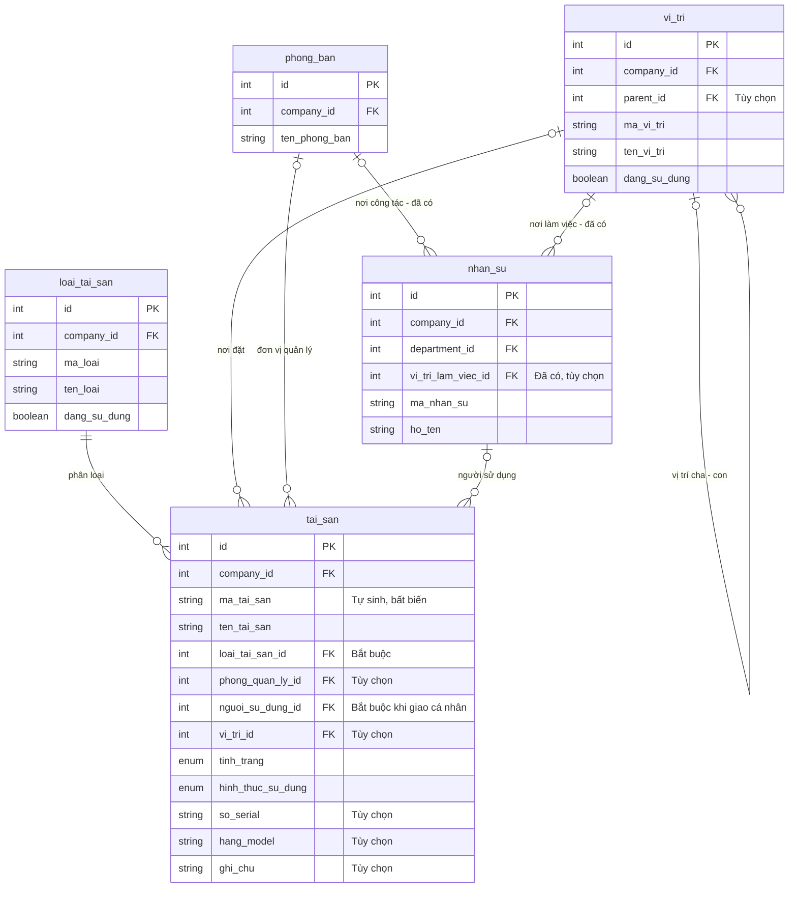
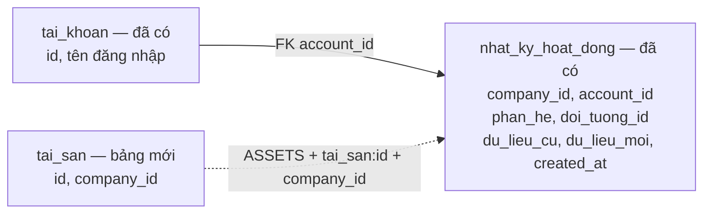

# Kế hoạch quản lý tài sản — mức 1

Cập nhật: **12/11/2026**. **Đã triển khai giao diện mức 1** cho thiết bị quản lý từng chiếc: `/assets` có danh mục loại, tìm/lọc, hồ sơ, chọn người/vị trí và lịch sử trên nền hai bảng cùng quyền ASSETS. Tài khoản `admin` đã được cấp ASSETS MANAGE theo yêu cầu; sẵn sàng chọn người phụ trách và thiết bị dùng thử. Người dùng đã tạo PC đầu tiên ngày 12/11; gán/chuyển/bỏ gán từ 3D HCNS đã triển khai và kiểm chứng. Thiết kế nhiều bảng cũ đã gỡ ngày 31/10 không được khôi phục; 3D nhân sự hoạt động độc lập.

Rule nghiệp vụ: [ASSET-MANAGEMENT-RULES](../../.agents/rules/ASSET-MANAGEMENT-RULES.md).

Đọc nhanh: [A. Tổng quan để duyệt](#a-tổng-quan-để-duyệt) · [B. Chi tiết triển khai](#b-chi-tiết-triển-khai) · [Checklist](#checklist-triển-khai).

## A. Tổng quan để duyệt

### Phạm vi hiện tại

- Mỗi thiết bị có một hồ sơ, mã cố định, loại, tình trạng, người sử dụng và vị trí khi đã xác định. Số lượng tính từ hồ sơ, không có ô số lượng cho một thiết bị.
- Danh sách/thẻ loại → hồ sơ bên phải → cập nhật thông tin và xem lịch sử. Có tìm kiếm, lọc loại/tình trạng/phòng quản lý/người sử dụng/vị trí.
- Mức 1 chỉ cập nhật hiện trạng: giao cho người khác, đổi vị trí, ghi nhận hỏng/đang sửa/ngừng sử dụng và ghi chú. Chưa có phiếu bàn giao, hồ sơ sửa chữa hay workflow duyệt riêng.
- **Ngoài phạm vi:** vật tư tiêu hao và nhập–xuất–tồn; license phần mềm; bảo trì định kỳ; giá vốn/khấu hao; QR/mã vạch; import/export hàng loạt. Đây là các bước sau, không tự khôi phục thiết kế cũ.
- Bản đầu phục vụ danh mục thiết bị IT được nhập vào ERP. Quyền có phạm vi công ty; chưa có giới hạn dữ liệu theo phòng. Phòng quản lý trên hồ sơ không phải scope phân quyền; IT không mặc định sở hữu hoặc quản lý mọi tài sản của công ty.

### Trạng thái triển khai — 12/11/2026

Người phụ trách vận hành được chọn bằng tài khoản và quyền tại `/roles`. Người sử dụng từng thiết bị chọn trong form tài sản, có thể là nhân sự không có tài khoản. Hai vai trò này độc lập; không thêm cột người giữ/đầu mối vào DB. Đã cấp ASSETS MANAGE cho `admin` theo yêu cầu, qua vai trò ADMIN hiện chỉ gán cho tài khoản này. Người phụ trách nghiệp vụ cụ thể và nguồn thiết bị dùng thử vẫn chờ lựa chọn.

Đã thực hiện theo yêu cầu: thử migration trên DB khôi phục riêng và DB cài mới, sao lưu rồi áp dụng local; dữ liệu 15 bảng cũ và grant hiện có giữ nguyên. **Giao diện `/assets` đã hoàn thành và kiểm thử trên DB riêng**; bước nghiệp vụ tiếp theo là chọn người phụ trách và nhóm thiết bị đã xác minh để dùng thử. Không cần chờ 3D hoặc workflow bàn giao.

| Điểm cần xử lý | Đánh giá và thời điểm |
| --- | --- |
| Chức năng mới | Đã có `/assets`, danh mục loại, tạo/sửa thiết bị, bộ chọn người/phòng/vị trí, lịch sử, tìm/lọc và phân trang. Thẻ số lượng và danh sách dùng cùng bộ lọc; menu kiểm tra ASSETS. |
| Quy tắc lưu | Đã có khóa chung, kiểm tra phiên bản, cấp mã, ràng buộc Cá nhân/người sử dụng, giữ liên kết cũ khi người nghỉ hoặc loại ngừng dùng, audit cùng giao dịch. |
| Liên kết với chức năng đang có | Đã chặn xóa/ngừng dùng vị trí còn tài sản, chặn xóa phòng quản lý còn tài sản; ASSETS MANAGE lấy danh mục chọn tối thiểu mà không có quyền sửa vị trí hoặc đọc toàn bộ HR. |
| Điều kiện trước khi dùng thử | `admin` đã có quyền quản lý; chọn người phụ trách nghiệp vụ/tài khoản bổ sung qua `/roles` và xác minh một nhóm thiết bị để nhập thủ công. Phạm vi quyền mức 1 là toàn công ty; nếu cần giới hạn theo phòng phải điều chỉnh thiết kế trước khi cấp quyền pilot. |

Tài liệu đánh giá 3D ngày 21/10 và phân tích nguồn ngày 27/10 chỉ dùng để tra bối cảnh/nguồn: các mô tả schema nhiều bảng, seed và renderer trong đó đã cũ. Plan này, plan vị trí và plan 3D hiện hành quản lý thiết kế triển khai.

## B. Chi tiết triển khai

### Thiết kế DB cần giữ

**Phân hệ tài sản sở hữu 2 bảng đã triển khai**: `loai_tai_san`, `tai_san`; tham chiếu `vi_tri` do [phân hệ vị trí dùng chung](LOCATION-MANAGEMENT-CHECKLIST.md) sở hữu. Migration `20261111095809_tai_san_muc_1` chỉ thêm hai bảng này, enum/sequence/ràng buộc và catalog quyền, không tạo lại vị trí hoặc chạy seed. Dùng lại nhân sự, phòng ban, tài khoản, RBAC và nhật ký hiện có. Tên Prisma/PostgreSQL giống nhau theo [rule DB](../../.agents/rules/DATABASE-RULES.md).

Các bảng mới có `id`, `company_id`, `created_at`, `updated_at`. Mã unique trong công ty; các FK cùng công ty, Restrict khi đã có tham chiếu. Cột tùy chọn để null khi chưa xác minh, không tạo người/phòng/vị trí giả.

#### Sơ đồ bảng và liên kết

**Hai bảng tài sản và các liên kết dưới đây đã migration.** `vi_tri` và các bảng HR dùng lại; FK `nhan_su.vi_tri_lam_viec_id` vẫn nullable và Restrict cùng công ty. Sơ đồ rút gọn các cột để tập trung vào liên kết; `PK` là khóa chính, `FK` là khóa ngoại; `||` là đúng một, `o|` là không hoặc một, `o{` là không hoặc nhiều.

Để tránh nhiều đường chéo, không vẽ `cong_ty`: mỗi bảng trên thuộc đúng một công ty qua `company_id`. FK nghiệp vụ được ràng buộc cùng công ty bằng cặp `(id, company_id)`; sơ đồ hiển thị tên cột đơn để dễ đọc. Mã loại/vị trí/tài sản unique theo cặp `(company_id, mã)`, không phải mã duy nhất toàn hệ thống.

**Nhật ký dùng lại, tách khỏi quan hệ người sử dụng:**

Đường nét đứt là liên kết tra cứu lịch sử qua định danh đối tượng, **không phải FK** từ nhật ký đến tài sản. `account_id` hiện nullable để giữ nhật ký khi không còn tài khoản; thao tác tài sản bình thường phải ghi tài khoản từ phiên hợp lệ. Một người có thể dùng nhiều thiết bị mà không có tài khoản đăng nhập; người thao tác cập nhật và người sử dụng thiết bị có thể khác nhau.

#### 1. `loai_tai_san` — danh mục loại thiết bị

| Cột nghiệp vụ | Ý nghĩa                                                                    |
| ---------------- | ---------------------------------------------------------------------------- |
| `ma_loai`      | Mã loại, ví dụ LAPTOP, PC, MAY_IN; giữ ổn định                       |
| `ten_loai`     | Tên hiển thị, bắt buộc                                                  |
| `mo_ta`        | Mô tả tùy chọn                                                           |
| `dang_su_dung` | Cho phép chọn khi thêm mới; ngừng dùng không làm mất liên kết cũ |

Chỉ chứa loại thiết bị trong giai đoạn này; không cần cột phân biệt thiết bị/vật tư. Không xây thêm bảng hãng, model hoặc cấu hình ở mức 1.

#### Danh mục vị trí dùng lại

`vi_tri` do [plan vị trí](LOCATION-MANAGEMENT-CHECKLIST.md) quản lý thiết kế cột, cây, trạng thái và quyền LOCATIONS. Tài sản chỉ lưu `vi_tri_id` nullable, FK kép cùng công ty, Restrict; chọn vị trí đang dùng và có tổ tiên đang dùng. Trường hợp chưa xác minh để trống.

ASSETS MANAGE được lấy danh mục tối thiểu để chọn, không tự có quyền sửa vị trí. Quản lý loại thiết bị vẫn thuộc tài sản. Preview/action/DB chặn xóa/ngừng dùng vị trí đang được thiết bị tham chiếu, kể cả thiết bị ngừng dùng. Luồng gán vị trí tuân thủ thứ tự khóa chung tại plan vị trí.

#### 2. `tai_san` — hồ sơ từng thiết bị

| Cột nghiệp vụ      | Nhãn và yêu cầu                                                                                               |
| --------------------- | ----------------------------------------------------------------------------------------------------------------- |
| `ma_tai_san`        | Mã tài sản tự sinh, ví dụ TS-000001; bất biến, không tái sử dụng                                      |
| `ten_tai_san`       | Tên tài sản — bắt buộc nhập                                                                                |
| `loai_tai_san_id`   | Loại tài sản — bắt buộc chọn từ danh mục                                                                 |
| `tinh_trang`        | Chưa xác nhận / Bình thường / Hỏng / Đang sửa / Ngừng sử dụng; mặc định Chưa xác nhận           |
| `hinh_thuc_su_dung` | Chưa xác định / Cá nhân / Dùng chung / Chưa phân bổ; mặc định Chưa xác định                      |
| `phong_quan_ly_id`  | FK `phong_ban`: đơn vị quản lý thiết bị, tùy chọn                                                      |
| `nguoi_su_dung_id`  | FK `nhan_su`: người được giao thiết bị; bắt buộc khi chọn Cá nhân, các hình thức khác để null |
| `vi_tri_id`         | FK `vi_tri`: vị trí hiện tại, tùy chọn                                                            |
| `so_serial`         | Serial/service tag, tùy chọn; không giả định mọi hãng có serial duy nhất toàn công ty                 |
| `hang_model`        | Hãng/model dạng text, tùy chọn                                                                                |
| `ghi_chu`           | Ghi chú vận hành, tùy chọn; không lưu mật khẩu/secret                                                    |

Quy tắc cụ thể:

- Tên và loại cần nhập/chọn; tình trạng/hình thức có giá trị mặc định nhưng vẫn là trường bắt buộc hợp lệ. Form hiển thị dấu sao đúng theo rule frontend. Nhập thêm serial, vị trí và người sau khi xác minh được.
- Mã cấp an toàn bằng sequence/default và ràng buộc bất biến; không dùng số lượng dòng hoặc `MAX + 1`. Đổi loại/phòng/người không đổi mã.
- Phân biệt **đơn vị quản lý**, **người sử dụng**, **vị trí vật lý**. Không tự đồng bộ vị trí hay đơn vị quản lý khi nhân sự chuyển phòng. Chọn mới người sử dụng đang làm việc và cùng công ty; người nghỉ việc đang giữ thiết bị vẫn giữ liên kết để người quản lý xử lý, không tự thu hồi.
- Thiết bị chưa xác định người dùng không mặc định là dùng chung. AP ngoài sảnh có thể chọn Dùng chung, vị trí Sảnh tầng 2, không gắn người.
- Mức 1 không có cột phòng sử dụng riêng: giao cá nhân thì liên kết người; dùng chung thì ghi vị trí và đơn vị quản lý. Không lấy phòng làm việc hiện tại của người làm bằng chứng bàn giao thiết bị cho cả phòng.
- Không xóa cứng hồ sơ trong mức 1. Thiết bị ngừng dùng giữ mã/lịch sử, lọc theo Ngừng sử dụng; nhập nhầm ghi rõ lý do. Ngừng sử dụng và chưa phân bổ là hai khái niệm khác nhau.
- Chống ghi đè bằng phiên bản `updated_at` cho cả thiết bị và loại. Mutation khóa hàng công ty → advisory phân quyền `(260126, companyId)` → kiểm tra lại phiên/quyền, phiên bản và tham chiếu → ghi dữ liệu/audit trong cùng transaction. Luồng vị trí, HR, phòng ban và tài sản dùng cùng thứ tự; trigger DB cũng khóa công ty để bảo vệ tham chiếu khi ghi trực tiếp.
- DB dùng enum `TinhTrangTaiSan` (`CHUA_XAC_NHAN`, `BINH_THUONG`, `HONG`, `DANG_SUA`, `NGUNG_SU_DUNG`) và `HinhThucSuDungTaiSan` (`CHUA_XAC_DINH`, `CA_NHAN`, `DUNG_CHUNG`, `CHUA_PHAN_BO`). CHECK bảo đảm Cá nhân khi và chỉ khi có người sử dụng; FK kép cùng công ty cho loại/người/phòng/vị trí. Trigger chặn đổi ID/công ty/mã và xóa cứng thiết bị.
- Chỉ kiểm tra trạng thái người/loại khi tạo hoặc đổi liên kết; giữ người đã nghỉ/loại ngừng dùng khi sửa trường khác. Loại được ngừng dùng dù còn hồ sơ cũ; mã loại nhập chữ hoa, số/gạch dưới, bất biến. Không áp dụng điều kiện loại vị trí làm việc của HR cho thiết bị; thiết bị được chọn mọi loại vị trí đang dùng với tổ tiên đang dùng.

#### Lịch sử và bảng dùng lại

- `nhat_ky_hoat_dong`: lưu ai làm, lúc nào, hành động, dữ liệu trước–sau gồm ID và nhãn cần giải thích lịch sử. Phân hệ `ASSETS`, khóa đối tượng có loại kèm ID, ví dụ `tai_san:123`, `loai_tai_san:5`, tránh trùng ID giữa bảng. Thay đổi danh mục vị trí ghi ở `LOCATIONS` theo plan vị trí; đổi nơi đặt thiết bị vẫn ghi ở lịch sử thiết bị. Snapshot nhãn lịch sử không thay FK hiện hành.
- Ghi trực tiếp audit trong transaction; không dùng helper `logActivity` hiện có vốn nuốt lỗi ghi nhật ký. Lỗi audit phải rollback thay đổi thiết bị.
- Lịch sử tại hồ sơ chỉ đọc nhật ký đúng công ty/đúng thiết bị, cho người có ASSETS VIEW; không mở quyền xem toàn bộ nhật ký hệ thống và không trả dữ liệu phân hệ khác.
- `nhan_su`, `phong_ban`: dùng ID có sẵn. `tai_khoan`: người thao tác audit, không phải người sử dụng thiết bị.
- Bảng `quyen`, `vai_tro_quyen`, `tai_khoan_vai_tro`: thêm quyền, giữ nguyên mô hình phân quyền; không tạo role theo loại thiết bị.

### Phân quyền và giao diện

- `ASSETS · VIEW` xem danh sách/chi tiết/lịch sử; `ASSETS · MANAGE` gồm xem, tạo/sửa thiết bị và quản lý danh mục loại; không bao gồm quản lý danh mục vị trí. Server và ma trận `/roles` đã áp dụng; menu/trang `/assets` áp dụng cùng chính sách.
- Khai báo catalog/validation/UI phân quyền cùng với các kiểm tra server. Thêm quyền DB bằng migration, đồng bộ seed cài mới; không chạy lại seed vận hành hoặc tự cấp quyền cho ADMIN/HCNS/role tài sản đã có.
- Form chọn người/phòng chỉ lấy ID, tên, mã, tình trạng cần thiết trong công ty theo ASSETS MANAGE. Không buộc cấp toàn quyền HR, không mở dữ liệu liên hệ/ghi chú HR.
- Trang `/assets`: thẻ số lượng theo loại; trạng thái bằng chữ/nhãn; danh sách ngắn, tìm/lọc; chi tiết và lịch sử trong panel. Đếm thiết bị trên cùng bộ lọc, phân biệt tổng hồ sơ với còn sử dụng. Không dựng tiến độ/số liệu giả.

Nền server tại `src/actions/asset.ts`: `getAssets` (phân trang và đếm trên cùng bộ lọc), `getAssetFilterOptions` (nhãn đã gắn hồ sơ), `getAssetCategories`, `getAsset`, `getAssetHistory` (50 sự kiện mới nhất của đúng thiết bị), `getAssetAssignmentOptions`, `saveAssetCategory`, `saveAsset`. Mutation dùng schema strict tại `src/lib/validations/asset.ts`; chưa có action xóa thiết bị hoặc endpoint REST. `getLocationOptions` dùng lại từ phân hệ vị trí. Payload sửa role cũ không có ASSETS giữ nguyên grant này, không vô tình thu hồi khi cập nhật tên/quyền khác.

### Checklist triển khai

- [x] Ô chọn loại, người, phòng và vị trí trong form/bộ lọc: đã chuyển sang tìm/chọn có hỗ trợ không dấu; kiểm thử giao diện và hồi quy đạt. Cách dùng chung và kiểm chứng tại [tổng quan](README.md#ô-chọn-dữ-liệu-có-tìm-kiếm--12112026). Không đổi dữ liệu hoặc quyền.

- [X] Thiết kế lại mức 1 cho thiết bị; tách vật tư và các lớp bàn giao/bảo trì/3D sang giai đoạn sau. Đồng bộ rule, router và tổng quan; đây là cập nhật tài liệu, chưa đổi schema hoặc dữ liệu.
- [X] Bổ sung sơ đồ ER các bảng/liên kết và sơ đồ nhật ký; ghi rõ bảng mới, bảng dùng lại, quan hệ tùy chọn, phạm vi công ty và liên kết lịch sử không phải FK. Đối chiếu tên liên kết hiện có với schema.
- [x] Tách vị trí thành phân hệ dùng chung, quyền LOCATIONS riêng; tài sản chỉ sở hữu 2 bảng và tham chiếu vị trí. Đối chiếu 11/11 cập nhật sơ đồ với FK nhân sự đã có; không đổi schema hoặc renderer.
- [x] Nền [quản lý vị trí](LOCATION-MANAGEMENT-CHECKLIST.md) đã triển khai độc lập; tài sản không tạo lại bảng hoặc quyền LOCATIONS.
- [x] Rà soát khả năng bắt đầu trước đợt 1 qua plan/rule và mã nguồn; kết luận và điều kiện pilot đã được dùng để triển khai nền dữ liệu theo yêu cầu tiếp theo.
- [x] Hoàn thiện và thực hiện thứ tự khóa, enum/CHECK, bảo vệ mã, giữ liên kết cũ, trạng thái danh mục và phiên bản thiết bị/loại tại mục DB.
- [x] Migration tạo bằng `migrate dev --create-only`, thử trên bản khôi phục và chuỗi migration cài mới; schema diff đều sạch. Sau backup mới, áp dụng local: 17 bảng nghiệp vụ, thêm đúng 2 quyền, 0 grant ASSETS, 0 loại/thiết bị. Fingerprint 15 bảng cũ giữ nguyên (so sánh catalog quyền cũ riêng), các sequence cũ ngoài sequence cấp ID quyền không thay đổi. Backup/bằng chứng tại `outputs/assets-foundation/`.
- [x] Bảo vệ tham chiếu vị trí ở preview/action/DB, chặn xóa phòng quản lý còn tài sản; bộ chọn tối thiểu theo ASSETS MANAGE. Không tự gỡ thiết bị khi xóa vị trí hoặc cấp quyền HR/LOCATIONS.
- [x] Server Actions, validation, mã tự sinh, audit nguyên tử và kiểm tra phiên bản; catalog/seed cài mới/validation/ma trận `/roles` đồng bộ. Không chạy seed trên DB vận hành hoặc tự cấp quyền.
- [x] 10 kiểm thử tích hợp DB/Server Actions, 6 unit và 13 E2E ma trận quyền/vị trí/phân quyền đạt; kiểm tra lại bố cục hộp thoại trên mobile đạt. TypeScript/lint phần ứng dụng đạt. Kiểm tra tích hợp giả lập cookie request/cache Next, dùng JWT/phiên/RBAC/DB thật; E2E dùng Chrome và DB riêng. Đây là kiểm chứng nền trước đợt giao diện; kiểm chứng mới nằm dưới.
- [x] Build production Webpack trên bản app riêng đạt; khởi động lại web local cổng 4000 sau generate/migration, `/login` trả 200. Next.js có cảnh báo nâng phiên bản bảo mật và middleware có sẵn; đã chạy lại lệnh sau thông báo, không thay dependency trong đợt tài sản.
- [x] Dọn các DB thử do đợt này tạo; kiểm tra local có 18 migration, checksum migration mới khớp và 3 trigger tài sản. Lint kiểm thử tích hợp, 144 liên kết/anchor trong 11 tài liệu và `git diff --check` đạt; backup/script/bằng chứng được Git bỏ qua. Không sửa ba rule kỹ thuật chung.
- [x] Xây giao diện danh mục loại, bộ chọn vị trí, danh sách/chi tiết/tạo/sửa thiết bị, tìm/lọc và lịch sử; truy vấn danh sách/phân trang 20 hồ sơ và thống kê dùng cùng bộ lọc. Có tải lại khi lỗi, giữ nội dung form, giữ bộ lọc khi đóng hồ sơ; chọn người chỉ khi giao cá nhân.
- [x] 11 kiểm thử tích hợp DB/Server Actions và 6 E2E `/assets` đạt trên DB riêng: phân trang/số đếm cùng bộ lọc, tạo loại/thiết bị, giao cá nhân → dùng chung, đổi vị trí/tình trạng, lịch sử, VIEW/MANAGE/không quyền, URL/action trực tiếp, khác công ty, thu hồi quyền, chống ghi đè và giữ liên kết ngừng dùng. Chrome desktop/mobile 390px sáng/tối đã xem ảnh; lỗi mạng có tải lại và giữ nội dung form. Bằng chứng tại `outputs/assets-ui/`.
- [x] Cấp ASSETS MANAGE/ALL cho `admin` ngày 12/11 theo yêu cầu, sau backup: thêm đúng một grant vào ADMIN (chỉ gán admin), cập nhật phiên bản role và ghi audit ROLE trong cùng transaction. Nhật ký nêu rõ tác vụ triển khai cục bộ, không giả ghi phiên đăng nhập người dùng. Quyền mọi tài khoản khác và dữ liệu 14 bảng ngoài role/grant/audit giữ nguyên; không chạy seed. Backup và fingerprint tại `outputs/assets-ui/`.
- [x] TypeScript, lint phần thay đổi và build production Webpack trên app riêng đạt. Build chạy lại sau cảnh báo bảo mật Next.js hiện có; còn cảnh báo middleware/Edge từ dependency dùng chung, không đổi thư viện hoặc cấu hình.
- [x] Kiểm tra bằng admin trên `http://localhost:4000/assets`: menu, trạng thái trống và form loại hoạt động, không có lỗi JavaScript; không lưu dữ liệu thử. Đã xóa DB thử riêng, giữ backup/bằng chứng. 14 bảng ngoài RBAC/audit không đổi so với trước kiểm thử; admin giữ quyền đã cấp, 0 loại/thiết bị. Sau mốc cấp quyền có thêm một cập nhật role ASSETS từ phiên admin (audit 249), được giữ nguyên, không thuộc script cấp quyền này. 141 liên kết/anchor trong 7 tài liệu và `git diff --check` đạt.
- [ ] Chọn người phụ trách nghiệp vụ và tài khoản bổ sung nếu cần; dùng thử với thiết bị được xác minh. Tài khoản admin đã sẵn sàng, chưa nghiệm thu nghiệp vụ và chưa cấp phạm vi theo từng phòng.
- [ ] Nguồn Excel/ảnh: rà từng thiết bị, mã/người/vị trí và thông tin nhạy cảm trước khi đề xuất nhập; không tự tạo theo số lượng tổng.

### Nguồn và phần giữ lại

Ảnh BMHC 0501 chỉ tham khảo: 11 nhóm/90 thiết bị; file Excel từng khảo sát có 92 dòng, chưa coi là danh mục vận hành đã xác nhận. Chi tiết ở [phân tích nguồn](../strategy/PHAN-TICH-NHAP-TAI-SAN-VA-VI-TRI-DUNG-CHUNG.md). Thiết kế nhiều bảng cũ không áp dụng cho mức 1 hiện tại.

3D nhân sự đã được chỉnh giao diện và kiểm tra desktop/mobile ngày 09/11; không phụ thuộc bảng tài sản mới. Hướng tương lai ở [đánh giá 3D](../strategy/DANH-GIA-TICH-HOP-TAI-SAN-VA-MO-HINH-3D.md); không suy vị trí thiết bị từ cơ cấu tổ chức.

### Liên kết với vị trí và 3D

Đã triển khai và kiểm chứng ngày 12/11: [plan 3D](OFFICE-3D-CHECKLIST.md#gán-tài-sản-tại-vị-trí-3d) sở hữu giao diện tại HCNS; [plan vị trí](LOCATION-MANAGEMENT-CHECKLIST.md) sở hữu cây `vi_tri`. Nhân sự và thiết bị có FK vị trí riêng, không chuyển thiết bị theo người.

| Quyền | Phạm vi |
| --- | --- |
| LOCATIONS VIEW/MANAGE | Vào viewer và chọn vị trí; không tự xem tài sản |
| Thêm ASSETS VIEW | Đọc danh sách thiết bị và hình đại diện tại điểm liên kết hợp lệ |
| Thêm ASSETS MANAGE | Gán/chuyển/bỏ gán; không sửa cây vị trí hoặc hồ sơ HR |

- `assignAssetLocation` chỉ đổi `tai_san.vi_tri_id` và `updated_at`; dùng ASSETS MANAGE, cùng khóa hàng công ty → advisory `(260126, company_id)` → kiểm tra lại phiên/quyền. Không có schema/migration mới.
- Payload strict gồm thiết bị, vị trí đích nullable, phiên bản đã đọc và xác nhận. Vị trí phải cùng công ty, đang dùng và mọi tổ tiên còn dùng; điểm đặt thiết bị dùng được, không giới hạn theo loại chỗ ngồi HR.
- Thiết bị đã có vị trí phải xác nhận khi chuyển/bỏ gán. Cùng vị trí không tạo trùng hoặc audit thừa. Phiên bản cũ bị từ chối, không tự ghi đè; thay đổi và nhật ký ASSETS `tai_san:id` cùng transaction, trước–sau có đường dẫn vị trí. Lỗi audit rollback toàn bộ.
- Giữ nguyên mã, người sử dụng, phòng quản lý, tình trạng và các trường còn lại. Thiết bị ngừng dùng vẫn có thể ghi nhận/chuyển nơi đặt hoặc bỏ gán, không bị mất lịch sử.
- `getAssetLocationCandidates` chỉ trả trường chọn tối thiểu, 20 hồ sơ/trang; lấy dữ liệu theo công ty phiên, không có HR hoặc ghi chú/serial trong kết quả. `saveAsset` cũng làm mới viewer khi đổi vị trí từ `/assets`.
- Hình PC/máy in trong HCNS nay đại diện hồ sơ đã gán, không dựng từ ghi chú khảo sát. Giới hạn mẫu hình và tương tác thuộc plan 3D.
- [x] Hoàn thiện action gán riêng, validation, danh sách chọn tối thiểu, cập nhật cache và liên kết với panel 3D.
- [x] 7 kiểm thử tích hợp action/quyền/đồng thời/audit và 4 E2E Chrome đạt trên DB riêng; không thay PC vận hành hoặc tự cấp quyền. Kết quả UI, kiểm tra cổng 4000 chỉ đọc và dọn môi trường thử tại [plan 3D](OFFICE-3D-CHECKLIST.md#gán-tài-sản-tại-vị-trí-3d).
