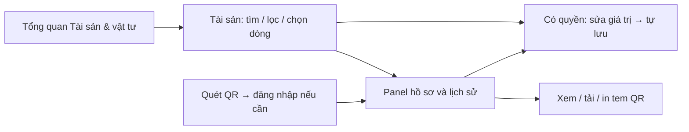
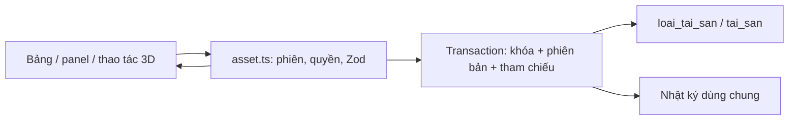

# Kế hoạch quản lý tài sản

Cập nhật: **23/11/2026**. **Chức năng hiện hành đã triển khai và có kiểm chứng kỹ thuật; chưa nghiệm thu vận hành.** Lần chuẩn hóa A/B này chỉ sửa tài liệu, không thay đổi chức năng, DB hoặc quyền.

[Rule nghiệp vụ](../../.agents/rules/ASSET-MANAGEMENT-RULES.md) · [A. Đặc tả yêu cầu](#a-đặc-tả-yêu-cầu) · [B. Thiết kế kỹ thuật](#b-thiết-kế-kỹ-thuật) · [Chi tiết kỹ thuật](../THIET-KE-QUAN-LY-TAI-SAN.md) · [Quy chuẩn plan](README.md#quy-chuẩn-lập-và-cập-nhật-plan).

## A. Đặc tả yêu cầu

### Mục tiêu và phạm vi hiện tại

Giúp người phụ trách biết **công ty có thiết bị gì, ai đang dùng, ở đâu và tình trạng ra sao**; tra lại thay đổi khi cần. Mỗi thiết bị có một hồ sơ và mã riêng. Vật tư tiêu hao/phụ kiện quản lý theo số lượng thuộc [plan vật tư](INVENTORY-MANAGEMENT-CHECKLIST.md).

Phạm vi hiện hành là cập nhật hiện trạng và lịch sử. Chưa có phiếu bàn giao, duyệt cấp phát, hồ sơ sửa chữa/bảo trì, kiểm kê, license hoặc màn hình nhập/xuất Excel hàng loạt. Đổi người sử dụng hiện tại chưa tương đương người nhận đã xác nhận bàn giao.

### Người dùng và quyền thao tác

| Người dùng | Được làm gì? | Giới hạn |
| --- | --- | --- |
| Người được cấp quyền Xem tài sản | Xem tổng quan, tìm/lọc, mở hồ sơ/lịch sử, xem/tải/in QR | Xem thiết bị trong công ty; không sửa |
| Người được cấp quyền Quản lý tài sản | Toàn bộ quyền xem; thêm/sửa thiết bị và loại; chọn người, phòng quản lý, vị trí | Chỉ chọn dữ liệu có sẵn; không tự có quyền sửa hồ sơ nhân sự hoặc cây vị trí |
| Người sử dụng thiết bị | Được ghi nhận là người giữ/dùng thiết bị | Không tự có quyền vào phân hệ, không bắt buộc có tài khoản |

Quyền hiện hành áp dụng toàn công ty, chưa giới hạn theo phòng. Trường Phòng quản lý mô tả trách nhiệm, không tự giới hạn người xem. Người phụ trách tự cấp quyền bổ sung; tài khoản `admin` đã được cấp quyền quản lý theo yêu cầu ngày 12/11.

### Màn hình và yêu cầu sử dụng

| Mã | Nơi thao tác | Yêu cầu và hành vi quan sát được |
| --- | --- | --- |
| TS-01 | Tổng quan Tài sản & vật tư | Một ô tìm kiếm chung ngay trên ba card: nhập mã/tên, chọn gợi ý mở thẳng tài sản, vật tư tiêu hao hoặc phụ kiện theo quyền. Để trống không hiện gợi ý. Giữ phân bố loại, thiết bị cần rà soát và vừa cập nhật. |
| TS-02 | Danh sách tài sản | Bảng và bộ lọc loại nhỏ, tìm tên/mã/serial/model, xem nhóm người/vị trí. Giữ tìm/lọc và trang khi mở rồi đóng hồ sơ. |
| TS-03 | Thêm hồ sơ, quản lý loại | Nhập tên, chọn loại; mã thiết bị tự sinh và không sửa. Cá nhân phải chọn người; Dùng chung/Chưa phân bổ/Chưa xác định không gắn người. Ngừng dùng giữ hồ sơ và lịch sử. |
| TS-04 | Sửa trong bảng/panel | Người có quyền bấm trực tiếp giá trị, kể cả Chưa rõ. Chọn để tự lưu; chữ/số/ngày lưu khi rời ô hoặc Enter. Lỗi giữ nội dung và cho thử lại, không âm thầm mất thay đổi. Tạo mới vẫn bấm xác nhận. |
| TS-05 | Hồ sơ và lịch sử | Có liên kết riêng mở đúng panel; xem ai sửa, thời điểm và trước–sau. Người, phòng quản lý và vị trí là ba thông tin độc lập; đổi người không tự chuyển vị trí. |
| TS-06 | Mua sắm & khấu hao | Ngày mua, giá, thời gian khấu hao, hạn bảo hành tùy chọn và mặc định thu gọn. Đủ ngày mua/thời gian mới hiện thanh phần còn lại xanh–vàng–đỏ; không thay tình trạng thiết bị. |
| TS-07 | Tem QR | Mỗi hồ sơ có QR dẫn tới liên kết của nó; xem, tải ảnh, in một tem. Người quét vẫn đăng nhập và cần quyền xem. |
| TS-08 | Bản đồ 3D | Tại phòng đã liên kết, xem/gán/chuyển/bỏ gán tài sản theo quyền; giữ mã, người và các thông tin khác khi đổi nơi đặt. |

Luồng chính:

Giữ giao diện gọn: card ở tổng quan, loại là bộ lọc nhỏ; thông tin phụ trong phần mở rộng. Danh mục dài có tìm kiếm. Bố cục thích ứng điện thoại, dùng được bàn phím và chế độ sáng/tối. Quy chuẩn liên phân hệ do [plan kiến trúc thông tin](INFORMATION-ARCHITECTURE-CHECKLIST.md#3-áp-dụng-đầu-tiên-cho-tài-sản--vật-tư) quản lý.

### Tiêu chí nghiệm thu

| Mã | Người dùng cần kiểm tra được | Yêu cầu liên quan |
| --- | --- | --- |
| NT-01 | Tổng quan chỉ hiện hạng mục có quyền; bấm số đếm mở đúng lọc; tìm trong loại/toàn bộ đúng phạm vi và quay lại giữ ngữ cảnh | TS-01,02 |
| NT-02 | Tạo thiết bị có mã riêng; không sửa mã; Cá nhân phải có người; không xóa mất hồ sơ khi ngừng dùng | TS-03 |
| NT-03 | Sửa trực tiếp tự lưu đúng; báo trạng thái; mất mạng/dữ liệu sai/xung đột giữ bản nháp, không báo lưu thành công sai hoặc mất dữ liệu khi đóng | TS-04 |
| NT-04 | Người chỉ xem không sửa được; biết link không vượt quyền/công ty; lịch sử đúng thiết bị và đúng người thao tác | TS-05 và mọi màn hình |
| NT-05 | Phần khấu hao tùy chọn; thanh chỉ hiện khi đủ dữ liệu, mức loại không tự ghi đè thiết bị cũ; mã/kết quả tính không sửa được | TS-06 |
| NT-06 | Link mở đúng hồ sơ qua đăng nhập/đổi mật khẩu; ảnh QR giải mã đúng; điện thoại và máy in thực tế dùng được địa chỉ ERP | TS-07 |
| NT-07 | Gán/chuyển/bỏ gán trên 3D đúng thiết bị, đúng quyền; đổi vị trí không đổi người hoặc mã, lịch sử ghi nhận đúng | TS-08 |
| NT-08 | Trên điện thoại/desktop, bàn phím, sáng/tối: không tràn trang; đọc được lỗi, thao tác sửa/tìm/mở hồ sơ không mất ngữ cảnh | TS-01–08 |

Trạng thái kiểm thử của từng tiêu chí được đối chiếu tại [phần B](#đối-chiếu-tiêu-chí-nghiệm-thu-và-kiểm-thử). Kiểm chứng kỹ thuật chưa thay nghiệm thu với người dùng.

### Tiến độ và quyết định còn lại

Chức năng hiện hành ở bảng yêu cầu đã có. Việc gần nhất là đối chiếu hồ sơ nguồn, bổ sung thông tin thực tế, chọn người phụ trách dùng thử và nghiệm thu QR bằng điện thoại/máy in. Danh sách chi tiết nằm tại [Việc còn lại](#việc-còn-lại) để không lặp checklist ở hai phần.

Đã chốt cập nhật ngày mua, tình trạng, hãng điện thoại và thời gian khấu hao cho hồ sơ hiện có theo yêu cầu ngày 20/11; đây là cập nhật một đợt, không phải quy tắc tự điền cho thiết bị mới. Các đề xuất dưới đây chưa được coi là đã duyệt triển khai.

### Đề xuất chưa triển khai

| Nội dung | Quyết định còn lại |
| --- | --- |
| Card Tài liệu | Đã rút gọn [đặc tả và kỹ thuật MVP](DOCUMENT-MANAGEMENT-CHECKLIST.md), chưa triển khai. Thư viện ba khu vực, quyền độc lập ASSETS; liên kết hồ sơ tài sản để sau. Quyền đề xuất tại A.3 của plan Tài liệu. |
| Tên và mã theo loại | Mã mới như `PC-001`, bộ đếm nguyên tử theo công ty/loại, không tái sử dụng; vượt 999 tiếp tục 1000. Giữ mã cũ và mã đã cấp khi đổi loại; tên mặc định từ loại, cho sửa. **Chưa chốt**; hiện tên vẫn bắt buộc, mã tự sinh `TS-...`. |
| Chọn icon loại | Tùy chọn trong phần Hiển thị thu gọn của loại; chưa có trường lưu/bộ chọn. Hiện icon Lucide ánh xạ theo mã loại, có icon mặc định. |
| Nhận diện máy khi gán vào bàn | Hiện ô chọn tìm theo tên máy/mã/serial và thiếu tên người sử dụng. Đề xuất cho tìm theo người, hiện tên người + vị trí hiện tại, ưu tiên máy giao cho người tại bàn khi được phép. Người thao tác chọn từng thiết bị và đối chiếu tem nếu còn trùng. |
| Chọn và sửa từ bàn 3D | Đã [thử tại bàn bác Khoa](OFFICE-3D-CHECKLIST.md) việc bấm PC hoặc tên thiết bị tại bàn để mở hồ sơ theo quyền ngay trên bản đồ. Mở rộng sang các bàn khác chờ đánh giá. Phân biệt danh sách máy đang đặt với máy gợi ý theo người. Sửa người sử dụng thuộc tài sản, sửa hồ sơ nhân sự và quản trị tài khoản dùng quyền riêng. |
| Phạm vi phòng | Thiết kế tại [plan phân quyền](ROLE-MANAGEMENT-CHECKLIST.md); không suy từ tên loại, người tạo, người sử dụng hoặc IT hỗ trợ. Phải bảo vệ cả đọc/đếm/lịch sử/ghi/3D tại server. |

Ô chọn vị trí giữ nguyên theo yêu cầu; chưa áp dụng phương án duyệt theo tầng/phòng. Các hướng mở rộng không được coi là đã duyệt triển khai.

### Mức 2 — đề xuất mở rộng, chưa triển khai

Theo quyết định 19/11/2026, giữ chức năng và giao diện hiện tại; không gọi hiện trạng là “mức 1”. “Mức 2” chỉ là tên đề xuất quản lý quá trình sử dụng tài sản, không phải cấp độ chứng nhận hoặc phạm vi đã được duyệt thực hiện. Ngày 20/11, người phụ trách duyệt riêng chỉnh thẩm mỹ panel; việc này không mở rộng nghiệp vụ mức 2.

| Ưu tiên đề xuất | Nội dung | Cần chốt trước triển khai |
| --- | --- | --- |
| 1 | Ticket báo hỏng/sửa chữa gắn tài sản; kết quả, chi phí và vật tư sử dụng | Bước xác nhận, người xử lý và liên kết workflow/vật tư hiện có |
| 2 | Cấp phát, bàn giao, điều chuyển và thu hồi | Người giao/nhận, thời điểm có hiệu lực, xác nhận cần thiết và cách sửa sai |
| 3 | Kiểm kê theo phòng/loại bằng QR, ghi nhận chênh lệch | Phạm vi đợt, người kiểm kê và xử lý kết quả |
| Sau các luồng chính | Bảo hành/bảo trì, ghi nhận ngừng sử dụng và báo cáo vận hành | Thiết bị cần theo dõi, lịch nhắc, tài liệu và chỉ tiêu báo cáo |

Mức 2 cần chốt phạm vi và thiết kế trước khi triển khai. Ưu tiên ba nhóm đầu; giữ chỉnh sửa mô tả trực tiếp, chỉ thêm xác nhận/duyệt khi nghiệp vụ cần.
- Khấu hao kế toán, mua sắm và bản quyền là các hướng mở rộng riêng, chưa tự đưa vào mức 2. Chưa đổi schema, quyền hoặc chức năng theo đề xuất này.

## B. Thiết kế kỹ thuật

### Kiến trúc và điểm vào

Dùng Next.js hiện có, Server Actions truy cập Prisma trực tiếp. Trang tổng quan `/asset-management` truy vấn số liệu theo quyền; `/assets` dùng bảng/panel tương tác. Không tạo REST API hoặc repository riêng cho hồ sơ tài sản.

Nguồn mã: [Server Actions](../../src/actions/asset.ts), [validation](../../src/lib/validations/asset.ts), [tự lưu](../../src/components/assets/use-asset-autosave.tsx), [panel](../../src/components/assets/AssetDetail.tsx), [QR](../../src/components/assets/AssetQrCard.tsx). Hợp đồng action và phân trang tra [đặc tả điểm vào](../THIET-KE-QUAN-LY-TAI-SAN.md#quyền-và-điểm-vào-mã-nguồn).

### Quyền theo hành động và phạm vi

| Điểm vào | Kiểm tra server và giới hạn |
| --- | --- |
| Tổng quan, danh sách, nhóm, hồ sơ, lịch sử | Phiên hợp lệ + ASSETS VIEW/MANAGE; lọc `company_id` từ phiên trước khi đọc/đếm. Lịch sử giới hạn đúng đối tượng thiết bị. |
| `saveAsset`, `saveAssetCategory` | ASSETS MANAGE; kiểm tra lại người thao tác trong transaction, phiên bản và FK cùng công ty. Không nhận công ty/mã thiết bị tùy ý từ client. |
| Danh mục chọn người/phòng/vị trí | Chỉ trả dữ liệu tối thiểu theo quyền tài sản; không mở toàn bộ HR hoặc quyền sửa vị trí. |
| `assignAssetLocation` | ASSETS MANAGE, vị trí cùng công ty và đang dùng; chuyển/bỏ gán có xác nhận theo hợp đồng 3D. Viewer còn cần quyền LOCATIONS. |
| Link/QR | Dùng lại quyền đọc hồ sơ; QR không phải token cấp quyền. Quyền INVENTORY không cấp quyền xem tài sản. |

Phòng quản lý không phải bộ lọc quyền hiện hành. Tên ADMIN/chức vụ không thay grant DB; thay đổi phạm vi phòng phải thiết kế cả đọc, đếm, lịch sử, ghi và 3D. Chi tiết tại [đặc tả quyền](../THIET-KE-QUAN-LY-TAI-SAN.md#quyền-và-điểm-vào-mã-nguồn).

### Luồng ghi, trạng thái và xử lý lỗi

| Tình huống | Cơ chế hiện hành |
| --- | --- |
| Tạo/sửa thiết bị hoặc loại | Zod strict → khóa công ty rồi khóa phân quyền → kiểm tra lại phiên/quyền, `updated_at` và tham chiếu → ghi bản ghi + audit cùng transaction → trả phiên bản mới, làm mới giao diện. |
| Hai người sửa hoặc lỗi mạng | Phiên bản cũ bị từ chối; UI giữ bản nháp, cho thử lại và chặn rời khi chưa lưu. Không tự ghi đè. Lỗi audit rollback nghiệp vụ. |
| Đổi hình thức sử dụng | CA_NHAN khi và chỉ khi có người; lưu cả nhóm hợp lệ. Đổi người không tự đổi phòng/vị trí. Người nghỉ việc cũ giữ liên kết; giao mới chỉ chọn người ACTIVE. |
| Đổi tình trạng | Hiện là cập nhật enum hiện trạng, chưa có chuỗi duyệt bắt buộc. HONG/DANG_SUA không tự tạo ticket; NGUNG_SU_DUNG giữ mã/lịch sử. Không có action xóa cứng thiết bị. |
| Ngừng dùng loại | Chặn chọn mới, giữ tham chiếu thiết bị đã có; đổi loại không đổi mã thiết bị. |

Thuật toán khóa, enum/CHECK và audit được giữ duy nhất trong [đặc tả DB](../THIET-KE-QUAN-LY-TAI-SAN.md#thiết-kế-db-cần-giữ); hợp đồng UI ở các mục tự lưu/panel bên dưới.

### Tệp, migration và sao lưu

- **Tải lên:** chưa có chức năng đính kèm tài liệu/ảnh hoặc import Excel qua giao diện. Script nhập nguồn trước đây không phải màn hình import vận hành.
- **Xem/tải xuống:** QR tạo cục bộ từ URL, xem trong panel, tải PNG và in một tem; không lưu ảnh vào DB. Chưa có xuất Excel hàng loạt.
- **Chia sẻ:** sao chép link hồ sơ; người nhận vẫn cần đăng nhập và ASSETS cùng công ty. Chưa có chia sẻ tệp hoặc link công khai; thư viện tài liệu thuộc plan riêng.
- Schema hiện có hai bảng và các cột khấu hao nullable; migration tương lai cần backup, thử DB khôi phục, đối chiếu dữ liệu/ràng buộc và phương án phục hồi. Không reset hoặc khôi phục seed cũ. Nguồn thiết kế tại [đặc tả DB](../THIET-KE-QUAN-LY-TAI-SAN.md#thiết-kế-db-cần-giữ); kết quả các đợt đã thực hiện ở phần bằng chứng bên dưới.

### Thiết kế DB cần giữ

Sở hữu **hai bảng** `loai_tai_san`, `tai_san`; dùng lại vị trí, HR, phòng ban, tài khoản, RBAC và audit. Mã bất biến, FK cùng công ty; Cá nhân khi và chỉ khi có người sử dụng. Thiếu dữ liệu để null/Chưa xác nhận, không tạo dữ liệu giả. Không xóa cứng; kiểm tra phiên bản và lưu thay đổi/audit trong cùng transaction.

Sơ đồ, cột, enum/CHECK, thứ tự khóa và vòng đời tham chiếu nằm tại [đặc tả DB](../THIET-KE-QUAN-LY-TAI-SAN.md#thiết-kế-db-cần-giữ), là nguồn chi tiết duy nhất.

### Tự lưu chỉnh sửa tài sản — 16/11/2026

Đã áp dụng cho bảng, panel/3D, sửa hồ sơ và loại. Chọn để lưu; chữ/số/ngày lưu khi rời ô hoặc Enter. Lỗi giữ nháp, không ghi đè xung đột; Esc chỉ bỏ phần chưa lưu. Tạo mới/bản nháp AI vẫn xác nhận rõ ràng. [Hợp đồng tự lưu](../THIET-KE-QUAN-LY-TAI-SAN.md#tự-lưu-chỉnh-sửa-tài-sản--16112026).

### Sửa trực tiếp trong panel và thông tin khấu hao — 16/11/2026

MANAGE nhấp giá trị để sửa; mã và kết quả tính toán chỉ đọc. Mua sắm/khấu hao/bảo hành tùy chọn; mức mặc định theo loại chỉ áp dụng chủ động, không hồi tố. [Trường dữ liệu, công thức và validation](../THIET-KE-QUAN-LY-TAI-SAN.md#sửa-trực-tiếp-trong-panel-và-thông-tin-khấu-hao--16112026).

### Cập nhật dữ liệu theo xác nhận — 20/11/2026

- [x] Theo yêu cầu trực tiếp, cập nhật toàn bộ 92 hồ sơ của công ty đang sử dụng: ngày mua **01/01/2022**, tình trạng **Bình thường**. Đây là đợt cập nhật được xác nhận riêng, không thay quy tắc tự suy ngày mua/tình trạng cho hồ sơ mới.
- [x] Áp dụng vào hồ sơ và mặc định loại: 33 PC **60 tháng**; 18 laptop, 10 điện thoại, 13 máy in và 10 Access Point **36 tháng**. 10 điện thoại ghi hãng **Grandstream** tại Hãng/Model; không tự sinh model cụ thể. TEL10 đã được cập nhật về loại Điện thoại bàn trong lúc đối chiếu; giữ thay đổi này.
- [x] Backup và chạy cùng thao tác trên DB khôi phục trước khi áp local; khóa công ty/tài sản theo thứ tự hiện có, kiểm tra quyền và snapshot, cập nhật nguyên tử cùng 96 audit (92 hồ sơ + 4 loại thay đổi). Xác minh sau ghi, giữ các trường khác; chỉ ba bảng tài sản/loại/audit thay đổi trong 29 bảng đối chiếu. Đã xóa DB thử; kiểm tra chỉ đọc giao diện cổng 4000 thấy đúng ngày mua/tình trạng/khấu hao ở laptop, PC và điện thoại, hãng Grandstream đúng, không lỗi JS. Bằng chứng và bản sao phục hồi cục bộ: `outputs/asset-bulk-20261120/`.
- [x] Đã chốt và cập nhật **8 hồ sơ** còn lại theo yêu cầu tiếp theo ngày 20/11: máy chủ **60 tháng**; tổng đài, UPS, cân bằng tải, switch và máy scan **36 tháng**, đồng bộ 6 mặc định loại. PC giữ 60 tháng. Tổng hiện tại **34 thiết bị 60 tháng, 58 thiết bị 36 tháng**, không còn hồ sơ thiếu thời gian khấu hao. Đã backup, kiểm tra quyền/khóa công ty, ghi cùng transaction 14 audit, đối chiếu sau commit và giữ các trường khác. Bằng chứng `outputs/asset-depreciation-complete-20261120/`.
- [ ] Bổ sung dữ liệu thực tế khi có: giá mua 92, serial 92, vị trí 72, phòng quản lý 84, hình thức sử dụng chưa rõ 40; hãng/model còn thiếu 60 và hạn bảo hành chưa nhập 90. Đây là số liệu tại mốc cập nhật, không phải trường bắt buộc mới. Nhóm 36 tháng hết kỳ 01/01/2025, PC/máy chủ 60 tháng kết thúc 01/01/2027; chỉ báo khấu hao không thay trạng thái Bình thường.

### Bố cục panel — 20/11/2026

- [x] Thu gọn phần đầu về tên, mã chỉ đọc và tình trạng có nhãn; gom hình thức/người/vị trí/phòng vào vùng Sử dụng & phụ trách. Ô nhân sự chỉ hiện khi Cá nhân, dùng nhóm dữ liệu hợp lệ hiện có.
- [x] Sửa trường trong cột hiện tại; bỏ khung form lồng và nhãn lặp, đặt bút cạnh giá trị, trạng thái tự lưu và nút đóng/bỏ thay đổi gọn. Giữ URL, quyền, lịch sử và các mục mở rộng; không đổi DB/action hoặc rule kỹ thuật chung.
- [x] 6 E2E panel và 5 E2E QR đạt trên DB khôi phục riêng: hình thức/người hợp lệ, tự lưu và giữ URL/lịch sử, giữ vị trí cột khi sửa, lỗi giữ nháp/chặn đóng hoặc Back, VIEW, tài chính/mặc định loại và mobile sáng/tối. Đã chỉnh selector thông báo lỗi và chờ autofocus trong ca thử để tránh thao tác trước khi form nhận focus.
- [x] TypeScript, ESLint và diff-check đạt; build production đạt sau chạy lại cảnh báo bảo mật Next.js hiện có (không đổi dependency). Kiểm tra chỉ đọc trên cổng 4000, xem ảnh desktop/mobile sáng/tối và form mở; không tràn ngang/lỗi JS. Đã dừng server thử, xóa DB thử; đối chiếu 29 bảng local không đổi. Bằng chứng `outputs/asset-panel-layout/`. Chưa nghiệm thu trực tiếp với người dùng.

### Liên kết hồ sơ và tem QR — 16/11/2026

`/assets?asset=<id>` mở panel, giữ đích qua đăng nhập/đổi mật khẩu. QR tạo cục bộ, không lưu ảnh vào DB hoặc cấp quyền truy cập. [Đặc tả URL và tem](../THIET-KE-QUAN-LY-TAI-SAN.md#liên-kết-hồ-sơ-và-tem-qr--16112026).

### Liên kết với vị trí và 3D

Tài sản chỉ tham chiếu `vi_tri`; không tự chuyển theo người. [Action gán/khóa/lịch sử](../THIET-KE-QUAN-LY-TAI-SAN.md#liên-kết-với-vị-trí-và-3d); cây thuộc [plan vị trí](LOCATION-MANAGEMENT-CHECKLIST.md), tương tác/phòng/bố trí thuộc [plan 3D](OFFICE-3D-CHECKLIST.md). Bảng AI duyệt khấu hao mặc định loại thuộc [plan AI](AI-ASSISTANT-CHECKLIST.md#bảng-công-việc-ai-và-duyệt-thực-hiện--16112026), không đổi khấu hao tài sản cũ.

### Tổng quan khi mở phân hệ — 19/11/2026

- [x] Người dùng yêu cầu trang tổng quan khi bấm phân hệ. Nâng cấp `/asset-management` hiện có: giữ ba card hạng mục, thêm phân bố sáu loại nhiều tài sản nhất, nhóm cần rà soát và năm hồ sơ vừa cập nhật. Mỗi số liệu/liên kết mở đúng bảng lọc hoặc panel hiện có.
- [x] Truy vấn cùng snapshot RepeatableRead, giới hạn công ty và ASSETS/INVENTORY độc lập; không truy vấn/hiện chi tiết thiết bị khi chỉ có INVENTORY. Tổng tài sản gồm ngừng sử dụng; vật tư/phụ kiện đếm mặt hàng đang dùng, khớp danh sách mặc định, không cộng số lượng khác đơn vị. Các nhóm rà soát có thể trùng nhau, không cộng thành một tổng.
- [x] Giữ menu và các URL danh sách/QR; không thêm DB, quyền hoặc thư viện. Số liệu rỗng hiển thị đúng 0/chưa có dữ liệu; lỗi tải không giả số 0.
- [x] 4 integration trên DB khôi phục riêng đạt: phiên/quyền độc lập, phạm vi công ty, tổng số/ranking sáu loại/năm hồ sơ, loại rỗng và số mặt hàng đang dùng. Kiểm tra chỉ đọc port 4000: 92 hồ sơ, 73 chưa rõ vị trí tại thời điểm kiểm tra; bấm loại/nhóm cần rà soát mở đúng bộ lọc, hồ sơ gần nhất mở đúng panel; bàn phím/Back, desktop/mobile sáng/tối không tràn trang hoặc lỗi JS. TypeScript, ESLint và diff-check đạt; đã xem ảnh, dọn DB tạm, không đổi dữ liệu/grant local. Bằng chứng `outputs/asset-overview/`; chưa chạy lại toàn bộ E2E.

### Rà soát tổng quan — 23/11/2026

**Phạm vi:** đọc mã, SELECT trong transaction READ ONLY và xem giao diện local cổng 4000 bằng tài khoản admin hiện có; không sửa chức năng, dữ liệu hoặc quyền. Đã xem ảnh desktop 1440 px và mobile 390 px, đối chiếu tổng và các trang đích. Chưa kiểm thử lại ma trận quyền đa tài khoản hoặc lỗi server bằng fault injection.

Kết quả tại thời điểm rà soát: **92 tài sản/11 loại, 4 mặt hàng tiêu hao, 4 mặt hàng phụ kiện; 66 tài sản thiếu vị trí**, khớp các số hiển thị. Tất cả 92 đang Bình thường theo dữ liệu hiện có. Đích lọc thiếu vị trí trả 66 hồ sơ, lọc Hỏng trả 0, danh sách tất cả trả 92. Không gặp lỗi JS hay tràn ngang mobile trong lượt xem này; không coi các kết quả đó là nghiệm thu toàn bộ UI.

| Mã | Phát hiện và ảnh hưởng | Hướng đề xuất, chưa triển khai |
| --- | --- | --- |
| TQ-01 | Trang tổng quan chung chỉ phân tích thiết bị. Danh sách tiêu hao có 1 mặt hàng Sắp hết; phụ kiện có 3 (trong đó một còn 0), nhưng tổng quan chỉ hiện số mặt hàng 4/4, không báo nhu cầu bổ sung. | Giữ ba lối vào; thêm tín hiệu cần xử lý theo từng hạng mục và đúng quyền; không cộng tồn khác đơn vị. |
| TQ-02 | Biểu đồ ghi 11 loại nhưng chỉ vẽ 6, tổng sáu nhóm là 87/92. Năm nhóm còn lại không được giải thích tại biểu đồ; thanh dài nhất bằng 100% chiều rộng do chuẩn hóa theo loại lớn nhất, không phải tỷ trọng tổng. | Ghi rõ Top 6/theo số lượng hoặc thêm nhóm Khác (5); nếu biểu diễn tỷ trọng thì dùng tổng 92 và nhãn phần trăm. Đây là vấn đề diễn giải, chưa thấy sai số đếm. |
| TQ-03 | “Xem đủ 11 loại tài sản” dẫn `/assets`, thực tế mở 92 hồ sơ, không mở danh sách 11 loại. Muốn xem đủ loại phải mở thêm bộ chọn. | Đổi nhãn thành Xem tất cả tài sản hoặc mở đúng danh sách/bộ chọn loại. |
| TQ-04 | Cần rà soát dành ba dòng cho số 0; không cho biết 36 hồ sơ chưa xác định hình thức sử dụng. Ngoài ra 84 hồ sơ chưa có phòng quản lý, là trường tùy chọn nên không mặc định coi là lỗi. | Ưu tiên mục có việc cần xử lý; thông tin thiếu để thành nhóm bổ sung dữ liệu, không bắt nhập mọi trường tùy chọn. |
| TQ-05 | Mobile xếp ba card lớn rồi sáu dòng biểu đồ; Cần rà soát nằm dưới cả hai khối. Nội dung main cao khoảng 2.236 px ở viewport 390×844, dù không tràn ngang. | Thu gọn card trên mobile; đưa việc cần xử lý lên trước biểu đồ; phần phân bố/lịch sử mở sau khi cần. |

**Điểm cần tái hiện riêng:** `saveAssetCategory` chỉ revalidate `/assets`, chưa chỉ định `/asset-management` dù tổng quan dùng tên loại. Đây là điểm cần kiểm tra làm mới khi đổi tên loại rồi quay lại, chưa kết luận có lỗi cache vì lượt này không thử ghi dữ liệu.

- [x] Hoàn tất rà soát chỉ đọc và đối chiếu ảnh/số liệu; bằng chứng tại `outputs/asset-overview-review-20261123/` (script, JSON, ảnh).
- [ ] Chốt hướng chỉnh tổng quan và thực hiện khi có yêu cầu; không đánh dấu các đề xuất TQ-01–05 đã được duyệt.

### Checklist triển khai

- [x] Chuẩn hóa A/B ngày 20/11 theo quy chuẩn plan tổng: A có mục tiêu, người dùng, yêu cầu TS-01–08 và nghiệm thu NT-01–08; B có kiến trúc, quyền, luồng ghi/tệp, checklist và đối chiếu bằng chứng. Giữ phạm vi hiện hành, đề xuất chưa duyệt và các mốc dữ liệu; chi tiết DB dài tiếp tục ở đặc tả liên kết.
- [x] Kiểm tra tài liệu sau chuẩn hóa: 29 liên kết trong plan và 14 tham chiếu có anchor tới plan đều hợp lệ; 8 tiêu chí nghiệm thu có hàng đối chiếu kiểm thử, diff-check đạt. Không chạy lại test ứng dụng; bằng chứng tại `outputs/asset-plan-ab-20261120/`.

- [x] Cập nhật cách gọi 19/11: bỏ nhãn “mức 1” khỏi mô tả hiện trạng tại plan/rule phân hệ, đặc tả và tài liệu tham chiếu; giữ mức 2 ở đề xuất chưa triển khai. Giữ mã migration lịch sử và chức năng/giao diện hiện tại. Nhãn tham chiếu cũ trong DATABASE-RULES thuộc quy trình duyệt ba rule chung, chưa sửa.

- [x] Nền hai bảng, ràng buộc, mã tự sinh, RBAC và audit; migration thử trên DB khôi phục/cài mới, backup trước áp local, giữ dữ liệu cũ.
- [x] Danh mục, bảng/tìm/lọc, hồ sơ/lịch sử, ô tìm/chọn, sửa tại dòng/panel và tự lưu; kiểm tra quyền/công ty/phiên bản, lỗi mạng giữ nháp.
- [x] Link/QR, mua sắm/khấu hao tùy chọn và gán vị trí từ 3D; không tự điền số liệu cho hồ sơ cũ.
- [x] Nhập 89 dòng nguồn đã đối chiếu; chống nhập lại, giữ hai hồ sơ thủ công và ghi audit nguyên tử. Ngoại lệ ở phần A.
- [x] Điều hướng chung và lọc loại nhỏ đã kiểm chứng theo plan IA; thay thế các mốc card loại lớn/nút Đổi/form sửa trước đây.
- [x] Rút gọn tài liệu 18/11: tách đặc tả kỹ thuật, gom kết quả kiểm thử, giữ quyết định chưa chốt và liên kết đang dùng. Đã kiểm tra 122 liên kết/anchor và diff; không thay mã ứng dụng, DB hoặc quyền.

### Việc còn lại

- [ ] Đối chiếu **PC01/Lap01/Lap19** với hai hồ sơ tạo thủ công trước khi nhập, tránh trùng hoặc ghi đè.
- [ ] Xác minh người của **PC26/PC32/Lap12/Lap18**: đã nhập thiết bị nhưng chưa gán vì tên khác cách viết hoặc nhân sự đã nghỉ; không tự đổi HR/thu hồi.
- [ ] Chọn người phụ trách nghiệp vụ, cấp thêm quyền khi cần và dùng thử; bổ sung dữ liệu theo mục cập nhật ngày 20/11. Nếu cần giới hạn theo phòng, thiết kế scope trước khi cấp quyền.
- [ ] Dùng địa chỉ ERP ổn định điện thoại truy cập được, nghiệm thu quét QR và máy in thực tế (NT-06).
- [ ] Chốt riêng các đề xuất mã theo loại, icon, phạm vi phòng hoặc mức 2 trước khi triển khai; chưa mặc định đưa vào phạm vi hiện hành.

**Mốc nguồn:** ngày 12/11 nhập 89 dòng/9 loại, giữ hai hồ sơ thủ công; tổng khi đó 91 hồ sơ/11 loại, không phải số đếm hiện tại. Nguồn/hash/chống trùng tại [đặc tả nguồn nhập](../THIET-KE-QUAN-LY-TAI-SAN.md#nguồn-nhập-và-giới-hạn-dữ-liệu).

**Giới hạn rà soát 20/11:** đã đọc plan, action/component, validation và schema; chưa truy vấn lại DB hoặc chạy lại kiểm thử trong lượt chuẩn hóa này. Số thiếu dữ liệu và kết quả kiểm thử là các mốc ghi nhận, không phải kết quả đo lại.

### Đối chiếu tiêu chí nghiệm thu và kiểm thử

Mã NT được bổ sung để truy vết yêu cầu; bảng này gắn với bằng chứng đã có, không có nghĩa đã chạy bộ test mới.

| Tiêu chí A | Kiểm thử/bằng chứng tương ứng | Trạng thái và phần còn lại |
| --- | --- | --- |
| NT-01 | Integration tổng quan, kiểm tra bộ lọc/link, nhóm và điều hướng: `outputs/asset-overview/`, các đợt bố cục | Có kết quả kỹ thuật; chờ dùng thử nghiệp vụ |
| NT-02 | Integration nền/validation, enum/FK, mã, nhập chống trùng: `outputs/assets-foundation/`, `outputs/assets-ui/`, `outputs/asset-import-20261112/` | Có kết quả kỹ thuật; ngoại lệ nguồn còn đối chiếu |
| NT-03 | Autosave: chọn/blur/Enter/Esc, lỗi/xung đột, nháp/chặn đóng; `outputs/assets-autosave/`, `outputs/asset-panel-layout/` | Đã kiểm chứng tại các mốc ghi nhận |
| NT-04 | Quyền/công ty/phiên bản/audit rollback nền; VIEW panel; link qua đăng nhập | Đã kiểm chứng kỹ thuật; quyền vận hành do người phụ trách cấp |
| NT-05 | Unit tính khấu hao, integration ràng buộc, E2E panel/finance: `outputs/assets-panel/`, `outputs/asset-panel-layout/` | Có kết quả kỹ thuật; dữ liệu mua sắm còn bổ sung |
| NT-06 | E2E link/đăng nhập/QR, PNG giải mã và tài liệu in: `outputs/assets-qr/`, `outputs/asset-panel-layout/` | Kỹ thuật đã kiểm chứng; camera/máy in thực tế chưa nghiệm thu |
| NT-07 | Integration/E2E gán/chuyển/bỏ gán theo plan 3D; autosave tại 3D | Có kết quả theo phạm vi phòng đã liên kết; mở rộng phòng theo plan 3D |
| NT-08 | E2E/ảnh desktop-mobile, sáng-tối, bàn phím, lỗi, cuộn/URL: các đợt tổng quan/panel/bố cục | Có kiểm chứng UI; chưa nghiệm thu trực tiếp với người dùng |

### Tìm kiếm tổng quan phân hệ

- [x] `/asset-management` có một ô tìm kiếm chung; dùng DB, không gọi AI. Tìm không dấu, không phân biệt hoa/thường; tài sản hỗ trợ thêm serial/model. Mã khớp chính xác ưu tiên trước, tối đa 8 gợi ý; nhiều hơn thì yêu cầu thu hẹp từ khóa. Tài sản gồm hồ sơ ngừng dùng; vật tư/phụ kiện chỉ mặt hàng đang dùng như danh sách mặc định.
- [x] `searchAssetOverview` kiểm tra phiên, quyền ASSETS/INVENTORY riêng và công ty trên server; chỉ trả mã/tên/loại/link cần dùng. Truy vấn tham số hóa, không tải toàn bộ danh sách sang trình duyệt. Không thêm bảng, migration, thư viện hoặc phân quyền mới.
- [x] `AssetOverviewSearch` chờ ngừng gõ 300 ms, bỏ kết quả cũ khi đổi từ khóa, có đang tìm/rỗng/lỗi/thử lại. Tab/mũi tên chọn kết quả, Enter mở link, Escape đóng gợi ý. Từ khóa giữ qua `q` trên URL; hồ sơ mở bằng `/assets?asset=…` hoặc `/inventory?kind=…&item=…` hiện có.
- [x] TS-01/NT-01/NT-04/NT-08: 5 integration trên DB thử riêng đạt (phiên/quyền độc lập, công ty, không dấu, mã/serial/model, giới hạn và payload sai); Chrome desktop 1440×900/mobile 390×844 đạt tìm/mở tài sản, bàn phím, Back giữ từ khóa, Escape, xóa và không có kết quả; không tràn ngang hay lỗi trình duyệt. TypeScript và lint phần sửa đạt. Bằng chứng cục bộ: `outputs/asset-overview-search/`; chưa nghiệm thu trên điện thoại vật lý.

### Bằng chứng kiểm chứng

Các kết quả dưới đây là **mốc đã chạy trước đợt rút gọn tài liệu**, không cộng thành tổng vì nhiều ca hồi quy lặp lại. Chưa đồng nghĩa nghiệm thu vận hành.

| Phạm vi | Kết quả và nơi tra cứu cục bộ |
| --- | --- |
| Nền và UI | 10 integration/6 unit/13 E2E nền; đợt UI 11 integration/6 E2E. Migration, quyền, công ty, phiên bản, audit, tham chiếu: `outputs/assets-foundation/`, `outputs/assets-ui/`. |
| Nhập dữ liệu | 89 nguồn → 89 hồ sơ, 9 loại, 98 audit; retry/đồng thời không trùng, lỗi audit rollback: `outputs/asset-import-20261112/`. |
| Tự lưu | 30 E2E tài sản và 1 ca 3D đạt qua các lượt; chọn/blur/Enter/Esc, quyền, lỗi/xung đột, giữ nháp, mobile: `outputs/assets-autosave/`. |
| Panel/khấu hao | 27 E2E, 3 integration, 5 unit; 5 probe DB từ chối dữ liệu sai, 18 bảng cũ giữ dữ liệu khi thêm cột nullable: `outputs/assets-panel/`. |
| QR | 22 E2E gồm 5 QR; 2 unit ID/redirect. PNG giải mã đúng URL, kiểm tra tài liệu in; chưa thử máy in/camera vật lý: `outputs/assets-qr/`. |
| Gán 3D | 7 integration + 4 E2E đợt gán; kết quả UI/phạm vi mở rộng theo plan 3D. |
| Bố cục | Bằng chứng các đợt: `outputs/assets-compact/`, `assets-groups/`, `assets-inline/`, `assets-cell-edit/`; hiện trạng điều hướng và kiểm chứng mới nhất theo plan IA. |

Các đợt mã nguồn trên đã kiểm tra TypeScript/lint/build theo phạm vi, ảnh desktop/mobile sáng/tối và dọn DB/server thử; cập nhật vận hành đồng thời được giữ nguyên. Chi tiết nhật ký cũ lưu trong bản trước rút gọn tại `outputs/asset-plan-condense/ASSET-MANAGEMENT-CHECKLIST.before.md`; đây là bản lưu lịch sử, không dùng làm đặc tả hiện hành.
