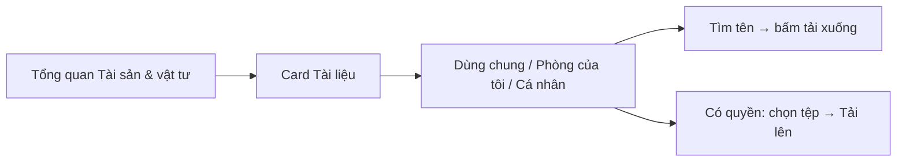
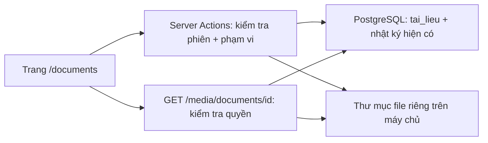
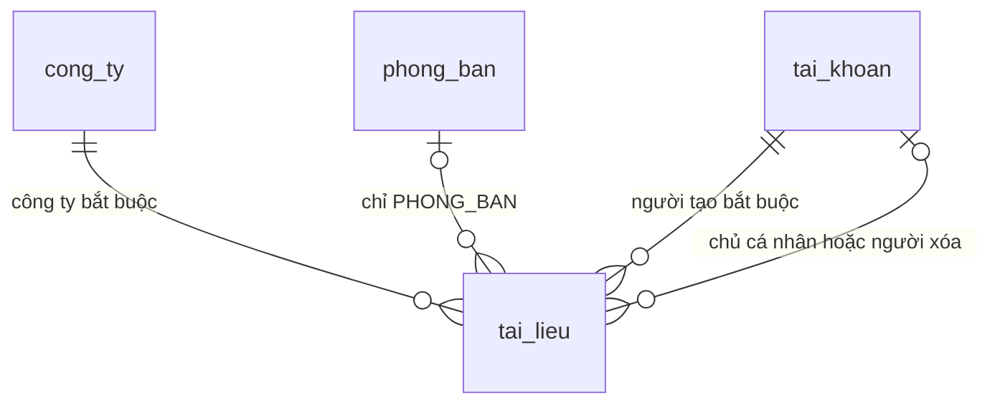

# Quản lý tài liệu — MVP: yêu cầu và thiết kế kỹ thuật

Cập nhật: **20/11/2026** · Phiên bản **0.2 — đề xuất MVP**.

**Trạng thái:** đã rút gọn thiết kế theo yêu cầu; chưa triển khai mã, quyền hoặc DB. File này thay thế phạm vi rộng của bản 0.1. Phần A dành cho người dùng nghiệp vụ; phần B dành cho nhóm triển khai.

[Rule phân hệ](../../.agents/rules/DOCUMENT-MANAGEMENT-RULES.md) · [A. Yêu cầu nghiệp vụ](#a-yêu-cầu-nghiệp-vụ) · [B. Thiết kế kỹ thuật](#b-thiết-kế-kỹ-thuật).

## A. Yêu cầu nghiệp vụ

### A.1. Mục tiêu và phạm vi

Có một nơi **đăng tài liệu, tìm và tải về**, tự giới hạn người xem theo công ty, phòng ban hoặc tài khoản. Người dùng không phải thiết lập quyền cho từng tệp.

Thêm card **Tài liệu** tại tổng quan **Tài sản & vật tư**, dẫn đến một trang gồm ba tab. Người chỉ được cấp quyền Tài liệu vẫn vào được trang tổng quan và card này.

| Khu vực | Nội dung | Ai được xem? |
| --- | --- | --- |
| **Dùng chung** | Quy định, biểu mẫu, hướng dẫn | Người trong công ty được cấp quyền dùng Tài liệu |
| **Phòng của tôi** | Tài liệu dùng trong phòng; tab hiện tên thật, ví dụ HCNS | Thành viên hiện tại của chính phòng đó, có quyền dùng Tài liệu |
| **Cá nhân** | Tài liệu công việc riêng của tài khoản | Chính tài khoản đó, có quyền dùng Tài liệu |

Đây là ba khu vực cố định, **chưa có thư mục con**. Ví dụ: người thuộc HCNS thấy tài liệu Dùng chung, HCNS và Cá nhân của mình; không thấy tài liệu phòng Kinh doanh.

### A.2. Chức năng bản đầu

| Mã | Chức năng | Hành vi cần có |
| --- | --- | --- |
| TL-01 | Mở thư viện | Ba tab, mặc định Dùng chung; giữ tab khi tải lại trang |
| TL-02 | Tải lên | Chọn một tệp, tên lấy từ tên file và được sửa trước khi gửi; nơi lưu chính là tab đang mở |
| TL-03 | Tìm tài liệu | Tìm theo tên trong tab hiện tại, danh sách có phân trang |
| TL-04 | Tải xuống | Bấm tên hoặc nút tải; kiểm tra quyền mỗi lần tải |
| TL-05 | Xóa khỏi danh sách | Chỉ người có quyền, có xác nhận; giữ bản lưu để tránh mất dữ liệu do thao tác nhầm |

Bản đầu nhận **PDF, DOCX, XLSX, PNG, JPEG**, tối đa **10 MB/tệp**, mỗi lần một tệp. Chưa đọc nội dung trong file hoặc xem trước trên web.

**Để sau:** thư mục con, chia sẻ cho người/phòng khác, quyền riêng từng tài liệu, thay tệp và lịch sử phiên bản, liên kết hồ sơ tài sản, thùng rác/khôi phục trên giao diện, xem trước, soạn thảo trực tuyến, AI/OCR và quy trình duyệt. Chưa cần tự tạo mã tài liệu hay dashboard thống kê.

### A.3. Quyền đơn giản

Đề xuất dùng hai mức trong ma trận quyền hiện có, không thêm màn hình phân quyền riêng:

| Khả năng | Sử dụng Tài liệu | Quản lý Tài liệu |
| --- | :---: | :---: |
| Xem/tải Dùng chung và phòng hiện tại | Có | Có |
| Thêm/xóa tài liệu Cá nhân của mình | Có | Có |
| Thêm/xóa tài liệu Dùng chung | Không | Có |
| Thêm/xóa tài liệu phòng hiện tại, kể cả tệp người khác đăng | Không | Có |
| Xem phòng khác hoặc Cá nhân người khác | Không | Không |

Quyền Quản lý bao gồm Sử dụng. Bản MVP gộp quyền đăng ở Dùng chung và phòng hiện tại; chưa cấp riêng từng khu vực. Đây là đánh đổi để giảm cấu hình, cần xác nhận trước triển khai nếu muốn người đăng tài liệu phòng không được đăng Dùng chung.

- Không tự cấp quyền mới cho ADMIN, DEFAULT hay trưởng phòng. Người phụ trách cấp tại **Vai trò và phân quyền**.
- Người chưa có phòng ban vẫn dùng Dùng chung và Cá nhân; tab phòng hiện giải thích “Chưa được gán phòng ban”.
- Khi chuyển phòng, quyền xem phòng cũ hết hiệu lực ở lần yêu cầu tiếp theo; tài liệu đã đăng vẫn ở phòng cũ. Cá nhân gắn với tài khoản, không chuyển theo phòng.
- Khi khóa/nghỉ việc, tài khoản không truy cập được; tài liệu không tự xóa hay công khai. Quyền quản trị hệ thống không tự mở tài liệu Cá nhân trong ứng dụng.
- Tài liệu phòng mở cho toàn bộ thành viên phòng có quyền sử dụng. Hồ sơ cần hạn chế hơn chưa đưa vào khu vực này trong MVP. Bản đã tải về máy không thể thu hồi bằng việc đổi quyền.

### A.4. Luồng sử dụng và giao diện

Một trang có tiêu đề, ba tab nhỏ, ô tìm và nút Tải lên theo quyền. Bảng gồm **Tên tài liệu · Người tải lên · Ngày tải · Thao tác**; điện thoại ưu tiên tên và menu thao tác. Không thêm panel chi tiết hoặc cây thư mục ở bản đầu.

Form tải lên chỉ có **Tệp** và **Tên tài liệu**. Hiện rõ nơi nhận trước khi gửi; có trạng thái đang tải/thành công/lỗi, giữ nội dung khi lỗi. Tải lên và xóa là hành động xác nhận rõ ràng, không áp dụng tự lưu khi bấm ra ngoài. Chưa có form sửa metadata sau khi đăng.

### A.5. Nghiệm thu và bước tiếp theo

MVP đạt khi người HCNS dùng được ba khu vực đúng phạm vi; người phòng khác và tài khoản khác không mở được tài liệu bằng cách đổi URL; tải lên/tải xuống/xóa hoạt động đúng quyền và không hiện thành công khi lưu lỗi.

**Trình tự đề xuất:** chốt hai mức quyền ở A.3 → triển khai một bảng và bảo vệ đọc/ghi → làm trang thư viện/card → kiểm thử và dùng thử với HCNS. Checklist thực hiện ở B.5.

Trước pilot, người phụ trách chọn tài khoản được cấp quyền Quản lý và nơi lưu/sao lưu file. Không cần nhập danh mục, tạo kho hoặc cấu hình từng thư mục để bắt đầu. Phạm vi MVP đã được yêu cầu; các lựa chọn kỹ thuật/quyền ở đây là đề xuất, chưa đồng nghĩa đã duyệt viết mã.

### A.6. Hướng bước 1 theo trao đổi 25/11 — đang phân tích

Người phụ trách muốn bắt đầu bằng **tài liệu và biểu mẫu Dùng chung**, giữ hai mức người quản lý/người xem; Phòng của tôi và Cá nhân trong thư viện để giai đoạn sau. Thêm nhu cầu nhờ AI tìm mẫu phù hợp, điền thông tin và xuất tệp; nếu chưa có mẫu thì tạo bản mới. Đây là phạm vi đang phân tích, chưa duyệt triển khai; thiết kế B hiện vẫn là bản MVP ba khu vực trước trao đổi này, cần cập nhật trước khi viết mã.

- Đề xuất một danh sách, phân biệt Tài liệu tham khảo/Biểu mẫu; tên, từ khóa như DNTT/Đề nghị thanh toán và mẫu đang dùng giúp chọn đúng nguồn. Chưa cần thư mục hoặc quy trình duyệt mới.
- Người xem được tải/dùng mẫu để tạo bản kết quả riêng trong chat; không sửa mẫu gốc hoặc tự đăng vào thư viện. Người quản lý được đăng/ngừng dùng mẫu chung. File đã điền chứa dữ liệu cá nhân/nghiệp vụ không tự trở thành tài liệu công khai.
- Có mẫu: dùng bản sao của mẫu đang dùng, hỏi phần bắt buộc còn thiếu, điền và xuất; giữ nguồn. Chưa có mẫu thật sự: AI tạo bản dự thảo, ghi rõ không phải mẫu công ty đã ban hành. Chỉ người quản lý chủ động đưa vào thư viện mới trở thành mẫu dùng chung; không coi thiếu quyền/lỗi đọc là không có mẫu.
- Ưu điểm: giảm phạm vi thư viện và thao tác tải mẫu lặp lại, dùng chung biểu mẫu thống nhất, tận dụng công cụ Word/Excel/PDF hiện có. Đánh đổi: phải chuẩn bị vùng điền và kiểm chứng bố cục; cần tránh chọn nhầm mẫu, tự bịa dữ liệu hoặc công khai kết quả đã điền. Nhiều mẫu phù hợp thì làm rõ lựa chọn; không tự suy mẫu chính thức.
- Đối chiếu mã 25/11: đã có công cụ điền placeholder DOCX, sửa ô Excel và xuất PDF; executor hiện chỉ nhận tệp thuộc tài khoản/cuộc chat. Chưa có kết nối tới thư viện mẫu chung. Cần bổ sung tra mẫu theo quyền và bản sao nguồn có truy nguyên, không nới quyền đọc mọi tệp chat. Công cụ/kiểm chứng kỹ thuật thuộc [plan AI](AI-ASSISTANT-CHECKLIST.md#tạo-sửa-và-xuất-tài-liệu--18112026).

## B. Thiết kế kỹ thuật

### B.1. Kiến trúc và phần dùng lại

Dùng Next.js hiện có: trang `/documents`, Server Actions đọc/ghi trực tiếp Prisma, Route Handler tải file có xác thực. Dùng lại tài khoản, phòng ban, RBAC và bảng nhật ký; không thêm service/repository hoặc nhà cung cấp lưu trữ mới cho MVP local.

Nguồn đối chiếu: [auth](../../src/lib/auth.ts), [catalog quyền](../../src/lib/role-catalog.ts), [Prisma schema](../../prisma/schema.prisma), [tổng quan tài sản](../../src/app/(dashboard)/asset-management/page.tsx), [mẫu phục vụ tệp riêng của AI](../../src/app/media/ai-attachments/[id]/route.ts). Tài liệu nghiệp vụ có nơi lưu và chính sách riêng, không dùng bảng/quyền/tệp chat AI.

### B.2. Thiết kế DB cần giữ

**Chỉ thêm một bảng `tai_lieu`.** Ba tab là bộ lọc dữ liệu, không cần bảng không gian, thư mục, ACL hoặc phiên bản. Một bản ghi ứng với một tệp bất biến; file lưu ngoài DB.

| Trường dự kiến | Kiểu / yêu cầu |
| --- | --- |
| `id`, `company_id` | Int, khóa chính tự tăng; công ty bắt buộc |
| `pham_vi` | Enum `DUNG_CHUNG`, `PHONG_BAN`, `CA_NHAN` |
| `department_id` | Int nullable; chỉ có khi phạm vi PHONG_BAN |
| `chu_so_huu_id` | Int nullable, FK tài khoản; chỉ có khi phạm vi CA_NHAN |
| `nguoi_tao_id` | Int, FK tài khoản bắt buộc, bất biến |
| `ten`, `ten_tep_goc` | Chuỗi bắt buộc, tối đa 255 ký tự; tên hiển thị đã trim, không rỗng |
| `khoa_luu_tru` | UUID unique do server sinh; không dùng tên file làm đường dẫn |
| `ma_yeu_cau` | UUID của lần gửi; unique theo công ty + người tạo để chống gửi lặp |
| `loai_mime`, `kich_thuoc`, `sha256` | MIME đã kiểm chứng; số byte dương tối đa 10 MiB; checksum nội dung |
| `deleted_at`, `nguoi_xoa_id` | Nullable; cùng rỗng hoặc cùng có giá trị; người xóa FK tài khoản |
| `created_at`, `updated_at` | Timestamp theo chuẩn dự án |

`tai_lieu` là bảng mới; ba bảng còn lại dùng lại. Nhật ký tham chiếu ID tài liệu trong trường đối tượng hiện có, không phải FK mới.

- CHECK phạm vi: DUNG_CHUNG không có phòng/chủ; PHONG_BAN có phòng, không chủ; CA_NHAN có chủ và chủ bằng người tạo, không phòng. Không đổi phạm vi, chủ hoặc phòng sau khi tạo trong MVP.
- FK phòng và các tài khoản phải cùng công ty bằng FK kép tương ứng; `onDelete: Restrict`. Kiểm tra server không thay ràng buộc DB.
- Index phục vụ danh sách theo `(company_id, pham_vi, department_id, deleted_at, created_at, id)` và `(company_id, chu_so_huu_id, deleted_at, created_at, id)`. Tìm tên dạng chứa, không phân biệt hoa/thường; tìm không dấu và tìm trong nội dung để sau.
- Tên được trùng; phân biệt bằng người/ngày tải. Không tự ghi đè file cùng tên. Chỉ xóa mềm, chưa tự dọn file đã xóa; phục hồi thủ công phải theo yêu cầu riêng và có audit.

### B.3. Quyền và hợp đồng đọc/ghi

Thêm module `DOCUMENTS` với `VIEW` (nhãn **Sử dụng Tài liệu**) và `MANAGE` (nhãn **Quản lý Tài liệu**) vào catalog/validation/ma trận khi triển khai; không tự gán role. MANAGE gồm VIEW. Dù grant lưu phạm vi ALL theo cơ chế hiện tại, phạm vi nội dung luôn theo chính sách bên dưới, không được hiểu là mở mọi phòng/tài khoản.

| Điểm vào dự kiến | Điều kiện server |
| --- | --- |
| `listDocuments({scope, query, page})` | VIEW; cùng công ty, chưa xóa; DUNG_CHUNG hoặc phòng hiện tại hoặc chủ chính mình tùy tab |
| `uploadDocument(FormData)` | VIEW cho Cá nhân; MANAGE cho Dùng chung/phòng hiện tại; tự lấy công ty, chủ và phòng từ phiên |
| `deleteDocument({id, updatedAt})` | Cùng phạm vi đọc và còn tồn tại; chủ Cá nhân có VIEW, hoặc MANAGE đối với Dùng chung/phòng hiện tại |
| `GET /media/documents/[id]` | VIEW và cùng bộ lọc đọc; không hợp lệ/không được xem trả kết quả không tiết lộ sự tồn tại |

Kiểm tra phiên, trạng thái tài khoản, quyền và phòng ban từ DB mỗi request; mutation kiểm tra lại trong transaction. Không nhận `company_id`, chủ hoặc phòng tùy ý từ client. Tài khoản không có phòng không được dùng phạm vi PHONG_BAN; chỉ phòng đang hoạt động được đăng mới.

Lọc quyền ngay trong truy vấn trước phân trang, tìm và đếm. Dùng helper phạm vi nhỏ dùng chung cho các điểm vào; không tạo lớp repository. Tổng quan `/asset-management` phải cho phép người có DOCUMENTS VIEW vào, kể cả không có ASSETS/INVENTORY, nhưng chỉ hiện card có quyền. Không trả khóa lưu trữ trong dữ liệu trình duyệt.

### B.4. Luồng lưu, lỗi và bảo toàn dữ liệu

1. **Tải lên:** xác thực quyền → Zod kiểm tra tên, tab, mã yêu cầu và giới hạn byte thực tế → kiểm chứng loại file → lưu tệp bằng khóa ngẫu nhiên ngoài `public/` → transaction kiểm tra lại quyền/phòng, tạo `tai_lieu` và nhật ký → trả thành công và cập nhật danh sách. Không mở transaction trong lúc truyền file.
2. **Chống gửi lặp:** cùng mã yêu cầu và cùng nội dung/tên/phạm vi trả kết quả cũ; payload khác báo xung đột. Unique DB xử lý hai request đồng thời; chỉ request thắng giữ file của mình. Tệp chưa có bản ghi khi ghi DB thất bại được dọn, không xóa file của request đã commit. Mất phản hồi sau commit không được coi là lỗi để xóa file đã lưu.
3. **Tải xuống:** tra metadata trong phạm vi quyền → đọc file → trả attachment, `Cache-Control: private, no-store`, `X-Content-Type-Options: nosniff`, tên tải được mã hóa an toàn. Chưa preview hoặc phát link công khai. Thiếu file báo lỗi, không tự xóa metadata.
4. **Xóa:** khóa bản ghi, kiểm tra quyền và `updated_at`, đánh dấu xóa mềm và ghi nhật ký trong cùng transaction. Hai lần xóa không tạo hai sự kiện; bản đã đổi báo tải lại. Danh sách/tải xuống mới không được lấy tài liệu đã xóa; luồng tải đã bắt đầu có thể hoàn tất.
5. **Nhật ký:** dùng bảng hiện có, ghi trực tiếp bằng transaction; không dùng helper ghi log nuốt lỗi. Chỉ lưu hành động, ID tài liệu và ID người thao tác; không ghi tên tệp/nội dung/đường dẫn/checksum vào nhật ký chung để tránh lộ metadata Cá nhân. MVP chưa có màn hình lịch sử tài liệu hoặc log từng lượt tải.

Lưu local dự kiến `var/documents/` (ngoài Git), quyền file chỉ cho tiến trình ứng dụng; một máy chủ/persistent volume ở pilot. Chưa triển khai multi-instance hoặc object storage. PDF/ảnh kiểm tra signature và MIME; DOCX/XLSX kiểm tra container/loại OOXML, giới hạn giải nén, từ chối macro hoặc tệp giả phần mở rộng. Không thực thi hay render nội dung tải lên.

Trước áp dụng migration: backup DB, thử trên DB tạm; chỉ thêm bảng/ràng buộc/quyền, không sửa dữ liệu tài sản. Sao lưu metadata và thư mục file cùng mốc, thử khôi phục trước pilot. Có lệnh đối soát file mồ côi dạng chỉ xem trước; chỉ dọn file không được DB tham chiếu, quá 24 giờ, khi không có upload đang chạy. Không chạy dọn tự động ở MVP. Hết dung lượng phải báo thất bại, không ghi metadata thành công.

Khi triển khai, đọc hướng dẫn Next.js cục bộ, kiểm tra upload 10 MiB với giới hạn request hiện tại; cập nhật kiến trúc/từ điển DB theo thay đổi thực tế. Chưa sửa cấu hình hay thêm dependency trong lượt lập plan.

### B.5. Checklist triển khai và kiểm chứng

- [x] Rút gọn cùng một file thành đặc tả MVP và thiết kế kỹ thuật; thay sáu bảng đề xuất bằng một bảng, quyền cố định theo khu vực.
- [x] Đồng bộ rule định tuyến, danh mục plan và các tham chiếu từ tài sản/menu.
- [ ] Chốt quyền gộp ở A.3, tài khoản pilot và nơi sao lưu trước khi triển khai tương ứng.
- [ ] Migration `tai_lieu`, ràng buộc, catalog quyền; thử trên DB tạm; người phụ trách tự cấp quyền.
- [ ] Server Actions, bộ lọc phạm vi, lưu/tải file, audit nguyên tử và xử lý gửi lặp.
- [ ] Trang `/documents`, ba tab, bảng/tìm kiếm/phân trang, tải lên/xóa và card tại tổng quan.
- [ ] KT-01 / TL-01,03,04: hai phòng, hai tài khoản cùng phòng và công ty khác; kiểm tra danh sách/đếm/tải trực tiếp, không rò rỉ tên hay metadata qua nhật ký.
- [ ] KT-02 / TL-02,05: VIEW và MANAGE theo ma trận, Cá nhân chỉ chính chủ; giả mạo phòng/chủ, người không phòng, tài khoản bị khóa, chuyển phòng và thu hồi quyền.
- [ ] KT-03 / TL-02,04,05: file hợp lệ/sai loại/quá cỡ, gửi lặp đồng thời, lỗi disk/DB/audit, mất phản hồi; không file trùng hay báo thành công sai; xóa lặp và tải file đã xóa.
- [ ] KT-04 / TL-01–05: dùng bàn phím/điện thoại/sáng tối, tên dài, trống/lỗi; người chỉ có DOCUMENTS vào được card; kiểm chứng backup/restore và đối soát file.

**Kết quả hiện tại — đối chiếu 25/11/2026:** plan vẫn là đề xuất MVP, chưa triển khai. Mã nguồn chưa có trang `/documents` hoặc card Tài liệu tại tổng quan; Prisma schema chưa có `tai_lieu`, catalog chưa có quyền `DOCUMENTS`. Công cụ tài liệu/tệp AI hiện có thuộc chat, không phải thư viện này. Lần đối chiếu chỉ đọc tài liệu/mã nguồn/migration, không truy vấn DB thực tế, không chạy kiểm thử ứng dụng hoặc thay đổi quyền. Các bước triển khai và nghiệm thu bên trên vẫn chưa hoàn thành.
