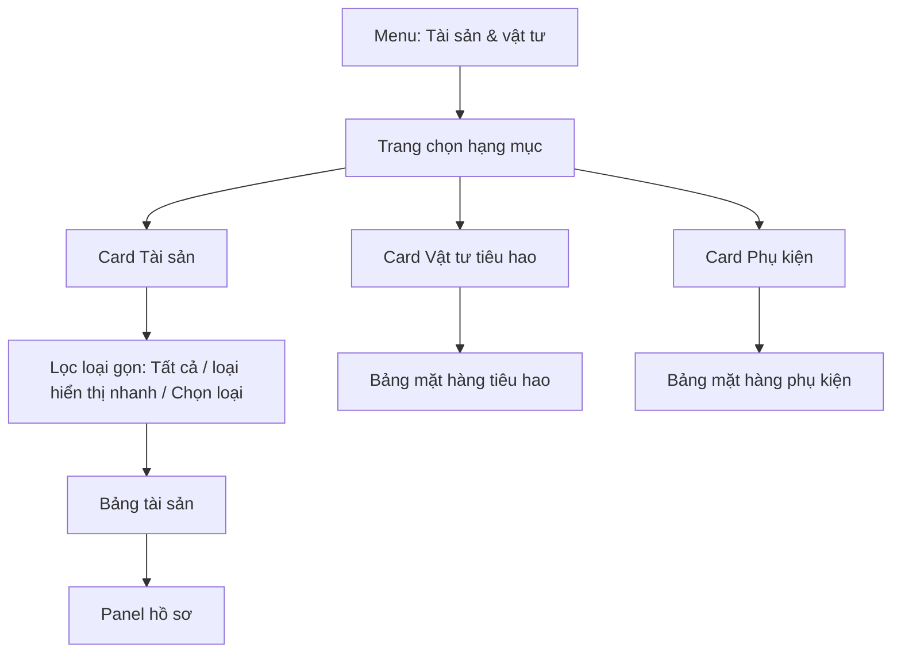

# Kiến trúc thông tin và điều hướng SDG ERP

Cập nhật: **23/11/2026**. **Đã triển khai khung điều hướng chung và đợt đầu Tài sản & vật tư; chờ người dùng dùng thử.** Đây là plan điều phối thiết kế nhiều phân hệ, không phải phân hệ nghiệp vụ mới. Chuẩn kỹ thuật/UX tiếp tục theo [Frontend](../../.agents/rules/FRONTEND-RULES.md); nghiệp vụ và kiểm thử riêng thuộc plan từng phân hệ.

Đọc nhanh: [A. Tổng quan](#a-tổng-quan) · [B. Trình tự áp dụng](#b-trình-tự-áp-dụng) · [Kiểm chứng](#kiểm-chứng).

## A. Tổng quan

### Mục tiêu và nguồn kế thừa

Làm rõ người dùng đang ở đâu, tìm chức năng ở đâu và quay lại công việc thế nào. Giảm điều hướng lặp, tên gọi nhập nhằng và việc chọn bố cục theo phán đoán riêng từng lần triển khai.

| Nguồn | Vai trò trong dự án | Giới hạn |
| --- | --- | --- |
| [IBM Carbon: Global header](https://www.carbondesignsystem.com/building-blocks/core/patterns/global-header) | Tham chiếu chính về điều hướng toàn cục/cục bộ, phân nhóm theo công việc, breadcrumb và bảo toàn ngữ cảnh | Kế thừa hướng dẫn, không tuyên bố tuân thủ toàn bộ Carbon hoặc thay thư viện UI |
| [Carbon: Left panel](https://www.carbondesignsystem.com/building-blocks/core/components/ui-shell-left-panel/guidelines), [Tabs](https://www.carbondesignsystem.com/building-blocks/core/components/tabs/guidelines) | Phân biệt menu, submenu, tab và bộ chuyển/lọc nội dung | Chọn cách áp dụng theo lượng dữ liệu và tác vụ; không sao chép máy móc giới hạn/kích thước |
| [SAP Fiori: bố cục nghiệp vụ](https://www.sap.com/design-system/fiori-design-web/v1-154/discover/sap-products/sap-s4hana-only/best-practices-for-designing-sap-fiori-apps) | Tham khảo mẫu danh sách, hồ sơ đối tượng, danh sách–chi tiết | Không đưa SAPUI5/OData hoặc quy trình SAP vào dự án |
| shadcn/ui New York, Tailwind, Radix, Lucide hiện có | Thành phần, nhận diện và cách triển khai | Giữ theme Sao Đỏ; quy chuẩn kỹ thuật do Frontend sở hữu |

Các nguồn đã được đọc trong hội thoại. Những quyết định dành riêng cho SDG ERP dưới đây là cách áp dụng của dự án, không phải yêu cầu nguyên văn từ Carbon/Fiori. Không dùng tên một bộ thiết kế để thay thế việc kiểm chứng tác vụ thực tế.

### Quy ước tổ chức cần áp dụng

| Câu hỏi | Hướng thiết kế |
| --- | --- |
| Người dùng chuyển khu vực công việc? | Menu chính; tên theo công việc, không theo bảng DB hoặc mã quyền |
| Trong khu vực có nhiều chức năng độc lập thường xuyên cần chuyển? | Submenu; tránh thêm tầng chỉ để lặp tên cha |
| Cần chọn giữa vài hạng mục có nghiệp vụ khác nhau? | Trang vào bằng card nếu giúp nhận biết lựa chọn; không bắt mọi phân hệ phải có trang card |
| Chuyển nhóm nội dung liên quan của một hồ sơ? | Tab, ví dụ Thông tin/Lịch sử |
| Thu hẹp cùng một tập hồ sơ? | Bộ lọc nhanh, dù hình thức có thể giống tab nhỏ; tên và phạm vi lọc phải rõ |
| Làm việc với nhiều bản ghi? | Danh sách/bảng có tìm kiếm, bộ lọc và hành động theo ngữ cảnh |
| Xem/sửa một bản ghi và còn cần danh sách? | Panel chi tiết; hồ sơ phức tạp có thể cần trang riêng |
| Đi sâu vào một hạng mục/đối tượng? | Breadcrumb phản ánh cấp nội dung; không biến mọi bộ lọc thành một tầng menu |

Mỗi chức năng có một nơi chính để quản lý; lối tắt từ nơi khác phải dẫn về cùng chức năng và đúng quyền. Tên/mức phân cấp không thay đổi chỉ vì hai chức năng dùng chung hoặc khác bảng DB. Mặc định giữ menu nông, tránh submenu lồng quá hai mức; trường hợp khác cần lý do trong plan sở hữu. Đây là hướng thiết kế của dự án, không phải giới hạn kỹ thuật.

### Hiện trạng đã đọc và việc cần rà

| Khu vực | Hiện trạng trong mã | Việc tiếp theo |
| --- | --- | --- |
| Tài sản | Một menu Tài sản & vật tư, ba card hạng mục; bên trong bảng có lọc loại gọn | Dùng thử mẫu đầu trước khi mở rộng |
| Quy trình | Điểm vào trực tiếp, bỏ nhóm trùng tên | Giữ nguyên route và quyền workflow |
| Nhân sự và 3D | Nhân sự chứa hồ sơ/cơ cấu; Bản đồ 3D là điểm vào cấp cao nhất, ngay sau Bàn làm việc | Bỏ nhóm Không gian làm việc; giữ LOCATIONS độc lập HR |
| Quản trị hệ thống | `/system` tổng quan theo quyền; tài khoản, vai trò, vị trí, audit và cài đặt. Bấm tên nhóm vào tổng quan, hover mở tác vụ; [plan sở hữu](SYSTEM-SETTINGS-CHECKLIST.md#dashboard-quản-trị--19112026) | Vị trí là danh mục nền; chỉ cần LOCATIONS, không yêu cầu quyền admin |
| Dashboard / Bàn làm việc | Đã bỏ banner/card/biểu đồ/lối tắt lặp, đổi điểm vào thành Bàn làm việc | AI làm vùng chính, bảng công việc theo ngữ cảnh; workflow giữ trong Việc của tôi. [Bố cục và lộ trình](AI-ASSISTANT-CHECKLIST.md#đề-xuất-dashboard-là-không-gian-làm-việc-với-agent--17112026) đã kiểm chứng đợt 1 |
| Công việc | Các mục mang nhãn Sắp có | Đối chiếu route/chức năng thực tế trước khi thay điều hướng |

Đợt 18/11 áp dụng đánh giá khung chung đã được người phụ trách duyệt. Chưa phải kiểm toán UX toàn ứng dụng hoặc nghiệm thu bố cục riêng từng phân hệ.

## B. Trình tự áp dụng

### 1. Xác lập nền thiết kế

- [x] Ghi rõ vai trò Carbon/Fiori và nền UI hiện tại; phân biệt nguồn tham chiếu với lựa chọn của dự án.
- [x] Đọc sidebar, quy chuẩn Frontend, cấu hình shadcn và plan tài sản/vật tư; ghi các điểm chưa nhất quán.
- [x] Đăng ký plan điều phối trong router và tổng quan; không thay ba rule kỹ thuật chung.

### 2. Hoàn thiện bản đồ điều hướng

- [x] Chốt bản đồ điểm vào, cấp nội dung và quyền theo bảng dưới; giữ toàn bộ URL.
- [x] Nhóm nhiều mục có nút mở/đóng riêng; nhóm chỉ có một mục được hiển thị thành liên kết trực tiếp.
- [x] Ghi trước/sau tại bảng hiện trạng; đưa Bản đồ 3D lên cấp cao nhất, vị trí về Quản trị hệ thống; bỏ nhóm Không gian làm việc và tầng lặp Quy trình.
- [ ] Rà mẫu bố cục các trang ngoài tài sản: nhân sự/phòng ban, tài khoản/vai trò, workflow, cài đặt và không gian 3D. Giữ mẫu phù hợp tác vụ, không ép thành card → bảng ở mọi nơi.

### Khung ứng dụng chung — đã áp dụng 18/11

| Điểm vào / công việc | Cấp nội dung và URL giữ nguyên | Điều kiện menu hiện có |
| --- | --- | --- |
| Bàn làm việc, hồ sơ cá nhân | `/`; hồ sơ tại menu tài khoản `/profile` | Tài khoản đăng nhập |
| Tài sản & vật tư | `/asset-management` → `/assets`, `/inventory` | ASSETS hoặc INVENTORY VIEW/MANAGE |
| Nhân sự | Tổng quan `/hr` → hồ sơ `/employees`, cơ cấu `/departments` | HR VIEW/MANAGE |
| Bản đồ 3D | Trực tiếp `/office-3d`, ngay sau Bàn làm việc | LOCATIONS VIEW/MANAGE |
| Quy trình | Trực tiếp `/workflows` | WORKFLOW VIEW/MANAGE theo session hiện có |
| Công việc | `/tasks`, `/tasks/department` (Sắp có) | TASK VIEW/MANAGE theo session hiện có |
| Quản trị hệ thống | `/accounts`, `/roles`, `/locations`, `/audit-logs`, `/settings` | LOCATIONS VIEW/MANAGE cho vị trí; ACCOUNTS MANAGE; ROLES/AUDIT theo quyền đọc; cài đặt theo quyền quản trị AI hiện có |

- [x] Sidebar dùng chữ rõ ở trạng thái thường, nhóm chữ thường dễ đọc, nhãn xuống dòng nếu dài; liên kết/nút nhóm tối thiểu 40px, khoảng cách giữa các mục 4px, bỏ padding cộng thêm trước nhóm, có focus, `aria-current` và `aria-expanded`. ID nhóm riêng cho sidebar/menu mobile; nhóm rỗng ẩn theo quyền. Hover nhóm dùng cùng cặp nền `muted`/chữ `foreground` ở sáng và tối; ghi đè cả màu chữ của Button ghost, tránh chữ trắng trên nền sáng.
- [x] Nhóm menu nhiều mục có icon riêng. Desktop có nút thu gọn/mở rộng trên header: sidebar 256px → 88px, giữ icon kèm tên ngắn; nhóm nhiều tác vụ mở flyout bằng hover/click/bàn phím, Escape đóng. Dùng lại lọc quyền và trạng thái trang hiện tại. Giữ trạng thái thu gọn khi điều hướng nội bộ trong layout; reload trở về thu gọn. Mobile tiếp tục dùng Sheet với nhãn đầy đủ. Không chạy hiệu ứng thay đổi chiều rộng liên tục để tránh resize Canvas 3D nhiều lần.
- [x] Tài khoản chỉ đặt ở header; bỏ thẻ tài khoản và phiên bản ở chân menu. Header dùng chung giữ nút menu/logo, màn hình đủ rộng hiện tên khu vực; breadcrumb chi tiết giữ tại vùng nghiệp vụ, không thêm hàng breadcrumb trùng. Đổi theme theo theme đã giải quyết của trình duyệt.
- [x] `AppContent` điều chỉnh chiều rộng: hồ sơ/cài đặt tối đa 1024px, trang chọn hạng mục tối đa 1280px, danh sách và vùng làm việc dùng chiều rộng khả dụng. Padding desktop 24px; mobile 16px. Không đổi bố cục chi tiết, form hoặc dữ liệu của phân hệ.
- [x] Có liên kết bàn phím bỏ qua menu tới nội dung; menu mobile dùng Sheet, nút đóng 40px, tự đóng sau điều hướng. Sidebar desktop theo chiều cao viewport động.
- [ ] Chuẩn hóa tiêu đề/hành động bên trong các màn hình nghiệp vụ khi rà từng mẫu trang; không coi đổi khung chung là đã chuẩn hóa toàn bộ nội dung riêng.

### Navigation rail có nhãn và flyout — 18/11

- [x] Khi thu gọn, hiện icon 24px và tên ngắn 11px phía dưới: Bàn làm việc, Bản đồ 3D, Tài sản, Nhân sự, Quy trình, Công việc, Quản trị. Giữ tên đầy đủ cho trợ năng và tiêu đề menu con; bỏ tooltip trùng. Rail 88px, không đổi trang hoặc tự mở rộng sidebar khi hover.
- [x] Nhóm nhiều tác vụ mở sau 200ms rê chuột, rời cả trigger/nội dung sau 300ms mới đóng; đi qua khe giữa hai vùng không mất menu. Chỉ một flyout được mở; dọn timer khi unmount/điều hướng. Mục một đích vẫn bấm để điều hướng, hover không tự chuyển trang.
- [x] Tái sử dụng Popover không modal với Link theo quyền, không giành focus khi mở bằng hover. Click/Enter/ArrowDown mở, phím mũi tên/Home/End chọn liên kết, Tab theo focus tự nhiên, Escape đóng và trả focus. Menu mở bằng bàn phím/click không tự đóng chỉ vì chuột rời vùng.
- [x] Mobile giữ Sheet với tên đầy đủ và thao tác chạm; nhãn thu gọn chỉ áp dụng desktop. Không thay DB, quyền, route, dependency hoặc ba rule kỹ thuật chung.
- [x] Chrome 1366×768: nhãn/rail 88px, hover không giành focus, khe chuyển, đóng sau rời vùng, chuyển nhóm chỉ giữ một flyout, Enter/ArrowDown/Escape và điều hướng giữ thu gọn đều đạt. Đã xem ảnh sáng/tối; mobile giả lập 390×844 dùng Sheet, đóng sau chọn, không tràn ngang. TypeScript/ESLint và 5 unit điều hướng/quyền đạt, không lỗi JavaScript. Kiểm tra chỉ đọc dữ liệu hiện có; ảnh/script/kết quả tại `outputs/nav-rail/` ngoài Git. Chưa kiểm tra điện thoại thật.

- [x] Nhân sự có trang đích `/hr`: click/Enter tên nhóm vào tổng quan, hover/ArrowDown vẫn mở flyout. Khi sidebar mở rộng/mobile, tên nhóm là link và chevron là nút mở/đóng riêng. Menu con có Tổng quan; không thay hành vi nhóm chưa có trang đích. Số liệu/kiểm chứng do [plan HR](HR-CHECKLIST.md#tổng-quan-phân-hệ-nhân-sự--18112026) sở hữu.

### Nhận diện menu và logo — 19/11

- [x] Logo đầy đủ và tên Sao Đỏ đặt cạnh nút menu trên header, giữ nguyên khi sidebar thu/mở. Bấm logo về Bàn làm việc, có focus bàn phím. Tái sử dụng ảnh hiện có, không thêm thư viện hoặc ảnh tải ngoài.
- [x] Nút thu gọn/mở rộng đặt góc trên trái của header, luôn tách khỏi vùng menu cuộn. Rail 88px giữ tên ngắn; icon bản đồ cho 3D, kiện hàng cho tài sản, nhánh quy trình cho workflow, nhóm người cho HR, checklist cho công việc và khiên cho quản trị.
- [x] Icon rail 24px, nét đồng nhất; mục chọn có nền đỏ nhạt, chữ/icon đỏ và vạch cạnh trái. Hover mục thường giữ nền trung tính/chữ rõ, mục đang chọn vẫn giữ màu nhận diện. Giữ flyout, quyền và điều hướng hiện có.
- [x] TypeScript, ESLint và 8 unit điều hướng/quyền đạt. Chrome 1366×768: logo về Bàn làm việc, thu/mở, hover/flyout, ArrowDown/Escape và giữ trạng thái qua điều hướng đạt; đã xem ảnh sáng/tối. Mobile giả lập 390×844: Sheet đóng sau chọn, không tràn ngang; không lỗi JavaScript. Bằng chứng `outputs/nav-rail/brand-*` chỉ lưu cục bộ. Huy hiệu Next.js Dev Tools ở góc dưới trái che nút chân menu trong môi trường dev; kiểm chứng click/ảnh đã ẩn riêng overlay qua trình duyệt kiểm thử, không sửa cấu hình hoặc ẩn lỗi trong ứng dụng. Production không có huy hiệu này; chưa thử điện thoại thật.

### Header cố định và menu mặc định thu gọn — 23/11

**Đã triển khai và kiểm chứng kỹ thuật.** Kế thừa cách bố trí từ ảnh YouTube người phụ trách cung cấp, giữ nhận diện và tác vụ ERP.

| Tiêu chí | Hành vi cần giữ |
| --- | --- |
| NAV-1 | Nút ☰ và logo Sao Đỏ cạnh nhau trên header suốt chiều ngang, cố định khi cuộn; logo về Bàn làm việc và không đổi vị trí khi thu/mở sidebar. |
| NAV-2 | Desktop mở/reload mặc định rail 88px; bấm mở rộng 256px. Giữ lựa chọn qua điều hướng nội bộ, không lưu qua reload. |
| NAV-3 | Giữ icon + nhãn ngắn, flyout hover/bàn phím, lọc quyền và link tổng quan phân hệ; sidebar cuộn riêng dưới header. |
| NAV-4 | Mobile đóng mặc định, ☰ mở Sheet với tên đầy đủ; chọn trang tự đóng, Escape trả focus, không tràn ngang. |
| NAV-5 | Thu/mở sidebar không remount nội dung hoặc Canvas 3D; không chạy animation chiều rộng gây resize liên tục. |

- [x] `AppLayout` đọc session ở server; `AppShell` giữ state thu gọn và nhận nội dung server qua children, truyền trạng thái/nút toggle cho Header và Sidebar. Header sticky cao 64px; sidebar sticky dưới header, cao phần viewport còn lại. Bỏ logo/nút chân sidebar trùng lặp.
- [x] Tái sử dụng Sheet và flyout hiện có; không thay DB, quyền, dependency hoặc ba rule chung.
- [x] NAV-1…5 đạt trên Chrome: mặc định 88px, mở 256px, logo giữ tọa độ khi thu/mở và cuộn; chuyển trang giữ lựa chọn, reload thu gọn. Hover/ArrowDown/Escape giữ flyout và focus. Các rộng 1366/1024/768/390/320px không tràn ngang; Sheet mobile đóng sau chọn và trả focus khi Escape. Canvas 3D giữ cùng đối tượng DOM khi thu/mở. TypeScript, ESLint và 8 unit điều hướng/quyền đạt; không lỗi JavaScript. Ảnh/script/kết quả tại `outputs/nav-rail/header-*`, chỉ đọc DB và chưa kiểm tra điện thoại thật.

### 3. Áp dụng đầu tiên cho Tài sản & vật tư

Thiết kế đích theo yêu cầu người dùng, **đã triển khai và kiểm chứng kỹ thuật**:

- [x] Menu chung là một điểm vào; ba card chỉ nằm ở trang chọn hạng mục. Trong mỗi hạng mục dùng breadcrumb để quay lại; không giữ thêm hàng ba card lớn ở trên bảng.
- [x] Thay card loại tài sản bằng bộ lọc nhỏ giống tab, có Tất cả; danh mục dài có ô Chọn loại kèm tìm kiếm, không trải nhiều hàng hoặc buộc cuộn dài. Tìm kiếm ghi rõ phạm vi loại hiện tại.
- [x] Card đếm đúng đơn vị: tài sản theo hồ sơ, tiêu hao/phụ kiện theo mặt hàng; không cộng số lượng khác đơn vị. Quyền và số đếm cùng phạm vi công ty.
- [x] Giữ bảng/panel, tự lưu tài sản, lịch sử, QR và giao dịch vật tư; không tự mở rộng autosave cho nhập/cấp/thu hồi cần xác nhận.
- [x] Menu/card theo quyền ASSETS hoặc INVENTORY độc lập; không mặc định cần ASSETS để vào khu vực chung, không tự cấp grant. Tài khoản chỉ có một hạng mục vẫn truy cập được.
- [x] Trang tổng quan dùng `/asset-management`; giữ URL hồ sơ `/assets?asset=<id>` và liên kết vật tư hiện có. Loại/bộ lọc/trang được khôi phục qua Back/Forward và reload; giữ cuộn khi đóng panel trong phiên trang, bảo vệ bản nháp theo hành vi đã có.

Từ 19/11, trang `/asset-management` được bổ sung tổng quan phân bố/nhóm cần rà soát/hồ sơ vừa cập nhật, giữ ba lối vào hạng mục. Thiết kế số liệu và kiểm chứng tại [plan tài sản](ASSET-MANAGEMENT-CHECKLIST.md#tổng-quan-khi-mở-phân-hệ--19112026).

**MVP đề xuất 20/11, chưa triển khai:** thêm card Tài liệu dẫn tới ba tab Dùng chung/phòng/cá nhân và bảng tài liệu, quyền độc lập ASSETS/INVENTORY. Phạm vi, bố cục và quyết định chờ chốt do [plan Tài liệu](DOCUMENT-MANAGEMENT-CHECKLIST.md) sở hữu; ba card hiện tại vẫn là trạng thái đã triển khai.

Plan này sở hữu sơ đồ điều hướng liên phân hệ. [Plan tài sản](ASSET-MANAGEMENT-CHECKLIST.md) và [plan vật tư](INVENTORY-MANAGEMENT-CHECKLIST.md) sở hữu hành vi nghiệp vụ, phần sửa component và kết quả kiểm thử tương ứng; dẫn liên kết thay vì sao chép thiết kế.

### 4. Kiểm chứng mẫu đầu tiên

- [x] Đi từ menu → chọn hạng mục → lọc loại → mở/sửa hồ sơ → quay lại; ghi thao tác thừa/điểm nhầm trước và sau, không tự đặt số liệu cải thiện.
- [x] Thử danh mục dài, rỗng, không có kết quả lọc, thiếu quyền, tải/lỗi, desktop/mobile, sáng/tối và bàn phím.
- [x] Hồi quy URL/QR, tự lưu và lỗi giữ bản nháp, nhập/cấp/thu hồi, số đếm và quyền độc lập; chạy kiểm tra phù hợp phần mã thay đổi.
- [ ] Đối chiếu trải nghiệm với người dùng sau bản đầu; chỉnh điểm bất tiện trước khi nhân rộng cấu trúc.

### 5. Mở rộng có kiểm soát

- [x] Rà và đề xuất dashboard hướng công việc với AI ngày 17/11; minh họa và chi tiết do [plan AI](AI-ASSISTANT-CHECKLIST.md#đề-xuất-dashboard-là-không-gian-làm-việc-với-agent--17112026) sở hữu. Đã duyệt áp dụng và triển khai bố cục đợt 1; kết quả kiểm chứng do plan AI sở hữu. Không áp mẫu card → bảng của tài sản cho dashboard.

- [x] Áp dụng điều hướng và khung chung theo bảng trên; giữ nguyên quyền/URL và các thao tác nghiệp vụ.
- [ ] Tiếp tục rà mẫu trang riêng theo thứ tự HR/phòng ban → tài khoản/vai trò/cài đặt → workflow; không gian/3D theo tác vụ riêng.
- [ ] Tách thành phần dùng chung khi mẫu đầu đã kiểm chứng và có nhu cầu tái sử dụng; không tạo tầng framework bố cục mới chỉ để chuẩn hóa.
- [ ] Mỗi đợt cập nhật plan sở hữu, kiểm tra hồi quy và trạng thái thực tế. Giữ ngoại lệ có lý do; không tuyên bố mọi trang tuân thủ chỉ vì dùng cùng component.

### Thiết kế DB cần giữ

Đợt tổ chức thông tin này không yêu cầu bảng/cột/migration mới. Route, bộ lọc và bố cục không thay mô hình dữ liệu, scope quyền hoặc quy tắc giao dịch hiện tại. Nếu phát sinh nhu cầu thay nghiệp vụ/DB, ghi riêng trong plan sở hữu trước khi triển khai; không suy nhu cầu DB từ cách chia card/menu.

### Kiểm chứng

- [x] Đợt triển khai menu/tài sản: thêm route tổng quan, breadcrumb, lọc loại gọn và lưu truy vấn danh sách vào URL. Không đổi DB/dependency/môi trường hoặc ba rule chung. Thay đổi AI đồng thời được giữ nguyên.
- [x] 42 kịch bản E2E liên quan đạt qua các đợt chạy: điều hướng mới 5, nhóm 3, inline/tự lưu 7, panel/khấu hao 5, QR 5, bảng gọn 3, tài sản/quyền 6, vật tư 8. Đã cập nhật bộ kiểm tra theo nhãn menu/nút lọc mới và chặn đúng request khi mô phỏng mất mạng; không cộng số lần chạy lại. Build production và TypeScript, lint phạm vi thay đổi đạt.
- [x] Rà ảnh desktop/mobile sáng–tối; kiểm tra bàn phím, danh mục dài/rỗng, không quyền, bộ lọc và trang qua reload/Back/Forward, tạo hồ sơ cập nhật số đếm tổng quan. Trước đây hai mục sidebar và ba tab trùng cấp; nay một điểm vào, ba card chỉ ở tổng quan, bảng dùng lọc loại gọn. Chưa đo thời gian thao tác hoặc nghiệm thu người dùng.
- [x] Kiểm tra chỉ đọc trên cổng 4000: 92 hồ sơ, bố cục mới hoạt động. Sau kiểm thử đã dừng server 4147 và xóa riêng DB thử; 27/27 bảng vận hành giữ nguyên fingerprint, không đổi grant. Backup/log/ảnh tại `outputs/ia-navigation/`; server 4000 được giữ nguyên.
- [x] Đồng bộ plan tài sản/vật tư, rule phân hệ, router, tổng quan và kiến trúc; kiểm tra liên kết/anchor nội bộ và `git diff --check`. Bằng chứng kiểm chứng: `outputs/ia-navigation/e2e.log`, `e2e-final.log`, `e2e-verified.log`, `e2e-assets-verified.log`, `build-final-retry.log`, `lint-verified.log`, `links.json`, `cleanup-result.json`.

- [x] Kiểm tra trình duyệt khung chung: 1440/1024/768/390/320px, không tràn ngang tại profile/vị trí; desktop→điều hướng→Back, menu mobile đóng khi chọn, active route, tài khoản/profile, chế độ tối và Tab/Enter bỏ qua menu đạt. Đã mở thêm Tài sản & vật tư, danh sách tài sản, nhân sự, vai trò và 3D trên desktop; Mô hình 3 tầng đã dựng, nhãn tầng hiển thị và hàng nút dưới nằm trong viewport 1440×900. Không có lỗi JavaScript. Bằng chứng cục bộ: `outputs/app-shell/`. Không có tài khoản vận hành không quyền phù hợp để kiểm tra browser; quyền tối thiểu được kiểm tra riêng bằng unit, không tạo/sửa tài khoản thật.

- [x] 5 unit đạt: tài khoản cơ bản, LOCATIONS độc lập HR, quyền quản trị tài khoản/AI, bắt buộc đổi mật khẩu và so khớp URL theo segment. TypeScript, ESLint phạm vi chỉnh và `git diff --check` đạt. Không đổi DB, grant, dependency hoặc ba rule chung.

- [x] Sửa hồi quy menu theo phản hồi người dùng: kiểm tra hover cả bốn nhóm trên sáng/tối, màu nền và chữ sau transition; khoảng cách giữa mục 4px, vùng bấm 40px, đóng/mở nhóm trên mobile đạt. Đã xem ảnh và chạy lint, không lỗi JavaScript. Bằng chứng: `outputs/app-shell/menu-hover.json` và ảnh cùng thư mục.

- [x] Kiểm chứng menu hiện tại sau sắp xếp: Bàn làm việc → Bản đồ 3D → Tài sản & vật tư; không còn nhóm Không gian làm việc, Vị trí nằm trong Quản trị hệ thống. Chrome 1366×768: tooltip, menu con đóng sau điều hướng, Enter/ArrowDown/Escape trả focus, sáng/tối đạt; mobile 390px giữ menu đầy đủ và đóng khi chọn. Canvas 3D giữ nguyên đối tượng DOM khi thu gọn, rộng từ 724px lên 908px; không lỗi JavaScript. TypeScript, lint Sidebar và 5 unit (gồm LOCATIONS độc lập HR/admin và tên ngữ cảnh mới) đạt. Đã xem ảnh `outputs/app-shell/navigation-reordered.png`; kết quả tại `navigation-reordered-results.json`.
