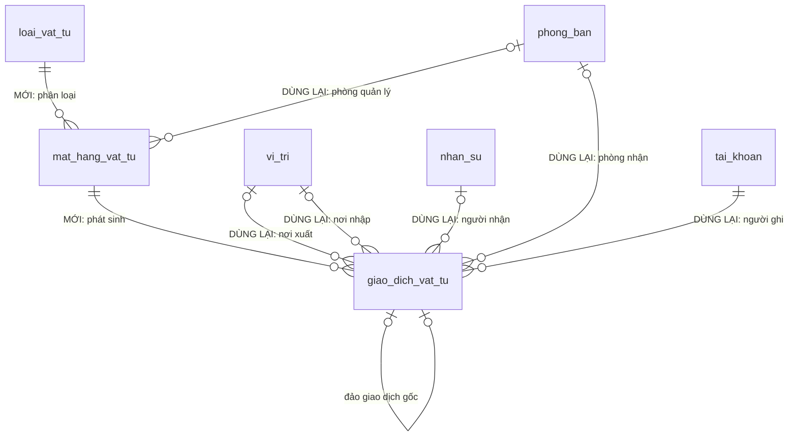

# Vật tư tiêu hao và phụ kiện

Cập nhật: **17/11/2026**. **Đã triển khai và kiểm chứng kỹ thuật trên DB local; chưa nghiệm thu vận hành**. Ba hạng mục, ba bảng mới, quyền INVENTORY độc lập. Theo lựa chọn của người dùng: chỉ thêm quyền vào ma trận, người dùng tự cấp sau; chưa nhập tồn vận hành. Tên bảng mặt hàng đã được người dùng chốt là `mat_hang_vat_tu`. Rule: [INVENTORY-MANAGEMENT-RULES](../../.agents/rules/INVENTORY-MANAGEMENT-RULES.md).

Đọc nhanh: [A. Tổng quan](#a-tổng-quan) · [B. Thiết kế và triển khai](#b-thiết-kế-và-triển-khai) · [Checklist](#checklist-triển-khai).

## A. Tổng quan

### Mục tiêu và phạm vi

Tổ chức khu quản lý thành ba hạng mục **Tài sản · Vật tư tiêu hao · Phụ kiện**. Tài sản có mã riêng theo từng chiếc tiếp tục dùng hai bảng hiện có; vật tư/phụ kiện quản lý theo mặt hàng và số lượng, dùng chung ba bảng mới. Mục tiêu là biết còn bao nhiêu để cấp, đã cấp cho ai/phòng nào và phụ kiện nào chưa thu hồi, không phải xây hệ thống kho/kế toán đầy đủ.

| Hạng mục | Đơn vị quản lý | Thao tác chính |
| --- | --- | --- |
| Tài sản | Từng chiếc có mã riêng | Giữ luồng tại [plan tài sản](ASSET-MANAGEMENT-CHECKLIST.md) |
| Vật tư tiêu hao | Một mặt hàng, nhiều đơn vị đồng loại | Nhập, cấp phát, chuyển nơi giữ, kiểm đếm/điều chỉnh |
| Phụ kiện | Một mặt hàng, nhiều đơn vị đồng loại có thể thu hồi | Như vật tư, thêm danh sách đang cấp, thu hồi một phần/toàn bộ và ghi giảm khi mất/hỏng |

Một sản phẩm có thể được quản lý từng chiếc hoặc theo số lượng tùy quyết định vận hành. Không tự chuyển hồ sơ tài sản hiện có sang vật tư, không đếm cùng một đồ vật ở cả hai nơi. Mực khác model/quy cách không thay thế được cho nhau là các mặt hàng riêng. Mã mặt hàng nhận diện chủng hàng, không cấp mã riêng cho từng hộp/bút/chuột.

### Luồng làm việc

1. Chọn tab Tiêu hao hoặc Phụ kiện → tìm/chọn mặt hàng.
2. Tạo loại/mặt hàng nếu chưa có; chọn đơn vị tính và phòng quản lý khi xác định được.
3. Nhập số lượng tại nơi giữ có sẵn; tồn đầu được ghi bằng giao dịch mở đầu có lý do, không sửa một ô tồn tự do.
4. Cấp số lượng cho một người hoặc một phòng. Phụ kiện được đưa vào danh sách đang cấp; tiêu hao được tính là đã xuất dùng.
5. Thu hồi phụ kiện từ một lần cấp cụ thể; nhập lại nơi giữ. Kiểm đếm chênh lệch hoặc ghi sai được xử lý có lý do và lịch sử.

Ví dụ minh họa: nhập 20 chuột → cấp anh Nam 2 → thu hồi 1: kho còn 19, anh Nam giữ 1. Nhập 20 hộp mực → cấp HCNS 2: kho còn 18, đã xuất dùng 2; không tạo nghĩa vụ thu hồi cho phòng.

### Quyết định và giới hạn

| Nội dung | Trạng thái |
| --- | --- |
| Ba hạng mục; bản quyền làm sau | Đã chốt trong hội thoại; không có bảng/tab license trong lần này |
| Tên `mat_hang_vat_tu` | Đã chốt theo yêu cầu; thay tên đề xuất trước `mat_hang` |
| Ba bảng mới, dùng chung nền số lượng cho tiêu hao/phụ kiện | Đã triển khai migration 17/11 trên DB local |
| Tồn tính từ giao dịch; không có bảng tồn/cấp phát riêng | Đã triển khai; phụ kiện truy theo lần cấp |
| Quyền `INVENTORY` VIEW/MANAGE toàn công ty | Đã thêm catalog, tách ASSETS; người dùng chọn tự cấp tại /roles sau |
| Đơn vị tính | Đã áp dụng số nguyên dương, mỗi mặt hàng một đơn vị cơ sở; chưa quy đổi thùng/hộp/cái hoặc số lượng lẻ |
| Nơi giữ | Dùng vị trí vật lý hiện có; cần xác định kho/tủ/phòng thực tế trước nhập tồn đầu, không tạo vị trí giả |
| Nhóm cha CNTT/Nội thất… | Ý tưởng riêng còn xem xét; không nằm trong ba bảng mới hoặc tự thay cây loại tài sản |

Ngoài phạm vi: mua hàng/duyệt phiếu, kế toán giá vốn/FIFO, lô/hạn dùng, quản lý serial từng phụ kiện, tài khoản phần mềm, tự tạo vật thể 3D, import hàng loạt và chuyển đổi dữ liệu tài sản cũ. Giao dịch bản đầu chỉ có một mặt hàng mỗi lần lưu; không cần bảng đầu phiếu/chi tiết phiếu.

### Giao diện hiện hành

- Khu điều hướng chung có ba tab. Giữ `/assets` và URL hồ sơ hiện có; `/inventory?kind=consumable` và `/inventory?kind=accessory` cho hai tab mới. Tab chỉ hiện theo quyền; có INVENTORY mà không có ASSETS vẫn vào được vật tư.
- Bảng mặt hàng: tên/mã, loại, đơn vị, tồn trong kho; tab phụ kiện thêm số đang cấp. Lọc loại, nơi giữ, phòng quản lý và sắp hết; tìm tên/mã có hỗ trợ không dấu, phân trang server 20 dòng. Mobile ẩn cột loại phụ để thấy tồn kho/đang cấp trong cùng màn hình; lịch sử phân trang 20 giao dịch.
- Tồn tổng là tổng nơi giữ trong phạm vi; lọc nơi giữ phải ghi rõ phạm vi. Không cộng hộp, cái, ram thành một tổng số lượng chung. Mức tồn tối thiểu bản đầu áp tổng tồn kho của một mặt hàng toàn công ty; không đổi ngầm ý nghĩa theo bộ lọc.
- Bấm dòng mở panel: thông tin, tồn theo nơi giữ, lịch sử; phụ kiện có danh sách đang cấp. Thao tác Nhập/Cấp phát dễ thấy; Chuyển nơi giữ/Điều chỉnh/Sửa sai trong menu. Thu hồi thực hiện tại lần cấp còn dư.
- Sửa thông tin mặt hàng tại chỗ có Lưu/Hủy theo quyền; số tồn và đang cấp chỉ đọc. Mã cố định. Danh mục dài dùng bộ tìm/chọn sẵn có; không cho nhập tên tự do thay ID.
- Sau lưu giữ tab/bộ lọc/trang/panel/cuộn và làm mới số lượng; lỗi giữ bản nháp, phản hồi tại trường. Desktop/mobile, sáng/tối, bàn phím/chạm theo [rule frontend](../../.agents/rules/FRONTEND-RULES.md#8-nguyên-tắc-ux-ưu-tiên).

## B. Thiết kế và triển khai

### Thiết kế DB cần giữ

**Ba bảng dưới đây đã triển khai qua migration `20261117090000_vat_tu_va_phu_kien`.** Giữ nguyên `loai_tai_san`, `tai_san`. Không thêm bảng hạng mục: hai hạng mục số lượng dùng enum tại loại. Không lưu tồn độc lập, không dùng JSONB để thay FK/số lượng/giao dịch.

Công ty và audit dùng lại, lược khỏi sơ đồ cho dễ đọc. Các liên kết trong sơ đồ là FK thật, không ghép theo tên. Hai self-FK có mục đích khác nhau: thu hồi/ghi giảm liên kết lần cấp; đảo liên kết giao dịch bị ghi sai.

#### 1. `loai_vat_tu`

| Trường nghiệp vụ | Kiểu/ràng buộc |
| --- | --- |
| `ma_loai`, `ten_loai` | Chuỗi bắt buộc; mã unique trong công ty |
| `hang_muc` | Enum `TIEU_HAO` / `PHU_KIEN`, bắt buộc |
| `mo_ta` | Text nullable |
| `dang_su_dung` | Boolean mặc định true |

Có `id`, `company_id`, `created_at`, `updated_at`. Không cho đổi hạng mục khi loại đã có mặt hàng; tạo loại mới khi thay đổi cách quản lý. Ngừng loại không xóa lịch sử hoặc đổi phân loại mặt hàng cũ.

#### 2. `mat_hang_vat_tu`

| Trường nghiệp vụ | Kiểu/ràng buộc |
| --- | --- |
| `ma_mat_hang` | Chuỗi unique trong công ty, tự cấp `VT-000001`, bất biến; dùng sequence, không suy từ loại |
| `ten_mat_hang` | Chuỗi bắt buộc; tên không dùng làm khóa |
| `loai_vat_tu_id` | FK bắt buộc |
| `don_vi_tinh` | Chuỗi bắt buộc, ví dụ hộp/cái/ram; không thêm bảng đơn vị bản đầu |
| `muc_ton_toi_thieu` | Int nullable, không âm; null = chưa thiết lập, 0 là mức được nhập rõ |
| `phong_quan_ly_id` | FK nullable tới `phong_ban`; không suy từ người tạo/người nhận |
| `ghi_chu`, `dang_su_dung` | Text nullable, Boolean mặc định true |

Có `id`, `company_id`, `created_at`, `updated_at`. Đổi loại chỉ trong cùng hạng mục; không đổi đơn vị khi đã có giao dịch. Không tự chuyển tiêu hao ↔ phụ kiện khi đã vận hành. Mã mới chỉ cấp cho mặt hàng mới, không đổi mã thiết bị đã có. Không có `so_luong_ton`, `nguoi_su_dung_id` hoặc một `vi_tri_id` cố định trên mặt hàng vì có thể tồn nhiều nơi và cấp cho nhiều người.

#### 3. `giao_dich_vat_tu`

| Trường nghiệp vụ | Kiểu/ràng buộc |
| --- | --- |
| `mat_hang_vat_tu_id` | FK bắt buộc tới mặt hàng cùng công ty |
| `loai_giao_dich` | Enum theo bảng hành vi phía dưới |
| `so_luong` | Int > 0; riêng `TON_DAU` cho phép 0 để xác nhận đã kiểm kê không còn hàng, đảo bản mở đầu 0 giữ số 0; không dùng số âm để biểu diễn hướng |
| `vi_tri_xuat_id`, `vi_tri_nhap_id` | Hai FK nullable, bắt buộc theo loại thao tác |
| `nhan_su_nhan_id`, `phong_ban_nhan_id` | Hai FK nullable, khi cấp chỉ chọn đúng một; không dùng cặp type/id không có FK |
| `cap_phat_goc_id` | Self-FK nullable; bắt buộc cho thu hồi/ghi giảm phụ kiện đang cấp |
| `dao_giao_dich_id` | Self-FK nullable; chỉ cho giao dịch đảo, unique khi khác null |
| `don_gia` | Decimal(18,0) nullable, VND không âm; chỉ nhập hàng, không dùng tính giá vốn |
| `ly_do`, `ghi_chu` | Lý do bắt buộc với mở đầu/điều chỉnh/ghi giảm/đảo; ghi chú tùy chọn |
| `request_id` | UUID bắt buộc, unique theo công ty để chống gửi lặp |
| `account_id`, `created_at` | Người ghi/thời điểm server, không nhận từ client |

Có `id`, `company_id`; giao dịch chỉ ghi thêm nên **không có `updated_at`**, không sửa/xóa sau lưu. Bản đầu thời điểm ghi nhận là thời điểm phát sinh trong sổ, chưa nhập lùi ngày; ngày hóa đơn cũ có thể ghi chú. Giá tiền truyền dưới dạng chuỗi nguyên qua Server Action. Khi đảo, các trường tác động được server sao chép từ bản gốc, không tin giá trị client.

FK tham chiếu dữ liệu công ty dùng cặp `(id, company_id)` theo chuẩn chung; self-FK còn bảo đảm cùng mặt hàng bằng unique/FK thích hợp hoặc trigger. Restrict khi xóa dữ liệu đã được tham chiếu. Index chính: mặt hàng theo công ty/loại, giao dịch theo công ty/mặt hàng/thời điểm/id, nơi xuất/nhập, người/phòng nhận, lần cấp gốc. Không tạo bảng kho riêng: vị trí còn sử dụng, thuộc loại PHONG/KHU_VUC/CHO_NGOI/DIEM_DAT_THIET_BI phù hợp được chọn làm nơi giữ; toàn bộ tổ tiên phải còn dùng.

### Giao dịch và cách tính

| Loại | Dữ liệu bắt buộc | Tác động |
| --- | --- | --- |
| `TON_DAU` | Nơi nhập, số lượng, lý do | + tồn kho mở đầu; chỉ khi mặt hàng chưa có giao dịch tại nơi đó |
| `NHAP` | Nơi nhập, số lượng | + tồn kho; giá tùy chọn |
| `CAP_PHAT` | Nơi xuất, số lượng, đúng một người/phòng nhận | − tồn kho; với phụ kiện + đang cấp |
| `THU_HOI` | Lần cấp gốc phụ kiện, nơi nhập, số lượng | + tồn kho; − đang cấp của lần gốc |
| `CHUYEN_NOI_GIU` | Nơi xuất và nhập khác nhau, số lượng | − nơi xuất, + nơi nhập trong cùng một dòng/giao dịch nguyên tử |
| `DIEU_CHINH_TANG` / `DIEU_CHINH_GIAM` | Nơi nhập/xuất tương ứng, số lượng, lý do | ± tồn kho sau kiểm đếm; không thay số đang cấp |
| `GIAM_DANG_CAP` | Lần cấp gốc phụ kiện, số lượng, lý do mất/hỏng | − đang cấp; không tăng tồn kho |
| `DAO_GIAO_DICH` | Bản gốc, lý do | Đảo toàn bộ tác động một lần; không phải thu hồi vật lý |

- Mỗi giao dịch chỉ dùng các trường đúng với loại ở bảng trên; trường không áp dụng phải null. Thu hồi/ghi giảm sao chép đúng một đích nhận từ lần cấp; đảo sao chép nguyên các trường tác động và `cap_phat_goc_id` nếu có. Đảo không trỏ tới bản đảo. `TON_DAU` unique theo mặt hàng/nơi nhập; số 0 chỉ được ghi nhận qua mở đầu hoặc bản đảo của mở đầu 0.
- `Tồn(nơi giữ) = tổng tăng − tổng giảm`, tính cả tác động ngược của giao dịch đảo. `Đang cấp(lần cấp) = số cấp − tổng thu hồi − tổng ghi giảm`, có xét đảo. Các kết quả phải luôn ≥ 0. Tổng đang cấp của mặt hàng là tổng các lần còn dư, không cộng vào “có thể cấp ngay”.
- Với tiêu hao, cấp phát coi là xuất dùng; không theo dõi nghĩa vụ hoàn trả. Hàng cấp nhầm/chưa dùng trả về xử lý bằng điều chỉnh tăng có lý do/tham chiếu ghi chú; không giả lập thu hồi phụ kiện.
- Thu hồi/ghi giảm lấy người/phòng từ lần cấp gốc; không cho thay đích hoặc tham chiếu mặt hàng/hạng mục khác. Một lần cấp được thu hồi nhiều đợt nhưng tổng không vượt phần còn lại. Người đã nghỉ vẫn giữ khoản đang cấp và được thu hồi, không xóa nghĩa vụ.
- Khi chưa có lịch sử, giao diện ghi “Chưa ghi nhận tồn”, không khẳng định đã kiểm kê bằng 0. Chỉ báo sắp hết áp khi đã ghi nhận và tồn ≤ mức đã thiết lập; chưa thiết lập thì không cảnh báo giả.
- Đảo giữ nguyên bản gốc và thêm bản mới; không cho đảo bản đảo, đảo trùng hoặc đảo lần cấp còn giao dịch thu hồi/ghi giảm hiệu lực. Phải xử lý phụ thuộc theo thứ tự ngược, và kiểm tra tồn/đang cấp sau đảo trước khi ghi. Có thể đảo mở đầu rồi ghi nhập/điều chỉnh đúng; không mở thêm một giao dịch mở đầu thứ hai tại cùng mặt hàng/nơi giữ.
- Số lượng trước/sau hiển thị khi thao tác; khi đã ghi nhận phát sinh khác làm lệch dự kiến, yêu cầu xem lại số mới thay vì âm thầm chấp nhận. Chuyển người giữ phụ kiện ở bản đầu là thu hồi rồi cấp lại, chưa thêm một loại giao dịch chuyển người.

### Toàn vẹn, đồng thời và vòng đời danh mục

- Tái sử dụng khóa công ty/advisory lock hiện có khi ghi, theo thứ tự của luồng vị trí/HR; khóa hàng mặt hàng trước khi tổng hợp và kiểm tra số dư. Tạo giao dịch, kiểm tra actor hiện tại và ghi audit cùng transaction. Hai yêu cầu xuất cạnh tranh không thể cùng vượt tồn; hai thu hồi không thể vượt lần cấp.
- Mọi đường ghi, gồm đảo và nhập, phải dùng cùng thứ tự khóa. DB CHECK bảo đảm số lượng hợp lệ theo loại và tổ hợp trường đúng; trigger bảo vệ tính chỉ-ghi-thêm, tham chiếu lần cấp/đảo cùng mặt hàng, chống âm/cấp vượt/đảo sai cả khi đi ngoài action. Khi triển khai phải kiểm chứng trigger và action không deadlock; không tuyên bố DB bảo vệ nếu mới có kiểm tra UI.
- `request_id` giữ nguyên khi gửi lại cùng thao tác do mất mạng; cùng khóa và payload trả kết quả cũ, cùng khóa nhưng payload khác bị từ chối. Unique và audit cùng transaction bảo đảm không cấp hai lần khi retry. So sánh các trường nghiệp vụ đã chuẩn hóa và người ghi với bản đã lưu; phiên bản số dư là điều kiện trước lần ghi đầu, không làm một retry đã thành công trở thành giao dịch khác.
- Danh mục sửa dùng version `updated_at`; sai version giữ bản nháp. Sau khi có lịch sử chỉ ngừng sử dụng, không xóa mặt hàng/loại. Ngừng mặt hàng chỉ khi tồn kho và đang cấp đều bằng 0; ngừng loại chỉ khi tất cả mặt hàng đã ngừng.
- Vị trí có lịch sử vật tư bị chặn xóa bởi FK; ngừng vị trí/nhánh phải bảo đảm không còn tồn tại nó/hậu duệ. Cho tất toán xuất/thu hồi/đảo khi tham chiếu đã ngừng trong trường hợp dữ liệu cũ, nhưng không cấp mới hoặc nhập vào nơi ngừng; bản đảo gây tồn ở nơi ngừng phải từ chối và hướng dẫn dùng vị trí còn hiệu lực. Không sửa quyền/xóa người hiện có để vượt ràng buộc.
- Phòng quản lý/phòng nhận/người nhận đã có tham chiếu phải được giữ lịch sử; kiểm tra thông báo chặn xóa phòng phù hợp. Không suy người nhận từ phòng; chọn người mới ACTIVE cùng công ty. Không tự gán/chuyển vị trí làm việc của HR hoặc thiết bị khi cấp vật tư.

### Quyền và tích hợp

| Hành động | Quyền |
| --- | --- |
| Xem mặt hàng, số tồn, đang cấp, lịch sử vật tư | `INVENTORY VIEW` hoặc MANAGE, toàn công ty |
| Tạo/sửa/ngừng danh mục, nhập/cấp/thu hồi/chuyển/điều chỉnh/đảo | `INVENTORY MANAGE` |
| Tạo/sửa vị trí chứa | Quyền LOCATIONS hiện có, không được cấp ngầm bởi INVENTORY |
| Sửa HR, tài sản hoặc phân quyền | Quyền phân hệ tương ứng, độc lập |

Dùng ma trận `/roles`; chỉ thêm catalog quyền khi triển khai, không tự gán role. Trước pilot chọn tài khoản và phạm vi đã hiểu rõ. Phòng quản lý là thông tin nghiệp vụ, **không phải phạm vi bảo mật**; giới hạn theo phòng là mở rộng riêng.

Server kiểm tra quyền/công ty ở cả danh sách, số đếm, chi tiết, lịch sử, options và mutation. INVENTORY MANAGE được tải danh mục người/phòng/nơi giữ tối thiểu để cấp hàng, không cần mở quyền xem toàn HR/LOCATIONS; không trả trường HR nhạy cảm. Action options riêng để không mở rộng truy vấn HR ngoài nhu cầu.

Audit dùng `nhat_ky_hoat_dong` với phân hệ INVENTORY, đối tượng rõ `loai_vat_tu:<id>`, `mat_hang_vat_tu:<id>`, `giao_dich_vat_tu:<id>`. Nhật ký kỹ thuật không thay sổ giao dịch. Chưa nối vật tư vào công cụ AI hoặc hình 3D; không sửa luồng gán tài sản đang có.

### Checklist triển khai

- [x] Đọc schema/rule/plan hiện có; ghi nhận ba hạng mục và tên `mat_hang_vat_tu` theo người dùng. Đây là đọc mã/tài liệu, không phải kiểm toán DB vận hành.
- [x] Lập plan ba bảng, sơ đồ, luồng số lượng, quyền/UX; tạo rule phân hệ và đăng ký router trước khi triển khai.
- [x] Người dùng yêu cầu triển khai; giữ đơn vị nguyên, phạm vi công ty, một mặt hàng/lần giao dịch theo thiết kế. Nơi giữ, người phụ trách và tồn thực tế vẫn xác định trước pilot; không tạo dữ liệu giả trong DB vận hành.
- [x] Triển khai schema, CHECK/FK/index/trigger và sequence; thêm catalog INVENTORY, không gán grant. Dùng migration theo [rule DB](../../.agents/rules/DATABASE-RULES.md), thử DB khôi phục riêng và DB cài mới.
- [x] Xây validation/action trực tiếp Prisma cho danh mục, giao dịch/số dư/đảo, options tối thiểu, idempotency, kiểm tra phiên bản và audit nguyên tử; không tạo repository/service layer.
- [x] Bổ sung bảo vệ xóa/ngừng vị trí và xóa phòng có tham chiếu vật tư; kiểm tra tương thích với HR/tài sản/3D hiện có, cập nhật plan sở hữu phần tích hợp bằng liên kết.
- [x] Xây hai tab mới, bảng/panel/form dùng lại UI chung; giữ trang tài sản/link/QR/camera 3D và quyền độc lập. Cập nhật kiến trúc/từ điển DB khi triển khai thực tế, không mô tả bảng dự kiến như bảng đã tồn tại.
- [x] Unit/integration: công thức tồn/đang cấp, thu hồi từng phần, mất/hỏng, chuyển kho, đảo phụ thuộc; CHECK/FK/khác công ty, sửa SQL trực tiếp, từ chối âm, hai cấp/thu hồi/đảo đồng thời, rollback khi audit lỗi, retry không ghi hai lần.
- [x] E2E: tạo mặt hàng/nhập/cấp/thu hồi, tồn cập nhật đúng; tìm không dấu/bàn phím/mobile/sáng/tối; quyền VIEW/NONE/thu hồi quyền, lỗi mạng/tải lại/bản nháp, stale số dư; hồi quy tài sản/HR/vị trí/3D và URL.
- [x] Backup mới trước áp dụng local, đối chiếu dữ liệu/schema/quyền cũ sau migrate, generate client và khởi động lại tiến trình cần thiết; không reset, seed đè hoặc nhập tồn chưa xác minh.
- [x] Dừng server thử 4146 và xóa riêng DB thử do lượt này tạo; giữ server local 4000, backup và bằng chứng trên máy. Đối chiếu cuối 22 bảng cũ: chỉ `quyen` thay đổi như dự kiến; không có grant INVENTORY hoặc mặt hàng vận hành. Kết quả tại `outputs/inventory/cleanup-result.json`.
- [ ] Người dùng tự cấp INVENTORY tại /roles (đã chọn không cấp tự động); nhập tồn đầu đã kiểm kê; không chuyển đồ vật đã theo dõi bằng mã sang mặt hàng tự động. Dùng thử, ghi kết quả thực tế và giới hạn.

### Kết quả kiểm chứng — 17/11/2026

- [x] 16 integration đạt: quyền/công ty/options tối thiểu, nhập/cấp/thu hồi/ghi giảm/chuyển, mở đầu 0, đảo phụ thuộc, idempotency, cạnh tranh action và SQL trực tiếp, version/vòng đời, rollback audit, phân trang/tìm không dấu/lọc sắp hết và ID ngoài phạm vi.
- [x] 37 kịch bản E2E liên quan đạt qua các đợt kiểm tra: vật tư 8, tự lưu tài sản 7, URL/QR 5, phòng ban 1, vị trí 3, chỉnh đối tượng 3D 4, vai trò 9. Các lỗi ở bộ kiểm tra đã sửa: đóng panel trước kiểm tra điều hướng, cập nhật số dư khi cố ý tạo xung đột, nhãn Đóng sau thay đổi autosave, màu nền đúng theme. Không còn ca thất bại chưa xử lý trong phạm vi này.
- [x] Rà ảnh mobile sáng/tối và form; bảng thấy tồn/đang cấp không tràn trang, bộ tìm/chọn dùng bàn phím, form dài cuộn trong hộp. Build production, TypeScript, lint phạm vi thay đổi và `git diff --check` đạt. Chưa tuyên bố kiểm thử toàn bộ hệ thống hoặc nghiệm thu dữ liệu vận hành.
- [x] DB khôi phục và cài mới đều migrate đạt, Prisma diff rỗng. Backup mới trước áp dụng local; 21/22 bảng cũ giữ nguyên fingerprint, bảng `quyen` chỉ thêm hai quyền, mọi quyền cũ giữ nguyên. Không thêm grant; ba bảng mới trống. Generate client và khởi động lại dev port 4000; kiểm tra trực tiếp ma trận quyền, trang tài sản và từ chối truy cập vật tư khi chưa có quyền.
- Bằng chứng cục bộ: `outputs/inventory/integration-release.log`, `e2e-final.log`, `e2e-release.log`, `e2e-verified.log`, `e2e-mobile-final.log`, `build-verified-retry.log`, `local-result.json`, `fresh-result.log`, `live-checked.log` và ảnh mobile. Các đợt chạy cuối đã kiểm tra lại những ca thất bại do bộ kiểm tra cũ; không cộng số lần chạy lại vào tổng số kịch bản.

### Kiểm tra tài liệu

- [x] Đồng bộ trạng thái triển khai A–B–rule–router, kiến trúc, từ điển DB và plan tài sản/vị trí/HR/vai trò. 269 liên kết/anchor đạt bằng `outputs/inventory/check-links.py`, kết quả tại `outputs/inventory/links.json`. Không thay ba rule kỹ thuật chung hoặc thêm thư viện/biến môi trường.
