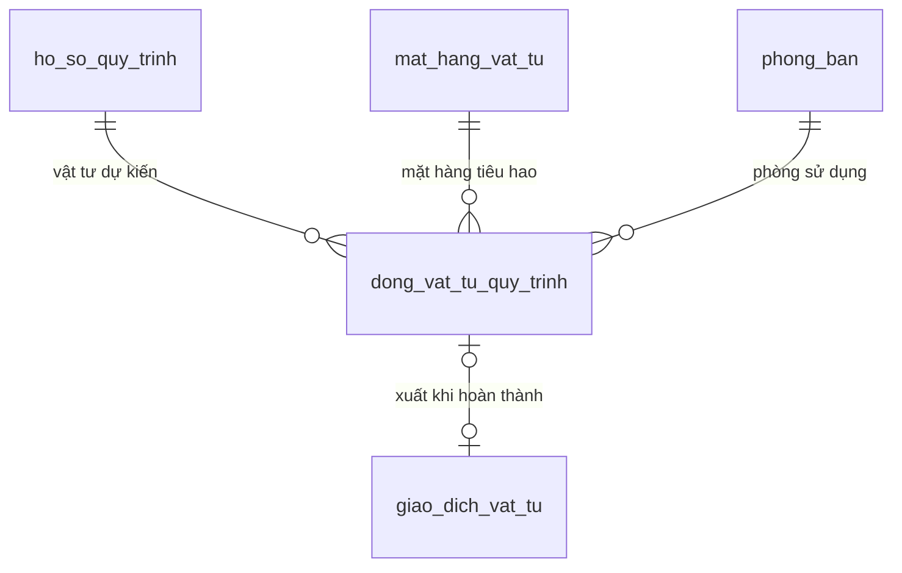
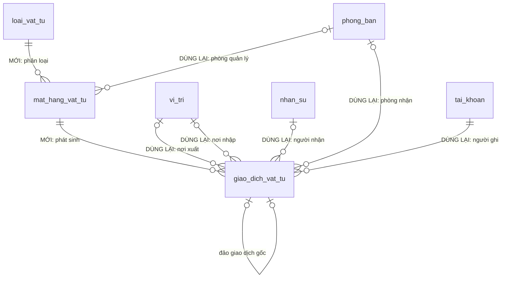

# Vật tư tiêu hao và phụ kiện

Cập nhật: **19/11/2026**. **Đã triển khai và kiểm chứng kỹ thuật trên DB local; chưa nghiệm thu vận hành**. Ba hạng mục, ba bảng số lượng và một bảng dòng vật tư workflow, quyền INVENTORY độc lập. Theo lựa chọn của người dùng: chỉ thêm quyền vào ma trận, người dùng tự cấp; dữ liệu nhập thử chưa được nghiệm thu vận hành. Tên bảng mặt hàng đã được người dùng chốt là `mat_hang_vat_tu`. Rule: [INVENTORY-MANAGEMENT-RULES](../../.agents/rules/INVENTORY-MANAGEMENT-RULES.md).

Đọc nhanh: [A. Tổng quan](#a-tổng-quan) · [B. Thiết kế và triển khai](#b-thiết-kế-và-triển-khai) · [Checklist](#checklist-triển-khai).

## A. Tổng quan

### Mục tiêu và phạm vi

Tổ chức khu quản lý thành ba hạng mục **Tài sản · Vật tư tiêu hao · Phụ kiện**. Tài sản có mã riêng theo từng chiếc tiếp tục dùng hai bảng hiện có; vật tư/phụ kiện quản lý theo mặt hàng và số lượng, dùng chung ba bảng số lượng; dòng sử dụng trên ticket liên kết workflow hiện có. Mục tiêu là biết còn bao nhiêu để cấp, đã cấp cho ai/phòng nào và phụ kiện nào chưa thu hồi, không phải xây hệ thống kho/kế toán đầy đủ.

| Hạng mục | Đơn vị quản lý | Thao tác chính |
| --- | --- | --- |
| Tài sản | Từng chiếc có mã riêng | Giữ luồng tại [plan tài sản](ASSET-MANAGEMENT-CHECKLIST.md) |
| Vật tư tiêu hao | Một mặt hàng, nhiều đơn vị đồng loại | Nhập, ghi nhận sử dụng trực tiếp hoặc khi hoàn thành ticket, kiểm đếm/điều chỉnh |
| Phụ kiện | Một mặt hàng, nhiều đơn vị đồng loại có thể thu hồi | Nhập/cấp/chuyển theo nơi giữ, theo dõi đang cấp, thu hồi và ghi giảm khi mất/hỏng |

Một sản phẩm có thể được quản lý từng chiếc hoặc theo số lượng tùy quyết định vận hành. Không tự chuyển hồ sơ tài sản hiện có sang vật tư, không đếm cùng một đồ vật ở cả hai nơi. Mực khác model/quy cách không thay thế được cho nhau là các mặt hàng riêng. Mã mặt hàng nhận diện chủng hàng, không cấp mã riêng cho từng hộp/bút/chuột.

### Luồng làm việc

**Luồng hiện hành:** tiêu hao dùng tồn chung; phụ kiện giữ theo nơi giữ. Ticket dùng hồ sơ workflow, xem quyền và thời điểm ghi tiêu hao ở phần B.

1. Vào Tài sản & vật tư → tìm mã/tên tại ô tìm kiếm chung để mở thẳng mặt hàng, hoặc chọn card Tiêu hao/Phụ kiện để duyệt danh sách. Tìm kiếm tổng quan do [plan tài sản](ASSET-MANAGEMENT-CHECKLIST.md#tìm-kiếm-tổng-quan-phân-hệ) quản lý, áp dụng quyền INVENTORY riêng.
2. Tạo loại/mặt hàng nếu chưa có; chọn đơn vị tính và phòng quản lý khi xác định được.
3. Tiêu hao: nhập số ban đầu tùy chọn ngay khi tạo, hoặc nhập thêm sau; không chọn kho/vị trí. Phụ kiện: nhập tại nơi giữ có sẵn. Tồn được tính từ giao dịch, không sửa số tổng tự do.
4. Cấp số lượng cho một người hoặc một phòng. Phụ kiện được đưa vào danh sách đang cấp; tiêu hao được tính là đã xuất dùng.
5. Thu hồi phụ kiện từ một lần cấp cụ thể; nhập lại nơi giữ. Kiểm đếm chênh lệch hoặc ghi sai được xử lý có lý do và lịch sử.

Ví dụ minh họa: nhập 20 chuột → cấp anh Nam 2 → thu hồi 1: kho còn 19, anh Nam giữ 1. Nhập 20 hộp mực → cấp HCNS 2: kho còn 18, đã xuất dùng 2; không tạo nghĩa vụ thu hồi cho phòng.

### Nhu cầu tồn chung và tiêu hao theo ticket — 17/11/2026

Người dùng hiện nhập mực/cartridge theo mã vào file, cất chung không quản lý theo vị trí; khi dùng cho phòng ban thì cập nhật file, kiểm đếm và mua thêm khi gần hết. Mục tiêu được nêu: người dùng gửi yêu cầu hỗ trợ, IT bổ sung mặt hàng/số lượng/phòng phục vụ trên ticket, xác nhận hoàn thành đồng thời ghi nhận tiêu hao. Người dùng đã yêu cầu triển khai cả tồn chung và liên kết ticket trong đợt 18/11; mã và kiểm thử theo mục đợt IT bên dưới.

| Nội dung | Hướng xử lý |
| --- | --- |
| Tồn chung | Theo mặt hàng trong công ty, không bắt tạo kho/chọn vị trí; không tạo vị trí giả để vượt ràng buộc hiện tại |
| Nhập hàng | Chọn mặt hàng/mã, số lượng, đơn vị rõ ràng; tách ô số lượng khỏi đơn vị tính. Có mức sắp hết để nhắc bổ sung |
| IT xử lý ticket | Dòng vật tư gồm mặt hàng, số lượng thực dùng và phòng được phục vụ; một ticket có thể nhiều dòng. Ghi nháp chưa trừ tồn |
| Hoàn thành | Chốt dòng thực dùng, kiểm tra đủ tồn và ghi xuất dùng cùng chuyển trạng thái hoàn thành trong một transaction. Liên kết giao dịch với ticket/dòng, chống ghi trùng khi bấm lại hoặc gửi lại |
| Lỗi/thiếu tồn | Không trừ một phần hoặc báo hoàn thành khi chưa ghi nhận được tiêu hao; giữ dữ liệu nhập để xử lý |
| Hủy/mở lại/sửa sau hoàn thành | Không tự cộng lại vật tư đã dùng hoặc trừ lần nữa; sửa sai bằng giao dịch điều chỉnh/đảo có lý do và kiểm tra quyền. Workflow hiện chưa có mở lại hồ sơ hoàn thành |
| Phụ kiện | Giữ phân biệt cấp có thu hồi với xuất tiêu hao; không mặc định mọi món thay trên ticket đều là phụ kiện phải thu hồi |

- [x] Kiểm tra dữ liệu thử: 3 mặt hàng đã nhập số `20`/`2` vào đơn vị tính; chưa có giao dịch nên chưa có tồn số lượng. Điểm vướng cần xử lý ở form, không quy cho cách dùng chung bảng.
- [x] Theo yêu cầu xóa thử nghiệm: đã backup DB, kiểm tra danh mục backup, đối chiếu chính xác ID/tên/version và khóa trước khi xóa 3 mặt hàng `VT-000001`–`VT-000003` cùng 3 loại `MUC`, `CATRIGE`, `MOUSE_BLT`. Còn 0 mặt hàng/0 loại/0 giao dịch trong công ty 1. Giữ nhật ký cũ và thêm audit bảo trì trong cùng transaction; không xóa vị trí/tài sản, đổi quyền, reset sequence hoặc tắt trigger. Bằng chứng/backup cục bộ tại `outputs/inventory-trial-cleanup/`.
- [x] Thay ràng buộc/hàm tồn cho tiêu hao chung, thêm dòng vật tư liên kết hồ sơ workflow và kiểm tra quyền chốt; đặc tả hiện hành ở phần B.
- [x] Tái sử dụng [workflow hiện có](WORKFLOW-CHECKLIST.md): lưu nháp ở TASK, xuất khi hồ sơ hoàn thành; sửa sai bằng đảo có lý do. Không tạo hệ thống ticket song song hoặc tự cấp quyền.

### VPP hành chính — lưu kế hoạch, chưa triển khai (18/11/2026)

Theo yêu cầu người dùng, ưu tiên vật tư tiêu hao IT trước. VPP hiện mua theo nhu cầu đã duyệt, không có tồn dự trữ: ngày 28 phòng ban đề nghị tháng sau → lãnh đạo phòng duyệt → HCNS kiểm tra định mức/tổng hợp → TGĐ duyệt → mua một lần/tháng → cấp ngày 01–05. Đột xuất cần lý do và cùng luồng duyệt. Rà định mức hàng quý; quy định nguồn không áp dụng cho bảo vệ. Các vai trò duyệt phải cấu hình, không hardcode tên cá nhân trong tài liệu nguồn.

- [x] Lưu yêu cầu: bảng đề nghị theo kỳ, bảng tổng hợp mặt hàng × phòng, số đề nghị/duyệt/mua/thực giao tách riêng; hỗ trợ giao thiếu/nhiều lần và lịch sử theo tháng/phòng. Hoàn thành cấp phát là “đã cấp”, không khẳng định đã dùng hết và không tự tạo nhập/xuất kho giả.
- [ ] Đối chiếu danh mục nguồn: người dùng nói 32 nhưng bảng có 35 dòng; bảng dán lệch tiêu đề, chưa đủ căn cứ nhập định mức từng phòng. Ô trống không tự đổi thành 0. Mã BMHC 0801/0802 trong quy trình và 0703 trên bảng định mức cần xác minh phiên bản.
- [ ] Thiết kế định mức theo người hoặc phòng, chu kỳ 1/2/3/6 tháng/năm, cấp ban đầu/thay khi hỏng, ngày hiệu lực và lịch sử sửa; chốt cách tính nhân sự/chu kỳ và ngoại lệ trước triển khai. Có 0,5 tập và kg nên cần số lượng thập phân hoặc quy đổi rõ; không áp dụng số nguyên IT cho VPP máy móc.
- [ ] Dùng chung danh mục nhưng tách chế độ không theo dõi tồn; không hiển thị tồn 0 khi không quản lý tồn. Kéo/bấm ghim không tự phân thành phụ kiện thu hồi chỉ vì dùng lâu. Chưa thêm schema, nhập 35 mặt hàng hoặc triển khai workflow VPP.

### Đợt vật tư IT — đã triển khai và kiểm chứng (18/11/2026)

- [x] Tiêu hao dùng tồn chung trong công ty theo mặt hàng, không chọn kho/vị trí; phụ kiện giữ luồng theo nơi giữ. Giữ sổ giao dịch và lịch sử cũ, không tạo kho giả.
- [x] Form tạo tiêu hao tách đơn vị (lọ/hộp/cái) và số lượng ban đầu tùy chọn, lưu nguyên tử mặt hàng + tồn đầu, chống gửi lặp. Mở hồ sơ sau tạo; tên/dòng là lối vào chi tiết rõ ràng.
- [x] Nhập thêm, ghi nhận sử dụng cho người/phòng, cảnh báo sắp hết, sửa sai có lý do. Không có số lượng thì “Chưa ghi nhận tồn”, khác với tồn 0.
- [x] Hai migration đạt trên DB khôi phục; 23 integration đạt, gồm tồn chung, dữ liệu lịch sử có vị trí, cạnh tranh/đảo/chống lặp/quyền, phụ kiện và ticket. Backup trước áp local; đối chiếu 28 bảng cũ không đổi dữ liệu, giữ nguyên số tồn và grant. Bảng dòng ticket mới trống; không thêm mẫu/hồ sơ thử vào local.
- [x] Người dùng yêu cầu làm cả ticket trong đợt này. Đã tích hợp và kiểm chứng với hồ sơ workflow hiện có; hai migration đã áp dụng local. Không tạo hệ thống ticket song song.
- [x] 20 E2E riêng biệt đạt: vật tư 9, ticket 1, workflow 10. Có tạo số ban đầu, xuất vượt tồn/lỗi mạng giữ nháp, quyền bị thu hồi, mở lại chi tiết bằng URL, mobile sáng/tối; ticket lưu nháp → tải lại → hoàn thành → theo liên kết lịch sử. Hai lỗi fixture/selector được sửa và chạy lại đạt.
- [x] Build production, TypeScript, ESLint phạm vi thay đổi và diff whitespace đạt; Prisma diff DB thử rỗng. Đã rà ảnh mobile sáng/tối, không tràn trang. Bằng chứng tại `outputs/it-consumables/`: `integration-final.log`, `e2e.log` (10 workflow đạt), `e2e-fixed.log` (10 vật tư/ticket đạt), `build-ticket-retry.log`, `schema-diff.sql`, `local-result.json` và ảnh.
- [x] Kiểm tra chỉ đọc trên cổng 4000: danh sách/chi tiết tiêu hao và workflow tải được, không có lỗi JavaScript (`live-final.log`). 310 liên kết/anchor tài liệu đạt, không sửa ba rule kỹ thuật chung.
- [x] Đã dừng server thử 4147 và xóa riêng DB thử, giữ server 4000. So với snapshot đầu lượt, fingerprint sổ khác do thêm cột nullable; kiểm tra trước–sau migration loại trừ cột mới xác nhận cả 28 bảng và số dư không đổi (`local-result.json`). Không có dữ liệu test/grant/mẫu workflow mới trong local.
- [ ] Đối chiếu đơn vị dữ liệu người dùng vừa nhập: mặt hàng “mực 140g” đang có đơn vị `20` và đã có giao dịch. Chưa tự đổi sang lọ/hộp, chưa xóa dữ liệu mới. Cần xác nhận đơn vị và sửa có kiểm soát trước dùng thật.
- [ ] Dùng thử vận hành: người phụ trách tự cấp quyền và cấu hình mẫu hỗ trợ IT kết thúc bằng TASK của IT; nhập/đối chiếu số lượng thực tế. Chưa tự phát hành mẫu hoặc giao người thật.

### Rà soát logic vận hành — 18/11/2026

- [x] Đọc action/UI/validation/migration và bộ kiểm thử; truy vấn DB trong transaction READ ONLY, thử validation trong bộ nhớ. Không sửa ứng dụng/DB/quyền, không chạy lại toàn bộ E2E. Bằng chứng tại `outputs/inventory-review-20261118/`. Các đề xuất dưới đây **chưa được duyệt triển khai**.
- Tại thời điểm rà soát 18/11 có 4 mặt hàng, 2 giao dịch; 3 đơn vị chỉ chứa số (`20`, `2`, `1`), khi đó hai mặt hàng chưa có lịch sử có thể sửa đơn vị qua form; từ 19/11 đã mở sửa cả mặt hàng có lịch sử. Chưa có mẫu workflow/hồ sơ/dòng vật tư ticket trong DB local. Tồn chung và phụ kiện thu hồi vẫn phù hợp mục tiêu; không cần tách thêm bảng danh mục chỉ để giải quyết UX.

| Ưu tiên | Phát hiện và hướng đề xuất |
| --- | --- |
| Đã triển khai 19/11 | Bỏ khóa đơn vị sau giao dịch để người quản lý sửa nhãn, gồm dữ liệu cũ `20`. Giữ validation đơn vị hợp lệ và audit; không tự đoán/đổi đơn vị dữ liệu người dùng. Tiến độ tại checklist sửa đơn vị bên dưới. |
| Sửa trước dùng thật | Chống lặp theo request/dòng ticket chưa ngăn người dùng ghi tay rồi ghi lại cùng lần sử dụng trên ticket. Chọn kênh duy nhất cho việc có ticket hoặc liên kết giao dịch đã ghi; không suy trùng theo tên/ngày/số lượng. Nguồn: `recordInventoryTransaction`, `activateNext`. |
| Hoàn thiện ticket | Chỉ xuất ở bước cuối, actor cuối cần INVENTORY MANAGE; phù hợp khi IT chốt cuối, vướng nếu người yêu cầu xác nhận cuối. Cấu hình rõ bước chốt vật tư và kiểm tra quyền sớm; không tự cấp MANAGE cho người xác nhận. Bước sau không được hủy/từ chối như chưa dùng nếu vật tư đã dùng thực tế. |
| Hoàn thiện sửa sai | Đảo giao dịch sửa tồn nhưng dòng ticket hoàn thành vẫn hiện số gốc; giao dịch sửa lại thủ công không liên kết dòng cũ. Cần hiển thị đã điều chỉnh và số thực dùng hiệu lực, giữ gốc + liên kết chỉnh sửa, không sửa/xóa lịch sử. |
| Hoàn thiện ticket | Bộ chọn chỉ trả tên/mã/đơn vị, chưa thấy số còn lại hoặc tổng dự kiến nhiều dòng; thiếu tồn mới báo khi đóng. Hiện tồn/dự kiến sau sử dụng và chỉ rõ dòng thiếu, vẫn kiểm tra lại lúc chốt. Chưa cần giữ chỗ tồn tự động. |
| Chống lặp bổ sung | Tạo mặt hàng có số đầu dùng UUID; tạo để trống số đầu bỏ qua nhánh chống lặp. Nếu server đã lưu nhưng mất phản hồi, gửi lại có thể tạo hai mặt hàng. Cần chống lặp cho tạo danh mục độc lập với tồn đầu; chưa tái hiện ghi DB trong lượt rà soát. |
| Giảm thao tác | Cho tạo nhanh loại trong form; dùng ô chọn đơn vị có gợi ý; cấp trực tiếp chọn Người/Phòng rồi chỉ hiện một picker. Thông tin mô tả có thể tự lưu, giao dịch số lượng và đóng ticket giữ xác nhận rõ ràng. |
| Theo dõi vận hành | Đưa Hết hàng/Sắp hết/Chưa ghi nhận lên lọc nhanh; kiểm đếm bằng số thực tế để hệ thống tính chênh lệch; bổ sung tổng hợp dùng theo tháng/phòng/mặt hàng (tính cả đảo). Hiện chỉ có lịch sử từng mặt hàng, chưa có báo cáo tiêu hao theo kỳ. |

Điểm kỹ thuật cần kiểm tra khi sửa: UI dự kiến đảo giao dịch chuyển nơi giữ tiêu hao cũ đang trừ số lượng dù SQL tổng chung tác động 0; hiện DB không có giao dịch dạng này. Bộ lọc/trang chỉ giữ state, reload về mặc định; link chi tiết có ID nhưng hạng mục giao diện lấy từ URL, cần đối chiếu với loại thật của mặt hàng. Đây là phát hiện qua mã, chưa tái hiện trình duyệt trong lượt này.

### Quyết định và giới hạn

| Nội dung | Trạng thái |
| --- | --- |
| Ba hạng mục; bản quyền làm sau | Đã chốt trong hội thoại; không có bảng/tab license trong lần này |
| Tên `mat_hang_vat_tu` | Đã chốt theo yêu cầu; thay tên đề xuất trước `mat_hang` |
| Ba bảng số lượng dùng chung; thêm một bảng dòng ticket | Nền 17/11 và hai migration IT 18/11 đã áp dụng local |
| Tồn tính từ giao dịch; không có bảng tồn/cấp phát riêng | Đã triển khai; phụ kiện truy theo lần cấp |
| Quyền `INVENTORY` VIEW/MANAGE toàn công ty | Đã thêm catalog, tách ASSETS; người dùng chọn tự cấp tại /roles sau |
| Đơn vị tính | Nhãn mô tả sửa được theo quyền quản lý, cả sau giao dịch; không tự quy đổi số lượng. Số lượng giao dịch vẫn nguyên, chưa hỗ trợ số lẻ |
| Nơi giữ | Tiêu hao tồn chung, không chọn vị trí; phụ kiện dùng vị trí vật lý hiện có |
| Nhóm cha CNTT/Nội thất… | Ý tưởng riêng còn xem xét; không nằm trong ba bảng mới hoặc tự thay cây loại tài sản |

Ngoài phạm vi: mua hàng/duyệt phiếu, kế toán giá vốn/FIFO, lô/hạn dùng, quản lý serial từng phụ kiện, tài khoản phần mềm, tự tạo vật thể 3D, import hàng loạt và chuyển đổi dữ liệu tài sản cũ. Giao dịch trực tiếp mỗi lần một mặt hàng; ticket có nhiều dòng và xuất nguyên tử khi hoàn thành.

### Giao diện hiện hành

Hướng điều chỉnh ngày 17/11: menu chung **Tài sản & vật tư** dẫn tới ba card hạng mục, thay cách vào cũ bằng hai mục sidebar/ba tab. **Đã triển khai và kiểm chứng kỹ thuật; chờ dùng thử.** Theo [plan kiến trúc thông tin](INFORMATION-ARCHITECTURE-CHECKLIST.md#3-áp-dụng-đầu-tiên-cho-tài-sản--vật-tư); nghiệp vụ số lượng và quyền giữ tại plan này.

- Menu chung mở `/asset-management` với ba card theo quyền; số đếm tiêu hao/phụ kiện là mặt hàng đang dùng, khớp danh sách mặc định. Tổng quan tài sản bổ sung tại [plan tài sản](ASSET-MANAGEMENT-CHECKLIST.md#tổng-quan-khi-mở-phân-hệ--19112026). `/inventory?kind=consumable` và `/inventory?kind=accessory` giữ đường dẫn hiện có; breadcrumb quay lại trang tổng quan. Có INVENTORY mà không có ASSETS vẫn vào được vật tư. Không thay số dư, lịch sử, giao dịch hoặc grant.
- Bảng mặt hàng: tên/mã, loại, đơn vị, số còn lại; tab phụ kiện thêm số đang cấp. Lọc loại, phòng quản lý và sắp hết; riêng phụ kiện có lọc nơi giữ; tìm tên/mã có hỗ trợ không dấu, phân trang server 20 dòng. Mobile ẩn cột loại phụ để thấy tồn kho/đang cấp trong cùng màn hình; lịch sử phân trang 20 giao dịch.
- Tiêu hao hiển thị “Còn lại” theo mặt hàng; phụ kiện có tổng nơi giữ trong phạm vi; lọc nơi giữ phải ghi rõ phạm vi. Không cộng hộp, cái, ram thành một tổng số lượng chung. Mức tồn tối thiểu bản đầu áp tổng tồn kho của một mặt hàng toàn công ty; không đổi ngầm ý nghĩa theo bộ lọc.
- Bấm tên/dòng mở panel thông tin và lịch sử; phụ kiện thêm tồn theo nơi giữ và đang cấp. Tiêu hao có Nhập hàng/Ghi nhận sử dụng, không có chuyển nơi giữ; điều chỉnh/sửa sai trong menu. Thu hồi thực hiện tại lần cấp còn dư.
- Sửa thông tin mặt hàng tại chỗ có Lưu/Hủy theo quyền; số tồn và đang cấp chỉ đọc. Mã cố định. Danh mục dài dùng bộ tìm/chọn sẵn có; không cho nhập tên tự do thay ID.
- Sau lưu giữ tab/bộ lọc/trang/panel/cuộn và làm mới số lượng; lỗi giữ bản nháp, phản hồi tại trường. Desktop/mobile, sáng/tối, bàn phím/chạm theo [rule frontend](../../.agents/rules/FRONTEND-RULES.md#8-nguyên-tắc-ux-ưu-tiên).

### Tích hợp trợ lý AI — 18/11/2026

Đã triển khai công cụ tra cứu và chuẩn bị mặt hàng/giao dịch theo INVENTORY VIEW/MANAGE. Xác nhận dùng form/action hiện có, giữ tồn/snapshot/chống lặp/audit; không thay quy tắc số lượng hoặc quyền. Kiểm chứng trên DB/app riêng với API mô phỏng; chưa nghiệm thu OpenAI thật. Tiến độ và nghiệm thu thuộc [plan AI](AI-ASSISTANT-CHECKLIST.md#công-cụ-vật-tư-theo-quyền-tài-khoản--18112026).

## B. Thiết kế và triển khai

### Thiết kế DB cần giữ

**Điều chỉnh IT 18/11:** migration `20261118090000_ton_chung_tieu_hao` giữ ba bảng/cột/FK, thay CHECK tổ hợp trường và hàm/trigger. Tiêu hao mới không nhận vị trí, chỉ dùng tồn chung theo công ty/mặt hàng; `ton_vat_tu` trả một dòng vị trí null, tính dấu từ loại giao dịch và giao dịch gốc khi đảo. Lịch sử tiêu hao cũ có vị trí giữ nguyên, tồn hiện tại bằng tổng cũ; giao dịch chuyển cũ tác động tổng 0. Phụ kiện giữ tính tồn theo nơi giữ và bắt buộc vị trí tại trigger. Sổ chỉ ghi thêm, khóa công ty → quyền → mặt hàng, chặn âm và chống lặp được giữ. Không tạo vị trí giả hoặc đổi schema Prisma chỉ để thay hàm SQL.

Tạo tiêu hao nhận số lượng ban đầu tùy chọn và UUID yêu cầu: tạo mặt hàng + TON_DAU + audit trong một transaction, gửi lại cùng UUID/nội dung trả hồ sơ cũ, khác nội dung báo lỗi. Null là chưa kiểm đếm; 0 là xác nhận hết. Đơn vị chỉ gồm số bị từ chối để tránh lặp nhầm lẫn đã gặp. Giá trị tồn không sửa trực tiếp. Liên kết ticket ở migration kế tiếp bên dưới; số lượng thập phân VPP chưa triển khai.

#### Dòng vật tư trên ticket — 18/11/2026

Migration `20261118100000_vat_tu_ticket` thêm `dong_vat_tu_quy_trinh`: `id`, `company_id`, FK hồ sơ/mặt hàng/phòng nhận, `so_luong` nguyên dương và timestamps; unique hồ sơ–mặt hàng–phòng, FK kép cùng công ty. `giao_dich_vat_tu.dong_vat_tu_id` nullable/unique và FK kép kèm mặt hàng/công ty bảo đảm mỗi dòng chỉ xuất một lần. Không thêm bảng ticket hoặc cấp quyền.

- Lưu nháp vật tư: người đang được giao bước TASK, WORKFLOW VIEW/EXECUTE và INVENTORY MANAGE, nhân sự ACTIVE; tối đa 50 dòng. Kiểm tra phiên/quyền/version, khóa công ty → quyền → hồ sơ; dòng chưa ghi kho được thay thế trong transaction và snapshot lưu vào lịch sử workflow. Không sửa nội dung yêu cầu đã gửi.
- Khi bước cuối hoàn thành (TASK hoặc APPROVAL), nếu có dòng vật tư thì người chốt cần thêm INVENTORY MANAGE. Gợi ý cấu hình hỗ trợ IT kết thúc bằng TASK của IT. Không tự suy quyền từ tên phòng/role, không tự cấu hình mẫu/người vận hành.
- Cùng transaction: kết thúc bước → đánh dấu hồ sơ COMPLETED → khóa mặt hàng theo ID tăng dần → ghi CAP_PHAT cho từng dòng + audit → lịch sử hoàn thành. Trigger kiểm tra khớp dòng/phòng/số lượng/hồ sơ hoàn thành; lỗi thiếu tồn, quyền hoặc audit rollback cả trạng thái/bước/lịch sử và mọi dòng xuất.
- Bước trung gian/hủy/từ chối không xuất; dòng nháp không giữ chỗ tồn. Version và unique chống bấm/gửi lại trừ hai lần. Hồ sơ kết thúc/dòng đã xuất bị khóa; mở lại chưa có trong workflow. Sửa sai qua đảo giao dịch tại mặt hàng có lý do, không xóa bằng chứng đã dùng; liên kết hai chiều giữa lịch sử mặt hàng và hồ sơ.
- Người có quyền xem hồ sơ được xem các dòng vật tư của chính hồ sơ đó; danh mục chọn chỉ trả cho người được phép sửa, tồn toàn hệ thống vẫn theo INVENTORY. UI khóa nút xử lý hồ sơ khi dòng vật tư đang nhập/chưa lưu, lỗi giữ bản nháp.

**Ba bảng dưới đây đã triển khai qua migration `20261117090000_vat_tu_va_phu_kien`.** Giữ nguyên `loai_tai_san`, `tai_san`. Không thêm bảng hạng mục: hai hạng mục số lượng dùng enum tại loại. Không lưu tồn độc lập, không dùng JSONB để thay FK/số lượng/giao dịch.

Công ty và audit dùng lại, lược khỏi sơ đồ cho dễ đọc. Các liên kết trong sơ đồ là FK thật, không ghép theo tên. Hai self-FK có mục đích khác nhau: thu hồi/ghi giảm liên kết lần cấp; đảo liên kết giao dịch bị ghi sai.

#### 1. `loai_vat_tu`

| Trường nghiệp vụ | Kiểu/ràng buộc |
| --- | --- |
| `ma_loai`, `ten_loai` | Chuỗi bắt buộc; mã unique trong công ty |
| `hang_muc` | Enum `TIEU_HAO` / `PHU_KIEN`, bắt buộc |
| `mo_ta` | Text nullable |
| `dang_su_dung` | Boolean mặc định true |

Có `id`, `company_id`, `created_at`, `updated_at`. Không cho đổi hạng mục khi loại đã có mặt hàng; tạo loại mới khi thay đổi cách quản lý. Ngừng loại không xóa lịch sử hoặc đổi phân loại mặt hàng cũ.

#### 2. `mat_hang_vat_tu`

| Trường nghiệp vụ | Kiểu/ràng buộc |
| --- | --- |
| `ma_mat_hang` | Chuỗi unique trong công ty, tự cấp `VT-000001`, bất biến; dùng sequence, không suy từ loại |
| `ten_mat_hang` | Chuỗi bắt buộc; tên không dùng làm khóa |
| `loai_vat_tu_id` | FK bắt buộc |
| `don_vi_tinh` | Chuỗi bắt buộc, ví dụ hộp/cái/ram; không thêm bảng đơn vị bản đầu |
| `muc_ton_toi_thieu` | Int nullable, không âm; null = chưa thiết lập, 0 là mức được nhập rõ |
| `phong_quan_ly_id` | FK nullable tới `phong_ban`; không suy từ người tạo/người nhận |
| `ghi_chu`, `dang_su_dung` | Text nullable, Boolean mặc định true |

Có `id`, `company_id`, `created_at`, `updated_at`. Đổi loại chỉ trong cùng hạng mục; đơn vị là nhãn mô tả, được sửa theo INVENTORY MANAGE cả khi có giao dịch; audit lưu trước/sau, số lượng không quy đổi, lịch sử hiển thị theo đơn vị hiện tại. Không tự chuyển tiêu hao ↔ phụ kiện khi đã vận hành. Mã mới chỉ cấp cho mặt hàng mới, không đổi mã thiết bị đã có. Không có `so_luong_ton`, `nguoi_su_dung_id` hoặc một `vi_tri_id` cố định trên mặt hàng vì có thể tồn nhiều nơi và cấp cho nhiều người.

#### 3. `giao_dich_vat_tu`

| Trường nghiệp vụ | Kiểu/ràng buộc |
| --- | --- |
| `mat_hang_vat_tu_id` | FK bắt buộc tới mặt hàng cùng công ty |
| `loai_giao_dich` | Enum theo bảng hành vi phía dưới |
| `so_luong` | Int > 0; riêng `TON_DAU` cho phép 0 để xác nhận đã kiểm kê không còn hàng, đảo bản mở đầu 0 giữ số 0; không dùng số âm để biểu diễn hướng |
| `vi_tri_xuat_id`, `vi_tri_nhap_id` | Hai FK nullable; tiêu hao mới để null, phụ kiện bắt buộc theo thao tác |
| `dong_vat_tu_id` | FK nullable/unique tới dòng workflow; giao dịch phát sinh khi hoàn thành hồ sơ |
| `nhan_su_nhan_id`, `phong_ban_nhan_id` | Hai FK nullable, khi cấp chỉ chọn đúng một; không dùng cặp type/id không có FK |
| `cap_phat_goc_id` | Self-FK nullable; bắt buộc cho thu hồi/ghi giảm phụ kiện đang cấp |
| `dao_giao_dich_id` | Self-FK nullable; chỉ cho giao dịch đảo, unique khi khác null |
| `don_gia` | Decimal(18,0) nullable, VND không âm; chỉ nhập hàng, không dùng tính giá vốn |
| `ly_do`, `ghi_chu` | Lý do bắt buộc với mở đầu/điều chỉnh/ghi giảm/đảo; ghi chú tùy chọn |
| `request_id` | UUID bắt buộc, unique theo công ty để chống gửi lặp |
| `account_id`, `created_at` | Người ghi/thời điểm server, không nhận từ client |

Có `id`, `company_id`; giao dịch chỉ ghi thêm nên **không có `updated_at`**, không sửa/xóa sau lưu. Bản đầu thời điểm ghi nhận là thời điểm phát sinh trong sổ, chưa nhập lùi ngày; ngày hóa đơn cũ có thể ghi chú. Giá tiền truyền dưới dạng chuỗi nguyên qua Server Action. Khi đảo, các trường tác động được server sao chép từ bản gốc, không tin giá trị client.

FK tham chiếu dữ liệu công ty dùng cặp `(id, company_id)` theo chuẩn chung; self-FK còn bảo đảm cùng mặt hàng bằng unique/FK thích hợp hoặc trigger. Restrict khi xóa dữ liệu đã được tham chiếu. Index chính: mặt hàng theo công ty/loại, giao dịch theo công ty/mặt hàng/thời điểm/id, nơi xuất/nhập, người/phòng nhận, lần cấp gốc. Không tạo bảng kho riêng. Chỉ phụ kiện cần nơi giữ: vị trí còn sử dụng, thuộc loại PHONG/KHU_VUC/CHO_NGOI/DIEM_DAT_THIET_BI phù hợp được chọn làm nơi giữ; toàn bộ tổ tiên phải còn dùng.

### Giao dịch và cách tính

Trong bảng dưới, nơi nhập/xuất chỉ bắt buộc với **phụ kiện**. Tiêu hao mới để null và không có chuyển nơi giữ; tồn chung tính từ dấu giao dịch. TON_DAU tiêu hao chỉ trước mọi giao dịch của mặt hàng, phụ kiện theo từng nơi. Lịch sử có vị trí trước nâng cấp giữ nguyên.

| Loại | Dữ liệu bắt buộc | Tác động |
| --- | --- | --- |
| `TON_DAU` | Nơi nhập, số lượng, lý do | + tồn kho mở đầu; chỉ khi mặt hàng chưa có giao dịch tại nơi đó |
| `NHAP` | Nơi nhập, số lượng | + tồn kho; giá tùy chọn |
| `CAP_PHAT` | Nơi xuất, số lượng, đúng một người/phòng nhận | − tồn kho; với phụ kiện + đang cấp |
| `THU_HOI` | Lần cấp gốc phụ kiện, nơi nhập, số lượng | + tồn kho; − đang cấp của lần gốc |
| `CHUYEN_NOI_GIU` | Nơi xuất và nhập khác nhau, số lượng | − nơi xuất, + nơi nhập trong cùng một dòng/giao dịch nguyên tử |
| `DIEU_CHINH_TANG` / `DIEU_CHINH_GIAM` | Nơi nhập/xuất tương ứng, số lượng, lý do | ± tồn kho sau kiểm đếm; không thay số đang cấp |
| `GIAM_DANG_CAP` | Lần cấp gốc phụ kiện, số lượng, lý do mất/hỏng | − đang cấp; không tăng tồn kho |
| `DAO_GIAO_DICH` | Bản gốc, lý do | Đảo toàn bộ tác động một lần; không phải thu hồi vật lý |

- Mỗi giao dịch chỉ dùng các trường đúng với loại ở bảng trên; trường không áp dụng phải null. Thu hồi/ghi giảm sao chép đúng một đích nhận từ lần cấp; đảo sao chép nguyên các trường tác động và `cap_phat_goc_id` nếu có. Đảo không trỏ tới bản đảo. `TON_DAU` tiêu hao một lần trước lịch sử; phụ kiện unique theo mặt hàng/nơi nhập; số 0 chỉ được ghi nhận qua mở đầu hoặc bản đảo của mở đầu 0.
- `Tồn(tiêu hao chung/phụ kiện theo nơi giữ) = tổng tăng − tổng giảm`, tính cả tác động ngược của giao dịch đảo. `Đang cấp(lần cấp) = số cấp − tổng thu hồi − tổng ghi giảm`, có xét đảo. Các kết quả phải luôn ≥ 0. Tổng đang cấp của mặt hàng là tổng các lần còn dư, không cộng vào “có thể cấp ngay”.
- Với tiêu hao, cấp phát coi là xuất dùng; không theo dõi nghĩa vụ hoàn trả. Hàng cấp nhầm/chưa dùng trả về xử lý bằng điều chỉnh tăng có lý do/tham chiếu ghi chú; không giả lập thu hồi phụ kiện.
- Thu hồi/ghi giảm lấy người/phòng từ lần cấp gốc; không cho thay đích hoặc tham chiếu mặt hàng/hạng mục khác. Một lần cấp được thu hồi nhiều đợt nhưng tổng không vượt phần còn lại. Người đã nghỉ vẫn giữ khoản đang cấp và được thu hồi, không xóa nghĩa vụ.
- Khi chưa có lịch sử, giao diện ghi “Chưa ghi nhận tồn”, không khẳng định đã kiểm kê bằng 0. Chỉ báo sắp hết áp khi đã ghi nhận và tồn ≤ mức đã thiết lập; chưa thiết lập thì không cảnh báo giả.
- Đảo giữ nguyên bản gốc và thêm bản mới; không cho đảo bản đảo, đảo trùng hoặc đảo lần cấp còn giao dịch thu hồi/ghi giảm hiệu lực. Phải xử lý phụ thuộc theo thứ tự ngược, và kiểm tra tồn/đang cấp sau đảo trước khi ghi. Có thể đảo mở đầu rồi ghi nhập/điều chỉnh đúng; không mở thêm một giao dịch mở đầu thứ hai tại cùng mặt hàng/nơi giữ.
- Số lượng trước/sau hiển thị khi thao tác; khi đã ghi nhận phát sinh khác làm lệch dự kiến, yêu cầu xem lại số mới thay vì âm thầm chấp nhận. Chuyển người giữ phụ kiện ở bản đầu là thu hồi rồi cấp lại, chưa thêm một loại giao dịch chuyển người.

### Toàn vẹn, đồng thời và vòng đời danh mục

- Tái sử dụng khóa công ty/advisory lock hiện có khi ghi, theo thứ tự của luồng vị trí/HR; khóa hàng mặt hàng trước khi tổng hợp và kiểm tra số dư. Tạo giao dịch, kiểm tra actor hiện tại và ghi audit cùng transaction. Hai yêu cầu xuất cạnh tranh không thể cùng vượt tồn; hai thu hồi không thể vượt lần cấp.
- Mọi đường ghi, gồm đảo và nhập, phải dùng cùng thứ tự khóa. DB CHECK bảo đảm số lượng hợp lệ theo loại và tổ hợp trường đúng; trigger bảo vệ tính chỉ-ghi-thêm, tham chiếu lần cấp/đảo cùng mặt hàng, chống âm/cấp vượt/đảo sai cả khi đi ngoài action. Khi triển khai phải kiểm chứng trigger và action không deadlock; không tuyên bố DB bảo vệ nếu mới có kiểm tra UI.
- `request_id` giữ nguyên khi gửi lại cùng thao tác do mất mạng; cùng khóa và payload trả kết quả cũ, cùng khóa nhưng payload khác bị từ chối. Unique và audit cùng transaction bảo đảm không cấp hai lần khi retry. So sánh các trường nghiệp vụ đã chuẩn hóa và người ghi với bản đã lưu; phiên bản số dư là điều kiện trước lần ghi đầu, không làm một retry đã thành công trở thành giao dịch khác.
- Danh mục sửa dùng version `updated_at`; sai version giữ bản nháp. Sau khi có lịch sử chỉ ngừng sử dụng, không xóa mặt hàng/loại. Ngừng mặt hàng chỉ khi tồn kho và đang cấp đều bằng 0; ngừng loại chỉ khi tất cả mặt hàng đã ngừng.
- Vị trí có lịch sử vật tư bị chặn xóa bởi FK; ngừng vị trí/nhánh phải bảo đảm không còn tồn tại nó/hậu duệ. Cho tất toán xuất/thu hồi/đảo khi tham chiếu đã ngừng trong trường hợp dữ liệu cũ, nhưng không cấp mới hoặc nhập vào nơi ngừng; bản đảo gây tồn ở nơi ngừng phải từ chối và hướng dẫn dùng vị trí còn hiệu lực. Không sửa quyền/xóa người hiện có để vượt ràng buộc.
- Phòng quản lý/phòng nhận/người nhận đã có tham chiếu phải được giữ lịch sử; kiểm tra thông báo chặn xóa phòng phù hợp. Không suy người nhận từ phòng; chọn người mới ACTIVE cùng công ty. Không tự gán/chuyển vị trí làm việc của HR hoặc thiết bị khi cấp vật tư.

### Quyền và tích hợp

| Hành động | Quyền |
| --- | --- |
| Xem mặt hàng, số tồn, đang cấp, lịch sử vật tư | `INVENTORY VIEW` hoặc MANAGE, toàn công ty |
| Tạo/sửa/ngừng danh mục, nhập/cấp/thu hồi/chuyển/điều chỉnh/đảo | `INVENTORY MANAGE` |
| Tạo/sửa vị trí chứa | Quyền LOCATIONS hiện có, không được cấp ngầm bởi INVENTORY |
| Sửa HR, tài sản hoặc phân quyền | Quyền phân hệ tương ứng, độc lập |

Dùng ma trận `/roles`; chỉ thêm catalog quyền khi triển khai, không tự gán role. Trước pilot chọn tài khoản và phạm vi đã hiểu rõ. Phòng quản lý là thông tin nghiệp vụ, **không phải phạm vi bảo mật**; giới hạn theo phòng là mở rộng riêng.

Server kiểm tra quyền/công ty ở cả danh sách, số đếm, chi tiết, lịch sử, options và mutation. INVENTORY MANAGE được tải danh mục người/phòng/nơi giữ tối thiểu để cấp hàng, không cần mở quyền xem toàn HR/LOCATIONS; không trả trường HR nhạy cảm. Action options riêng để không mở rộng truy vấn HR ngoài nhu cầu.

Audit dùng `nhat_ky_hoat_dong` với phân hệ INVENTORY, đối tượng rõ `loai_vat_tu:<id>`, `mat_hang_vat_tu:<id>`, `giao_dich_vat_tu:<id>`. Nhật ký kỹ thuật không thay sổ giao dịch. Tích hợp AI theo mục trên; chưa nối vật tư vào hình 3D, không sửa luồng gán tài sản đang có.

### Sửa đơn vị tính — 19/11/2026

- [x] Người dùng duyệt cho sửa nhãn đơn vị sau giao dịch. Mở ô đơn vị và giải thích tác động hiển thị; giữ quyền/version/validation và audit hiện có.
- [x] Tạo migration SQL tường minh `20261119090000_sua_nhan_don_vi_vat_tu` cho môi trường không tương tác: thay hàm trigger, chỉ bỏ điều kiện khóa đơn vị; giữ các ràng buộc khác. Không thêm cột/bảng hoặc sửa dữ liệu mặt hàng.
- [x] Backup và khôi phục DB tạm; migration đạt, 24 integration đạt gồm sửa đơn vị sau xuất dùng, dữ liệu đơn vị số cũ, số tồn/sổ không đổi, audit trước/sau, quyền/version và ràng buộc còn lại. Đã áp riêng migration local; đối chiếu 29 bảng không đổi, Prisma schema diff rỗng.
- [x] TypeScript, lint phạm vi sửa và diff-check đạt. Trên port 4000, kiểm tra desktop/mobile: mở mặt hàng có lịch sử, nhập đơn vị mới và hủy bản nháp; không lưu thử vào DB local. Đã xóa DB tạm; bằng chứng tại `outputs/inventory-unit-edit/`. Chưa chạy lại toàn bộ E2E.

### Checklist triển khai

- [x] Tách cột số lượng và Đơn vị trên bảng tiêu hao/phụ kiện; đơn vị cũ chỉ chứa số hiển thị “Cần xác nhận” kèm giá trị đã nhập. Panel/lịch sử không ghép số lượng với đơn vị số gây nhầm “18 20”. Chỉ đổi hiển thị, không sửa dữ liệu hay quy đổi tồn.
- [x] Lượt làm rõ cột số lượng/đơn vị: lint phạm vi sửa, TypeScript và diff-check đạt; kiểm tra chỉ đọc trên port 4000 cho tiêu hao/phụ kiện, cột tách biệt, đơn vị cũ sai, mở chi tiết bằng bàn phím và không tràn trang ở desktop/mobile sáng/tối. Ảnh/script tại `outputs/inventory-unit-display/`; không ghi DB, chưa chạy lại toàn bộ E2E.

- [x] Đọc schema/rule/plan hiện có; ghi nhận ba hạng mục và tên `mat_hang_vat_tu` theo người dùng. Đây là đọc mã/tài liệu, không phải kiểm toán DB vận hành.
- [x] Lập plan ba bảng, sơ đồ, luồng số lượng, quyền/UX; tạo rule phân hệ và đăng ký router trước khi triển khai.
- [x] Người dùng yêu cầu triển khai; giữ đơn vị nguyên, phạm vi công ty, một mặt hàng/lần giao dịch theo thiết kế. Người phụ trách và tồn thực tế cần xác định trước pilot; nơi giữ chỉ cần cho phụ kiện; không tạo dữ liệu giả trong DB vận hành.
- [x] Triển khai schema, CHECK/FK/index/trigger và sequence; thêm catalog INVENTORY, không gán grant. Dùng migration theo [rule DB](../../.agents/rules/DATABASE-RULES.md), thử DB khôi phục riêng và DB cài mới.
- [x] Xây validation/action trực tiếp Prisma cho danh mục, giao dịch/số dư/đảo, options tối thiểu, idempotency, kiểm tra phiên bản và audit nguyên tử; không tạo repository/service layer.
- [x] Bổ sung bảo vệ xóa/ngừng vị trí và xóa phòng có tham chiếu vật tư; kiểm tra tương thích với HR/tài sản/3D hiện có, cập nhật plan sở hữu phần tích hợp bằng liên kết.
- [x] Xây hai tab mới, bảng/panel/form dùng lại UI chung; giữ trang tài sản/link/QR/camera 3D và quyền độc lập. Cập nhật kiến trúc/từ điển DB khi triển khai thực tế, không mô tả bảng dự kiến như bảng đã tồn tại.
- [x] Unit/integration: công thức tồn/đang cấp, thu hồi từng phần, mất/hỏng, chuyển kho, đảo phụ thuộc; CHECK/FK/khác công ty, sửa SQL trực tiếp, từ chối âm, hai cấp/thu hồi/đảo đồng thời, rollback khi audit lỗi, retry không ghi hai lần.
- [x] E2E: tạo mặt hàng/nhập/cấp/thu hồi, tồn cập nhật đúng; tìm không dấu/bàn phím/mobile/sáng/tối; quyền VIEW/NONE/thu hồi quyền, lỗi mạng/tải lại/bản nháp, stale số dư; hồi quy tài sản/HR/vị trí/3D và URL.
- [x] Backup mới trước áp dụng local, đối chiếu dữ liệu/schema/quyền cũ sau migrate, generate client và khởi động lại tiến trình cần thiết; không reset, seed đè hoặc nhập tồn chưa xác minh.
- [x] Dừng server thử 4146 và xóa riêng DB thử do lượt này tạo; giữ server local 4000, backup và bằng chứng trên máy. Đối chiếu cuối 22 bảng cũ: chỉ `quyen` thay đổi như dự kiến; không có grant INVENTORY hoặc mặt hàng vận hành. Kết quả tại `outputs/inventory/cleanup-result.json`.
- [ ] Người dùng tự cấp INVENTORY tại /roles (đã chọn không cấp tự động); nhập tồn đầu đã kiểm kê; không chuyển đồ vật đã theo dõi bằng mã sang mặt hàng tự động. Dùng thử, ghi kết quả thực tế và giới hạn.

### Kết quả kiểm chứng — 17/11/2026

- [x] 16 integration đạt: quyền/công ty/options tối thiểu, nhập/cấp/thu hồi/ghi giảm/chuyển, mở đầu 0, đảo phụ thuộc, idempotency, cạnh tranh action và SQL trực tiếp, version/vòng đời, rollback audit, phân trang/tìm không dấu/lọc sắp hết và ID ngoài phạm vi.
- [x] 37 kịch bản E2E liên quan đạt qua các đợt kiểm tra: vật tư 8, tự lưu tài sản 7, URL/QR 5, phòng ban 1, vị trí 3, chỉnh đối tượng 3D 4, vai trò 9. Các lỗi ở bộ kiểm tra đã sửa: đóng panel trước kiểm tra điều hướng, cập nhật số dư khi cố ý tạo xung đột, nhãn Đóng sau thay đổi autosave, màu nền đúng theme. Không còn ca thất bại chưa xử lý trong phạm vi này.
- [x] Rà ảnh mobile sáng/tối và form; bảng thấy tồn/đang cấp không tràn trang, bộ tìm/chọn dùng bàn phím, form dài cuộn trong hộp. Build production, TypeScript, lint phạm vi thay đổi và `git diff --check` đạt. Chưa tuyên bố kiểm thử toàn bộ hệ thống hoặc nghiệm thu dữ liệu vận hành.
- [x] DB khôi phục và cài mới đều migrate đạt, Prisma diff rỗng. Backup mới trước áp dụng local; 21/22 bảng cũ giữ nguyên fingerprint, bảng `quyen` chỉ thêm hai quyền, mọi quyền cũ giữ nguyên. Không thêm grant; ba bảng mới trống. Generate client và khởi động lại dev port 4000; kiểm tra trực tiếp ma trận quyền, trang tài sản và từ chối truy cập vật tư khi chưa có quyền.
- Bằng chứng cục bộ: `outputs/inventory/integration-release.log`, `e2e-final.log`, `e2e-release.log`, `e2e-verified.log`, `e2e-mobile-final.log`, `build-verified-retry.log`, `local-result.json`, `fresh-result.log`, `live-checked.log` và ảnh mobile. Các đợt chạy cuối đã kiểm tra lại những ca thất bại do bộ kiểm tra cũ; không cộng số lần chạy lại vào tổng số kịch bản.

### Kiểm tra tài liệu

- [x] Đồng bộ trạng thái triển khai A–B–rule–router, kiến trúc, từ điển DB và plan tài sản/vị trí/HR/vai trò. 269 liên kết/anchor đạt bằng `outputs/inventory/check-links.py`, kết quả tại `outputs/inventory/links.json`. Không thay ba rule kỹ thuật chung hoặc thêm thư viện/biến môi trường.

### Ghi nhận hàng mua qua AI

- [x] Có công việc AI chờ duyệt gộp tạo loại/mặt hàng còn thiếu và NHAP nhiều dòng, một lần xác nhận, cùng transaction/audit và quyền INVENTORY MANAGE. Phụ kiện chọn nơi giữ; tiêu hao dùng tồn chung. Không dùng TON_DAU cho hàng vừa mua.
- Chi tiết DB, giới hạn và kiểm chứng được quản lý tại [plan AI](AI-ASSISTANT-CHECKLIST.md#ghi-nhận-hàng-vừa-mua--19112026).
