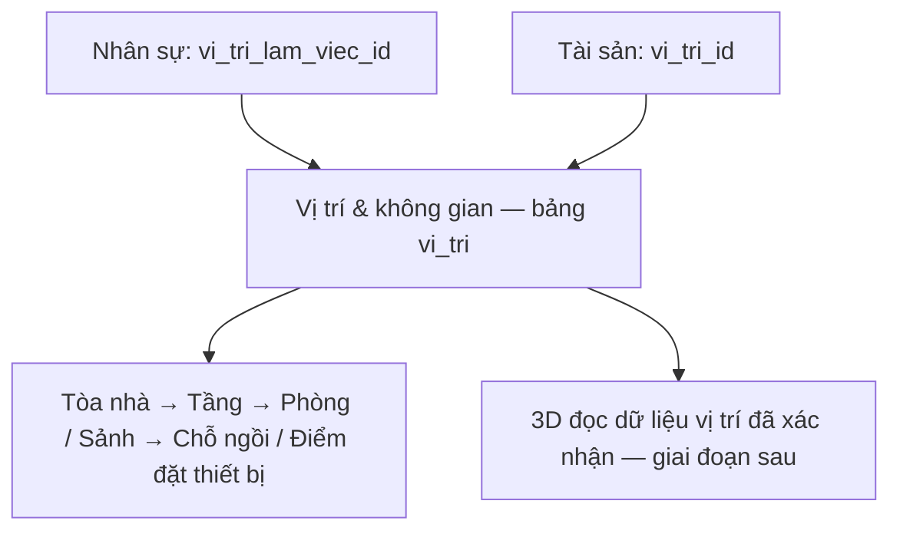

# Kế hoạch vị trí & không gian dùng chung

Cập nhật: **10/11/2026**. **Bản đầu đã triển khai và kiểm thử kỹ thuật đạt; chờ cấp quyền/nhập cây vị trí thực tế.** Rule: [LOCATION-MANAGEMENT-RULES](../../.agents/rules/LOCATION-MANAGEMENT-RULES.md).

## Phạm vi và trách nhiệm

- Tính năng riêng tại **Hệ thống & cấu hình → Vị trí & không gian**, đường dẫn `/locations`.
- Sở hữu danh mục vật lý `vi_tri`, dùng chung cho nhân sự, tài sản và 3D. Phòng ban là cơ cấu tổ chức, không thay thế vị trí.
- Bản đầu quản lý cây, tìm kiếm, tạo/sửa, thêm vị trí con và ngừng sử dụng. Chỉ xóa bản ghi nhập nhầm chưa có tham chiếu; vẫn giữ audit.
- Chưa thiết kế mặt bằng, tọa độ 3D, đặt chỗ theo lịch, sức chứa hoặc lịch sử di chuyển chuyên biệt. Không tự tạo chỗ ngồi/người từ cấu hình 3D.

## Thiết kế DB cần giữ

Một bảng mới `vi_tri`; Prisma và PostgreSQL dùng cùng tên. ID tự sinh; `parent_id` nhận ID của vị trí cha được chọn, không phải ID mới của vị trí con.

| Cột | Yêu cầu |
| --- | --- |
| `id` | Int, khóa chính tự tăng |
| `company_id` | Bắt buộc, lấy từ phiên |
| `ma_vi_tri` | Mã tự cấp ổn định, ví dụ VT-000001; unique trong công ty, không sửa hoặc tái sử dụng |
| `ten_vi_tri` | Bắt buộc; tên hiển thị, có thể sửa |
| `loai_vi_tri` | Bắt buộc: Tòa nhà / Tầng / Phòng / Khu vực / Chỗ ngồi / Điểm đặt thiết bị |
| `parent_id` | Nullable; FK về `vi_tri`, cùng công ty; null là vị trí gốc |
| `mo_ta` | Tùy chọn, hướng dẫn tìm vị trí |
| `dang_su_dung` | Boolean, mặc định true |
| `created_at`, `updated_at` | Thời gian tạo/cập nhật; dùng phiên bản khi sửa |

- Unique `(id, company_id)` phục vụ FK kép; FK cha và các tham chiếu dùng Restrict. Cấp mã bằng sequence/default, không dùng số dòng hoặc `MAX + 1`.
- ID/mã không phải số thứ tự hay số lượng. Kiểm thử tích hợp đã cấp rồi dọn bản ghi trên DB local nên sequence có khoảng trống; rollback cũng không trả số đã cấp. Không reset bộ đếm hoặc đánh lại ID của dữ liệu đang dùng. Các lần kiểm thử ghi dữ liệu tiếp theo ưu tiên DB tạm để không tiêu bộ đếm vận hành.
- Loại vị trí giúp phân loại; bản đầu không ép đủ mọi tầng cấp. Chặn chính mình, hậu duệ, chu trình và khác công ty. Không tự đổi cây khi thay cơ cấu phòng ban.
- Chỉ chọn vị trí đang sử dụng, với toàn bộ tổ tiên đang sử dụng. Chuyển cha giữ ID của vị trí và các liên kết nhưng đổi đường dẫn của cả nhánh; hiển thị ảnh hưởng và xác nhận trước khi lưu.
- Bản đầu ngừng dùng/xóa từng vị trí từ dưới lên: chặn khi còn vị trí con hoặc bất kỳ nhân sự/tài sản tham chiếu, kể cả hồ sơ đã nghỉ/ngừng dùng. Yêu cầu chuyển/gỡ liên kết có chủ đích trước; không tự xóa hoặc dồn về cha. Audit còn giữ định danh/nhãn lịch sử sau khi xóa vị trí trống.
- Mutation khóa hàng công ty → khóa phân quyền hiện hành → kiểm tra lại quyền, version và cây → ghi dữ liệu/audit trong cùng transaction. Luồng gán vị trí ở HR/tài sản cũng khóa công ty trước kiểm tra trạng thái để không đua với ngừng dùng/xóa vị trí.
- Nhật ký dùng bảng sẵn có: phân hệ `LOCATIONS`, đối tượng `vi_tri:<id>`. Nhật ký chứa trước/sau và nhãn giải thích; không tạo bảng lịch sử vị trí riêng.

## Quyền và giao diện

| Quyền | Phạm vi trong công ty |
| --- | --- |
| `LOCATIONS · VIEW` | Xem cây, chi tiết vị trí và lịch sử vị trí |
| `LOCATIONS · MANAGE` | Bao gồm xem; thêm/sửa/chuyển cha/ngừng dùng/xóa vị trí trống |
| `ASSETS · MANAGE` | Chọn vị trí để gán thiết bị; không sửa danh mục vị trí |
| `HR · MANAGE` | Chọn vị trí làm việc cho nhân sự; không sửa danh mục vị trí |

- Hai luồng chọn vị trí của HR/tài sản được truy vấn danh mục tối thiểu (ID, mã, tên, loại, đường dẫn, trạng thái), không bắt cấp LOCATIONS VIEW. Truy vấn vẫn kiểm tra đúng quyền nghiệp vụ và công ty.
- LOCATIONS VIEW không cấp quyền xem người/tài sản tại vị trí. Khi bổ sung phần liên quan, từng truy vấn phải kiểm tra HR/ASSETS riêng; không lộ tên, số lượng hoặc ghi chú qua cây vị trí.
- Trang ưu tiên cây và panel chi tiết; mobile mở chi tiết riêng. Form có dấu `*`, lỗi tại trường, chọn cha bằng đường dẫn; không nhập ID thủ công. Không đưa lịch sử hay metadata kỹ thuật lên màn hình chính.
- Catalog, migration, seed cài mới, guard menu/page/action và ma trận `/roles` cập nhật cùng lần triển khai quyền. Không tạo role mẫu mới, không tự cấp cho ADMIN/HCNS/role tài sản.

## Liên kết và thứ tự triển khai

| Bước | Kết quả và chủ sở hữu |
| --- | --- |
| 1. Vị trí dùng chung | Plan này: bảng `vi_tri`, quyền LOCATIONS, `/locations`; chạy độc lập khi chưa có tài sản |
| 2. Tài sản mức 1 | [Plan tài sản](ASSET-MANAGEMENT-CHECKLIST.md): `loai_tai_san`, `tai_san`, FK `vi_tri_id`, quyền ASSETS |
| 3. Vị trí nhân sự | [Plan HR](HR-CHECKLIST.md): thêm `nhan_su.vi_tri_lam_viec_id` nullable, FK cùng công ty, Restrict; form gán vị trí |
| 4. Kết nối 3D | Lập plan triển khai 3D riêng trước khi thay mapping; đọc vị trí thực, chưa xác nhận thì để trống |

Nhân sự có một vị trí làm việc chính; một vị trí có thể chứa nhiều người và thiết bị, không unique FK hoặc tự suy sức chứa. Thiết bị giữ vị trí riêng, không tự đi theo người. Khi triển khai bước 2/3 phải bổ sung kiểm tra tham chiếu cho thao tác xóa/ngừng dùng vị trí và kiểm thử đồng thời; không truy vấn bảng chưa tồn tại ở bước 1.

## Checklist và nghiệm thu

- [x] Tách thiết kế, quyền và quyền sở hữu bảng vị trí khỏi tài sản; đăng ký rule/router, đồng bộ các plan liên quan. Chỉ thay tài liệu.
- [x] Migration `20261110100000_vi_tri_khong_gian`: bảng, sequence/mã bất biến, FK cùng công ty, kiểm tra cây/trạng thái và 2 quyền LOCATIONS. Backup PostgreSQL 17 được khôi phục vào DB tạm rồi thử migration; fingerprint của 14 bảng cũ giữ nguyên sau áp dụng (loại quyền mới khỏi phép so sánh catalog). Không thêm vị trí hoặc grant vận hành. Bằng chứng cục bộ tại `outputs/locations/`.
- [x] `/locations`: cây, tìm không dấu/đường dẫn, lọc trạng thái, thêm/sửa/con, xác nhận chuyển nhánh, ngừng dùng/xóa trống, chi tiết và 50 nhật ký gần nhất. Guard menu/page/action, form RHF/Zod, version và audit cùng transaction. Danh mục tối thiểu hỗ trợ HR MANAGE; ASSETS bổ sung khi phân hệ đó triển khai. Ma trận quyền và seed cài mới có LOCATIONS, không tự cấp role.
- [x] Kiểm thử VIEW/MANAGE/không quyền (kể cả chỉ có HR MANAGE), thu hồi quyền, URL/action trực tiếp, khác công ty, mã đồng thời và audit rollback. Tiêm lỗi audit giới hạn trong công ty kiểm thử: action thất bại giữ nguyên dữ liệu/version.
- [x] Kiểm thử hai chuyển cha đồng thời không tạo chu trình, xác nhận chuyển nhánh, đường dẫn/tìm không dấu, chặn ngừng dùng/xóa còn vị trí con, không chọn cha đã ngừng dùng, version cũ và lịch sử còn sau xóa. Chrome desktop/mobile/sáng/tối, focus khi đóng chi tiết đạt. Các ca liên kết HR/tài sản chạy thêm khi triển khai từng phân hệ.
- [x] 3 ca `locations.spec.ts` và 9 ca phân quyền hồi quy đạt; TypeScript/lint, Prisma validate và schema diff đạt. Tại thời điểm dọn fixture: fingerprint 14 bảng cũ giữ nguyên, 0 vị trí/0 grant LOCATIONS; số liệu này không phải trạng thái cố định sau khi người dùng nhập dữ liệu. Đã mở Chrome kiểm tra Studio cổng 5555: `All Models` có `vi_tri`, mở được các cột `ma_vi_tri`, `ten_vi_tri`; đúng DB `sdg_erp`, không cần chạy lại migration. Tab cũ cần tải lại danh sách model. Nhật ký/ảnh kiểm thử/backup chỉ ở `outputs/locations/`.
- [ ] Người phụ trách xác nhận cây thực tế và cấp quyền pilot. Không tự nhập hàng loạt từ 3D hoặc 1Office.

Nghiệm thu bản đầu: người có quyền quản lý được cây hợp lệ và lịch sử; người chọn vị trí qua HR/tài sản không sửa được danh mục; quyền vị trí không làm lộ hồ sơ thuộc phân hệ khác.
