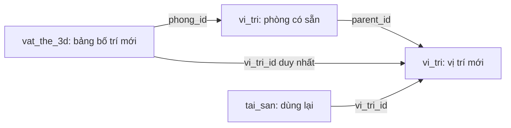
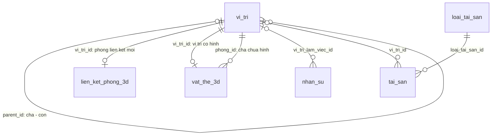

# Mô hình không gian 3D — tòa nhà và các phòng

Cập nhật: **25/11/2026**. Đã triển khai và kiểm chứng mặt bằng ba tầng theo PDF, chuyển cảnh HCNS, gán người/tài sản, khung điều khiển mở rộng, bảng phòng rút gọn và thêm/sửa thông tin vị trí trực tiếp trên mô hình; vẫn là bản thử nghiệm. Rule: [OFFICE-3D-RULES](../../.agents/rules/OFFICE-3D-RULES.md).

## A. Tổng quan

**Bản thử tại bàn bác Khoa, tầng 3.** Chọn bàn để thấy tên bàn và danh sách tài sản trong bảng bên. Bấm vào PC hoặc tên thiết bị trong danh sách để xem hồ sơ ngay trên bản đồ. Người có quyền quản lý tài sản có thể sửa trực tiếp. Chờ đánh giá trải nghiệm tại bàn này trước khi mở rộng.

**Mở rộng KHĐT — đã triển khai:** các phòng vật lý đã liên kết dùng chung vào phòng, camera, bảng vị trí và gán người/tài sản. KHĐT có 12 vị trí lưu DB; giữ Bàn Huy ở số 11, Bàn Tuân ở số 12 cùng toàn bộ liên kết cũ. Bàn chung và sofa chỉ là bối cảnh. Không thêm bảng DB. [Thiết kế và kiểm chứng](#phòng-chi-tiết-dùng-chung-và-bố-trí-khđt).

**Bản thử thêm vị trí:** người quản lý chọn phòng đã liên kết → Thêm vị trí → chọn Bàn làm việc/Điểm đặt thiết bị → bấm mặt bằng, xoay/dịch chuyển → Lưu. Vị trí tạo được dùng ngay để gán tài sản theo quyền ASSETS. Đây là phạm vi mới đã được yêu cầu, thay quyết định trước đây chỉ dựng nội thất cố định. Không làm trình biên tập tường, kích thước hoặc kéo thả tự do.

| Người dùng thao tác | Hành vi hiện tại |
| --- | --- |
| Chọn tầng / trở về toàn nhà | Camera di chuyển và phóng tới tầng; các tầng giữ nguyên vị trí, tầng ngoài lựa chọn mờ nhanh tại chỗ rồi ẩn, không chồng/gom hình |
| Nhấp đúp HCNS khi đang xem tầng | Phóng gần từ hướng đang nhìn, không tải lại trang/Canvas; không gian xung quanh mờ dần |
| Vào HCNS / bấm tên HCNS / bấm vùng trống | Vào phòng không tự chọn bàn; tên HCNS và nhấp trái nền/sàn bỏ chọn điểm, trở về camera và bảng tổng quan phòng |
| Chọn bàn / nhấp đúp | Nhấp đơn xem vị trí; nhấp đúp phóng sát khu vực, giữ hướng nhìn và cùng Canvas |
| Chọn hình thiết bị | Xem đúng hồ sơ tài sản; nếu nhiều hồ sơ chung hình thì chọn trong danh sách. Nhấp đúp phóng gần thiết bị |
| Chuột phải đối tượng / menu … | Sửa hồ sơ đúng đối tượng theo quyền riêng: vị trí, tài sản hoặc nhân sự; mở tại chỗ, giữ Canvas/góc nhìn. Hình nhiều tài sản cho chọn hồ sơ |
| Sửa thông tin vị trí | Từ bảng điểm/phòng đã liên kết, sửa tên và mô tả ngay trên 3D theo quyền quản lý vị trí; lưu giữ góc nhìn và lựa chọn |
| Tìm đối tượng / nút lớp | Chỉ gợi ý sau khi gõ; chọn để đến vị trí. Bật/tắt Nhân sự/Tài sản và lọc loại nằm ở cụm nút riêng |
| Chọn hình người hoặc tên | Xem người đã gán tại vị trí; nhiều người có danh sách đầy đủ |
| Gán tài sản tại bàn | Chọn thiết bị đã tạo; chuyển từ nơi khác có xác nhận, hỗ trợ bỏ gán. Quyền ASSETS riêng với HR |
| Quay ra hoặc nhấn Esc | Đóng menu/hộp thoại trước; tài sản → vị trí → phòng → tầng → toàn nhà, giữ góc nhìn trước. Chỉ thu gọn khung mở rộng khi đã ở toàn nhà; không bỏ bản nháp |
| Chuột phải / nút … | Cùng bộ thao tác theo đối tượng và quyền: xem, tập trung, tổng quan, thêm/chỉnh bố trí; không thao tác xóa nhanh |
| Dùng điện thoại/bàn phím hoặc thiếu WebGL | Giữ nút vào/quay lại và danh sách vị trí mở rộng |
| Mở rộng/thu gọn vùng 3D | Nút góc trên phải; giữ góc nhìn, tầng/phòng, vị trí và cùng Canvas |
| Xem/ẩn thông tin | Bảng bên phải mặc định mở trên desktop; chọn phòng/hồ sơ mở thông tin theo ngữ cảnh. Cột bên cạnh trên desktop, bảng phía dưới trên điện thoại; màn hình ngang thấp dùng cột để tránh che mô hình |
| Chọn Nhân sự/Tài sản trong bảng phòng | Xem số lượng và vị trí ngắn gọn; chọn hồ sơ có hình để tập trung đúng điểm và xem chi tiết, giữ cùng Canvas |

Mô hình người biểu thị phân công chỗ làm việc, không phải chấm công/hiện diện. Dùng dữ liệu và quyền HR–vị trí hiện có; bảng bố trí bổ sung được mô tả bên dưới. Không thêm dependency hoặc thay ba rule chung. KHĐT đã có bản vẽ 12 vị trí; các phòng còn lại chờ khảo sát nội thất. Tìm kiếm đưa camera tới người đã được bổ sung theo mục bên dưới; kéo thả người chưa thuộc phạm vi này.

**Mặt bằng hiện hành:** ba PDF tầng 1–3 làm nền tỷ lệ; bản tầng 2 được người phụ trách điền thêm đã xác nhận tên 6 phòng và điều chỉnh nội thất HCNS. Kinh doanh ở ô 97 m² tầng 1. Giữ 10 vị trí HCNS và dữ liệu đang gán; Quầy Lễ tân đã đặt ở sảnh Tầng 1, lưng người ngồi hướng về Phòng Khánh Tiết; dùng lại vị trí có sẵn. Toàn bộ bàn/điểm HCNS lưu bố trí DB, có thể thêm hoặc chỉnh qua bộ thao tác chung bên dưới; tài sản thật gán qua panel theo quyền ASSETS. Chi tiết và kiểm chứng ở mục [Khảo sát mặt bằng kiến trúc](#khảo-sát-mặt-bằng-kiến-trúc).

Đọc chi tiết: [B. Triển khai](#b-chi-tiết-triển-khai), [Gán tài sản](#gán-tài-sản-tại-vị-trí-3d), [DB cần giữ](#thiết-kế-db-cần-giữ), [Nghiệm thu](#nghiệm-thu).

**Giao diện 12/11 — đã triển khai và kiểm chứng:** điều khiển nằm trong vùng mô hình, có Mở rộng/Thu gọn và bảng thông tin đóng/mở. Các thao tác cục bộ không cần tìm ngoài khung; xem [thiết kế và nghiệm thu bên dưới](#đề-xuất-khung-điều-khiển-và-mở-rộng).

## B. Chi tiết triển khai

### Mẫu bàn Tổng giám đốc

- [x] Thêm `BAN_TONG_GIAM_DOC` vào **Mẫu hiển thị** khi thêm/chỉnh bàn: kích thước mặc định 2,4 × 1,2 m, mặt gỗ dày, yếm và chân dạng tấm, mặt phụ bên hông cùng cao độ. Đây là mẫu minh họa, chưa phải số đo bàn thực tế; không tự đổi các bàn đã có.
- [x] Dùng chung `vat_the_3d`, thao tác xoay/di chuyển, gán nhân sự/tài sản và thuật toán bố trí thiết bị. Mẫu chỉ dành cho `BAN`; không tạo loại vị trí, bảng hay quyền mới. Hình học đơn giản, không thêm texture/thư viện.
- [x] Migration `20261120160000_mau_ban_tong_giam_doc` mở rộng CHECK hiện có; đã sao lưu và thử trên DB phục hồi, đối chiếu toàn bộ 34 bảng không đổi dữ liệu. Unit kiểm tra kích thước/va chạm/xoay và integration lưu/đổi mẫu, đọc lại, ràng buộc DB đạt.
- [x] Chrome đã kiểm tra chọn mẫu, lưu và tải lại đúng mẫu, không lỗi JS; đã xem ảnh phối cảnh. TypeScript, lint, 6 unit placement và integration đạt. Migration đã áp dụng DB local sau backup; đối chiếu 34 bảng giữ nguyên dữ liệu. Ảnh và bằng chứng tại `outputs/executive-desk/` (không đưa Git).

### Quầy lễ tân và đặt model cho vị trí có sẵn

- [x] Dùng lại “Lễ Tân” là chỗ ngồi trực thuộc Tầng 1; không tạo phòng giả, không đổi cha/ID hoặc gán lại người/tài sản. Vùng mở trước Phòng Khánh Tiết không dựng vách bao; quầy xoay để lưng người ngồi hướng về Khánh Tiết.
- [x] `vat_the_3d.mau_hien_thi` tách kiểu hình khỏi `loai_vat_the`: quầy vẫn là `BAN`, kích thước mẫu 2,6 × 1,1 m. Một vị trí chỉ có một model. Migration `20261120113000_mau_quay_le_tan` chỉ thêm cột/CHECK, giữ mẫu mặc định cho dữ liệu cũ; đã sao lưu và kiểm tra trên bản sao trước khi áp dụng DB local.
- [x] Thêm vị trí trong phòng: chọn tạo mới hoặc vị trí có sẵn chưa có model. Lễ tân liên kết thẳng chỗ ngồi: chỉ đặt/chỉnh model cho chính vị trí ấy, không sinh con dưới chỗ ngồi. Kiểm tra công ty, cây đang dùng, phiên bản, loại vị trí, unique và khóa giao dịch; gắn model không đổi tên/ghi chú/liên kết hồ sơ có sẵn.
- [x] Dùng chung chọn/nhấp đúp, camera, URL/Escape, sửa bố trí và panel gán HR/ASSETS theo quyền riêng. Không có nhân sự thì không tự tạo hình người. Mẫu quầy thêm vài khối hình học, không thêm texture/dependency/vòng render hoặc truy vấn từng khung hình.
- [x] Kiểm chứng: TypeScript/lint, 25 unit hình học/điều hướng và 6 integration trên DB riêng đạt (quyền, tạo đồng thời, giữ hồ sơ, phiên bản cũ, sai cha/loại và liên kết mất hiệu lực). Chrome đã kiểm tra tạo model cho vị trí có sẵn trên DB thử, chọn/xem/chỉnh quầy và nút gán HR/ASSETS trên bản local; desktop và viewport điện thoại 390 × 844 không lỗi JS/tràn ngang. Đây chưa phải đo hiệu năng trên điện thoại thật. Bằng chứng/ảnh/backup tại `outputs/reception/` (chỉ lưu cục bộ).
- [ ] Người phụ trách kiểm tra vị trí quầy theo thực tế và gán nhân sự lễ tân; có thể chỉnh bố trí ngay trên 3D.

### Quy ước dùng chung cho các phòng — 20/11

- [x] Tất cả phòng dùng cùng nhãn ngắn, trạng thái chọn, panel tổng quan, camera và điều hướng. Phòng có liên kết vị trí đang sử dụng được vào chi tiết ngay cả khi chưa có bàn; thêm/chỉnh vị trí và gán người/tài sản dùng bộ chức năng chung theo quyền hiện có. Tên trên thanh điều hướng cũng rút gọn cho các phòng ngoài HCNS/KHĐT, tên đầy đủ giữ trong panel.
- [x] Bỏ ba nhánh dự phòng đưa người/tài sản/điểm không tìm thấy về HCNS. Đích tương tác phải có vật thể DB và đúng khóa phòng; đối tượng mất hiệu lực không đổi lựa chọn sang phòng khác.
- [x] 18 unit về ánh xạ, điều hướng và phòng đạt; thêm kiểm tra mọi phòng vật lý: phòng rỗng, cô lập đối tượng theo phòng, URL/Escape, tên ngắn và chặn phòng chưa liên kết/ngừng dùng. TypeScript và ESLint phạm vi đạt. Chrome chỉ đọc kiểm chứng Kinh doanh, KHĐT, HCNS: tổng quan không tự chọn bàn, có Thêm vị trí theo quyền, Escape về tầng, cùng Canvas, không lỗi JS. Ảnh/kết quả `outputs/room-labels/shared-*`; chưa chạy mutation tạo/gán trong đợt này.
- **Dữ liệu hiện hành:** ba phòng đã đặt trên mặt bằng và liên kết là Kinh doanh, HCNS, KHĐT. Lễ tân có liên kết và mẫu quầy tại sảnh Tầng 1; Tổng Giám đốc có bản ghi vị trí nhưng chưa có ánh xạ mô hình. Các phòng còn lại không tự tạo bàn, nhân sự, tài sản hoặc suy liên kết theo tên. Các liên kết đã có được giữ nguyên; không tự gắn phòng mới.
- [x] LOCATIONS MANAGE chọn phòng chưa liên kết → Liên kết vị trí → chọn Phòng/Khu vực đang dùng, trực thuộc đúng tầng, chưa gắn hình khác → lưu → dùng chi tiết/thêm vị trí/gán như các phòng hiện có. Không tự chọn theo tên hoặc tạo nội thất.
- **Thiết kế DB cần giữ — liên kết phòng:** bảng `lien_ket_phong_3d` gồm `id`, `company_id`, `khoa_phong`, `vi_tri_id`, `created_at`, `updated_at`; unique công ty/khóa hình và vị trí/công ty, FK kép cùng công ty. Liên kết là dữ liệu phụ của vị trí nên xóa vị trí hợp lệ sẽ xóa liên kết; không xóa nhân sự/tài sản. Tòa nhà/tầng/liên kết cũ giữ file cấu hình, liên kết mới đọc hợp nhất từ DB và kiểm tra trùng, không ghi đè file. Đổi cha/loại/ngừng dùng làm liên kết mất hiệu lực qua bộ resolve hiện có. Chưa có thao tác đổi/gỡ liên kết từ 3D.
- **Ghi:** khóa công ty rồi khóa cây vị trí dùng chung, kiểm tra lại phiên/quyền/công ty/tầng/trùng trước tạo và audit cùng transaction. Không tự cấp quyền HR/ASSETS. Không thêm tọa độ vào `vi_tri`.
- [x] Migration `20261120100000_lien_ket_phong_3d` chạy trên DB khôi phục rồi local sau backup; fingerprint 29 bảng cũ giữ nguyên, bảng mới chưa có liên kết tự tạo. Kiểm thử tích hợp 7/7 đạt: quyền, đúng tầng/loại/trạng thái, công ty, chống trùng đồng thời, audit rollback, cascade phụ thuộc, phiên thu hồi và thêm bàn qua mapping DB.
- [x] Chrome trên DB khôi phục: bắt buộc chọn phòng, không liệt kê phòng đã nối, lưu → vào phòng rỗng → Thêm vị trí, giữ cùng Canvas, reload vẫn có liên kết. Đã xem ảnh desktop 1366×768/mobile giả lập 390×844, dialog trong màn hình, không lỗi JS. 16 unit hồi quy phòng/điều hướng/bố trí, TypeScript và ESLint phạm vi đạt. Bản cổng 4000 đã khởi động lại để nạp Prisma Client mới; kiểm tra chỉ đọc thấy danh sách phòng phù hợp và HCNS hiển thị đúng, chưa gắn phòng mới trên DB vận hành. Bằng chứng/backup tại `outputs/room-links/`; chưa đo trên điện thoại thật.

### Chuyển bố trí HCNS sang DB

- Phạm vi đã duyệt: chuyển 10 bàn gốc sang `vat_the_3d`, tái sử dụng ID `vi_tri`, giữ bố cục/kích thước và liên kết người/tài sản. Các vật thể thêm sau giữ nguyên.
- Thiết kế: bổ sung chiều rộng/sâu và khóa tương thích URL cũ vào bảng bố trí hiện có; hình học phòng/tường vẫn là bối cảnh. Render, camera và kiểm tra chồng lấn lấy bố trí DB dùng chung với KHĐT.
- [x] Sao lưu và thử trên DB khôi phục riêng trước khi áp dụng DB vận hành. Nhập 10 bàn gốc; cùng vật thể có sẵn thành 11 bố trí HCNS trong DB. Chạy lại không tạo trùng; toàn bộ hồ sơ vị trí, liên kết người/tài sản và bố trí cũ giữ nguyên. Backup/đối chiếu cục bộ tại `outputs/hcns-db/`.
- [x] Viewer/editor/camera dùng bố trí DB chung; bỏ `HcnsRoomModel` và danh sách bàn khỏi mã chạy ứng dụng. Giữ link `hcns-01`…`hcns-10` bằng `khoa_cu`. Dữ liệu khảo sát cũ ở `prisma/data/hcns-survey.ts` chỉ phục vụ nhập một lần và kiểm thử.
- [x] Đã áp dụng migration và nhập DB vận hành; 24 unit đạt. Trên DB riêng, chỉnh bàn gốc hai lần liên tiếp và reload giữ kích thước/liên kết/link cũ/cùng Canvas. Sửa thời điểm mở lại editor để chờ dữ liệu mới sau lưu, tránh dùng phiên bản cũ. Đã dọn server/DB thử, giữ backup.
- [x] Trên app cổng 4000, 3 E2E chỉ đọc đạt: nhân sự/máy in 251 qua hai vòng chuyển HCNS–KHĐT–tầng; tìm người/zoom/cùng Canvas/link cũ; tìm kiếm và nút lớp trên mobile tối. Đã sửa nhãn vị trí trùng/lấn nhãn người khi chọn nhân sự. TypeScript, lint phạm vi và diff check đạt. Đã xem ảnh Chrome, chưa đo FPS điện thoại thật hoặc chạy production build trong lượt này.
- [x] Khởi động lại app cổng 4000 để nạp Prisma Client mới và làm mới cache Turbopack cũ; không khởi động lại PostgreSQL. Kiểm tra cuối xác nhận hồ sơ vị trí, phân công người/tài sản và bố trí cũ không đổi. Bằng chứng/backup nằm cục bộ tại `outputs/hcns-db/`, không đưa Git.

**Thiết kế chuyển đổi:** migration `20261117150000_bo_tri_hcns_db` bổ sung `chieu_rong`, `chieu_sau` (0,1–10 m), `khoa_cu` nullable/unique theo công ty vào `vat_the_3d`. Không tạo bảng mới. Kích thước hiện hữu được giữ khi chỉnh bố trí; loại hình `BAN` không đổi loại nghiệp vụ `DIEM_DAT_THIET_BI` của vị trí máy in. Kiểm tra biên vẫn chừa tường 12 cm; khoảng cách chống chồng lấn giữa hình 1 cm để nhận các bàn ghép cách nhau 5 cm theo khảo sát.

**Nhập dữ liệu:** `prisma/bootstrap-hcns-layout.ts` mặc định xem trước; `--apply` nhập nguyên tử cùng audit/khóa công ty và kiểm tra ánh xạ. Có dấu nhập đầy đủ thì không ghi lại; dữ liệu dở dang/xung đột thì dừng. Không tạo lại vị trí, không đổi phân công, không ép lại bố trí khi tải trang.

### Phòng chi tiết dùng chung và bố trí KHĐT

- [x] Khu tiếp khách KHĐT (19/11): cụm tiếp khách xoay thêm 90°, một sofa dài lưng tựa tường phía sau, một bàn tròn ở giữa và hai ghế đơn đối diện theo bản phác. Dùng hình khối nhẹ cùng phong cách; đây là nội thất bối cảnh, không tạo hồ sơ tài sản/vị trí hoặc thay bố trí 12 bàn trong DB.
- [x] TypeScript/lint đạt ở bước dựng cụm; lần xoay 90° đã kiểm tra lại lint và ảnh Chrome mặt bằng/phối cảnh: lưng sofa sát tường phía sau, bàn tròn và hai ghế đơn đối diện, không chồng bàn làm việc; không lỗi JavaScript. Ảnh tại `outputs/room-labels/khdt-sofa-*.png`, kiểm tra chỉ đọc DB.

- [x] `room-detail.ts` xác định phòng có hình vật lý và liên kết vị trí đang dùng; `RoomPointPanel` dùng chung cho mọi phòng đủ điều kiện. Camera lưu riêng theo khóa phòng. Tổng quan, chọn bàn/người/tài sản, nhấp đúp tập trung, Esc/Back, tìm kiếm và menu dùng cùng luồng; không tạo Canvas hoặc trang chi tiết thứ hai.
- [x] KHĐT (`plan_t2_phai_truoc`, phòng vật lý 76) đã nhập 12 bàn từ bản vẽ: hai cụm 1–5 và 6–11, bàn riêng 12; bàn chung/sofa là hình nền giản lược, không tạo hồ sơ vị trí/tài sản.
- [x] Giữ vị trí **78 Bàn Huy = số 11**, **79 Bàn Tuân = số 12**; chỉ đổi tọa độ/hướng của hình. Tạo 10 vị trí mới và hình tương ứng. Đã đối chiếu sau nhập: hồ sơ hai vị trí cũ và toàn bộ liên kết người/tài sản tại hai bàn giữ nguyên.
- [x] Nhập thử trên DB khôi phục riêng; kiểm tra biên/chồng lấn và chạy lại không tạo trùng. Sao lưu DB vận hành trước khi áp dụng; đầu ra cục bộ tại `outputs/khdt/`.
- [x] Kiểm thử gán/chuyển có xác nhận/bỏ gán, audit, phiên bản cũ, thiếu quyền và khác công ty trên DB riêng. Đã xem ảnh bố trí đủ 12 bàn ở phối cảnh, mặt bằng và màn hình 390px; cùng Canvas, không lỗi JavaScript trong ca KHĐT.
- [x] 23 unit và 20 ca E2E khác nhau đạt: 2 nghiệm thu KHĐT + 18 hồi quy chọn thiết bị/nhấp đúp/Esc/chuyển tầng/tìm kiếm/lớp/WebGL/menu/HCNS. Một ca cũ về hai điểm Máy hủy giấy/Tủ đồ bỏ qua do thiếu đủ fixture hiện hành. Ca chuyển tầng đổi chờ thời gian cố định sang chờ camera hội tụ, giữ nguyên ngưỡng sai số; ca nhấp đúp bàn chọn góc trống để tránh trúng laptop. TypeScript, lint phạm vi và `git diff --check` đạt. Không chạy lại production build trong lượt này. Đã dừng server 4127 và xóa DB thử riêng, giữ app 4000/backup/ảnh. Đối chiếu ngay sau nhập xác nhận không đổi liên kết; kiểm tra cuối phát hiện hai thao tác HR của tài khoản admin phát sinh sau nhập (chuyển người sang Vị trí 10 và Bàn Huy), giữ nguyên thay đổi mới, không phục hồi snapshot cũ.

- [x] Sửa hồi quy hình người KHĐT: chỉ chia sẻ geometry tĩnh; mỗi hình người sở hữu material riêng để hiệu ứng mờ/ẩn HCNS hoặc tầng khác không làm trong suốt nhân sự đang xem. Material được quản lý và thu hồi theo vòng đời React Three Fiber.
- [x] Kiểm chứng hiển thị bằng Chrome: đọc opacity của mesh nhân sự và máy in, chuyển HCNS → KHĐT → tầng 1/2 → HCNS hai vòng trong cùng Canvas. Có ảnh desktop và mobile giả lập tại `outputs/3d-visibility/`; không ghi DB hoặc đổi liên kết người/tài sản. Bộ hồi quy bổ sung `room-visibility.spec.ts`; 15 unit liên quan đạt, TypeScript và lint đạt.

**Thiết kế DB cần giữ:** dùng lại quan hệ ở [mục DB](#thiết-kế-db-cần-giữ). `vi_tri` lưu tên/mã tự sinh/cha; `vat_the_3d` lưu FK phòng, FK vị trí, loại hình, tọa độ và góc xoay. Toàn bộ 12 bàn KHĐT đọc bố trí từ DB; `khdt-layout.ts` chỉ là dữ liệu khởi tạo một lần, không ép tọa độ khi render hoặc mở trang. Người/tài sản vẫn nối vào `vi_tri`; chỉnh bố trí không sửa các liên kết đó. HCNS đã chuyển sang cùng nguồn bố trí DB tại mục chuyển đổi phía trên.

**Công cụ nhập:** `prisma/bootstrap-khdt-layout.ts` mặc định chỉ xem trước; khi áp dụng phải truyền rõ ánh xạ bàn cũ `--reuse=11:78,12:79`. Ghi 12 audit với dấu nguồn `khdt-survey-20261117` trong cùng transaction Serializable/khóa công ty. Chạy lại trả `already-imported`, không ghi đè chỉnh sửa của người dùng; nếu dấu nguồn thiếu một phần hoặc có vị trí cũ chưa đối chiếu thì dừng. ID trên là dữ liệu môi trường local, môi trường khác phải kiểm tra lại ánh xạ, không chạy nguyên lệnh với ID phỏng đoán.

**Sử dụng:** Tầng 2 → nhấp đúp phòng KHĐT (hoặc Vào phòng) → chọn bàn → Gán tài sản. ASSETS VIEW/MANAGE quyết định xem/gán; HR VIEW/MANAGE độc lập cho nhân sự; LOCATIONS MANAGE cho sửa vị trí/bố trí. Không cấp thêm quyền hoặc sinh thiết bị/người từ hình minh họa.

**Giới hạn:** vị trí/kích thước nội thất ước lượng theo bản phác, cần người phụ trách xác nhận bằng mắt; không tuyên bố là bản đo thi công. Phòng mới dùng được chức năng chung khi đã liên kết và có hình bàn/điểm trong DB, nhưng bố cục nội thất vẫn cần khảo sát. Không có kéo thả riêng từng thiết bị hoặc tự suy người ngồi.

### Sửa hồ sơ từ menu đối tượng — 16/11/2026

Panel tài sản dùng cơ chế [tự lưu của phân hệ tài sản](ASSET-MANAGEMENT-CHECKLIST.md#tự-lưu-chỉnh-sửa-tài-sản--16112026): chọn/rời ô/Enter để lưu, không đổi luồng sửa HR/vị trí. Ca E2E nhấp phải mesh → sửa tên → Enter tự lưu đã đạt, giữ Canvas/URL/camera và audit; bằng chứng tại `outputs/assets-autosave/3d.log`.

**Đã triển khai và kiểm chứng:** chuột phải chọn đúng đối tượng rồi mở sửa tại chỗ; menu … dùng cùng lệnh cho bàn phím/chạm. Bàn/phòng sửa tên/mô tả vị trí (LOCATIONS MANAGE); hình người sửa hồ sơ nhân sự (HR MANAGE); hình thiết bị sửa hồ sơ tài sản (ASSETS MANAGE). Nhãn menu lấy tên đối tượng. Hình đại diện nhiều thiết bị phải chọn hồ sơ, không tự lấy bản ghi đầu tiên; nền không hiện lệnh sửa đối tượng.

Tái sử dụng form/action hiện có; hồ sơ chi tiết chỉ tải khi mở, kiểm tra công ty/quyền tại server. Không thay DB hoặc cấp quyền. Giữ Canvas/camera/URL khi mở và lưu, làm mới tên/liên kết trên mô hình; form lỗi giữ bản nháp, đóng ngoài không làm mất nội dung. Mã tự cấp không sửa. Tài sản dùng lại panel sửa từng mục, nhân sự dùng form HR với xác nhận chuyển vị trí và xử lý nghỉ việc hiện có; không mở luồng tài khoản trong 3D.

- [x] Hoàn thiện xác định đích, nhãn và lệnh sửa theo quyền, chọn hồ sơ khi hình đại diện nhiều tài sản.
- [x] Tái sử dụng phần sửa vị trí/tài sản/nhân sự tại chỗ và bảo vệ bản nháp; tải động editor, không nạp chi tiết hồ sơ khi chỉ xem mô hình.
- [x] 4 E2E mới đạt: nhấp phải mesh thiết bị và bàn, nhãn nhân sự; đúng menu/hồ sơ, sửa/lưu và audit, tên trên mô hình cập nhật, Canvas/URL/ma trận camera không đổi khi lưu tài sản. Hình nhiều thiết bị phải chọn đúng bản ghi. HR lỗi mạng giữ bản nháp, Escape không bỏ form, dùng Lưu/Hủy; quyền độc lập, HR VIEW và ID khác công ty bị từ chối tại action đọc mới. Menu … hoạt động ở mobile/tối, không tràn ngang.
- [x] 21 E2E hồi quy liên quan đạt ở các lượt kiểm tra: 3 sửa vị trí, 3 HR độc lập, 7 khung làm việc và 8 điều hướng/menu 3D. Chuẩn hóa tên vị trí chỉ trong DB thử cho fixture cũ; sửa điểm bấm kiểm thử bàn sang phần trống thay vì đè hình thiết bị, cập nhật ngưỡng vùng Canvas ngang theo thanh tìm kiếm/lớp hiện có. Fixture mới dùng chỗ ngồi hợp lệ khi gán nhân sự, không dùng điểm thiết bị. TypeScript, lint, build production Webpack, 109 liên kết/anchor và `git diff --check` đạt.
- [x] Chrome trên cổng 4000: mở menu nhân sự, nhập thử/Escape/Hủy, không gửi lưu, tên DB giữ nguyên và không lỗi JavaScript; đã xem ảnh desktop và mobile tối. Không migration/cấp quyền hoặc ghi dữ liệu vận hành. Lượt đối chiếu đầu thấy tài sản/audit thay đổi đồng thời ngoài luồng thử và được giữ nguyên; hai lượt sau 18/18 bảng vận hành không đổi. Đã dọn server/DB thử, giữ app cổng 4000. Bằng chứng, snapshot và log tại `outputs/3d-object-edit/`.

### Chọn thiết bị, phóng gần và lùi cấp

- [x] Dùng chung cho bàn HCNS và vật thể thêm qua `vat_the_3d`: nhấp đơn thiết bị chọn hồ sơ, nhấp đúp bàn/điểm phóng gần vị trí; nhấp đúp thiết bị phóng gần hình đại diện. Giữ hướng camera và tôn trọng giảm chuyển động; không đổi cấp khi chỉ cuộn zoom.
- [x] Hình đại diện ánh xạ tới hồ sơ ASSETS tại đúng điểm sau bộ lọc. Một hồ sơ mở trực tiếp; nhiều hồ sơ cùng loại mở danh sách để chọn, không đoán bản ghi. Panel chỉ hiển thị tài sản đang chọn, tên vị trí, tình trạng và thao tác theo quyền; có link mở hồ sơ đầy đủ. Gán mới ở cấp vị trí, chuyển/bỏ gán dùng lại action hiện có.
- [x] Lựa chọn tài sản/loại hình theo URL; lưu camera từng cấp trong viewer để Esc/Back phục hồi. Esc: tài sản hoặc nhóm hình → vị trí → phòng → tầng → toàn nhà; khung mở rộng giữ nguyên đến toàn nhà rồi Esc mới thu gọn. Menu/form/bản nháp được ưu tiên; tên HCNS/nền phòng vẫn về tổng quan phòng.
- **DB/quyền:** không thêm bảng/cột, không ghi dữ liệu khi chọn/zoom. Dùng dữ liệu đã lọc theo quyền ASSETS/HR/LOCATIONS; ID trong URL không cấp quyền hoặc tự truy vấn hồ sơ ngoài phạm vi. Thiết kế DB hiện hành giữ nguyên ở mục bên dưới.
- [x] 18 unit đạt: URL/lùi cấp, loại tài sản, nhóm nhiều hồ sơ và bộ lọc. 3 E2E mới chỉ đọc đạt: nhấp thật mesh bàn/PC, đúng hồ sơ, zoom và phục hồi camera theo từng cấp, khung mở rộng/menu/Esc, bàn thêm tại KHĐT và cùng Canvas.
- [x] 14 E2E hồi quy chỉ đọc đạt: 6 tìm kiếm/lớp/mobile và 8 chuyển phòng/camera/menu/WebGL. Tổng 17 ca gồm 3 ca mới; TypeScript, lint và diff check đạt. Các test điều hướng đọc tên vị trí hiện tại từ DB, không phụ thuộc tên “Vị trí 07” cũ. Đã xem ảnh PC được chọn; ảnh/log tại `outputs/equipment-models/`. Nhóm nhiều hồ sơ cùng hình đã kiểm tra bằng unit; chưa dựng fixture UI trùng loại. Không chạy lại nhóm E2E có ghi DB trong lượt này.
- **Giới hạn:** hình bố trí theo diện tích sử dụng, không giới hạn cứng ba loại; xem quy tắc bố trí bên dưới. Chưa có kéo thả riêng từng tài sản.

### Hình đại diện các loại tài sản hiện có

- [x] Đối chiếu 11 loại trong DB: giữ PC, laptop, máy in, AP; sửa nhận diện `SCN`/“Máy Scan” và dựng máy quét có nắp mở/kính/tờ giấy. Thêm điện thoại bàn, tổng đài, máy chủ, UPS, cân bằng tải và switch. Hình cách điệu để nhận biết loại, không mô phỏng đúng hãng/model.
- [x] `EquipmentModel`/`EquipmentDisplay` trong `RoomFurniture` dùng chung cho bàn HCNS, bàn thêm và điểm đặt thiết bị; điểm thiết bị không còn luôn dùng khối hộp. Mã loại đã biết ưu tiên, tên Việt/Anh dự phòng, loại lạ giữ hình chung. Mỗi hồ sơ có hình riêng khi còn diện tích bố trí; hồ sơ/số lượng vẫn theo DB và quyền/lọc hiện có.
- **DB/tài nguyên:** không thay schema, bản ghi, gán vị trí hoặc quyền; không thêm thư viện, texture hay file model. Chỉ dựng mesh cho loại đang hiển thị; mã thư viện nằm trong bundle viewer, loại không dùng không tạo mesh/GPU resource. Giữ sàn/tường/bàn khi tắt lớp tài sản.
- [x] 10 unit đạt (nhận diện đủ 11 loại, SCN/Máy Scan/tên tùy chỉnh, fallback, lọc và quyền); 7 E2E chỉ đọc đạt (6 tìm kiếm/lớp/mobile và 1 chọn điểm thiết bị HCNS). TypeScript/lint/diff check đạt. Đã xem gallery Chrome gồm 11 loại + fallback trên cả bàn/điểm thiết bị, không lỗi JS; kiểm tra trực tiếp máy scan tại HCNS qua bộ lọc, không ghi DB. Ảnh/script tạm tại `outputs/equipment-models/`, ngoài Git.
- Giới hạn ba hình của bản thư viện ban đầu đã được thay bằng bố trí theo vùng bên dưới; không sửa liên kết tài sản.

### Bố trí thiết bị theo vùng — 17/11/2026

- [x] Bỏ giới hạn ba loại. Mỗi tài sản có hình và đích bấm riêng theo ID; thiết bị trùng loại không bị gộp. Giữ đường chọn nhóm loại cho URL cũ, không tự chọn bản ghi đầu.
- [x] PC/laptop chính ở vùng trước mặt người ngồi; laptop tiếp theo ưu tiên bên cạnh; máy in/scan và thiết bị phụ ở vùng cạnh bàn. Thùng PC, UPS/máy chủ ở vùng dưới bàn, tránh khoảng chân trung tâm. Tất cả theo hướng xoay bàn; đây là bố trí minh họa, chưa đo kích thước thiết bị thật.
- [x] Dùng biên chiếm chỗ gồm khay giấy/bàn phím/chuột và khoảng hở; tỷ lệ mẫu cố định, không co nhỏ theo số lượng. Tài sản thứ 5–6 được xét tiếp nếu còn chỗ. Khi hết diện tích không nhồi hình, không tự tạo bàn phụ, không báo “chưa bố trí”; panel vẫn đủ hồ sơ. Thuật toán ưu tiên đơn giản, không cam kết tối ưu mọi cách xếp.
- [x] Khoảng chừa mép trên mặt bàn là ưu tiên và được giảm nếu toàn bộ hình vẫn nằm trong mặt bàn; khoảng cách giữa thiết bị và khoảng chừa chân bàn vẫn bắt buộc. Sửa máy in Canon 251DW tại vị trí 06 HCNS: hình sâu 64,5 cm vừa bàn sâu 70 cm, không bị loại vì cộng cứng 6 cm mép. Giữ tỷ lệ mẫu, không tràn khay/đè thiết bị; test thêm trường hợp bàn thực sự quá nhỏ. Không thay kích thước bàn hoặc dữ liệu tài sản.
- [x] `equipment-layout.ts` tính bố trí xác định theo loại/ID trên client và memo hóa khi dữ liệu/kích thước đổi, không chạy mỗi khung hình. Bộ lọc chỉ ẩn mesh, giữ tọa độ của các hình còn lại. Render, click/chuột phải và camera dùng cùng bố trí, chọn đúng tài sản kể cả trùng loại.
- **DB/tài nguyên:** không thêm bảng/cột/tọa độ hoặc ghi dữ liệu; dùng `tai_san.vi_tri_id`, bàn gốc và `vat_the_3d` hiện có. Chỉ tạo hình còn chỗ và đang bật lớp. Giữ một Canvas, quyền, gán dữ liệu và camera điều hướng hiện có.
- [x] 22 unit đạt: đóng gói 4–6 thiết bị, hai máy in hết diện tích, trùng loại giữ ID riêng, vùng dưới bàn, thứ tự ổn định, bộ lọc giữ tọa độ/quyền. 18 E2E Chrome chỉ đọc đạt qua các lượt: bấm đủ 4 hồ sơ thật tại bàn Minh (PC/AP/điện thoại/scan), zoom/Esc, tầng/phòng/KHĐT, lớp/tìm kiếm và mobile; 1 ca điểm thiết bị cũ bỏ qua do thiếu fixture tương ứng. Ca Minh ban đầu bấm trúng nhãn người che bàn phím, đổi điểm kiểm tra sang đế màn hình và đã đạt. TypeScript/lint/diff check đạt; đã xem ảnh mặt bằng, phối cảnh và mobile tại `outputs/equipment-models/minh-layout-*.png`. Không ghi DB. Đã cập nhật tọa độ/đích chọn của test sửa hồ sơ `object-edit-3d`, chưa chạy lại nhóm ghi trên DB thử; trùng loại hiện kiểm tra bằng unit.

### Sửa thông tin vị trí ngay trên 3D

- Phạm vi đã yêu cầu: nút **Sửa thông tin vị trí** tại chi tiết điểm dựng sẵn/điểm thêm mới và tổng quan phòng có liên kết. Cho sửa tên và mô tả/hướng dẫn tìm; giữ loại, cha, trạng thái và hình học. Thay cấu trúc/ngừng sử dụng vẫn qua danh mục vị trí.
- [x] Dùng `LocationEditDialog` và `LocationForm` dùng chung với `/locations`; mở mới tải một bản ghi qua `getLocationForEdit`, chỉ LOCATIONS MANAGE, đúng công ty, không tải danh sách HR. Lưu qua `saveLocation` hiện có: validation, version, transaction/audit và revalidation; không thêm schema/API hoặc tự đổi liên kết.
- [x] Lưu thành công đóng hộp thoại và làm mới dữ liệu trên cùng Canvas, giữ URL/điểm/góc nhìn. Lỗi giữ form và thông báo; đang lưu chặn đóng/gửi lặp. Bỏ liên kết buộc sang `/locations` để sửa ghi chú ở panel điểm.
- [x] 6 E2E Chrome đạt: 3 ca sửa tại 3D và 3 ca hồi quy `/locations`. Bao gồm lưu/hủy/validation, phiên bản cũ giữ bản nháp, chặn thiếu quyền/khác công ty tại server, điểm gốc/điểm thêm/phòng, giữ URL/Canvas/camera, mở rộng và mobile. TypeScript, lint và diff check đạt; đã xem ảnh desktop mở rộng/mobile. Kiểm thử ghi trên DB sao chép riêng, đã dọn; đối chiếu cả 18 bảng vận hành không đổi. Bằng chứng và backup tại `outputs/location-inline/`, ngoài Git.

### Lỗi chọn điểm thiết bị HCNS — đã sửa và kiểm chứng

- [x] Kiểm tra đọc DB và Chrome ngày 16/11/2026: “Máy hủy giấy” và “Tủ đồ” đều có vị trí đang sử dụng và bản ghi bố trí hợp lệ. Mở trực tiếp điểm chọn hiển thị chi tiết cả hai; bấm vật thể Máy hủy giấy trong góc mặt bằng lại về tổng quan, trong khi Tủ đồ chọn được.
- [x] Truy vết raycast: đường viền `LineLoop` thuộc nhóm phòng/tầng đã ẩn vẫn nằm trước điểm Máy hủy giấy trong kết quả bắt chuột; sự kiện tới handler nền của `BuildingModel`, gọi tổng quan và chặn điểm phía sau. Thử loại các giao điểm có tổ tiên `visible=false` trong phiên trình duyệt kiểm tra giúp chọn đúng Máy hủy giấy. Không sửa mã ứng dụng, DB hoặc liên kết vị trí. Bằng chứng/script tạm tại `outputs/hcns-inspect/`.
- [x] Bộ sự kiện chung của Canvas loại giao điểm có vật thể hoặc tổ tiên `visible=false` trước khi phát sự kiện; chuột phải dùng cùng điều kiện. Đường viền trang trí `LineLoop` không tham gia raycast. Giữ vùng chọn phòng trong suốt có chủ đích, xử lý nền và cùng Canvas; không đổi DB, liên kết, bố trí hoặc quyền.
- [x] 8 ca Chrome đạt (1 ca mới + 7 hồi quy): chuột trái/phải trên Máy hủy giấy/Tủ đồ ở mặt bằng và phối cảnh, bấm nền về tổng quan, chuyển tầng/phòng, chọn bàn dựng sẵn, KHĐT, Back/Forward, mobile, giữ Canvas và phục hồi WebGL. Ca mới chỉ đọc DB, đối chiếu hai bản ghi bố trí/vị trí trước–sau không đổi. TypeScript, lint và `git diff --check` đạt. Đã xem ảnh `outputs/hcns-inspect/fixed-1-top.png` và `fixed-1-perspective.png`; đồng bộ rule phân hệ, không sửa ba rule kỹ thuật chung.

### Tìm kiếm và lọc đối tượng trong khung 3D

**Đã chỉnh UX theo phản hồi 13/11:** ô tìm kiếm chỉ tìm đối tượng, không liệt kê danh bạ khi chưa nhập và không chứa lệnh bật/tắt. Sàn, tường, bàn luôn là bối cảnh. Tái sử dụng luồng camera/điều hướng đã kiểm chứng.

| Thao tác | Hành vi đã thống nhất |
| --- | --- |
| Tìm kiếm | Input trực tiếp; chỉ gợi ý khi có chữ, tối đa 6 kết quả. Tìm tên không dấu, phân biệt bằng phòng/vị trí hoặc mã thiết bị. Không di chuyển camera khi mới gõ |
| Chọn người/tài sản | Đến điểm đã liên kết trên cùng Canvas. Thiếu điểm thì tới phòng hoặc thông báo. Tự bật lớp của đối tượng vừa chọn; giữ trạng thái lớp còn lại |
| Nút biểu tượng Nhân sự / Tài sản | Bật/tắt độc lập, không làm đổi góc nhìn hoặc lựa chọn; có tên truy cập, chú thích và trạng thái hiển thị. Không mở bảng kết quả khi chỉ bật/tắt |
| Tùy chọn hiển thị | Bật/tắt Tên phòng và chọn loại tài sản trong menu cạnh nút lớp; chỉ lọc tài sản, không tự ẩn nhân sự. Danh sách kết quả theo phạm vi phòng/tầng/toàn nhà. Chọn Tất cả loại để bỏ lọc. Nếu đang chọn điểm, giữ bảng chi tiết điểm; tổng quan mới hiển thị danh sách kết quả |
| Esc / Tab / bấm ngoài | Đóng gợi ý trước; không đổi tầng/phòng. Bàn phím mũi tên/Enter chọn kết quả; xóa chữ đóng danh sách |

**DB cần giữ:** không thêm bảng/cột/query. Dùng danh bạ tìm kiếm tối thiểu người ACTIVE cùng công ty theo HR VIEW và hồ sơ tài sản đã có trong dữ liệu tòa nhà theo ASSETS VIEW. Tìm tài sản chỉ bao phủ các phòng đã liên kết; không tạo hồ sơ/điểm giả. FK và ánh xạ hiện có là nguồn định vị. Bật/tắt chỉ thay lớp hình/nhãn, bảng hồ sơ vẫn là dữ liệu nghiệp vụ; lọc loại có danh sách/số đếm riêng. Trạng thái lớp/bộ lọc lưu trong phiên trang, không lưu DB.

- [x] Tách tìm kiếm gợi ý và nút lớp; giữ cơ chế zoom, quyền, điểm chọn và dữ liệu camera hiện có. Tái sử dụng Input/Button/DropdownMenu và lệnh điều hướng; không sửa Select dùng ở form. Đã bổ sung nguyên tắc ưu tiên kế thừa thao tác quen thuộc vào rule 3D, không thay ba rule kỹ thuật chung.
- [x] 4 E2E tìm kiếm/lớp + 7 E2E hồi quy đạt: rỗng/giới hạn 6 gợi ý, phím/chuột/mobile, nút lớp độc lập, giữ điểm chọn/Canvas, lọc loại theo phòng/tầng và tìm tới đối tượng đang ẩn. 18 unit đạt, gồm dữ liệu/ánh xạ, điều hướng, lớp và gợi ý. TypeScript/lint/diff check đạt; đã xem ảnh desktop/mobile, sáng/tối, context-only trong `outputs/scene-search/` ngoài Git.
- E2E chỉ đọc tài khoản/dữ liệu hiện có, không gửi mutation vào DB vận hành. Unit kiểm tra không trả gợi ý/đích khi thiếu quyền; chưa chạy mới ma trận tài khoản thiếu quyền trên DB riêng.

### Thông tầng mở ra phía trước — 18/11

- [x] Tầng 2: kéo thông tầng đến mép trước (trục Z bản vẽ 24,25), bỏ hình học hành lang phía trước. Mặt sàn dùng đường bao lõm mở ra ngoài, tránh lỗ chạm mép gây lỗi dựng tam giác; viền thông tầng giữ ba cạnh bên trong; bổ sung vách thấp cao 0,65 theo tỷ lệ mô hình tại mép trước kết thúc thông tầng (20/11). Không khôi phục sàn/hành lang phía trước.
- [x] Không hiện nhãn thông tầng, WC các tầng và sảnh chính tầng 1, kể cả khi rê/chọn. Giữ hình học các khu còn lại và quyền/chọn thông tin hiện có.
- **DB:** chỉ thay cấu hình hình học/nhãn; không xóa vị trí hoặc thay liên kết người, tài sản, vật thể. Hành lang cũ không còn vùng hình học trên mô hình.
- [x] 6 kiểm tra hình học đạt; TypeScript/ESLint đạt. Chrome cổng 4000 kiểm tra ba trường hợp chọn thông tầng/WC/sảnh tầng 1 không có nhãn, vào HCNS vẫn hoạt động và không lỗi JavaScript. Đã xem ảnh mặt bằng/phối cảnh tại `outputs/room-labels/atrium-*.png`; chỉ đọc DB, không thay dữ liệu vận hành.

- [x] Kiểm chứng chỉnh vách/nhãn 20/11: 12 unit hình học và dàn nhãn người, TypeScript, ESLint phạm vi và diff check đạt. Chrome 1366×768: xem trực tiếp ảnh mặt bằng/phối cảnh thấy vách chặn mép trước, không thêm sàn; nhãn Hành chính giữ ngắn khi rê/chọn, tên đầy đủ ở panel, nhấp đúp vẫn vào phòng. Thông tầng/WC/sảnh không có nhãn, không lỗi JS, chỉ đọc DB. Ảnh tại `outputs/room-labels/wall-labels-*`; nhãn theo theme tối đọc được, nhưng kiểm tra ép theme tối còn thấy một số chữ/nút UI chung thiếu tương phản ngoài phạm vi này. Chưa kiểm chứng trên điện thoại thật.

### Khu VietinBank tầng 1

- [x] Theo xác nhận 20/11: hai khu trước/phía phải · sau cùng thuộc VietinBank, gộp thành một đường bao, một nhãn và một vùng chọn. Giữ khóa `plan_t1_phai_truoc` và vị trí DB đang liên kết; bỏ vùng tham khảo `plan_t1_phai_sau`. Link cũ đến khu sau được chuyển sang khu chung. Giữ lối vào bên hông và khối phụ trợ ngoài ngân hàng.
- **DB:** đã kiểm tra trước sửa: khu sau chưa có liên kết DB; vị trí VietinBank không có vị trí con, vật thể 3D, nhân sự hoặc tài sản. Không sửa/xóa bản ghi hoặc tạo bảng mới. Tâm hình học đổi theo đường bao hợp nhất; chưa có bố trí cần chuyển tọa độ. Chi tiết/thêm vị trí/gán dữ liệu dùng luồng phòng chung trên toàn vùng mới.
- [x] 20 kiểm tra hình học/điều hướng/chi tiết phòng, TypeScript và lint phạm vi đạt. Chrome 1680×1000: chỉ còn một nhãn ngân hàng, chọn tô sáng cả hai khu, vào chi tiết hiện toàn vùng và nút Thêm vị trí; không lỗi JavaScript. Đã xem ảnh tại `outputs/floor1-correction/`, không ghi dữ liệu trong kiểm thử trình duyệt.

### Nhãn phòng gọn theo cấp xem — 18/11

- [x] Toàn nhà chỉ hiện nhãn tầng; xem tầng dùng nhãn 12px, nền mỏng, bỏ khung/bóng lớn và nhãn số trên điện thoại. Không tự cắt tiền tố “Phòng”: Phòng Họp, Phòng Khánh Tiết và các tên người dùng đặt giữ nguyên. Chỉ giữ bí danh KHĐT/Hành chính và HCNS ở thanh điều hướng đã có; không sửa tên DB hoặc yêu cầu nhập “Phòng” hai lần.
- [x] Rê chuột/focus/chọn giữ tên ngắn, làm nổi vùng phòng. Nhãn dùng thẻ nhỏ nền theo theme, viền mảnh và dấu tròn; chọn nhấn màu thương hiệu, không kéo dài tên phủ nội thất (20/11). Tên đầy đủ giữ ở bảng thông tin và nhãn trợ năng. Nhãn đặt lệch về phía mép sau thay vì giữa phòng; chống chồng theo cơ chế chiếu hiện có, ưu tiên phòng được chọn rồi phòng đang rê. Vào chi tiết ẩn nhãn phòng; vẫn giữ nhãn người/điểm theo quy tắc cũ.
- [x] Khu phụ trợ không hiện tên mặc định, giữ hình học và vùng chọn; riêng thông tầng/WC/sảnh chính tầng 1 không hiện nhãn cả khi rê/chọn theo mục phía trên. Menu Tùy chọn hiển thị (thay tên Lọc loại tài sản) có mục Tên phòng; tắt chỉ ẩn nhãn thường, vẫn hiện tên phòng đang chọn/rê. Lọc tài sản vẫn theo quyền ASSETS và bị khóa khi lớp tài sản tắt; tùy chọn tên phòng không cần quyền HR/ASSETS.
- [x] Giữ vùng bấm cả phòng, click/double-click và danh sách bên phải; nhãn có tên truy cập đầy đủ và vùng bấm tối thiểu 40px. Bật/tắt không đổi camera, URL, Canvas hoặc dữ liệu. Trạng thái trong phiên viewer, không thêm DB/dependency.
- [x] TypeScript/ESLint đạt; 9 E2E hồi quy tìm kiếm/lớp/bố cục đạt. Kiểm tra Chrome mốc 18/11 trước chỉnh nhãn 20/11 đạt: tên ngắn → đầy đủ khi hover/chọn, bật/tắt, vào phòng ẩn nhãn phòng, giữ cùng Canvas; không có lỗi JavaScript. Đã xem ảnh desktop 1366×768 và mobile giả lập 390×844, sáng/tối tại `outputs/room-labels/` (ngoài Git). Kiểm tra chỉ đọc, không sửa DB; chưa đo trên điện thoại thật.

### Rút gọn bảng tổng quan và thanh công cụ

**Phạm vi đã duyệt:** giảm thông tin lặp, dành diện tích cho mô hình và gom điều khiển theo chiều rộng thực tế; giữ hình học, dữ liệu và lệnh camera hiện hành.

| Vùng | Quyết định |
| --- | --- |
| Tổng quan tòa nhà | Chỉ giữ tiêu đề trang, bỏ phụ đề tên tòa nhà/số tầng và đường dẫn lặp. Bảng bên phải mặc định mở trên desktop, kể cả khi quay về tổng quan bằng nút tầng/Esc; có thể chủ động đóng/mở. Mobile giữ bảng dưới mở khi chọn; WebGL lỗi mở danh sách thay thế |
| Danh sách không gian | Dùng tên không gian nhất quán, số lượng theo danh sách đã lọc; không số thứ tự nội bộ. Bỏ khu phụ trợ chưa liên kết DB như WC, cầu thang, thông tầng, hành lang/mái; giữ phòng làm việc, Lễ tân và mọi vị trí đã liên kết. Hình học trên mô hình giữ nguyên. Tìm trong phạm vi đang xem sẽ mở các nhóm có kết quả. Khi chọn phòng, danh sách đổi không gian vẫn thu gọn; mất WebGL có danh sách thay thế |
| Chiều cao khung | Theo phần chiều cao cửa sổ còn lại sau header/tiêu đề, chừa 16px dưới; tự cập nhật khi resize/đổi hướng. Không dùng chiều cao cố định hoặc nhận diện đời máy. Màn hình quá thấp giữ vùng mô hình tối thiểu và cho cuộn trang; mở rộng vẫn dùng toàn viewport, giữ cùng Canvas |
| Thanh công cụ | Chọn tầng, tìm đối tượng, nút lớp và thao tác chung cùng hàng khi vùng mô hình đủ rộng (56rem); khung hẹp xuống hàng có chủ đích, giữ vùng bấm ≥40px. Chiều cao toolbar được đo bằng ResizeObserver để chừa đúng khoảng cho Canvas, không giữ khoảng trống cố định |
| Bảng thông tin | Bỏ câu hướng dẫn thường trực và mục Về mô hình này; phần trợ giúp/giới hạn mô hình nằm ở nút ?. Giữ cây tra cứu, tab Nhân sự/Tài sản, trạng thái dữ liệu thiếu và hành động cần thiết |
| Tìm kiếm đối tượng | Chọn kết quả xong làm trống ô nhập; chuyển tầng/phòng/điểm hoặc Back/Forward bỏ từ khóa cũ. Bật/tắt lớp, đổi góc nhìn, mở rộng và làm mới dữ liệu không tự xóa nội dung đang nhập |

**DB:** dùng dữ liệu hiện có, không đổi bảng, bản ghi, ánh xạ hoặc quyền; chỉ thay trình bày và trạng thái UI.

- [x] Áp dụng rule Frontend hiện hành về mật độ thông tin: bỏ phụ đề/giới thiệu lặp, panel tổng quan mở mặc định trên desktop, gom toolbar theo chiều rộng khung và dành lại diện tích Canvas. Không sửa ba rule chung.
- [x] Chiều cao thích ứng: 3 E2E trong `scene-compact-layout` đạt; nút dưới nằm trọn viewport tại 1440×760, 1280×650, 1669×825, 1920×1080, 390×844 và 320×844. Cửa sổ ngang 844×390 dùng cuộn khi chạm chiều cao tối thiểu; khung không tự dài thêm khi cuộn, giữ cùng Canvas khi resize/mở rộng. Đã xem ảnh toàn trang laptop tại `outputs/compact-3d/laptop-viewport.png`; TypeScript/lint/diff check đạt. Kiểm chứng bằng kích thước cửa sổ Chrome, chưa phải thử trên phần cứng MacBook cụ thể. Không đổi DB hoặc thư viện.
- [x] Điều chỉnh mặc định mở panel và lược khu phụ trợ tham khảo: 3 E2E đạt (bố cục desktop/mobile, đóng/mở/chọn phòng, tìm kiếm/danh sách nhóm, WebGL fallback); TypeScript/lint/diff check đạt. Đã xem ảnh desktop: danh sách còn 6/6/4 không gian theo tầng ở dữ liệu kiểm tra. Không đổi dữ liệu hoặc hình học.
- [x] Kiểm tra desktop 1600/1280 và mobile 390/320: toolbar cùng hàng khi đủ chỗ, không che Canvas/tràn ngang, nút ≥40px; khung rất hẹp giữ ô tìm rộng rồi xuống hàng nút lớp. Đã xem ảnh tổng quan, bảng phòng và mobile sáng/tối tại `outputs/compact-3d/` và `outputs/scene-search/`.
- [x] 19 ca E2E chỉ đọc đạt: 2 bố cục mới, 6 tìm kiếm, 8 chuyển cảnh và 3 chọn/zoom/Esc; kiểm tra mở panel theo lựa chọn, danh sách thay thế WebGL, giữ cùng Canvas và phục hồi camera. Lượt đầu đạt 18/19; ca bấm PC dùng tọa độ cũ khi bàn đã thêm máy in, đã sửa kiểm thử theo thứ tự/độ co của thiết bị thực tế và chạy lại đạt. TypeScript, lint các file liên quan và diff check đạt. Không ghi dữ liệu vận hành; các luồng lưu/xóa không thuộc lượt kiểm thử này.

- [x] `SpaceDirectory` nhóm theo tầng, thu gọn ở toàn nhà, mở khi lọc/tầng đang xem/WebGL fallback; dùng tên không gian và trạng thái tham khảo/chưa xác định theo dữ liệu. Bỏ khối giới thiệu, CTA riêng HCNS và số thứ tự. Toolbar viền/bóng nhẹ, vùng bấm ≥40px; chọn tầng nền nhạt. Ô tìm reset riêng khi đổi đích/chọn kết quả, giữ Canvas và trạng thái lớp.
- [x] 13 E2E chỉ đọc đạt (`scene-search` + `seamless-3d`): nhóm/tìm/chọn không gian bằng phím, dữ liệu rỗng, tìm đối tượng → tổng quan, Back/Forward không phục hồi từ khóa cũ, giữ từ khóa khi bật/tắt lớp/mở rộng, cùng Canvas và camera quay lại, mobile 390/320, WebGL fallback. Đã xem ảnh tổng quan mới, kết quả tìm không gian và mobile sáng/tối tại `outputs/scene-search/`; TypeScript/lint/diff check đạt. Không ghi DB vận hành; các ca có fixture ở `building-room`/`room-overview` chỉ cập nhật selector, chưa chạy lại trên DB riêng trong đợt này.

### Quy ước tương tác và bố trí thông tin dùng chung

- [x] Kế thừa mô hình thao tác quen thuộc của viewer: chọn để xem, nhấp đúp HCNS để vào, bấm nền/tên phòng để bỏ chọn và xem tổng quan. Chuột trái kéo xoay, chuột giữa kéo dịch chuyển, cuộn thu phóng; chuột phải dành cho menu đối tượng. Cảm ứng giữ thao tác một/hai ngón của CameraControls; mọi lệnh phụ có trong nút … để dùng bằng chạm/bàn phím.
- [x] `BuildingExplorer.spaceActions()` là bộ lệnh chung cho menu chuột phải và menu …; dùng lại hàm điều hướng/camera/editor. Nhấp phải bàn/phòng/người xác định đối tượng trước khi mở menu; nhấp phải nền giữ lựa chọn cho tới khi chọn lệnh. Chỉnh bố trí chỉ có với vật thể bổ sung và LOCATIONS MANAGE; không cho sửa 10 bàn cấu hình bằng editor mới. Bản nháp khóa chuyển đối tượng/menu; không thêm thao tác ghi DB hoặc xóa bỏ qua xác nhận hiện có.
- [x] Esc xử lý lớp mở trên cùng rồi lùi tài sản → vị trí → phòng → tầng → toàn nhà; khung mở rộng chỉ thu gọn khi đã ở toàn nhà. Không điều hướng khi đang nhập form, có hộp thoại/menu hoặc bản nháp. Chọn/căn camera/đóng menu giữ cùng Canvas; URL vẫn lưu cấp/điểm chọn.
- [x] Bảng bên phải theo ngữ cảnh: phòng dùng tổng quan người/tài sản; điểm dùng chi tiết và hành động gán hiện có. Có nút Tổng quan phòng ngay trên chi tiết. Danh sách đổi vị trí đặt dưới hồ sơ; ghi chú thu gọn, bỏ đoạn giải thích kỹ thuật lặp trên từng vị trí. Nhãn vật thể bổ sung chỉ tồn tại khi đang chọn, gỡ khỏi DOM khi về tổng quan để không lưu nhãn cũ. Không hiển thị thêm ID hoặc số liệu suy đoán.
- [x] 7 E2E `seamless-3d` và 5 unit điều hướng đạt: menu trên mesh bàn thật, cùng lệnh với nút …, chuột/phím/mobile, Esc theo cấp, giữ Canvas, Back/Forward và khôi phục WebGL. KHĐT dùng menu chung, mở/hủy chỉnh bố trí và giữ bản nháp khi bấm nền/chuột phải/Esc; đối chiếu bản ghi thử đọc không đổi. Đã xem ảnh desktop/mobile/KHĐT; TypeScript, lint và diff check đạt. Không gửi mutation vào DB vận hành; ảnh tại `outputs/seamless-3d/` ngoài Git. Các bài thử gán dữ liệu/khung mở rộng trên DB riêng đã cập nhật chọn điểm rõ ràng và thứ tự Esc; chưa chạy lại nhóm có ghi DB trong đợt thay đổi giao diện này.

Không thêm thư viện, schema hoặc quyền; wrapper ContextMenu dùng Radix đã cài. Bộ thao tác áp dụng cho phòng/vật thể hiện có, kể cả KHĐT; chế độ chuyển cảnh chi tiết đã dùng chung cho phòng liên kết theo mục KHĐT hiện hành. Không dựng trình biên tập 3D mới và không thay ba rule kỹ thuật chung.

### Tổng quan phòng và bỏ chọn vị trí

- [x] HCNS trên thanh điều hướng là nút; vào phòng mặc định `point=null`. Link ghi rõ điểm vẫn mở điểm đó, link cũ `/office-3d/hcns` mở tổng quan. Back/Forward giữ đúng trạng thái tổng quan/chi tiết.
- [x] Dùng lại `RoomOverviewPanel` để xem tổng người/tài sản và ghi chú phòng theo quyền; dùng chung `RoomPointList` cho danh sách 10 điểm gốc cùng các vị trí bổ sung. Chọn điểm mới mở `RoomPointPanel`, tải lựa chọn gán người khi cần.
- [x] Nút HCNS hoặc nhấp trái nền/sàn ngoài bàn/người/thiết bị bỏ chọn và căn camera toàn phòng qua cơ chế hiện có. Giữ cùng Canvas, không đổi tầng hoặc tải lại trang. Kéo xoay/nhấp phải/nút điều khiển không bỏ chọn; đang thêm/chỉnh bố trí thì giữ bản nháp.
- [x] 5 E2E `seamless-3d` và 5 unit điều hướng đạt; gồm tổng quan mặc định, nút HCNS bằng bàn phím, bấm nền bỏ chọn, không bỏ chọn khi kéo/nhấp phải/đổi góc nhìn, giữ bản nháp, cùng Canvas, Back/Forward, mobile và khôi phục WebGL. TypeScript/lint/diff check đạt; đã xem ảnh desktop/mobile. Ca cũ dùng tên vị trí 10 được sửa để đọc tên hiện hành theo ID ánh xạ. Không ghi dữ liệu vận hành; ảnh tại `outputs/seamless-3d/` ngoài Git.
- Không đổi schema, dữ liệu, quyền hoặc dependency. Menu chuột phải đã được bổ sung trong mục Quy ước tương tác phía trên; không tổng quát hóa toàn bộ chế độ chi tiết sang KHĐT.

### Khôi phục khi không hiển thị mô hình

- [x] Bổ sung **Tải lại mô hình** khi mất WebGL hoặc scene gặp lỗi. Chỉ khởi tạo lại viewer khi người dùng bấm thử lại; giữ URL/tầng/phòng/điểm chọn và bảng thông tin, không tải lại document hoặc ghi DB. Camera được dựng lại từ lựa chọn/lệnh hiện tại; không cam kết giữ góc xoay tự do trước sự cố. Thao tác thông thường vẫn giữ một Canvas.
- [x] Kiểm tra Chrome cổng 4000: toàn nhà, HCNS, KHĐT hiển thị; ba vòng vào/ra HCNS có chuyển động không có lỗi JS/request tải thất bại. Giả lập sự kiện mất WebGL hai lần, thử lại thành công, giữ phòng và document; đã xem ảnh khôi phục. Ca E2E hồi quy `lost WebGL` trong `seamless-3d.spec.ts` đạt; TypeScript, lint hai component và diff check đạt. Bằng chứng cục bộ `outputs/3d-debug/`.
- [ ] Chưa tái hiện được nguyên nhân gốc trên tab người dùng báo lỗi. Kiểm tra trên phiên Chrome mới thành công không chứng minh tab cũ đã hết lỗi; cần thông báo/Console hoặc trạng thái thực tế của tab đó. Trường hợp mất WebGL ở trên là kiểm thử có chủ đích, không phải bằng chứng nguyên nhân sự cố người dùng.

### Liên kết phòng mới để quản lý

1. Tạo/chọn vị trí loại **Phòng** dưới đúng tầng tại `/locations`; đây là không gian vật lý, không tạo lại cơ cấu `phong_ban`.
2. Chọn phòng trên 3D → **Liên kết vị trí** → chọn Phòng/Khu vực tại đúng tầng → **Liên kết phòng**. Cần LOCATIONS MANAGE; chỉ chọn phòng đang dùng, chưa nối với hình khác. Liên kết mới lưu DB; tòa nhà/tầng và liên kết cũ vẫn dùng cấu hình cục bộ. Nếu tầng chưa có ánh xạ, người triển khai cần thiết lập tầng trước.

- [x] Liên kết tầng: cấu hình local đã có đủ Tầng 1/2/3; bổ sung Tầng 3 → vị trí 93 thuộc Tòa nhà 58 sau khi kiểm tra công ty, loại, cha và trạng thái. Nguyên nhân trước đó: có hồ sơ Tầng 3 trong DB nhưng thiếu mục tương ứng ở `var/office-3d/building.json`. Kiểm tra bằng resolver/bộ chọn thực tế: Tầng 3 active, cả 4 vùng phòng quản lý được trả về hai lựa chọn Phòng ăn và Công ty xây dựng Sao Đỏ. Giữ các liên kết khác, không ghi DB hoặc tự gán hai phòng vào hình chưa xác nhận. Bản cấu hình trước sửa và kiểm tra cục bộ ở `outputs/floor3-link/`.

3. Trên 3D chọn phòng → **Thêm vị trí** → đặt bàn/điểm thiết bị → Lưu. Bố trí mới lưu trong DB; không cần sửa mã hình học cho từng bàn.
4. Gán nhân sự/tài sản theo vị trí thực tế và quyền riêng. Không tự đưa toàn bộ nhân sự cùng phòng ban vào phòng vật lý.

- [x] KHĐT: đã tạo **Phòng Kế hoạch Đầu tư** dưới Tầng 2 qua giao diện/action vị trí, ánh xạ `plan_t2_phai_truoc` → vị trí `76` theo ô phòng đã được xác nhận. Đã mở rộng chi tiết dùng chung và nhập 12 bàn theo bản khảo sát; hai bàn đã có người/tài sản giữ nguyên liên kết. Xem [phạm vi KHĐT hiện hành](#phòng-chi-tiết-dùng-chung-và-bố-trí-khđt).
- [x] Đã sao lưu DB/cấu hình trước thay đổi; kiểm tra Chrome cổng 4000 mở/hủy form thêm vị trí, xem ảnh sau khi camera ổn định, không lỗi JavaScript. 6 kiểm thử ánh xạ đạt; fingerprint chỉ thay `vi_tri` và `nhat_ky_hoat_dong`, các bảng khác giữ nguyên. Bằng chứng cục bộ tại `outputs/link-khdt/`; cấu hình liên kết trong `var/` cần được giữ cùng bản triển khai.

### Thử nghiệm thêm vị trí trên mô hình

| Thao tác | Phạm vi |
| --- | --- |
| Thêm bàn/điểm thiết bị | Trong hình học phòng đã có ánh xạ vị trí hợp lệ; không đặt vào thông tầng hoặc phòng chưa liên kết |
| Đặt và chỉnh | Bấm trên mặt bằng để xem trước; xoay 90° và dịch bước nhỏ bằng nút/bàn phím; Lưu/Hủy rõ ràng |
| Gán tài sản | Tái sử dụng hồ sơ, FK, quyền và action tài sản; bàn minh họa không tự tạo hồ sơ tài sản |
| Chỉnh bố trí đã thêm | Giữ ID vị trí và liên kết người/thiết bị, kiểm tra phiên bản trước ghi |
| Xóa vị trí | Dùng luồng xóa danh mục vị trí hiện có; không tạo đường tắt vượt ràng buộc tài sản/HR |

**Thiết kế DB cần giữ cho bố trí:** thêm `vat_the_3d`, một bản ghi cho mỗi vị trí có hình, gồm cả bàn HCNS/KHĐT nhập từ khảo sát và hình thêm qua UI. Tọa độ tương đối trong phòng thuộc bảng bố trí; không thêm tọa độ vào `vi_tri`.

| Cột | Ý nghĩa |
| --- | --- |
| `id`, `company_id` | Khóa tự cấp, công ty theo phiên |
| `vi_tri_id` | FK cùng công ty, duy nhất; xóa vị trí hợp lệ thì xóa hình phụ thuộc |
| `phong_id` | FK tới cha chứa hình (phòng/khu vực; hoặc tầng đối với chỗ làm việc trực tiếp như Lễ tân). Giữ tên cột hiện có; đổi cha làm hình mất hiệu lực, không tự di chuyển hình |
| `mau_hien_thi` | `MAC_DINH`, `QUAY_LE_TAN` hoặc `BAN_TONG_GIAM_DOC`; hai mẫu chuyên biệt chỉ dùng với `BAN`, có CHECK tại DB. Kiểu hình không đổi loại vị trí nghiệp vụ |
| `loai_vat_the` | Hình `BAN` hoặc `DIEM`; khi tạo mới cấp loại vị trí tương ứng. Khi đọc/chỉnh, không suy lại loại nghiệp vụ từ hình (máy in có thể đặt trên bàn) |
| `toa_do_x`, `toa_do_z`, `goc_xoay` | Bố trí phẳng trong phòng, số hữu hạn; góc 0/90/180/270° |
| `chieu_rong`, `chieu_sau` | Kích thước hình (m), CHECK 0,1–10; chỉnh bố trí giữ kích thước đã lưu; đổi mẫu hình dùng kích thước mặc định của mẫu mới |
| `khoa_cu` | Nullable, unique theo công ty; giữ link HCNS cũ sau chuyển đổi |
| `created_at`, `updated_at` | Thời điểm và phiên bản chỉnh bố trí |

- LOCATIONS MANAGE mới được tạo/chỉnh; kiểm tra lại trong transaction cùng khóa công ty/phân quyền của danh mục vị trí. HR/ASSETS giữ quyền riêng. Tạo vị trí + hình + audit nguyên tử, không ghi file JSON trong mutation.
- Kiểm tra nằm trong đường bao phòng, không đè bàn đã có hoặc vách HCNS. Khóa công ty tuần tự hóa hai lần đặt đồng thời; lưu lỗi giữ bản nháp. Không coi bố trí thử nghiệm là bản đo chính xác hay bảo đảm lối thoát hiểm.
- Bố trí mới chỉ hiển thị khi công ty, phòng, vị trí/cha và trạng thái còn hợp lệ. Dữ liệu HR/ASSETS lọc riêng trước trả client. Mô hình và danh sách lựa chọn cùng đọc DB, tải lại trang vẫn còn hình.
- [x] Migration `20261112160000_vi_tri_bo_sung_3d` đã phục hồi backup và áp dụng trên DB riêng, đối chiếu 17 bảng cũ không đổi trước khi áp dụng local. Thêm bảng rỗng, không seed hoặc tự tạo vị trí vận hành.
- [x] Tạo/chỉnh, xem trước, Lưu/Hủy và gán tài sản trên cùng Canvas. Chỉ phòng có hình học `room` và ánh xạ còn hoạt động mới hiện nút Thêm vị trí; không tự gán lại phòng chưa liên kết. Giữ nguyên loại hình sau khi tạo.
- [x] 4 E2E mới đạt: đặt bàn bằng click thật trên Canvas → lưu → gán PC → chỉnh/reload giữ liên kết; chặn quyền/công ty/sai phòng/ngoài biên/chồng lấn/stale, hai request đồng thời chỉ tạo một; hủy trên mobile không ghi DB, lỗi phiên bản giữ bản nháp; điểm thiết bị phòng Kinh doanh và phòng chưa liên kết. 14 E2E hồi quy tài sản–HCNS–bảng phòng–chuyển cảnh và 14 unit đạt. Đã xem ảnh desktop/mobile, kiểm tra live cổng 4000 mở/hủy bản nháp cùng Canvas, không gửi mutation.
- [x] Đồng bộ rule phân hệ, kiến trúc, từ điển DB và plan liên quan. TypeScript/lint, Prisma schema diff và build production Webpack trên app riêng đạt; build còn cảnh báo middleware/Edge Runtime và nhắc nâng phiên bản Next.js hiện có, không đổi dependency. Không sửa ba rule kỹ thuật chung. Ảnh/backup/log nằm tại `outputs/3d-placement/` ngoài Git. Đã dọn server/DB thử; đối chiếu fingerprint 17 bảng vận hành cũ không đổi, không nhập vị trí thử vào DB thật. Dev cổng 4000 đã khởi động lại để nhận Prisma Client mới.

### Nội dung bảng thông tin phòng

**Trạng thái:** đã triển khai và kiểm chứng. Dùng `RoomOverviewPanel` cho tổng quan phòng, tái sử dụng bảng chi tiết vị trí khi chọn người/thiết bị.

Phản hồi: khi chọn HCNS từ tầng, tên phòng/tầng/đường dẫn lặp ở đầu bảng và từng người; chức vụ + phòng ban dài, mô tả và danh sách phòng làm loãng đối tượng đang chọn. Mục tiêu: nhìn nhanh người và tài sản đã gán trong không gian, mở chi tiết đúng đối tượng.

| Vùng | Hành vi đã áp dụng |
| --- | --- |
| Đầu bảng | Tên phòng một lần, tầng ngắn gọn; một thao tác Vào phòng. Không lặp tên phòng trong đường dẫn hoặc nhãn nút; mô tả chuyển vào phần mở rộng. |
| Tóm tắt | Số người đã gán và số hồ sơ tài sản gộp vào nhãn hai tab, không thêm dãy thống kê lặp. Đếm trong phòng, gồm liên kết trực tiếp và các vị trí con hợp lệ. Số vị trí là thông tin phụ, không đồng nghĩa số chỗ ngồi/sức chứa. |
| Nhân sự / Tài sản | Hai tab có số lượng từ DB, nhớ tab khi quay từ chi tiết về phòng. Người: tên + tên vị trí tương đối trong phòng; chức vụ/phòng ban mở khi cần. Tài sản: tên + vị trí + tình trạng cần chú ý; trên 12 hồ sơ và nhiều loại thì nhóm theo loại. Mã chỉ hiện trên dòng tổng quan để phân biệt thiết bị trùng tên. |
| Tương tác | Với HCNS đã có hình học, chọn dòng đưa tới đúng bàn/điểm và chi tiết trong cùng Canvas; không mặc định chuyển sang trang nhân sự. Đưa focus bàn phím đến tiêu đề hồ sơ; tài sản đang chọn được làm nổi và đặt đầu danh sách tại điểm đó. Đối tượng chưa gắn hình mở chi tiết ngay trên dòng, không tự đặt vị trí 3D. |
| Thông tin phụ | Danh sách không gian theo tầng chuyển vào mục Đổi không gian thu gọn khi đã chọn một phòng; giữ truy cập bàn phím và tự mở danh sách thay thế khi WebGL lỗi. Ghi chú/hướng dẫn mở khi cần, cảnh báo ngừng dùng/mất liên kết vẫn hiển thị. |

Chỉ tổng hợp dữ liệu được phép xem, không dùng số mesh hoặc ghi chú tham khảo để đếm tài sản. Không suy hiện diện, tỷ lệ lấp đầy hoặc chỗ trống từ số người và số vị trí; dữ liệu chưa gán chưa chứng minh không có người/thiết bị thực tế. Thiếu quyền không hiển thị thành số 0. Dùng các FK hiện có; bổ sung truy vấn đọc tối thiểu theo công ty/quyền và vị trí hợp lệ. Không đổi schema, quyền, hình học hoặc bộ chọn vị trí tài sản.

- [x] Tổng hợp người ACTIVE và tài sản theo công ty, quyền riêng và cây vị trí hợp lệ. Tài sản gắn trực tiếp vào phòng hoặc vị trí chưa có hình vẫn được đếm/đọc; không kéo hồ sơ chưa gán hoặc của công ty khác vào phòng.
- [x] Rút gọn bảng phòng; chọn hồ sơ đi tới đúng điểm, giữ tab khi quay lại. Vào phòng bằng nút tổng quan sau khi xem thiết bị trở về góc toàn phòng, không giữ nhầm điểm tập trung cũ. Thiết bị được chọn nằm đầu danh sách; tiêu đề nhận focus khi mở hồ sơ bằng bàn phím.
- [x] 4 E2E mới và 21 E2E hồi quy đạt trên Chrome/DB riêng: số đếm, trùng tên, liên kết trực tiếp/chưa có hình, quyền riêng/thu hồi quyền/khác công ty, cùng Canvas/document, gán/chuyển/bỏ gán, đổi tên/chuyển nhánh phòng, camera/mở rộng/resize, Esc/focus, mobile/sáng/tối và WebGL fallback. Đã cập nhật kiểm thử theo nhãn Vào phòng mới, vị trí tiêu đề phòng và thao tác nhấn Enter để tìm tài sản. 21 unit, TypeScript, lint và `git diff --check` đạt.
- [x] Đã xem ảnh bản thật cổng 4000: hai tab phòng, đi tới người/thiết bị, điện thoại và chế độ tối. Không gửi thay đổi dữ liệu vận hành. Dừng server thử 4113, xóa DB thử và đối chiếu fingerprint 17 bảng vận hành không đổi. Ảnh/bằng chứng ở `outputs/room-panel/`, ngoài Git; 59 liên kết cục bộ/anchor trong rule 3D, plan 3D và mục lục đã kiểm tra.
- [x] Đồng bộ rule 3D, kiến trúc và mục lục kế hoạch. Không thêm dependency hoặc sửa ba rule kỹ thuật chung.

## Đề xuất khung điều khiển và mở rộng

**Trạng thái:** đã triển khai. Trước đó chọn tầng/góc nhìn chiếm hai hàng riêng, cập nhật và quay lại tầng nằm ngoài vùng mô hình; hiện đã gom vào khung và mở rộng được vùng làm việc. Tác vụ chính: tìm phòng/vị trí, xem và gán người/tài sản ngay tại đó, giữ ngữ cảnh khi thay kích thước khung.

| Vị trí | Điều khiển |
| --- | --- |
| Góc trên trái | Chọn toàn nhà/tầng; trong HCNS hiện tên phòng và nút quay về tầng, tránh lặp đường dẫn với nhiều hàng điều hướng |
| Góc trên phải | Mở/đóng thông tin, Mở rộng/Thu gọn; menu … dùng chung bộ lệnh theo đối tượng với chuột phải, gồm Cập nhật dữ liệu và Quản lý vị trí theo quyền |
| Góc dưới trái | Phối cảnh/Mặt bằng, nhãn ngắn; hướng dẫn thao tác chuyển vào nút trợ giúp |
| Góc dưới phải | Thu/phóng mô hình, đặt lại góc nhìn; Tập trung xuất hiện khi có đối tượng phù hợp được chọn |

- Các cụm điều khiển là HTML phủ trên vùng xem, nền đủ tương phản theo theme, không xuyên sự kiện xuống mô hình. Giữ khoảng đệm khi căn camera/nhãn để nút và bảng thông tin không che đối tượng cần thao tác.
- Mở rộng dùng chính vùng làm việc 3D phủ vùng nội dung trình duyệt, tạm che menu/header ERP; thanh địa chỉ trình duyệt vẫn còn. Nút `+`/`−` vẫn điều chỉnh camera, khác với thay kích thước vùng làm việc. Bản đầu không cần thêm chế độ toàn màn hình trình duyệt riêng.
- Giữ cùng cây component/Canvas khi mở rộng và thu gọn: bảo toàn tầng/phòng/điểm, hướng xoay, tâm nhìn và tỷ lệ gần tương đối khi resize. Không tải lại trang, tạo renderer thứ hai hoặc tự đổi tầng. Khôi phục vị trí cuộn trang/focus khi thu gọn.
- Bảng nhân sự/tài sản thuộc cùng vùng làm việc; desktop có cột chi tiết thu gọn, mobile dùng bảng trượt từ dưới. Chọn bàn/người mở thông tin tương ứng; vẫn gán/chuyển/bỏ gán trong chế độ mở rộng theo quyền hiện hành.
- Escape xử lý menu/hộp thoại trước, sau đó lùi từng cấp lựa chọn theo bảng A, giữ khung mở rộng đến tổng quan toàn nhà. Bảo đảm hộp thoại gán nhân sự/tài sản hiển thị phía trên vùng mở rộng, focus/Tab và cuộn không lọt xuống trang nền.
- Mobile giữ cụm chọn tầng gọn và các nút tối thiểu 40×40px, có tên truy cập; thao tác thiết yếu không phụ thuộc hover. Giảm hoạt ảnh khi người dùng chọn giảm chuyển động; giữ danh sách thay thế khi WebGL lỗi.
- Chỉ thay bố cục/trạng thái giao diện và xử lý resize/điều hướng liên quan tại `BuildingExplorer`, `BuildingCanvas`, panel. Không cần schema, quyền mới hoặc thư viện; trạng thái mở rộng không lưu DB. Chuẩn này thuộc plan/rule 3D, không cần sửa ba rule kỹ thuật chung.

- [x] Gom điều khiển vào khung; chỉ mở rộng bằng CSS trên cùng cây DOM, không remount Canvas. Panel giữ nội dung khi ẩn; điện thoại mở panel khi chọn đối tượng, không tự mở vì nội dung fallback bên trong thẻ canvas. Khi thật sự mất WebGL thì tự mở danh sách thay thế.
- [x] Camera đổi tỷ lệ theo vùng nhìn đã chừa chỗ cho điều khiển/panel; mở rộng/thu gọn lặp lại không tích lũy sai lệch zoom. Giữ tỷ lệ mong muốn qua kích thước trung gian chạm giới hạn zoom khi chuyển desktop ↔ mobile. Giữ điểm chọn, bộ lọc, cuộn, hướng xoay; không đổi dữ liệu/vị trí thực tế. Hộp thoại/menu ở trên vùng mở rộng, nền bị cô lập và được trả lại khi đóng/điều hướng.
- [x] 7 E2E mới đạt trên Chrome/DB khôi phục riêng: Canvas/context/document duy nhất, camera qua 3 vòng mở rộng/đóng panel và chuỗi desktop → mobile → desktop, cập nhật dữ liệu và điểm chọn, resize khi xoay, Esc/focus/cuộn, gán nhân sự/tài sản trong chế độ mở rộng, mobile 320/390px và ngang 844×390, sáng/tối, hủy chuyển tài sản, WebGL fallback. Chờ ResizeObserver cập nhật kích thước thật trước đối chiếu canvas/panel; không coi kích thước tức thời trước resize là kết quả cuối.
- [x] 10 E2E hồi quy đạt: gán/chuyển/bỏ gán và quyền tài sản, dữ liệu cũ/thu hồi quyền/lỗi tải, HCNS, link cũ, Back/Forward, giữ góc tầng và chọn nhanh lúc đang tải. Bộ thử chọn đúng dòng tài sản theo tên khi một vị trí có nhiều thiết bị. 20 unit ánh xạ/bố cục/điều hướng đạt; TypeScript và lint đạt. Ảnh đã xem trực tiếp tại `outputs/ux-3d/`, ngoài Git. Đây là kiểm chứng cục bộ, không phải đo FPS trên máy người dùng.
- [x] Kiểm tra trang thực tế cổng 4000 bằng Chrome: toàn nhà, HCNS mở rộng, hộp thoại tài sản và điện thoại; đã xem ảnh, giữ một Canvas/document, không lỗi JavaScript. Chỉ đọc và mở/đóng giao diện, không gửi thay đổi dữ liệu vận hành.
- [x] Đã dừng server thử cổng 4112 và xóa đúng DB thử riêng; đối chiếu fingerprint 17 bảng vận hành không đổi. 92 liên kết tài liệu cục bộ/anchor và `git diff --check` đạt. Bằng chứng/backup lưu tại `outputs/ux-3d/`, ngoài Git.
- [x] Đồng bộ rule 3D và kiến trúc; checklist/README dẫn đến nội dung này. Không đổi ba rule kỹ thuật chung, dependency, quyền, schema hoặc dữ liệu vận hành.

## Gán tài sản tại vị trí 3D

Yêu cầu 12/11: tài sản đã có hồ sơ ở `/assets`; chọn bàn/vị trí HCNS để gán ngay, tương tự nhân sự. Không tự gán chiếc PC người dùng vừa tạo khi chưa chọn vị trí đích.

| Thao tác | Kết quả |
| --- | --- |
| Chọn vị trí → Gán tài sản | Tìm theo tên/mã/serial, chọn thiết bị đã có; danh sách phân trang |
| Chọn tài sản đã ở nơi khác | Hiện nơi cũ → nơi mới, xác nhận trước khi chuyển |
| Chuyển / Bỏ gán tài sản | Chỉ đổi nơi đặt; giữ người sử dụng, đơn vị quản lý và thông tin thiết bị |
| Xem vị trí | Danh sách hồ sơ thật và trạng thái; hình từng thiết bị dùng mẫu theo loại |

Chi tiết lưu/khóa/nhật ký thuộc [plan tài sản](ASSET-MANAGEMENT-CHECKLIST.md#liên-kết-với-vị-trí-và-3d). Dùng FK `tai_san.vi_tri_id`, không thêm bảng/cột, migration hoặc thư viện. Chỉ các vị trí đã liên kết hình học mới có thao tác trên 3D; lần này áp dụng 10 vị trí HCNS, gồm điểm thiết bị 06. Việc thêm vị trí/hình mới được quản lý riêng tại mục [Thử nghiệm thêm vị trí](#thử-nghiệm-thêm-vị-trí-trên-mô-hình).

- [x] Server đọc tài sản đúng công ty/điểm liên kết còn hiệu lực khi có ASSETS VIEW/MANAGE. LOCATIONS hoặc HR riêng không cấp quyền tài sản; dữ liệu thiết bị không kéo theo hồ sơ HR.
- [x] Component `LocationAssets` cho ASSETS MANAGE gán/chuyển/bỏ gán; chỉ tải lựa chọn khi mở hộp thoại, đổi điểm đóng hộp thoại cũ, báo lỗi/tải lại, chống gửi lặp. Lưu làm mới dữ liệu và giữ Canvas/camera/điểm chọn.
- [x] Hình thiết bị lấy từ hồ sơ thật; bỏ dựng từ ghi chú cũ. Hình bố trí theo vùng và khoảng trống, mỗi hồ sơ một hình; danh sách vẫn đủ mọi thiết bị kể cả ngừng dùng. Loại chưa có mẫu dùng khối thiết bị chung; không có quyền ASSETS thì không trả hồ sơ/số đếm/hình tài sản.
- [x] 7 kiểm thử tích hợp đạt trên DB riêng: quyền/công ty/phiên, vị trí ngừng dùng, ràng buộc tổ tiên, phiên bản cũ/ghi đồng thời, xác nhận, audit nguyên tử, không thay người/phòng, danh sách phân trang và tách quyền HR/ASSETS. Cookie/cache Next được giả lập; JWT/RBAC/DB/transaction dùng thật.
- [x] 4 E2E Chrome đạt: gán/chuyển/hủy/bỏ gán, điểm thiết bị 06, đồng bộ `/assets`, quyền xem/quản lý/thu hồi, ghi dữ liệu cũ và lỗi tải/thử lại. Giữ cùng Canvas, chế độ nhìn và một lần tải document trong chuỗi thao tác. Đã xem ảnh desktop/mobile, không tràn ngang trên 390px. 20 unit ánh xạ/bố cục/điều hướng/loại thiết bị, TypeScript và lint phần thay đổi đạt.
- [x] Mở bản vận hành cổng 4000 bằng Chrome chỉ đọc: nhân sự và tài sản hiển thị cùng panel; PC01 có trong danh sách chọn, hồ sơ giữ nguyên. Không tự gán PC vận hành hoặc cấp quyền. Ảnh/backup/bằng chứng tại `outputs/assets-3d/`; DB thử đã dọn, fingerprint 17 bảng vận hành giữ nguyên.

## Khảo sát mặt bằng kiến trúc

**Trạng thái:** đã triển khai và kiểm chứng mặt bằng giản lược. Giữ bố cục gốc theo bản phác từng phòng; vật thể bổ sung theo bản thử tạo vị trí ở mục trên. Gán tài sản được bổ sung tại mục trên, độc lập với đợt chỉnh hình học.

- [x] Đọc trực quan toàn bộ `1-1 MB TANG 1.pdf`, `1-2 MB TANG 2.pdf`, `1-3 MB TANG 3.pdf`: mỗi file một trang, tỷ lệ ghi 1:150. PDF xuất từ AutoCAD, có đường vector; nhiều chữ/số là nét vẽ nên trích xuất văn bản không đủ để nhận diện phòng tự động. Ảnh đọc, metadata và checksum lưu cục bộ ở `outputs/architecture-review/`, ngoài Git.
- [x] Đối chiếu trước thay đổi: khung cũ có 22 khu vực chữ nhật ước lượng, HCNS thu/xoay vào ô có sẵn. Đã thay bằng `architectural-layout.ts`: 42 vùng hình học giản lược (phòng, hành lang, sảnh, khu phụ trợ), không tạo tương ứng 42 hồ sơ DB. `building-layout.ts` giữ khóa liên kết HCNS/Kinh doanh/Lễ tân; Lễ tân đã có vùng chọn tại sảnh theo xác nhận bổ sung; xem mục quầy lễ tân.
- [x] Xác nhận từ người phụ trách: HCNS → vùng nguồn `plan_t2_phai_sau` (95,4 m²), Kinh doanh → `plan_t1_trai_truoc` (97 m²). Không gắn các tên phòng ban cũ chưa có xác nhận vào vùng mới.

| Nguồn | Dữ liệu đọc được | Giới hạn áp dụng |
| --- | --- | --- |
| Tầng 1 | Tường/cột/cửa, cụm thang/WC, sảnh chính 127 m²; cao độ sàn ±0.000 | Kinh doanh ở ô 97 m² theo xác nhận; quầy Lễ tân trước Phòng Khánh Tiết theo xác nhận bổ sung; các vùng chưa xác nhận giữ tên trung tính |
| Tầng 2 | Các phòng ghi 73,6; 45; 68; 61; 95,4; 82 m², phần thông tầng, cụm thang/WC; cao độ +4.200 | Đã xác nhận tên 6 phòng theo ảnh điền hiện trạng I–VI; HCNS ở ô 95,4 m². Nội thất theo ảnh mới, kích thước bàn/cửa vẫn ước lượng |
| Tầng 3 | PDF gốc: 50; 61; 140; 179 m² và sảnh 83 m²; cao độ +8.400 | Bản khảo sát bổ sung: chia ô 140 m² thành hai phòng; ô server riêng sát cầu thang, bồn cây/bàn ở sảnh. Không dùng diện tích gốc cho từng phòng đã tách |

- [x] Bản khảo sát Tầng 3 người phụ trách bổ sung đã xác nhận vách ngang chia ô trái 140 m² thành hai phòng, cửa riêng ra sảnh. Mô hình giữ phòng trái–sau 50 m², thêm vùng trái–giữa và thu vùng trái–trước; ranh chia theo tỷ lệ ảnh (trục nguồn z ≈ 14,4 m), chưa phải số đo thực tế. Không gán diện tích 140 m² cho từng phòng mới.
- [x] Ô nhỏ bên phải khu phụ trợ sát cầu thang là **Phòng server** (`plan_t3_server`), tách khỏi phần kỹ thuật bên trái; không lấy cả cầu thang/khu phụ trợ làm server. Dùng loại hình phòng và bộ chọn/liên kết/quản lý chung. Chưa tạo vị trí server trong DB hoặc tự gán vào Phòng ăn/Công ty xây dựng; người phụ trách chọn hồ sơ vị trí đúng sau khi tạo. Không sửa dữ liệu hay liên kết phòng bên phải đang có.
- [x] Kiểm tra hình học và điều hướng: 20 unit test đạt, lint đạt. Chrome hiển thị đủ 6 vùng phòng Tầng 3, ba phòng trái và ô server riêng; mở nút liên kết server bằng luồng chung, không ghi DB. Đã xem ảnh tại `outputs/floor3-survey/`; không có lỗi JavaScript trong lượt kiểm tra.
- [x] Theo yêu cầu bổ sung, sảnh Tầng 3 có bồn cỏ thấp viền uốn cong ở giữa và một bàn tròn phía trước, hướng mặt tiền. Dùng bối cảnh tĩnh trong `RoomBackdrop`, giữ lối đi xung quanh; tỷ lệ ước lượng theo ảnh, không phải số đo thực tế. Bốn mesh đơn giản, không texture/hoạt ảnh/nhãn hoặc hồ sơ DB, không tham gia chọn đối tượng; dùng chung chuyển tầng và ẩn bối cảnh khi vào phòng.
- [x] TypeScript và ESLint phạm vi đạt. Chrome cổng 4000: đã xem ảnh mặt bằng/phối cảnh, chuyển Tầng 3 → 2 → 3 giữ cùng Canvas; vào Phòng Server thì bồn/bàn ẩn cùng bối cảnh xung quanh, không lỗi JavaScript. Kiểm tra chỉ đọc, không ghi DB; ảnh tại `outputs/floor3-garden/`. Chưa đo hiệu năng trên điện thoại thật.

Bảng trên là thông tin đọc từ nguồn, không phải danh sách chi tiết cần dựng. Kích thước chỉ giúp căn tỷ lệ phòng và khoảng cách hợp lý trong cấu hình hình học; không hiển thị đường đo, cao độ hoặc yêu cầu nhập số đo cho người dùng. Khoảng giãn tầng và chiều cao vách được chọn để dễ nhìn. Các phòng tầng 1/3 chưa có tên xác nhận vẫn giữ tên trung tính.

### Hiện trạng tầng 2 đã được điền trên bản in

Hướng đọc: phía mặt tiền ở dưới bản vẽ. Ảnh điền tay trong hội thoại là nguồn cập nhật bố cục; không phải bản đo nội thất.

| Ký hiệu trên ảnh | Vùng mặt bằng | Tên hiển thị |
| --- | --- | --- |
| I | Trái · phía sau, ô 73,6 m² | Phòng Kế toán |
| II | Giữa · phía sau, ô 61 m² | Phòng Tổng Giám đốc |
| III | Phải · phía sau, ô 95,4 m² | HCNS; phòng liên kết DB hiện tên Phòng Hành Chính Tổng Hợp |
| IV | Trái · giữa, ô 45 m² | Phòng Phát triển dự án |
| V | Trái · phía trước, ô 68 m² | Phòng Chủ tịch |
| VI | Phải · phía trước, ô 82 m² | Phòng Kế hoạch Đầu tư |

- [x] Đặt tên 6 vùng đã xác nhận, giữ nguyên khóa hình học/ánh xạ. Các phòng mới có tên trên mô hình chưa tự tạo hồ sơ `vi_tri` hoặc gán người từ danh sách phòng ban; liên kết HCNS hiện hữu tiếp tục đọc DB.
- [x] Bỏ phần nhô phía mặt tiền đã gạch “Bỏ” trên tầng 2; thông tầng hiện mở tới mép trước theo mục Thông tầng mở ra phía trước; không thay lối vào tầng 1/mái tầng 3.
- [x] Dựng lại HCNS theo ảnh mới: khu ngoài chỉ bàn 01 của Vũ Trọng Toàn; vách nối ngang mép dưới cụm cầu thang, cửa ở bên trái. Bàn 02 ở phía trong gần vách, cặp 03–04 ở giữa, cụm 05–08 ở cuối phòng bên phải, 09–10 dọc vách trái. Bỏ khối kho từng ước lượng từ bản phác cũ vì ảnh mới không thể hiện khối này. Giữ 10 khóa vị trí, hướng lưng dựa tường của bàn 01/09/10 và dữ liệu người/ghi chú.
- [x] Kiểm chứng cập nhật ảnh điền hiện trạng: **15 unit**, TypeScript và lint đạt. Chrome cổng 4000 chọn đúng cả 10 bàn, xác nhận bàn 01 vẫn là Vũ Trọng Toàn; tên các phòng tầng 2 xuất hiện đúng. Vào/quay ra HCNS giữ Canvas và một lần tải document, không lỗi JS/tràn ngang mobile. Đã xem ảnh mặt bằng tầng 2, HCNS phối cảnh/mặt bằng/điện thoại tại `outputs/floor-2-confirmed/`. Kiểm tra trình duyệt chỉ đọc, không sửa DB/ánh xạ; không chạy lại ca mutation HR/phân quyền trong lần chỉnh hình học này.

### Phạm vi đã triển khai

| Thành phần | Phạm vi phù hợp |
| --- | --- |
| Phòng và khu vực | Chỉnh hình dạng, tỷ lệ và vị trí tương đối; bổ sung hành lang, sảnh, kho hoặc khu chung bị bỏ sót nếu có trong nguồn/được xác nhận |
| Ranh giới và lối vào | Vách thấp/đường viền và khoảng mở đơn giản, đủ phân biệt các phòng. Cầu thang, WC, thông tầng chỉ cần biểu thị khu vực để nhận biết |
| Nền hiển thị | Mặt phẳng màu đơn giản đỡ các vật thể, không dựng cấu tạo sàn, trần, cột, tượng hoặc trang trí kiến trúc |
| Bàn và vị trí | Agent dựng bàn/vùng làm việc một lần theo bản phác và liên kết vị trí; người dùng không cần thao tác dựng hình. Khi thay đổi bố trí thực tế, cập nhật cấu hình riêng phòng đó |
| Nhân sự và tài sản | Hình người theo HR; hình thiết bị theo tài sản đã gán và quyền ASSETS. Không dựng thiết bị từ ghi chú cũ |

Giữ viewer và liên kết `vi_tri` hiện có; bố cục gốc không cần bảng DB riêng; vật thể bổ sung dùng bảng bố trí tại mục bản thử. Không tự tạo lại danh mục, thêm tọa độ nghiệp vụ hoặc thư viện dựng hình. Bỏ khỏi đợt này các đề xuất trình bố trí tổng quát, thư viện đồ trang trí, lưu phiên bản thiết kế. Tìm kiếm mới đã được duyệt riêng tại mục Tìm kiếm và lọc đối tượng. Cột đơn giản không nhất thiết gây chậm đáng kể; lý do bỏ là không phục vụ thao tác quản lý, gây nhiễu và tăng công duy trì. Không cam kết mức tăng tốc khi chưa đo.

### Bố cục cố định, dữ liệu vận hành cập nhật

Người phụ trách đi từng phòng, phác vị trí bàn/chỗ làm việc, cửa và thiết bị chung; agent đối chiếu với mặt bằng, dựng bố cục và gắn ID vị trí có sẵn. Không làm kéo thả tự do. Bàn/điểm thiết bị, gồm 10 bàn HCNS gốc, được tạo/chỉnh bằng bộ thao tác chung và lưu trong `vat_the_3d`; dùng lại mẫu hình và giữ liên kết vị trí ổn định.

| Thay đổi thực tế | Cách xử lý |
| --- | --- |
| Đổi người ngồi tại bàn | Cập nhật gán vị trí HR; hình người/tên đọc từ DB, không sửa bố cục |
| Gán/chuyển thiết bị | Cập nhật vị trí từ hồ sơ tài sản hoặc panel 3D, hình đại diện hiện quanh điểm tương ứng; không ghi cứng mã/tên thiết bị thật vào model |
| Thêm, bớt hoặc di chuyển bàn | Cung cấp bản phác điều chỉnh để agent sửa cấu hình của phòng; không dựng lại các phòng khác |
| Tạo vị trí mới trong DB | Vẫn dùng được trong danh mục; chỉ có vật thể 3D sau khi bổ sung/ghép với bố cục, không tự sinh bàn hoặc đoán tọa độ |

Đã có giao diện nối **phòng vật lý** đã tồn tại với vùng phòng trên mô hình qua “Liên kết vị trí”. Với **bàn/điểm**, Thêm vị trí vẫn tạo đồng thời vị trí mới và hình mới; chưa có giao diện ghép một vị trí con đã tồn tại với hình bàn. Bố trí bàn/điểm lưu DB; nội thất nền dựng từ bản phác.

“Thiết bị gắn vào bàn” là cách hiển thị tại chỗ làm việc: hồ sơ người và thiết bị tham chiếu vị trí chung, không dùng hình bàn làm khóa DB. Điểm đặt hình thiết bị gần/trên bàn thuộc cấu hình hiển thị; người chuyển chỗ không tự chuyển thiết bị. Một bàn ghép có thể chứa nhiều vị trí; AP/máy in dùng chung có thể gắn điểm riêng trong phòng/sảnh. Hình thiết bị hiện lấy từng hồ sơ đã gán và dùng mẫu theo loại; danh sách trong panel phản ánh đủ từng thiết bị, ghi chú không phải hồ sơ tài sản.

Lý do chọn bố cục cố định là ít thay đổi nội thất và giảm công phát triển/vận hành công cụ biên tập. Chưa có căn cứ kết luận lưu bố trí trong DB tự làm ứng dụng nặng; đây là lựa chọn phạm vi, không phải kết quả đo hiệu năng. “Dựng một lần” áp dụng khi bố trí thực tế không đổi, còn phân công người/thiết bị được cập nhật độc lập.

### Tiến độ và việc tiếp theo

- [x] Chỉnh cả ba tầng theo cùng hệ tỷ lệ, thêm khu vực/hành lang thiếu, giữ thông tầng tầng 2 và sảnh tầng 3. Nền phẳng/vách thấp/đường viền dễ đọc, không cột/trần/tượng, không hiển thị số đo CAD.
- [x] Đặt HCNS đúng vùng chữ L quanh khu phụ trợ, cùng tỷ lệ/trục của tầng (`scale=1`, `rotation=0`). Giữ 10 khóa vị trí; bàn 1/9/10 giữ hướng lưng về tường. Cửa chính theo lối mở phía trái dưới trên PDF; vách/nội thất theo bản in đã điền tại mục hiện trạng tầng 2, kích thước vẫn ước lượng.
- [x] Căn camera theo phạm vi mới, chọn đúng vùng đa giác thay ô chữ nhật, giảm nhãn khi chồng nhau. Duy trì một Canvas, nhấp đúp vào HCNS và thao tác HR tại vị trí. Lễ tân dùng vùng chọn và lệnh tập trung chung sau khi xác nhận chỗ đặt.
- [x] Sửa hướng hai khu: từ hành lang vào chỉ có bàn 01 của Vũ Trọng Toàn, qua cửa thông mới đến bàn 02–10. Hướng bàn 01 lưng về mép dưới, bàn 09/10 lưng về vách trái. Bố trí vách/bàn hiện hành theo mục ảnh điền tầng 2 ở trên; không thay liên kết vị trí/người khi chỉnh hình.
- [x] Kiểm chứng lần sửa hướng nội thất: **14 unit**, TypeScript và lint đạt. Kiểm tra hình học đủ 10 bàn/hình người nằm trong phòng, chỉ bàn 01 thuộc khu cửa hành lang và lối thông không bị bàn chắn. Chrome cổng 4000 chọn trực tiếp đủ 10 bàn, bàn 01 vẫn hiển thị Vũ Trọng Toàn; vào/quay ra giữ cùng Canvas, chỉ một lần tải document, không lỗi JS/tràn ngang. Đã xem ảnh mặt bằng/phối cảnh/mobile tại `outputs/hcns-orientation/`. Kiểm tra trình duyệt chỉ đọc; không sửa DB hoặc ánh xạ, không chạy lại các ca mutation phân quyền/HR cho lần đổi hình học này.
- [x] Mốc tích hợp mặt bằng trước sửa hướng nội thất: **18 unit và 17 ca E2E khác nhau đạt**: tòa nhà 4, tương tác trực tiếp 3, HCNS 3, chuyển cảnh 3, gán người 4. Sau chỉnh đường viền/nhãn, chạy lại 6/6 ca tương tác và chuyển cảnh đạt; TypeScript/lint đạt. Đã xem ảnh Chrome thực tế trên cổng 4000: ba tầng, phối cảnh/mặt bằng HCNS và điện thoại; giữ nguyên Canvas, không lỗi JS hoặc tràn ngang trong lượt kiểm tra. Nội thất vẫn là bố trí tham khảo, chưa nghiệm thu hiện trạng phòng.
- [x] Đã dọn đúng server/DB thử riêng; fingerprint **15 bảng vận hành không đổi**, app cổng 4000 tiếp tục chạy. Ảnh, backup và bằng chứng kiểm thử lưu ngoài Git tại `outputs/architecture-3d/`; không sửa schema, dữ liệu, ánh xạ ID, dependency hoặc ba rule kỹ thuật chung.
- [x] Tạo bộ mặt bằng giấy để khảo sát hiện trạng từ **nét vector ba PDF gốc**: giữ tường/cửa/lối đi, giản lược thông tầng và ký hiệu khu chung; loại kích thước, trục, cao độ, nét gạch và chi tiết trang trí. Để trống tên phòng, bàn/người/thiết bị cho người phụ trách điền; có cột ghi chú. Xuất PDF 3 trang A3 ngang, bản A4 và ba PNG 300 dpi tại `outputs/mat-bang-khao-sat/` (ngoài Git). Đã xem cả ba trang, kiểm tra số trang/kích thước/chữ trong khung và checksum PDF nguồn không đổi. Bản giấy không tự cập nhật model hoặc DB; không dùng đo kích thước/thi công.
- [ ] Xác nhận tên sử dụng các phòng còn lại; dựng nội thất từng phòng khi nhận bản phác. Tài sản theo [plan riêng](ASSET-MANAGEMENT-CHECKLIST.md).

Tiêu chí khi triển khai: nhận biết đúng tầng/phòng/khu vực theo hiện trạng xác nhận, tỷ lệ tương đối hợp lý, các vùng chọn không chồng sai; giữ dữ liệu phân công HCNS và thao tác mượt; không thêm chữ/số đo hoặc vật thể không giúp quản lý. Kiểm chứng lại quyền, chọn bàn/người, chuyển cảnh và mobile; không lấy độ chi tiết kiến trúc làm tiêu chí hoàn thành.

## Đã triển khai: tòa nhà → tầng → phòng → vị trí dùng chung khung 3D

- [x] Chuyển toàn nhà ↔ tầng: giữ model gắn trong cùng Canvas; giữ độ cao từng tầng cố định, chỉ camera di chuyển/phóng đến tầng được chọn. Tầng khác mờ ngay tại chỗ trong khoảng 0,2 giây rồi ẩn; bỏ hiệu ứng gom ba tầng về mặt đất gây chồng hình. Nội thất, bản nháp bố trí, điểm chọn và nhãn dùng chung độ cao tầng; tầng đang mờ không nhận chọn. Giữ hướng nhìn khi vào tầng lần đầu, khôi phục góc đã lưu khi quay lại; tôn trọng giảm chuyển động và dừng vẽ sau chuyển cảnh. Không thay DB, ánh xạ vị trí hoặc thư viện.
- [x] Kiểm chứng: 11 ca hồi quy và ca chuyển tầng đạt (12 ca E2E); 7 unit, TypeScript/lint/diff check đạt. Đo ma trận vật thể khi camera chuyển cảnh xác nhận độ cao thế giới không đổi, có nhiều mức zoom trung gian và giữ hướng; đổi nhanh 1 → 3 → 2, quay lại toàn nhà giữ Canvas/1 document, không cập nhật WebGL khi nghỉ 1 giây. Đã xem ảnh giữa/cuối chuyển cảnh; chọn bàn/tài sản HCNS, bàn KHĐT, bản nháp bố trí, Escape, Back/Forward, mobile giả lập và WebGL fallback đạt. Một lượt kiểm tra Canvas bị mất execution context khi dev Fast Refresh đang cập nhật; chạy lại riêng đạt. Bằng chứng tại `outputs/equipment-models/floor-transition-*`; chưa đo độ mượt trên điện thoại thật.

- [x] Thay luồng hai page/hai Canvas cũ bằng viewer chung. Giữ model HCNS đã nhúng trong tầng 2, bỏ `HcnsRoomCanvas` và `HcnsRoomExplorer`; không dựng lại nội thất.
- [x] Dùng một Canvas/camera trong `/office-3d`, đổi cấp xem bằng trạng thái tòa nhà/tầng/phòng/vị trí. Chọn vào HCNS đưa camera tới phòng, làm mờ không gian che tầm nhìn và cho chọn trực tiếp 10 vị trí; bảng bên cạnh dùng lại chi tiết và thao tác gán/chuyển/bỏ gán người. Không thay Canvas hoặc dựng bản HCNS thứ hai khi vào phòng.
- [x] Giữ góc nhìn/độ phóng trước khi vào phòng để quay về đúng chỗ; có đường dẫn cấp xem, nút trở lại tầng và chế độ mặt bằng. Chuyển cấp bằng thao tác rõ ràng, không tự nhảy chế độ khi cuộn zoom. Nhãn điểm/camera phải tính theo phép xoay và tỷ lệ HCNS đang nhúng trong tầng, tránh lệch điểm chọn.
- [x] URL thể hiện cấp xem và điểm đang chọn, hỗ trợ mở trực tiếp/tải lại/Back–Forward mà không dựng lại Canvas trong điều hướng nội bộ 3D. URL HCNS cũ dẫn về trạng thái phòng tương ứng của viewer chung; không tiếp tục duy trì viewer riêng.
- [x] Dữ liệu người/quyền tiếp tục kiểm tra trên server. Chỉ tải lựa chọn gán khi cần và đủ HR MANAGE; cập nhật dữ liệu sau lưu không đặt lại camera/điểm chọn. Giữ vẽ theo thay đổi. Không cần bảng, migration hoặc thư viện mới cho phương án này.
- [x] 17 ca E2E liên quan đã chạy đạt theo nhóm: 4 tòa nhà, 4 gán tại HCNS, 3 HR/vị trí, 3 HCNS và 3 điều hướng liền mạch. Các nhóm được chạy lại sau sửa; lượt cuối 6/6 và ca chọn nhanh khi đang chờ dữ liệu 1/1 đạt. 13 unit ánh xạ/điều hướng, TypeScript và lint đạt. Kiểm tra cùng DOM Canvas, góc xoay/zoom khi trở lại, chọn điểm, lưu/làm mới, Back–Forward, link cũ, mobile/sáng/tối, WebGL fallback và các lớp quyền. Đã sửa cập nhật điểm chọn khi Server Action còn chờ; test giữ phản hồi server để kiểm chứng trường hợp này.
- [x] Đo Chrome headless trên máy hiện tại, dev server, 1600×1100, giảm chuyển động, bỏ vòng làm nóng: trung vị 5 lần vào HCNS giảm từ **1.268 ms xuống 388 ms**. Sau 6 vòng vào/ra: bản cũ tạo 13 WebGL context, bản mới giữ 1; bản mới giữ nguyên Canvas. Cả hai có 0 lệnh vẽ mới trong 1,5 giây đứng yên. JS heap sau GC tăng 49,3→55,0 MB ở bản cũ và 51,7→54,1 MB ở bản mới. Đây là phép đo dev cục bộ, không đại diện FPS/GPU RAM hoặc bảo đảm không rò rỉ dài hạn. Số liệu tại `outputs/seamless-3d/benchmark-result.json`.
- [x] DB kiểm thử đã dọn, fingerprint 15 bảng vận hành không đổi. Backup, benchmark và ảnh tại `outputs/seamless-3d/` (ngoài Git). Đã khởi động lại riêng dev server cổng 4000 do tiến trình cũ bị `write EPIPE`. Kiểm tra trên bản chạy thực tế (Turbopack): vào HCNS giữ Canvas, không lỗi JS hoặc tràn ngang; đã xem ảnh phối cảnh, mặt bằng và điện thoại. Không đổi DB hoặc cấu hình chạy.

Viewer cập nhật điểm chọn trực tiếp từ URL bằng `useSyncExternalStore`, không chờ Next Router hoàn tất Server Action; tránh mở bảng gán của điểm trước khi chọn nhanh. Camera lưu góc thực tế sau kéo chuột; lệnh đổi góc mới được ưu tiên hơn góc đã lưu. Nhãn trên điện thoại được thu gọn để không che nhau. Không thay ba rule kỹ thuật chung.

## Nhấp đúp và phóng liên tục — đã triển khai

- [x] Nhấp đúp hình học hoặc nhãn HCNS trong tầng để vào phòng; nhấp đơn chọn thông tin. Ở toàn tòa nhà, thao tác chọn đưa về tầng trước; trì hoãn nhấp đơn tại mức này để hình không đổi chỗ giữa hai lần click. Phòng chưa có nội thất không mở chế độ trống.
- [x] Camera dịch chuyển/phóng từ hướng đang nhìn; không đổi sang góc HCNS đặt sẵn khi vào phòng. Vật liệu các phòng/sàn xung quanh mờ dần; trở lại khôi phục góc tầng. Giữ nút vào/quay lại, Esc bỏ qua form/hộp thoại và cài đặt giảm chuyển động.
- [x] Giới hạn delta của CameraControls qua `impl` Drei ở 1/30 giây: không tích lũy khoảng nghỉ thành bước phóng đột ngột. Camera sau đổi kích thước dùng tỷ lệ khung vừa phòng, tránh mô hình quá nhỏ trên mobile. Vẫn vẽ theo thay đổi.
- [x] Chrome trên cổng 4000: nhấp đúp nhãn vào được HCNS, cùng Canvas/1 WebGL context, không điều hướng document hoặc lỗi JS. Chuỗi đo chuyển động bình thường có 76 mức zoom, từ khoảng 14,30 tăng dần đến 69,29; bản trước bước đầu đã nhảy lên 50,80/đích 54,68. Không dùng số liệu này làm cam kết FPS cho mọi máy.
- [x] E2E bấm trực tiếp hình học phòng sau khoảng nghỉ: giữ hướng camera, có nhiều bước zoom, Escape về góc trước; cùng Canvas, 1 document ban đầu, 1 context và không vẽ thêm khi đứng yên. Ảnh theo thời gian/số liệu tại `outputs/direct-3d/`; bằng chứng trước sửa tại `outputs/camera-transition-review/` (ngoài Git).

## Bàn và nhân sự — đã triển khai và kiểm chứng

Mô hình và bảng chi tiết dùng dữ liệu hiện có; không tự tạo hồ sơ hoặc suy chỗ ngồi từ phòng ban.

- [x] Mặc định bỏ các nhãn số 01–10 phủ lên mô hình và giảm vai trò của lưới chọn số ở bảng bên. Chọn trực tiếp bàn hoặc vùng chỗ làm việc đã liên kết vị trí; các bàn ghép trong HCNS vẫn có vùng chọn riêng theo từng vị trí. Giữ nguyên ID, tên và ánh xạ DB; số theo bản phác chỉ dùng khi cần đối chiếu, không là bước bắt buộc để thao tác.
- [x] Vùng tương tác có dấu hiệu nhẹ, tĩnh; rê chuột/focus làm nổi viền hoặc bề mặt, chọn thì giữ trạng thái nổi bật. Không chỉ dựa vào hover: điện thoại chạm để chọn; vẫn có danh sách tên dễ hiểu để dùng bằng bàn phím hoặc khi WebGL lỗi. Click để xem, kéo để xoay không chọn nhầm; nhấp đúp vào phòng theo mục chuyển cảnh ở trên.
- [x] Dựng mô hình người cách điệu ít đa giác, đầu tròn/thân bo đơn giản, dùng chung hình học và vật liệu với phong cách hiện tại; đặt ở phía làm việc của bàn theo bố cục. Không dựng thêm ghế, không cần khuôn mặt, chuyển động đi lại hoặc hoạt ảnh liên tục.
- [x] Chỉ dựng người ACTIVE thực sự được gán vào vị trí qua HR và trong quyền xem. Chọn hình người hoặc tên mở thông tin người tương ứng tại bảng bên; chọn bàn mở thông tin vị trí và các thao tác được phép. Gán/chuyển/bỏ gán vẫn dùng luồng hiện có, xác nhận khi chuyển người đã có chỗ và giữ camera sau lưu.
- [x] Tên nhân sự gắn gần mô hình người khi xem gần; ưu tiên nhãn đang chọn/rê chuột/focus, tránh chồng nhãn và thu gọn khi nhìn xa. Vị trí có nhiều người phải phản ánh đủ dữ liệu bằng tối đa 3 hình người và nhãn +N mở danh sách đầy đủ, không chỉ lấy người đầu tiên hoặc tự suy thêm chỗ ngồi.
- [x] Bản thử chọn PC tại bàn bác Khoa dùng liên kết phòng `plan_t3_phai` và vị trí `VT-000104`. Tên bàn nằm trong bảng bên, viền bàn báo lựa chọn. Màn hình và thùng PC có vùng bấm rộng hơn và đổi màu khi rê chuột. Chọn hình hoặc tên máy mở hồ sơ theo ID tài sản gắn tại vị trí, dùng lại trình sửa và quyền ASSETS. Không lưu cấu hình thử vào DB.
- [x] Chrome mở đúng PC33 (TS-000034) từ phối cảnh, sau khi xoay và từ mặt bằng. Đã mở ô sửa tên, đóng lại và kiểm tra cùng Canvas. Trên màn hình cảm ứng giả lập đã chạm tên máy trong bảng bên. Kiểm tra chỉ đọc dữ liệu. TypeScript và lint phạm vi sửa đạt. Kiểm thử bố trí/lọc đạt 17/18, ca điều hướng lễ tân `t1_letan` cũng lỗi trên HEAD trước bản thử.
- [ ] Người phụ trách thử thao tác thực tế, xác nhận trước khi nhân rộng. Chưa thử trên điện thoại thật hoặc với tài khoản chỉ có ASSETS VIEW trong phòng này.
- [x] Nhãn nhân sự trùng nhau (19/11): cùng dịch trái/phải một nửa khoảng thiếu, cách nhau 8px; nhãn gần mép nhường phần dịch cho nhãn còn lại. Giới hạn lệch ngang 80px, cụm đông chuyển lệch một hàng khi cần; nhãn chọn/rê/focus ưu tiên nếu vẫn không đủ chỗ. Đường nối mảnh xuất hiện khi lệch trên 12px. Thứ tự theo điểm neo trên màn hình, không đổi bên chỉ vì hover; số vòng giải quyết có giới hạn, chạy cùng khung hình camera hiện có, không thêm hoạt ảnh/vòng vẽ lúc nghỉ. Dùng chung mọi phòng; không sửa DB/bàn/người, nhãn phòng/tầng giữ cách bố trí cũ.
- [x] Dàn nhãn: 6 unit đạt (dịch đôi, mép, cụm ba, tính ổn định/không sửa đầu vào, ưu tiên, vật cản); lint phạm vi sửa đạt. Chrome 1366×768 KHĐT hiện đủ 5 tên ở phối cảnh/mặt bằng, nhãn người cạnh Tuân bấm ra đúng hồ sơ; xoay/zoom không chồng các nhãn đang hiện, HCNS đủ 4 tên. Đã xem ảnh `outputs/room-labels/paired-*`, không lỗi JS ở lượt hoàn tất. Mobile giả lập 390×844 không tràn trang; góc tổng quan vẫn ẩn tên theo ngưỡng zoom cũ, chưa nghiệm thu dàn nhãn khi xem gần trên điện thoại. Thử zoom bổ sung chạm giới hạn nút hiện có, không đổi camera trong phạm vi này. TypeScript toàn repo còn lỗi ở `ai-work.ts`/`AiWorkCard.tsx` ngoài phạm vi 3D; chưa coi toàn dự án đạt. Không ghi DB khi kiểm chứng.

- [x] Hình người biểu thị vị trí được phân công, không thể hiện có mặt/vắng mặt hay online/offline. Không có quyền HR thì không trả/hiện người hoặc số người, không kết luận chỗ trống. Vị trí chưa gán người giữ hình bàn; thông báo chưa gán chỉ hiển thị khi có đủ quyền và dữ liệu.
- [x] Nghiệm thu: chọn đúng bàn/người bằng chuột, chạm và bàn phím; nhãn không che thao tác; kiểm tra 0/1/nhiều người, thiếu quyền, liên kết mất hiệu lực và cập nhật sau gán/chuyển. Giữ một Canvas, không phát sinh vòng vẽ liên tục khi nghỉ; đo lại hiệu năng khi thêm hình người.

- [x] Kiểm chứng lần cập nhật: **20 ca E2E** đạt theo nhóm (17 hồi quy + 3 ca mới); sau chỉnh khung nhìn responsive, chạy lại 6/6 ca điều hướng/tương tác đạt. **13 unit**, TypeScript và lint đạt. Đã xem ảnh Chrome cổng 4000: phối cảnh, mặt bằng, mobile; giữ Canvas, không lỗi JS/tràn ngang. Tên được nâng khỏi đầu hình người để dễ đọc.
- [x] Bộ chạy thử ban đầu lỗi cấu hình DB tạm do file kết quả camera trùng tên metadata; đã tách file, khôi phục metadata từ bản DB chưa có mutation và chạy lại đạt. Không coi các ca lỗi/bỏ qua ban đầu là kiểm chứng thành công.
- [x] DB/server thử đã dọn; đối chiếu fingerprint **15 bảng vận hành không đổi**. Backup, ảnh, chuỗi khung hình và kết quả ở `outputs/direct-3d/` (ngoài Git); giữ app cổng 4000 hoạt động. Không sửa schema, dependency, môi trường hoặc ba rule kỹ thuật chung.

Không cần bảng nhân vật, tọa độ trong DB hoặc thư viện mới cho thiết kế này. Tái sử dụng liên kết HR → vị trí; điểm đặt hình người thuộc cấu hình hình học. Tìm kiếm đưa camera đến người/phòng đã triển khai theo mục Tìm kiếm và lọc đối tượng; kéo thả nhân sự chưa thuộc phạm vi.

## Thay khung tòa nhà — đã triển khai

Mục này ghi phạm vi thay viewer ban đầu. Bố cục 22 khu vực và phép thu/xoay HCNS bên dưới đã được thay bằng mặt bằng PDF tại mục [Khảo sát mặt bằng kiến trúc](#khảo-sát-mặt-bằng-kiến-trúc).

- [x] Thay viewer Three.js thủ công, khối đặc và sheet ghép nhân sự theo phòng ban bằng Fiber/Drei: mô hình mở mái, tường sáng, sàn trung tính, ánh sáng dịu, camera trực giao. Giữ vị trí tương đối của 22 khu vực/3 tầng từ bản cũ; thu gọn ô thang tầng 2 để không chồng ô HCNS; tỷ lệ vẫn ước lượng, các phòng ngoài HCNS chưa có sơ đồ nội thất xác nhận. Không dựng ghế.
- [x] Tái sử dụng nguyên model nội thất HCNS (10 điểm) trong tầng 2; xoay/thu đồng tỷ lệ để khớp ô phòng cũ, không biến dạng từng bàn. Chọn tầng/phòng, phối cảnh/mặt bằng, thu phóng, đặt lại góc; vào phòng HCNS xem chi tiết và quay về tầng 2.
- [x] `/office-3d` dùng LOCATIONS VIEW/MANAGE; danh sách người cần thêm HR. Bỏ truy vấn nhân sự theo mã phòng ban và số người toàn công ty khỏi bản đồ. Phòng đã xác nhận liên kết đọc tên/ghi chú/người từ cây vị trí; chưa liên kết hiển thị bố cục tham khảo, không giả danh DB.
- [x] Ánh xạ riêng `var/office-3d/building.json` cùng công ty, tầng, phòng; chỉ nối những ID đã kiểm chứng, không tạo dữ liệu DB. Không tự gán “Phòng họp chính” vào Họp 1/2 khi chưa có căn cứ. Mất/chuyển/ngừng dùng liên kết phải báo trạng thái, không tự ghép tên.
- [x] 10 unit đạt; 6 E2E HR/HCNS và 4 E2E tòa nhà đạt. Lượt đầu một ca tòa nhà hết thời gian chờ route HCNS biên dịch dev; đã điều chỉnh thời gian chờ, chạy lại đủ 4 ca đạt. TypeScript/lint đạt. Kiểm tra quyền, khác công ty/thu hồi quyền, không suy người từ phòng ban, đổi tên/chuyển nhánh, chọn tầng/phòng/HCNS, bàn phím, mobile/sáng/tối và WebGL fallback. Đã xem ảnh thật cả 3 tầng, HCNS nhúng, mặt bằng và điện thoại; không tràn ngang/lỗi JS. Đo Chrome khi nghỉ 1,5 giây: 0 lệnh vẽ WebGL mới, chưa phải benchmark máy người dùng.
- [x] Fixture chạy trên DB khôi phục riêng đã dọn; fingerprint cả 15 bảng vận hành giữ nguyên. Backup, ảnh và kết quả tại `outputs/building-3d/`; ánh xạ riêng đã lưu ngoài Git. Đã đồng bộ kiến trúc, router, plan HR và mục lục; không sửa ba rule kỹ thuật chung, schema hoặc quyền vận hành.

## Phạm vi đã được yêu cầu

- [x] Gán/chuyển/bỏ gán hồ sơ nhân sự ngay trong bảng chi tiết HCNS, tái sử dụng `LocationPeople` và `assignEmployeeLocation`. Chỉ HR MANAGE được nạp danh sách người ACTIVE để chọn; HR VIEW giữ chế độ đọc. Điểm mất liên kết/ngừng dùng hoặc điểm thiết bị không có nút gán mới. Đổi điểm chọn đặt lại hộp thoại; lưu làm mới dữ liệu nhưng giữ vị trí/góc nhìn, xác nhận chuyển và chống ghi đè theo luồng vị trí chung.
- [x] 4 E2E gán tại 3D và 8 E2E hồi quy HCNS/vị trí đạt; 5 unit ánh xạ, TypeScript/lint đạt. Đã kiểm tra gán/chuyển/hủy/bỏ gán, giữ điểm và góc nhìn, không gán trùng, đồng bộ trang Vị trí, phiên bản cũ, quyền xem/khác công ty/thu hồi quyền khi hộp thoại mở, điểm thiết bị/ngừng dùng/mất liên kết và audit. Đã xem ảnh Chrome desktop/mobile; không lỗi JS hoặc tràn ngang trong ca thao tác. Các ca mới chạy lại sau chỉnh selector cảnh báo và fixture điểm trống. DB thử đã dọn; fingerprint 15 bảng vận hành giữ nguyên. Ảnh/backup/bằng chứng: `outputs/hcns-assignment/`. Không đổi schema hoặc ba rule kỹ thuật chung.

- Dùng Three.js + React Three Fiber + Drei, dựng nội thất bằng hình học tái sử dụng. Không tải mẫu/font/texture từ dịch vụ ngoài.
- Phòng đã có trong DB: Phòng Hành Chính Tổng Hợp, tầng 2, gồm HCNS và Pháp chế. Bổ sung đúng 10 vị trí con, giữ nguyên dữ liệu phòng đã nhập.
- Ghi chú nguồn: 1 có PC + laptop (Toàn, Pháp chế); 2 có PC + AP + scanner (Minh, nhân sự); 6 có máy in; 7 có PC (Nam, IT); 10 có laptop (Trang, trưởng phòng HCNS). Các vị trí khác chưa có thông tin. Đây là ghi chú theo sơ đồ, không phải phân công nhân sự hoặc hồ sơ tài sản.
- Dựng bố cục và cửa theo bản in đã điền hiện trạng; đường ngăn hai khu có cửa bên trái. Tỷ lệ, kiểu nội thất và bề rộng chính xác của cửa vẫn ước lượng. Khối kho từ bản phác đầu đã bỏ khỏi hình theo ảnh mới. Không suy số người thực tế, tài sản đang sử dụng hay tình trạng còn trống.
- Chế độ HCNS trong `/office-3d` (link cũ `/office-3d/hcns` được chuyển tiếp): chọn vị trí trên mô hình hoặc danh sách, đọc mô tả từ DB, góc tổng thể/mặt bằng/tập trung, hỗ trợ mobile và fallback khi WebGL lỗi. Lối vào từ danh mục vị trí và bản đồ tòa nhà, theo quyền.

## Phong cách hình ảnh

- **3D cách điệu dạng mô hình thu nhỏ (dollhouse/diorama)**, camera trực giao với góc xiên gần isometric; có góc mặt bằng từ trên xuống để đối chiếu bố trí.
- Mở mái, hạ thấp các vách che tầm nhìn; hình khối đơn giản, bo nhẹ, chi tiết vừa đủ nhận biết bàn và thiết bị.
- Vật liệu ít bóng, ánh sáng dịu; nền và tường màu trung tính sáng, bàn gỗ sáng. Màu nhấn đánh dấu vị trí đang chọn. Không phủ nhãn số mặc định; làm nổi vùng tương tác và hiện hình người đơn giản theo phân công vị trí. Tên có chống chồng nhãn, thu gọn khi nhìn xa.
- **Không dựng ghế trong bản HCNS theo yêu cầu hiện tại.** Bàn, thiết bị, hình người đã gán và cửa là các thành phần hiển thị. Loại vị trí “Chỗ ngồi” trong DB vẫn biểu thị vị trí làm việc, không yêu cầu có hình ghế.
- Ưu tiên đọc bố cục và chọn vị trí; tỷ lệ phòng theo mặt bằng giản lược, kiểu/bố trí nội thất theo bản phác, chưa phải bản đo hiện trạng.
- Góc bàn cấu hình bằng **độ** ở `facingDegrees`, đổi sang radian khi dựng hình. Theo mặt bằng PDF đã sửa hướng cửa: bàn 1 = 0° (lưng hướng tường dưới), bàn 9/10 = 270° (lưng hướng vách trái). Quan hệ lưng dựa tường giữ theo bản phác dù hướng trục toàn tòa nhà khác bản phòng cũ. Không nhập số độ trực tiếp vào `rotation` của Three.js.

## Thiết kế DB cần giữ

- **Trạng thái:** đã triển khai. 3D sở hữu `vat_the_3d` và `lien_ket_phong_3d`; dùng lại danh mục vị trí, nhân sự, tài sản và phân quyền. Các trường bố trí được đặc tả tại [Thử nghiệm thêm vị trí](#thử-nghiệm-thêm-vị-trí-trên-mô-hình), không duy trì bảng cột thứ hai ở đây.

| Bảng / liên kết | Trách nhiệm và ràng buộc hiện hành |
| --- | --- |
| `vi_tri.parent_id → vi_tri.id` | Cây không gian dùng chung. Cha tùy chọn; không gian vật lý độc lập với cơ cấu `phong_ban`. FK cùng công ty, Restrict. Cấu trúc đầy đủ tại [plan vị trí](LOCATION-MANAGEMENT-CHECKLIST.md#thiết-kế-db-cần-giữ). |
| `lien_ket_phong_3d.vi_tri_id → vi_tri.id` | Liên kết phòng chọn qua UI; FK cùng công ty, Cascade xóa cấu hình phụ khi vị trí được phép xóa. Ràng buộc/luồng ghi tại [quy ước dùng chung](#quy-ước-dùng-chung-cho-các-phòng--2011). |
| `vat_the_3d.vi_tri_id → vi_tri.id` | Bắt buộc; mỗi vị trí có tối đa một hình. Unique `(vi_tri_id, company_id)`; khi xóa vị trí hợp lệ thì Cascade xóa hình phụ thuộc. |
| `vat_the_3d.phong_id → vi_tri.id` | Bắt buộc; một cha không gian chứa nhiều hình. FK cùng công ty, Restrict. Action kiểm tra vị trí là con trực tiếp của cha; vùng Lễ tân liên kết thẳng chỗ ngồi dưới tầng phải khớp cả vị trí và cha; viewer không hiển thị hình nếu liên kết không còn hợp lệ. |
| `nhan_su.vi_tri_lam_viec_id → vi_tri.id` | Tùy chọn; một người có một vị trí chính, một vị trí có nhiều người. FK Restrict; luồng xóa/gỡ theo [plan HR](HR-CHECKLIST.md) và plan vị trí. 3D chỉ đọc người ACTIVE theo quyền HR. |
| `tai_san.vi_tri_id → vi_tri.id` | Tùy chọn; một tài sản có một vị trí, một vị trí có nhiều tài sản. FK Restrict; thiết bị không tự di chuyển theo người. |
| `tai_san.loai_tai_san_id → loai_tai_san.id` | Bắt buộc; cung cấp loại để chọn hình thiết bị đại diện. Hồ sơ là nguồn đếm, không phải số mesh. Thiết kế thuộc [plan tài sản](ASSET-MANAGEMENT-CHECKLIST.md). |
| `cong_ty`, tài khoản/vai trò/quyền, `nhat_ky_hoat_dong` | Dùng lại để giới hạn công ty, kiểm tra LOCATIONS/HR/ASSETS và ghi lịch sử. Tham chiếu đối tượng trong nội dung audit không phải FK tới từng vị trí/hình. |

Các FK vị trí/người/tài sản/bố trí nêu trên dùng kèm `company_id` để bảo đảm cùng công ty. Sơ đồ lược bỏ các bảng quyền và khóa công ty để dễ đọc; không hàm ý tạo bảng mới hoặc bỏ ràng buộc.

**Cấu hình nền:** `building.json` giữ ID tòa nhà/tầng và các liên kết phòng cũ; đây không phải FK PostgreSQL. `building-mapping-server.ts` hợp nhất với `lien_ket_phong_3d` rồi kiểm tra schema; phần xem và lưu bố trí dùng cùng nguồn. Vỏ phòng/tường và nội thất nền giữ trong mã. Toàn bộ bàn/điểm quản lý ở HCNS/KHĐT lưu `vat_the_3d`. `hcns.json` chỉ còn là đầu vào nhập lịch sử; viewer không đọc file này. Sao lưu DB và `building.json` để khôi phục vận hành, giữ file nguồn cũ khi cần đối chiếu.

- Không thêm tọa độ vào `vi_tri`; dùng hai bảng tài sản đã có, không khôi phục schema tài sản cũ. Dùng FK vị trí theo [plan HR](HR-CHECKLIST.md); bảng chi tiết 3D gọi action gán vị trí chung, không thay tài khoản/quyền hoặc tự phân công người.
- 10 vị trí dùng FK `parent_id` về phòng có sẵn; tên Vị trí 01–10, đánh số theo sơ đồ. Vị trí 06 là điểm đặt thiết bị; các vị trí bàn còn lại là chỗ ngồi theo hình minh họa.
- Hình học nền lưu trong mã; bố trí bàn/điểm đọc DB. Không dùng tên/số thứ tự làm khóa DB hoặc công khai file ánh xạ qua public.
- Import một lần có backup, transaction cùng audit `LOCATIONS`, khóa công ty và kiểm tra phòng/tổ tiên hoạt động. Chạy lại chỉ kiểm chứng ánh xạ, không ghi đè ghi chú hoặc tạo trùng.
- Quyền xem bản thử: LOCATIONS VIEW/MANAGE. Server kiểm tra công ty, phòng và từng liên kết. Ghi chú là mô tả vị trí đã được cung cấp. Chỉ khi có thêm HR VIEW/MANAGE mới truy vấn và trả tên/chức vụ/phòng của người ACTIVE đang gắn vị trí; không có quyền HR thì không trả danh sách/số người. HR MANAGE dùng bảng chi tiết để gán/chuyển/bỏ gán cùng action của trang Vị trí; server vẫn kiểm tra quyền hiện hành, công ty, tình trạng, phiên bản và ghi audit. Tài sản đọc/gán riêng theo ASSETS VIEW/MANAGE tại mục tích hợp 3D ở trên. Vị trí bị xóa/chuyển/ngừng dùng hiển thị chưa liên kết hoặc ngừng dùng, không gán thay bằng tên.

## Nghiệm thu

- [x] Góc bàn nhận độ và được chuyển sang radian trong viewer. Đã xem trực tiếp ảnh Chrome mặt bằng/phối cảnh: bàn 1 thẳng theo tường trên, 9/10 theo tường phải; giữ thiết kế không ghế. 3D đọc người ACTIVE đã gán qua HR theo quyền riêng. 8 E2E HR/danh bạ/HCNS trên DB tạm, 5 unit, TypeScript/lint đạt; form chọn vị trí desktop/mobile không lỗi JS/tràn ngang. Ảnh góc bàn tại `outputs/hcns-3d/`, ảnh form và bằng chứng migration tại `outputs/hr-locations/`.

- [x] Nhập 10 vị trí và ghi chú vào phòng có sẵn, cùng 10 nhật ký LOCATIONS; backup/biên bản kiểm chứng tại `outputs/hcns-3d/`. 7 vị trí cũ giữ nguyên, chạy lại chỉ xác nhận đủ 10 điểm và không tạo trùng.
- [x] Cài Fiber 9.8.2/Drei 10.7.9 tương thích React hiện tại; cập nhật kiến trúc/dependencies. Không nâng framework hoặc tự chạy audit fix.
- [x] Bản 3D một phòng với bàn, thiết bị theo ghi chú, kho, cửa ngoài và cửa thông hai khu vực. Đã bỏ toàn bộ hình ghế và mã dựng ghế theo yêu cầu; giữ đủ 10 điểm và dữ liệu vị trí. Kiểm tra lại TypeScript/lint và Chrome sau khi bỏ ghế đạt, đã xem ảnh mô hình. Chọn điểm, mô tả DB, phối cảnh/mặt bằng/tập trung, danh sách dùng bàn phím và fallback WebGL. Liên kết từ `/locations` và bản đồ tòa nhà; lưu/xóa vị trí làm mới dữ liệu trang 3D.
- [x] 5 kiểm thử logic đạt: ánh xạ đủ/duy nhất, tên/ghi chú cập nhật, mất/chuyển/khác công ty không lộ dữ liệu, vị trí ngừng dùng và ghi chú trống. Không hiển thị ID/mã kỹ thuật.
- [x] 3 kiểm thử Chrome đạt: đối chiếu 10 ghi chú DB, chọn/góc nhìn/làm mới/bàn phím/responsive; chặn phiên không đủ điều kiện và sai công ty; giữ danh sách khi WebGL lỗi. Tài khoản không có LOCATIONS hiện đồng thời cần đổi mật khẩu, nên ca này xác nhận chặn truy cập nhưng chưa cô lập riêng điều kiện thiếu quyền; không thay tài khoản vận hành để thử.
- [x] TypeScript và lint các file thay đổi đạt. Đã xem ảnh Chrome desktop, viewport điện thoại, sáng/tối, mặt bằng và tập trung: không tràn ngang trang, không lỗi JavaScript/console trong thao tác bình thường. Vẽ theo yêu cầu, DPR tối đa 1,5; đo Chrome khi đứng yên 1,5 giây không phát sinh lệnh vẽ WebGL, chưa phải benchmark thiết bị thật. Nhãn chọn nằm cùng cây DOM ứng dụng để tránh lỗi unmount khi dùng nhiều React root.

Ảnh kiểm thử, backup, kết quả nhập và script cục bộ ở `outputs/hcns-3d/` và `outputs/building-3d/`; ánh xạ ở `var/office-3d/hcns.json` và `var/office-3d/building.json`. Các tệp này ngoài Git, cần sao lưu cùng dữ liệu. Bản phác HCNS là ảnh trong hội thoại, chưa ghi nhận có bản ảnh gốc trên đĩa; ba PDF kiến trúc đã có cục bộ trong thư mục nguồn.

Tiếp theo: xác nhận tên các phòng còn lại ở tầng 1/3, nhận bản phác để dựng nội thất từng phòng. Tầng 2 đã có tên 6 phòng theo ảnh điền hiện trạng; phòng chưa có nội thất/ánh xạ vẫn chỉ hiển thị không gian. Tài sản triển khai theo plan riêng, không tự sinh thiết bị từ hình minh họa.
