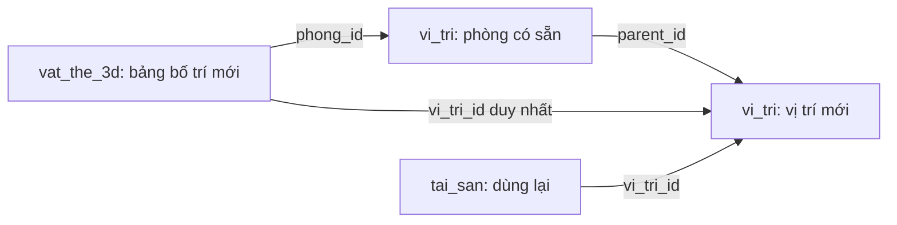
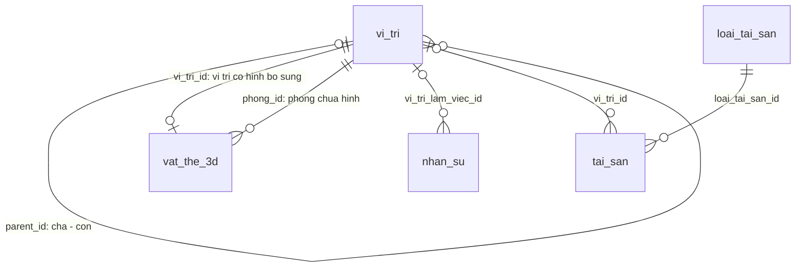

# Mô hình không gian 3D — tòa nhà và phòng HCNS

Cập nhật: **13/11/2026**. Đã triển khai và kiểm chứng mặt bằng ba tầng theo PDF, chuyển cảnh HCNS, gán người/tài sản, khung điều khiển mở rộng, bảng phòng rút gọn và thêm vị trí trực tiếp trên mô hình; vẫn là bản thử nghiệm. Rule: [OFFICE-3D-RULES](../../.agents/rules/OFFICE-3D-RULES.md).

## A. Tổng quan

**Bản thử thêm vị trí:** người quản lý chọn phòng đã liên kết → Thêm vị trí → chọn Bàn làm việc/Điểm đặt thiết bị → bấm mặt bằng, xoay/dịch chuyển → Lưu. Vị trí tạo được dùng ngay để gán tài sản theo quyền ASSETS. Đây là phạm vi mới đã được yêu cầu, thay quyết định trước đây chỉ dựng nội thất cố định. Không làm trình biên tập tường, kích thước hoặc kéo thả tự do.

| Người dùng thao tác | Hành vi hiện tại |
| --- | --- |
| Nhấp đúp HCNS khi đang xem tầng | Phóng gần từ hướng đang nhìn, không tải lại trang/Canvas; không gian xung quanh mờ dần |
| Chọn bàn | Làm nổi vùng làm việc, xem vị trí và gán/chuyển/bỏ gán theo quyền; không phủ nút số lên hình |
| Chọn hình người hoặc tên | Xem người đã gán tại vị trí; nhiều người có danh sách đầy đủ |
| Gán tài sản tại bàn | Chọn thiết bị đã tạo; chuyển từ nơi khác có xác nhận, hỗ trợ bỏ gán. Quyền ASSETS riêng với HR |
| Quay ra hoặc nhấn Esc | Trở lại góc tầng trước đó; không dùng Esc điều hướng khi đang mở form/hộp thoại |
| Dùng điện thoại/bàn phím hoặc thiếu WebGL | Giữ nút vào/quay lại và danh sách vị trí mở rộng |
| Mở rộng/thu gọn vùng 3D | Nút góc trên phải; giữ góc nhìn, tầng/phòng, vị trí và cùng Canvas |
| Xem/ẩn thông tin | Cột bên cạnh trên desktop, bảng phía dưới trên điện thoại; màn hình ngang thấp dùng cột để tránh che mô hình |
| Chọn Nhân sự/Tài sản trong bảng phòng | Xem số lượng và vị trí ngắn gọn; chọn hồ sơ có hình để tập trung đúng điểm và xem chi tiết, giữ cùng Canvas |

Mô hình người biểu thị phân công chỗ làm việc, không phải chấm công/hiện diện. Dùng dữ liệu và quyền HR–vị trí hiện có; bảng bố trí bổ sung được mô tả bên dưới. Không thêm dependency hoặc thay ba rule chung. Phòng khác HCNS chưa có nội thất xác nhận. Tìm kiếm đưa camera tới người và kéo thả người chưa thuộc phạm vi này.

**Mặt bằng hiện hành:** ba PDF tầng 1–3 làm nền tỷ lệ; bản tầng 2 được người phụ trách điền thêm đã xác nhận tên 6 phòng và điều chỉnh nội thất HCNS. Kinh doanh ở ô 97 m² tầng 1. Giữ 10 vị trí HCNS và dữ liệu đang gán; Lễ tân tra cứu được nhưng chưa đặt lên mặt bằng vì thiếu xác nhận. 10 bàn HCNS giữ cấu hình gốc, có thể thêm bàn/điểm thiết bị qua bản thử bên dưới; tài sản thật gán qua panel theo quyền ASSETS. Chi tiết và kiểm chứng ở mục [Khảo sát mặt bằng kiến trúc](#khảo-sát-mặt-bằng-kiến-trúc).

Đọc chi tiết: [B. Triển khai](#b-chi-tiết-triển-khai), [Gán tài sản](#gán-tài-sản-tại-vị-trí-3d), [DB cần giữ](#thiết-kế-db-cần-giữ), [Nghiệm thu](#nghiệm-thu).

**Giao diện 12/11 — đã triển khai và kiểm chứng:** điều khiển nằm trong vùng mô hình, có Mở rộng/Thu gọn và bảng thông tin đóng/mở. Các thao tác cục bộ không cần tìm ngoài khung; xem [thiết kế và nghiệm thu bên dưới](#đề-xuất-khung-điều-khiển-và-mở-rộng).

## B. Chi tiết triển khai

### Khôi phục khi không hiển thị mô hình

- [x] Bổ sung **Tải lại mô hình** khi mất WebGL hoặc scene gặp lỗi. Chỉ khởi tạo lại viewer khi người dùng bấm thử lại; giữ URL/tầng/phòng/điểm chọn và bảng thông tin, không tải lại document hoặc ghi DB. Camera được dựng lại từ lựa chọn/lệnh hiện tại; không cam kết giữ góc xoay tự do trước sự cố. Thao tác thông thường vẫn giữ một Canvas.
- [x] Kiểm tra Chrome cổng 4000: toàn nhà, HCNS, KHĐT hiển thị; ba vòng vào/ra HCNS có chuyển động không có lỗi JS/request tải thất bại. Giả lập sự kiện mất WebGL hai lần, thử lại thành công, giữ phòng và document; đã xem ảnh khôi phục. Ca E2E hồi quy `lost WebGL` trong `seamless-3d.spec.ts` đạt; TypeScript, lint hai component và diff check đạt. Bằng chứng cục bộ `outputs/3d-debug/`.
- [ ] Chưa tái hiện được nguyên nhân gốc trên tab người dùng báo lỗi. Kiểm tra trên phiên Chrome mới thành công không chứng minh tab cũ đã hết lỗi; cần thông báo/Console hoặc trạng thái thực tế của tab đó. Trường hợp mất WebGL ở trên là kiểm thử có chủ đích, không phải bằng chứng nguyên nhân sự cố người dùng.

### Liên kết phòng mới để quản lý

1. Tạo/chọn vị trí loại **Phòng** dưới đúng tầng tại `/locations`; đây là không gian vật lý, không tạo lại cơ cấu `phong_ban`.
2. Gắn khóa hình phòng có sẵn với ID vị trí trong `var/office-3d/building.json`. Hiện bước này do người triển khai cấu hình; chưa có giao diện tự chọn hình để liên kết phòng. Kiểm tra đúng công ty, tầng, loại và trạng thái; không ánh xạ trùng.
3. Trên 3D chọn phòng → **Thêm vị trí** → đặt bàn/điểm thiết bị → Lưu. Bố trí mới lưu trong DB; không cần sửa mã hình học cho từng bàn.
4. Gán nhân sự/tài sản theo vị trí thực tế và quyền riêng. Không tự đưa toàn bộ nhân sự cùng phòng ban vào phòng vật lý.

- [x] KHĐT: đã tạo **Phòng Kế hoạch Đầu tư** dưới Tầng 2 qua giao diện/action vị trí, ánh xạ `plan_t2_phai_truoc` → vị trí `76` theo ô phòng đã được xác nhận. Chưa tạo bàn hoặc gán người/tài sản. Chế độ vào chi tiết bằng nhấp đúp vẫn riêng HCNS; KHĐT dùng chọn phòng/tập trung và bố trí trên mặt bằng tầng.
- [x] Đã sao lưu DB/cấu hình trước thay đổi; kiểm tra Chrome cổng 4000 mở/hủy form thêm vị trí, xem ảnh sau khi camera ổn định, không lỗi JavaScript. 6 kiểm thử ánh xạ đạt; fingerprint chỉ thay `vi_tri` và `nhat_ky_hoat_dong`, các bảng khác giữ nguyên. Bằng chứng cục bộ tại `outputs/link-khdt/`; cấu hình liên kết trong `var/` cần được giữ cùng bản triển khai.

### Thử nghiệm thêm vị trí trên mô hình

| Thao tác | Phạm vi |
| --- | --- |
| Thêm bàn/điểm thiết bị | Trong hình học phòng đã có ánh xạ vị trí hợp lệ; không đặt vào thông tầng hoặc phòng chưa liên kết |
| Đặt và chỉnh | Bấm trên mặt bằng để xem trước; xoay 90° và dịch bước nhỏ bằng nút/bàn phím; Lưu/Hủy rõ ràng |
| Gán tài sản | Tái sử dụng hồ sơ, FK, quyền và action tài sản; bàn minh họa không tự tạo hồ sơ tài sản |
| Chỉnh bố trí đã thêm | Giữ ID vị trí và liên kết người/thiết bị, kiểm tra phiên bản trước ghi |
| Xóa vị trí | Dùng luồng xóa danh mục vị trí hiện có; không tạo đường tắt vượt ràng buộc tài sản/HR |

**Thiết kế DB cần giữ cho bố trí:** thêm `vat_the_3d`, một bản ghi cho mỗi vị trí có hình được thêm qua UI. Tọa độ tương đối trong phòng thuộc bảng bố trí; không thêm tọa độ vào `vi_tri` và không thay 10 điểm HCNS cũ.

| Cột | Ý nghĩa |
| --- | --- |
| `id`, `company_id` | Khóa tự cấp, công ty theo phiên |
| `vi_tri_id` | FK cùng công ty, duy nhất; xóa vị trí hợp lệ thì xóa hình phụ thuộc |
| `phong_id` | FK tới phòng gốc của hình; nếu vị trí chuyển khỏi phòng thì không tự chuyển hình theo |
| `loai_vat_the` | `BAN` hoặc `DIEM`; tương ứng `CHO_NGOI` hoặc `DIEM_DAT_THIET_BI` |
| `toa_do_x`, `toa_do_z`, `goc_xoay` | Bố trí phẳng trong phòng, số hữu hạn; góc 0/90/180/270° |
| `created_at`, `updated_at` | Thời điểm và phiên bản chỉnh bố trí |

- LOCATIONS MANAGE mới được tạo/chỉnh; kiểm tra lại trong transaction cùng khóa công ty/phân quyền của danh mục vị trí. HR/ASSETS giữ quyền riêng. Tạo vị trí + hình + audit nguyên tử, không ghi file JSON trong mutation.
- Kiểm tra nằm trong đường bao phòng, không đè bàn đã có hoặc vách HCNS. Khóa công ty tuần tự hóa hai lần đặt đồng thời; lưu lỗi giữ bản nháp. Không coi bố trí thử nghiệm là bản đo chính xác hay bảo đảm lối thoát hiểm.
- Bố trí mới chỉ hiển thị khi công ty, phòng, vị trí/cha và trạng thái còn hợp lệ. Dữ liệu HR/ASSETS lọc riêng trước trả client. Mô hình và danh sách lựa chọn cùng đọc DB, tải lại trang vẫn còn hình.
- [x] Migration `20261112160000_vi_tri_bo_sung_3d` đã phục hồi backup và áp dụng trên DB riêng, đối chiếu 17 bảng cũ không đổi trước khi áp dụng local. Thêm bảng rỗng, không seed hoặc tự tạo vị trí vận hành.
- [x] Tạo/chỉnh, xem trước, Lưu/Hủy và gán tài sản trên cùng Canvas. Chỉ phòng có hình học `room` và ánh xạ còn hoạt động mới hiện nút Thêm vị trí; không tự gán lại phòng chưa liên kết. Giữ nguyên loại hình sau khi tạo.
- [x] 4 E2E mới đạt: đặt bàn bằng click thật trên Canvas → lưu → gán PC → chỉnh/reload giữ liên kết; chặn quyền/công ty/sai phòng/ngoài biên/chồng lấn/stale, hai request đồng thời chỉ tạo một; hủy trên mobile không ghi DB, lỗi phiên bản giữ bản nháp; điểm thiết bị phòng Kinh doanh và phòng chưa liên kết. 14 E2E hồi quy tài sản–HCNS–bảng phòng–chuyển cảnh và 14 unit đạt. Đã xem ảnh desktop/mobile, kiểm tra live cổng 4000 mở/hủy bản nháp cùng Canvas, không gửi mutation.
- [x] Đồng bộ rule phân hệ, kiến trúc, từ điển DB và plan liên quan. TypeScript/lint, Prisma schema diff và build production Webpack trên app riêng đạt; build còn cảnh báo middleware/Edge Runtime và nhắc nâng phiên bản Next.js hiện có, không đổi dependency. Không sửa ba rule kỹ thuật chung. Ảnh/backup/log nằm tại `outputs/3d-placement/` ngoài Git. Đã dọn server/DB thử; đối chiếu fingerprint 17 bảng vận hành cũ không đổi, không nhập vị trí thử vào DB thật. Dev cổng 4000 đã khởi động lại để nhận Prisma Client mới.

### Nội dung bảng thông tin phòng

**Trạng thái:** đã triển khai và kiểm chứng. Dùng `RoomOverviewPanel` cho tổng quan phòng, tái sử dụng bảng chi tiết vị trí khi chọn người/thiết bị.

Phản hồi: khi chọn HCNS từ tầng, tên phòng/tầng/đường dẫn lặp ở đầu bảng và từng người; chức vụ + phòng ban dài, mô tả và danh sách phòng làm loãng đối tượng đang chọn. Mục tiêu: nhìn nhanh người và tài sản đã gán trong không gian, mở chi tiết đúng đối tượng.

| Vùng | Hành vi đã áp dụng |
| --- | --- |
| Đầu bảng | Tên phòng một lần, tầng ngắn gọn; một thao tác Vào phòng. Không lặp tên phòng trong đường dẫn hoặc nhãn nút; mô tả chuyển vào phần mở rộng. |
| Tóm tắt | Số người đã gán và số hồ sơ tài sản gộp vào nhãn hai tab, không thêm dãy thống kê lặp. Đếm trong phòng, gồm liên kết trực tiếp và các vị trí con hợp lệ. Số vị trí là thông tin phụ, không đồng nghĩa số chỗ ngồi/sức chứa. |
| Nhân sự / Tài sản | Hai tab có số lượng từ DB, nhớ tab khi quay từ chi tiết về phòng. Người: tên + tên vị trí tương đối trong phòng; chức vụ/phòng ban mở khi cần. Tài sản: tên + vị trí + tình trạng cần chú ý; trên 12 hồ sơ và nhiều loại thì nhóm theo loại. Mã chỉ hiện trên dòng tổng quan để phân biệt thiết bị trùng tên. |
| Tương tác | Với HCNS đã có hình học, chọn dòng đưa tới đúng bàn/điểm và chi tiết trong cùng Canvas; không mặc định chuyển sang trang nhân sự. Đưa focus bàn phím đến tiêu đề hồ sơ; tài sản đang chọn được làm nổi và đặt đầu danh sách tại điểm đó. Đối tượng chưa gắn hình mở chi tiết ngay trên dòng, không tự đặt vị trí 3D. |
| Thông tin phụ | Danh sách phòng chuyển vào mục Đổi phòng thu gọn khi đã chọn một phòng; giữ truy cập bàn phím và tự mở danh sách thay thế khi WebGL lỗi. Ghi chú/hướng dẫn mở khi cần, cảnh báo ngừng dùng/mất liên kết vẫn hiển thị. |

Chỉ tổng hợp dữ liệu được phép xem, không dùng số mesh hoặc ghi chú tham khảo để đếm tài sản. Không suy hiện diện, tỷ lệ lấp đầy hoặc chỗ trống từ số người và số vị trí; dữ liệu chưa gán chưa chứng minh không có người/thiết bị thực tế. Thiếu quyền không hiển thị thành số 0. Dùng các FK hiện có; bổ sung truy vấn đọc tối thiểu theo công ty/quyền và vị trí hợp lệ. Không đổi schema, quyền, hình học hoặc bộ chọn vị trí tài sản.

- [x] Tổng hợp người ACTIVE và tài sản theo công ty, quyền riêng và cây vị trí hợp lệ. Tài sản gắn trực tiếp vào phòng hoặc vị trí chưa có hình vẫn được đếm/đọc; không kéo hồ sơ chưa gán hoặc của công ty khác vào phòng.
- [x] Rút gọn bảng phòng; chọn hồ sơ đi tới đúng điểm, giữ tab khi quay lại. Vào phòng bằng nút tổng quan sau khi xem thiết bị trở về góc toàn phòng, không giữ nhầm điểm tập trung cũ. Thiết bị được chọn nằm đầu danh sách; tiêu đề nhận focus khi mở hồ sơ bằng bàn phím.
- [x] 4 E2E mới và 21 E2E hồi quy đạt trên Chrome/DB riêng: số đếm, trùng tên, liên kết trực tiếp/chưa có hình, quyền riêng/thu hồi quyền/khác công ty, cùng Canvas/document, gán/chuyển/bỏ gán, đổi tên/chuyển nhánh phòng, camera/mở rộng/resize, Esc/focus, mobile/sáng/tối và WebGL fallback. Đã cập nhật kiểm thử theo nhãn Vào phòng mới, vị trí tiêu đề phòng và thao tác nhấn Enter để tìm tài sản. 21 unit, TypeScript, lint và `git diff --check` đạt.
- [x] Đã xem ảnh bản thật cổng 4000: hai tab phòng, đi tới người/thiết bị, điện thoại và chế độ tối. Không gửi thay đổi dữ liệu vận hành. Dừng server thử 4113, xóa DB thử và đối chiếu fingerprint 17 bảng vận hành không đổi. Ảnh/bằng chứng ở `outputs/room-panel/`, ngoài Git; 59 liên kết cục bộ/anchor trong rule 3D, plan 3D và mục lục đã kiểm tra.
- [x] Đồng bộ rule 3D, kiến trúc và mục lục kế hoạch. Không thêm dependency hoặc sửa ba rule kỹ thuật chung.

## Đề xuất khung điều khiển và mở rộng

**Trạng thái:** đã triển khai. Trước đó chọn tầng/góc nhìn chiếm hai hàng riêng, cập nhật và quay lại tầng nằm ngoài vùng mô hình; hiện đã gom vào khung và mở rộng được vùng làm việc. Tác vụ chính: tìm phòng/vị trí, xem và gán người/tài sản ngay tại đó, giữ ngữ cảnh khi thay kích thước khung.

| Vị trí | Điều khiển |
| --- | --- |
| Góc trên trái | Chọn toàn nhà/tầng; trong HCNS hiện tên phòng và nút quay về tầng, tránh lặp đường dẫn với nhiều hàng điều hướng |
| Góc trên phải | Mở/đóng thông tin, Mở rộng/Thu gọn, menu phụ chứa Cập nhật dữ liệu và Quản lý vị trí theo quyền |
| Góc dưới trái | Phối cảnh/Mặt bằng, nhãn ngắn; hướng dẫn thao tác chuyển vào nút trợ giúp |
| Góc dưới phải | Thu/phóng mô hình, đặt lại góc nhìn; Tập trung xuất hiện khi có đối tượng phù hợp được chọn |

- Các cụm điều khiển là HTML phủ trên vùng xem, nền đủ tương phản theo theme, không xuyên sự kiện xuống mô hình. Giữ khoảng đệm khi căn camera/nhãn để nút và bảng thông tin không che đối tượng cần thao tác.
- Mở rộng dùng chính vùng làm việc 3D phủ vùng nội dung trình duyệt, tạm che menu/header ERP; thanh địa chỉ trình duyệt vẫn còn. Nút `+`/`−` vẫn điều chỉnh camera, khác với thay kích thước vùng làm việc. Bản đầu không cần thêm chế độ toàn màn hình trình duyệt riêng.
- Giữ cùng cây component/Canvas khi mở rộng và thu gọn: bảo toàn tầng/phòng/điểm, hướng xoay, tâm nhìn và tỷ lệ gần tương đối khi resize. Không tải lại trang, tạo renderer thứ hai hoặc tự đổi tầng. Khôi phục vị trí cuộn trang/focus khi thu gọn.
- Bảng nhân sự/tài sản thuộc cùng vùng làm việc; desktop có cột chi tiết thu gọn, mobile dùng bảng trượt từ dưới. Chọn bàn/người mở thông tin tương ứng; vẫn gán/chuyển/bỏ gán trong chế độ mở rộng theo quyền hiện hành.
- Escape xử lý lớp trên cùng: hộp thoại trước, sau đó thu gọn vùng mở rộng; chỉ khi ở chế độ thường và không có hộp thoại/form mới áp dụng quay từ phòng về tầng. Bảo đảm hộp thoại gán nhân sự/tài sản hiển thị phía trên vùng mở rộng, focus/Tab và cuộn không lọt xuống trang nền.
- Mobile giữ cụm chọn tầng gọn và các nút tối thiểu 40×40px, có tên truy cập; thao tác thiết yếu không phụ thuộc hover. Giảm hoạt ảnh khi người dùng chọn giảm chuyển động; giữ danh sách thay thế khi WebGL lỗi.
- Chỉ thay bố cục/trạng thái giao diện và xử lý resize/điều hướng liên quan tại `BuildingExplorer`, `BuildingCanvas`, panel. Không cần schema, quyền mới hoặc thư viện; trạng thái mở rộng không lưu DB. Chuẩn này thuộc plan/rule 3D, không cần sửa ba rule kỹ thuật chung.

- [x] Gom điều khiển vào khung; chỉ mở rộng bằng CSS trên cùng cây DOM, không remount Canvas. Panel giữ nội dung khi ẩn; điện thoại mở panel khi chọn đối tượng, không tự mở vì nội dung fallback bên trong thẻ canvas. Khi thật sự mất WebGL thì tự mở danh sách thay thế.
- [x] Camera đổi tỷ lệ theo vùng nhìn đã chừa chỗ cho điều khiển/panel; mở rộng/thu gọn lặp lại không tích lũy sai lệch zoom. Giữ tỷ lệ mong muốn qua kích thước trung gian chạm giới hạn zoom khi chuyển desktop ↔ mobile. Giữ điểm chọn, bộ lọc, cuộn, hướng xoay; không đổi dữ liệu/vị trí thực tế. Hộp thoại/menu ở trên vùng mở rộng, nền bị cô lập và được trả lại khi đóng/điều hướng.
- [x] 7 E2E mới đạt trên Chrome/DB khôi phục riêng: Canvas/context/document duy nhất, camera qua 3 vòng mở rộng/đóng panel và chuỗi desktop → mobile → desktop, cập nhật dữ liệu và điểm chọn, resize khi xoay, Esc/focus/cuộn, gán nhân sự/tài sản trong chế độ mở rộng, mobile 320/390px và ngang 844×390, sáng/tối, hủy chuyển tài sản, WebGL fallback. Chờ ResizeObserver cập nhật kích thước thật trước đối chiếu canvas/panel; không coi kích thước tức thời trước resize là kết quả cuối.
- [x] 10 E2E hồi quy đạt: gán/chuyển/bỏ gán và quyền tài sản, dữ liệu cũ/thu hồi quyền/lỗi tải, HCNS, link cũ, Back/Forward, giữ góc tầng và chọn nhanh lúc đang tải. Bộ thử chọn đúng dòng tài sản theo tên khi một vị trí có nhiều thiết bị. 20 unit ánh xạ/bố cục/điều hướng đạt; TypeScript và lint đạt. Ảnh đã xem trực tiếp tại `outputs/ux-3d/`, ngoài Git. Đây là kiểm chứng cục bộ, không phải đo FPS trên máy người dùng.
- [x] Kiểm tra trang thực tế cổng 4000 bằng Chrome: toàn nhà, HCNS mở rộng, hộp thoại tài sản và điện thoại; đã xem ảnh, giữ một Canvas/document, không lỗi JavaScript. Chỉ đọc và mở/đóng giao diện, không gửi thay đổi dữ liệu vận hành.
- [x] Đã dừng server thử cổng 4112 và xóa đúng DB thử riêng; đối chiếu fingerprint 17 bảng vận hành không đổi. 92 liên kết tài liệu cục bộ/anchor và `git diff --check` đạt. Bằng chứng/backup lưu tại `outputs/ux-3d/`, ngoài Git.
- [x] Đồng bộ rule 3D và kiến trúc; checklist/README dẫn đến nội dung này. Không đổi ba rule kỹ thuật chung, dependency, quyền, schema hoặc dữ liệu vận hành.

## Gán tài sản tại vị trí 3D

Yêu cầu 12/11: tài sản đã có hồ sơ ở `/assets`; chọn bàn/vị trí HCNS để gán ngay, tương tự nhân sự. Không tự gán chiếc PC người dùng vừa tạo khi chưa chọn vị trí đích.

| Thao tác | Kết quả |
| --- | --- |
| Chọn vị trí → Gán tài sản | Tìm theo tên/mã/serial, chọn thiết bị đã có; danh sách phân trang |
| Chọn tài sản đã ở nơi khác | Hiện nơi cũ → nơi mới, xác nhận trước khi chuyển |
| Chuyển / Bỏ gán tài sản | Chỉ đổi nơi đặt; giữ người sử dụng, đơn vị quản lý và thông tin thiết bị |
| Xem vị trí | Danh sách hồ sơ thật và trạng thái; hình thiết bị đại diện theo loại |

Chi tiết lưu/khóa/nhật ký thuộc [plan tài sản](ASSET-MANAGEMENT-CHECKLIST.md#liên-kết-với-vị-trí-và-3d). Dùng FK `tai_san.vi_tri_id`, không thêm bảng/cột, migration hoặc thư viện. Chỉ các vị trí đã liên kết hình học mới có thao tác trên 3D; lần này áp dụng 10 vị trí HCNS, gồm điểm thiết bị 06. Việc thêm vị trí/hình mới được quản lý riêng tại mục [Thử nghiệm thêm vị trí](#thử-nghiệm-thêm-vị-trí-trên-mô-hình).

- [x] Server đọc tài sản đúng công ty/điểm liên kết còn hiệu lực khi có ASSETS VIEW/MANAGE. LOCATIONS hoặc HR riêng không cấp quyền tài sản; dữ liệu thiết bị không kéo theo hồ sơ HR.
- [x] Component `LocationAssets` cho ASSETS MANAGE gán/chuyển/bỏ gán; chỉ tải lựa chọn khi mở hộp thoại, đổi điểm đóng hộp thoại cũ, báo lỗi/tải lại, chống gửi lặp. Lưu làm mới dữ liệu và giữ Canvas/camera/điểm chọn.
- [x] Hình thiết bị lấy từ hồ sơ thật; bỏ dựng từ ghi chú cũ. Tối đa 3 hình đại diện loại trên bàn để không chồng lên nhau; danh sách vẫn đủ mọi thiết bị kể cả ngừng dùng. Loại chưa có mẫu dùng khối thiết bị chung; không có quyền ASSETS thì không trả hồ sơ/số đếm/hình tài sản.
- [x] 7 kiểm thử tích hợp đạt trên DB riêng: quyền/công ty/phiên, vị trí ngừng dùng, ràng buộc tổ tiên, phiên bản cũ/ghi đồng thời, xác nhận, audit nguyên tử, không thay người/phòng, danh sách phân trang và tách quyền HR/ASSETS. Cookie/cache Next được giả lập; JWT/RBAC/DB/transaction dùng thật.
- [x] 4 E2E Chrome đạt: gán/chuyển/hủy/bỏ gán, điểm thiết bị 06, đồng bộ `/assets`, quyền xem/quản lý/thu hồi, ghi dữ liệu cũ và lỗi tải/thử lại. Giữ cùng Canvas, chế độ nhìn và một lần tải document trong chuỗi thao tác. Đã xem ảnh desktop/mobile, không tràn ngang trên 390px. 20 unit ánh xạ/bố cục/điều hướng/loại thiết bị, TypeScript và lint phần thay đổi đạt.
- [x] Mở bản vận hành cổng 4000 bằng Chrome chỉ đọc: nhân sự và tài sản hiển thị cùng panel; PC01 có trong danh sách chọn, hồ sơ giữ nguyên. Không tự gán PC vận hành hoặc cấp quyền. Ảnh/backup/bằng chứng tại `outputs/assets-3d/`; DB thử đã dọn, fingerprint 17 bảng vận hành giữ nguyên.

## Khảo sát mặt bằng kiến trúc

**Trạng thái:** đã triển khai và kiểm chứng mặt bằng giản lược. Giữ bố cục gốc theo bản phác từng phòng; vật thể bổ sung theo bản thử tạo vị trí ở mục trên. Gán tài sản được bổ sung tại mục trên, độc lập với đợt chỉnh hình học.

- [x] Đọc trực quan toàn bộ `1-1 MB TANG 1.pdf`, `1-2 MB TANG 2.pdf`, `1-3 MB TANG 3.pdf`: mỗi file một trang, tỷ lệ ghi 1:150. PDF xuất từ AutoCAD, có đường vector; nhiều chữ/số là nét vẽ nên trích xuất văn bản không đủ để nhận diện phòng tự động. Ảnh đọc, metadata và checksum lưu cục bộ ở `outputs/architecture-review/`, ngoài Git.
- [x] Đối chiếu trước thay đổi: khung cũ có 22 khu vực chữ nhật ước lượng, HCNS thu/xoay vào ô có sẵn. Đã thay bằng `architectural-layout.ts`: 42 vùng hình học giản lược (phòng, hành lang, sảnh, khu phụ trợ), không tạo tương ứng 42 hồ sơ DB. `building-layout.ts` giữ khóa liên kết HCNS/Kinh doanh/Lễ tân; riêng Lễ tân chỉ hiện trong danh sách đến khi xác nhận chỗ đặt.
- [x] Xác nhận từ người phụ trách: HCNS → vùng nguồn `plan_t2_phai_sau` (95,4 m²), Kinh doanh → `plan_t1_trai_truoc` (97 m²). Không gắn các tên phòng ban cũ chưa có xác nhận vào vùng mới.

| Nguồn | Dữ liệu đọc được | Giới hạn áp dụng |
| --- | --- | --- |
| Tầng 1 | Tường/cột/cửa, cụm thang/WC, sảnh chính 127 m²; cao độ sàn ±0.000 | Kinh doanh ở ô 97 m² theo xác nhận; các phòng khác và chỗ đặt Lễ tân chưa xác nhận |
| Tầng 2 | Các phòng ghi 73,6; 45; 68; 61; 95,4; 82 m², phần thông tầng, cụm thang/WC; cao độ +4.200 | Đã xác nhận tên 6 phòng theo ảnh điền hiện trạng I–VI; HCNS ở ô 95,4 m². Nội thất theo ảnh mới, kích thước bàn/cửa vẫn ước lượng |
| Tầng 3 | Các khu 50; 61; 140; 179 m² và sảnh 83 m²; cao độ +8.400 | Khu trung tâm không ghi vườn cây như model cũ; cần đối chiếu sử dụng thực tế |

Bảng trên là thông tin đọc từ nguồn, không phải danh sách chi tiết cần dựng. Kích thước chỉ giúp căn tỷ lệ phòng và khoảng cách hợp lý trong cấu hình hình học; không hiển thị đường đo, cao độ hoặc yêu cầu nhập số đo cho người dùng. Khoảng giãn tầng và chiều cao vách được chọn để dễ nhìn. Các phòng tầng 1/3 chưa có tên xác nhận vẫn giữ tên trung tính.

### Hiện trạng tầng 2 đã được điền trên bản in

Hướng đọc: phía mặt tiền ở dưới bản vẽ. Ảnh điền tay trong hội thoại là nguồn cập nhật bố cục; không phải bản đo nội thất.

| Ký hiệu trên ảnh | Vùng mặt bằng | Tên hiển thị |
| --- | --- | --- |
| I | Trái · phía sau, ô 73,6 m² | Phòng Kế toán |
| II | Giữa · phía sau, ô 61 m² | Phòng Tổng Giám đốc |
| III | Phải · phía sau, ô 95,4 m² | HCNS; phòng liên kết DB hiện tên Phòng Hành Chính Tổng Hợp |
| IV | Trái · giữa, ô 45 m² | Phòng Phát triển dự án |
| V | Trái · phía trước, ô 68 m² | Phòng Chủ tịch |
| VI | Phải · phía trước, ô 82 m² | Phòng Kế hoạch Đầu tư |

- [x] Đặt tên 6 vùng đã xác nhận, giữ nguyên khóa hình học/ánh xạ. Các phòng mới có tên trên mô hình chưa tự tạo hồ sơ `vi_tri` hoặc gán người từ danh sách phòng ban; liên kết HCNS hiện hữu tiếp tục đọc DB.
- [x] Bỏ phần nhô phía mặt tiền đã gạch “Bỏ” trên tầng 2; giữ hành lang trước thông tầng và không thay lối vào tầng 1/mái tầng 3.
- [x] Dựng lại HCNS theo ảnh mới: khu ngoài chỉ bàn 01 của Vũ Trọng Toàn; vách nối ngang mép dưới cụm cầu thang, cửa ở bên trái. Bàn 02 ở phía trong gần vách, cặp 03–04 ở giữa, cụm 05–08 ở cuối phòng bên phải, 09–10 dọc vách trái. Bỏ khối kho từng ước lượng từ bản phác cũ vì ảnh mới không thể hiện khối này. Giữ 10 khóa vị trí, hướng lưng dựa tường của bàn 01/09/10 và dữ liệu người/ghi chú.
- [x] Kiểm chứng cập nhật ảnh điền hiện trạng: **15 unit**, TypeScript và lint đạt. Chrome cổng 4000 chọn đúng cả 10 bàn, xác nhận bàn 01 vẫn là Vũ Trọng Toàn; tên các phòng tầng 2 xuất hiện đúng. Vào/quay ra HCNS giữ Canvas và một lần tải document, không lỗi JS/tràn ngang mobile. Đã xem ảnh mặt bằng tầng 2, HCNS phối cảnh/mặt bằng/điện thoại tại `outputs/floor-2-confirmed/`. Kiểm tra trình duyệt chỉ đọc, không sửa DB/ánh xạ; không chạy lại ca mutation HR/phân quyền trong lần chỉnh hình học này.

### Phạm vi đã triển khai

| Thành phần | Phạm vi phù hợp |
| --- | --- |
| Phòng và khu vực | Chỉnh hình dạng, tỷ lệ và vị trí tương đối; bổ sung hành lang, sảnh, kho hoặc khu chung bị bỏ sót nếu có trong nguồn/được xác nhận |
| Ranh giới và lối vào | Vách thấp/đường viền và khoảng mở đơn giản, đủ phân biệt các phòng. Cầu thang, WC, thông tầng chỉ cần biểu thị khu vực để nhận biết |
| Nền hiển thị | Mặt phẳng màu đơn giản đỡ các vật thể, không dựng cấu tạo sàn, trần, cột, tượng hoặc trang trí kiến trúc |
| Bàn và vị trí | Agent dựng bàn/vùng làm việc một lần theo bản phác và liên kết vị trí; người dùng không cần thao tác dựng hình. Khi thay đổi bố trí thực tế, cập nhật cấu hình riêng phòng đó |
| Nhân sự và tài sản | Hình người theo HR; hình thiết bị theo tài sản đã gán và quyền ASSETS. Không dựng thiết bị từ ghi chú cũ |

Giữ viewer và liên kết `vi_tri` hiện có; bố cục gốc không cần bảng DB riêng; vật thể bổ sung dùng bảng bố trí tại mục bản thử. Không tự tạo lại danh mục, thêm tọa độ nghiệp vụ hoặc thư viện dựng hình. Bỏ khỏi đợt này các đề xuất trình bố trí tổng quát, thư viện đồ trang trí, lưu phiên bản thiết kế và chức năng tìm kiếm mới. Cột đơn giản không nhất thiết gây chậm đáng kể; lý do bỏ là không phục vụ thao tác quản lý, gây nhiễu và tăng công duy trì. Không cam kết mức tăng tốc khi chưa đo.

### Bố cục cố định, dữ liệu vận hành cập nhật

Người phụ trách đi từng phòng, phác vị trí bàn/chỗ làm việc, cửa và thiết bị chung; agent đối chiếu với mặt bằng, dựng bố cục và gắn ID vị trí có sẵn. Không làm kéo thả tự do hoặc chỉnh 10 bàn gốc qua UI. Bàn/điểm thiết bị bổ sung được tạo/chỉnh bằng bản thử, lưu riêng trong `vat_the_3d`. Tọa độ/hướng vật thể thuộc cấu hình hình học riêng từng phòng; dùng lại mẫu bàn và giữ ánh xạ ổn định theo thiết kế hiện có.

| Thay đổi thực tế | Cách xử lý |
| --- | --- |
| Đổi người ngồi tại bàn | Cập nhật gán vị trí HR; hình người/tên đọc từ DB, không sửa bố cục |
| Gán/chuyển thiết bị | Cập nhật vị trí từ hồ sơ tài sản hoặc panel 3D, hình đại diện hiện quanh điểm tương ứng; không ghi cứng mã/tên thiết bị thật vào model |
| Thêm, bớt hoặc di chuyển bàn | Cung cấp bản phác điều chỉnh để agent sửa cấu hình của phòng; không dựng lại các phòng khác |
| Tạo vị trí mới trong DB | Vẫn dùng được trong danh mục; chỉ có vật thể 3D sau khi bổ sung/ghép với bố cục, không tự sinh bàn hoặc đoán tọa độ |

Hiện chưa có giao diện ghép một vị trí đã tồn tại với hình cũ; luồng Thêm vị trí trên 3D tạo đồng thời vị trí mới và hình mới. Ánh xạ phòng/bàn vẫn được cấu hình bởi agent trong tệp cục bộ. Hướng có thể bổ sung: chọn vật thể có sẵn → chọn “Liên kết vị trí” → tìm vị trí đúng tầng/phòng → lưu liên kết; không cần công cụ dựng hình hoặc kéo thả bàn. Đây là đề xuất, chưa triển khai; vật thể chưa có vẫn cần bổ sung từ bản phác.

“Thiết bị gắn vào bàn” là cách hiển thị tại chỗ làm việc: hồ sơ người và thiết bị tham chiếu vị trí chung, không dùng hình bàn làm khóa DB. Điểm đặt hình thiết bị gần/trên bàn thuộc cấu hình hiển thị; người chuyển chỗ không tự chuyển thiết bị. Một bàn ghép có thể chứa nhiều vị trí; AP/máy in dùng chung có thể gắn điểm riêng trong phòng/sảnh. Hình thiết bị hiện đại diện theo loại hồ sơ đã gán; danh sách trong panel phản ánh đủ từng thiết bị, ghi chú không phải hồ sơ tài sản.

Lý do chọn bố cục cố định là ít thay đổi nội thất và giảm công phát triển/vận hành công cụ biên tập. Chưa có căn cứ kết luận lưu bố trí trong DB tự làm ứng dụng nặng; đây là lựa chọn phạm vi, không phải kết quả đo hiệu năng. “Dựng một lần” áp dụng khi bố trí thực tế không đổi, còn phân công người/thiết bị được cập nhật độc lập.

### Tiến độ và việc tiếp theo

- [x] Chỉnh cả ba tầng theo cùng hệ tỷ lệ, thêm khu vực/hành lang thiếu, giữ thông tầng tầng 2 và sảnh tầng 3. Nền phẳng/vách thấp/đường viền dễ đọc, không cột/trần/tượng, không hiển thị số đo CAD.
- [x] Đặt HCNS đúng vùng chữ L quanh khu phụ trợ, cùng tỷ lệ/trục của tầng (`scale=1`, `rotation=0`). Giữ 10 khóa vị trí; bàn 1/9/10 giữ hướng lưng về tường. Cửa chính theo lối mở phía trái dưới trên PDF; vách/nội thất theo bản in đã điền tại mục hiện trạng tầng 2, kích thước vẫn ước lượng.
- [x] Căn camera theo phạm vi mới, chọn đúng vùng đa giác thay ô chữ nhật, giảm nhãn khi chồng nhau. Duy trì một Canvas, nhấp đúp vào HCNS và thao tác HR tại vị trí. Lễ tân không có vùng chọn hoặc lệnh tập trung khi chưa xác định chỗ đặt.
- [x] Sửa hướng hai khu: từ hành lang vào chỉ có bàn 01 của Vũ Trọng Toàn, qua cửa thông mới đến bàn 02–10. Hướng bàn 01 lưng về mép dưới, bàn 09/10 lưng về vách trái. Bố trí vách/bàn hiện hành theo mục ảnh điền tầng 2 ở trên; không thay liên kết vị trí/người khi chỉnh hình.
- [x] Kiểm chứng lần sửa hướng nội thất: **14 unit**, TypeScript và lint đạt. Kiểm tra hình học đủ 10 bàn/hình người nằm trong phòng, chỉ bàn 01 thuộc khu cửa hành lang và lối thông không bị bàn chắn. Chrome cổng 4000 chọn trực tiếp đủ 10 bàn, bàn 01 vẫn hiển thị Vũ Trọng Toàn; vào/quay ra giữ cùng Canvas, chỉ một lần tải document, không lỗi JS/tràn ngang. Đã xem ảnh mặt bằng/phối cảnh/mobile tại `outputs/hcns-orientation/`. Kiểm tra trình duyệt chỉ đọc; không sửa DB hoặc ánh xạ, không chạy lại các ca mutation phân quyền/HR cho lần đổi hình học này.
- [x] Mốc tích hợp mặt bằng trước sửa hướng nội thất: **18 unit và 17 ca E2E khác nhau đạt**: tòa nhà 4, tương tác trực tiếp 3, HCNS 3, chuyển cảnh 3, gán người 4. Sau chỉnh đường viền/nhãn, chạy lại 6/6 ca tương tác và chuyển cảnh đạt; TypeScript/lint đạt. Đã xem ảnh Chrome thực tế trên cổng 4000: ba tầng, phối cảnh/mặt bằng HCNS và điện thoại; giữ nguyên Canvas, không lỗi JS hoặc tràn ngang trong lượt kiểm tra. Nội thất vẫn là bố trí tham khảo, chưa nghiệm thu hiện trạng phòng.
- [x] Đã dọn đúng server/DB thử riêng; fingerprint **15 bảng vận hành không đổi**, app cổng 4000 tiếp tục chạy. Ảnh, backup và bằng chứng kiểm thử lưu ngoài Git tại `outputs/architecture-3d/`; không sửa schema, dữ liệu, ánh xạ ID, dependency hoặc ba rule kỹ thuật chung.
- [x] Tạo bộ mặt bằng giấy để khảo sát hiện trạng từ **nét vector ba PDF gốc**: giữ tường/cửa/lối đi, giản lược thông tầng và ký hiệu khu chung; loại kích thước, trục, cao độ, nét gạch và chi tiết trang trí. Để trống tên phòng, bàn/người/thiết bị cho người phụ trách điền; có cột ghi chú. Xuất PDF 3 trang A3 ngang, bản A4 và ba PNG 300 dpi tại `outputs/mat-bang-khao-sat/` (ngoài Git). Đã xem cả ba trang, kiểm tra số trang/kích thước/chữ trong khung và checksum PDF nguồn không đổi. Bản giấy không tự cập nhật model hoặc DB; không dùng đo kích thước/thi công.
- [ ] Xác nhận tên sử dụng các phòng còn lại và chỗ đặt Lễ tân; dựng nội thất từng phòng khi nhận bản phác. Tài sản theo [plan riêng](ASSET-MANAGEMENT-CHECKLIST.md).

Tiêu chí khi triển khai: nhận biết đúng tầng/phòng/khu vực theo hiện trạng xác nhận, tỷ lệ tương đối hợp lý, các vùng chọn không chồng sai; giữ dữ liệu phân công HCNS và thao tác mượt; không thêm chữ/số đo hoặc vật thể không giúp quản lý. Kiểm chứng lại quyền, chọn bàn/người, chuyển cảnh và mobile; không lấy độ chi tiết kiến trúc làm tiêu chí hoàn thành.

## Đã triển khai: tòa nhà → tầng → phòng → vị trí dùng chung khung 3D

- [x] Thay luồng hai page/hai Canvas cũ bằng viewer chung. Giữ model HCNS đã nhúng trong tầng 2, bỏ `HcnsRoomCanvas` và `HcnsRoomExplorer`; không dựng lại nội thất.
- [x] Dùng một Canvas/camera trong `/office-3d`, đổi cấp xem bằng trạng thái tòa nhà/tầng/phòng/vị trí. Chọn vào HCNS đưa camera tới phòng, làm mờ không gian che tầm nhìn và cho chọn trực tiếp 10 vị trí; bảng bên cạnh dùng lại chi tiết và thao tác gán/chuyển/bỏ gán người. Không thay Canvas hoặc dựng bản HCNS thứ hai khi vào phòng.
- [x] Giữ góc nhìn/độ phóng trước khi vào phòng để quay về đúng chỗ; có đường dẫn cấp xem, nút trở lại tầng và chế độ mặt bằng. Chuyển cấp bằng thao tác rõ ràng, không tự nhảy chế độ khi cuộn zoom. Nhãn điểm/camera phải tính theo phép xoay và tỷ lệ HCNS đang nhúng trong tầng, tránh lệch điểm chọn.
- [x] URL thể hiện cấp xem và điểm đang chọn, hỗ trợ mở trực tiếp/tải lại/Back–Forward mà không dựng lại Canvas trong điều hướng nội bộ 3D. URL HCNS cũ dẫn về trạng thái phòng tương ứng của viewer chung; không tiếp tục duy trì viewer riêng.
- [x] Dữ liệu người/quyền tiếp tục kiểm tra trên server. Chỉ tải lựa chọn gán khi cần và đủ HR MANAGE; cập nhật dữ liệu sau lưu không đặt lại camera/điểm chọn. Giữ vẽ theo thay đổi. Không cần bảng, migration hoặc thư viện mới cho phương án này.
- [x] 17 ca E2E liên quan đã chạy đạt theo nhóm: 4 tòa nhà, 4 gán tại HCNS, 3 HR/vị trí, 3 HCNS và 3 điều hướng liền mạch. Các nhóm được chạy lại sau sửa; lượt cuối 6/6 và ca chọn nhanh khi đang chờ dữ liệu 1/1 đạt. 13 unit ánh xạ/điều hướng, TypeScript và lint đạt. Kiểm tra cùng DOM Canvas, góc xoay/zoom khi trở lại, chọn điểm, lưu/làm mới, Back–Forward, link cũ, mobile/sáng/tối, WebGL fallback và các lớp quyền. Đã sửa cập nhật điểm chọn khi Server Action còn chờ; test giữ phản hồi server để kiểm chứng trường hợp này.
- [x] Đo Chrome headless trên máy hiện tại, dev server, 1600×1100, giảm chuyển động, bỏ vòng làm nóng: trung vị 5 lần vào HCNS giảm từ **1.268 ms xuống 388 ms**. Sau 6 vòng vào/ra: bản cũ tạo 13 WebGL context, bản mới giữ 1; bản mới giữ nguyên Canvas. Cả hai có 0 lệnh vẽ mới trong 1,5 giây đứng yên. JS heap sau GC tăng 49,3→55,0 MB ở bản cũ và 51,7→54,1 MB ở bản mới. Đây là phép đo dev cục bộ, không đại diện FPS/GPU RAM hoặc bảo đảm không rò rỉ dài hạn. Số liệu tại `outputs/seamless-3d/benchmark-result.json`.
- [x] DB kiểm thử đã dọn, fingerprint 15 bảng vận hành không đổi. Backup, benchmark và ảnh tại `outputs/seamless-3d/` (ngoài Git). Đã khởi động lại riêng dev server cổng 4000 do tiến trình cũ bị `write EPIPE`. Kiểm tra trên bản chạy thực tế (Turbopack): vào HCNS giữ Canvas, không lỗi JS hoặc tràn ngang; đã xem ảnh phối cảnh, mặt bằng và điện thoại. Không đổi DB hoặc cấu hình chạy.

Viewer cập nhật điểm chọn trực tiếp từ URL bằng `useSyncExternalStore`, không chờ Next Router hoàn tất Server Action; tránh mở bảng gán của điểm trước khi chọn nhanh. Camera lưu góc thực tế sau kéo chuột; lệnh đổi góc mới được ưu tiên hơn góc đã lưu. Nhãn trên điện thoại được thu gọn để không che nhau. Không thay ba rule kỹ thuật chung.

## Nhấp đúp và phóng liên tục — đã triển khai

- [x] Nhấp đúp hình học hoặc nhãn HCNS trong tầng để vào phòng; nhấp đơn chọn thông tin. Ở toàn tòa nhà, thao tác chọn đưa về tầng trước; trì hoãn nhấp đơn tại mức này để hình không đổi chỗ giữa hai lần click. Phòng chưa có nội thất không mở chế độ trống.
- [x] Camera dịch chuyển/phóng từ hướng đang nhìn; không đổi sang góc HCNS đặt sẵn khi vào phòng. Vật liệu các phòng/sàn xung quanh mờ dần; trở lại khôi phục góc tầng. Giữ nút vào/quay lại, Esc bỏ qua form/hộp thoại và cài đặt giảm chuyển động.
- [x] Giới hạn delta của CameraControls qua `impl` Drei ở 1/30 giây: không tích lũy khoảng nghỉ thành bước phóng đột ngột. Camera sau đổi kích thước dùng tỷ lệ khung vừa phòng, tránh mô hình quá nhỏ trên mobile. Vẫn vẽ theo thay đổi.
- [x] Chrome trên cổng 4000: nhấp đúp nhãn vào được HCNS, cùng Canvas/1 WebGL context, không điều hướng document hoặc lỗi JS. Chuỗi đo chuyển động bình thường có 76 mức zoom, từ khoảng 14,30 tăng dần đến 69,29; bản trước bước đầu đã nhảy lên 50,80/đích 54,68. Không dùng số liệu này làm cam kết FPS cho mọi máy.
- [x] E2E bấm trực tiếp hình học phòng sau khoảng nghỉ: giữ hướng camera, có nhiều bước zoom, Escape về góc trước; cùng Canvas, 1 document ban đầu, 1 context và không vẽ thêm khi đứng yên. Ảnh theo thời gian/số liệu tại `outputs/direct-3d/`; bằng chứng trước sửa tại `outputs/camera-transition-review/` (ngoài Git).

## Bàn và nhân sự — đã triển khai và kiểm chứng

Mô hình và bảng chi tiết dùng dữ liệu hiện có; không tự tạo hồ sơ hoặc suy chỗ ngồi từ phòng ban.

- [x] Mặc định bỏ các nhãn số 01–10 phủ lên mô hình và giảm vai trò của lưới chọn số ở bảng bên. Chọn trực tiếp bàn hoặc vùng chỗ làm việc đã liên kết vị trí; các bàn ghép trong HCNS vẫn có vùng chọn riêng theo từng vị trí. Giữ nguyên ID, tên và ánh xạ DB; số theo bản phác chỉ dùng khi cần đối chiếu, không là bước bắt buộc để thao tác.
- [x] Vùng tương tác có dấu hiệu nhẹ, tĩnh; rê chuột/focus làm nổi viền hoặc bề mặt, chọn thì giữ trạng thái nổi bật. Không chỉ dựa vào hover: điện thoại chạm để chọn; vẫn có danh sách tên dễ hiểu để dùng bằng bàn phím hoặc khi WebGL lỗi. Click để xem, kéo để xoay không chọn nhầm; nhấp đúp vào phòng theo mục chuyển cảnh ở trên.
- [x] Dựng mô hình người cách điệu ít đa giác, đầu tròn/thân bo đơn giản, dùng chung hình học và vật liệu với phong cách hiện tại; đặt ở phía làm việc của bàn theo bố cục. Không dựng thêm ghế, không cần khuôn mặt, chuyển động đi lại hoặc hoạt ảnh liên tục.
- [x] Chỉ dựng người ACTIVE thực sự được gán vào vị trí qua HR và trong quyền xem. Chọn hình người hoặc tên mở thông tin người tương ứng tại bảng bên; chọn bàn mở thông tin vị trí và các thao tác được phép. Gán/chuyển/bỏ gán vẫn dùng luồng hiện có, xác nhận khi chuyển người đã có chỗ và giữ camera sau lưu.
- [x] Tên nhân sự gắn gần mô hình người khi xem gần; ưu tiên nhãn đang chọn/rê chuột/focus, tránh chồng nhãn và thu gọn khi nhìn xa. Vị trí có nhiều người phải phản ánh đủ dữ liệu bằng tối đa 3 hình người và nhãn +N mở danh sách đầy đủ, không chỉ lấy người đầu tiên hoặc tự suy thêm chỗ ngồi.
- [x] Hình người biểu thị vị trí được phân công, không thể hiện có mặt/vắng mặt hay online/offline. Không có quyền HR thì không trả/hiện người hoặc số người, không kết luận chỗ trống. Vị trí chưa gán người giữ hình bàn; thông báo chưa gán chỉ hiển thị khi có đủ quyền và dữ liệu.
- [x] Nghiệm thu: chọn đúng bàn/người bằng chuột, chạm và bàn phím; nhãn không che thao tác; kiểm tra 0/1/nhiều người, thiếu quyền, liên kết mất hiệu lực và cập nhật sau gán/chuyển. Giữ một Canvas, không phát sinh vòng vẽ liên tục khi nghỉ; đo lại hiệu năng khi thêm hình người.

- [x] Kiểm chứng lần cập nhật: **20 ca E2E** đạt theo nhóm (17 hồi quy + 3 ca mới); sau chỉnh khung nhìn responsive, chạy lại 6/6 ca điều hướng/tương tác đạt. **13 unit**, TypeScript và lint đạt. Đã xem ảnh Chrome cổng 4000: phối cảnh, mặt bằng, mobile; giữ Canvas, không lỗi JS/tràn ngang. Tên được nâng khỏi đầu hình người để dễ đọc.
- [x] Bộ chạy thử ban đầu lỗi cấu hình DB tạm do file kết quả camera trùng tên metadata; đã tách file, khôi phục metadata từ bản DB chưa có mutation và chạy lại đạt. Không coi các ca lỗi/bỏ qua ban đầu là kiểm chứng thành công.
- [x] DB/server thử đã dọn; đối chiếu fingerprint **15 bảng vận hành không đổi**. Backup, ảnh, chuỗi khung hình và kết quả ở `outputs/direct-3d/` (ngoài Git); giữ app cổng 4000 hoạt động. Không sửa schema, dependency, môi trường hoặc ba rule kỹ thuật chung.

Không cần bảng nhân vật, tọa độ trong DB hoặc thư viện mới cho thiết kế này. Tái sử dụng liên kết HR → vị trí; điểm đặt hình người thuộc cấu hình hình học. Tìm kiếm đưa camera đến người/phòng và kéo thả nhân sự vẫn là đề xuất riêng, chưa chốt phạm vi triển khai.

## Thay khung tòa nhà — đã triển khai

Mục này ghi phạm vi thay viewer ban đầu. Bố cục 22 khu vực và phép thu/xoay HCNS bên dưới đã được thay bằng mặt bằng PDF tại mục [Khảo sát mặt bằng kiến trúc](#khảo-sát-mặt-bằng-kiến-trúc).

- [x] Thay viewer Three.js thủ công, khối đặc và sheet ghép nhân sự theo phòng ban bằng Fiber/Drei: mô hình mở mái, tường sáng, sàn trung tính, ánh sáng dịu, camera trực giao. Giữ vị trí tương đối của 22 khu vực/3 tầng từ bản cũ; thu gọn ô thang tầng 2 để không chồng ô HCNS; tỷ lệ vẫn ước lượng, các phòng ngoài HCNS chưa có sơ đồ nội thất xác nhận. Không dựng ghế.
- [x] Tái sử dụng nguyên model nội thất HCNS (10 điểm) trong tầng 2; xoay/thu đồng tỷ lệ để khớp ô phòng cũ, không biến dạng từng bàn. Chọn tầng/phòng, phối cảnh/mặt bằng, thu phóng, đặt lại góc; vào phòng HCNS xem chi tiết và quay về tầng 2.
- [x] `/office-3d` dùng LOCATIONS VIEW/MANAGE; danh sách người cần thêm HR. Bỏ truy vấn nhân sự theo mã phòng ban và số người toàn công ty khỏi bản đồ. Phòng đã xác nhận liên kết đọc tên/ghi chú/người từ cây vị trí; chưa liên kết hiển thị bố cục tham khảo, không giả danh DB.
- [x] Ánh xạ riêng `var/office-3d/building.json` cùng công ty, tầng, phòng; chỉ nối những ID đã kiểm chứng, không tạo dữ liệu DB. Không tự gán “Phòng họp chính” vào Họp 1/2 khi chưa có căn cứ. Mất/chuyển/ngừng dùng liên kết phải báo trạng thái, không tự ghép tên.
- [x] 10 unit đạt; 6 E2E HR/HCNS và 4 E2E tòa nhà đạt. Lượt đầu một ca tòa nhà hết thời gian chờ route HCNS biên dịch dev; đã điều chỉnh thời gian chờ, chạy lại đủ 4 ca đạt. TypeScript/lint đạt. Kiểm tra quyền, khác công ty/thu hồi quyền, không suy người từ phòng ban, đổi tên/chuyển nhánh, chọn tầng/phòng/HCNS, bàn phím, mobile/sáng/tối và WebGL fallback. Đã xem ảnh thật cả 3 tầng, HCNS nhúng, mặt bằng và điện thoại; không tràn ngang/lỗi JS. Đo Chrome khi nghỉ 1,5 giây: 0 lệnh vẽ WebGL mới, chưa phải benchmark máy người dùng.
- [x] Fixture chạy trên DB khôi phục riêng đã dọn; fingerprint cả 15 bảng vận hành giữ nguyên. Backup, ảnh và kết quả tại `outputs/building-3d/`; ánh xạ riêng đã lưu ngoài Git. Đã đồng bộ kiến trúc, router, plan HR và mục lục; không sửa ba rule kỹ thuật chung, schema hoặc quyền vận hành.

## Phạm vi đã được yêu cầu

- [x] Gán/chuyển/bỏ gán hồ sơ nhân sự ngay trong bảng chi tiết HCNS, tái sử dụng `LocationPeople` và `assignEmployeeLocation`. Chỉ HR MANAGE được nạp danh sách người ACTIVE để chọn; HR VIEW giữ chế độ đọc. Điểm mất liên kết/ngừng dùng hoặc điểm thiết bị không có nút gán mới. Đổi điểm chọn đặt lại hộp thoại; lưu làm mới dữ liệu nhưng giữ vị trí/góc nhìn, xác nhận chuyển và chống ghi đè theo luồng vị trí chung.
- [x] 4 E2E gán tại 3D và 8 E2E hồi quy HCNS/vị trí đạt; 5 unit ánh xạ, TypeScript/lint đạt. Đã kiểm tra gán/chuyển/hủy/bỏ gán, giữ điểm và góc nhìn, không gán trùng, đồng bộ trang Vị trí, phiên bản cũ, quyền xem/khác công ty/thu hồi quyền khi hộp thoại mở, điểm thiết bị/ngừng dùng/mất liên kết và audit. Đã xem ảnh Chrome desktop/mobile; không lỗi JS hoặc tràn ngang trong ca thao tác. Các ca mới chạy lại sau chỉnh selector cảnh báo và fixture điểm trống. DB thử đã dọn; fingerprint 15 bảng vận hành giữ nguyên. Ảnh/backup/bằng chứng: `outputs/hcns-assignment/`. Không đổi schema hoặc ba rule kỹ thuật chung.

- Dùng Three.js + React Three Fiber + Drei, dựng nội thất bằng hình học tái sử dụng. Không tải mẫu/font/texture từ dịch vụ ngoài.
- Phòng đã có trong DB: Phòng Hành Chính Tổng Hợp, tầng 2, gồm HCNS và Pháp chế. Bổ sung đúng 10 vị trí con, giữ nguyên dữ liệu phòng đã nhập.
- Ghi chú nguồn: 1 có PC + laptop (Toàn, Pháp chế); 2 có PC + AP + scanner (Minh, nhân sự); 6 có máy in; 7 có PC (Nam, IT); 10 có laptop (Trang, trưởng phòng HCNS). Các vị trí khác chưa có thông tin. Đây là ghi chú theo sơ đồ, không phải phân công nhân sự hoặc hồ sơ tài sản.
- Dựng bố cục và cửa theo bản in đã điền hiện trạng; đường ngăn hai khu có cửa bên trái. Tỷ lệ, kiểu nội thất và bề rộng chính xác của cửa vẫn ước lượng. Khối kho từ bản phác đầu đã bỏ khỏi hình theo ảnh mới. Không suy số người thực tế, tài sản đang sử dụng hay tình trạng còn trống.
- Chế độ HCNS trong `/office-3d` (link cũ `/office-3d/hcns` được chuyển tiếp): chọn vị trí trên mô hình hoặc danh sách, đọc mô tả từ DB, góc tổng thể/mặt bằng/tập trung, hỗ trợ mobile và fallback khi WebGL lỗi. Lối vào từ danh mục vị trí và bản đồ tòa nhà, theo quyền.

## Phong cách hình ảnh

- **3D cách điệu dạng mô hình thu nhỏ (dollhouse/diorama)**, camera trực giao với góc xiên gần isometric; có góc mặt bằng từ trên xuống để đối chiếu bố trí.
- Mở mái, hạ thấp các vách che tầm nhìn; hình khối đơn giản, bo nhẹ, chi tiết vừa đủ nhận biết bàn và thiết bị.
- Vật liệu ít bóng, ánh sáng dịu; nền và tường màu trung tính sáng, bàn gỗ sáng. Màu nhấn đánh dấu vị trí đang chọn. Không phủ nhãn số mặc định; làm nổi vùng tương tác và hiện hình người đơn giản theo phân công vị trí. Tên có chống chồng nhãn, thu gọn khi nhìn xa.
- **Không dựng ghế trong bản HCNS theo yêu cầu hiện tại.** Bàn, thiết bị, hình người đã gán và cửa là các thành phần hiển thị. Loại vị trí “Chỗ ngồi” trong DB vẫn biểu thị vị trí làm việc, không yêu cầu có hình ghế.
- Ưu tiên đọc bố cục và chọn vị trí; tỷ lệ phòng theo mặt bằng giản lược, kiểu/bố trí nội thất theo bản phác, chưa phải bản đo hiện trạng.
- Góc bàn cấu hình bằng **độ** ở `facingDegrees`, đổi sang radian khi dựng hình. Theo mặt bằng PDF đã sửa hướng cửa: bàn 1 = 0° (lưng hướng tường dưới), bàn 9/10 = 270° (lưng hướng vách trái). Quan hệ lưng dựa tường giữ theo bản phác dù hướng trục toàn tòa nhà khác bản phòng cũ. Không nhập số độ trực tiếp vào `rotation` của Three.js.

## Thiết kế DB cần giữ

- **Trạng thái:** đã triển khai. 3D sở hữu `vat_the_3d`; dùng lại danh mục vị trí, nhân sự, tài sản và phân quyền. Các trường bố trí được đặc tả tại [Thử nghiệm thêm vị trí](#thử-nghiệm-thêm-vị-trí-trên-mô-hình), không duy trì bảng cột thứ hai ở đây.

| Bảng / liên kết | Trách nhiệm và ràng buộc hiện hành |
| --- | --- |
| `vi_tri.parent_id → vi_tri.id` | Cây không gian dùng chung. Cha tùy chọn; không gian vật lý độc lập với cơ cấu `phong_ban`. FK cùng công ty, Restrict. Cấu trúc đầy đủ tại [plan vị trí](LOCATION-MANAGEMENT-CHECKLIST.md#thiết-kế-db-cần-giữ). |
| `vat_the_3d.vi_tri_id → vi_tri.id` | Bắt buộc; mỗi vị trí có tối đa một hình bổ sung. Unique `(vi_tri_id, company_id)`; khi xóa vị trí hợp lệ thì Cascade xóa hình phụ thuộc. |
| `vat_the_3d.phong_id → vi_tri.id` | Bắt buộc; một phòng chứa nhiều hình. FK cùng công ty, Restrict. Action kiểm tra vị trí là con trực tiếp của phòng; viewer không hiển thị hình nếu liên kết không còn hợp lệ. |
| `nhan_su.vi_tri_lam_viec_id → vi_tri.id` | Tùy chọn; một người có một vị trí chính, một vị trí có nhiều người. FK Restrict; luồng xóa/gỡ theo [plan HR](HR-CHECKLIST.md) và plan vị trí. 3D chỉ đọc người ACTIVE theo quyền HR. |
| `tai_san.vi_tri_id → vi_tri.id` | Tùy chọn; một tài sản có một vị trí, một vị trí có nhiều tài sản. FK Restrict; thiết bị không tự di chuyển theo người. |
| `tai_san.loai_tai_san_id → loai_tai_san.id` | Bắt buộc; cung cấp loại để chọn hình thiết bị đại diện. Hồ sơ là nguồn đếm, không phải số mesh. Thiết kế thuộc [plan tài sản](ASSET-MANAGEMENT-CHECKLIST.md). |
| `cong_ty`, tài khoản/vai trò/quyền, `nhat_ky_hoat_dong` | Dùng lại để giới hạn công ty, kiểm tra LOCATIONS/HR/ASSETS và ghi lịch sử. Tham chiếu đối tượng trong nội dung audit không phải FK tới từng vị trí/hình. |

Các FK vị trí/người/tài sản/bố trí nêu trên dùng kèm `company_id` để bảo đảm cùng công ty. Sơ đồ lược bỏ các bảng quyền và khóa công ty để dễ đọc; không hàm ý tạo bảng mới hoặc bỏ ràng buộc.

**Ngoài DB:** `building.json` nối khóa hình phòng với ID vị trí; `hcns.json` nối 10 điểm dựng sẵn với ID vị trí. Đây là tra cứu cấu hình, **không phải FK PostgreSQL**. Vỏ phòng và 10 bàn gốc còn trong mã; các bàn/điểm bổ sung mới lưu ở `vat_the_3d`. Cần sao lưu cả DB và hai file ánh xạ để khôi phục đầy đủ mô hình.

- Không thêm tọa độ vào `vi_tri`; dùng hai bảng tài sản mức 1 đã có, không khôi phục schema tài sản cũ. Dùng FK vị trí theo [plan HR](HR-CHECKLIST.md); bảng chi tiết 3D gọi action gán vị trí chung, không thay tài khoản/quyền hoặc tự phân công người.
- 10 vị trí dùng FK `parent_id` về phòng có sẵn; tên Vị trí 01–10, đánh số theo sơ đồ. Vị trí 06 là điểm đặt thiết bị; các vị trí bàn còn lại là chỗ ngồi theo hình minh họa.
- Hình học nền và 10 bàn HCNS gốc lưu trong mã; ánh xạ khóa đối tượng ổn định → ID vị trí lưu cục bộ tại `var/office-3d/hcns.json` (ngoài Git, sao lưu cùng DB). Bố trí bổ sung thuộc `vat_the_3d` như mô tả ở trên. Không dùng tên hoặc số thứ tự làm khóa DB; không công khai ánh xạ qua thư mục public.
- Import một lần có backup, transaction cùng audit `LOCATIONS`, khóa công ty và kiểm tra phòng/tổ tiên hoạt động. Chạy lại chỉ kiểm chứng ánh xạ, không ghi đè ghi chú hoặc tạo trùng.
- Quyền xem bản thử: LOCATIONS VIEW/MANAGE. Server kiểm tra công ty, phòng và từng liên kết. Ghi chú là mô tả vị trí đã được cung cấp. Chỉ khi có thêm HR VIEW/MANAGE mới truy vấn và trả tên/chức vụ/phòng của người ACTIVE đang gắn vị trí; không có quyền HR thì không trả danh sách/số người. HR MANAGE dùng bảng chi tiết để gán/chuyển/bỏ gán cùng action của trang Vị trí; server vẫn kiểm tra quyền hiện hành, công ty, tình trạng, phiên bản và ghi audit. Tài sản đọc/gán riêng theo ASSETS VIEW/MANAGE tại mục tích hợp 3D ở trên. Vị trí bị xóa/chuyển/ngừng dùng hiển thị chưa liên kết hoặc ngừng dùng, không gán thay bằng tên.

## Nghiệm thu

- [x] Góc bàn nhận độ và được chuyển sang radian trong viewer. Đã xem trực tiếp ảnh Chrome mặt bằng/phối cảnh: bàn 1 thẳng theo tường trên, 9/10 theo tường phải; giữ thiết kế không ghế. 3D đọc người ACTIVE đã gán qua HR theo quyền riêng. 8 E2E HR/danh bạ/HCNS trên DB tạm, 5 unit, TypeScript/lint đạt; form chọn vị trí desktop/mobile không lỗi JS/tràn ngang. Ảnh góc bàn tại `outputs/hcns-3d/`, ảnh form và bằng chứng migration tại `outputs/hr-locations/`.

- [x] Nhập 10 vị trí và ghi chú vào phòng có sẵn, cùng 10 nhật ký LOCATIONS; backup/biên bản kiểm chứng tại `outputs/hcns-3d/`. 7 vị trí cũ giữ nguyên, chạy lại chỉ xác nhận đủ 10 điểm và không tạo trùng.
- [x] Cài Fiber 9.8.2/Drei 10.7.9 tương thích React hiện tại; cập nhật kiến trúc/dependencies. Không nâng framework hoặc tự chạy audit fix.
- [x] Bản 3D một phòng với bàn, thiết bị theo ghi chú, kho, cửa ngoài và cửa thông hai khu vực. Đã bỏ toàn bộ hình ghế và mã dựng ghế theo yêu cầu; giữ đủ 10 điểm và dữ liệu vị trí. Kiểm tra lại TypeScript/lint và Chrome sau khi bỏ ghế đạt, đã xem ảnh mô hình. Chọn điểm, mô tả DB, phối cảnh/mặt bằng/tập trung, danh sách dùng bàn phím và fallback WebGL. Liên kết từ `/locations` và bản đồ tòa nhà; lưu/xóa vị trí làm mới dữ liệu trang 3D.
- [x] 5 kiểm thử logic đạt: ánh xạ đủ/duy nhất, tên/ghi chú cập nhật, mất/chuyển/khác công ty không lộ dữ liệu, vị trí ngừng dùng và ghi chú trống. Không hiển thị ID/mã kỹ thuật.
- [x] 3 kiểm thử Chrome đạt: đối chiếu 10 ghi chú DB, chọn/góc nhìn/làm mới/bàn phím/responsive; chặn phiên không đủ điều kiện và sai công ty; giữ danh sách khi WebGL lỗi. Tài khoản không có LOCATIONS hiện đồng thời cần đổi mật khẩu, nên ca này xác nhận chặn truy cập nhưng chưa cô lập riêng điều kiện thiếu quyền; không thay tài khoản vận hành để thử.
- [x] TypeScript và lint các file thay đổi đạt. Đã xem ảnh Chrome desktop, viewport điện thoại, sáng/tối, mặt bằng và tập trung: không tràn ngang trang, không lỗi JavaScript/console trong thao tác bình thường. Vẽ theo yêu cầu, DPR tối đa 1,5; đo Chrome khi đứng yên 1,5 giây không phát sinh lệnh vẽ WebGL, chưa phải benchmark thiết bị thật. Nhãn chọn nằm cùng cây DOM ứng dụng để tránh lỗi unmount khi dùng nhiều React root.

Ảnh kiểm thử, backup, kết quả nhập và script cục bộ ở `outputs/hcns-3d/` và `outputs/building-3d/`; ánh xạ ở `var/office-3d/hcns.json` và `var/office-3d/building.json`. Các tệp này ngoài Git, cần sao lưu cùng dữ liệu. Bản phác HCNS là ảnh trong hội thoại, chưa ghi nhận có bản ảnh gốc trên đĩa; ba PDF kiến trúc đã có cục bộ trong thư mục nguồn.

Tiếp theo: xác nhận tên các phòng còn lại ở tầng 1/3 và chỗ đặt Lễ tân, nhận bản phác để dựng nội thất từng phòng. Tầng 2 đã có tên 6 phòng theo ảnh điền hiện trạng; phòng chưa có nội thất/ánh xạ vẫn chỉ hiển thị không gian. Tài sản triển khai theo plan riêng, không tự sinh thiết bị từ hình minh họa.
