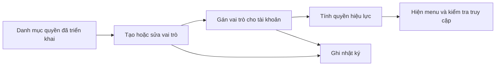
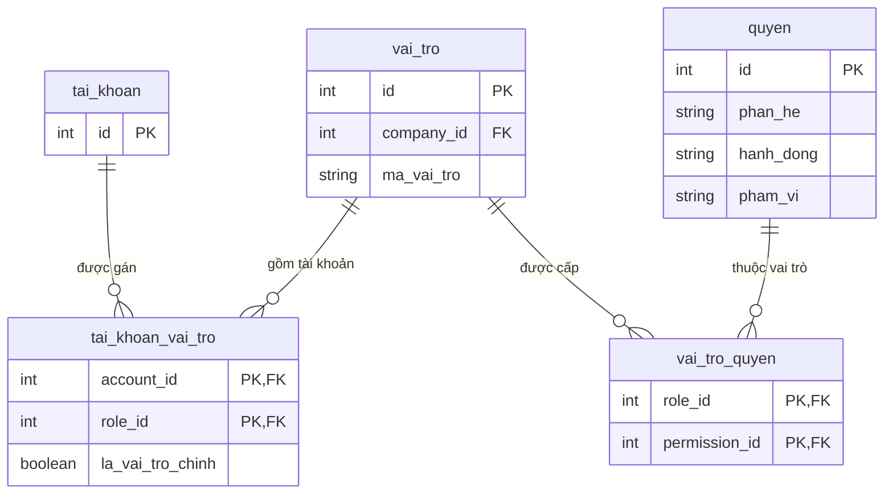

# Kế hoạch quản lý vai trò và phân quyền

Cập nhật: **17/11/2026**. **Bản đầu đã triển khai; đã kiểm chứng kỹ thuật trước đây, chưa nghiệm thu vận hành trên nhóm người dùng thực tế.**

Rule nghiệp vụ: [ROLE-MANAGEMENT-RULES](../../.agents/rules/ROLE-MANAGEMENT-RULES.md).

Đọc nhanh: [A. Tổng quan để duyệt](#a-tổng-quan-để-duyệt) · [Trạng thái và việc cần quyết định](#trạng-thái-và-việc-cần-quyết-định) · [Mốc thời gian](#mốc-thời-gian) · [B. Chi tiết triển khai](#b-chi-tiết-triển-khai) · [Thiết kế DB](#thiết-kế-db-cần-giữ) · [Checklist](#checklist-triển-khai-và-kiểm-chứng).

Người quản lý có thể đọc phần A trước. Phần B là nơi quản lý thiết kế, kiểm soát rủi ro và bằng chứng triển khai theo [quy chuẩn lập plan](README.md#quy-chuẩn-lập-và-cập-nhật-plan).

## A. Tổng quan để duyệt

### Mục tiêu

Thiết lập **một nơi quản lý tập trung quyền truy cập SDG ERP**, giúp trả lời rõ ba câu hỏi:

1. Tài khoản nào đang có vai trò gì?
2. Vai trò đó được xem hoặc quản lý chức năng nào?
3. Ai đã thay đổi quyền, thay đổi khi nào và có làm mất quyền quản trị hệ thống hay không?

Hệ thống sử dụng mô hình **tài khoản → vai trò → quyền**. Một tài khoản có thể kiêm nhiều vai trò; quyền hiệu lực là tập hợp quyền của các vai trò được gán. Chức vụ, phòng ban hoặc tên vai trò không tự sinh quyền truy cập.

### Phạm vi hiện tại

| Đã có trong bản đầu | Chưa thuộc phạm vi hiện tại |
| --- | --- |
| Trang `/roles` để tạo, sửa và xem vai trò | Cho quản trị viên tự đặt tên một quyền hoàn toàn mới |
| Ma trận quyền theo các chức năng đã có trong phần mềm | Tự động cấp quyền theo chức vụ hoặc người phụ trách phòng |
| Gán hoặc gỡ nhiều vai trò cho từng tài khoản | Phân quyền tổng quát theo phòng ban cho mọi phân hệ |
| Xem quyền hiệu lực trước khi lưu | Phê duyệt nhiều cấp đối với yêu cầu xin quyền |
| Chặn xóa vai trò hệ thống hoặc vai trò đang được sử dụng | Đồng bộ quyền với 1Office hoặc hệ thống bên ngoài |
| Chặn thao tác làm mất tài khoản quản trị cuối cùng | Tự cấp quyền mới cho các vai trò đang vận hành |
| Ghi nhật ký thay đổi trong cùng giao dịch dữ liệu | Nghiệm thu chính thức trên toàn bộ người dùng thực tế |

### Người dùng thao tác thế nào?

| Người dùng | Tác vụ chính |
| --- | --- |
| Quản trị phân quyền | Tạo vai trò, chọn quyền, xem số tài khoản bị ảnh hưởng, sửa hoặc xóa vai trò đủ điều kiện |
| Quản trị tài khoản | Gán vai trò có quyền không vượt quá quyền của chính mình; khóa, mở hoặc đặt lại mật khẩu theo quyền được cấp |
| Người dùng thông thường | Chỉ thấy menu, trang và thao tác phù hợp với quyền hiệu lực của tài khoản |
| Người kiểm tra | Xem nhật ký thay đổi quyền; không được sửa hoặc xóa lịch sử |

Quyền mới chỉ xuất hiện trong ma trận sau khi chức năng đã có kiểm tra tại server. Vì vậy, việc nhập một tên quyền mới không thể tự bảo vệ chức năng.

### Danh mục quyền hiện hành

| Nhóm chức năng | Mức quyền hoặc hành động hiện có | Ghi chú quản lý |
| --- | --- | --- |
| Nhân sự và phòng ban | Không truy cập / Xem / Quản lý | Không tự cấp quyền vị trí hoặc tài khoản |
| Vị trí và không gian 3D | Không truy cập / Xem / Quản lý | Tách khỏi quyền xem hồ sơ nhân sự |
| Tài sản | Không truy cập / Xem / Quản lý | Dùng quyền `ASSETS` riêng |
| Vật tư và phụ kiện | Không truy cập / Xem / Quản lý | Dùng quyền `INVENTORY` riêng; chưa tự cấp cho vai trò nào |
| Tài khoản đăng nhập | Không truy cập / Quản lý | Không được gán quyền vượt quá quyền người thao tác |
| Vai trò và phân quyền | Không truy cập / Xem / Quản lý | Quyền quản lý có thể cấp các quyền trong công ty |
| Nhật ký hoạt động | Không truy cập / Xem | Không có quyền sửa hoặc xóa lịch sử |
| Quy trình | Xem / Tạo / Duyệt / Thực hiện / Quản lý | Duyệt và thực hiện chỉ áp dụng đúng hồ sơ, bước được giao |
| Kết nối AI | Quản lý kết nối và model | Độc lập quyền sử dụng các nghiệp vụ khác |

Các quyền lịch sử `TASK`, `APPROVAL`, `SYSTEM` nằm ngoài ma trận hiện hành được giữ nguyên để không làm mất dữ liệu; chúng không chứng minh chức năng tương ứng đã được triển khai.

### Mô hình dữ liệu nhìn nhanh

Bản đầu dùng bốn bảng phân quyền đã triển khai. Hai bảng ở giữa là bảng nối nhiều–nhiều và dùng khóa ghép.

Mỗi vai trò thuộc một công ty; hệ thống kiểm tra tài khoản và vai trò phải cùng công ty. Nhật ký hoạt động được dùng lại để ghi người thao tác và dữ liệu trước–sau, không thêm bảng nhật ký riêng cho phân quyền.

### Trạng thái và việc cần quyết định

| Nội dung | Trạng thái | Ý nghĩa |
| --- | --- | --- |
| Mô hình tài khoản → vai trò → quyền | Đã triển khai | Quyền lấy từ DB, không suy từ tên `ADMIN` hoặc chức vụ |
| Giao diện `/roles` và gán vai trò | Đã triển khai | Có ma trận, xem ảnh hưởng và bảo vệ khi xóa |
| Kiểm soát vượt quyền, khác công ty và quản trị cuối cùng | Đã triển khai, đã kiểm chứng kỹ thuật trước đây | Cần tiếp tục giữ trong mọi thay đổi sau này |
| Quyền Workflow, Vị trí, Tài sản, AI và Vật tư | Đã đưa vào ma trận | Không tự động cấp quyền vận hành |
| Phân quyền tổng quát theo phòng ban | Chờ nhu cầu nghiệp vụ cụ thể | Chưa mở tùy chọn phạm vi phòng trên giao diện |
| Mô tả HR còn nhắc “bản đồ 3D” | Cần sửa | Chỉ là nhãn giải thích; không thay đổi quyền |
| Dùng thử với nhóm tài khoản thực tế | Chưa thực hiện | Là điều kiện trước khi nghiệm thu vận hành |

Không có đề xuất thay schema hoặc thay chính sách quyền trong lần chuẩn hóa tài liệu này.

### Mốc thời gian

#### Các mốc đã hoàn thành

| Thời gian | Mốc công việc | Kết quả |
| --- | --- | --- |
| **04/11/2026** | Hoàn thiện nền quản lý vai trò | Bổ sung migration phân quyền, ràng buộc cùng công ty, vai trò chính và chuyển đặc quyền cũ thành quyền DB tường minh |
| **05–06/11/2026** | Hoàn thiện kiểm soát quyền và Workflow | Bảo vệ quản trị cuối cùng, chống vượt quyền; đưa quyền Workflow vào quản lý tập trung và kiểm tra cấp/thu hồi |
| **09/11/2026** | Hoàn thiện giao diện quản lý | Đồng bộ giao diện vai trò, tài khoản, nhật ký trên desktop/mobile; nhóm phân quyền 9/9 E2E và nhóm nhân sự/tài khoản 14/14 đạt |
| **12/11/2026** | Mở rộng quyền Tài sản và trải nghiệm chọn dữ liệu | Đưa `ASSETS` vào ma trận; ô tìm/chọn nhân sự hỗ trợ không dấu và lưu đúng ID |
| **16/11/2026** | Mở rộng quyền quản trị AI | Quyền `AI MANAGE_CONNECTIONS` quản lý kết nối và model độc lập với các quyền nghiệp vụ |
| **17/11/2026** | Mở rộng quyền Vật tư và chuẩn hóa tài liệu | Đưa `INVENTORY` vào ma trận, không tự cấp grant; chuẩn hóa plan theo bố cục để duyệt và triển khai |

#### Lịch dự kiến để nghiệm thu vận hành

| Thời gian dự kiến | Công việc | Người phối hợp / đầu ra |
| --- | --- | --- |
| **18/11/2026** | Sửa nhãn mô tả HR còn gộp “bản đồ 3D”; chuẩn bị mẫu rà soát tài khoản–vai trò–quyền | Lập trình viên; không thay quyền hoặc DB |
| **19–20/11/2026** | Rà tài khoản và quyền cần dùng của nhóm pilot | Người phụ trách các bộ phận xác nhận danh sách |
| **23–25/11/2026** | Pilot cấp, thu hồi và kiểm tra truy cập thực tế | Quản trị phân quyền và người dùng pilot; có biên bản lỗi/kết quả |
| **26/11/2026** | Khắc phục điểm phát hiện và kiểm tra lại | Lập trình viên; chỉ đóng các lỗi thuộc phạm vi bản đầu |
| **27/11/2026** | Rà nhật ký, bảo vệ quản trị cuối cùng và quyền hiệu lực; họp đánh giá | Người phụ trách xác nhận đạt hoặc nêu phần cần bổ sung |
| **30/11/2026** | Mốc dự phòng và chốt biên bản nghiệm thu | Hoàn thành nếu không còn lỗi nghiêm trọng; phần mở rộng chuyển sang kế hoạch sau |

Các ngày từ 18–30/11 là **kế hoạch dự kiến**, phụ thuộc lịch của người phụ trách và việc cung cấp tài khoản pilot. Thay đổi lịch không đồng nghĩa thay đổi phạm vi hoặc tự duyệt triển khai thêm chức năng.

### Điều kiện nghiệm thu

| Hạng mục | Hiện tại | Điều kiện hoàn thành |
| --- | --- | --- |
| Thiết kế và DB phân quyền | Hoàn thành | Bốn bảng và ràng buộc cùng công ty hoạt động |
| Giao diện quản lý | Hoàn thành | Tạo/sửa/xóa hợp lệ, gán/gỡ và xem quyền hiệu lực |
| Kiểm thử kỹ thuật | Đã có kết quả trước đây | Cấp/thu hồi, truy cập trực tiếp, đồng thời, audit và bảo vệ quản trị cuối cùng đạt |
| Rà soát người dùng thực tế | Dự kiến **19–20/11/2026** | Xác nhận đúng tài khoản, vai trò và quyền cần dùng |
| Pilot vận hành | Dự kiến **23–25/11/2026** | Người có quyền và không có quyền hoàn thành các ca kiểm tra thực tế |
| Nghiệm thu vận hành | Mục tiêu **27–30/11/2026** | Người phụ trách xác nhận kết quả và ký biên bản |

Chỉ nghiệm thu khi người có quyền và người không có quyền đều được thử trên các thao tác thực tế; thu hồi quyền phải có hiệu lực từ request tiếp theo; không mất tài khoản quản trị cuối cùng; mọi thay đổi quan trọng có nhật ký tra cứu được.

---

## B. Chi tiết triển khai

### Phạm vi sở hữu và nguồn chính

- [Rule phân quyền](../../.agents/rules/ROLE-MANAGEMENT-RULES.md) quản lý hành vi nghiệp vụ hiện hành.
- Plan này quản lý phạm vi, quyết định DB, tiến độ, kiểm chứng và việc còn lại.
- Quyền riêng của từng phân hệ được thiết kế và kiểm chứng tại plan sở hữu; plan này chỉ xác nhận quyền đã được đưa vào ma trận.
- Chuẩn kỹ thuật chung tra tại [Database](../../.agents/rules/DATABASE-RULES.md), [Backend](../../.agents/rules/BACKEND-RULES.md) và [Frontend](../../.agents/rules/FRONTEND-RULES.md), không chép lại tại đây.

### Bộ vai trò tối thiểu

| Vai trò khởi tạo | Loại | Mục đích |
| --- | --- | --- |
| `ADMIN` | Vai trò hệ thống | Quản trị các chức năng đã được cấp trong bản cài mới |
| `DEFAULT` | Vai trò hệ thống | Nền tối thiểu cho tài khoản hợp lệ; không có quyền nghiệp vụ |
| `HR_MANAGER` | Vai trò tùy chỉnh | Quản lý hành chính nhân sự; không phải chức vụ hoặc người duyệt mặc định |

- Vận hành được tạo thêm vai trò tùy chỉnh theo nhu cầu; không sinh sẵn vai trò cho mọi chức danh hoặc phòng ban.
- Seed cài mới chỉ tạo ba vai trò trên. Seed không được dùng để phục hồi vai trò đã xóa hoặc quyền đã bị thu hồi trên DB đang vận hành.
- Các vai trò mẫu cũ `IT_ADMIN`, `HR_STAFF`, `DEPT_HEAD`, `ACCOUNTANT`, `STAFF` đã được loại khỏi bộ khởi tạo sau khi kiểm tra gán và quyền.
- Quyền mới không tự cấp cho `ADMIN`, `HR_MANAGER` hoặc vai trò đang dùng. Người quản lý phải chọn quyền phù hợp tại `/roles`.

### Ma trận và kiểm soát nghiệp vụ

| Trường hợp | Kiểm soát bắt buộc |
| --- | --- |
| Nhiều vai trò | Hợp nhất quyền của cùng một tài khoản; không cộng quyền giữa các tài khoản của cùng nhân sự |
| `MANAGE` và `VIEW` | `MANAGE` bao gồm `VIEW` với nhóm hai mức; Workflow giữ các hành động độc lập |
| Gán vai trò | Người chỉ quản lý tài khoản không được gán quyền vượt quyền của mình |
| Sửa hoặc xóa vai trò | Mã vai trò bất biến; chặn xóa vai trò hệ thống hoặc đang dùng |
| Quản trị cuối cùng | Luôn còn ít nhất một tài khoản sử dụng được có cả `ACCOUNTS MANAGE` và `ROLES MANAGE` |
| Nghỉ việc hoặc khóa tài khoản | Thu hồi phiên; gán vai trò không tự mở lại tài khoản |
| Grant ngoài ma trận | Giữ nguyên khi lưu; không tự đổi quyền lịch sử thành quyền mới |
| Thay đổi quyền | Ghi audit trong cùng transaction; quyền hiệu lực được đọc lại từ DB ở request tiếp theo |

Chi tiết hành vi là nguồn chính tại [ROLE-MANAGEMENT-RULES](../../.agents/rules/ROLE-MANAGEMENT-RULES.md).

### Khi thêm tính năng hoặc quyền mới

Quản trị viên chỉ chọn được **quyền của chức năng đã triển khai**. Quy trình thêm quyền mới:

1. Lập trình viên xác định hành động, phạm vi và kiểm tra quyền ở menu, trang, truy vấn và Server Action; mặc định từ chối khi chưa được cấp.
2. Thêm quyền vào bảng `quyen` bằng migration cho DB hiện có và đồng bộ seed cho cài mới. Không chạy lại seed để sửa quyền vận hành.
3. Cập nhật `src/lib/role-catalog.ts`, validation và giao diện nếu có hành động khác `VIEW`/`MANAGE`.
4. Kiểm thử cấp, thu hồi, truy cập URL/action trực tiếp, phạm vi dữ liệu và ảnh hưởng tới vai trò hiện có.
5. Sau triển khai, người quản lý chọn quyền mới cho vai trò phù hợp tại `/roles`; hệ thống không tự cấp hàng loạt.

Các quyền đã tích hợp gần đây được quản lý chi tiết tại [Vị trí](LOCATION-MANAGEMENT-CHECKLIST.md), [Tài sản](ASSET-MANAGEMENT-CHECKLIST.md), [Vật tư](INVENTORY-MANAGEMENT-CHECKLIST.md), [Workflow](WORKFLOW-CHECKLIST.md) và [Cài đặt AI](SYSTEM-SETTINGS-CHECKLIST.md).

### Thiết kế DB cần giữ

| Bảng | Khóa chính | Vai trò |
| --- | --- | --- |
| `vai_tro` | `id` | Vai trò trong từng công ty; mã vai trò duy nhất trong công ty |
| `quyen` | `id` | Danh mục phân hệ, hành động và phạm vi |
| `tai_khoan_vai_tro` | `account_id` + `role_id` | Gán nhiều vai trò cho tài khoản; đánh dấu vai trò chính |
| `vai_tro_quyen` | `role_id` + `permission_id` | Ma trận quyền của vai trò |

- Giữ hai bảng nối bằng khóa ghép; không thêm ID riêng chỉ để thay đổi hình thức.
- Role gắn với tài khoản, không gắn trực tiếp với chức vụ. Nhật ký tham chiếu tài khoản thao tác.
- Trigger `tai_khoan_vai_tro_cung_cong_ty` chặn gán tài khoản và vai trò khác công ty.
- Partial unique `tai_khoan_mot_vai_tro_chinh` bảo đảm mỗi tài khoản có tối đa một vai trò chính; các vai trò khác vẫn được hợp nhất quyền.
- Mutation khóa theo thứ tự công ty → advisory `(260126, companyId)`, đọc lại quyền, phiên và `updated_at`, sau đó thay đổi dữ liệu và ghi audit trong cùng transaction.
- Migration `20261104110000_quan_ly_vai_tro` chuyển đặc quyền cũ thành grant tường minh; runtime không dùng tên `ADMIN` để suy quyền.
- Không sửa `pham_vi` của quyền toàn cục để giả lập quyền theo phòng. Khi một phân hệ thực sự cần phạm vi phòng, phải thiết kế cách cấp quyền và bộ lọc server tại plan của phân hệ đó.
- DEFAULT và trigger bảo vệ tài khoản tối thiểu được quản lý tại [plan cá nhân](PROFILE-DASHBOARD-CHECKLIST.md#thiết-kế-db-cần-giữ).

### Đồng thời, audit và bảo toàn dữ liệu

- Giao diện gửi `updated_at`; server từ chối ghi đè khi bản ghi đã thay đổi và yêu cầu tải lại dữ liệu mới.
- Kiểm tra quyền, ràng buộc quản trị cuối cùng, thay đổi role/grant và ghi `nhat_ky_hoat_dong` phải nằm trong cùng transaction.
- Thay đổi grant không cần buộc đăng xuất; request tiếp theo đọc lại quyền từ DB. Thay đổi mật khẩu hoặc trạng thái tài khoản tăng phiên bản đăng nhập để thu hồi phiên.
- Không reset DB, chạy lại seed hoặc xóa grant để “đồng bộ” ma trận. Migration chỉ bổ sung catalog và ràng buộc; cấp quyền vận hành là thao tác riêng có audit.
- Backup RBAC trước lần dọn vai trò đã lưu cục bộ tại `outputs/role-cleanup/`; lịch sử lâu dài nằm trong Git và migration.

### Giao diện và khả năng sử dụng

- Danh sách vai trò dùng thẻ, nhãn quyền và số tài khoản thực tế; DEFAULT xem ở chế độ chỉ đọc.
- Xóa vai trò tùy chỉnh hiển thị các tài khoản đang sử dụng và có lối sang đổi vai trò; chỉ cho xác nhận khi đã hết gán.
- Ô chọn nhân sự khi tạo hoặc sửa tài khoản hỗ trợ tìm không dấu, lưu đúng ID và không nhận chữ nhập tự do.
- Desktop và mobile không được tràn ngang; thông tin kỹ thuật như ID, version và metadata không cần thiết không hiển thị cho người dùng.
- Nhãn HR trong catalog hiện còn cụm “bản đồ 3D”; cần sửa để phản ánh quyền 3D được kiểm soát riêng qua HR và LOCATIONS.

### Checklist triển khai và kiểm chứng

#### Đã hoàn thành

- [x] Triển khai bốn bảng RBAC, khóa ghép, ràng buộc cùng công ty và tối đa một vai trò chính.
- [x] Triển khai `/roles`: tạo/sửa vai trò, ma trận, số tài khoản chịu ảnh hưởng, gán/gỡ và xóa có bảo vệ.
- [x] Bỏ đặc quyền ngầm theo mã `ADMIN`/`IT_ADMIN`; quyền hiệu lực lấy từ DB.
- [x] Tách quyền HR, ACCOUNTS, ROLES và AUDIT; menu, trang và action dùng cùng chính sách.
- [x] Thêm các hành động Workflow; giới hạn người gửi, người được giao và người điều phối theo nghiệp vụ Workflow.
- [x] Thêm quyền LOCATIONS, ASSETS, AI `MANAGE_CONNECTIONS` và INVENTORY vào catalog, validation và ma trận; không tự cấp quyền vận hành.
- [x] Chặn sửa vượt quyền, gán khác công ty, mất quản trị cuối cùng và ghi đè phiên bản cũ; mutation và audit cùng transaction.
- [x] Thu gọn bộ khởi tạo còn `ADMIN`, `DEFAULT`, `HR_MANAGER`; seed không phục hồi vai trò hoặc grant đã bị xóa.
- [x] Kiểm thử phân quyền trước đây đã bao phủ cấp/thu hồi, truy cập trực tiếp, vòng đời tài khoản, Workflow, đồng thời, rollback audit và bảo vệ quản trị cuối cùng.
- [x] Giao diện vai trò, tài khoản và nhật ký đã được kiểm tra trên desktop/mobile; nhóm phân quyền 9/9 E2E và nhóm nhân sự/tài khoản 14/14 đạt tại lần kiểm tra 09/11.
- [x] Chuẩn hóa plan ngày 17/11 theo bố cục A/B, bổ sung luồng, ERD và phần đọc nhanh; không đổi mã nguồn, DB, quyền hoặc ba rule kỹ thuật chung.

#### Còn lại

- [ ] **18/11/2026:** Sửa mô tả HR trong `src/lib/role-catalog.ts` để bỏ cách diễn đạt HR tự bao gồm “bản đồ 3D”; không thay grant hoặc guard.
- [ ] **19–20/11/2026:** Rà danh sách tài khoản, vai trò và quyền cần dùng với người phụ trách từng bộ phận.
- [ ] **23–25/11/2026:** Dùng thử cấp và thu hồi quyền trên nhóm tài khoản pilot, gồm cả trường hợp không có quyền và truy cập URL trực tiếp.
- [ ] **26/11/2026:** Khắc phục điểm phát hiện trong phạm vi bản đầu và kiểm tra lại các ca bị ảnh hưởng.
- [ ] **27–30/11/2026:** Xác nhận nhật ký, bảo vệ quản trị cuối cùng và quyền hiệu lực sau thay đổi; người phụ trách nghiệm thu vận hành.
- [ ] Chỉ thiết kế phạm vi phòng ban tổng quát khi có phân hệ nêu rõ dữ liệu, người dùng và hành động cần giới hạn.

### Tiêu chí nghiệm thu vận hành

| Nhóm kiểm tra | Kết quả cần đạt |
| --- | --- |
| Đúng quyền | Tài khoản chỉ thấy và thực hiện đúng chức năng được cấp; truy cập trực tiếp vẫn bị chặn khi thiếu quyền |
| Cấp và thu hồi | Quyền thay đổi từ request tiếp theo; không cần sửa code theo từng lần gán |
| Bảo toàn quản trị | Không thao tác nào làm mất tài khoản quản trị cuối cùng |
| Cùng công ty | Không gán vai trò hoặc đọc dữ liệu phân quyền chéo công ty |
| Đồng thời | Hai người sửa cùng vai trò không âm thầm ghi đè dữ liệu mới hơn |
| Nhật ký | Tra được ai thay đổi vai trò/quyền, thời điểm và dữ liệu trước–sau |
| Khả năng sử dụng | Người phụ trách hiểu ma trận, tự gán đúng quyền và hoàn thành pilot không cần can thiệp DB |

### Tài liệu liên quan

[Tổng quan kế hoạch](README.md) · [HR](HR-CHECKLIST.md) · [Tài khoản và không gian cá nhân](PROFILE-DASHBOARD-CHECKLIST.md) · [Workflow](WORKFLOW-CHECKLIST.md) · [Vị trí](LOCATION-MANAGEMENT-CHECKLIST.md) · [Tài sản](ASSET-MANAGEMENT-CHECKLIST.md) · [Vật tư](INVENTORY-MANAGEMENT-CHECKLIST.md) · [Cài đặt AI](SYSTEM-SETTINGS-CHECKLIST.md)

### Quản trị sử dụng AI — 17/11/2026

Catalog/ma trận/guard bổ sung AI MANAGE_LIMITS và VIEW_USAGE; kết nối vẫn MANAGE_CONNECTIONS. Menu cài đặt hiện theo hợp ba quyền, mỗi action kiểm tra lại quyền/công ty. Migration chỉ thêm catalog, không tự cấp grant. AI USE mở rộng nhiều tài khoản chưa triển khai, quyền pilot giữ nguyên. Thiết kế và kiểm chứng tại [plan AI](AI-ASSISTANT-CHECKLIST.md#quản-trị-api-openai-mở-rộng--17112026).

### Quyền Công việc — 20/11/2026

- [x] Danh mục `SUPPORT_TASK`: VIEW, CREATE, EXECUTE, ACCEPT, MANAGE; form role và tổng quyền tài khoản hiển thị riêng. Mọi thao tác cần VIEW; MANAGE không thay EXECUTE/ACCEPT.
- [x] Session/query đọc grant hiện hành, server lọc phạm vi công việc; form cũ thiếu trường mới giữ nguyên grant công việc. Chi tiết phạm vi do [plan Công việc](TASK-MANAGEMENT-CHECKLIST.md#b2-cách-tính-quyền-và-người-nhận-thông-báo) sở hữu.
- [x] E2E tạo role với VIEW/EXECUTE và đối chiếu đúng grant trên DB thử đạt; quyền thực tế không thay đổi.
- [ ] Chọn/gán quyền tài khoản pilot; migration không tự cấp DEFAULT/admin hoặc chuyển TASK cũ.

- [x] Thử Công việc trên local 20/11 theo yêu cầu: hai phòng/năm nhân sự-tài khoản/bốn role có nhãn TEST, tạo/gán qua action có audit; tài khoản thử đã khóa sau kiểm chứng. Dữ liệu thật của `namdh` giữ nguyên. Phạm vi và kết quả tại [plan Công việc B.8](TASK-MANAGEMENT-CHECKLIST.md#b8-thử-luồng-trên-web-local-bằng-tài-khoản-riêng--20112026).
