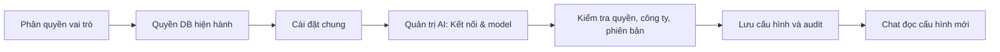

# Cài đặt hệ thống

Cập nhật: **16/11/2026**. Trạng thái: **đã triển khai theo yêu cầu “Hãy thực hiện”**. Rule: [SYSTEM-SETTINGS-RULES](../../.agents/rules/SYSTEM-SETTINGS-RULES.md).

Mục lục: [A. Phạm vi](#a-phạm-vi) · [B. Triển khai](#b-triển-khai) · [Thiết kế DB cần giữ](#thiết-kế-db-cần-giữ) · [Kiểm chứng](#kiểm-chứng).

## A. Phạm vi

Thay trang chờ `/settings` bằng khu cài đặt có các mục đã hoạt động và được cấp quyền. Đợt này có **Quản trị AI → Kết nối & model**, chuyển form từ dashboard sang `/settings/ai`; chat và nghiệp vụ tài sản/vị trí giữ nguyên.

| Tác vụ | Kết quả |
| --- | --- |
| Mở Cài đặt chung | Thấy mục Quản trị AI khi có quyền quản lý kết nối |
| Sửa key/model | Dùng dữ liệu, kho mã hóa và action AI hiện có; kiểm tra/lưu/tạm dừng tại trang riêng |
| Cấp/gỡ quyền | Checkbox Quản lý kết nối & model AI tại `/roles`; kiểm tra menu, URL và action theo DB |
| Các nhóm khác | Thông tin chung, tích hợp, thông báo, bảo mật, lưu trữ theo [định hướng](../THIET-KE-QUAN-TRI-AI.md#đề-xuất-đưa-ai-vào-khu-cài-đặt-hệ-thống--16112026); chưa tạo form hoặc menu trống |

Đề xuất tiếp theo theo câu hỏi người phụ trách: [model theo tác vụ](#model-theo-tác-vụ--đề-xuất), chưa triển khai. Quản trị chọn model riêng cho từng loại việc tại trang AI; tác vụ chưa cấu hình dùng model mặc định.

Quyền quản trị kết nối độc lập quyền dùng chat và tài sản/vị trí; không mở chat cho mọi người quản trị AI. Đợt chuyển tiếp giữ quyền quản trị kết nối cho đúng tài khoản pilot đã được người phụ trách yêu cầu dùng; kiểm tra role chỉ gán tài khoản đó trước khi cấp riêng, có audit. Migration/seed chỉ thêm catalog, không cấp hàng loạt.

## B. Triển khai

### Thiết kế DB cần giữ

Không thêm bảng/cột. Dùng `ket_noi_ai` và kho bí mật theo [thiết kế AI](../THIET-KE-QUAN-TRI-AI.md#kết-nối-pilot--16112026). Thêm catalog `AI / MANAGE_CONNECTIONS / ALL` qua migration, dùng RBAC hiện có. Các quyền AI chưa triển khai không đưa vào ma trận. Payload role cũ thiếu `aiActions` giữ grant AI; truyền mảng rỗng là thu hồi rõ ràng.

Kết nối môi trường chỉ được xem/sử dụng/nhận quản lý ở công ty của tài khoản pilot được bind; quản trị công ty khác phải cấu hình kết nối riêng. Bản ghi DB luôn ưu tiên, không fallback env khi tạm dừng/lỗi kho bí mật.

### Danh sách model tự động — 16/11/2026

Theo yêu cầu người phụ trách: mặc định ô Model là danh sách tìm/chọn, tự tải từ OpenAI bằng khóa đã cấu hình khi mở trang. Khóa mới dùng nút kiểm tra/tải; giữ model đang chọn, không tự chọn hoặc lưu model khác. Có tải lại và nhập thủ công khi khóa thiếu quyền danh sách hoặc mạng lỗi; không ghi danh mục model vào DB. Tái sử dụng action có kiểm tra quyền/công ty/phiên bản và giới hạn lượt, không thêm API endpoint/thư viện.

- [x] Đọc hướng dẫn Next.js/rule và chuyển trường Model sang danh sách; tự tải một lần khi mở, tránh gọi lặp do Strict Mode hoặc lưu chỉ đổi model.
- [x] Kiểm tra Models API thật bằng khóa hiện tại: OpenAI trả 96 model, dropdown có 96 lựa chọn, không lỗi JavaScript; cấu hình/key/model không đổi, không gọi model tạo nội dung.
- [x] 8 E2E cài đặt đạt: tự tải một lần, tìm/chọn rồi lưu, giữ model cũ, khóa mới/lỗi/danh sách rỗng, xung đột hai tab, phân quyền và mobile sáng/tối. Chặn tương tác trước hydration, bỏ kết quả tải khi khóa/phiên bản đã đổi. TypeScript/lint, 227 liên kết/anchor và `git diff --check` đạt; đã xem ảnh dropdown thật và mobile, đồng bộ rule/plan/thiết kế.

### Checklist

- [x] Đọc rule/plan và hướng dẫn Next.js. `/settings` là trang chờ, form AI ở dashboard; ADMIN hiện chỉ gán tài khoản pilot, các role khác có người dùng chung.
- [x] Backup/khôi phục thử đạt; trên bản khôi phục sạch, migration chỉ thêm một quyền, toàn bộ dữ liệu cũ của 19 bảng và các grant không đổi. Đã áp dụng migration local, schema diff rỗng; không sửa kết nối/khóa/model.
- [x] Đã tạo khu cài đặt, trang AI và điều hướng, chuyển form khỏi chat; có tải lại/bỏ thay đổi và trạng thái kết nối. Đã kiểm chứng desktop/mobile sáng/tối, URL riêng và tải lại/bỏ thay đổi.
- [x] Đã tích hợp quyền riêng vào session/catalog/action/ma trận; guard kiểm tra lại khi lưu/kiểm tra key, tách fallback môi trường theo công ty pilot. TypeScript/lint bước đầu đạt.
- [x] 10 tích hợp cài đặt, 10 tích hợp chat hồi quy, 6 E2E cài đặt, 9 E2E phân quyền và 3 unit phân quyền đạt (38 ca). Đã kiểm tra URL/action trực tiếp, công ty, quyền độc lập, thu hồi trong lúc test key, cấp/gỡ tại ma trận, giữ grant với payload cũ, xung đột hai tab, khóa không lộ và mobile sáng/tối. Đã xem ảnh; chỉnh hộp lỗi để đọc rõ ở dark mode và kiểm tra lại ca giao diện đó đạt.
- [x] Cấp riêng quyền kết nối cho role hiện chỉ gán tài khoản pilot (1 tài khoản), giữ grant cũ và ghi audit cùng transaction. Mở trang cài đặt/AI và checkbox quyền ở local đạt; chat không còn form cài đặt, không sửa key/model hoặc gọi API thật.
- [x] TypeScript/lint cuối, 226 liên kết/anchor trong 11 tài liệu và `git diff --check` đạt. Đã đồng bộ rule/plan/kiến trúc/từ điển DB, giữ ba rule kỹ thuật chung. Đã dừng app thử và dọn đúng DB tạm; backup/log/ảnh giữ cục bộ.

### Model theo tác vụ — đề xuất

- [x] Đọc mã hiện hành: `readAiConnection` trả một model chung; action chat dùng model đó xuyên suốt vòng gọi công cụ. Cấu hình hiện tại chưa phân theo job. Lượt này chỉ khảo sát và ghi phương hướng, không sửa mã/DB hoặc gọi OpenAI.
- [x] Đối chiếu phạm vi nhiều API key: [thiết kế đầy đủ](../THIET-KE-QUAN-TRI-AI.md#ket_noi_ai--nguồn-kết-nối-và-thanh-toán) đã dự kiến nhiều kết nối, nhưng mỗi organization/project chỉ có một kết nối với một phiên bản khóa hoạt động; công ty dùng một kết nối mặc định. Đề xuất hội thoại mới về nhiều key và gán kết nối/model theo job chưa được hợp nhất thành thiết kế DB; cần chốt quan hệ key–project và thay phương án JSON đơn kết nối phía dưới nếu triển khai. Rà soát này không thay hành vi đã duyệt hoặc cấu hình vận hành.
- [ ] Đề xuất thêm các lựa chọn model cho hội thoại chung, tra cứu tài sản/vị trí và chuẩn bị bản nháp thêm/sửa; mỗi ô dùng danh sách OpenAI và có lựa chọn dùng mặc định. Tóm tắt/báo cáo bổ sung khi có chức năng tương ứng.
- [ ] Chốt cách xác định tác vụ: giai đoạn đầu chế độ/chức năng được người dùng chọn, máy chủ kiểm tra mã tác vụ hợp lệ và quyền; tự phân loại câu chat là bước riêng. Không suy job bằng từ khóa đơn giản hoặc để client truyền tên model tùy ý. Chọn model trước khi gọi AI, giữ nguyên trong vòng xử lý của tác vụ; ngữ cảnh hội thoại được giữ trong giới hạn hiện có.
- [ ] Phương án DB dự kiến: thêm một cột JSONB ánh xạ mã tác vụ cố định sang tên model trong `ket_noi_ai`, không thêm bảng hoặc key riêng. Cấu hình rỗng dùng `model_mac_dinh`; thiếu cấu hình khác với model lỗi, không tự đổi model/nguồn thanh toán khi lỗi. Thiết kế/migration chi tiết thực hiện khi có yêu cầu triển khai.
- [ ] Nghiệm thu dự kiến: định tuyến đúng model trước cuộc gọi, kế thừa mặc định, quyền/công ty/phiên bản và audit giữ nguyên; nhật ký có job/model thực dùng. Kiểm tra model hỗ trợ kiểu tác vụ qua ca thử phù hợp, không coi xuất hiện trong Models API là bằng chứng tương thích. Thêm/sửa vẫn qua form xác nhận hiện có.

### Kiểm chứng

Bộ kiểm chứng đợt chuyển trang đã đạt như checklist phía trên. TypeScript và lint các file thay đổi đạt. Dùng DB/app/kho khóa riêng và API mô phỏng; không gọi API thật hoặc thay khóa/model vận hành để kiểm thử. Bằng chứng và backup tại `outputs/system-settings/`.

Đợt dropdown tự động dùng DB/app/kho khóa riêng cho 8 E2E; kiểm tra bổ sung trên local chỉ đọc Models API thật, không lưu cấu hình hoặc gọi tạo nội dung. Đã dừng app thử và dọn đúng DB tạm; app local giữ nguyên. Bằng chứng, ảnh và backup tại `outputs/ai-model-select/`.
