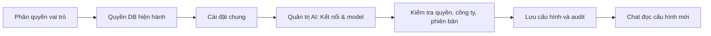

# Cài đặt hệ thống

Cập nhật: **19/11/2026**. Trạng thái: **đã triển khai theo yêu cầu “Hãy thực hiện”**. Rule: [SYSTEM-SETTINGS-RULES](../../.agents/rules/SYSTEM-SETTINGS-RULES.md).

Mục lục: [A. Phạm vi](#a-phạm-vi) · [B. Triển khai](#b-triển-khai) · [Thiết kế DB cần giữ](#thiết-kế-db-cần-giữ) · [Kiểm chứng](#kiểm-chứng).

## A. Phạm vi

**Tổng quan quản trị:** `/system` là dashboard phân hệ. Bấm tên Quản trị mở tổng quan; hover menu thu gọn mở tác vụ con. Thẻ tài khoản (cho phép đăng nhập/khóa), vai trò (tùy chỉnh/hệ thống), vị trí (đang/ngừng dùng), nhật ký 7 ngày và cài đặt chỉ hiện theo quyền tương ứng. `/settings` tiếp tục là khu cấu hình.

Thay trang chờ `/settings` bằng khu cài đặt có các mục đã hoạt động và được cấp quyền. Đợt này có **Quản trị AI → Kết nối & model**, chuyển form từ dashboard sang `/settings/ai`; chat và nghiệp vụ tài sản/vị trí giữ nguyên.

| Tác vụ | Kết quả |
| --- | --- |
| Mở Cài đặt chung | Thấy mục Quản trị AI khi có quyền quản lý kết nối |
| Sửa key/model | Dùng dữ liệu, kho mã hóa và action AI hiện có; kiểm tra/lưu/tạm dừng tại trang riêng |
| Cấp/gỡ quyền | Checkbox Quản lý kết nối & model AI tại `/roles`; kiểm tra menu, URL và action theo DB |
| Các nhóm khác | Thông tin chung, tích hợp, thông báo, bảo mật, lưu trữ theo [định hướng](../THIET-KE-QUAN-TRI-AI.md#đề-xuất-đưa-ai-vào-khu-cài-đặt-hệ-thống--16112026); chưa tạo form hoặc menu trống |

Đã triển khai theo yêu cầu người phụ trách: [model theo tác vụ](#model-theo-tác-vụ--triển-khai-17112026), đã kiểm chứng kỹ thuật với API mô phỏng. Quản trị chọn model riêng cho từng loại việc tại trang AI; tác vụ chưa cấu hình dùng model mặc định.

Quyền quản trị kết nối độc lập quyền dùng chat và tài sản/vị trí; không mở chat cho mọi người quản trị AI. Đợt chuyển tiếp giữ quyền quản trị kết nối cho đúng tài khoản pilot đã được người phụ trách yêu cầu dùng; kiểm tra role chỉ gán tài khoản đó trước khi cấp riêng, có audit. Migration/seed chỉ thêm catalog, không cấp hàng loạt.

## B. Triển khai

### Dashboard quản trị — 19/11/2026

- [x] Tạo `/system` và skeleton; menu dùng cùng điều kiện hợp quyền với page. ACCOUNTS cần MANAGE; ROLES/LOCATIONS/AUDIT cần VIEW hoặc MANAGE; cấu hình dùng hợp quyền quản trị AI hiện có. Không thêm quyền SYSTEM hoặc tự cấp quyền.
- [x] Dữ liệu: chỉ group/count `tai_khoan`, `vai_tro`, `vi_tri`, `nhat_ky_hoat_dong` trong công ty và mảng được cấp quyền, một snapshot đọc. Không truy vấn khóa AI, mật khẩu hoặc payload audit; không thêm bảng/cột. Số tài khoản cho phép đăng nhập không biểu thị online hay số nhân sự.
- [x] Card và thanh tỷ lệ dùng dữ liệu thực; thiếu quyền ẩn cả thẻ lẫn truy vấn. Zero hiện 0. Link thẻ mở chức năng đầy đủ, nhật ký 7 ngày là số tổng quan, trang nhật ký giữ bộ lọc riêng. Trang không lưu cache dữ liệu chung; mutation vị trí/3D revalidate tổng quan, tài khoản/vai trò dùng revalidate layout hiện có.
- [x] TypeScript/lint và 8 unit điều hướng/quyền đạt. Chrome chỉ đọc DB: số tài khoản/vai trò/vị trí khớp, hover mở menu/click vào tổng quan, ArrowDown/Escape, link vị trí/Back, mobile mở menu/đóng sau chọn, không tràn ngang, sáng/tối và chưa đăng nhập chuyển login đều đạt; không lỗi JavaScript. Đã xem ảnh tại `outputs/nav-rail/system-*.png`. Không có tài khoản vận hành thiếu toàn bộ quyền phù hợp để kiểm tra browser từ chối; ca này kiểm tra chính sách bằng unit, không tự đổi quyền/tạo tài khoản thật.

### Thiết kế DB cần giữ

Đợt chuyển trang không thêm bảng/cột; đợt nhiều key mở rộng hai cột/index theo mục bên dưới. Dùng `ket_noi_ai` và kho bí mật theo [thiết kế AI](../THIET-KE-QUAN-TRI-AI.md#kết-nối-pilot--16112026). Thêm catalog `AI / MANAGE_CONNECTIONS / ALL` qua migration, dùng RBAC hiện có. Các quyền AI chưa triển khai không đưa vào ma trận. Payload role cũ thiếu `aiActions` giữ grant AI; truyền mảng rỗng là thu hồi rõ ràng.

Kết nối môi trường chỉ được xem/sử dụng/nhận quản lý ở công ty của tài khoản pilot được bind; quản trị công ty khác phải cấu hình kết nối riêng. Bản ghi DB luôn ưu tiên, không fallback env khi tạm dừng/lỗi kho bí mật.

### Danh sách model tự động — 16/11/2026

Theo yêu cầu người phụ trách: mặc định ô Model là danh sách tìm/chọn, tự tải từ OpenAI bằng khóa đã cấu hình khi mở form kết nối. Khóa mới dùng nút kiểm tra/tải; giữ model đang chọn, không tự chọn hoặc lưu model khác. Có tải lại và nhập thủ công khi khóa thiếu quyền danh sách hoặc mạng lỗi; không ghi danh mục model vào DB. Tái sử dụng action có kiểm tra quyền/công ty/phiên bản và giới hạn lượt, không thêm API endpoint/thư viện.

- [x] Đọc hướng dẫn Next.js/rule và chuyển trường Model sang danh sách; tự tải một lần khi mở, tránh gọi lặp do Strict Mode hoặc lưu chỉ đổi model.
- [x] Kiểm tra Models API thật bằng khóa hiện tại: OpenAI trả 96 model, dropdown có 96 lựa chọn, không lỗi JavaScript; cấu hình/key/model không đổi, không gọi model tạo nội dung.
- [x] 8 E2E cài đặt đạt: tự tải một lần, tìm/chọn rồi lưu, giữ model cũ, khóa mới/lỗi/danh sách rỗng, xung đột hai tab, phân quyền và mobile sáng/tối. Chặn tương tác trước hydration, bỏ kết quả tải khi khóa/phiên bản đã đổi. TypeScript/lint, 227 liên kết/anchor và `git diff --check` đạt; đã xem ảnh dropdown thật và mobile, đồng bộ rule/plan/thiết kế.

### Checklist

- [x] Đọc rule/plan và hướng dẫn Next.js. `/settings` là trang chờ, form AI ở dashboard; ADMIN hiện chỉ gán tài khoản pilot, các role khác có người dùng chung.
- [x] Backup/khôi phục thử đạt; trên bản khôi phục sạch, migration chỉ thêm một quyền, toàn bộ dữ liệu cũ của 19 bảng và các grant không đổi. Đã áp dụng migration local, schema diff rỗng; không sửa kết nối/khóa/model.
- [x] Đã tạo khu cài đặt, trang AI và điều hướng, chuyển form khỏi chat; có tải lại/bỏ thay đổi và trạng thái kết nối. Đã kiểm chứng desktop/mobile sáng/tối, URL riêng và tải lại/bỏ thay đổi.
- [x] Đã tích hợp quyền riêng vào session/catalog/action/ma trận; guard kiểm tra lại khi lưu/kiểm tra key, tách fallback môi trường theo công ty pilot. TypeScript/lint bước đầu đạt.
- [x] 10 tích hợp cài đặt, 10 tích hợp chat hồi quy, 6 E2E cài đặt, 9 E2E phân quyền và 3 unit phân quyền đạt (38 ca). Đã kiểm tra URL/action trực tiếp, công ty, quyền độc lập, thu hồi trong lúc test key, cấp/gỡ tại ma trận, giữ grant với payload cũ, xung đột hai tab, khóa không lộ và mobile sáng/tối. Đã xem ảnh; chỉnh hộp lỗi để đọc rõ ở dark mode và kiểm tra lại ca giao diện đó đạt.
- [x] Cấp riêng quyền kết nối cho role hiện chỉ gán tài khoản pilot (1 tài khoản), giữ grant cũ và ghi audit cùng transaction. Mở trang cài đặt/AI và checkbox quyền ở local đạt; chat không còn form cài đặt, không sửa key/model hoặc gọi API thật.
- [x] TypeScript/lint cuối, 226 liên kết/anchor trong 11 tài liệu và `git diff --check` đạt. Đã đồng bộ rule/plan/kiến trúc/từ điển DB, giữ ba rule kỹ thuật chung. Đã dừng app thử và dọn đúng DB tạm; backup/log/ảnh giữ cục bộ.

### Model theo tác vụ — triển khai 17/11/2026

Đã có mã chọn kết nối/model cho GENERAL (tổng hợp), LOOKUP (chỉ đọc) và DRAFT (soạn hồ sơ/công việc). Người dùng chọn tác vụ trước khi gửi chat. Tác vụ chưa cấu hình kế thừa kết nối/model mặc định; model riêng có đơn giá tùy chọn, không tự xoay key khi lỗi. Dropdown tải từ đúng kết nối; có nhập thủ công. Chi tiết DB/ngân sách và tiến độ nghiệm thu quản lý tại [đợt quản trị API](AI-ASSISTANT-CHECKLIST.md#quản-trị-api-openai-mở-rộng--17112026), không duy trì checklist trùng.

### Nhiều API key OpenAI — 16/11/2026

**Đã triển khai.** Người phụ trách yêu cầu thêm key giữ key cũ, xác nhận chỉ OpenAI. Trang AI có danh sách kết nối, thêm riêng, sửa/thay key riêng và chọn mặc định. Model theo job thuộc đợt 17/11 ở trên. Key `.env` giữ nguyên; trước khi thêm kết nối đầu tiên, máy chủ bảo toàn kết nối môi trường trong kho mã hóa và DB cùng transaction tạo mới. Có thao tác lưu riêng kết nối máy chủ để chuyển sang quản lý tại UI. Không tự xóa biến môi trường.

Thiết kế DB đợt này: mở rộng `ket_noi_ai` với `ten_ket_noi` và `la_mac_dinh`; bỏ unique toàn cột `company_id`, thêm index công ty và partial unique bảo đảm tối đa một mặc định/công ty. Bản ghi cũ giữ ID/secret/model/trạng thái và trở thành mặc định. Không thêm bảng, không xóa dữ liệu. Mỗi bản ghi là một key có thể thay phiên bản, cho phép các key cùng project; không suy ngân sách độc lập theo key. Thiết kế đối soát project của bản đầy đủ phải gom đúng nguồn khi triển khai quota.

`cong_ty (đã có) 1 → N ket_noi_ai (mở rộng)`: FK công ty bắt buộc/Restrict; mặc định có thể tạm dừng và khi đó chat bị chặn. Không fallback môi trường nếu đã có bất kỳ kết nối DB. Thêm key không đổi mặc định đang dùng. Chọn mặc định kiểm tra phiên bản kết nối và mặc định cũ dưới khóa công ty; cập nhật/audit nguyên tử. Mọi đọc/ghi/test theo ID đều kiểm tra công ty/quyền, Models API dùng đúng key của bản ghi đang mở.

- [x] Đọc rule, code, hướng dẫn Next.js; chốt phạm vi nhiều key OpenAI và giữ cấu hình môi trường.
- [x] Backup/khôi phục thử đạt; migration trên DB riêng giữ nguyên 19 bảng (so các cột cũ). Ca migration với hai kết nối cũ thuộc hai công ty giữ ID/secret/version/model/timestamp/trạng thái, đặt mặc định đúng; generate client đạt. Đã backup mới và áp dụng local: 19 bảng giữ nguyên các cột/dữ liệu cũ, schema diff rỗng và partial unique mặc định đúng.
- [x] Danh sách/thêm/sửa/chọn mặc định, bảo toàn key môi trường và kiểm tra model theo kết nối đã có mã. 24 kiểm thử tích hợp (14 cài đặt, gồm chuyển riêng key môi trường + 10 chat hồi quy) đạt trên DB riêng với HTTP mô phỏng: giữ key cũ, đúng nguồn, quyền/công ty, xung đột, unique mặc định, rollback nhập môi trường, tạm dừng và chạy khi bỏ biến key/model khỏi tiến trình thử. TypeScript/lint đạt.
- [x] 9 E2E đạt: giữ các ca cũ và thêm key thứ hai, đổi mặc định, sửa đúng key, nguồn chat đúng, desktop/mobile sáng/tối; đã xem ảnh. Local mở danh sách/form thêm và form kết nối hiện tại đạt, GET Models thật thành công, không lỗi JavaScript và không thay cấu hình/key/model. Đã restart dev để nạp Prisma Client mới.
- [x] Đồng bộ rule/thiết kế/kiến trúc/từ điển DB/router; 231 liên kết/anchor và `git diff --check` đạt. Đã dừng app thử 4135 và dọn đúng DB tạm, giữ app local 4000. Bằng chứng/backup/ảnh tại `outputs/ai-multiple-keys/`; không đổi `.env`, không tạo/revoke key ở OpenAI hoặc gọi tạo nội dung thật.

### Kiểm chứng

Bộ kiểm chứng đợt chuyển trang đã đạt như checklist phía trên. TypeScript và lint các file thay đổi đạt. Dùng DB/app/kho khóa riêng và API mô phỏng; không gọi API thật hoặc thay khóa/model vận hành để kiểm thử. Bằng chứng và backup tại `outputs/system-settings/`.

Đợt dropdown tự động dùng DB/app/kho khóa riêng cho 8 E2E; kiểm tra bổ sung trên local chỉ đọc Models API thật, không lưu cấu hình hoặc gọi tạo nội dung. Đã dừng app thử và dọn đúng DB tạm; app local giữ nguyên. Bằng chứng, ảnh và backup tại `outputs/ai-model-select/`.
