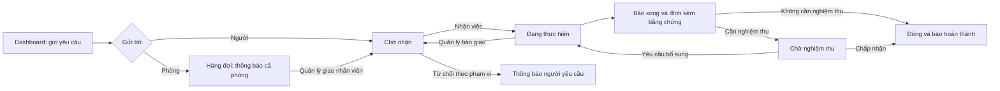
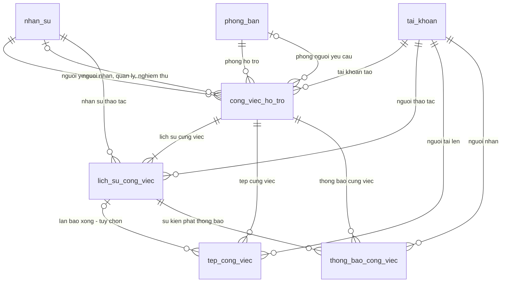

# Công việc và ticket hỗ trợ

Cập nhật: **25/11/2026**. **Đã triển khai và kiểm chứng kỹ thuật quản lý, bàn giao và giao diện gọn; kết quả tại B.10–B.11. Chưa cấp quyền pilot hoặc nghiệm thu vận hành.** Ưu tiên công việc theo yêu cầu người dùng; báo cáo tuần làm sau. Rule: [TASK-MANAGEMENT-RULES](../../.agents/rules/TASK-MANAGEMENT-RULES.md).

Đọc nhanh: [A. Đặc tả yêu cầu](#a-đặc-tả-yêu-cầu) · [B. Thiết kế kỹ thuật](#b-thiết-kế-kỹ-thuật) · [DB](#thiết-kế-db-cần-giữ) · [Checklist](#b7-checklist-triển-khai).

## A. Đặc tả yêu cầu

### A.1. Mục tiêu và phạm vi

Người dùng gửi yêu cầu hỗ trợ từ dashboard cá nhân bằng form hoặc nhờ AI soạn rồi kiểm tra và bấm **Gửi yêu cầu**. Một đầu việc theo dõi xuyên suốt từ gửi yêu cầu, nhận việc, báo xong đến nghiệm thu và đóng; người liên quan nhận thông báo trong ứng dụng.

| Làm trong bản đầu | Để giai đoạn sau |
| --- | --- |
| Form yêu cầu, chọn người hoặc phòng hỗ trợ; hạng mục để lọc công việc | Báo cáo tuần, bảng Excel, xuất/in báo cáo |
| Việc của tôi, hàng đợi phòng ban, nhận/từ chối, báo xong, nghiệm thu | Công việc định kỳ tự sinh, dự án, nhiều người đồng thực hiện |
| Thông báo, ảnh/tài liệu bằng chứng, lịch sử thay đổi | Email/push bên ngoài, chia sẻ công khai, tích hợp 1Office |

Hạng mục ví dụ IT, Hành chính, Nhân sự chỉ phân loại công việc; không mặc định IT là một phòng riêng. Bản đầu dùng danh mục cấu hình cố định, chưa cần màn hình quản trị danh mục.

### A.2. Người dùng được làm gì

| Vai trò trong đầu việc | Thao tác |
| --- | --- |
| Người yêu cầu | Tạo yêu cầu; đặt thời gian; theo dõi; nghiệm thu khi được chỉ định |
| Người được yêu cầu hỗ trợ | Xác nhận nhận hoặc từ chối có lý do; thực hiện; báo xong và thêm bằng chứng |
| Thành viên phòng được yêu cầu | Nhận thông báo, xem hàng đợi; quản lý giao cho một nhân viên theo D4 |
| Quản lý trực tiếp hai bên | Nhận thông báo và theo dõi đầu việc liên quan; nghiệm thu nếu được chỉ định |
| Người nghiệm thu | Chấp nhận hoặc yêu cầu bổ sung có lý do; người khác không bấm thay |
| Người điều phối được cấp quyền | Giao/bàn giao, đổi người nghiệm thu hợp lệ, hủy có lý do trong phòng mình phụ trách; không mặc nhiên được nghiệm thu thay |

### A.3. Giao diện và form

| Màn hình | Nội dung/thao tác chính |
| --- | --- |
| Dashboard cá nhân | Nút **Yêu cầu hỗ trợ**, số việc cần xử lý và thông báo chưa đọc |
| Công việc → Việc của tôi | Ba nhóm **Cần tôi xử lý / Tôi yêu cầu / Tất cả**; tìm tiêu đề, mở bộ lọc hạng mục/trạng thái/quá hạn khi cần; lối vào Việc phòng ban riêng |
| Công việc → Phòng ban | Hàng đợi yêu cầu gửi tới phòng; thể hiện rõ chưa ai nhận hoặc người đang xử lý |
| Chi tiết công việc | Nội dung, người tham gia, thời gian, bằng chứng, lịch sử; nút hành động theo trạng thái và quyền |

Danh sách dùng bảng trên desktop, thẻ gọn trên điện thoại; mở chi tiết bằng panel có đường dẫn riêng. Bộ lọc/trang nằm trên URL để mở chi tiết và quay lại đúng danh sách. Tên việc là tiêu đề duy nhất; người yêu cầu, người xử lý, phòng và hạn luôn thấy. Một nút chính theo trạng thái tại chân khung; bằng chứng và nghiệm thu nằm cùng nội dung báo xong, không cần bấm mở thêm biểu mẫu. Thông tin phụ/lịch sử thu gọn; thao tác quản lý và mở trang/copy/làm mới trong menu phụ. Tạo mới, nhận việc, báo xong và nghiệm thu có nút xác nhận rõ ràng; không gửi yêu cầu chỉ vì đổi một ô chọn. Lỗi giữ nội dung đã nhập.

| Trường form | Hành vi |
| --- | --- |
| Người yêu cầu | Tự điền theo tài khoản/nhân sự đăng nhập; chưa hỗ trợ gửi thay người khác |
| Tiêu đề, nội dung, hạng mục | Tiêu đề và nội dung bắt buộc; hạng mục dùng để tìm/lọc |
| Gửi tới **Người / Phòng ban** | Chọn người thì tự điền phòng tương ứng; chọn phòng thì gửi thông báo tới thành viên đủ điều kiện |
| Quản lý trực tiếp hai bên | Hiển thị người sẽ được thông báo để kiểm tra; nguồn xác định theo D2 |
| Tính chất/mức độ và nghiệm thu | Cần lựa chọn người nghiệm thu hoặc không yêu cầu; chưa tự gợi ý theo mức độ (D1/D3) |
| Thời gian bắt đầu | Mặc định thời điểm tạo; người yêu cầu có thể đặt lại |
| Hạn hoàn thành | Tùy chọn, **mặc định để trống** |
| Tệp mô tả | Tùy chọn, thêm tại chi tiết sau khi tạo thành công; bằng chứng thêm khi làm/bổ sung và chọn lúc báo xong |

Form chính giữ tiêu đề, nội dung, đích nhận, nghiệm thu và hạn hoàn thành. Hạng mục/tính chất/mức độ/bắt đầu/quản lý nằm trong **Thông tin thêm**; chỉ hiển thị đích nhận đủ điều kiện. Bằng chứng vừa tải khi thực hiện được chọn sẵn cho lần báo xong; có thể bỏ chọn. Bản nháp AI mở lại từ chat; nếu đã gửi thì mở đầu việc hiện có.

Đóng panel hoặc Back trong ứng dụng giữ phần đang nhập để mở lại; **Bỏ chỉnh sửa** mới bỏ nội dung có xác nhận. Tải lại toàn trang/đóng trình duyệt có cảnh báo: nháp nhập tay chưa gửi không lưu DB; nháp AI gốc vẫn có trong chat, phần sửa thêm chỉ giữ trong phiên giao diện.

### A.4. Tình huống sử dụng

- **Gửi đích danh:** chọn nhân sự hỗ trợ → tự hiện phòng → người đó và quản lý hai bên được thông báo → nhận hoặc từ chối.
- **Gửi phòng:** cả phòng nhận thông báo. Chỉ một đầu việc treo ở hàng đợi; quản lý giao cho nhân viên, nhân viên xác nhận nhận. Một thành viên từ chối không làm mất yêu cầu của cả phòng.
- **Báo xong:** ghi thời điểm hoàn thành khi người thực hiện báo xong. Nếu cần nghiệm thu, chờ người được chỉ định duyệt; không lấy ngày duyệt làm ngày hoàn thành.
- **Cần bổ sung:** trả lại người thực hiện với lý do; lần báo xong cũ vẫn có trong lịch sử. Lần báo xong hợp lệ sau cùng là thời điểm hoàn thành được sử dụng.
- **Bàn giao:** quản lý chọn người cùng phòng và ghi lý do; việc quay về Chờ nhận, người mới xác nhận. Lịch sử/bằng chứng cũ giữ nguyên; người yêu cầu vẫn được sửa nội dung có lịch sử trước khi người mới nhận.

### A.5. Quyết định áp dụng và phần còn cần cấu hình

Người dùng đã yêu cầu triển khai; áp dụng D1–D5 dưới đây. D2 được cập nhật theo đợt hoàn thiện 25/11: dùng người phụ trách phòng làm mặc định, chỉ định riêng khi cần ngoại lệ. D4 giữ nguyên: cả phòng được thông báo, việc chờ quản lý phân công. D6 còn lựa chọn tài khoản và chính sách vận hành.

| Mã | Nội dung | Phương án bản đầu |
| --- | --- | --- |
| D1 | “Quản lý nghiệm thu” là quản lý bên nào? | Quản lý trực tiếp người yêu cầu; lưu rõ một người nghiệm thu cho mỗi việc |
| D2 | Xác định quản lý trực tiếp; thiếu quản lý/tài khoản thì xử lý thế nào? | Chỉ định riêng → người phụ trách phòng; trưởng phòng tìm người phụ trách khác mình ở cấp trên. Thiếu nguồn/quyền thì báo để cấu hình, không lặng lẽ bỏ thông báo. Chỉ người đứng đầu phòng gốc mới được không có cấp trên; Quản lý nghiệm thu vẫn cần người cụ thể. Chi tiết DB.9 |
| D3 | Mức độ/tính chất nào cần ai nghiệm thu? | Bản đầu chọn rõ **Không cần / Người yêu cầu / Quản lý**; chỉ tự gợi ý theo mức độ sau khi có bảng quy tắc được duyệt |
| D4 | Cách nhận/từ chối yêu cầu gửi cả phòng | Đã xác nhận: một việc treo tại Việc phòng ban, thông báo các thành viên có tài khoản/quyền; quản lý phòng chọn nhân viên và giao, sau đó nhân viên nhận/từ chối. Cá nhân không tự tranh nhận việc phòng. |
| D5 | Người thực hiện chọn có cần nghiệm thu lúc báo xong | Được đề nghị thêm nghiệm thu; không được bỏ nghiệm thu đã bắt buộc. Người nghiệm thu bổ sung phải được xác định trước khi báo xong |
| D6 | Phạm vi pilot, người điều phối và giới hạn tệp | Cấp quyền rõ cho tài khoản pilot; giới hạn 10 MiB/tệp, 5 tệp/lần, 50 MiB/đầu việc; chốt nơi sao lưu trước sử dụng |

### A.6. Tiêu chí nghiệm thu

| Mã | Kết quả người dùng phải quan sát được |
| --- | --- |
| CV01 | Tạo từ dashboard, mặc định đúng người gửi/thời gian; hạn trống được lưu; chọn người tự hiện đúng phòng |
| CV02 | Gửi đúng người/phòng; quản lý hai bên nhận thông báo; người kiêm nhiều vai không nhận trùng một sự kiện |
| CV03 | Hai quản lý cùng giao một yêu cầu: chỉ một cập nhật thành công; chỉ nhân viên được giao mới nhận việc |
| CV04 | Từ chối có lý do, người yêu cầu được thông báo; từ chối cá nhân không đóng hàng đợi phòng theo D4 |
| CV05 | Báo xong kèm ảnh/tài liệu; lưu thời gian báo xong riêng thời gian nghiệm thu/đóng; hạn trống không bị báo quá hạn |
| CV06 | Đúng người nghiệm thu mới chấp nhận/trả lại; bổ sung rồi báo xong lại vẫn xem được các lần trước; D5 được tuân thủ |
| CV07 | Mỗi thay đổi đã lưu có người làm, thời gian, nội dung trước/sau hoặc hành động; gửi lặp không tạo việc/thông báo trùng |
| CV08 | Người ngoài phạm vi không xem được việc, lịch sử, thông báo hoặc tệp bằng đường dẫn trực tiếp; thu hồi quyền có hiệu lực khi truy cập lại |
| CV09 | Bảng/panel và form dùng được trên điện thoại, bàn phím; trạng thái chờ/lỗi rõ, không mất dữ liệu nhập khi lưu lỗi |
| CV10 | Khôi phục thử trên môi trường riêng đọc được công việc, lịch sử và tệp, giữ đúng phân quyền |
| CV11 | AI tra đúng đích, form cho kiểm tra/sửa trước gửi; mở lại chat phục hồi nháp hoặc liên kết việc đã gửi, không tạo trùng; mất quyền phải chặn |
| CV12 | Nhân viên dùng quản lý phòng mặc định; ngoại lệ riêng được ưu tiên; chặn vòng lặp/tự quản lý; hiện rõ nguồn và lỗi cấu hình |
| CV13 | Bàn giao có lý do, người mới nhận lại, người cũ mất quyền thực hiện; lịch sử/bằng chứng các vòng còn nguyên; hai lượt bàn giao đồng thời chỉ một thành công |
| CV14 | Nhóm Cần tôi xử lý gồm đúng việc cần nhận/đang làm/cần bổ sung/chờ mình nghiệm thu; chỉ một nút chính theo trạng thái, giữ ngữ cảnh lọc/nháp và truy cập bằng bàn phím trên mobile |

## B. Thiết kế kỹ thuật

### B.1. Hiện trạng và kiến trúc

Mã triển khai ngày 20/11/2026; bằng chứng kiểm thử và trạng thái DB tại B.6–B.7:

| Thành phần | Bằng chứng và hướng xử lý |
| --- | --- |
| Công việc | [Sidebar](../../src/components/layout/Sidebar.tsx), `/tasks`, `/tasks/department`, `/tasks/[id]` dùng [Server Actions riêng](../../src/actions/support-task.ts) |
| HR | [Schema](../../prisma/schema.prisma) có người phụ trách phòng và FK quản lý riêng; helper giải quyết quản lý hiệu lực, hồ sơ hiển thị Theo phòng ban/Chỉ định riêng và nguồn với quyền HR MANAGE |
| Workflow | Đã có hồ sơ và các bước tuần tự theo [plan workflow](WORKFLOW-CHECKLIST.md); luồng nhận việc cả phòng và nghiệm thu lại của ticket cần thiết kế riêng |
| Quyền, audit, tệp | Dùng nền tài khoản/RBAC/audit và cách lưu tệp riêng hiện có; không dùng `cong_viec_ai` hoặc tệp hội thoại AI làm công việc/bằng chứng nhân sự |

**Kiến trúc:** một máy trạng thái ticket riêng, Server Actions dùng trực tiếp Prisma, giao diện theo shadcn/ui hiện có. Một ticket chính là một đầu việc, không tạo thêm bản sao workflow. Nếu sau này thống nhất vào workflow, phải đánh giá lại trước migration; chưa triển khai hai động cơ cùng xử lý một yêu cầu.

Điểm tích hợp: trên dashboard, tab **Việc của tôi** mở form hỗ trợ và thông báo theo quyền SUPPORT_TASK; `/tasks` danh sách cá nhân, `/tasks/department` hàng đợi; `/tasks/[id]` chi tiết; route tệp xác thực riêng. Các route đã có mã. Thông báo lưu DB cùng giao dịch, tải lại khi mở/focus và polling; chưa cần WebSocket/worker. Không tự xuất vật tư khi ticket hoàn thành; nghiệp vụ tồn kho vẫn do [plan vật tư](INVENTORY-MANAGEMENT-CHECKLIST.md) và workflow sở hữu.

### Thiết kế DB cần giữ

**Trạng thái: đã có schema và migration `20261120150000_cong_viec_ho_tro`, đã kiểm thử trên DB khôi phục riêng và áp dụng local.** D1–D5 áp dụng như A.5, D6 chưa cấp quyền thực tế. Mục này là nguồn thiết kế DB của tính năng; B.2–B.5 quy định quyền và hành vi sử dụng dữ liệu đó.

Tra cứu: [Mô hình](#db1-mô-hình-và-phạm-vi) · [Công việc](#db2-bảng-cong_viec_ho_tro) · [Lịch sử](#db3-bảng-lich_su_cong_viec) · [Tệp](#db4-bảng-tep_cong_viec) · [Thông báo](#db5-bảng-thong_bao_cong_viec) · [Ràng buộc](#db6-khóa-ngoại-và-ràng-buộc) · [Index](#db7-index-theo-truy-vấn) · [Ghi dữ liệu](#db8-giao-dịch-và-chống-gửi-lặp) · [Quản lý trực tiếp](#db9-dữ-liệu-quản-lý-trực-tiếp) · [Ví dụ](#db10-ví-dụ-vòng-đời-dữ-liệu).

#### DB.1. Mô hình và phạm vi

Giữ **4 bảng mới**. Một ticket chính là một công việc; gửi cho phòng vẫn chỉ tạo một hàng công việc.

| Bảng | Lưu gì? | Vì sao tách riêng? |
| --- | --- | --- |
| `cong_viec_ho_tro` | Trạng thái hiện tại, người tham gia, thời gian và chính sách nghiệm thu | Truy vấn danh sách/quyền/hạn trực tiếp bằng cột SQL |
| `lich_su_cong_viec` | Mỗi lần thay đổi, báo xong, trả lại hoặc nghiệm thu | Giữ mọi lần xử lý; phân quyền nội dung riêng, không kéo toàn bộ lịch sử khi đọc danh sách |
| `tep_cong_viec` | Metadata ảnh/tài liệu và liên kết lần báo xong | Một việc có nhiều tệp; byte tệp ở kho private, không làm phình DB |
| `thong_bao_cong_viec` | Người nhận và trạng thái đọc của từng sự kiện | Cùng sự kiện nhưng từng tài khoản có trạng thái đã đọc khác nhau |

Dùng lại `cong_ty`, `nhan_su`, `phong_ban`, `tai_khoan` và RBAC. Chưa thêm bảng hạng mục, người theo dõi, lần nghiệm thu hoặc báo cáo: hạng mục dùng mã cấu hình; mỗi lần báo xong/nghiệm thu là sự kiện có kiểu rõ trong lịch sử. Khi cần nhiều người đồng thực hiện, duyệt nhiều cấp hoặc danh mục tự quản trị, phải mở rộng thiết kế, không nhét vào JSON để lách quan hệ.

Các bảng HR/tài khoản là **đã có**; bốn bảng công việc là **mới bổ sung**. Sơ đồ gộp các vai nhân sự tùy chọn thành một cạnh, cột FK riêng ở DB.2. Quan hệ mỗi việc có ít nhất một lịch sử được bảo đảm bằng giao dịch tạo và kiểm tra ở cuối transaction, không chỉ bằng FK thông thường. `company_id` có mặt ở cả bốn bảng; các cạnh công ty được lược bỏ để sơ đồ dễ đọc.

Quy ước bảng cột: `?` = cho phép NULL; không có `?` = NOT NULL. `Int` → PostgreSQL `integer`, PK tự tăng; `String(n)` → `varchar(n)`; `Text` → `text`; `UUID` → Prisma `String @db.Uuid`; `Time` → `DateTime @db.Timestamptz(3)`; `JSONB` → `Json @db.JsonB`. Các giới hạn độ dài dưới đây áp dụng cho MVP. Cả bốn bảng có FK `company_id → cong_ty.id`, `id Int` và `created_at Time DEFAULT now()`.

#### DB.2. Bảng `cong_viec_ho_tro`

**Nội dung và danh tính** — ngoài `id`, `company_id`, `created_at` theo quy ước:

| Cột | Kiểu / mặc định | Ý nghĩa và điều kiện |
| --- | --- | --- |
| `tieu_de` | String(255) | Bắt buộc, không chỉ có khoảng trắng |
| `noi_dung` | Text | Mô tả yêu cầu; giới hạn 20.000 ký tự |
| `hang_muc` | String(50) | Mã hạng mục trong cấu hình được phép; không phải FK phòng ban |
| `tinh_chat` | String(50)? | Mã tính chất trong cấu hình cố định, không nhận mã tùy ý |
| `muc_do` | String(30)? | Mã mức độ trong cấu hình. Không mặc định suy ra người nghiệm thu |
| `trang_thai` | Enum / `CHO_NHAN` | `CHO_NHAN`, `DANG_THUC_HIEN`, `CHO_NGHIEM_THU`, `CAN_BO_SUNG`, `HOAN_THANH`, `TU_CHOI`, `DA_HUY` |
| `nguoi_yeu_cau_id` | Int | FK nhân sự; lấy từ session, bất biến sau tạo |
| `tai_khoan_tao_id` | Int | FK tài khoản đăng nhập tạo việc; bất biến, không suy ngược từ nhân sự hiện tại |
| `phong_nguoi_yeu_cau_id` | Int? | FK phòng được chụp lúc tạo; null nếu nhân sự không thuộc phòng và chính sách pilot cho phép |
| `loai_dich_nhan` | Enum | `CA_NHAN` hoặc `PHONG_BAN` |
| `phong_ho_tro_id` | Int | FK phòng đích; chọn người thì server xác định từ HR |
| `nguoi_duoc_yeu_cau_id` | Int? | FK người được chỉ định; bắt buộc với đích cá nhân, null với đích phòng |
| `nguoi_thuc_hien_id` | Int? | FK người thực sự nhận; null trước khi nhận. Phân biệt với người được yêu cầu |
| `quan_ly_nguoi_yeu_cau_id` | Int? | FK quản lý bên gửi đã xác nhận tại thời điểm tạo |
| `quan_ly_ben_ho_tro_id` | Int? | FK đầu mối quản lý bên hỗ trợ; xác định lại khi nhận theo D2 và ghi lịch sử |
| `che_do_nghiem_thu` | Enum | `KHONG_CAN`, `NGUOI_YEU_CAU`, `QUAN_LY`; form phải gửi lựa chọn, không mặc định bỏ nghiệm thu |
| `nghiem_thu_bat_buoc` | Boolean | Chụp yêu cầu ban đầu: true nếu lúc tạo cần nghiệm thu. Không cho người thực hiện chuyển true thành false |
| `nguoi_nghiem_thu_id` | Int? | FK người được chỉ định; null khi `KHONG_CAN`, bắt buộc với chế độ còn lại |

`che_do_nghiem_thu` là chính sách hiện hành; `nghiem_thu_bat_buoc` bảo vệ yêu cầu ban đầu. Ví dụ việc ban đầu không bắt buộc nhưng người thực hiện đề nghị nghiệm thu: cờ vẫn false, chế độ và người nghiệm thu được bổ sung có lịch sử. D5 được áp dụng trong Server Action báo xong.

**Thời gian và kiểm soát cập nhật:**

| Cột | Kiểu / mặc định | Ý nghĩa và điều kiện |
| --- | --- | --- |
| `bat_dau_luc` | Time / giờ tạo | Thời gian người yêu cầu đặt; mặc định cùng mốc `created_at` |
| `han_hoan_thanh` | Time? / null | Không bắt buộc; nếu có phải ≥ `bat_dau_luc` |
| `nhan_luc` | Time? / null | Giờ server lúc nhận việc thành công |
| `bao_xong_luc` | Time? / null | Lần báo xong hiện hành; xóa về null khi bị trả lại, lần cũ giữ trong lịch sử |
| `nghiem_thu_luc` | Time? / null | Giờ server chấp nhận nghiệm thu; null nếu không cần nghiệm thu |
| `dong_luc` | Time? / null | Giờ hoàn thành cuối hoặc hủy; từ chối chưa đóng vì có thể chuyển đích gửi lại |
| `so_lan_bao_xong` | Int / 0 | Tăng đúng 1 mỗi lần báo xong; không giảm khi trả lại |
| `version` | Int / 1 | Phiên bản sự kiện hiện hành; mỗi thay đổi nghiệp vụ tăng đúng 1 |
| `request_id` | UUID | Khóa chống tạo lặp do client giữ qua các lần retry; không dùng làm PK |
| `request_hash` | String(64) | SHA-256 payload tạo đã chuẩn hóa; cùng request khác nội dung bị từ chối |
| `updated_at` | Time / Prisma `@updatedAt` | Thời điểm hàng công việc thay đổi; không dùng thay `version` |

Không lưu cột `qua_han`, số giờ xử lý hoặc tên người/phòng làm nguồn quyết định: tính từ hạn, thời điểm, trạng thái và quan hệ. Tên hiển thị lúc thao tác có thể chụp trong JSON lịch sử để đọc hồ sơ cũ, nhưng quyền luôn theo ID và dữ liệu hiện hành.

#### DB.3. Bảng `lich_su_cong_viec`

Một hàng cho **một thao tác nghiệp vụ thành công**, kể cả từ chối cá nhân mà trạng thái việc không đổi. Không tạo hàng cho từng phím gõ, xem danh sách hoặc lỗi validation. Lịch sử chỉ thêm, không có `updated_at`.

| Cột | Kiểu / mặc định | Ý nghĩa và điều kiện |
| --- | --- | --- |
| `cong_viec_id` | Int | FK việc cùng công ty |
| `version` | Int | Phiên bản sau thao tác; tạo việc là 1, các lần sau liên tiếp |
| `operation_id` | UUID | Mã thao tác để retry không ghi lặp |
| `request_hash` | String(64) | Hash loại thao tác + payload nghiệp vụ đã chuẩn hóa |
| `tai_khoan_thao_tac_id` | Int | FK tài khoản thực tế; lấy từ session |
| `nhan_su_thao_tac_id` | Int | FK nhân sự tại thời điểm thao tác; giữ dấu vết nếu tài khoản đổi liên kết về sau |
| `hanh_dong` | Enum | `TAO`, `SUA`, `NHAN`, `TU_CHOI_CA_NHAN`, `TU_CHOI_YEU_CAU`, `CHUYEN_DICH`, `DOI_NGUOI_NGHIEM_THU`, `DOI_QUAN_LY`, `THEM_TEP`, `BAO_XONG`, `YEU_CAU_BO_SUNG`, `NGHIEM_THU`, `HUY` |
| `ly_do` | Text? | Bắt buộc khi từ chối, chuyển, đổi quản lý/người nghiệm thu, yêu cầu bổ sung hoặc hủy; tối đa 2.000 ký tự |
| `lan_bao_xong` | Int? | Bắt buộc với báo xong/trả lại/nghiệm thu, chỉ rõ vòng nào; các thao tác khác null |
| `du_lieu_truoc` | JSONB / `{}` | Chỉ các trường chịu tác động, không chép toàn bộ lịch sử trước đó |
| `du_lieu_sau` | JSONB / `{}` | Giá trị đã lưu, các trường đổi và danh sách ID tệp được gắn; giao diện tra tên từ HR |
| `ket_qua` | JSONB | Kết quả tối thiểu để trả khi retry: ID việc, version, trạng thái, ID tệp nếu có |

JSON phải là object và được kiểm tra theo `hanh_dong`; không lưu secret/đường dẫn tệp private. ID bên trong JSON là dữ liệu truy nguyên, **không phải FK**. Quyền, người nghiệm thu, trạng thái và liên kết bằng chứng cần toàn vẹn đều nằm ở cột SQL. Audit chung chỉ lưu ID/hành động/phiên bản; lịch sử chi tiết được đọc qua quyền của đầu việc.

Ví dụ sửa hạn: `du_lieu_truoc = {"han_hoan_thanh": null}`, `du_lieu_sau = {"han_hoan_thanh": "2026-11-24T10:00:00Z"}`. Đọc lịch sử biết ai đổi, đổi lúc nào và đổi gì; không cần suy từ `updated_at`.

#### DB.4. Bảng `tep_cong_viec`

Chỉ ghi hàng khi byte tệp đã hoàn tất và kiểm tra hợp lệ. File staging chưa phải dữ liệu nghiệp vụ; không cần enum tải lên trên bảng này ở MVP.

| Cột | Kiểu / mặc định | Ý nghĩa và điều kiện |
| --- | --- | --- |
| `cong_viec_id` | Int | FK việc cùng công ty |
| `tai_khoan_tai_id` | Int | FK người tải; không lấy từ tên tệp/client |
| `upload_id` | UUID | Khóa chống gắn lại cùng lần tải |
| `khoa_luu_tru` | String(255) | Khóa opaque do server cấp; unique toàn kho, không là URL công khai |
| `ten_goc` | String(255) | Tên hiển thị/tải xuống đã làm sạch |
| `mime_type` | String(100) | MIME được kiểm tra thực tế |
| `kich_thuoc_byte` | BigInt | Số byte > 0; giới hạn D6 kiểm tra trước/ trong khi tải |
| `sha256` | String(64) | Checksum byte gốc; dùng đối chiếu toàn vẹn/restore, không tự gộp tệp khác quyền |
| `loai_tep` | Enum | `MO_TA` hoặc `BANG_CHUNG` |
| `su_kien_bao_xong_id` | Int? / null | FK tới sự kiện `BAO_XONG` cùng việc/công ty; null nếu mô tả hoặc bằng chứng chưa gửi |
| `updated_at` | Time / Prisma `@updatedAt` | Chỉ thay đổi khi gắn bằng chứng chưa gửi vào lần báo xong |

Byte, tên gốc, checksum, chủ thể và khóa lưu bất biến sau khi tạo. `su_kien_bao_xong_id` chỉ được chuyển **null → một sự kiện hợp lệ**, không đổi sang lần khác hoặc bỏ liên kết. Tệp mô tả luôn để null. Khi cần dùng lại bằng chứng cũ, vẫn xem tại lần cũ; bổ sung lần mới tải tệp mới, không di chuyển bằng chứng đã gửi.

Ở thao tác báo xong, server nhận danh sách ID bằng chứng, khóa việc và kiểm tra từng tệp: cùng việc, chưa gắn, do người thực hiện hợp lệ tải; rồi tạo sự kiện và gắn các ID trong cùng transaction. Trigger kiểm tra sự kiện đích là `BAO_XONG`. Không thể dùng FK để bảo đảm byte tệp tồn tại trên đĩa; việc này thuộc luồng kho tệp/restore B.4–B.5.

#### DB.5. Bảng `thong_bao_cong_viec`

| Cột | Kiểu / mặc định | Ý nghĩa và điều kiện |
| --- | --- | --- |
| `cong_viec_id` | Int | FK việc cùng công ty |
| `version_su_kien` | Int | FK ghép tới phiên bản lịch sử của chính việc này |
| `tai_khoan_nhan_id` | Int | FK tài khoản nhận; không dùng nhân sự để gộp trạng thái đọc của nhiều tài khoản |
| `loai` | Enum | `YEU_CAU_MOI`, `CAP_NHAT`, `CAN_NGHIEM_THU`, `CAN_BO_SUNG`, `HOAN_THANH`, `DA_HUY` |
| `da_doc_luc` | Time? / null | Null là chưa đọc; lần đọc đầu ghi thời gian server |
| `updated_at` | Time / Prisma `@updatedAt` | Cập nhật khi đánh dấu đọc |

Mỗi tài khoản nhận tối đa một thông báo cho một sự kiện, kể cả kiêm nhiều vai. Nếu vừa cần nghiệm thu vừa là người yêu cầu, ưu tiên loại `CAN_NGHIEM_THU`. Không sao chép mô tả/bằng chứng vào payload thông báo; mở thông báo phải kiểm tra quyền lại. Đánh dấu đọc chỉ cập nhật hàng thông báo của session, không tăng `version` việc hoặc sinh thêm thông báo/lịch sử nghiệp vụ.

#### DB.6. Khóa ngoại và ràng buộc

**FK cùng công ty và cùng đầu việc:**

| Nhóm quan hệ | Ràng buộc vật lý |
| --- | --- |
| Người/phòng/tài khoản của việc | `(cot_fk, company_id) → bang_nguon(id, company_id)`; dùng unique kép sẵn có của HR/tài khoản |
| Ba bảng con → việc | `(cong_viec_id, company_id) → cong_viec_ho_tro(id, company_id)`; thêm unique `(id, company_id)` trên việc |
| Actor/uploader/recipient của bảng con | FK kép tới tài khoản/nhân sự cùng công ty |
| Thông báo → lịch sử | `(cong_viec_id, company_id, version_su_kien) → lich_su_cong_viec(cong_viec_id, company_id, version)` |
| Bằng chứng → sự kiện báo xong | `(su_kien_bao_xong_id, cong_viec_id, company_id) → lich_su_cong_viec(id, cong_viec_id, company_id)`; thêm unique bộ ba ở lịch sử |

Tất cả FK trên dùng `ON DELETE RESTRICT`, `ON UPDATE RESTRICT`; bản đầu không xóa cứng việc/lịch sử/bằng chứng. Khóa tài khoản/nghỉ việc không làm mất lịch sử. Khi đổi liên kết HR, FK snapshot trên việc vẫn giữ người/phòng đã ghi, không tự thay theo cơ cấu mới.

**CHECK/unique trên từng hàng:**

| Quy tắc | Cách bảo đảm |
| --- | --- |
| Đích nhận hợp lệ | `CA_NHAN` ⇔ `nguoi_duoc_yeu_cau_id IS NOT NULL`; `PHONG_BAN` ⇔ cột đó null |
| Nghiệm thu rõ người | `KHONG_CAN` ⇔ `nguoi_nghiem_thu_id IS NULL`; cờ bắt buộc true thì chế độ không được `KHONG_CAN`; chế độ `NGUOI_YEU_CAU` thì FK người nghiệm thu = người yêu cầu |
| Thời gian hợp lệ | Hạn null hoặc ≥ bắt đầu; báo xong null hoặc ≥ bắt đầu và ≥ nhận; nghiệm thu phải có báo xong và ≥ báo xong; đóng hoàn thành ≥ báo xong, đóng hủy ≥ tạo |
| Số đếm | `version ≥ 1`, `so_lan_bao_xong ≥ 0`, `lan_bao_xong` null hoặc > 0, kích thước tệp > 0 |
| Chống tạo/gửi lặp | Unique `(company_id, tai_khoan_tao_id, request_id)` ở việc; `(cong_viec_id, operation_id)` ở lịch sử |
| Một phiên bản/một lần báo xong | Unique `(cong_viec_id, company_id, version)`; partial unique `(cong_viec_id, lan_bao_xong)` WHERE hành động = `BAO_XONG` |
| Chống lặp tệp/thông báo | Unique `(company_id, tai_khoan_tai_id, upload_id)` và `khoa_luu_tru`; unique `(cong_viec_id, version_su_kien, tai_khoan_nhan_id)` |

CHECK thời gian phải viết rõ điều kiện NOT NULL khi phụ thuộc, không để biểu thức NULL làm lọt ràng buộc. Các enum mới dùng tên Prisma tương ứng `TrangThaiCongViecHoTro`, `LoaiDichNhanCongViec`, `CheDoNghiemThuCongViec`, `HanhDongCongViec`, `LoaiTepCongViec`, `LoaiThongBaoCongViec`.

**Tổ hợp trạng thái cần có ở DB:**

| Trạng thái | Người thực hiện / thời điểm nhận | Báo xong | Nghiệm thu | Đóng |
| --- | --- | --- | --- | --- |
| `CHO_NHAN`, `TU_CHOI` | Null cả hai | Null | Null | Null |
| `DANG_THUC_HIEN`, `CAN_BO_SUNG` | Bắt buộc cả hai | Null | Null | Null |
| `CHO_NGHIEM_THU` | Bắt buộc | Bắt buộc | Null | Null |
| `HOAN_THANH` | Bắt buộc | Bắt buộc | Bắt buộc nếu có nghiệm thu; null nếu `KHONG_CAN` | Bắt buộc |
| `DA_HUY` | Giữ giá trị trước hủy; null hoặc có đủ cặp | Giữ lần báo xong hiện hành nếu đã có | Null vì không hủy việc đã hoàn thành | Bắt buộc |

`CHO_NGHIEM_THU` yêu cầu chế độ khác `KHONG_CAN`; `CAN_BO_SUNG` yêu cầu đã có ít nhất một lần báo xong. Các thao tác thực tế vẫn phải theo bảng chuyển trạng thái B.3; CHECK chỉ kiểm tra hàng hiện tại, không thay kiểm tra chuyển trạng thái.

**Kiểm tra liên hàng/lịch sử:** migration SQL có trigger chặn UPDATE/DELETE lịch sử, bảo vệ trường bất biến và kiểm tra liên kết bằng chứng. Deferred constraint trigger trên cả việc và lịch sử, chạy cuối transaction, kiểm tra hai chiều: việc có lịch sử đúng version, lịch sử mới có cập nhật việc tương ứng; cập nhật nghiệp vụ tăng đúng 1, không bỏ phiên bản. Sự kiện báo xong có số lần kế tiếp, trả lại/nghiệm thu trỏ đúng vòng đã có. Một transaction chỉ xử lý một thao tác nghiệp vụ cho mỗi việc. Kiểm thử riêng vì Prisma schema không thể hiện đầy đủ các ràng buộc này. DB không suy diễn RBAC từ cột snapshot; quyền và tư cách thành viên hiện hành kiểm tra trong giao dịch phía server.

#### DB.7. Index theo truy vấn

Các unique ở DB.6 đã tạo index tương ứng, không tạo bản sao. Index dưới đây đã được tạo, đo lại bằng kế hoạch truy vấn trên dữ liệu thử trước mở rộng.

| Bảng / truy vấn | Index |
| --- | --- |
| Việc tôi thực hiện | `(company_id, nguoi_thuc_hien_id, trang_thai, updated_at DESC, id DESC)` |
| Việc gửi đích danh đang chờ | `(company_id, nguoi_duoc_yeu_cau_id, created_at, id)` WHERE `trang_thai = CHO_NHAN` |
| Hàng đợi phòng | `(company_id, phong_ho_tro_id, created_at, id)` WHERE `loai_dich_nhan = PHONG_BAN AND trang_thai = CHO_NHAN` |
| Tôi yêu cầu / chờ tôi nghiệm thu | Lần lượt `(company_id, nguoi_yeu_cau_id, created_at DESC, id DESC)` và `(company_id, nguoi_nghiem_thu_id, created_at, id)` WHERE `trang_thai = CHO_NGHIEM_THU` |
| Quản lý theo dõi | Hai index `(company_id, quan_ly_nguoi_yeu_cau_id, updated_at DESC, id DESC)` và `(company_id, quan_ly_ben_ho_tro_id, updated_at DESC, id DESC)` |
| Việc chưa báo xong có hạn | `(company_id, han_hoan_thanh, id)` WHERE hạn khác null và trạng thái thuộc `CHO_NHAN`, `DANG_THUC_HIEN`, `CAN_BO_SUNG` |
| Lịch sử theo việc | Dùng unique `(cong_viec_id, company_id, version)` để phân trang theo version; không cần index GIN JSONB cho MVP |
| Tìm từ chối cá nhân | `(cong_viec_id, nhan_su_thao_tac_id, version DESC)` WHERE `hanh_dong = TU_CHOI_CA_NHAN` |
| Tệp theo việc | `(company_id, cong_viec_id, created_at, id)` và index bộ FK `(su_kien_bao_xong_id, cong_viec_id, company_id)` |
| Danh sách thông báo | `(company_id, tai_khoan_nhan_id, created_at DESC, id DESC)` |
| Thông báo chưa đọc | `(company_id, tai_khoan_nhan_id, created_at DESC, id DESC)` WHERE `da_doc_luc IS NULL` |

Danh sách có phân trang và lọc scope trước LIMIT; không tải toàn bộ việc rồi lọc trong trình duyệt. Lọc hạng mục/trạng thái áp dụng trong phạm vi đó; chưa thêm index tìm kiếm toàn văn hoặc extension chỉ vì có ô tìm tiêu đề. Không đưa `now()` vào điều kiện partial index quá hạn; so sánh giờ hiện tại lúc truy vấn.

#### DB.8. Giao dịch và chống gửi lặp

Mọi cập nhật nghiệp vụ trên một việc dùng cùng thứ tự: khóa phạm vi công ty/quyền và HR cần xác thực theo cơ chế hiện có → khóa hàng việc → các hàng tệp theo ID tăng dần → ghi việc/lịch sử/thông báo. Khi triển khai phải đối chiếu thứ tự với HR/RBAC để tránh khóa đảo chiều. Không giữ transaction trong thời gian upload/stream file.

| Thao tác | Dữ liệu ghi trong một transaction |
| --- | --- |
| Tạo | Việc version 1 + sự kiện `TAO` version 1 + thông báo người nhận; tệp mô tả thêm sau tạo bằng thao tác riêng |
| Nhận đích danh | Khóa/kiểm tra `CHO_NHAN` → gán người thực hiện + `nhan_luc` + quản lý hợp lệ → tăng version → sự kiện `NHAN` + thông báo |
| Từ chối cá nhân ở hàng đợi phòng | Giữ trạng thái, tăng version; sự kiện ghi nhân sự từ chối. Không tạo bản sao việc hoặc gắn người thực hiện |
| Sửa/chuyển đích/đổi vai | Ghi các cột được phép, before/after, lý do và thông báo; không sửa lịch sử hoặc tệp cũ |
| Bàn giao đang làm/cần bổ sung | Kiểm tra người mới đủ điều kiện trong phòng; đặt `CHO_NHAN`, xóa người thực hiện/mốc nhận/mốc báo xong hiện tại, giữ số vòng; lịch sử `CHUYEN_DICH` kèm `ban_giao: true`, thông báo cả người cũ còn hợp lệ |
| Thêm tệp | Ghi metadata + tăng version việc + sự kiện `THEM_TEP`; mỗi tệp là một thao tác có upload_id riêng |
| Báo xong | Tăng `so_lan_bao_xong`, ghi `bao_xong_luc`; tạo sự kiện `BAO_XONG` có số vòng; gắn tệp đã chọn; chờ nghiệm thu hoặc đóng ngay, phát thông báo |
| Trả lại | Giữ bộ đếm vòng; đặt `bao_xong_luc = null`, trạng thái `CAN_BO_SUNG`; sự kiện chỉ rõ vòng bị trả, bằng chứng vòng cũ giữ nguyên |
| Nghiệm thu | Giữ `bao_xong_luc`; ghi `nghiem_thu_luc`, `dong_luc`, `HOAN_THANH`; sự kiện `NGHIEM_THU` ghi số vòng hiện hành + thông báo |
| Hủy | Ghi `DA_HUY`, `dong_luc`, lý do và sự kiện; giữ người nhận/thời điểm/bằng chứng đã có |

Trong transaction, kiểm tra quyền hiện hành rồi tra `operation_id` **trước** kiểm tra version do client gửi: nếu đã thành công, actor/hash trùng thì trả kết quả cũ; actor/hash khác thì báo xung đột. Nếu chưa có, kiểm tra version và trạng thái rồi xử lý. Tạo mới dùng unique `request_id`: hai lần tạo đồng thời chỉ một commit, lần còn lại đọc hàng đã tồn tại và đối chiếu hash/creator. Hash tính từ payload đầu vào đã chuẩn hóa, không lấy giờ server/nguồn HR được tra lại khi retry; dấu hiệu “dùng giờ tạo mặc định” giữ ổn định trong payload. Không tự retry bằng mã mới sau timeout.

Phản hồi cũ không ghi đè UI mới: kết quả retry có version, client tải trạng thái hiện hành nếu đã có sự kiện mới hơn. Lỗi transaction rollback cả lịch sử/thông báo, không để “đã hoàn thành” nhưng thiếu bằng chứng liên kết. Việc lưu byte ngoài DB được xử lý staging/đối chiếu tệp mồ côi theo B.4–B.5.

Giới hạn tổng dung lượng tệp theo việc cũng được tính lại sau khi khóa hàng việc và trước khi gắn metadata, tránh hai lượt upload đồng thời cùng vượt hạn mức. Retry thao tác tải lên đối chiếu `upload_id`, việc, chủ thể và checksum; không nhận cùng mã tải với byte/nội dung khác.

Từ chối cá nhân được nhận diện theo **nhân sự**, không đóng yêu cầu phòng. Quản lý vẫn có thể phân công lại; nhân viên được giao xác nhận hoặc từ chối đích danh. Giao nhân viên đổi đích từ `PHONG_BAN` thành `CA_NHAN`, giữ phòng; đích gốc và người giao được truy nguyên trong `CHUYEN_DICH`.

#### DB.9. Dữ liệu quản lý trực tiếp

Dùng `phong_ban.nguoi_phu_trach_id` cho quản lý hàng đợi phòng; đã bổ sung **một cột** `nhan_su.quan_ly_truc_tiep_id Int?`, FK tự tham chiếu `(quan_ly_truc_tiep_id, company_id) → nhan_su(id, company_id)`, `RESTRICT`; index `(company_id, quan_ly_truc_tiep_id)`. Chặn tự quản lý và chu trình, kể cả hai cập nhật đồng thời; chuẩn cây theo [rule DB](../../.agents/rules/DATABASE-RULES.md).

Thay đổi HR này nằm ngoài bốn bảng công việc; giao diện gán và audit theo [plan HR](HR-CHECKLIST.md). Cột quản lý riêng null nghĩa là dùng người phụ trách phòng, không backfill FK. `employee-manager-resolution.ts` dựng đồ thị theo công ty: ưu tiên chỉ định riêng, nếu không có lấy head phòng; khi head chính là người đó tìm head khác ở cấp trên. Nhân viên phòng thiếu head không tự nhảy cấp. Chỉ head phòng gốc mới nhận nguồn `TOP_LEVEL` với quản lý null; nguồn không hoạt động/chu trình báo lỗi. Giải quyết theo lô và cache; kiểm tra chu trình hiệu lực khi đổi quản lý, head, phòng cha hoặc chuyển phòng nhân sự. Đầu mối hàng đợi vẫn cần VIEW + MANAGE; quản lý nhận thông báo cần tài khoản hoạt động và VIEW.

Các FK quản lý trên công việc lưu snapshot tại lúc tạo/giao/nhận; đổi HR không tự sửa hàng loạt việc cũ. `NHAN` xác định lại quản lý bên hỗ trợ hiện hành và ghi thay đổi vào lịch sử. Trong khi đang làm, chuyển người quản lý/nghiệm thu bằng thao tác điều phối có lý do/thông báo; nghiệm thu chỉ đổi tới người yêu cầu hoặc quản lý hiệu lực bên yêu cầu có ACCEPT. Không tự nghiệm thu. Các cột quản lý nullable cho nguồn TOP_LEVEL hợp lệ; không bỏ qua lỗi thiếu cấu hình. Người nghiệm thu luôn phải cụ thể nếu chế độ khác KHONG_CAN.

#### DB.10. Ví dụ vòng đời dữ liệu

Ví dụ minh họa: việc gửi phòng HCNS, quản lý giao nhân sự IT rồi người đó nhận, nghiệm thu bởi người yêu cầu; mỗi bước dưới đây là một thao tác. ID chỉ minh họa, không phải dữ liệu cần seed.

| Bước | Hàng công việc | Lịch sử/tệp/thông báo |
| --- | --- | --- |
| Tạo 09:00 | version 1, `CHO_NHAN`, người thực hiện null, hạn null | `TAO`; mỗi tài khoản liên quan một thông báo |
| Giao 09:03 | version 2, `CHO_NHAN`, đích cá nhân IT | `CHUYEN_DICH`; người được giao nhận thông báo |
| Nhận 09:05 | version 3, `DANG_THUC_HIEN`, người thực hiện IT, `nhan_luc = 09:05` | `NHAN`; các thành viên khác không thể nhận thêm |
| Tải ảnh A | version 4, vẫn đang làm | `THEM_TEP`; ảnh A có FK báo xong null |
| Báo xong 10:00 | version 5, vòng 1, `CHO_NGHIEM_THU`, `bao_xong_luc = 10:00` | `BAO_XONG` vòng 1; ảnh A liên kết chính sự kiện này |
| Trả lại 10:10 | version 6, `CAN_BO_SUNG`, vòng vẫn 1, báo xong hiện hành null | `YEU_CAU_BO_SUNG` vòng 1; ảnh A và mốc 10:00 còn nguyên trong lịch sử |
| Báo lại 11:00 | version 7, vòng 2, `CHO_NGHIEM_THU`, báo xong 11:00 | `BAO_XONG` vòng 2; không chuyển ảnh A sang vòng 2 |
| Nghiệm thu 14:00 | version 8, `HOAN_THANH`, báo xong 11:00, nghiệm thu/đóng 14:00 | `NGHIEM_THU` vòng 2 và thông báo hoàn thành |

Thời gian hoàn thiện trong ví dụ là **09:00 → 11:00 = 2 giờ trôi qua**; không tính thành 5 giờ vì nghiệm thu lúc 14:00. Không có deadline nên không gắn nhãn quá hạn. Bằng chứng lần đầu và các lần trả lại vẫn truy nguyên được.

### B.2. Cách tính quyền và người nhận thông báo

**Quyền riêng `SUPPORT_TASK`**, đăng ký qua hệ thống vai trò hiện có; không tự chuyển các grant `TASK` lịch sử thành quyền mới. Chưa tự cấp cho DEFAULT/admin hoặc tài khoản pilot.

Quyết định cho mỗi request: **session hợp lệ + tài khoản/nhân sự hoạt động + cùng công ty + quyền hành động + phạm vi đầu việc + trạng thái hợp lệ**. Lọc tại query trước phân trang/đếm; kiểm tra lại trong transaction ghi và trong route tệp. Chỉ có thông báo hoặc biết ID không tạo quyền truy cập.

| Quyền | Điều kiện bổ sung |
| --- | --- |
| VIEW | Người yêu cầu, người đích danh/thực hiện, người nghiệm thu, quản lý đã xác định; người phụ trách phòng xem việc phòng; thành viên được xem yêu cầu còn gửi tới cả phòng, chưa phân công |
| CREATE + VIEW | Tạo dưới danh tính đăng nhập; đích đến hợp lệ và có người đủ quyền xử lý |
| EXECUTE + VIEW | Nhận việc khi đúng người được chỉ định; thành viên phòng không tự nhận trước khi quản lý giao; báo xong/thêm bằng chứng chỉ khi là người thực hiện hiện hành |
| ACCEPT + VIEW | Đúng `nguoi_nghiem_thu_id`, đang chờ nghiệm thu; không suy quyền này từ vai trò quản lý hoặc notification |
| MANAGE + VIEW | Điều phối việc thuộc phòng mình được giao quản lý; chuyển người/hủy có lý do, không thay thế EXECUTE/ACCEPT |

Danh tính quản lý và người nghiệm thu được chụp tại lúc gửi/nhận theo D1/D2. Nếu người đó nghỉ, chuyển phòng hoặc mất quyền, không tự cấp quyền cho người kế nhiệm: yêu cầu điều phối chuyển vai có lịch sử, thu hồi phạm vi người cũ. Thành viên phòng hết phạm vi hàng đợi sau khi quản lý giao đích danh cho người khác; khi mở thông báo cũ chỉ thấy thông báo không còn quyền truy cập, không rò nội dung.

| Sự kiện | Tài khoản nhận thông báo |
| --- | --- |
| Tạo yêu cầu | Người được yêu cầu hoặc mọi thành viên đang hoạt động trong phòng có tài khoản và VIEW; quản lý trực tiếp người yêu cầu và bên hỗ trợ |
| Nhận/từ chối/chuyển/hủy | Người yêu cầu và quản lý liên quan; người thực hiện mới nếu chuyển |
| Báo xong cần nghiệm thu | Người nghiệm thu; người yêu cầu được biết trạng thái |
| Yêu cầu bổ sung | Người thực hiện, người yêu cầu |
| Đóng hoàn thành | Người yêu cầu, người thực hiện và quản lý liên quan |

Khử trùng theo tài khoản ở mỗi sự kiện, loại người đang thao tác. Tải từng tệp chỉ ghi lịch sử, thông báo tại lúc báo xong. Bàn giao thêm người thực hiện/quản lý cũ còn tài khoản hợp lệ; nếu mất phạm vi, chỉ hiện thông báo không còn quyền xem, không trả tiêu đề/người/hành động. Không thể thông báo cho người chưa có tài khoản: form nêu thiếu người nhận theo D2/D6, không báo “đã gửi cả phòng” khi chỉ gửi một phần. Với đích phòng, dùng người phụ trách khi gửi; xác định quản lý hiệu lực lúc giao/nhận. Vai trò/phòng được kiểm tra lại khi ghi; người thực hiện trùng người nghiệm thu phải đổi theo D1.

### B.3. Trạng thái, thời gian và đồng thời

| Từ | Hành động/điều kiện | Sang |
| --- | --- | --- |
| Chờ nhận | Người hợp lệ nhận; cập nhật người thực hiện nguyên tử | Đang thực hiện |
| Chờ nhận | Đích danh từ chối hoặc điều phối từ chối toàn phòng, có lý do | Từ chối |
| Chờ nhận | Thành viên từ chối yêu cầu phòng theo D4 | Giữ Chờ nhận; ghi lịch sử cá nhân |
| Đang thực hiện / Cần bổ sung | Người thực hiện báo xong, người nghiệm thu đã hợp lệ nếu cần | Chờ nghiệm thu hoặc Hoàn thành |
| Chờ nghiệm thu | Người nghiệm thu chấp nhận | Hoàn thành |
| Chờ nghiệm thu | Người nghiệm thu yêu cầu bổ sung có lý do | Cần bổ sung |
| Chờ nhận / Từ chối | Điều phối chuyển đích hợp lệ, ghi lý do và thông báo | Chờ nhận |
| Chưa kết thúc | Điều phối hủy có lý do | Đã hủy |

Không sửa nội dung/phạm vi khi đang chờ nghiệm thu hoặc đã đóng. Bản đầu chỉ cho người yêu cầu sửa mô tả/thời gian khi Chờ nhận; chuyển đích do điều phối. Chuyển người đang thực hiện cần thao tác riêng được đặc tả trước triển khai, chưa cho sửa trực tiếp FK.

- Thời gian lưu có múi giờ, hiển thị Asia/Ho_Chi_Minh; mặc định bắt đầu bằng giờ server tạo. Deadline null hợp lệ; nếu có phải ≥ bắt đầu. Báo xong lấy giờ server, không được trước thời gian bắt đầu.
- `bao_xong_luc` khác `nghiem_thu_luc` và `dong_luc`. Trả lại để bổ sung xóa thời điểm hoàn thành hiệu lực, giữ lần cũ trong lịch sử; báo lại ghi thời điểm mới. Việc chưa nghiệm thu vẫn hiển thị “đã báo xong, chờ nghiệm thu”.
- Thời gian hoàn thiện tính từ bắt đầu đến lần báo xong hợp lệ, không cộng thời gian chờ nghiệm thu sau đó. Đây là thời gian trôi qua, không phải số giờ lao động. Hạn trống không tính quá hạn.
- Mỗi mutation khóa hàng việc, kiểm tra `version`, quyền và trạng thái, rồi cập nhật việc + lịch sử + thông báo trong một transaction. Hai quản lý giao cùng phiên bản chỉ một lượt thành công; nhận đích danh gửi lặp chỉ ghi một sự kiện; người còn lại nhận thông tin phiên bản mới, không ghi đè.
- `request_id` chống tạo lặp; `operation_id` chống lặp mutation, gắn actor và dấu vân tay payload. Cùng khóa nhưng khác actor/payload bị từ chối. Khi retry phải trả kết quả đã lưu, không tạo lịch sử hoặc thông báo lần nữa.

### B.4. Tải lên, xem, tải xuống và chia sẻ tệp

| Luồng | Thiết kế |
| --- | --- |
| Tải lên | Kiểm tra session/phạm vi/trạng thái, giới hạn byte và MIME thực; cho JPEG/PNG/PDF/DOCX/XLSX theo D6. Lưu byte private bằng tên UUID độc quyền trước transaction; không nhận đường dẫn từ client |
| Gắn vào việc | Sau khi tệp hoàn tất mới ghi metadata + lịch sử trong transaction; kiểm tra lại quyền và phiên bản. Tệp báo xong gắn đúng việc/lần báo xong, không nhận ID tệp việc khác |
| Xem | Ảnh hợp lệ qua route có xác thực; bản đầu PDF/Office dùng tải xuống, không gửi tới dịch vụ xem công khai. Danh sách tệp cũng kiểm tra cùng quyền đọc việc |
| Tải xuống | Tra ID → kiểm tra quyền hiện hành → kiểm tra hash → trả byte tệp; `no-store`, `nosniff`, tên tải an toàn. Không đưa khóa lưu hoặc đường dẫn đĩa cho client |
| Chia sẻ | Chỉ gửi liên kết nội bộ tới đầu việc; người nhận vẫn phải đủ quyền. Chưa có link công khai, token bỏ qua quyền hay chia sẻ ngoài công ty |
| Giữ bằng chứng | Không ghi đè byte; thêm tệp mới khi bổ sung. Không xóa/sửa bằng chứng đã báo xong/nghiệm thu trong bản đầu |

Tệp lưu ngoài `public/`, tại `var/task-attachments/` hoặc kho private theo môi trường. Tệp mô tả thêm khi Chờ nhận bởi người yêu cầu; bằng chứng thêm bởi người thực hiện trong lúc làm/bổ sung. Không dùng quyền kho AI hoặc phân hệ tài liệu cho tệp công việc. Chốt chính sách lưu giữ/xóa và kiểm tra tệp độc hại trước mở rộng ngoài pilot.

### B.5. Lỗi, sao lưu và khôi phục

| Tình huống | Cách xử lý |
| --- | --- |
| Thiếu quản lý/người nhận không còn hợp lệ | Nêu cụ thể người cần cấu hình; không gửi thành công giả; giữ dữ liệu form |
| Mất quyền/khác công ty | Từ chối phía server, không trả nội dung/tên tệp nhạy cảm; thông báo cũ không vượt qua kiểm tra |
| Xung đột hoặc đổi trạng thái | Trả lỗi xung đột; cho tải trạng thái hiện hành, giữ phần nhập chưa lưu và phiên bản gốc đến khi người dùng chủ động đối chiếu; không ghi đè âm thầm |
| Mất mạng sau gửi | Retry cùng mã thao tác và payload; tra kết quả trước khi tạo mới, không khẳng định thất bại khi chưa xác nhận kết quả |
| Lỗi hệ thống khi đọc/ghi | Tách thông báo tải và lưu; trả mã hỗ trợ để đối chiếu log tối thiểu (hành động, nhóm lỗi, Prisma/SQLSTATE). Không log payload, câu SQL, secret hoặc trả chi tiết DB cho client |
| Tệp quá lớn/sai loại/thiếu byte | Báo ngay tệp lỗi; không gắn metadata chưa hoàn tất hoặc tự báo xong việc |
| Tệp ghi được nhưng transaction lỗi | Giữ byte để đối chiếu; script chỉ báo tệp mồ côi quá 24 giờ, không tự xóa vì có thể là lượt đang ghi |
| Thiếu tệp khi xem/khôi phục | Báo tệp chưa khả dụng, giữ lịch sử; không xóa bản ghi việc hoặc che lỗi bằng trạng thái thành công |

Công cụ thủ công và hướng dẫn khôi phục tại [Kiến trúc](../ARCHITECTURE.md#công-việc-và-ticket-hỗ-trợ--bản-thử-20112026). Sao lưu **DB và kho tệp private cùng mốc nhất quán**, bao gồm lịch sử/thông báo và manifest khóa tệp/hash; kiểm soát quyền truy cập bản sao. Chốt nơi giữ, tần suất, thời hạn lưu và người khôi phục tại D6; không mở pilot khi chưa có phương án. Trước migration sao lưu, thử trên bản sao; không reset/drop dữ liệu cũ. Khi phục hồi: khôi phục vào môi trường riêng, kiểm tra FK, số bản ghi, hash và quyền tải tệp, rồi mới quyết định chuyển sang phục vụ. RPO/RTO phải được người vận hành chốt, chưa coi là có cam kết.

### B.6. Kiểm thử và bằng chứng

| Ca kiểm thử | Đối chiếu A | Cách xác minh |
| --- | --- | --- |
| Ticket qua AI | CV11 | Tích hợp DB/auth thật với provider giả lập; E2E soạn, tải lại, sửa, gửi, tải lại và mở việc đã tạo; quyền/đích/ngày giờ kiểm tra lại |
| Form và UI | CV01, CV09 | E2E desktop/mobile/bàn phím; chọn người/phòng, hạn null, lỗi giữ nội dung và hành động không tự gửi |
| Phân phối thông báo | CV02 | Người kiêm vai, phòng nhiều người, thiếu tài khoản/quản lý, quản lý thay đổi; đếm bản ghi đúng và không lộ thông tin ngoài scope |
| Phân công/nhận/từ chối đồng thời | CV03, CV04 | Hai quản lý phân công cùng version; nhận đích danh gửi lặp; từ chối cá nhân giữ hàng đợi |
| Báo xong/nghiệm thu | CV05, CV06 | Có/không nghiệm thu, thêm yêu cầu nghiệm thu, chặn bỏ bắt buộc, trả lại/báo lại; so sánh riêng ba thời điểm |
| Lịch sử và chống gửi lặp | CV07 | Retry sau timeout, payload khác cùng mã, rollback; chỉ một event/recipient, before/after đúng |
| Ràng buộc DB | CV03, CV05, CV06, CV07, CV08 | Trên DB thử: FK khác công ty/khác việc phải lỗi; không sửa/xóa lịch sử hoặc chuyển tệp đã gắn; CHECK chặn tổ hợp trạng thái/thời gian sai; trigger chặn thiếu lịch sử, nhảy version, số vòng sai; kiểm tra các partial unique |
| Quyền và tệp | CV08 | Khác công ty, đoán ID, mất grant, chuyển phòng, sai người duyệt, tệp việc khác, sai MIME/quá cỡ; kiểm tra cả route trực tiếp |
| Khôi phục | CV10 | Restore DB+tệp trên môi trường riêng; kiểm tra hash, lịch sử, quyền và tải tệp thực tế |

**Kết quả kỹ thuật ngày 20/11:**

| Nhóm | Bằng chứng đạt |
| --- | --- |
| Tích hợp | 10/10: quyền/đích nhận, retry, phân công đồng thời, tệp private, nghiệm thu nhiều vòng, rollback, ràng buộc và chu trình quản lý |
| Trình duyệt | 3/3: dashboard → gửi phòng → quản lý giao → nhân viên nhận/tải ảnh/báo xong → người yêu cầu nghiệm thu; quyền/notification/lỗi giữ form; lưu quyền mới và quản lý trực tiếp trên HR |
| Giao diện | Đã xem ảnh danh sách/chi tiết desktop, chi tiết mobile 390 px sáng/tối và lỗi form; không tràn ngang; nút theo trạng thái, liên kết panel và trang riêng hoạt động |
| Khôi phục | Dump theo snapshot và manifest cùng mốc: 14 việc, 44 sự kiện, 182 thông báo, 2 tệp. Khớp hash; người hợp lệ đọc việc/lịch sử/tải tệp, tài khoản khác công ty bị chặn |
| Mã/schema | TypeScript, ESLint phần thay đổi, Prisma validate/generate và build production Webpack trên app riêng đạt; schema diff local không có khác biệt |
| Local | Backup trước migration; 29 bảng cũ giữ nguyên checksum, danh mục quyền chỉ thêm 5 hàng; bảng gán quyền/vai trò không đổi, không có việc mẫu hoặc quản lý tự gán |

Log, ảnh và backup cục bộ: `outputs/task-implementation-20261120/`. Lần chạy E2E đầu gặp selector tên lựa chọn và PNG fixture lỗi; đã sửa fixture/selector, dùng PNG sinh bằng sharp và chạy lại đạt. Build có cảnh báo sẵn có về phiên bản Next.js và convention middleware; chạy lại theo công cụ đạt, chưa nâng dependency. Chưa chạy lại toàn bộ hồi quy workflow/toàn hệ thống; chưa nghiệm thu nghiệp vụ, tải lớn, lịch sao lưu tự động hoặc kiểm tra mã độc tệp. Ba ca E2E không thay thế toàn bộ tình huống UX CV09.

### B.7. Checklist triển khai

- [x] Lập đặc tả A/B, DB chi tiết DB.1–DB.10; nhận yêu cầu triển khai và làm rõ D4 theo phản hồi người dùng.
- [x] Schema bốn bảng, FK/CHECK/trigger/index; FK quản lý trực tiếp có giao diện HR, audit và chặn chu trình. Không tự backfill quản lý.
- [x] Sao lưu DB local, khôi phục riêng và áp dụng migration thành công trên bản sao; không tự chuyển TASK cũ hoặc cấp grant vận hành.
- [x] Server Actions theo trạng thái, quyền/phạm vi hiện hành, version, retry, lịch sử chi tiết và thông báo trong cùng transaction.
- [x] Dashboard, Việc của tôi, hàng đợi phòng, chi tiết/panel, tệp private, cấu hình quyền tại `/roles`.
- [x] 10/10 kiểm thử tích hợp đạt; TypeScript không lỗi.
- [x] 3/3 E2E, kiểm tra ảnh desktop/mobile sáng/tối, TypeScript/lint và build đạt; giới hạn kiểm chứng tại B.6.
- [x] Sao lưu nhất quán và khôi phục DB/tệp riêng: 14 việc, 44 sự kiện, 182 thông báo, 2 tệp; hash khớp, tài khoản hợp lệ tải được, khác công ty bị chặn.
- [x] Áp dụng migration local sau backup mới: 29 bảng cũ giữ nguyên checksum dữ liệu (không tính cột nullable mới); chỉ danh mục quyền thêm 5 hàng. Không gán role/grant, không backfill quản lý hoặc tạo việc mẫu.
- [x] Generate Prisma Client, khởi động lại web local cổng 4000; kiểm tra bằng trình duyệt: cấu hình quyền mới có mặt, tài khoản chưa cấp SUPPORT_TASK vẫn bị chặn, không lỗi JavaScript. Schema diff local không có thay đổi.
- [x] Đồng bộ plan/rule/router/HR/vai trò/dashboard/kiến trúc/từ điển DB và bản HTML; 308 liên kết/anchor hợp lệ, `git diff --check` đạt.
- [ ] Chọn tài khoản/phòng pilot, xác nhận người phụ trách phòng/ngoại lệ quản lý riêng và cấp quyền thực tế (D6).
- [ ] Chốt nơi/lịch sao lưu, thời hạn lưu, RPO/RTO; người phụ trách dùng thử và nghiệm thu CV01–CV10 trước mở rộng.

### B.8. Thử luồng trên web local bằng tài khoản riêng — 20/11/2026

Người phụ trách cho phép dùng `namdh` hoặc tạo 1–2 phòng/nhân sự/vai trò thử nghiệm. `namdh` chưa có SUPPORT_TASK và chưa có quản lý trực tiếp: giữ nguyên tài khoản/HR/quyền; dùng để kiểm tra bị chặn ngoài phạm vi. Các luồng nghiệp vụ dùng dữ liệu có nhãn TEST trong cùng công ty.

- [x] Sao lưu DB và kho tệp trước khi tạo dữ liệu tại `outputs/task-live-test-20261120/backup-before/`.
- [x] Tạo hai phòng `[TEST Công việc] Phòng Yêu cầu` và `[TEST Công việc] Phòng Hỗ trợ`; năm nhân sự/tài khoản, bốn role quyền tối thiểu. Tạo/gán qua Server Actions có kiểm tra quyền và audit; không cấp quyền rộng cho mọi vai.
- [x] Năm tài khoản đăng nhập qua form thật trên cổng 4000; cả bốn luồng dưới đây đạt.
- [x] Đối chiếu DB: bốn việc, 21 sự kiện, 86 thông báo, hai tệp; số sự kiện bằng version từng việc. `namdh` không xem việc/tải hai tệp bằng URL trực tiếp; tài khoản, role và hồ sơ của namdh giữ nguyên.
- [x] Khóa cả năm tài khoản thử sau chạy bằng action tài khoản, thu hồi phiên; giữ hai phòng/năm hồ sơ/bốn role/bốn việc và lịch sử. Không lưu mật khẩu thử, không xóa chứng cứ, không coi là người dùng nghiệm thu.

| Luồng trên dữ liệu local | Kết quả đã kiểm tra |
| --- | --- |
| Việc 1 — Gửi cá nhân, người yêu cầu nghiệm thu | Nhân viên B không xem được; A nhận, tải ảnh, báo xong; bị trả lại có lý do, tải PDF và báo lần 2. Ảnh/PDF giữ đúng vòng 1/2. Quản lý không được nghiệm thu thay người yêu cầu. Hoàn thành, 8 sự kiện |
| Việc 2 — Gửi cả phòng, quản lý nghiệm thu | Cả ba thành viên phòng hỗ trợ có thông báo; chưa phân công thì không có nút nhận. A từ chối cá nhân, việc vẫn chờ; trưởng phòng giao B, B nhận/báo xong; chỉ quản lý bên yêu cầu nghiệm thu. Hoàn thành, 6 sự kiện |
| Việc 3 — Từ chối và giao lại | A từ chối có lý do; trưởng phòng giao B; B nhận/báo xong, tự đóng theo lựa chọn Không cần nghiệm thu; `nghiem_thu_luc = null`. Hoàn thành, 5 sự kiện |
| Việc 4 — Quản lý hủy | Trưởng phòng hủy có lý do/xác nhận; ghi trạng thái Đã hủy và giữ lịch sử, 2 sự kiện |

Vai trò chỉ có SUPPORT_TASK: người yêu cầu VIEW/CREATE/ACCEPT; quản lý bên yêu cầu VIEW/ACCEPT; trưởng phòng hỗ trợ VIEW/MANAGE; kỹ thuật viên A/B VIEW/EXECUTE. Không dùng quyền toàn phần để che lỗi phân quyền. Phòng thử có mã `TEST_CV_2011_REQUEST` / `TEST_CV_2011_SUPPORT`; tài khoản bắt đầu `test.cv.2011.` và hiện đã khóa.

Minh chứng cục bộ tại `outputs/task-live-test-20261120/`: `results-final.json`, `verification.json`, manifest ID và bốn ảnh kết quả. Lần đầu luồng 1 vượt ngưỡng chờ 5 giây khi Next dev biên dịch route; lần sau bộ chọn alert của script trùng route announcer. Đã sửa ngưỡng/bộ chọn trong script thử và tiếp tục chính việc 1, không tạo việc trùng. Các luồng còn lại đạt ngay. Không sửa mã ứng dụng hoặc schema trong lượt thử này; chưa kiểm tra tải lớn hay nghiệm thu người dùng.

### B.9. Ticket hỗ trợ qua AI và tinh gọn thao tác — 23/11/2026

Người phụ trách yêu cầu lặp kiểm thử tới khi luồng đơn giản/ổn và bổ sung công cụ AI tạo ticket. Đã triển khai và kiểm chứng kỹ thuật: tra người/phòng theo quyền SUPPORT_TASK, lập bản nháp có thể mở lại trong chat, kiểm tra rồi gửi qua action Công việc hiện có; không tạo bảng mới hoặc cấp quyền cho tài khoản thật.

- [x] Thu gọn trường phụ của form; tự chọn bằng chứng vừa tải; giữ nghiệm thu và deadline rõ ràng.
- [x] Công cụ tra đích nhận và chuẩn bị ticket; lưu bản nháp trong metadata chat, kiểm tra nguồn khi mở lại; gửi trùng dùng cùng request ID. Tích hợp DB thật + provider giả lập đạt 6/6; trình duyệt đạt.
- [x] Kiểm thử quyền/mất quyền, đích sai/thiếu quản lý, gửi lặp, phục hồi chat, form mobile và các luồng xử lý.
- [x] Đồng bộ tài liệu, ghi kết quả và giới hạn sau kiểm chứng.

Điều chỉnh theo thử nghiệm đổ mực HCNS ngày 23/11:

- [x] Tra theo chức danh/mã/tên viết tắt, tìm cả người và phòng; IT là từ khóa tìm kiếm, không phải ánh xạ cố định tới một người/phòng. Tái sử dụng danh mục tối thiểu cùng công ty theo SUPPORT_TASK, không cần quyền HR và không mở hồ sơ HR.
- [x] Trả lý do thiếu điều kiện nhận việc; duyệt danh sách không cần từ khóa và có phân trang. HCNS trong yêu cầu đổ mực là nơi cần hỗ trợ, không tự làm phòng nhận việc.
- [x] Lưu các lựa chọn thật trong metadata trace để hiện nút Chọn trong chat và phục hồi sau reload. Chọn khi ô soạn trống tiếp tục trao đổi để lập nháp; có văn bản/tệp chưa gửi thì thêm lựa chọn vào ô soạn để kiểm tra. Không gửi ticket trước xác nhận form.
- [x] Kiểm chứng tra IT qua chức danh, nhiều đích/trùng tên, danh sách phân trang, đích thiếu điều kiện, chọn → nháp → duyệt và quyền/lịch sử. Chưa kiểm chứng model thật qua API trả phí.

Thiết kế bổ sung dùng lại DB: `tin_nhan_ai.du_lieu_kem_theo.supportTaskDraft = {requestId, values}` giữ bản nháp gốc AI, không phải đầu việc đã gửi. Sau xác nhận mới ghi bốn bảng Công việc bằng action hiện có, cùng lịch sử/thông báo. Không thêm bảng/cột/migration. `requestId` lưu cùng chat và dùng lại khi gửi; kiểm tra ticket đã tạo theo công ty + tài khoản + request ID để mở hồ sơ thay vì gửi lần nữa. Từ 25/11, phần sửa form giữ qua Back/chuyển trang/đóng panel bằng provider bộ nhớ có khóa tài khoản/phiên/quyền; tải lại toàn trang chỉ phục hồi nháp AI gốc và có cảnh báo trước khi rời.

Danh sách lựa chọn nằm trong `du_lieu_kem_theo.ngu_canh[].supportTargets`, gồm ID/loại đích, tên/mã/chức danh/phòng, khả năng nhận và lý do chưa đủ điều kiện tại lúc tra. Lịch sử vẫn kiểm tra quyền và tham chiếu nguồn; khi chọn, AI tra lại đích và action gửi kiểm tra điều kiện hiện hành. Snapshot không cấp quyền hay bảo đảm người nhận vẫn đủ điều kiện ở thời điểm gửi.

| Thành phần | Trách nhiệm |
| --- | --- |
| `lookup_support_targets` | Tra tên/mã/chức danh/phòng và tên viết tắt, IT/CNTT tương đương; kind=all, từ khóa trống để xem danh sách, 20 kết quả/trang với nextPage. Không thấy phòng thì gợi ý cá nhân; trả lý do chưa thể nhận, không trả hồ sơ HR đầy đủ |
| `prepare_support_ticket` | Kiểm tra dữ liệu, quản lý, đích nhận, người nghiệm thu bằng cùng helper với action tạo; chỉ trả nháp |
| `AiSupportTicket` → `TaskCreate` | Tải người/phòng hiện hành; sửa form, gửi qua action chung; mở lại nháp đã gửi chỉ có liên kết đầu việc |
| Quyền | VIEW + CREATE cho cả hai tool; LOOKUP không cấp prepare; kiểm tra quyền/nguồn khi đọc chat và quyền hiện hành khi gửi |

AI không tự nhận, giao, báo xong hoặc nghiệm thu; không chuyển tệp chat sang bằng chứng. Hạn mặc định trống, bắt đầu mặc định lúc gửi thật; nghiệm thu mặc định người yêu cầu và hiển thị để sửa.

Kết quả 23/11 trên DB riêng; log tích hợp tại `outputs/task-ai-20261120/`, giao diện/build của đợt cải thiện tìm đích tại `outputs/ai-targets-20261123/`:

| Kiểm chứng | Kết quả |
| --- | --- |
| Nghiệp vụ hiện có | 10/10 tích hợp đạt: quyền, vòng nghiệm thu, tệp private, đồng thời, lịch sử/thông báo và ràng buộc DB |
| AI → Công việc | 6/6 tích hợp đạt: tìm chức danh/mã/viết tắt, phân trang và lý do chưa đủ điều kiện; tra đích; chuẩn bị không ghi việc; nháp phục hồi từ chat; xác nhận đồng thời chỉ một việc/event/bộ thông báo; LOOKUP, giả mạo người gửi, khác công ty, hạn sai, thiếu quản lý và mất quyền bị chặn |
| Tìm kiếm | 2/2 unit đạt: IT/CNTT/chức danh/mã, HCNS, không dấu và tránh khớp IT trong từ khác |
| Trình duyệt | 2/2 ca AI đạt trong đợt này: soạn → reload → sửa/gửi → mở lại không trùng; lựa chọn phục hồi, phân biệt trùng tên bằng mã, chặn đích thiếu quyền, giữ văn bản đang gõ, chọn → nháp giữ địa điểm HCNS và chưa tạo ticket. Ba ca Công việc khác đã đạt ở đợt trước, không chạy lại khi không đổi luồng đó |
| UX | Đã xem ảnh mobile 390 px và desktop; form gọn, thông tin phụ thu gọn, trạng thái yêu cầu đã gửi rõ, không tràn ngang; luồng Công việc có ảnh sáng/tối |
| Mã và tài liệu | TypeScript, ESLint phần đổi, build production Webpack trên app riêng đạt; kiểm tra liên kết/anchor tài liệu; HTML đồng bộ từ Markdown |

Bộ kiểm thử ngày 23/11 mô phỏng phản hồi OpenAI, sử dụng auth/action/Prisma/DB thật; không gọi API có phí trong đợt đó. Kiểm chứng model thật ngày 25/11 ghi tại B.10, chưa thay nghiệm thu người dùng. Chưa tự cấp quyền cho `namdh` hoặc thay dữ liệu vận hành; năm tài khoản thử local ở B.8 vẫn khóa. Các ảnh/log và DB thử giữ riêng, không đưa lên Git.

Môi trường E2E riêng sử dụng đường dẫn kho khóa thật, không dùng symlink (bị lớp bảo vệ kho khóa từ chối). Sau sửa cấu hình môi trường thử, cả hai ca đạt; không giảm kiểm tra bảo mật. Build production đạt; chưa nâng dependency trong phạm vi này.

Cách chạy lại: tạo DB thử có tiền tố `sdg_tasks_test_`, chạy `tests/integration/support-task.test.cjs` trước để tạo fixture, sau đó `tests/integration/ai-support-task.test.cjs` với cùng `TASK_TEST_FIXTURES`. E2E dùng `tests/e2e/support-task.spec.ts` và `tests/e2e/ai-support-task.spec.ts`, server thử trỏ cùng DB/kho khóa giả lập; không chạy đồng thời ca thu hồi quyền và E2E trên cùng fixture. Script môi trường/log cục bộ nằm ở thư mục trên. Bản nháp AI không được coi là bằng chứng đã nghiệm thu vận hành.

### B.10. Hoàn thiện luồng sử dụng và vận hành — 25/11/2026

Người phụ trách đã yêu cầu thực hiện sau đánh giá toàn diện. Đã triển khai và kiểm chứng kỹ thuật; không sửa ba rule kỹ thuật chung hoặc cấp quyền tài khoản vận hành.

| Nhóm | Quyết định triển khai |
| --- | --- |
| Quản lý | Ưu tiên chỉ định riêng; thiếu thì lấy người phụ trách phòng. Trưởng phòng tìm head khác mình ở cấp trên; chỉ người đứng đầu phòng gốc mới có thể không có cấp trên, chế độ Quản lý nghiệm thu vẫn cần người cụ thể. Không backfill; kiểm tra chu trình kế thừa |
| Bàn giao | Điều phối phòng chuyển việc đang thực hiện/cần bổ sung sang người đủ điều kiện cùng phòng, có lý do; người mới xác nhận nhận. Giữ lịch sử, tệp và số vòng, trạng thái về Chờ nhận |
| Nghiệm thu | Người điều phối chỉ đổi người nghiệm thu tới người yêu cầu hoặc quản lý hiệu lực bên yêu cầu, có ACCEPT; không tự nghiệm thu. Việc đã có người duyệt giữ snapshot đến khi bàn giao rõ ràng |
| Giao diện | Giữ URL bộ lọc/trang; hành động theo ngữ cảnh; provider bộ nhớ giữ nháp khi ẩn panel/Back/chuyển trang. Phiên/quyền mới dùng bộ nhớ mới; giữ version và operation ID để không tự ghi đè sau xung đột; reload có cảnh báo |
| Thông báo | Hiện hành động/người/thời điểm; không tự thông báo cho người thao tác; thêm tệp chỉ ghi lịch sử, báo xong mới thông báo bằng chứng. Gửi phòng vẫn thông báo mọi thành viên đủ điều kiện |
| DB | Dùng bốn bảng hiện có, không thêm bảng/cột; bàn giao dùng event CHUYEN_DICH + cờ ban_giao trong JSON lịch sử. Mốc nhận mới lưu trên việc, mốc cũ giữ trong lịch sử |

- [x] Quản lý kế thừa, ngoại lệ và kiểm tra vòng lặp; giao diện HR thể hiện nguồn. Unit 10/10 đạt.
- [x] Bàn giao, phạm vi đổi người duyệt, số đếm và thông báo rõ ngữ cảnh; kiểm thử bổ sung tại bảng kết quả bên dưới.
- [x] Danh sách/nút/câu chữ, mobile/bàn phím, giữ nội dung chỉnh sửa và phục hồi lỗi; nút tối thiểu 40×40 px trong phạm vi UI thay đổi.
- [x] Kiểm thử tích hợp/E2E theo vai trò tối thiểu; đối chiếu DB/lịch sử/tệp, đo hiệu năng và thử khôi phục trên môi trường riêng.
- [x] Rà AI bằng tích hợp giả lập 6/6 và một yêu cầu tiếng Việt qua model thật; phạm vi cụ thể bên dưới.
- [x] Đồng bộ rule/plan/router/kiến trúc/HTML, ghi kết quả và giới hạn trước pilot; 319 liên kết/anchor hợp lệ, `git diff --check` đạt.

| Kiểm chứng 25/11 | Kết quả và phạm vi |
| --- | --- |
| Unit | 13/13: 10 ca quản lý/chu trình và 3 ca URL bộ lọc/trang/đường quay lại hợp lệ |
| Tích hợp | Nghiệp vụ cũ 10/10; bổ sung 9/9 (gồm nhóm cha), AI giả lập 6/6. Kiểm tra quản lý kế thừa/ngoại lệ/cấp cao nhất; chặn chu trình qua action HR/đổi head/phòng cha/chuyển phòng; từ chối không ghi row/audit; bàn giao người bị khóa, đồng thời, bằng chứng nhiều vòng, người cũ mất phạm vi, nghiệm thu đúng bên, thông báo không trùng/tự gửi |
| Trình duyệt | 7 luồng: 3 nghiệp vụ/quyền/HR, 2 AI, 2 bổ sung bộ lọc/nháp/bàn giao. Thử Back/Forward thật, đóng/mở panel, chuyển trang rồi quay về chat giữ phần sửa, bỏ nháp cần xác nhận, gửi lại không trùng. Không có lỗi JavaScript ứng dụng |
| Mobile và hình ảnh | Đợt đầu đã kiểm tra desktop/mobile sáng/tối, nội dung dài, nút tối thiểu 40×40 px và bàn phím Enter. Bố cục chi tiết được thay bằng một nút chính ở chân khung; kết quả hiện hành tại B.11. Chưa thay kiểm chứng thiết bị thật/bàn phím ảo |
| API thật | Một yêu cầu tiếng Việt với nhân sự/phòng giả lập, model `gpt-6.2-astra`: 2 HTTP thành công, đúng tra đích → chuẩn bị nháp. Đúng người nhận, nghiệm thu người yêu cầu, hạn trống; 0 ticket/0 thông báo trước xác nhận. Giới hạn harness 4 HTTP và 2.048 token đầu ra/lượt; thực tế 9.950 input (2.481 cached), 122 output. Chưa có giá hợp lệ cho model nên usage ghi CHUA_GIA, không khẳng định chi phí tiền |
| Khôi phục | DB và tệp riêng: 42 việc, 84 sự kiện, 268 thông báo, 4 tệp; giữ việc đã bàn giao/lịch sử. Tải hợp lệ 200, ngoài phạm vi 404; byte bị hỏng bị chặn 503, sửa bản sao thì tải lại 200 |
| Hiệu năng bước đầu | 24 lượt tạo có audit, chạy nhóm 4 trên DB local riêng: trung vị 117 ms, p95 196 ms; đọc trang 30 ms. Mẫu nhỏ chỉ phát hiện nghẽn cơ bản, chưa xác nhận sức tải triển khai hoặc tải toàn công ty |
| Mã và build | TypeScript và ESLint phạm vi thay đổi đạt; build production Webpack trên bản sao nguồn riêng exit 0, 27/27 trang tĩnh. Lần đầu dừng ở cảnh báo bảo mật Next, chạy lại đạt và vẫn có nhắc nâng cấp; convention middleware/Edge là cảnh báo sẵn có, lần tải font đầu retry TLS. Không bỏ kiểm tra hoặc nâng dependency để đạt build |

Minh chứng cục bộ tại `outputs/task-review-20261125/`, tổng hợp `qa-summary.json`, API tại `real-ai-smoke/result.json`. API dùng công ty/quyền tối thiểu riêng, không đưa dữ liệu nhân sự vận hành ra ngoài; khóa thử được mã hóa trong vault riêng, xóa sau chạy, kết nối tạm dừng và tài khoản thử khóa. Một câu API thật chỉ chứng minh luồng tra/soạn nháp đó, chưa bao phủ hiểu nhầm tiếng Việt/trùng tên trong sử dụng thực tế. Không migration, không đổi dữ liệu/quyền vận hành. Đã dừng server QA, giữ bản sao DB/minh chứng; web local 4000 tiếp tục chạy. Còn pilot, lịch/vị trí sao lưu ngoài máy, thời hạn lưu và đo tải lớn theo B.7.

- [ ] Rà và xử lý cảnh báo bảo mật của Next.js đang cài trước triển khai vận hành. Công cụ build nhắc nâng phiên bản; đợt Công việc này không nâng dependency hoặc sửa convention middleware của toàn dự án.

### B.11. Lỗi báo xong và giản lược giao diện — 25/11/2026

Người dùng cung cấp ảnh báo lỗi lưu tại công việc đổ mực HCNS và yêu cầu đọc rule Frontend, đề xuất giao diện đơn giản hơn. **Người dùng đã duyệt “áp dụng đi”; đã triển khai và kiểm chứng bố cục, phục hồi lỗi. Không sửa ba rule kỹ thuật chung hoặc cấu trúc DB.**

- [x] Đối chiếu mã lỗi: `failure()` gộp lỗi ngoài `TaskError` thành “Không thể lưu công việc”, dùng chung cho đọc và ghi; chưa có mã liên hệ log theo request. Nút bỏ nháp hiển thị với mọi lỗi có operation, chưa phản ánh cách phục hồi đúng.
- [x] PostgreSQL ghi ba lỗi `relation "chung.cong_ty" does not exist` lúc 13:41:59–13:42:19, câu khóa công ty đúng với `taskActor`. Migration [namespace](DATABASE-NAMESPACE-CHECKLIST.md) áp dụng 13:43:44. Đây là sự cố mã/DB chưa đồng bộ trong thời gian triển khai, phù hợp nhánh phát sinh thông báo ảnh; chưa có request ID để chứng minh riêng từng lần bấm trong ảnh.
- [x] Dùng action thật trên clone mới của DB sau migration: task5, actor đúng người thực hiện, `BAO_XONG`/`KHONG_CAN`/không tệp → HOAN_THANH, version3, vòng1, lịch sử 2→3, thông báo 2→3. DB vận hành giữ nguyên Đang thực hiện/version2. Minh chứng tại `outputs/task-completion-diagnostics-20261125/`, gồm `error-window.txt` và `sdg_tasks_diag_1795589275422/summary.json`. Không coi chạy lại thành công là đã sửa toàn bộ xử lý lỗi.

Áp dụng các nguyên tắc 1/2/4/5/8/10 của [Frontend](../../.agents/rules/FRONTEND-RULES.md#8-nguyên-tắc-ux-ưu-tiên), chưa cần thay quy chuẩn:

| Vùng | Thiết kế đã duyệt |
| --- | --- |
| Danh sách | Ba nhóm Cần tôi xử lý / Tôi yêu cầu / Tất cả; lối vào Việc phòng ban riêng. Nhóm đầu hợp việc cần nhận/đang làm/cần bổ sung (EXECUTE) và chờ mình nghiệm thu (ACCEPT) tại server; VIEW-only vẫn xem ở Tất cả. Phạm vi, số đếm và phân trang cùng điều kiện; giữ URL và bộ lọc trạng thái |
| Đầu chi tiết | Tên việc là tiêu đề duy nhất; trạng thái, người xử lý, người yêu cầu, phòng và hạn luôn thấy. Mở trang/copy/làm mới vào menu phụ |
| Thao tác | Một nút chính theo trạng thái tại chân khung; khi đang làm, thông tin báo xong hiện ngay, bỏ bước mở form và nút chính trùng. Bằng chứng tải/chọn/gửi cùng một vùng; nghiệm thu bắt buộc vẫn rõ |
| Thông tin phụ | Ghi chú nháp ngắn khi có thay đổi; thông tin bổ sung/lịch sử mở khi cần, giữ lỗi chặn và lý do cần bổ sung dễ thấy |
| Phục hồi lỗi | Phân loại lỗi tải/lưu/tệp/quyền/xung đột/kết quả chưa rõ; log có mã tra cứu và dữ liệu tối thiểu ở server. Lỗi tại tác vụ, giữ nháp; thử lại/kiểm tra trạng thái theo đúng loại lỗi, không mặc định yêu cầu bỏ nội dung |

- [x] Người phụ trách duyệt bố cục gọn và hướng phục hồi lỗi.
- [x] Backend: nhóm cần xử lý theo quyền hiện hành, lỗi có `code/reference/recovery`, chỉ chuyển lỗi phiên/quyền đã biết thành lỗi nghiệp vụ; lỗi DB vẫn được chẩn đoán riêng. Lý do bổ sung mới nhất đọc riêng, không mất khi đổi trang lịch sử. Sáu ca tích hợp (7 test gồm nhóm cha) đạt trên DB riêng: phạm vi/quyền, lý do bổ sung, validation/auth/conflict, lỗi DB trong actor, mất phản hồi sau commit và retry không tạo trùng. Log tại `outputs/task-simplification-20261125/integration-feedback.log`.
- [x] Triển khai danh sách ba nhóm, chi tiết một nút chính, vùng bằng chứng và phản hồi lỗi có mã tra cứu; giữ nguyên quyền/DB. URL nhóm cũ tiếp tục hoạt động với nhãn bộ lọc rõ; mặc định Tất cả giữ tương thích. Các form lý do/phân công dùng RHF/Zod, lỗi tại trường; sửa nội dung dùng cùng nút lưu ở chân khung.
- [x] Khi chưa xác nhận lần gửi, giữ cả payload/version/mã thao tác/lỗi trong nháp và khóa sửa nội dung đến khi kiểm tra lại; đóng/mở panel không đổi ý nghĩa lần gửi. Xung đột cần xem cập nhật rồi chủ động dùng bản mới; không mặc định bỏ nháp.
- [x] Tệp chưa rõ kết quả giữ metadata, SHA-256 và mã/phiên bản tải trong nháp trước khi gửi; không lưu byte tệp ở provider. Đóng/mở lại thì chọn lại đúng tệp để kiểm tra cùng lần tải. Tải tệp thành công trong khi sửa chỉ tăng phiên bản bản nháp khi khớp đúng cập nhật của mình; hoàn nguyên A→B→A giữ giá trị A. Xem xung đột hiển thị các trường của bản đang lưu để đối chiếu trước khi dùng bản mới.
- [x] Tám ca trình duyệt tập trung đạt: bộ lọc/Back/Forward/nháp/hoàn nguyên; bàn giao; nhận → báo xong một lần bấm; quản lý yêu cầu bổ sung rồi nghiệm thu; upload khi đang sửa và xung đột hai phiên; mất phản hồi báo xong sau commit; từ chối; mất phản hồi upload sau commit rồi đóng/mở và chọn lại tệp. Kiểm tra lỗi DB trong actor tại bộ tích hợp; không che lỗi thành sai quyền.
- [x] Đã kiểm tra ảnh desktop/mobile sáng/tối và phím Enter. Viewport 390×844: tài liệu rộng đúng 390 px, nút Báo xong 93×40 px tại y=788; input tệp ẩn không tạo vùng tràn ngang. Lỗi tràn do `sr-only` kết hợp `w-full` đã sửa bằng input `hidden`, thao tác qua nút Thêm tệp.
- [x] Ba ca trình duyệt hồi quy đạt: dashboard → hàng đợi phòng → giao/nhận/tệp/nghiệm thu; tài khoản thiếu quyền/form lỗi/thông báo; RBAC và quản lý HR. Tổng 11 luồng trình duyệt riêng biệt đạt; nhóm tích hợp hiện có 10/10 và phản hồi lỗi 7/7 (gồm nhóm cha), unit URL 3/3; TypeScript và ESLint phạm vi đổi đạt.
- [x] Đối chiếu chỉ đọc task5 vận hành từ 14:02:55 đến 14:34:45 giờ Việt Nam: hai snapshot giống nhau, trạng thái Hoàn thành/version3, mốc cập nhật 13:48:14; không suy diễn thay đổi ngoài khoảng đối chiếu. Các ca thử ghi trên DB riêng. Đã dừng server QA 4026, giữ nguyên server 4000; lưu DB và minh chứng tại `outputs/task-simplification-20261125/summary.json` cùng sáu ảnh `final-*.png`.

Bộ kiểm thử đã sửa selector theo nhãn mới và chờ chi tiết tải xong. Ca giả lập mất phản hồi multipart ban đầu làm mất byte tệp; đã sửa bộ giả lập, xác nhận commit thật trước khi ngắt phản hồi và đối chiếu cùng mã tải, chỉ một tệp/sự kiện. Không coi HTTP 200 là bằng chứng lưu thành công. Không gọi AI API hoặc chạy lại build production trong đợt giao diện này; kết quả build trước ở B.10. Kiểm chứng trình duyệt giả lập chưa thay nghiệm thu người dùng trên thiết bị thực tế. Markdown/HTML và liên kết tài liệu được đồng bộ.
