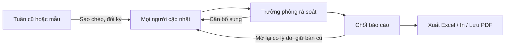
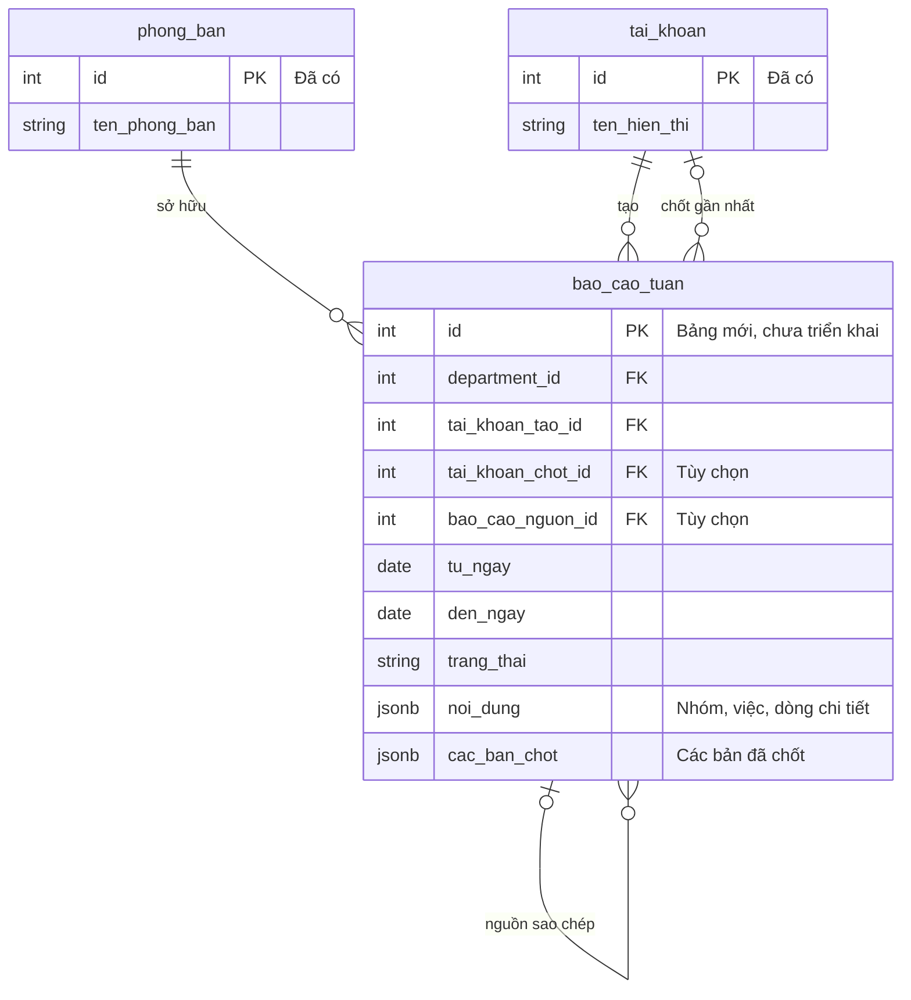

# Kế hoạch báo cáo công việc tuần dùng chung

Cập nhật: **11/11/2026**. **Đã lập plan theo yêu cầu; chưa triển khai giao diện, schema, migration hoặc cấp quyền.** Việc duyệt lập plan không đồng nghĩa duyệt triển khai. Rule nghiệp vụ tại [WEEKLY-REPORT-RULES](../../.agents/rules/WEEKLY-REPORT-RULES.md).

Đọc nhanh: [A. Tổng quan để duyệt](#a-tổng-quan-để-duyệt) · [Điểm cần xác nhận](#điểm-cần-xác-nhận) · [B. Chi tiết triển khai](#b-chi-tiết-triển-khai) · [DB](#thiết-kế-db-cần-giữ) · [Checklist](#checklist-triển-khai).

Người phụ trách có thể đọc phần A trước; agent phải đọc cả A, B và rule phân hệ theo [chuẩn lập plan](README.md#quy-chuẩn-lập-và-cập-nhật-plan). Phần B là nơi quản lý chi tiết, A chỉ tóm tắt để duyệt.

## A. Tổng quan để duyệt

### Mục tiêu và phạm vi

Thay việc chuyền file Excel bằng **một báo cáo chung trên web cho mỗi phòng/kỳ**, trước mắt dùng thử tại HCNS. Mọi người thao tác trực tiếp như bảng; trưởng phòng cập nhật cuối cùng và in gửi lãnh đạo.

**Hướng đã thống nhất:** sao chép tuần cũ giữ hạn năm; thêm nhóm/công việc/dòng bằng nút; lưu nội dung JSONB trong PostgreSQL và dùng nhật ký hiện có. Quyền chi tiết, kỳ tuần và mẫu in còn cần xác nhận.

| Có trong bản đầu | Để sau |
| --- | --- |
| Báo cáo chung của phòng, pilot HCNS; tạo từ mẫu hoặc kỳ cũ | Công việc có vòng đời xuyên tuần, KPI cá nhân, giao việc theo dòng |
| Giữ hạn năm và nội dung khi sao chép, sửa thủ công phần cần đổi | Tự sinh theo cron, tự chuyển việc quá hạn, nhắc hạn/email |
| Sửa ô, nhiều dòng, copy/paste giá trị, thêm/xóa/di chuyển nhóm và dòng | Công thức, macro, sheet tự do, gộp/tách ô tùy ý, nhập lại mọi file Excel |
| Tự lưu, kiểm tra xung đột, lịch sử; rà soát/chốt/mở lại | Đồng bộ con trỏ và gõ từng ký tự như Google Sheets, chỉnh offline |
| Xuất XLSX, giao diện in/lưu PDF từ bản chốt | Duyệt nhiều cấp, tự gửi email/lãnh đạo, tích hợp 1Office |

### Luồng sử dụng

Rà soát chỉ cho người chốt sửa là **phương án cần xác nhận**; [bảng chuyển trạng thái](#luồng-và-giao-diện-dự-kiến) và [ma trận quyền](#quyền-và-phạm-vi) ở phần B quy định chi tiết.

### Người dùng sẽ thao tác thế nào?

| Nhu cầu | Giao diện dự kiến |
| --- | --- |
| Lấy tuần cũ làm nền | Chọn nguồn, chọn kỳ mới, xem trước, tạo |
| Thêm hạng mục | Nút **+ Nhóm / + Công việc / + Dòng chi tiết** |
| Nhập như Excel | Sửa ô, Tab/Enter, nhiều dòng, copy/paste vùng giá trị |
| Sắp xếp lại bảng | Chèn, nhân bản, di chuyển, xóa dòng có xác nhận |
| Biết nội dung đã lưu chưa | Đang lưu / Đã lưu / Lưu lỗi / Có xung đột |
| Xem ai đã sửa | Mở lịch sử, so sánh nội dung trước–sau |
| Tổng hợp gửi lãnh đạo | Rà soát, chốt, chọn bản chốt để xuất/in |

Ba phần của mẫu được giữ: **Đã thực hiện – Kiến nghị – Kế hoạch tuần tới**. Các cột cố định; nhóm và số dòng linh hoạt. Chi tiết thao tác tại [Bảng làm việc](#bảng-làm-việc).

### Mô hình DB nhìn nhanh

**Dự kiến thêm một bảng `bao_cao_tuan`**, dùng lại phòng ban, tài khoản và nhật ký. Toàn bộ dữ liệu nằm trong PostgreSQL; JSONB là kiểu cột chứa chi tiết bảng, không phải cơ sở dữ liệu khác.

`||` = đúng một, `o|` = không hoặc một, `o{` = không hoặc nhiều. Sơ đồ bỏ bớt cột; các FK phải cùng công ty. Nhật ký dùng lại `nhat_ky_hoat_dong`, tra bằng công ty + phân hệ + ID báo cáo, **không có FK trực tiếp từ nhật ký tới báo cáo**. Xem [thiết kế DB](#thiết-kế-db-cần-giữ).

| Dữ liệu | Nơi lưu |
| --- | --- |
| Phòng, kỳ, trạng thái, người tạo/chốt | Các cột thông thường của báo cáo |
| Nhóm, công việc, dòng và nội dung từng ô | Cột `noi_dung` JSONB |
| Nội dung cố định mỗi lần chốt | Cột `cac_ban_chot` JSONB |
| Ai sửa, lúc nào, trước–sau | Bảng nhật ký hiện có |

### Điểm cần xác nhận

Đây là các quyết định chưa chốt; không được coi yêu cầu chuẩn hóa tài liệu là duyệt các phương án này.

| Nội dung | Phương án / câu hỏi cần chốt | Trạng thái |
| --- | --- | --- |
| Kỳ tuần | Thứ Hai–thứ Sáu như mẫu hay đến Chủ nhật; có kỳ ngoại lệ/chồng lấn không? Ngày theo Asia/Ho_Chi_Minh | Chờ xác nhận |
| Phạm vi người dùng | Ai cập nhật, ai chốt; có người ngoài phòng hoặc ủy quyền không? Xem [ma trận](#quyền-và-phạm-vi) | Chờ xác nhận |
| Rà soát và mở lại | Khi rà soát chỉ người chốt sửa; mở lại bắt buộc lý do | Đề xuất |
| Bản in | Khổ/hướng giấy, cỡ chữ, có in Người thực hiện không; lưu PDF trình duyệt hay tải tự động? | Chờ mẫu in thử |
| Dữ liệu nguồn | Rà năm `20225` ở C18 và đánh số nhóm; giữ nguyên khi chưa xác nhận sửa; không đoán người theo tên viết ngắn | Chờ rà soát |
| Quy mô vận hành | Số dòng/dung lượng, số bản chốt cần lưu và tốc độ cập nhật giữa nhiều người | Chờ đo mẫu và thử tải |

### Tiến độ và điều kiện nghiệm thu

| Mốc | Hiện tại | Chi tiết |
| --- | --- | --- |
| Khảo sát mẫu và lập thiết kế | Đã làm; chưa kiểm chứng bản in | [Căn cứ](#căn-cứ-và-trạng-thái-thiết-kế) |
| Xác nhận các lựa chọn còn lại | Chưa xong | [Điểm cần xác nhận](#điểm-cần-xác-nhận) |
| Bảng nhập và mẫu xuất thử | Chưa triển khai | [Checklist](#checklist-triển-khai) |
| DB, quyền, lịch sử và chức năng | Chưa triển khai | [Checklist](#checklist-triển-khai) |
| Kiểm thử và pilot HCNS | Chưa thực hiện | [Kiểm chứng hiện tại](#kiểm-chứng-hiện-tại) |

Chỉ nghiệm thu khi sao chép giữ đúng hạn năm, thao tác bảng không mất cập nhật, lịch sử truy đủ thay đổi, bản chốt cũ giữ nguyên và bản xuất/in đủ nội dung; quyền được kiểm chứng và trưởng phòng xác nhận pilot. [Các ca kiểm tra](#kiểm-chứng-và-pilot) cụ thể ở B.

## B. Chi tiết triển khai

### Căn cứ và trạng thái thiết kế

- [x] Đọc mẫu `docs/bao-cao/BC tuan P.HCNS (26.10-30.10.2026).xlsx` ngày 09/11 bằng `xlsx` có sẵn, theo chấp thuận của người dùng. Một sheet `Sheet1`, vùng khai báo A2:O50, nội dung A:H, 41 vùng gộp, không có công thức; chưa render kiểm chứng bản in.
- [x] Xác định ba phần và nhóm Nhân sự/Hành chính; một công việc có nhiều dòng chi tiết, kiến nghị đang trống; cột H Người thực hiện đang ẩn và chứa tên viết ngắn/nhiều người.
- [x] Ghi nhận hướng đã thống nhất ở A; đăng ký rule/plan trong router và tổng quan, chuyển đầu mối theo dõi từ HR sang plan này.
- [x] Áp dụng bố cục A/B, sơ đồ luồng và ERD rút gọn theo chuẩn lập plan; giữ nội dung thiết kế, không tự duyệt các lựa chọn còn mở hoặc triển khai mã/DB.

### Luồng và giao diện dự kiến

Đường dẫn đề xuất `/weekly-reports` và `/weekly-reports/[id]`; chưa tạo route. Danh sách lọc phòng, kỳ, trạng thái; không hiện ID hoặc revision kỹ thuật.

**Tạo từ nguồn:** chọn mẫu hoặc báo cáo cùng phòng có quyền đọc, chọn kỳ đích và xem trước. Sao chép nhất quán một revision nguồn; chỉ đổi kỳ tiêu đề, giữ thời gian công việc/hạn năm, kết quả, ghi chú và kế hoạch. Không tự chuyển kế hoạch thành kết quả, không mang lịch sử/bản chốt/trạng thái khóa sang báo cáo mới. Kỳ đích bắt đầu ở `DANG_CAP_NHAT`.

| Trạng thái / chuyển đổi | Ai được sửa hoặc thực hiện | Kết quả |
| --- | --- | --- |
| `DANG_CAP_NHAT` | Người có quyền cập nhật trong phạm vi phòng | Sửa chung toàn bảng; người thực hiện ghi trên dòng không quyết định quyền |
| Cập nhật → `DANG_RA_SOAT` | Người có quyền chốt trong phạm vi | Người cập nhật thông thường chuyển sang chỉ đọc |
| `DANG_RA_SOAT` | Người có quyền chốt trong phạm vi | Sửa cuối; có thể trả về cập nhật |
| Rà soát → `DA_CHOT` | Người có quyền chốt trong phạm vi | Thêm snapshot bất biến, báo cáo chỉ đọc |
| Rà soát → Cập nhật | Người có quyền chốt trong phạm vi | Mở cộng tác tiếp |
| Đã chốt → Cập nhật | Người có quyền chốt, nhập lý do mở lại | Giữ mọi snapshot cũ; lần chốt sau thêm bản mới |

Luồng rà soát/mở lại còn ở trạng thái đề xuất theo [A](#điểm-cần-xác-nhận). Mọi chuyển đổi kiểm tra và ghi lịch sử ở server. Không có xóa toàn báo cáo trong bản đầu; xóa nhóm/dòng vẫn có lịch sử.

#### Bảng làm việc

| Thành phần | Hợp đồng dự kiến |
| --- | --- |
| Nhóm và cấu trúc | Nhóm mặc định Nhân sự/Hành chính; cho thêm/đổi tên/di chuyển. Cột cố định, gộp ô theo nhóm/công việc/dòng. STT tính theo thứ tự, không là ID |
| Thanh công cụ | Thêm nhóm/công việc/dòng chi tiết, lịch sử, xem trước in, xuất Excel; rà soát/chốt/mở lại theo quyền |
| Menu dòng | Chèn trên/dưới, nhân bản, di chuyển, xóa có xác nhận; xóa nhóm nêu số việc/dòng bị ảnh hưởng |
| Đã thực hiện | STT, nội dung, thời gian, kết quả, lý do chưa hoàn thành, biện pháp khắc phục, ghi chú, người thực hiện |
| Kế hoạch | STT, nội dung, thời gian, yêu cầu kết quả, ghi chú, người thực hiện |
| Kiến nghị | Nhiều đoạn/dòng, có revision riêng |
| Bàn phím | Click sửa; Tab/Shift+Tab chuyển ô; Enter xác nhận, Shift+Enter xuống dòng; không lưu giữa lúc IME ghép dấu tiếng Việt |
| Dán vùng | Giá trị nhiều ô, xem trước lỗi và xác nhận khi vượt số dòng; không thực thi công thức/HTML, không nhập định dạng/macro; batch nguyên tử có lịch sử từng ô |
| Bố cục | Giữ tiêu đề khi cuộn; chỉnh rộng cột có giới hạn và audit khi đổi bố cục chung; mobile cuộn trong vùng bảng, ô nhập mở rộng cho đoạn dài |
| Lưu/lỗi | Đang lưu/đã lưu/lỗi/xung đột; giữ nội dung chưa lưu trong phiên, cảnh báo rời trang; không hứa khôi phục sau đóng trình duyệt/mất máy, không mặc định dùng localStorage |
| Hoàn tác | Phần chưa lưu tác động bản nháp trình duyệt; phần đã lưu tạo mutation mới có kiểm tra xung đột và audit, không xóa lịch sử |

### Thiết kế DB cần giữ

#### Một bảng nghiệp vụ mới: `bao_cao_tuan`

Tên/cột dưới đây là thiết kế dự kiến, chưa có trong Prisma/DB. PostgreSQL lưu metadata và nội dung JSONB cùng bản ghi; SQL/Prisma truy vấn, liên kết, transaction và khóa. JSONB không thay thế cơ sở dữ liệu.

| Trường dự kiến | Kiểu / mục đích |
| --- | --- |
| `id`, `company_id`, `department_id` | PK và FK cùng công ty; phòng sở hữu báo cáo |
| `tieu_de`, `tu_ngay`, `den_ngay` | Tiêu đề, kỳ báo cáo dạng Date; tách hoàn toàn khỏi thời gian từng việc |
| `trang_thai`, `phien_ban` | Trạng thái nghiệp vụ và revision tăng sau mỗi mutation |
| `bao_cao_nguon_id`, `phien_ban_nguon` | Báo cáo và revision được sao chép, nullable khi tạo từ mẫu |
| `tai_khoan_tao_id`, `tai_khoan_chot_id`, `thoi_diem_chot` | Actor tạo/chốt gần nhất và thời điểm; nguồn danh tính từ session |
| `phien_ban_cau_truc`, `noi_dung` | Phiên bản cấu trúc và JSONB nội dung đang làm việc |
| `cac_ban_chot` | JSONB danh sách snapshot chỉ thêm; ban đầu rỗng |
| `created_at`, `updated_at` | Thời điểm kỹ thuật |

- FK phòng/tài khoản/báo cáo nguồn cùng công ty; Restrict để không mất liên kết. Nguồn sao chép bản đầu phải cùng phòng. Không đổi phòng sở hữu sau tạo.
- Unique dự kiến `(company_id, department_id, tu_ngay, den_ngay)` để không tạo hai báo cáo cùng kỳ. Kiểm tra `tu_ngay <= den_ngay`; quy ước kỳ tuần và xử lý kỳ chồng lấn cần chốt trước migration. Index danh sách theo công ty/phòng/kỳ; chưa cần GIN trên toàn JSON nếu chỉ mở nội dung theo ID.
- JSON có ba phần, nhóm → công việc → dòng chi tiết; ID ổn định trong phạm vi báo cáo, thứ tự tách khỏi ID; dòng có revision. Phần kiến nghị và bố cục cũng có revision. Nhân bản dòng tạo ID mới; sao chép sang báo cáo khác có thể giữ ID cục bộ vì khóa truy vết luôn kèm ID báo cáo.
- Thời gian công việc giữ dạng text ở bản đầu để bảo toàn hạn năm/khoảng thời gian không đồng nhất. Không suy quá hạn hay tự sửa dữ liệu năm sai. Người thực hiện giữ text như nguồn; chưa dùng làm FK hay tự gán tài khoản từ tên viết ngắn.
- Server kiểm tra cấu trúc JSON theo version: trường cho phép, ID duy nhất, quan hệ cha/con, thứ tự hợp lệ, loại giá trị, giới hạn dung lượng/số dòng/độ dài ô. Chốt giới hạn sau đo mẫu và stress test; không âm thầm cắt nội dung.
- Snapshot chứa nội dung, kỳ, tên phòng/công ty và nhãn người chốt tại thời điểm đó, cấu hình xuất/in, version mẫu xuất, số lần chốt, revision nguồn và thời gian. Không đọc tên/bố cục hiện hành để dựng lại một bản chốt cũ.
- Mở lại không xóa snapshot. Thiết kế trigger chỉ cho nối thêm `cac_ban_chot`, chặn sửa/xóa snapshot cũ và sửa nội dung khi còn trạng thái đã chốt; mutation chốt/mở lại phải đi đúng chuyển trạng thái. Không cho xóa vật lý báo cáo qua ứng dụng.
- Với quy mô báo cáo phòng ban, một hàng JSONB + mảng snapshot là lựa chọn ban đầu. Đo dung lượng và chi phí rewrite khi nhiều bản chốt; nếu vượt ngưỡng vận hành sẽ đề xuất bảng phiên bản riêng, không tự mở rộng trong lần này.

#### Sửa đồng thời và chống gửi lặp

- Client gửi operation có `ma_thao_tac` duy nhất, report ID, target ID, revision phần bị sửa và thay đổi dự kiến; không gửi toàn bộ JSON để ghi đè.
- Transaction theo thứ tự khóa tương thích hệ thống: công ty → khóa phân quyền dùng chung → hàng báo cáo. Đọc lại quyền/phạm vi/trạng thái và JSON mới nhất trong khóa; áp operation vào bản mới nhất, tăng revision và ghi audit.
- Bản đầu kiểm tra revision theo dòng: hai dòng khác nhau cùng lưu được; hai ô cùng dòng có thể xung đột. Thêm/xóa/di chuyển dùng revision cấu trúc nhóm/cha; đổi metadata dùng revision tương ứng. Việc xóa đồng thời với sửa, di chuyển sau xóa phải bị phát hiện.
- Chốt/chuyển trạng thái yêu cầu revision toàn báo cáo mà người chốt đã xem và mọi lưu cục bộ đã hoàn tất. Nếu có người vừa cập nhật thì yêu cầu rà soát bản mới, không chốt mù.
- Khi xung đột, trả nội dung hiện hành và giữ bản người dùng đang nhập để so sánh/thử lại; không tự chọn người ghi sau. Đồng bộ bằng đọc lại định kỳ/khi focus, giữ vùng đang sửa; không cần WebSocket trong bản đầu.
- Retry sau timeout phải dùng lại `ma_thao_tac`; truy nhật ký xác định đã commit thì trả kết quả đã lưu, không thêm dòng/audit lần hai. Dự kiến unique index biểu thức cho nhật ký phân hệ theo `(company_id, doi_tuong_id, ma_thao_tac)` lấy từ JSON audit. Kiểm tra chính sách retry sau khi thu hồi quyền, không trả dữ liệu nếu actor không còn quyền xem.

#### Nhật ký dùng chung

- Tái sử dụng `nhat_ky_hoat_dong`, phân hệ dự kiến `WEEKLY_REPORT`; không thêm bảng lịch sử riêng. `doi_tuong_id` là ID báo cáo; payload chứa operation ID, revision trước/sau, nhóm/việc/dòng/trường, giá trị cũ/mới và lý do nếu có.
- Thêm/xóa giữ đủ nội dung và vị trí để truy vết/hoàn tác; dán nhiều ô ghi một sự kiện có danh sách đầy đủ thay đổi, không chỉ ghi “đã cập nhật”. Chỉ lưu giá trị đổi thật, no-op không tạo lịch sử thành công giả.
- Ghi cả tạo/sao chép, sửa nội dung/bố cục, xóa dòng, chuyển trạng thái, chốt/mở lại và hoàn tác. Danh tính/timestamp do server xác định; lịch sử chỉ thêm, không xóa theo thời hạn dọn log chung của báo cáo khác.
- Bổ sung index tra lịch sử theo công ty/phân hệ/báo cáo/thời gian và bảo vệ UPDATE/DELETE cho sự kiện báo cáo bằng migration phù hợp. Rà cascade khi xóa công ty để không tạo lối xóa lịch sử ngoài ý muốn; không thay chính sách audit các phân hệ khác nếu chưa đánh giá.
- Lưu nội dung, snapshot và audit trong cùng transaction. Không dùng `logActivity` nuốt lỗi cho mutation bắt buộc lưu lịch sử.

### Quyền và phạm vi

**Phương án cần xác nhận trước triển khai.** Tận dụng RBAC, không thêm JSON quyền lên role hoặc bảng phân quyền riêng. Mã quyền dưới đây là đề xuất, chưa đưa vào catalog/seed; không tự cấp cho ADMIN/HCNS hay theo chức danh.

| Quyền dự kiến | Hành động | Phạm vi đề xuất bản đầu |
| --- | --- | --- |
| `WEEKLY_REPORT VIEW` | Xem báo cáo, lịch sử liên quan và xuất nháp có nhãn | Phòng của nhân sự ACTIVE gắn tài khoản hoặc phòng người đó phụ trách |
| `WEEKLY_REPORT CREATE` + VIEW | Tạo/sao chép kỳ | Cùng phạm vi phòng; nguồn cũng phải có quyền đọc |
| `WEEKLY_REPORT UPDATE` + VIEW | Sửa chung, thêm/xóa/di chuyển | Cùng phạm vi phòng, chỉ khi đang cập nhật |
| `WEEKLY_REPORT FINALIZE` + VIEW | Rà soát, sửa cuối, chốt, trả lại, mở lại có lý do | Phòng người đó được xác định là người phụ trách; quyền này độc lập UPDATE |
| `WEEKLY_REPORT VIEW_ALL` | Xem/xuất các bản đã chốt trong công ty | Lãnh đạo được cấp rõ; không xem nháp/lịch sử nội bộ chỉ bằng quyền này |

- Chức danh/head chỉ là quan hệ phạm vi, không tự cấp quyền. Một tài khoản cần đủ các grant; không cộng quyền các tài khoản cùng người.
- Phạm vi báo cáo kiểm tra riêng trong phân hệ; không coi scope phòng ban tổng quát đã triển khai. Nếu cần người rà soát thay trưởng phòng/người ngoài phòng cập nhật, phải chốt cơ chế ủy quyền rõ trước khi mở rộng mô hình.
- Người không gắn nhân sự không tự có phạm vi phòng; có thể xem bản chốt nếu có VIEW_ALL. ROLES MANAGE cấu hình quyền tại `/roles`, không mặc nhiên đọc báo cáo.
- Lịch sử trong trang báo cáo dùng quyền xem và phạm vi báo cáo; trang audit toàn hệ thống vẫn cần AUDIT VIEW. API lịch sử chỉ trả sự kiện của báo cáo được phép, không lộ log phân hệ khác.
- Trạng thái, nghỉ việc, chuyển phòng, thay head hoặc thu hồi quyền được kiểm tra lại khi đọc/ghi/xuất. Snapshot cũ không tự cấp quyền truy cập hiện tại.

### Xuất Excel, in và PDF

- Xuất theo ba phần của mẫu, giữ nhóm, nhiều dòng chi tiết, xuống dòng và các cột nghiệp vụ. Dữ liệu text bắt đầu bằng ký tự công thức phải xuất dưới dạng text; không tạo công thức từ nội dung người dùng.
- Xem trước bản in, lặp tiêu đề bảng, không cắt chữ/viền hoặc tách dòng khó đọc; xử lý công việc có nội dung dài hơn một trang. Không cam kết giữ nguyên từng pixel của mẫu trước thử xuất.
- Bản đã chốt xuất theo snapshot được chọn, có kỳ và số bản chốt để phân biệt. Bản đang làm việc có nhãn NHÁP; không dùng nội dung đang sửa để xuất thay bản chốt cũ.
- Bản đầu dự kiến giao diện in để in giấy/lưu PDF bằng trình duyệt. Nút tải PDF tự động cần đánh giá renderer riêng nếu có yêu cầu; không coi đó là chức năng đã có.
- Cột Người thực hiện hiển thị trên web; ẩn/hiện khi xuất theo lựa chọn đã xác nhận và được lưu trong snapshot. Nội dung cột không bị xóa chỉ vì ẩn.
- Export kiểm tra quyền, công ty, phạm vi và version như đọc báo cáo; không đặt file nội bộ trong public hoặc cache công khai. File nguồn/export và ảnh kiểm chứng chỉ ở `outputs/` hoặc kho riêng khi triển khai, không đưa Git.

### Checklist triển khai

Các quyết định còn mở được quản lý tại [Điểm cần xác nhận](#điểm-cần-xác-nhận); không thực hiện phần phụ thuộc trước khi được chốt. Checklist dưới đây chỉ triển khai khi có yêu cầu thực hiện chức năng.

#### Khảo sát giao diện và chọn công cụ

- [ ] Sau yêu cầu triển khai: đọc guide Next.js cục bộ; dựng thử bảng với đúng nội dung dài/ô gộp của mẫu, copy/paste, bàn phím và mobile.
- [ ] Đánh giá bảng hiện có và thư viện grid chuyên dụng theo tính năng, giấy phép, React hiện hành, theme và khả năng truy cập. Không mặc định `xlsx` là UI bảng tính; chưa chọn/cài thư viện mới trong plan.
- [ ] Thử xuất XLSX và in PDF trên mẫu; đối chiếu nội dung, chữ dài, ngắt trang. Chọn công cụ xuất dựa trên kết quả; `xlsx` đang có chưa được xác nhận đủ định dạng in.

#### Dữ liệu và server

- [ ] Chốt schema/JSON version/giới hạn/snapshot/idempotency; cập nhật từ điển DB khi triển khai thật.
- [ ] Tạo migration cộng thêm bảng/ràng buộc/index/trigger và quyền; backup, thử DB tạm, kiểm tra phục hồi và dữ liệu các phân hệ khác. Không seed nội dung/quyền vận hành tự động.
- [ ] Viết actions đọc/tạo/sao chép/patch/chuyển trạng thái/chốt/mở lại/hoàn tác, kiểm tra quyền và đồng thời; thêm lịch sử theo báo cáo.
- [ ] Đưa quyền vào catalog, validation và `/roles`; kiểm tra menu/action/export dùng cùng phạm vi, không nâng scoped grant thành ALL.

#### Giao diện và đầu ra

- [ ] Danh sách kỳ, tạo từ kỳ trước, bảng ba phần và nút nhóm/công việc/dòng chi tiết.
- [ ] Tự lưu theo ô/batch, hàng đợi thao tác của từng client, báo lỗi/thử lại/xung đột, cảnh báo rời trang.
- [ ] Lịch sử lọc theo người/thời gian/dòng và so sánh trước–sau; mở lại/hoàn tác có audit.
- [ ] Rà soát/chốt, chọn bản chốt cũ, xuất XLSX và in/lưu PDF, nhãn nháp rõ ràng.
- [ ] Tích hợp danh sách báo cáo cần cập nhật vào dashboard chỉ khi có nhu cầu được duyệt; không thêm số liệu/nhắc việc giả.

#### Kiểm chứng và pilot

- [ ] Kiểm tra quyền từng trạng thái, khác phòng/công ty, thiếu nhân sự, chuyển phòng/nghỉ việc/thay head/thu hồi quyền, lịch sử và export không rò dữ liệu.
- [ ] Kiểm tra hai người sửa khác dòng, cùng dòng, sửa-vs-xóa, di chuyển-vs-xóa, lưu-vs-chốt, mở lại-vs-xuất, tạo kỳ trùng, retry timeout không nhân đôi dữ liệu/audit.
- [ ] Giả lập audit lỗi phải rollback; snapshot/audit cũ bị chặn sửa/xóa; giữ snapshot qua nhiều lần mở lại/chốt.
- [ ] Sao chép không đổi hạn năm, không mang trạng thái khóa/lịch sử sang kỳ mới; nguồn thay đổi khi sao chép phải được xử lý nhất quán và ghi đúng revision.
- [ ] Đối chiếu từng giá trị và cấu trúc mẫu với bản web/XLSX/PDF; kiểm tra dấu tiếng Việt, ô nhiều dòng, paste lớn, nội dung dạng công thức, sáng/tối, desktop/mobile và bàn phím.
- [ ] Chạy kiểm tra TypeScript/lint/build và test phù hợp thay đổi; ghi kết quả thực tế tại đây. Kiểm thử ghi dùng DB tạm, không sửa dữ liệu vận hành.
- [ ] Pilot một kỳ HCNS với nhiều tài khoản; trưởng phòng xác nhận bản in và lịch sử trước nghiệm thu.

### Kiểm chứng hiện tại

Chỉ lập và rà soát tài liệu; chưa có kết quả kiểm thử chức năng. Không đổi mã ứng dụng, DB, dependencies, môi trường hoặc ba rule kỹ thuật chung trong lượt lập plan.

- [x] Sau chuẩn hóa: kiểm tra 74 liên kết/anchor trong router, tổng quan, plan và rule báo cáo; `git diff --check` đạt. Đối chiếu A–B–rule, giữ nguyên anchor DB và các lựa chọn chờ xác nhận; các chỉnh sửa có sẵn của phân hệ khác được giữ nguyên.
- [x] Rà soát nội dung hai sơ đồ Mermaid và kiểm tra khối Markdown. Chưa render trực quan vì môi trường hiện không có Mermaid renderer; không coi đây là kiểm thử chức năng.
