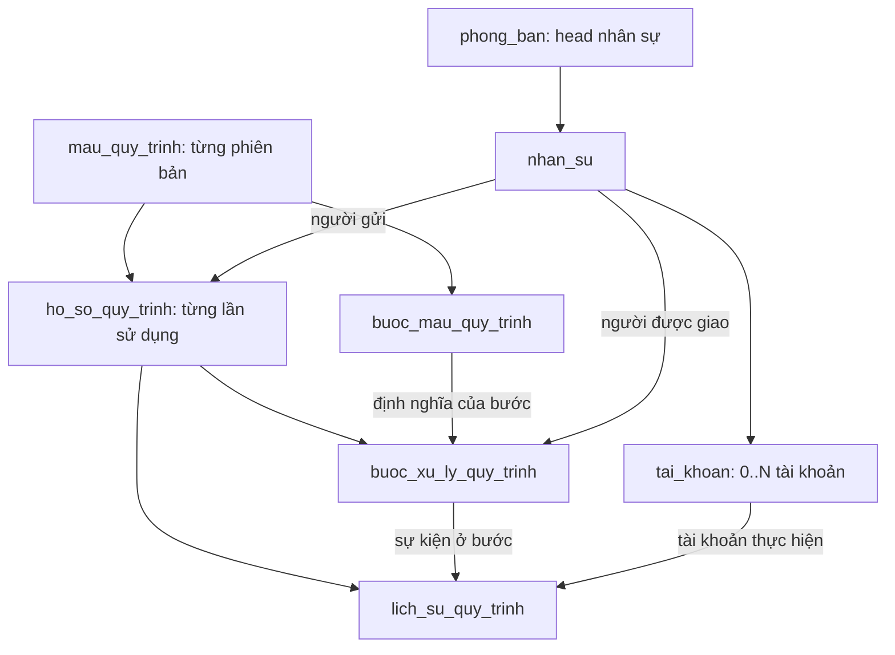

# Thiết kế workflow sơ khai và kế hoạch triển khai

Ngày lập: 02/11/2026. Cập nhật tên dữ liệu 03/11/2026: Prisma và PostgreSQL dùng chung tên tiếng Việt. **Trạng thái: đề xuất để người phụ trách xem xét; chưa tạo bảng, migration, quyền hay giao diện.**

## 1. Mục tiêu và nền tảng tái sử dụng

Có thể xây dựng dần từ dữ liệu hiện có. Dùng lại `cong_ty`, `phong_ban`, `nhan_su`, `tai_khoan` và bốn bảng RBAC. Nhân sự là người chịu trách nhiệm; tài khoản là danh tính đăng nhập thực hiện hành động. Không nhân bản danh sách người hay dùng text chức danh để suy quyền.

Schema hiện chưa có bảng quy trình; `phong_ban` chưa có head. Session hiện chỉ diễn giải VIEW/MANAGE và chưa thực thi quyền duyệt riêng. Vì vậy, thiết kế dưới đây gồm dữ liệu nghiệp vụ và phần quyền tối thiểu phải hoàn thiện cùng lúc.

Đề xuất thêm **5 bảng nghiệp vụ** và **1 cột nullable trên phòng ban** để hỗ trợ cả người cụ thể và head. Nếu triển khai đầy đủ, số bảng nghiệp vụ từ 9 thành 14; hiện DB vẫn giữ nguyên. Không cần hệ thống workflow bên ngoài, hàng đợi hay thư viện mới cho bản đầu. Server Actions dùng Prisma transaction trực tiếp theo kiến trúc hiện có.

## 2. Phạm vi bản đầu

- Mẫu gồm danh sách bước tuần tự, mỗi bước có một người xử lý.
- Hai loại bước: `APPROVAL` (duyệt/từ chối) và `TASK` (thực hiện, xác nhận hoàn tất).
- Hai cách chọn người: `SPECIFIC_EMPLOYEE` (chọn người cụ thể) và `REQUESTER_DEPARTMENT_HEAD` (head phòng người gửi).
- Người dùng chọn mẫu đang phát hành, nhập tiêu đề/nội dung, lưu nháp rồi gửi. Bản đầu không có form động hoặc upload tệp; bổ sung sau khi pilot xác nhận nhu cầu.
- Danh sách “Hồ sơ tôi gửi”, “Việc chờ tôi xử lý”, chi tiết các bước và lịch sử.
- Duyệt → bước tiếp theo; từ chối → kết thúc hồ sơ. Nếu cần sửa để gửi lại, tạo bản nháp mới liên kết hồ sơ cũ; không tái sử dụng các kết quả duyệt trước.
- Chưa có nhánh điều kiện, duyệt song song, biểu quyết, hạn mức tiền, ủy quyền theo thời gian, người theo dõi, gửi email, trình kéo–thả hoặc công việc độc lập ngoài quy trình.
- Không thay thế quy trình đang chạy trên 1Office. Pilot một luồng nội bộ được chọn, không tạo hai nơi phê duyệt chính thức cho cùng hồ sơ.

Ví dụ minh họa (không phải quy trình đã chốt của công ty): nhân viên gửi đề nghị hỗ trợ → head phòng xác nhận → nhân sự IT được chỉ định thực hiện → hoàn tất. Mỗi bước TASK là một việc cần làm trong quy trình; chưa cần bảng Task độc lập ở bản đầu.

## 3. Quan hệ tổng thể

Hai bảng bước không trùng dữ liệu: bước mẫu là hướng dẫn chung, bước xử lý là kết quả của một hồ sơ cụ thể. Một mẫu 3 bước dùng cho 10 hồ sơ có 3 bước mẫu và 30 bước xử lý.

## 4. Bổ sung vào dữ liệu có sẵn

| Bảng | Trường Prisma = cột PostgreSQL đề xuất | Kiểu | Ý nghĩa |
| --- | --- | --- | --- |
| phong_ban | dinh_danh_nguoi_phu_trach | Int? FK → nhan_su | Nhân sự phụ trách phòng; có thể để trống khi chưa xác nhận |

- FK kép `(dinh_danh_nguoi_phu_trach, dinh_danh_cong_ty)` → `nhan_su(dinh_danh, dinh_danh_cong_ty)`, `onDelete: Restrict`; thêm index cùng cặp. Cho phép một người phụ trách nhiều phòng, không đặt unique trên dinh_danh_nguoi_phu_trach. Người đó có thể công tác ở phòng khác nhưng phải cùng công ty và được xác nhận phân công.
- Không tự gán từ DEPT_HEAD, chức danh hoặc tên giám sát trong export. Select hiển thị họ tên + mã ERP + phòng công tác để phân biệt người trùng tên.
- Chọn head không tự cấp role/quyền hay tạo tài khoản. Head chưa có tài khoản đủ quyền vẫn lưu được ở cơ cấu; khi dùng làm người xử lý phải báo chưa đủ điều kiện.
- `tai_khoan` giữ nguyên quan hệ với nhan_su; chỉ cần thêm `@@unique([dinh_danh, dinh_danh_cong_ty])` khi triển khai để làm đích FK cùng công ty cho bảng mới. Đây không phải cột dữ liệu mới.
- Nếu chỉ làm chọn người cụ thể ở đợt đầu, có thể hoãn cột head và không bật lựa chọn head trên UI. Thiết kế mục 5 mô tả phương án hỗ trợ cả hai.

## 5. Các bảng và cột đề xuất

Quy ước: `?` = nullable; tên bảng/cột vật lý tiếng Việt không dấu; model/field Prisma trùng tên bảng/cột PostgreSQL, tiếng Việt không dấu snake_case. Tất cả 5 bảng có các cột chung sau (không lặp trong từng bảng):

| Trường Prisma = cột PostgreSQL | Kiểu / quy tắc |
| --- | --- |
| dinh_danh | Int, PK tự tăng |
| dinh_danh_cong_ty | Int, FK cong_ty; lấy từ session |
| thoi_diem_tao | DateTime, mặc định now() |
| thoi_diem_cap_nhat | DateTime, @updatedAt |

### 5.1. mau_quy_trinh

Một dòng là **một phiên bản mẫu**, ví dụ `HTNB` phiên bản 1. Không cần bảng phiên bản thứ sáu ở bản đầu.

| Trường Prisma = cột PostgreSQL | Kiểu | Nội dung |
| --- | --- | --- |
| ma | VarChar(50) | Mã mẫu, ổn định giữa các phiên bản |
| ten | VarChar(255) | Tên hiển thị |
| mo_ta | Text? | Hướng dẫn sử dụng |
| phien_ban | Int | Từ 1, tăng khi sửa mẫu đã phát hành |
| trang_thai | Enum | DRAFT / PUBLISHED / RETIRED |
| dinh_danh_tai_khoan_tao | Int FK tai_khoan | Người cấu hình mẫu |
| thoi_diem_phat_hanh | DateTime? | Thời điểm phát hành |

Unique `(dinh_danh_cong_ty, ma, phien_ban)`; check phien_ban > 0. Partial unique index `(dinh_danh_cong_ty, ma) WHERE trang_thai = 'PUBLISHED'` bảo đảm mỗi mã chỉ có một phiên bản được dùng để tạo hồ sơ mới. Index `(dinh_danh_cong_ty, trang_thai)`.

Mẫu DRAFT được sửa. Khi phát hành, tên/nội dung/các bước đóng băng; sửa phải sao chép sang phiên bản mới. Phát hành bản mới và chuyển bản cũ RETIRED trong cùng transaction. RETIRED chỉ ngừng nhận hồ sơ mới; hồ sơ đã gửi tiếp tục dùng đúng phiên bản cũ.

### 5.2. buoc_mau_quy_trinh

| Trường Prisma = cột PostgreSQL | Kiểu | Nội dung |
| --- | --- | --- |
| dinh_danh_mau | Int FK mau_quy_trinh | Thuộc đúng một phiên bản mẫu |
| thu_tu | Int | Thứ tự 1, 2, 3… |
| ten | VarChar(255) | Ví dụ “Xác nhận đề nghị” |
| huong_dan | Text? | Người xử lý cần làm gì |
| loai_buoc | Enum | APPROVAL / TASK |
| cach_chon_nguoi | Enum | SPECIFIC_EMPLOYEE / REQUESTER_DEPARTMENT_HEAD |
| dinh_danh_nguoi_chi_dinh | Int? FK nhan_su | Chỉ có giá trị khi chọn người cụ thể |

Unique `(dinh_danh_mau, thu_tu)`; check thu_tu > 0. CHECK bắt buộc dinh_danh_nguoi_chi_dinh có giá trị khi SPECIFIC_EMPLOYEE và null khi chọn head. Phát hành phải có ít nhất một bước, số thứ tự liên tục, không sửa bước của mẫu đã phát hành. Người được chỉ định phải cùng công ty.

Không lưu tên người vào đây để JOIN. Head chưa được ghi thành người cố định trong mẫu; đây là quy tắc xác định người tại thời điểm bước bắt đầu.

### 5.3. ho_so_quy_trinh

Một dòng là một đề nghị/hồ sơ thực tế sử dụng mẫu.

| Trường Prisma = cột PostgreSQL | Kiểu | Nội dung |
| --- | --- | --- |
| ma | VarChar(50) | Mã tự sinh, bất biến, ví dụ QT-000123 |
| dinh_danh_mau | Int FK mau_quy_trinh | Khóa vào đúng phiên bản mẫu |
| tieu_de | VarChar(255) | Tiêu đề hồ sơ |
| noi_dung | Text | Nội dung do người gửi nhập |
| dinh_danh_nguoi_gui | Int FK nhan_su | Người đề nghị, lấy từ tài khoản đang đăng nhập |
| dinh_danh_phong_nguoi_gui | Int FK phong_ban | Phòng của người gửi, chốt tại lúc gửi |
| dinh_danh_tai_khoan_tao | Int FK tai_khoan | Tài khoản tạo hồ sơ |
| trang_thai | Enum | DRAFT / IN_PROGRESS / COMPLETED / REJECTED / CANCELLED |
| thoi_diem_gui | DateTime? | Null khi nháp |
| thoi_diem_ket_thuc | DateTime? | Null khi chưa kết thúc |
| dinh_danh_ho_so_truoc | Int? FK ho_so_quy_trinh | Tùy chọn liên kết hồ sơ bị từ chối, khi lập lại |

Unique `(dinh_danh_cong_ty, ma)`; mã cấp bằng sequence phía DB, không MAX+1. Index `(dinh_danh_cong_ty, dinh_danh_nguoi_gui, trang_thai)` và `(dinh_danh_cong_ty, trang_thai, thoi_diem_tao)`.

Bản đầu người tạo phải có nhan_su ACTIVE và phòng ban hợp lệ; chưa hỗ trợ tạo thay người khác. Lưu nháp lấy phòng hiện tại; khi gửi kiểm tra và chốt lại phòng. Chuyển phòng nhân sự sau đó không đổi phòng nguồn của hồ sơ. Không sửa tiêu đề/nội dung/mẫu/người gửi sau khi gửi. Nháp đang trỏ mẫu RETIRED phải chuyển sang mẫu còn phát hành trước khi gửi.

Không thêm `currentStepId` để tránh hai nơi xác định bước hiện tại. Đọc từ bước xử lý có trạng thái PENDING hoặc BLOCKED; tối đa một bước như vậy trên mỗi hồ sơ ở bản tuần tự.

### 5.4. buoc_xu_ly_quy_trinh

| Trường Prisma = cột PostgreSQL | Kiểu | Nội dung |
| --- | --- | --- |
| dinh_danh_ho_so | Int FK ho_so_quy_trinh | Hồ sơ đang thực hiện |
| dinh_danh_mau | Int | Dùng trong FK kép/ba để bảo đảm bước và hồ sơ cùng mẫu |
| dinh_danh_buoc_mau | Int FK buoc_mau_quy_trinh | Định nghĩa bước bất biến |
| dinh_danh_nguoi_duoc_giao | Int? FK nhan_su | Chốt người khi bước bắt đầu; null khi chưa xác định |
| trang_thai | Enum | WAITING / PENDING / BLOCKED / APPROVED / REJECTED / COMPLETED / CANCELLED |
| thoi_diem_bat_dau | DateTime? | Bắt đầu chờ xử lý hoặc bị vướng phân công |
| thoi_diem_ket_thuc | DateTime? | Thời điểm kết thúc bước |
| ly_do_tam_dung | Text? | Ví dụ chưa có head hoặc tài khoản đủ quyền |

Unique `(dinh_danh_ho_so, dinh_danh_buoc_mau)`; index `(dinh_danh_cong_ty, dinh_danh_nguoi_duoc_giao, trang_thai)`. Partial unique index trên dinh_danh_ho_so khi trang_thai thuộc PENDING/BLOCKED ngăn có hai bước đang xử lý. PENDING phải có dinh_danh_nguoi_duoc_giao và thoi_diem_bat_dau; WAITING chưa có người/thời điểm bắt đầu.

Không lặp tên, thứ tự, hướng dẫn của bước: đọc qua dinh_danh_buoc_mau vì mẫu đã phát hành bất biến. dinh_danh_mau ở đây là khóa hỗ trợ ràng buộc, không phải một bản mô tả mẫu thứ hai.

Không đặt `approvedBy` trên bước để đại diện cho mọi hành động. Người thực sự duyệt/từ chối/hoàn tất và lời nhận xét được ghi ở lịch sử. Người được giao có thể khác người tạo hồ sơ; khi có chuyển giao, lịch sử giữ cả người cũ và mới.

### 5.5. lich_su_quy_trinh

| Trường Prisma = cột PostgreSQL | Kiểu | Nội dung |
| --- | --- | --- |
| dinh_danh_ho_so | Int FK ho_so_quy_trinh | Hồ sơ của sự kiện |
| dinh_danh_buoc_xu_ly | Int? FK buoc_xu_ly_quy_trinh | Null với sự kiện cấp hồ sơ |
| dinh_danh_tai_khoan_thao_tac | Int? FK tai_khoan | Tài khoản thực hiện; null chỉ cho sự kiện hệ thống |
| dinh_danh_nhan_su_thao_tac | Int? FK nhan_su | Người gắn tài khoản tại thời điểm hành động |
| ten_nguoi_thao_tac_luc_do | VarChar(255) | Tên lịch sử hoặc nhãn “Hệ thống” |
| hanh_dong | Enum | SUBMITTED / STEP_ASSIGNED / APPROVED / REJECTED / TASK_COMPLETED / REASSIGNED / BLOCKED / CANCELLED / FINISHED |
| y_kien | Text? | Nhận xét; bắt buộc lý do với từ chối/chuyển giao/hủy |
| chi_tiet | Json? | Trạng thái trước/sau, ID người cũ/mới và lý do xác định người |

Index `(dinh_danh_ho_so, thoi_diem_tao, dinh_danh)` và `(dinh_danh_cong_ty, dinh_danh_tai_khoan_thao_tac, thoi_diem_tao)`. Lịch sử chỉ thêm, không sửa/xóa; thoi_diem_cap_nhat bằng thoi_diem_tao khi tạo và không cập nhật sau đó. Hành động của người dùng lấy actor từ session server; sự kiện tự động có nhãn hệ thống và actor null. chi_tiet chỉ chứa dữ liệu lịch sử cần thiết, không dùng JSON làm nguồn FK hoặc cấu hình quyền.

Tên snapshot ở nhật ký là dữ liệu lịch sử có chủ đích, không thay bảng nhân sự. dinh_danh_nhan_su_thao_tac giữ bằng chứng người thao tác nếu sau này tài khoản được đổi liên kết; dinh_danh_tai_khoan_thao_tac phân biệt tài khoản thường/admin của cùng người.

nhat_ky_hoat_dong hiện có ghi thao tác quản trị mẫu/head. lich_su_quy_trinh phục vụ timeline nghiệp vụ, không sao chép toàn bộ mỗi sự kiện vào nhat_ky_hoat_dong trừ khi có yêu cầu kiểm toán riêng.

## 6. Ràng buộc liên kết và bảo toàn dữ liệu

- Mỗi bảng mới có unique `(dinh_danh, dinh_danh_cong_ty)` để làm đích FK cùng công ty. Tham chiếu cong_ty và người/phòng/tài khoản/mẫu phải kiểm tra công ty ở cả server và FK kép.
- `ho_so_quy_trinh` và `buoc_mau_quy_trinh` thêm unique `(dinh_danh, dinh_danh_mau, dinh_danh_cong_ty)`. buoc_xu_ly_quy_trinh dùng FK `(dinh_danh_ho_so, dinh_danh_mau, dinh_danh_cong_ty)` và `(dinh_danh_buoc_mau, dinh_danh_mau, dinh_danh_cong_ty)` đến hai bảng này để không ghép một bước mẫu khác vào hồ sơ.
- buoc_xu_ly_quy_trinh thêm unique `(dinh_danh, dinh_danh_ho_so, dinh_danh_cong_ty)`. History dùng FK `(dinh_danh_buoc_xu_ly, dinh_danh_ho_so, dinh_danh_cong_ty)` để một sự kiện không trỏ sang bước của hồ sơ khác. dinh_danh_ho_so_truoc cùng công ty, không cho tự trỏ chính mình.
- FK nghiệp vụ dùng `onDelete: Restrict`. Mẫu/người/tài khoản đã được dùng không xóa cứng qua workflow; dùng ngừng phát hành, nghỉ việc hoặc khóa tài khoản. Bản đầu cho phép hủy nháp thay cho xóa, giữ lịch sử đơn giản.
- Quy tắc nhiều hàng (mẫu đã phát hành bất biến, đủ bước, bước phù hợp loại, thứ tự chuyển) kiểm tra trong transaction; ghi rõ phần nào cần trigger khi soạn migration. Partial index/CHECK tạo bằng SQL migration và tài liệu hóa vì không thể hiện hết qua Prisma schema.
- Không thêm khóa/head/role dựa vào suy đoán từ dữ liệu nguồn. Gán người thực tế là bước cấu hình cần xác nhận trước pilot.

## 7. Quyền và người được phân công

Giữ bốn bảng vai_tro/quyen/vai_tro_quyen/tai_khoan_vai_tro. Đề xuất danh mục WORKFLOW riêng, không tái sử dụng ngầm TASK:APPROVE chưa được thực thi:

| quyen đề xuất | Phạm vi bản đầu |
| --- | --- |
| WORKFLOW:VIEW | Xem mẫu phát hành và hồ sơ mình gửi/được giao xử lý; không mở toàn công ty |
| WORKFLOW:CREATE | Tạo/sửa nháp và gửi hồ sơ của chính mình |
| WORKFLOW:EXECUTE | Hoàn tất bước TASK đang được giao cho mình |
| WORKFLOW:APPROVE | Duyệt/từ chối bước APPROVAL đang được giao cho mình |
| WORKFLOW:MANAGE | Quản lý mẫu, xem hồ sơ cùng công ty để điều phối, chuyển giao bước chưa kết thúc và hủy hồ sơ có lý do; không thay người khác duyệt |

Phải có VIEW cùng quyền thao tác tương ứng. Server kiểm tra quyền của **tài khoản đang đăng nhập** + nhan_su ACTIVE + đúng người được giao + đúng công ty + đúng trạng thái/bước. Không cộng quyền từ tài khoản khác cùng người; không tự cấp APPROVE khi chọn head hay từ mã ADMIN/IT_ADMIN. Quản trị kỹ thuật không gắn nhan_su có thể cấu hình mẫu nếu được cấp MANAGE, nhưng không gửi/duyệt/thực hiện thay người.

Hộp việc theo dinh_danh_nguoi_duoc_giao; một người có nhiều tài khoản chỉ thấy/nút xử lý theo quyền từng tài khoản. Chưa gửi thông báo ngoài ứng dụng nên không cần chọn một tài khoản nhận email. Người không có tài khoản không thể thực hiện trực tuyến; không tự tạo tài khoản.

Quyền hiện chỉ VIEW/MANAGE ở session phải được mở rộng để đọc quyền hành động cho WORKFLOW. Không sửa nghĩa của quyền HR/account hiện tại hoặc cấp quyền hàng loạt trong lúc xây schema. Khi triển khai phải cập nhật BACKEND-RULES phần ghi dữ liệu theo quyền chuyên biệt; hiện rule MANAGE chung chưa đủ.

Giới hạn bản đầu dựa trên quan hệ người gửi/người được giao, chưa dùng scope DEPARTMENT chung. Chưa cần thay cấu trúc vai_tro_quyen để có bộ máy scope tổng quát. Trang /roles hoàn chỉnh không phải điều kiện bắt buộc cho pilot, nhưng phải có ma trận cấp quyền thử nghiệm được chốt và kiểm tra server đầy đủ.

## 8. Luồng chạy và các trường hợp cần xử lý

1. **Cấu hình:** tạo mẫu DRAFT, xếp bước, chọn người hoặc quy tắc head. Phát hành kiểm tra đủ bước, người cụ thể đang làm việc và có ít nhất một tài khoản hoạt động đủ quyền cho bước.
2. **Gửi hồ sơ:** khóa hồ sơ nháp, xác minh chủ sở hữu, mẫu còn phát hành, chốt phòng nguồn. Kiểm tra trước khả năng tìm người cho các bước; nếu thiếu head, quyền/tài khoản hoặc bước APPROVAL tự duyệt thì báo để chỉnh cấu hình, chưa nhận gửi. Tạo các bước WAITING, chuyển hồ sơ IN_PROGRESS, kích hoạt bước đầu và ghi lịch sử trong một transaction.
3. **Kích hoạt bước:** đọc quy tắc của phiên bản mẫu. Người cụ thể lấy nhan_su đã chỉ định; head lấy từ phòng nguồn chốt ở hồ sơ. Chốt dinh_danh_nguoi_duoc_giao, ghi STEP_ASSIGNED và chuyển PENDING. Việc kiểm tra trước lúc gửi không đóng băng người của bước chưa bắt đầu.
4. **Dữ liệu thay đổi sau khi gửi:** nếu đến bước mà không còn người hợp lệ/tài khoản đủ quyền, bước thành BLOCKED, hồ sơ vẫn IN_PROGRESS. Không bỏ qua bước, tự phê duyệt hoặc tự đẩy lên phòng cha. MANAGE có thể chuyển giao cho người đủ điều kiện cùng công ty, có lý do; dùng cho cả PENDING/BLOCKED. Không tạo màn hình sửa kết quả đã duyệt.
5. **Xử lý:** APPROVAL nhận APPROVED/REJECTED; TASK nhận COMPLETED. Từ chối yêu cầu lý do, hồ sơ REJECTED và các bước còn lại CANCELLED. Duyệt/hoàn tất kích hoạt bước tiếp; hết bước thì hồ sơ COMPLETED. Trạng thái hoàn tất quy trình không tự tạo giao dịch thanh toán/mua hàng.
6. **Tự duyệt:** bản đầu chặn APPROVAL nếu dinh_danh_nguoi_duoc_giao = dinh_danh_nguoi_gui, dù đăng nhập tài khoản thứ hai. TASK tự thực hiện được phép. Với head cũng là người gửi, cần cấu hình người cụ thể khác hoặc chuyển giao có ghi nhận; không mặc định bỏ bước.
7. **Đổi head/chuyển phòng:** head mới chỉ ảnh hưởng bước chưa kích hoạt; bước PENDING giữ nguyên người đã giao. Phòng nguồn của hồ sơ không đổi khi nhân sự chuyển phòng. Nếu người đang xử lý nghỉ việc/mất quyền, thao tác bị chặn và cần chuyển giao; UI hiển thị tình trạng vướng từ dữ liệu hiện tại, không cần job nền để phát hiện.
8. **Hủy/lập lại:** chủ hồ sơ được hủy DRAFT; MANAGE có thể hủy hồ sơ IN_PROGRESS có lý do, hủy bước còn mở/chưa chạy. Hồ sơ đã kết thúc không sửa. Hồ sơ REJECTED có thể sao chép thành nháp mới với dinh_danh_ho_so_truoc, chọn mẫu còn phát hành và duyệt lại từ đầu.

Mọi hành động thay trạng thái khóa hàng hồ sơ trước, sau đó kiểm tra lại quyền/danh tính từ DB và trạng thái trong transaction. Cập nhật bước + hồ sơ + lịch sử cùng transaction; chỉ một hành động trên bước thắng khi bấm hai lần/hai tài khoản duyệt đồng thời. Không thực hiện gọi dịch vụ bên ngoài trong transaction. Đăng xuất/thu hồi quyền áp dụng ở lần xử lý tiếp theo theo cơ chế phiên hiện có.

## 9. Giao diện đề xuất

- **Mẫu quy trình:** danh sách mẫu; form tên/mô tả, danh sách bước có nút lên/xuống; select loại bước, cách chọn người, select nhân sự khi cần. Có trạng thái nháp/phát hành/ngừng dùng và phiên bản.
- **Tạo hồ sơ:** chọn mẫu, xem trước các bước/người dự kiến, nhập tiêu đề/nội dung, lưu nháp/gửi. Tên người dự kiến ở bước head có ghi chú có thể đổi trước khi bước bắt đầu.
- **Hồ sơ của tôi / Việc cần xử lý:** tiêu đề, người gửi, bước hiện tại, trạng thái. Chưa thêm bộ lọc phức tạp.
- **Chi tiết:** nội dung đã gửi, các bước và timeline; nút đúng loại bước và quyền. Nếu bị vướng phân công, nêu lý do và đầu mối điều phối.
- Không mở UI bảng nối RBAC cho người vận hành; phân quyền thao tác nằm trong luồng tài khoản/role.

## 10. Thứ tự triển khai đề xuất

- [x] Rà soát schema và session; xác định dữ liệu nền dùng lại và phần thiếu. Không truy cập 1Office.
- [x] Lập thiết kế 5 bảng, head tùy chọn, quan hệ FK, trạng thái, quyền, phiên bản và giới hạn MVP. Đây là bản thiết kế, không phải schema đã chạy.
- [x] Đăng ký plan trong AGENTS, dẫn chiếu từ kế hoạch role, kiến trúc và từ điển DB; kiểm tra liên kết cục bộ và diff.
- [ ] Chốt pilot, người quản trị mẫu, người được giao và ma trận quyền; xác nhận hai loại bước và cách chọn người của bản đầu.
- [ ] Thiết kế migration cộng thêm bảng/cột/constraint, backup và thử trên bản DB tạm; không reset bảng lõi hoặc gán head tự động.
- [ ] Triển khai kiểm tra quyền WORKFLOW tại server, head phòng ban nếu chọn hỗ trợ và cập nhật rule backend/DB.
- [ ] CRUD mẫu nháp, phát hành và tạo phiên bản mới; giao diện danh sách bước.
- [ ] Tạo/gửi hồ sơ, hộp việc, kích hoạt bước, duyệt/từ chối/hoàn tất/chuyển giao/hủy và timeline.
- [ ] Kiểm thử tiêu chí mục 11, đối chiếu dữ liệu lõi trước/sau, chạy một quy trình pilot rồi cập nhật trạng thái thực tế.

Không đặt ngày hoàn thành hoặc coi là đã được duyệt triển khai khi chưa chốt phạm vi.

## 11. Tiêu chí kiểm thử khi triển khai

| Tình huống | Kết quả cần đạt |
| --- | --- |
| Nhân sự có 0 tài khoản | Không tự tạo tài khoản; phát hiện không thể giao bước trực tuyến |
| Một người có 2 tài khoản | Quyền tách theo tài khoản; lịch sử ghi đúng tài khoản và người; không tự duyệt qua tài khoản thứ hai |
| Người có APPROVE nhưng không được giao | Không duyệt được; biết ID không mở quyền đọc hồ sơ |
| Người được giao mất quyền, bị khóa hoặc nghỉ việc | Request tiếp theo bị chặn; điều phối chuyển giao rõ ràng |
| Ghép người/phòng/mẫu/bước/hồ sơ khác công ty hoặc khác mẫu | FK và hanh_dong từ chối, không ghi một phần |
| Mẫu phát hành bị sửa / hai bản cùng mã phát hành đồng thời | Bản cũ bất biến; chỉ một phiên bản PUBLISHED |
| Sửa head trước/sau khi bước bắt đầu | Bước chưa bắt đầu lấy head mới; bước đã giao không âm thầm đổi người |
| Chuyển phòng người gửi | Hồ sơ đã gửi giữ phòng nguồn đã chốt |
| Head chưa khai báo hoặc mất người xử lý giữa luồng | Báo lỗi trước khi gửi hoặc BLOCKED khi đến bước; không duyệt tự động |
| Duyệt/từ chối/hoàn tất sai loại bước hoặc sai thứ tự | Bị chặn, bước sau chưa được mở |
| Bấm gửi/duyệt hai lần hoặc hai tài khoản cùng người cùng xử lý | Một kết quả được ghi; không nhân đôi bước hoặc lịch sử quyết định |
| Ghi lịch sử lỗi giữa transaction | Hồ sơ và bước rollback, không có kết quả thiếu lịch sử |
| Sửa payload hồ sơ đã gửi | Không được sửa nội dung bên dưới kết quả đã duyệt |
| Từ chối rồi lập lại | Hồ sơ mới liên kết cũ, chạy lại từ đầu; lịch sử cũ giữ nguyên |
| Hủy hồ sơ đang chạy cùng lúc người khác duyệt | Transaction tuần tự hóa, không còn bước mở trên hồ sơ đã hủy |

## 12. Hướng mở rộng sau pilot

- Head của phòng cụ thể/phòng cha: thêm cách chọn và dinh_danh_phong_ban nguồn ở bước mẫu, không suy từ role.
- Nhiều người cùng duyệt: thêm bảng phân công từng người cho một bước và quy tắc một người/tất cả; không nhét danh sách ID vào cột text.
- Tệp đính kèm: bảng tệp liên kết hồ sơ, quyền tải theo hồ sơ; lưu file ngoài DB. Chưa thiết kế nơi lưu trong bản này.
- Form nghiệp vụ có số tiền/chi tiết hàng hóa: thêm cấu trúc theo loại hồ sơ khi có mẫu thực tế; không tạo bảng động tùy ý ngay từ đầu.
- Sửa rồi gửi lại trên cùng hồ sơ, nhánh điều kiện, hạn xử lý/nhắc việc, bàn giao theo lịch: thiết kế thêm phiên xử lý/chính sách sau, không mở rộng enum và đường chuyển trạng thái tùy tiện.
- Công việc độc lập và tích hợp giao dịch tài sản/thanh toán là phạm vi riêng; không tự khôi phục module đang tạm hoãn.
