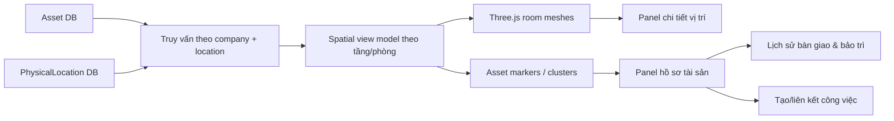

# Đánh giá mô hình 3D và khả năng tích hợp quản lý tài sản IT

**Ngày đánh giá:** 21/10/2026  
**Trạng thái:** Đề xuất kỹ thuật, chờ xác minh dữ liệu và duyệt triển khai  
**Phạm vi:** mô hình Three.js hiện tại, nhân sự, vị trí, tài sản, bảo trì và khả năng mở rộng

## 1. Kết luận

Mô hình 3D hiện tại **phù hợp để tiếp tục làm prototype tương tác**, đặc biệt cho việc chọn tầng, chọn phòng và mở panel dữ liệu. Nó chưa đủ làm Digital Twin quản lý tài sản chính thức vì hình học, phòng và liên kết phòng ban đều đang hard-code trong mã nguồn.

Bối cảnh vận hành đã được xác nhận là Sao Đỏ chưa có bộ khung quản lý tài sản chính thức, cách làm việc linh hoạt và nhu cầu kiểm soát hiện tại ở mức nhẹ. Ảnh BMHC 0501 chỉ là dữ liệu tạm để tham khảo, không phải chứng từ nguồn cần hoàn thiện. Mục tiêu của tính năng sau khi triển khai là quản lý từng tài sản, nhưng chỉ yêu cầu các trường tối thiểu và cho phép bổ sung dữ liệu dần. MVP không cần xử lý chống mất trộm, điều tra thất thoát, kiểm kê khắt khe, khấu hao kế toán hoặc phê duyệt nhiều tầng.

| Tiêu chí | Mức hiện tại | Nhận xét |
| :--- | :---: | :--- |
| Khả năng tích hợp dữ liệu | 7/10 | Có ID phòng và callback chọn phòng; cần chuyển sang `PhysicalLocation` trong DB |
| Khả năng mở rộng nghiệp vụ | 6/10 | Kiến trúc component rõ nhưng dữ liệu/phòng/mesh gắn cứng và có special-case |
| Hiệu năng ở quy mô hiện tại | 7/10 | 22 khối phòng nhẹ; vòng render vẫn chạy liên tục dù được mô tả là on-demand |
| Thẩm mỹ | 6/10 | Clean isometric, tương phản tốt; hình khối còn sơ lược và chưa có nhãn/legend đủ rõ |
| Dễ tương tác desktop | 7/10 | Có hover, click, zoom, xoay, preset, lọc tầng và exploded view |
| Dễ tương tác mobile/accessibility | 4/10 | Điều khiển dày, hướng dẫn thiên về chuột, selector phòng bị ẩn trên mobile, canvas chưa hỗ trợ bàn phím |
| Sẵn sàng quản lý tài sản thật | 4/10 | Schema vừa được tạo nhưng chưa áp dụng DB; chưa có marker, quyền, UI hoặc đối soát |

Nên giữ engine Three.js và trải nghiệm chọn phòng để thử nghiệm. Lớp dữ liệu, mapping vị trí, panel chi tiết và vòng render cần thiết kế lại trước khi đưa dữ liệu tài sản thực tế vào không gian 3D.

## 2. Dữ liệu tài sản nhận từ biên bản

| STT | Nhóm thiết bị | Số lượng |
| ---: | :--- | ---: |
| 1 | Máy tính lắp ráp | 33 |
| 2 | Laptop | 19 |
| 3 | Bộ phát Wifi | 10 |
| 4 | Tổng đài | 1 |
| 5 | Điện thoại bàn | 8 |
| 6 | Máy chủ Dell T360 | 1 |
| 7 | UPS online MHPRO 3000 | 1 |
| 8 | Cân bằng tải Ruijie NBR6205-E | 1 |
| 9 | Switch Cisco 24 Port 100/1000 | 1 |
| 10 | Máy in | 12 |
| 11 | Máy Scan | 3 |
|  | **Tổng** | **90** |

Người bàn giao hiển thị là Nguyễn Minh Dương, chức vụ IT. Ngày bàn giao và thông tin bên nhận đang để trống trên ảnh. Nguồn này chỉ dùng làm mẫu dữ liệu tham khảo và được lưu dưới dạng `DRAFT`; không cần hoàn thiện chính ảnh/biên bản này để đưa vào vận hành.

Ảnh chỉ cung cấp số lượng tham khảo theo nhóm và chưa đủ để tạo tài sản thật. Khi tính năng sẵn sàng, mỗi thiết bị thực tế sẽ có một hồ sơ `Asset` riêng với mã nội bộ, loại và tình trạng tối thiểu. Người sử dụng, vị trí, serial/service tag, hãng/model, bảo hành và lịch sử sửa chữa được bổ sung khi kiểm kê hoặc khi phát sinh nghiệp vụ; không cần đủ mọi trường ngay lần nhập đầu.

## 3. Thiết kế DB đã tạo

| Model | Vai trò |
| :--- | :--- |
| `AssetCategory` | Danh mục 11 nhóm thiết bị và các nhóm tương lai |
| `AssetInventoryDocument` | Thông tin biên bản/đợt kiểm kê |
| `AssetInventoryLine` | Số lượng từng dòng trên chứng từ; đối soát với tài sản cá thể |
| `Asset` | Một thiết bị đã có mã tài sản riêng |
| `PhysicalLocation` | Cây Tòa nhà → Tầng → Phòng → Khu vực → Rack/Kho và khóa `threeDKey` |
| `AssetAssignment` | Lịch sử bàn giao cho người, phòng ban hoặc dùng chung |
| `AssetLocationHistory` | Lịch sử chuyển vị trí có thời gian bắt đầu/kết thúc |
| `AssetMaintenance` | Kiểm tra, bảo trì định kỳ, sửa chữa, thay thế và nâng cấp |

`AssetInventoryLine` chỉ giữ số lượng tham khảo hoặc số liệu của một đợt kiểm kê. `Asset` mới là bản ghi vận hành của từng thiết bị, giữ snapshot vị trí/người/phòng ban hiện tại; lịch sử tương ứng là nguồn truy vết. Hai lớp của một tài sản phải được cập nhật trong một transaction.

Biên bản được seed riêng bằng `npm run db:seed:it-assets`. Seed chỉ tạo 11 danh mục và 11 dòng tổng hợp làm dữ liệu tham khảo. Không tự biến 90 đơn vị trong ảnh thành 90 tài sản thật; hồ sơ từng tài sản sẽ được nhập từ kết quả kiểm kê sau khi giao diện sẵn sàng.

Migration đã được sinh nhưng chưa áp dụng vì PostgreSQL tại `localhost:5432` không hoạt động trong lần thực hiện này.

## 4. Điểm mạnh của mô hình 3D hiện tại

1. **Khóa phòng ổn định ở mức prototype:** 22 không gian có `Room3D.id`, tầng, tâm và kích thước; có thể map bước đầu với `PhysicalLocation.threeDKey`.
2. **Luồng tương tác đã hoàn chỉnh:** OrbitControls, raycasting, hover, click, lọc tầng, exploded view và ba camera preset đã có.
3. **Component được tách tương đối rõ:** page tải dữ liệu server-side; wrapper giữ trạng thái; viewer quản lý Three.js; sheet hiển thị dữ liệu.
4. **Quy mô geometry nhẹ:** phòng là BoxGeometry đơn giản, không có shadow/post-processing nặng, pixel ratio được giới hạn 1.5.
5. **Có tenant scope ở page:** phòng ban và nhân sự được lọc theo `session.companyId`.
6. **Panel chi tiết có thể mở rộng:** cấu trúc Sheet hiện tại có thể chuyển thành tab Tổng quan, Nhân sự, Tài sản, Bảo trì và Công việc.

## 5. Hạn chế và ảnh hưởng

### 5.1 Dữ liệu và liên kết

- `BUILDING_ROOMS` nằm trong `office-3d-data.ts`; thay phòng hoặc đổi mặt bằng phải sửa code và build lại.
- Nhân sự được ghép bằng `Department.code`; phòng HCNS + Pháp chế phải xử lý special-case theo `room.id`.
- Viewer 3D chưa đọc `PhysicalLocation` vừa thiết kế, nên hiện vẫn chưa lưu/hiển thị lịch sử vị trí độc lập với mô hình hard-code.
- Hai phòng lãnh đạo cùng dùng `deptCode = BLD`, cho thấy phòng vật lý và phòng ban không có quan hệ 1–1.
- Không có version cho mặt bằng. Khi thay hình học, không thể biết tài sản từng nằm ở phiên bản không gian nào.

### 5.2 Hiệu năng và kỹ thuật Three.js

- Vòng `animate()` luôn gọi `requestAnimationFrame(animate)` và render mỗi frame. Biến `isAnimatingRef` không được đặt về `false`; đoạn “Idle” không dừng loop. Đây chưa phải on-demand rendering.
- Room được chọn có pulse liên tục, khiến renderer không thể nghỉ ngay cả khi sửa vòng loop.
- Mỗi `pointermove` tạo mới `Raycaster` và `Vector2`, đồng thời cập nhật React state vị trí chuột; cần tái sử dụng và throttle.
- Cleanup mới gọi `renderer.dispose()`; chưa dispose toàn bộ geometry/material, `controls`, và listener `change` ẩn danh.
- 90 marker đơn giản vẫn có thể chạy tốt, nhưng hàng trăm/hàng nghìn thiết bị cần `InstancedMesh`, LOD/clustering và tải theo tầng/phòng.

### 5.3 Thẩm mỹ

- Màu nền tối và khối isometric tạo cảm giác dashboard kỹ thuật rõ ràng.
- Khối phòng đặc giúp phân vùng nhanh nhưng chưa thể hiện tường, cửa, hành lang, bàn, tủ rack hay vị trí đặt thiết bị.
- Màu hiện đồng thời đại diện khu vực/phòng ban nhưng chưa có legend; khi thêm trạng thái tài sản sẽ dễ xung đột ý nghĩa màu.
- Nhiều màu `slate/red/sky/amber` và inline color đang nằm trực tiếp trong component, chưa tuân theo theme token chung của project.
- Nhãn phòng chỉ xuất hiện khi hover hoặc carousel; người dùng mới khó định hướng khi nhìn toàn cảnh.
- Badge “Live Data” chưa chính xác: dữ liệu là snapshot tải khi mở trang, không có subscription/realtime.

### 5.4 Tương tác và accessibility

- Desktop tương đối trực quan: click phòng, xoay/zoom và camera preset.
- Thanh điều khiển có thể che mô hình ở màn hình hẹp; carousel chọn phòng bị ẩn dưới breakpoint `md`.
- Hướng dẫn chỉ mô tả chuột; chưa có chỉ dẫn chạm hai ngón, reset camera rõ ràng hoặc chế độ khóa xoay.
- Canvas không thể được điều hướng bằng bàn phím và các phòng không có semantic control thay thế.
- Chưa có fallback khi WebGL lỗi, trạng thái loading, reduced motion hoặc giới hạn thiết bị yếu.
- Panel nhân sự có link hồ sơ chưa tồn tại; hiện đã được catch-all đưa tới trang “đang phát triển”.

## 6. Kiến trúc tích hợp đề xuất

Nguyên tắc chính:

- `PhysicalLocation.id` là khóa nghiệp vụ; `threeDKey` chỉ là adapter tới đối tượng hình học.
- Tài sản được gán vào phòng trước. Tọa độ X/Y/Z chỉ nhập khi đã đo hoặc người dùng đặt marker có chủ ý.
- Phòng, nhân sự và tài sản được truy vấn theo location; không suy tất cả nhân sự từ department.
- Click phòng hiển thị số lượng/tình trạng trước; click marker mới mở chi tiết từng thiết bị.
- Công việc/bảo trì phải liên kết `assetId` và `locationId`; không nhúng trạng thái task vào mesh.

## 7. Trải nghiệm đề xuất

Khi nhìn toàn tòa nhà, nên ưu tiên heatmap số lượng thiết bị và điểm báo hỏng/đang sửa; kèm bộ lọc tầng, loại tài sản và trạng thái. Bộ lọc phòng ban, người sử dụng và bảo trì định kỳ chỉ bổ sung khi dữ liệu thực tế đủ dùng. Legend phải tách ý nghĩa màu phòng khỏi màu trạng thái thiết bị.

Khi chọn phòng, panel nên có các tab:

- **Tổng quan:** tên phòng, bộ phận sử dụng, số nhân sự, số tài sản, việc đang mở.
- **Nhân sự:** người làm việc thực tế tại vị trí, không chỉ theo phòng ban hành chính.
- **Tài sản:** danh sách/marker, tình trạng, người giữ, lần bảo trì gần nhất.
- **Bảo trì:** lịch sử và lịch sắp tới.
- **Công việc:** việc gắn với phòng hoặc thiết bị; nút tạo việc chỉ hiện theo permission.

Khi chọn tài sản đã được quản lý riêng, hiển thị mã, tên/model, tình trạng, người dùng hoặc bộ phận, vị trí và lịch sử báo hỏng–sửa chữa. QR, serial chi tiết, timeline di chuyển và lịch bảo trì là thông tin mở rộng, chỉ triển khai khi có nhu cầu. Các hành động cập nhật vị trí, người dùng hoặc báo hỏng áp dụng quyền quản lý cơ bản.

## 8. Lộ trình khuyến nghị

1. **Asset registry 2D nhẹ:** xây giao diện tạo/import từng tài sản với mã, loại và tình trạng tối thiểu; ảnh BMHC 0501 chỉ dùng làm dữ liệu demo/tham khảo.
2. **Kiểm kê tăng dần:** nhập từng thiết bị thực tế, bổ sung vị trí/người dùng khi xác định được và theo dõi báo hỏng–kết quả sửa chữa; chưa bắt buộc QR hoặc đủ serial ngay từ đầu.
3. **Location mapping:** đưa 22 phòng hiện tại vào `PhysicalLocation`, map `threeDKey`, bỏ ghép bằng `Department.code`.
4. **3D room dashboard:** click phòng xem tổng hợp tài sản/tình trạng; đây là pilot có giá trị sớm và ít rủi ro.
5. **Asset markers:** thêm marker cho thiết bị quan trọng như server, UPS, switch, access point, máy in; chưa cần hiển thị mọi laptop/desktop ngay.
6. **Báo hỏng và xử lý:** tạo phiếu ngắn hoặc liên kết công việc, ghi người xử lý và kết quả; chỉ mở rộng thành work order đầy đủ khi khối lượng công việc đủ lớn.
7. **Nâng hình học:** chỉ chuyển sang glTF/CAD/BIM khi có bản vẽ chuẩn, người chịu trách nhiệm cập nhật và nhu cầu định vị chi tiết đã được chứng minh.

## 9. Dữ liệu cần IT bổ sung

- Danh sách kiểm kê thực tế mới dùng để tạo từng tài sản; không lấy 90 đơn vị trong ảnh làm dữ liệu đã chốt.
- Số lượng thực tế theo nhóm và số đang hoạt động, hỏng, đang sửa hoặc ngừng dùng.
- Vị trí hiện tại của các thiết bị hạ tầng quan trọng như server, UPS, load balancer, switch và access point.
- Người sử dụng máy tính/laptop chỉ bổ sung dần khi cần hỗ trợ, bàn giao hoặc hiển thị trên mô hình 3D.
- Mã tài sản, serial, IP/MAC chỉ thu thập cho thiết bị có nhu cầu quản lý kỹ thuật cụ thể; không phải trường bắt buộc cho toàn bộ danh mục.
- Lịch sử sửa chữa/bảo hành đang nằm ở file, hóa đơn hoặc nhà cung cấp nào.
- Bản vẽ mặt bằng mới nhất và quy ước tên phòng được HCNS/HC xác nhận.

## 10. Phạm vi chủ động loại khỏi MVP

- Chống mất trộm, cảnh báo thất thoát hoặc điều tra trách nhiệm.
- Kiểm kê bắt buộc theo chu kỳ với quy trình ký duyệt nhiều tầng.
- Khấu hao, định giá và hạch toán kế toán tài sản.
- Dán QR/tem hoặc yêu cầu đủ toàn bộ trường chi tiết ngay trong lần nhập đầu; việc lập hồ sơ riêng cho từng tài sản vẫn là mục tiêu của hệ thống.
- Lịch bảo trì định kỳ cho mọi thiết bị phổ thông.
- Phân quyền chi tiết theo từng hành động nhỏ; MVP chỉ cần quyền xem và quyền quản lý.
