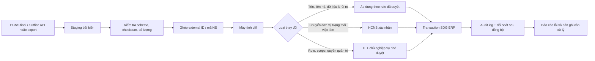

# Thiết kế đồng bộ Master Data và phân quyền SDG ERP – 1Office

> **Cập nhật 28/10/2026:** HR chỉ lấy nguồn để khởi tạo/đối chiếu ban đầu (baseline file final 72); từ đây ERP quản lý độc lập, không chạy đồng bộ nhân sự định kỳ hoặc khóa sửa theo nguồn. Các luồng snapshot/API/webhook HR bên dưới là phương án nghiên cứu cũ, không phải kế hoạch hiện hành. Mã ERP do DB tự cấp, bất biến; nguồn và ngày nhập chỉ là provenance. Cơ cấu phòng ban vẫn giữ cây đã chốt, tài khoản và role quản lý riêng.

> **Cập nhật nguồn nhân sự 27/10/2026:** Đã nhập file HR final ngày 26/10/2026: 72 người theo danh sách, giữ 7 hồ sơ chờ xác nhận và 1 đã nghỉ riêng. File HR ưu tiên cho các trường nhân sự có trong file; mapping 1Office và cây 18 đơn vị được giữ. Các số liệu 66/67 trong khảo sát cũ bên dưới là lịch sử, không phải hiện trạng mới. Xem [đối chiếu HR và các điểm cần xác nhận](DOI-CHIEU-NHAN-SU-HR-2026-10-26.md).

## Thẩm quyền nguồn hiện hành — chốt 27/10/2026

File HR final 72 người ngày 26/10/2026 được người phụ trách xác nhận ưu tiên về độ chính xác. Khi bất đồng tên/ngày sinh/phòng ban gán cho người/chức danh/ghi chú, ERP dùng final. Ví dụ Nguyễn Tiến Trung thuộc PTDA và Nguyễn Đức Hậu có chức danh Lái xe BQLDA theo final, không chờ nguồn 1Office cũ khớp mới áp dụng.

Nguồn 1Office giữ mapping, thông tin bổ sung chưa có trong final và cây đơn vị đã lưu. Bản xuất/API mới phải báo chênh lệch, không tự ghi đè trường HR đã chốt. Chỉ đổi khi người phụ trách/HR xác nhận cập nhật. Quyết định này thay thế nguyên tắc ưu tiên nhân sự 1Office trong phần khảo sát lịch sử bên dưới; không xác nhận thay các liên kết người–tài khoản còn mơ hồ và không cấp quyền từ chức danh.

## Cập nhật triển khai ngày 26/10/2026

Các nhận xét về bảng User gộp hồ sơ ở phần khảo sát bên dưới là lịch sử. Hiện đã tách `Employee` (người) và `User` (tài khoản), 1 người có 0..N tài khoản. Giữ nguyên tài khoản ERP cũ, không đồng bộ trạng thái/mật khẩu/role từ tài khoản 1Office.

- Đối chiếu workbook HR ngày 14/10/2026: 67 hồ sơ (66 đang làm, 1 nghỉ việc); DB ERP có 68 tài khoản gồm 1 tài khoản hệ thống không liên kết người. Đây là số liệu snapshot, không chứng nhận hiện trạng nhân sự hôm nay.
- Mã SDG-074: nguồn ghi “Nhân viên IT”, ERP đã có tên Dương Hoàng Nam; giữ thông tin ERP, cần xác nhận tên nguồn khi cập nhật snapshot. Liên kết nguồn theo mã/ID, không tự ghép chỉ theo tên.
- Mã SDG-071 vẫn có tài khoản ERP do seed cũ tạo. Việc không có tài khoản 1Office không có nghĩa phải xóa tài khoản ERP; chuyển đổi lần này bảo toàn tài khoản.
- Tên/mã/phòng/chức vụ của hồ sơ nguồn được bảo vệ trong form; liên hệ và tình trạng làm việc có thể được xác nhận nội bộ, có audit. Import tương lai phải báo xung đột thay vì ghi đè thay đổi này.
- Tạo nhân sự nội bộ riêng khi chưa có nguồn phải đối chiếu tránh trùng; không tự tạo tài khoản hoặc cấp quyền từ chức danh. Chưa có đồng bộ API/webhook/nhập file tổng quát.

**Ngày đối chiếu:** 21/10/2026  
**Trạng thái:** Đã chốt 1Office làm nguồn chuẩn cho nhân sự/cơ cấu; thiết kế đồng bộ và RBAC còn chờ triển khai  
**Phạm vi:** công ty, cơ cấu tổ chức, hồ sơ nhân sự, tài khoản, nhóm quyền và RBAC  
**Nguồn so sánh:** Prisma schema/seed của SDG ERP, file 67 hồ sơ nhân sự, bốn export quản trị 1Office ngày 21/10/2026 và cẩm nang hội nhập 21 trang

**Giới hạn truy cập:** chỉ sử dụng dữ liệu/export đã lưu. Không truy cập lại 1Office hoặc tái sử dụng credential cũ. Mọi lần xem/export mới cần người phụ trách cấp lại tài khoản và phạm vi; không được thay đổi dữ liệu, quyền hoặc cấu hình 1Office.

## 1. Kết luận cần chốt

Master data về người và cơ cấu giữa file nhân sự đang dùng để seed SDG ERP với 1Office **khớp tốt ở lớp dữ liệu hiện có**, nhưng mô hình của SDG ERP chưa đủ an toàn để đồng bộ vận hành:

- 66/67 hồ sơ nhân sự khớp một tài khoản 1Office theo mã nhân sự hoặc username; không có sai lệch phòng ban hay vị trí trong 66 trường hợp này.
- Hồ sơ còn lại là **Vũ Văn Khoa, mã 71**, thuộc Ban Kiểm soát, chưa có tài khoản 1Office. Đây là khác biệt giữa *con người* và *tài khoản*, không phải thiếu nhân sự.
- 18 đơn vị trong seed SDG ERP khớp 18 đơn vị nghiệp vụ của 1Office. Bản ghi thứ 19 trên 1Office là nút công ty gốc.
- SDG ERP đang gộp hồ sơ con người, quan hệ làm việc và tài khoản đăng nhập vào bảng `User`. Vì vậy seed sẽ tạo tài khoản cho cả người chưa có tài khoản 1Office và khó diễn đạt trạng thái nghỉ việc, khóa đăng nhập, kiêm nhiệm hoặc chuyển phòng.
- Role trong seed được suy đoán từ username, chức vụ và phòng ban. Nhóm 1Office lại là gói quyền của riêng 1Office. Hai khái niệm không tương đương và không được đồng bộ trực tiếp.

Phương án phù hợp là đồng bộ một chiều 1Office/HCNS → vùng staging → SDG ERP theo ID ngoài ổn định, tạo báo cáo sai lệch trước khi áp dụng. Cơ cấu và dữ liệu người có thể tự động cập nhật sau khi quy tắc được duyệt; mọi thay đổi role nhạy cảm phải có người phê duyệt.

**Quyết định nguồn dữ liệu ngày 21/10/2026:** hồ sơ nhân sự và cơ cấu tổ chức trên 1Office được coi là chuẩn nền để áp dụng cho SDG ERP. ERP lưu mapping và bản sao phục vụ nghiệp vụ của mình; không cho phép chỉnh sửa độc lập làm phát sinh một cơ cấu cạnh tranh. Các ngoại lệ về trạng thái tài khoản vẫn được ghi nhận để tìm hiểu dần, nhưng không phủ nhận vai trò nguồn chuẩn của 1Office.

## 2. Giới hạn của lần đối chiếu

“Master data hiện tại của project” trong báo cáo này là dữ liệu được định nghĩa bởi `prisma/seed.ts` và file Excel 67 hồ sơ mà seed đọc. PostgreSQL local sau đó đã được xác minh hoạt động; nhận xét đối chiếu trong tài liệu vẫn dựa trên schema, seed và các export đã lưu, chưa phải kết quả của một job đồng bộ tự động.

Bốn export 1Office là ảnh chụp tại một thời điểm của nguồn chuẩn, không phải kết nối dữ liệu sống. Không dùng một snapshot cũ để tự động vô hiệu hóa tài khoản, chuyển đơn vị hoặc cấp quyền sản xuất; mỗi lần đồng bộ cần thời điểm chốt, log và báo cáo sai lệch.

## 3. So sánh dữ liệu nền

### 3.1 Quy mô và mức khớp

| Đối tượng | SDG ERP/file nguồn | 1Office | Kết quả |
| :--- | ---: | ---: | :--- |
| Công ty | 1 | 1 nút công ty ID `23` | Khớp về tổ chức; cần lưu external ID |
| Đơn vị nghiệp vụ | 18 | 18, ngoài nút công ty | Khớp tên và cây tổ chức |
| Hồ sơ người | 67 | 67 hồ sơ có thể đối chiếu | Khớp về số người |
| Tài khoản người dùng | Seed tạo 67 tài khoản nhân sự + 1 Master Admin | 55 tài khoản người đang hoạt động + 11 bị khóa + 1 hồ sơ chưa có tài khoản + tài khoản hệ thống `admin` | Khác mô hình vòng đời |
| Role/nhóm | 7 role SDG | 11 nhóm 1Office | Không ánh xạ 1–1 |
| Permission | 9 quyền seed | Ma trận quyền chi tiết theo module/gói/quy trình | SDG đang giản lược mạnh |

Kết quả so sánh từng dòng:

- 66 tài khoản người dùng 1Office, không tính tài khoản hệ thống `admin`, đều tìm thấy trong file 67 hồ sơ.
- Không có mã nhân sự hoặc username trùng trong file nguồn.
- Không có tài khoản 1Office nào mang mã nhân sự nằm ngoài file 67 hồ sơ.
- Không phát hiện sai tên đơn vị hoặc vị trí trong 66 cặp đã khớp.
- Hồ sơ mã `71` chưa có account phải được giữ là `Person/Employment`, không được tự sinh login nếu chưa có yêu cầu cấp tài khoản.

### 3.2 So sánh mô hình trường dữ liệu

| Khái niệm | SDG ERP hiện tại | 1Office/export | Khoảng trống cần xử lý |
| :--- | :--- | :--- | :--- |
| Công ty | `Company.id`, tên, MST, địa chỉ, active | ID, tên, quan hệ tổ chức | Thiếu mapping external ID |
| Đơn vị | code SDG, tên, `parentId`, `companyId` | ID, parent ID, level, tên; cột mã đang trống | Giữ code SDG; map ID 1Office riêng; không dùng tên làm khóa |
| Loại đơn vị | Chưa có | Export chưa phân loại; cẩm nang phân biệt tầng quản trị, điều hành, phòng/ban, BQLDA và bộ phận | Cần `organizationUnitType` sau khi HCNS xác nhận |
| Con người | Nằm trong `User` | Hồ sơ nhân sự có personnel ID/mã NS | Cần `Person` độc lập với login |
| Quan hệ làm việc | Một công ty, một phòng, một position trên `User` | Phòng chính, phòng kiêm nhiệm, chức vụ, vị trí, trạng thái | Cần `Employment`/`OrgAssignment`, hiệu lực từ–đến |
| Tài khoản | username/password và `isActive` trên `User` | account ID, username, kích hoạt/khóa/chưa kích hoạt/đã xóa, lần đăng nhập | Cần `ExternalAccount`; khóa login không đồng nghĩa nghỉ việc |
| Chức vụ/vị trí | Chuỗi `position` | Có cả `Chức vụ` và `Vị trí` | Cần danh mục `Position` và phân biệt title/position |
| Kiêm nhiệm | `UserRole.isPrimary`; không có phòng kiêm nhiệm | Có phòng ban kiêm nhiệm | Cần assignment nhiều đơn vị, có loại và hiệu lực |
| Role | Role công ty, gán trực tiếp cho User | Nhóm quyền/gói 1Office | Lưu snapshot nhóm ngoài; SDG role do SDG quản trị |
| Scope | Nằm trên `Permission` | Phạm vi phụ thuộc nhóm, module và ngữ cảnh | Scope phải nằm trên grant/assignment |
| Hiệu lực | Chỉ có `assignedAt` | Có trạng thái/lịch sử ngoài hệ thống | Thiếu `effectiveFrom`, `effectiveTo`, nguồn, người duyệt |
| Tuyến báo cáo | Suy gián tiếp từ `parentId` | Cẩm nang dùng quản lý trực tiếp, trưởng đơn vị và Giám đốc BQLDA theo ngữ cảnh | Không đồng nhất cây hành chính với quan hệ báo cáo |
| Đồng bộ | Chưa có | Export theo thời điểm | Cần staging, mapping, sync run và issue log |

### 3.3 Mapping đơn vị đã xác định

ID 1Office là khóa ngoài; code SDG là khóa nghiệp vụ nội bộ. Tên chỉ dùng để hiển thị và đối soát.

| Code SDG | ID 1Office | Đơn vị |
| :--- | ---: | :--- |
| `BLD` | 5 | BAN LÃNH ĐẠO |
| `KD` | 11 | PHÒNG KINH DOANH |
| `TCKT` | 14 | PHÒNG TÀI CHÍNH - KẾ TOÁN |
| `HCNS` | 17 | PHÒNG HÀNH CHÍNH NHÂN SỰ |
| `PC` | 20 | BAN PHÁP CHẾ |
| `KHDT` | 32 | PHÒNG KẾ HOẠCH ĐẦU TƯ |
| `PTDA` | 35 | PHÒNG PHÁT TRIỂN DỰ ÁN |
| `QLDA_NDV1` | 38 | BAN QLDA KCN NAM ĐÌNH VŨ 1 |
| `QLDA_BGDKCN` | 41 | Ban giám đốc KCN NAM ĐÌNH VŨ 1 |
| `QLDA_VP` | 44 | Bộ phận văn phòng - Ban QLDA |
| `QLDA_KT` | 47 | Bộ phận kỹ thuật - Ban QLDA |
| `QLDA_CQ` | 50 | Bộ phận cảnh quan môi trường - Ban QLDA |
| `QLDA_GN` | 53 | Bộ phận giao nhận - Ban QLDA |
| `QLDA_DN` | 56 | Bộ phận điện nước - Ban QLDA |
| `QLDA_PCCC` | 59 | Bộ phận PCCC - Ban QLDA |
| `BKS` | 62 | BAN KIỂM SOÁT |
| `KD_CSKH` | 65 | Bộ phận CSKH - Phòng Kinh Doanh |
| `KD_SM` | 68 | Bộ phận Sales Marketing - Phòng Kinh doanh |

Nút công ty ID `23` ánh xạ với `Company`, không tạo thêm một `Department`. Ban Kiểm soát có parent ID `0` trên 1Office; trong SDG ERP nên giữ là đơn vị cấp công ty với `parentId = null` và `companyId` tương ứng.

### 3.4 Đối chiếu với cẩm nang hội nhập

Cẩm nang biểu diễn Ban Kiểm soát cùng tầng quản trị với HĐQT, trong khi dữ liệu hiện tại lưu BKS như một đơn vị cấp công ty. Chưa thay mapping hiện hành; mô hình mục tiêu cần phân biệt loại chủ thể tổ chức với quan hệ cha/con.

Cẩm nang đặt Ban Giám đốc QLDA ở vị trí chỉ đạo sáu bộ phận. Snapshot 1Office đặt Ban Giám đốc và sáu bộ phận thành bảy node con trực tiếp của Ban QLDA. Đây được ghi nhận là khác biệt ngữ nghĩa cần HCNS/BQLDA xác nhận, không phải lỗi dữ liệu để tự động sửa.

Trang đầu mối phối hợp còn chứng minh nhu cầu lưu `directManager`, người phụ trách đơn vị và tuyến chuyển cấp theo loại yêu cầu. Các quan hệ này không được suy ra duy nhất từ `Department.parentId` hoặc role ứng dụng.

## 4. Đánh giá role hiện tại

### 4.1 Role SDG đang được suy đoán như thế nào

Seed hiện tạo bảy role: `ADMIN`, `IT_ADMIN`, `HR_MANAGER`, `HR_STAFF`, `DEPT_HEAD`, `ACCOUNTANT`, `STAFF`. Role được suy ra từ username, chức vụ và tên phòng ban. Cách làm này hữu ích cho dữ liệu demo nhưng không đủ căn cứ để cấp quyền thật.

Đối chiếu role do seed suy đoán với nhóm 1Office cho 67 hồ sơ:

| Role seed | Phân bố nhóm 1Office quan sát được |
| :--- | :--- |
| `ADMIN` | 1 Ban lãnh đạo - CRM |
| `IT_ADMIN` | 2 Nhân viên |
| `HR_MANAGER` | 1 TP HCNS |
| `HR_STAFF` | 1 Nhân viên Hành chính, 1 Nhân viên |
| `DEPT_HEAD` | 6 Quản lý, 2 Quản lý không thuộc KD - CRM, 2 Nhân viên, 1 Ban lãnh đạo - CRM |
| `ACCOUNTANT` | 4 Nhân viên, 1 Quản lý không thuộc KD - CRM |
| `STAFF` | 31 Nhân viên, 6 Nhân viên - CRM, 5 Quản lý, 1 Ban lãnh đạo - CRM, 1 Quản trị hệ thống, 1 chưa có tài khoản/nhóm |

Ma trận trên chứng minh role SDG và nhóm 1Office phục vụ hai hệ thống quyền khác nhau. Ví dụ một người có nhóm “Quản trị hệ thống” trên 1Office vẫn được seed suy đoán là `STAFF`; hai người được seed là `IT_ADMIN` chỉ thuộc nhóm “Nhân viên” trên 1Office.

### 4.2 Các rủi ro cụ thể

| Vấn đề hiện tại | Hệ quả |
| :--- | :--- |
| `ADMIN` và `IT_ADMIN` đều nhận toàn bộ 9 permission | Quản trị kỹ thuật mặc nhiên có toàn quyền HR, công việc và phê duyệt |
| `IT_ADMIN` được suy ra từ username/chức danh | Đổi tên hoặc đổi vị trí có thể làm thay đổi quyền đặc biệt không qua phê duyệt |
| Người thuộc Ban lãnh đạo có thể nhận `ADMIN` | Trộn quyền điều hành nghiệp vụ với quyền cấu hình kỹ thuật |
| `HR_MANAGER` và `HR_STAFF` đều có `HR:MANAGE` phạm vi `ALL` | Chưa tách đọc danh bạ, đọc hồ sơ nhạy cảm, sửa hồ sơ và duyệt thay đổi |
| `STAFF` có `HR:VIEW` phạm vi `ALL` | Chưa phân biệt danh bạ nội bộ với hồ sơ nhân sự nhạy cảm |
| `scope` nằm trong bản ghi `Permission` và unique chỉ theo module/action | Không thể cấp cùng một action với scope khác nhau cho các role |
| Session chỉ còn `NONE/VIEW/MANAGE` theo module | Làm mất khác biệt `CREATE`, `ASSIGN`, `APPROVE` và scope khi thực thi |
| `UserRole` thiếu đơn vị áp dụng và thời hạn | Không diễn đạt trưởng phòng theo đơn vị, ủy quyền tạm thời hoặc kiêm nhiệm |
| Seed chỉ upsert thêm role | Role cũ có thể còn lại khi nguồn thay đổi; dễ tích lũy quyền |

### 4.3 Mô hình phân role đề xuất

Tách bốn lớp, mỗi lớp có chủ sở hữu rõ ràng:

1. **Danh tính và cơ cấu:** Person, Employment, phòng chính/kiêm nhiệm, quản lý trực tiếp. HCNS chịu trách nhiệm dữ liệu.
2. **Vai trò nghiệp vụ SDG:** `STAFF`, `DEPT_MANAGER`, `HR_SPECIALIST`, `HR_MANAGER`, `ACCOUNTING_SPECIALIST`... Chủ phân hệ đề xuất, người có thẩm quyền phê duyệt.
3. **Vai trò quản trị hệ thống:** `SYSTEM_ADMIN`, `IDENTITY_ADMIN`, `INTEGRATION_OPERATOR`, `AUDITOR`. IT đề xuất và phải có phê duyệt riêng; không suy ra từ chức vụ.
4. **Nhóm/quyền hệ thống ngoài:** nhóm 1Office được lưu để đối soát và deep-link, không tự biến thành role SDG.

Nên tách quyền danh bạ khỏi quyền HR nhạy cảm:

| Permission gợi ý | Nội dung |
| :--- | :--- |
| `DIRECTORY:VIEW` | Họ tên, đơn vị, chức danh công khai, liên hệ nội bộ được phép |
| `HR_PROFILE:VIEW_SELF` | Người dùng xem hồ sơ của chính mình |
| `HR_PROFILE:VIEW_DEPARTMENT` | Quản lý xem trường được phép trong đơn vị phụ trách |
| `HR_PROFILE:VIEW_SENSITIVE` | Xem trường nhân sự nhạy cảm theo nhiệm vụ |
| `HR_PROFILE:UPDATE` | Sửa hồ sơ theo trường/phạm vi được giao |
| `ORG_STRUCTURE:MANAGE` | Quản lý danh mục cơ cấu đã phê duyệt |
| `IDENTITY:MANAGE` | Cấp/khóa tài khoản và xử lý liên kết danh tính |
| `RBAC:MANAGE` | Quản lý role/grant; tách khỏi quản lý hồ sơ |
| `AUDIT:VIEW` | Xem nhật ký theo phạm vi |

Mỗi grant cần tối thiểu: role, permission/action, scope type, scope ID, `effectiveFrom`, `effectiveTo`, source, trạng thái phê duyệt và người phê duyệt.

### 4.4 Nguyên tắc mapping nhóm 1Office

| Nhóm 1Office | Cách dùng trong SDG ERP |
| :--- | :--- |
| Quản trị hệ thống | Chỉ tạo đề xuất cấp `SYSTEM_ADMIN`; cần phê duyệt thủ công |
| TP HCNS | Đề xuất `HR_MANAGER`, xác nhận lại phạm vi và dữ liệu nhạy cảm |
| Nhân viên Hành chính | Đề xuất role hành chính hoặc `HR_STAFF` theo nhiệm vụ thực tế |
| Quản lý | Đề xuất `DEPT_MANAGER` với đúng đơn vị và thời hạn |
| Nhân viên | `STAFF` cơ sở; không kế thừa quyền “Xem tất cả” hồ sơ HR sang SDG |
| Các nhóm CRM | Lưu external membership; chỉ tạo quyền CRM SDG nếu SDG có module tương ứng |
| Nhóm HR đang không có thành viên | Không cấp role từ cấu hình nhóm trống; HCNS xác nhận người thực hiện thật |

### 4.5 Phân quyền tài sản và license theo bối cảnh phòng ban tự quản

**Bối cảnh đã xác nhận:** phòng ban tự quản lý license/tài sản do mình đề xuất mua; IT thuộc HCNS. **Trạng thái giải pháp:** các phương án dưới đây đang được cân nhắc, chưa triển khai hay thay đổi quyền hiện hành.

| Phương án | Cách vận hành | Đánh giá |
| :--- | :--- | :--- |
| 1. Mỗi phòng tự quản | Người được cấp quyền trong phòng tạo/xem/sửa tài sản thuộc phạm vi phòng đó | Sát thực tế phân tán; cần thống nhất ai được sửa và phòng nào chịu trách nhiệm. Có thể cấp cho cả phòng nếu chủ nghiệp vụ chọn, nhưng không mặc định cùng phòng là có quyền sửa |
| 2. HCNS hoặc người được chỉ định | Chỉ nhóm được giao nhiệm vụ thấy và sử dụng module | Phù hợp pilot IT/HCNS; không đại diện đầy đủ tài sản toàn công ty nếu các phòng khác chưa tham gia. Thuộc HCNS không đồng nghĩa tự động được xem mọi tài sản |
| 3. Kết hợp — đề xuất | Mỗi phòng có đầu mối quản lý; HCNS/IT có thêm phạm vi hỗ trợ hoặc tổng hợp khi được giao | Có thể bắt đầu bằng vài người trong HCNS rồi mở rộng từng phòng trên cùng mô hình quyền, không phải xây hai module |

**Đề xuất triển khai theo giai đoạn:** bắt đầu với phương án 2 bằng cách gán role quản lý tài sản cho các user được chỉ định, giới hạn vào danh mục IT/HCNS được giao quản lý. Khi mở rộng, gán cùng role cho đầu mối phòng khác với phạm vi đơn vị tương ứng. Chỉ cấp quyền xem tổng hợp hoặc quản lý nhiều phòng khi có nhiệm vụ cụ thể; IT không mặc nhiên có quyền nghiệp vụ toàn công ty.

#### Quyền và phạm vi dữ liệu

- Phòng ban trả lời “người thuộc đơn vị nào”; role trả lời “người được làm gì”. Dùng role dùng chung như `ASSET_VIEWER`/`ASSET_MANAGER` kèm phạm vi đơn vị, thay vì tạo một role mới cho mỗi phòng.
- Giữ hai mức nghiệp vụ gọn: xem và quản lý (bao gồm tạo/cập nhật trong phạm vi được cấp). Có thể gán role trực tiếp cho từng user; chưa cần xây thêm cơ chế quyền ngoại lệ riêng cho từng người.
- Phạm vi có thể là một đơn vị, danh sách đơn vị hoặc toàn công ty khi được cấp rõ ràng. Không tự suy quyền xuống phòng con hay từ quan hệ kiêm nhiệm.
- Menu lấy theo quyền hiệu lực; người không có quyền không thấy menu. Truy cập URL trực tiếp, Server Action, export, thống kê và dữ liệu 3D đều phải kiểm tra cùng quyền/phạm vi ở server. Ẩn menu không thay thế kiểm tra dữ liệu.
- Một tài sản đặt trong phòng khác hoặc được IT tạo hộ vẫn thuộc phạm vi của đơn vị chịu trách nhiệm quản lý. Không dùng người tạo, vị trí vật lý hoặc phòng của người đang sử dụng làm căn cứ duy nhất để cấp quyền.
- Khi nhân sự chuyển phòng, cần cập nhật phạm vi và phiên đăng nhập; không tự chuyển các tài sản họ đã nhập sang phòng mới. Chuyển đơn vị chịu trách nhiệm tài sản là thao tác riêng có lịch sử.

#### Dữ liệu cần làm rõ trước khi xây

1. **Đơn vị chịu trách nhiệm quản lý** tài sản/license: căn cứ chính để lọc dữ liệu theo phòng.
2. **Đơn vị đề xuất mua** nếu cần lưu nguồn phát sinh; có thể trùng đơn vị quản lý ban đầu nhưng không thay thế trách nhiệm hiện tại.
3. **Đơn vị/người sử dụng và vị trí hiện tại:** phục vụ vận hành, có thể khác đơn vị quản lý. `Asset.currentDepartmentId` hiện là snapshot bàn giao/sử dụng; không tự coi trường này là đơn vị sở hữu phạm vi quyền khi chưa chốt ngữ nghĩa.
4. **Người phụ trách** và các đơn vị được hỗ trợ/xem thêm khi thực sự cần; tránh tạo bản sao tài sản cho mỗi phòng.
5. Với **license**, cần tên sản phẩm, số lượng quyền sử dụng, số lượng đã cấp, người/đơn vị được cấp, thời hạn và đầu mối gia hạn. License dùng chung nhiều phòng có một hồ sơ chính và các phân bổ sử dụng; schema thiết bị hiện tại chưa được coi là đã đáp ứng đầy đủ việc này.

Các quyết định còn mở: pilot chỉ gồm IT/HCNS hay mở ngay cho các phòng; cấp quyền sửa cho cả phòng hay đầu mối; ai cần xem tổng hợp; cách quản lý tài sản/license dùng chung. Chưa thay schema, menu hoặc quyền người dùng theo các đề xuất này.

## 5. Chủ sở hữu dữ liệu và chiều đồng bộ

| Dữ liệu | Hệ thống/chủ sở hữu chuẩn | Chiều giai đoạn đầu | Ghi chú |
| :--- | :--- | :--- | :--- |
| Hồ sơ người, quan hệ làm việc | Bản final HCNS; tạm đối chiếu từ 1Office | HCNS/1Office → SDG | Không lấy trạng thái account thay trạng thái nhân sự |
| Cơ cấu tổ chức | HCNS + lãnh đạo xác nhận | 1Office/export → staging → SDG | SDG giữ code; map ID 1Office |
| Tài khoản và trạng thái đăng nhập 1Office | 1Office/IT | 1Office → SDG reference | Không tạo login SDG chỉ vì có Person |
| Nhóm và membership 1Office | 1Office/IT | 1Office → SDG snapshot | Không tự cấp role SDG |
| Role và permission SDG | SDG ERP; IT + chủ phân hệ phê duyệt | Quản trị tại SDG | Có audit và hiệu lực |
| Vị trí 3D, GIS, tài sản/IoT đặc thù | SDG ERP | SDG quản trị | Tham chiếu person/org chuẩn |
| Quy trình và hồ sơ chạy | 1Office | 1Office → SDG reference/report | Không sao chép workflow engine |

## 6. Luồng đồng bộ đề xuất

Quy trình phải idempotent: cùng một nguồn, loại thực thể và external ID chỉ có một mapping; cùng checksum không chạy áp dụng lần hai. Mỗi dòng có hash trước/sau, kết quả, lý do bỏ qua và lỗi nếu có.

### 6.1 Thứ tự ghép danh tính

1. External personnel ID của 1Office.
2. Mã nhân sự đã được HCNS xác nhận.
3. Mapping đã duyệt trong `ExternalMapping`.
4. Username chỉ dùng hỗ trợ điều tra, không làm khóa người.
5. Họ tên không bao giờ là khóa ghép tự động.

### 6.2 Quy tắc trạng thái

| Trạng thái 1Office | Cập nhật trong SDG ERP |
| :--- | :--- |
| Kích hoạt | External account active; không tự suy ra employment active nếu HCNS chưa xác nhận |
| Khóa | External account locked; giữ Person và Employment |
| Chưa kích hoạt | Person có thể tồn tại, ExternalAccount chưa active; không tự tạo login SDG |
| Đã xóa | Giữ bản ghi lịch sử/mapping; không hard-delete Person |
| Không còn trong export mới | Tạo sync issue để đối soát; không xóa hoặc khóa tự động |

### 6.3 Quy tắc xung đột

- Đổi tên đơn vị hoặc tên người vẫn nhận diện bằng external ID/mã nhân sự.
- Chuyển phòng tạo assignment mới có ngày hiệu lực; không ghi đè mất lịch sử.
- Một người có thể có một phòng chính và nhiều assignment kiêm nhiệm.
- Role đặc quyền không được cấp hoặc thu hồi chỉ từ title, phòng ban hay nhóm 1Office.
- Khi nguồn và SDG cùng thay đổi một trường do cùng một bên sở hữu, dừng bản ghi đó và tạo `SyncIssue`.
- Không ghi ngược sang 1Office trong giai đoạn đầu.

## 7. Mô hình dữ liệu mục tiêu

**Quy ước tên DB cập nhật 22/10/2026:** các tên model/field trong tài liệu là tên API Prisma. PostgreSQL dùng tiếng Việt không dấu qua `@@map`/`@map` (ví dụ `Department` → `phong_ban`, `externalId` → `dinh_danh_nguon`). Mapping đầy đủ nằm tại [từ điển DB](../DATABASE-DICTIONARY.md). Các bảng mới trong thiết kế này cũng phải tuân thủ quy tắc đó khi triển khai; đổi tên vật lý không thay đổi ID hoặc nguồn chuẩn 1Office.

Schema và tính năng hiện tại đều là bản nháp, nên có thể thay thế toàn bộ nếu phương án được duyệt. Đề xuất dưới đây chia hai bước để việc đánh giá, migration và kiểm chứng dữ liệu rõ ràng hơn.

### Bước A — Lớp tích hợp tối thiểu

- `ExternalSystem`: định danh nguồn như `1OFFICE`.
- `ExternalMapping`: source, entity type, external ID, internal ID, trạng thái.
- `SyncRun`: loại nguồn, thời gian, checksum, số bản ghi, kết quả.
- `SyncRecord`/`SyncIssue`: diff từng dòng, lỗi và quyết định xử lý.
- `ExternalAccount`, `ExternalGroup`, `ExternalGroupMembership`: phản ánh account/quyền ngoài mà không làm biến dạng RBAC SDG.

Giai đoạn này giữ `User` hiện tại để ứng dụng tiếp tục chạy, nhưng dừng tạo login tự động cho hồ sơ chưa có account và dừng suy role đặc quyền trong import sản xuất.

### Bước B — Chuẩn hóa HR và RBAC

- `Person`: mã người, họ tên và dữ liệu cá nhân.
- `Employment`: công ty, trạng thái làm việc, ngày hiệu lực.
- `OrganizationAssignment`: đơn vị, vị trí, loại chính/kiêm nhiệm, quản lý, hiệu lực.
- `OrganizationUnit`/phần mở rộng của `Department`: loại đơn vị và quan hệ hành chính; quan hệ báo cáo được lưu riêng khi khác cây hành chính.
- `Position`: danh mục vị trí/chức danh chuẩn.
- `ApplicationAccount`: login SDG tách khỏi Person.
- `RoleAssignment`: role, scope, hiệu lực, nguồn, người duyệt.
- `RoleGrant`: permission/action và scope trên quan hệ role–permission.

Mọi bảng nghiệp vụ mới phải tuân thủ quy tắc project: khóa chính `Int @id @default(autoincrement())`, `createdAt`, `updatedAt`, khóa ngoại rõ ràng, index phục vụ truy vấn và migration có thể rollback.

## 8. Lộ trình thực hiện

### P0 — Chốt dữ liệu và dừng phát sinh sai lệch

1. Lấy snapshot/export 1Office tại thời điểm chốt gồm người, mã NS, trạng thái việc làm, đơn vị chính/kiêm nhiệm, vị trí và quản lý trực tiếp; lập danh sách ngoại lệ cần tìm hiểu thay vì sửa trực tiếp nguồn.
2. Chốt 18 code đơn vị SDG và mapping ID 1Office trong bảng trên.
3. Loại việc tự suy role đặc quyền và tự tạo tài khoản khỏi luồng import dữ liệu thật; seed chỉ phục vụ demo/bootstrap.
4. Xác minh dữ liệu PostgreSQL thực tế khi dịch vụ DB hoạt động.

### P1 — Đồng bộ chỉ đọc và báo cáo diff

1. Thêm staging/mapping/sync log bằng migration riêng.
2. Import export vào staging, không ghi bảng nghiệp vụ trong lượt đầu.
3. Sinh báo cáo: bản ghi mới, thay đổi, mất khỏi nguồn, trùng khóa, xung đột và role đề xuất.
4. HCNS/IT duyệt diff rồi mới áp dụng transaction.

### P2 — Làm lại RBAC trước khi mở rộng người dùng

1. Tách `DIRECTORY` khỏi `HR_PROFILE`.
2. Đưa scope vào grant/assignment và giữ action chi tiết trong session/authorization.
3. Thêm phạm vi đơn vị, ngày hiệu lực, người cấp và người duyệt cho role assignment.
4. Kiểm thử chéo theo tài khoản Staff, quản lý đơn vị, HCNS, IT và auditor.

### P3 — API và vận hành định kỳ

1. Làm việc với 1Office để có API/webhook hoặc export chính thức có lịch.
2. Chạy read-only theo lịch, cảnh báo sai lệch; chưa tự động write-back.
3. Đối soát số lượng và quyền hàng quý; lưu bằng chứng phê duyệt.

## 9. Tiêu chí nghiệm thu luồng cơ sở

- 100% Person có mã ổn định hoặc được đưa vào danh sách ngoại lệ có chủ xử lý.
- 100% đơn vị có code SDG và external mapping; đổi tên không làm phát sinh đơn vị mới.
- Số Person, Employment và ExternalAccount được báo cáo riêng.
- Account khóa không làm mất hồ sơ người; hồ sơ chưa có account không bị tự tạo login.
- Mỗi role đặc quyền có phạm vi, hiệu lực, nguồn, người cấp và người duyệt.
- Chạy lại cùng một nguồn không tạo bản ghi trùng hoặc thay đổi ngoài dự kiến.
- Mọi lần sync có checksum, thống kê trước/sau, audit và danh sách lỗi.
- Có test chứng minh nhân viên thường không đọc được trường HR nhạy cảm ngoài phạm vi.

## 10. Quyết định chưa được tự suy đoán

Các nội dung sau cần người có thẩm quyền xác nhận trước khi triển khai:

- 1Office hay file HCNS final là nguồn vận hành chính cho từng trường hồ sơ.
- Lý do 11 tài khoản đang bị khóa và hồ sơ mã 71 chưa có tài khoản. Đây là câu hỏi nghiên cứu vòng đời account, không phải điều kiện để công nhận 1Office là nguồn chuẩn cho hồ sơ/cơ cấu.
- Người nào thực sự giữ vai trò quản lý đơn vị, HR, quản trị hệ thống và phạm vi tương ứng.
- Danh mục trường nào thuộc danh bạ chung và trường nào là hồ sơ nhân sự nhạy cảm.
- Quy tắc cấp, thu hồi, ủy quyền tạm thời và rà soát role định kỳ.

## 11. Tài liệu liên quan

- [Nguồn export quản trị 1Office](../1office-sources/README.md)
- [Mô hình dữ liệu quản trị và tích hợp 1Office](./MO-HINH-DU-LIEU-QUAN-TRI-VA-TICH-HOP-1OFFICE.md)
- [Bối cảnh hiện tại và định hướng số hóa](./BOI-CANH-HIEN-TAI-VA-DINH-HUONG-SO-HOA.md)
- [Kế hoạch chuyển đổi số](../plans/DIGITAL-TRANSFORMATION-CHECKLIST.md)
- [Kế hoạch HR](../plans/HR-CHECKLIST.md)
